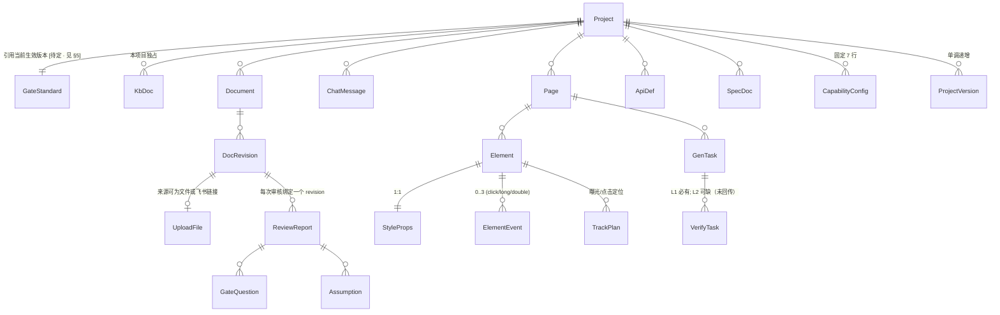

# 共享领域模型

> 由主 Agent 从 PRD 抽取，五个角色 Agent 共用；服务端 Spec 的 DDL 与此保持一致。
> **来源 PRD**：`platform/平台需求概要.md`（`document_id`: `local:platform/平台需求概要.md`，`revision_id`: v1.4 第 4 轮回写后）
> **更新日期**：2026-10-20 ｜ **更新动作**：由 S4 拆解阶段**反向回填**（原文为空模板）
>
> ⚠️ **唯一事实来源声明**：本文件是**业务视角**的共享基线。**字段名 / 类型 / 必填 / 枚举完整取值 / 状态机**的唯一事实来源是
> **`platform/design/数据模型.md`（已确认基线）**；本文件与之冲突时**一律以它为准**，并须回改本文件。
> 本文件**不承载**"被开发 App"的业务实体（那是用户在平台里定义的 `ApiDef` + 生成的安卓代码，见 `数据模型 E9`）。
> `[来源: 推断，待确认]` = 平台推导，**不阻塞开工**，引用时原样带标签。

---

## 1 实体清单

> 23 个实体，**只做这 23 个，不新增组件**（`数据模型 §1.1`）。`表名` 列为**建议名**（服务端 DDL 命名，需在接口 Spec 定稿时确认）。

| # | 实体 | 说明 | 隔离根 | 来源 REQ-ID | 对应表名（服务端，建议） |
|---|---|---|---|---|---|
| E1 | `Project` | 项目，**一切数据的隔离根** | — | `REQ-PROJ-001` | `tbl_project` |
| E2 | `KbDoc` | 知识库文档（只放本项目） | `project_id` | `REQ-KB-001` | `tbl_kb_doc` |
| E3 | `UploadFile` | 上传文件（以系统 id 存储） | `project_id` | `REQ-UPLOAD-001` | `tbl_upload_file` |
| E4 | `DocRevision` | 文档 revision（一次上传/解析的版本） | 经 `Document` | `REQ-UPLOAD-005` | `tbl_doc_revision` |
| E5 | `Page` | 页面（画布承载） | `project_id` | `REQ-UIEDIT-002` | `tbl_page` |
| E6 | `Element` | 元素（`EL-<模块>-<三位>`） | `project_id` | `REQ-UIEDIT-009` | `tbl_element` |
| E7 | `StyleProps` | 样式属性（与 `Element` **1:1**） | 经 `Element` | `REQ-UIEDIT-003` | `tbl_style_props` |
| E8 | `ElementEvent` | 事件（点击/长按/双击，每元素最多 3 条） | 经 `Element` | `REQ-UIEDIT-004` | `tbl_element_event` |
| E9 | `ApiDef` | **被开发 App** 的接口定义 | `project_id` | `REQ-API-001` | `tbl_api_def` |
| E10 | `ProjectVersion` | 项目级版本（方案 A：整包快照 + diff） | `project_id` | `REQ-API-002` | `tbl_project_version` |
| E11 | `SpecDoc` | Spec 文档（五角色各一份） | `project_id` | `REQ-SPEC-001` | `tbl_spec_doc` |
| E12 | `TrackPlan` | **被开发项目**的埋点方案 | `project_id` | `REQ-SPLIT-004` | `tbl_track_plan` |
| E13 | `CapabilityConfig` | 能力配置（每项目**固定 7 行**） | `project_id` | `REQ-CAP-001` | `tbl_capability_config` |
| E14 | `GenTask` | 代码生成任务 | `project_id` | `REQ-GEN-001` | `tbl_gen_task` |
| E15 | `VerifyTask` | 验证任务（L1 静态 / L2 本地构建） | 经 `GenTask` | `REQ-GEN-002`/`003` | `tbl_verify_task` |
| E16 | `Document` | 文档（revision 的父） | `project_id` | `REQ-UPLOAD-001` | `tbl_document` |
| E17 | `ReviewReport` | 门禁评分卡（**绑定 `revision_id`**） | 经 `DocRevision` | `REQ-REVIEW-001` | `tbl_review_report` |
| E18 | `GateQuestion` | 待澄清问题（分级） | 经 `ReviewReport` | `REQ-REVIEW-003` | `tbl_gate_question` |
| E19 | `Assumption` | 假设（`accept` / `convert`） | 经 `ReviewReport` | `REQ-REVIEW-004` | `tbl_assumption` |
| E20 | `ChatMessage` | 对话消息 | `project_id` | `REQ-CHAT-001` | `tbl_chat_message` |
| E21 | `GateStandard` | 门禁标准（**每次保存版本 +1**） | ⚠️ **待定**（见 §5） | `REQ-REVIEW-005` | `tbl_gate_standard` |
| E22 | `User` | 用户（**`ref(User)` 的宿主**；`role` 枚举与个人数据宿主）〔2026-10-21 补入〕 | — | `REQ-AUTH-002` | `tbl_user` |
| E23 | `ReviewItem` | 评分卡逐项（**`evidence_ref` 的宿主**）〔2026-10-21 补入〕 | 经 `ReviewReport` | `REQ-REVIEW-001` | `tbl_review_item` |

**E16~E21 的来源标签**：本组为**由 PRD 已点名组件补全**的实体，标 **`[来源: 推断，待确认]`**（`数据模型 §1.1 B 组`），随基线一并请 PM 确认（`§6` 标注解除登记：**已解除，0 条未解除**，但性质仍属假设，**欢迎 PM 修正**）。

**三条"唯一事实来源"硬规则**（`数据模型 §1.2`）：
1. **元素身份 → `Element.element_id`，唯一**；**别名仅供展示，不参与任何匹配**。
2. **元素树当前状态 → `Element` + `StyleProps` + `ElementEvent` 合成**；**画布与预览均从它派生，不得反向修改它**。
3. **版本态 → `ProjectVersion`**；**「当前版本」只在 `ProjectVersion.status = current` 上**。

---

## 2 实体关系

> 图与 `数据模型 §1.2` 一致。**`Project ||--|| GateStandard` 的关系口径待 PM 裁定**（见 §5 `[拆解缺口-Q3]`）。
> **`E22 User` / `E23 ReviewItem`**（2026-10-21 补入）：`ref(User)` 的宿主 与 评分卡逐项证据宿主；上图为补口前的历史快照，未画入。

---

## 3 核心实体字段（业务视角，非 DDL）

> **字段级唯一事实来源 = `platform/design/数据模型.md §2`**（含类型、必填、约束、来源列）。本节只列**业务含义**，避免出现第二份会漂移的字段清单。
> 所有实体均隐含 `created_at` / `updated_at`（UTC ISO-8601）；时间**UTC 存储、浏览器本地时区展示**。

### 3.1 `Project`（E1）
| 字段 | 业务含义 | 类型 | 可空 | 取值/枚举 | 来源 REQ-ID |
|---|---|---|---|---|---|
| `project_id` | 项目主键（UUID），隔离根 | string(36) | 否 | — | `REQ-PROJ-001` |
| `name` | 项目名（**1~50 可见字符**，emoji 计 1；**同用户允许重名**） | string(50) | 否 | — | `REQ-PROJ-001` |
| `owner_user_id` | 创建者（`ref(User)`⚠️） | ref | 否 | — | `REQ-AUTH-002` |
| `stage` | 项目阶段 | enum | 否 | 17 态，见 `数据模型 §3.1` | `REQ-PROJ-005` |
| `current_revision_id` | 最近一次 PRD 解析版本 | ref | 是 | — | `REQ-UPLOAD-005` |
| `current_version_id` | 当前项目级版本 | ref | 是 | — | `REQ-API-002` |
| `element_id_seq` | 各模块已分配的最大序号（供 id 分配） | json | 否* | 如 `{"HOME":12}` | `REQ-UIEDIT-009` |
| `deleted_at` | 逻辑删除标记（**30 天后物理清除**） | datetime | 是 | — | `REQ-PROJ-004` |

### 3.2 `Element` + `StyleProps` + `ElementEvent`（E6/E7/E8）—— 元素树
| 字段 | 业务含义 | 类型 | 可空 | 取值/枚举 | 来源 REQ-ID |
|---|---|---|---|---|---|
| `element_id` | **统一主键**：`EL-<模块>-<三位>`，项目内全局唯一、不可复用、不可回收；**服务端集中分配** | string(24) | 否 | 归一化（大写零填充） | `REQ-UIEDIT-009` |
| `parent_element_id` | 父容器（空 = 根级）；同级内 `order_index` 唯一 | ref(Element) | 是 | — | `REQ-UIEDIT-005` |
| `widget_type` | 控件类型 | enum | 否 | **37 项原子控件**（`数据模型 §4`） | `REQ-UIEDIT-010` |
| `alias` | 元素别名 | string(50) | 是 | **仅供展示，不参与匹配** | `REQ-UIEDIT-009` |
| `status` | 元素状态 | enum | 否 | `active` / `void`（终态） | `REQ-UIEDIT-008` |
| （样式 11 项） | 宽/高/背景色/字体颜色/字体大小/内边距/外边距/圆角/边框/透明度/对齐方式/可见性 —— **以 §F14 表格为准**，字段级取值域见 `数据模型 E7` | json/int/string/enum | 视项而定 | 色值 `#RRGGBB`；字号 8~72sp；边距 0~200dp；alpha 0~100 | `REQ-UIEDIT-003` |
| `event_type` | 事件类型（**每元素最多 3 条，可并存**） | enum | 否 | `click` / `long_click` / `double_click` | `REQ-UIEDIT-004` |
| `action_type` | 事件动作 | enum | 否 | **本期只 `none`**（其余保留位不可选） | `REQ-UIEDIT-004` |

### 3.3 `Document` / `DocRevision` / `UploadFile`（E16/E4/E3）
| 字段 | 业务含义 | 类型 | 可空 | 取值/枚举 | 来源 REQ-ID |
|---|---|---|---|---|---|
| `document_id` | 文档主键 | string(36) | 否 | — | `REQ-UPLOAD-001` |
| `source_type` | 来源 | enum | 否 | `file` / `feishu_link` | `REQ-UPLOAD-001` |
| `revision_id` | **所有审核结论与评分卡都绑定它** | string(36) | 否 | — | `REQ-REVIEW-001` |
| `parse_status` | 解析状态 | enum | 否 | `pending`/`parsing`/`succeeded`/`partial`/`failed` | `REQ-UPLOAD-003` |
| `parts` | 逐块结果（正文/表格/白板/附件） | json | 否 | 每块 `ok`/`failed`/`skipped` | `REQ-UPLOAD-003` |
| `empty_document` | **「解析成功但无内容」独立标记**（与失败区分） | bool | 否 | — | `REQ-UPLOAD-004` |
| `original_name` / `storage_key` | 原文件名**仅作展示**；存储用**系统生成键** | string | 是/否 | — | `REQ-UPLOAD-002` |
| `status` / `reject_reason` | 上传状态与拒绝原因 | enum | 否/是 | 见 `数据模型 §3.2` | `REQ-UPLOAD-002` |

### 3.4 `GenTask` / `VerifyTask`（E14/E15）—— 生成与验证
| 字段 | 业务含义 | 类型 | 可空 | 取值/枚举 | 来源 REQ-ID |
|---|---|---|---|---|---|
| `seq` | **单调递增**，前后端**只应用最新序号的结果** | int | 否 | — | `REQ-GEN-006` |
| `status` | 任务状态 | enum | 否 | `queued`/`running`/`succeeded`/`failed`/`timeout`/**`canceled`** | `REQ-GEN-001`/`REQ-GEN-005` |
| `idempotency_key` | 幂等键 = `project_id` + **元素树哈希** | string(64) | 否 | — | `REQ-GEN-001` |
| `input_hash` | 元素树+样式+事件+id 的规范化哈希 | string(64) | 否 | — | `REQ-GEN-001` |
| `attempt` | 尝试次数（**上限 3**） | int | 否 | — | `REQ-GEN-004` |
| `artifact_ref` | 产物（**原子落盘**） | string(128) | 是 | 源码 + wrapper + 依赖锁定清单 | `REQ-GEN-009` |
| `l1_result` | L1 逐规则证据 + 耗时 | json | 是 | `{passed, checks[], duration_ms}` | `REQ-GEN-002` |
| `l2_result` | L2 回传结果 | json | 是 | `{reported, passed, log_digest, reported_at}` | `REQ-GEN-003` |
| `layer` / `status`（VerifyTask） | 验证层级与状态 | enum | 否 | `L1`/`L2`；`pending`/`running`/`passed`/`failed`/`timeout` | `REQ-GEN-002`/`003` |

> **L1 校验规则集（5 条，穷举）**：① Kotlin/XML 语法可解析 ② 结构合法（根布局、父子关系闭包）③ **元素 id 与画布元素树一一对应**（多一个/少一个都失败）④ 属性取值在允许域内 ⑤ 引用完整（`R.id.*`、字符串资源、drawable 均存在）。**L1 通过 = 刷新预览**。

### 3.5 `ReviewReport` / `GateQuestion` / `Assumption` / `GateStandard` / `ReviewItem`（E17~E19/E21/E23）—— 门禁域
| 字段 | 业务含义 | 类型 | 可空 | 取值/枚举 | 来源 REQ-ID |
|---|---|---|---|---|---|
| `revision_id` | 评分卡**绑定的解析版本** | ref | 否 | — | `REQ-REVIEW-001` |
| `standard_version` | 评分时使用的门禁标准版本 | int | 否 | **历史评分不重算** | `REQ-REVIEW-005` |
| `verdict` | 门禁结论 | enum | 否 | `running`/`passed`/`blocked`/`failed` | `REQ-REVIEW-001` |
| `counts` | 各级计数 | json | 否 | `{blocking, major, suggestion}` | `REQ-REVIEW-003` |
| `superseded` | 是否已过期（新 revision 后置 `true`，**不参与放行判定**） | bool | 否 | — | `REQ-REVIEW-001` |
| `question_code` / `level` / `options` / `fallback` / `status` | 待澄清问题 | — | — | 见 `数据模型 E18` | `REQ-REVIEW-003` |
| `assumption_code` / `choice` / `converted_question_code` | 假设与其处置 | — | — | `unset`/`accept`/`convert`（**`unset` 不得进入生成阶段**） | `REQ-REVIEW-004` |
| `version` / `items` / `is_current` | 门禁标准与其版本 | — | — | 每次保存 **+1** | `REQ-REVIEW-005`⚠️ |

### 3.6 其余实体（业务含义一览）

| 实体 | 关键业务字段 | 来源 REQ-ID |
|---|---|---|
| `KbDoc` | `sector`（`prd`/`spec`/`glossary`/`domain`）、`content_md`、`origin`（`agent_extracted`/`user_edited`/`user_uploaded`）；**检索强制按 `project_id` 过滤**〔2026-10-22 按实现对齐：原 `doc_type`〕 | `REQ-KB-001` |
| `Page` | `name`、`module_code`（元素 id 的模块段，**英文短名、大写 2~12 字符**）、`order_index`、`status` | `REQ-UIEDIT-002` |
| `ApiDef` | `code`（`API-<模块>-<三位>`，项目内唯一）、`path`/`method`、`req_schema`/`resp_schema`、`field_type`（**完整 8 项**）、`status`、`version_id` | `REQ-API-001` |
| `ProjectVersion` | `seq`（展示 `v1`/`v2`）、`snapshot_ref`（整包快照）、`diff_ref`（接口**字段级**/Spec **文档级**）、`status` | `REQ-API-002` |
| `SpecDoc` | `role`（**固定 5 个**）、`content_md`、`status`（含 `stale`）、`error_code`；**单份失败不阻断其余** | `REQ-SPEC-001` |
| `TrackPlan` | `event_key`（`EVT_<模块>_<动作>`，项目内唯一）、`element_id`（定位键）、`trigger_desc`、`params`、`status` | `REQ-SPLIT-004` |
| `CapabilityConfig` | `capability`（7 项）、`enabled`（**默认 `false` 全关**）、`code_status`、`note`（**占位说明，不存真实密钥**） | `REQ-CAP-001`/`REQ-CAP-004` |
| `ChatMessage` | `seq`（在「项目 + 线程」内单增，禁并发改写同一 PRD）、`role`（`user`/`agent`/`system`）、**`content`**（**单条 ≤20000 字符**；与知识库/Spec 的正文列**不同名**）、`status`、**`thread_key`**（**对话线程 = 项目内的子步骤**；对象恒为 Project，缺省 `workbench`） | `REQ-CHAT-001` |

---

## 4 核心业务对象与生命周期

| 实体 | 状态列表 | 关键迁移 | 来源 |
|---|---|---|---|
| `Project` | `created`/`kb_ready`/`reviewing`/`supplementing`/`gate_passed`/`splitting`/`spec_generating`/`ui_ready`/`api_developing`/`app_developing`/`editing`/`code_generating`/`verifying`/`preview_ready`/`manual_required`/`testing`/`delivered` | 知识库就绪（**空库亦算**）→ 上传并解析完成 → 审核 → 存在阻断则 `supplementing` ↔ `reviewing` → 阻断 0 则 `gate_passed` → 拆解 → Spec → 三段开发 → 编辑/生成/验证 → 预览 → 测试 → 交付；**中止** 与 **回环**（`testing → supplementing`）两条边保留 | `数据模型 §3.1` |
| `DocRevision` | `pending`/`parsing`/`succeeded`/`partial`/`failed` | `partial` = 某块失败但至少一块成功；**`succeeded` 但 `empty_document=true` ≠ 失败** | `数据模型 §3.2` |
| `UploadFile` | `uploading`/`uploaded`/`rejected` | 超 20MB / 超 100 页 / 格式不支持 → `rejected` + 具体原因 | 同上 |
| `Page` | `draft`/`defined`/`generating`/`generated` | `generating` 由 `GenTask` 驱动 | 同上 |
| `Element` | `active` → `void` | **单向、终态**：id 不可回收、不可复用，**保留在 id 台账中可查** | 同上、`D-A4` |
| `ApiDef` | `draft`/`effective`/`deprecated` | 随项目级版本冻结 | 同上 |
| `ProjectVersion` | `current`/`superseded`/`rolled_back`/`archived` | 新版本 → 旧版 `superseded`；回滚 → 目标版本置 `current`、被回滚的置 `rolled_back`（**快照保留**）；`archived` = 回环产物归档（**不物理删除**） | 同上、`D-Q16` |
| `SpecDoc` | `queued`/`generating`/`succeeded`/`failed`/`stale` | 上游变更（重拆/回滚/major 变更）→ `stale` | 同上 |
| `TrackPlan` | `draft`/`confirmed`/`implemented`/`verified` | 对应 **S4 定方案 → S7 写码 → S8 验证** | 同上 |
| `CapabilityConfig` | `not_generated`/`generated`/`partial`/`failed` | **保存即触发生成** | 同上、`D-Q19` |
| `GenTask` | `queued`/`running`/`succeeded`/`failed`/`timeout`/`canceled` | `timeout` = 统一 5min 阈值；`canceled` = **用户主动取消**（非失败态、不计重试、不产生版本记录） | 同上、`D-Q22` |
| `VerifyTask` | `pending`/`running`/`passed`/`failed`/`timeout` | L1 失败且 `attempt<3` → 回 `code_generating`；`≥3` → `manual_required` | 同上、`D-A15` |
| `ReviewReport` | `running`/`passed`/`blocked`/`failed` → `superseded` | 新 revision 后旧卡标「已过期」 | 同上、`D-A27` |
| `GateQuestion` | `open`/`answered`/`converted` | **未 `answered` 的阻断项 → 不允许 `gate_passed`** | 同上 |
| `Assumption` | `unset`/`accept`/`convert` | **`unset` 不得进入生成阶段** | 同上 |
| `ChatMessage` | `sent`/`streaming`/`failed` | 失败可重发且**不重复入库** | 同上 |

**两条必须分开表达的失败路径**：`GenTask.status=failed`（大模型超时/输出畸形）与 `VerifyTask.status=failed`（L1 规则不过）——**各有自己的文案与重试入口**。

---

## 5 待澄清

| 编号 | 问题 | 影响实体/字段 | 证据位置 |
|---|---|---|---|
| `[拆解缺口-Q3]` ✅ **已闭合** | **门禁标准的归属层级与维护人**：关系图 `Project \|\|--\|\| GateStandard`（项目级）vs `E21` **无 `project_id`**（全局单例）vs `§F3`「需求方本人维护」vs `§9 补充块①`「管理员维护」 | E21 `GateStandard`（是否补 `project_id`）；顺带影响 `ReviewReport.standard_version` 的取值域 | `数据模型 §1.2/E21`；`§F3`；`§9 补充块①` |
| `[拆解缺口-Q4]` ✅ **已闭合** | **缺 `User` 实体**：`ref(User)` 无对应实体；`role` 枚举、`open_id`、昵称、头像 URL、个人数据删除范围**均无宿主** | 需新增 `E22 User`（建议字段：`user_id`=`open_id`、`role`、`nickname`、`avatar_url`、`deleted_at`）；`Project.owner_user_id`、`KbDoc.updated_by` 的类型待定 | `数据模型 E1/E2/§5.1`；`§9 补充块②` |
| `[拆解缺口-Q2]` ✅ **已闭合** | 属性面板「**11 项**」的计数口径：`§F14` 表 **11 行**（宽/高合并）／`§8`+`页面规格§6.1` **12 个名称**／`E7 StyleProps` **13 个字段** | E7 `StyleProps`（是否为 `width`/`height` 分立、`align_h`/`align_v` 分立） | `§F14`；`§8` 第 603 行；`页面规格§6.1`；`数据模型 E7` |
| ~~`[拆解缺口-Q6]`~~ | **✅ 已闭合（2026-10-21）**：落点 = **项目级 `E1.depth`**（enum{minimal,standard,comprehensive}，默认 `standard`）；`#16`/`#28` 可带可选 `depth` | — | `§F6`；`数据模型 E1` |
| `[拆解缺口-Q7]` ✅ **已闭合** | **平台自身埋点无实体承载**（`E12 TrackPlan` 是被开发项目的埋点方案，不能替代）；埋点数据**保留期与清理口径未定义** | 需明确是否新增埋点事件实体，或明确"只走接口不留库" | `§9 补充块⑦`；`接口契约 #62`；`数据模型 §1.1` |
| `[拆解缺口-Q2-附]` ✅ **已闭合** | **评分卡「43 项」写死为验收数值**，但门禁标准可维护（可增删检查项）→ 数值断言会失效；且 `ReviewReport` 下**无逐项明细实体**承载 `evidence_ref` | `ReviewReport`；逐项明细（是否需新增实体） | `AC-RV-01`；`第 4 轮报告 §三`；`数据模型 E17` |
| `[拆解缺口-Q5]` ✅ **已闭合** | 项目卡片需展示「**元素 id 前缀示例**」，但接口侧无字段来源 | `Project` / `Page.module_code`（该"前缀"指哪一个？） | `页面规格§1.1` vs `接口契约 §2` |
| `[拆解缺口-Q13]` ✅ **已闭合** | `D-Q14` 要求乐观锁覆盖**画布/接口管理/能力配置**，但相关写接口未标 `If-Match`、实体未标 `version` | `Element`/`StyleProps`/`ElementEvent`/`ApiDef`/`CapabilityConfig` 的 `version` 字段 | `数据模型 §1/E7/E8/E9/E13` vs `接口契约 #39/#40/#53/#58` |
| `[拆解缺口-Q9]` ✅ **已闭合** | 平台自身接口总数 **62 vs 63** | 无（计数口径） | `接口契约 §1` vs `§3`；`README §2` |
| **编号冗余（非冲突，低）** | `E4` 与 `E16` 均指 `Document` 系列：`§1.1` 把 `E4` 记为 `DocRevision`、`E16` 记为 `Document`（父），而 `§2` 的小节标题是「**E4 `Document` / `DocRevision`**」并与 §2-E16 相互引用 | 仅编号呈现，字段本身一致 | `数据模型 §1.1` vs `§2 E4` |
| **元素 id 溢出形式** | 序号超 999 后"扩展四位"的**具体样例**未给出（应为 `EL-HOME-1000` 还是 `EL-HOME-A001`？） | `Element.element_id` 的格式约束 | `D-A2`：只说"扩展四位并在术语表登记" |

> 全部缺口与矛盾的完整清单（共 13 条 + 2 条低severity）见 `platform/requirements/拆解期发现的问题.md`；**本文件不自行裁决**。
