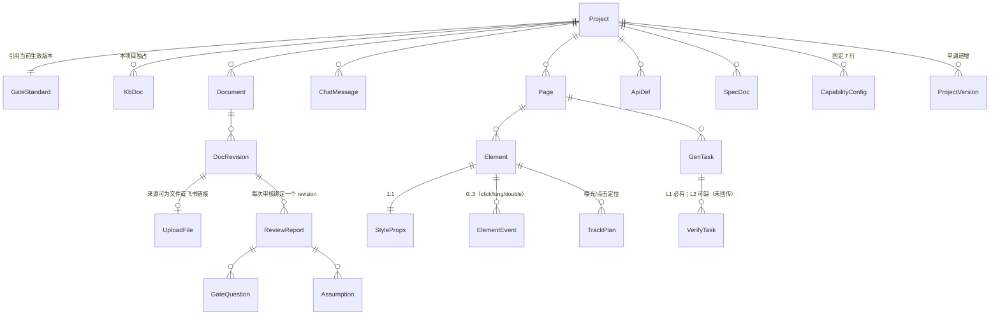

> ✅ **本文件为「已确认基线」**（第 3 轮交付 → **第 4 轮转正**，对应门禁阻断项 **C1 / C2 / B1**）。
> **转正依据**：PM 于 2026-10-20 就 T1 七条答复「**按默认值**」，并接受四类产出物为本期正式基线。见 `platform/平台需求概要.md` §11.7。
> **PM 过目确认后方为正式基线**；确认前不是 `platform/平台需求概要.md` 的条款，也不影响其正文。
> 与 `baseline/领域模型.md` 的区别：那份是面向**用户项目**的空模板；本文件是**平台自身**的领域模型。
> 来源标签：`[prd §X]` = `platform/平台需求概要.md` 当前 revision（含第 2/3 轮 [平台补充] 块）；`[answer:T0]` = PM 2026-10-20「T0 全部 Accept」；`[来源: 推断，待确认]` = 平台推导，须 PM 确认。

# 平台自身 · 数据模型（**已确认基线**）

> **同步修订：B9-20261026** ｜按本轮磁盘实现增量同步；原正式基线来源保持不变。**同版增量补正**：主Agent反馈：真实服务重启成功、健康=`real:gpt-5.6-terra-dhwork`、supplement迁移成功；b2 25/25、b3 21/21、b4 18/18已执行。新脚本首轮47/47，强化后46/47（01静态匹配待测试agent修订/复跑），不声称最终47通过。浏览器、真实PRD写入/真实模型新正文判定与独立验收仍待主Agent；文档助手未执行服务/DB/模型或回归。

**被审文档**：`platform/平台需求概要.md` ｜ **交付轮次**：第 3 轮（回流上限最后一轮）
**覆盖**：实体 / 字段（名称·类型·必填）/ 枚举完整取值 / 关系 / 状态机与迁移条件
**对应门禁**：C1（字段名·类型·必填）、C2（枚举完整取值）、B1（状态穷举）、B2（迁移条件）、B3（无孤立状态）

---

## 0 阅读约定

- **类型**记法：`string(n)` 字符长度上限 ｜ `int` / `long` ｜ `bool` ｜ `enum{...}` ｜ `json` ｜ `datetime`（UTC ISO-8601）｜ `ref(<实体>)` ｜ `ref[]`。
- **必填**列：`Y` = 必填；`N` = 可空；`Y*` = 创建时可缺省但写入后必非空（由系统赋默认值）。
- 所有实体均隐含 `created_at: datetime Y` / `updated_at: datetime Y`（下文不再重复），时间一律 **UTC 存储、浏览器本地时区展示** `[answer:T0]`（`D-A20`）。
- 所有带 `project_id` 的实体，其**每一次读写**都必须做**逐对象鉴权**，含列表、搜索、导出；越权返回 403 且不泄露对象是否存在 `[answer:T0]`（`D-A28`）。

---

## 1 实体总览与关系

### 1.1 实体清单

**A. `D-Q8` 点名的 15 类实体**（`[answer:T0]`）

| # | 实体 | 说明 | PRD 出处 |
|---|---|---|---|
| E1 | `Project` 项目 | 一切数据的隔离根 | `[prd §F1]` |
| E2 | `KbDoc` 知识库文档 | 只放本项目 | `[prd §F1]` |
| E3 | `UploadFile` 上传文件 | 以系统 id 存储 | `[prd §F2]` |
| E4 | `DocRevision` 文档 revision | 一次上传/解析的版本 | `[prd §F2]` |
| E5 | `Page` 页面 | 画布承载的页面 | `[prd §F14]` |
| E6 | `Element` 元素 | `EL-<模块>-<三位>` | `[prd §F13]` |
| E7 | `StyleProps` 样式属性 | 与元素 1:1 | `[prd §F14]` |
| E8 | `ElementEvent` 事件 | 点击 / 长按 / 双击 | `[prd §F14]` |
| E9 | `ApiDef` 接口定义 | 平台内被开发 App 的接口 | `[prd §F12]` |
| E10 | `ProjectVersion` 项目级版本 | 方案 A，整包快照 + diff | `[prd §F12]` |
| E11 | `SpecDoc` Spec 文档 | 五角色各一份 | `[prd §F7]` |
| E12 | `TrackPlan` 埋点方案 | S4 定方案 | `[prd §F5]` |
| E13 | `CapabilityConfig` 能力配置 | 7 项，默认全关 | `[prd §F11]` |
| E14 | `GenTask` 生成任务 | 提交变更后的代码生成 | `[prd §F13]` |
| E15 | `VerifyTask` 验证任务 | L1 静态 / L2 本地构建 | `[prd §F9]` + `[answer:T0]` |

**B. 由 PRD 已点名组件补全的 6 类实体**（本组为**平台补充**，`[来源: 推断，待确认]`，随本草案一并请 PM 确认）

| # | 实体 | 为什么必须有 | 出处 |
|---|---|---|---|
| E16 | `Document` 文档（revision 的父） | §F2 产出 `document_id` **且** `revision_id`，二者是父子关系 | `[prd §F2]` |
| E17 | `ReviewReport` 门禁评分卡 | §8「审核结果：门禁评分卡…待澄清清单」 | `[prd §F3]` `[prd §8]` |
| E18 | `GateQuestion` 待澄清问题 | §8「待澄清清单（分级）」+ §F4 逐条回答 | `[prd §F4]` `[prd §8]` |
| E19 | `Assumption` 假设 | §F4/§11.4 的 Accept / Convert 必须落库 | `[prd §11.4]` |
| E20 | `ChatMessage` 对话消息 | §2「右侧对话框，显示与 agent 的对话信息」 | `[prd §2]` |
| E21 | `GateStandard` 门禁标准 | §F3「门禁三级标准由需求方本人维护」 | `[prd §F3]` `[answer:T0]`（`D-Q18`） |
| E22 | `User` 用户 | `ref(User)` 的宿主（`E1.owner_user_id` / `E2.updated_by` 此前悬空）；`role` 枚举与个人数据宿主 | `[prd §F3]` `D-Q6`（🆕 〔2026-10-21 裁决 · `P0-补口裁决单`〕） |
| E23 | `ReviewItem` 评分卡逐项 | 评分卡逐项明细与 `evidence_ref` 的宿主（`AC-RV-01`） | `[prd §F3]`（🆕 〔2026-10-21 裁决 · `P0-补口裁决单`〕） |

> **只做这 23 个，不新增组件。** E16~E21 是 PRD **已经点名**的页面/产物所必需；E22/E23 为**必要补全**（悬空 `ref(User)` 的宿主 + 评分卡逐项证据宿主，〔2026-10-21 裁决 · `P0-补口裁决单`〕）。

### 1.2 关系图



**唯一事实来源声明**（对应角落「同一事实存了两份」）：
- 元素身份 → `Element.element_id`，**唯一**；别名仅供展示 `[answer:T0]`（`D-A32`）。
- 元素树的当前状态 → `Element` + `StyleProps` + `ElementEvent` 三表合成；**画布与预览均从它派生，不得反向修改它**。
- 版本态 → `ProjectVersion`；**「当前版本」只在 `ProjectVersion.status = current` 上**。

---

## 2 实体与字段

### E1 `Project`

| 字段 | 类型 | 必填 | 说明 / 约束 | 来源 |
|---|---|---|---|---|
| `project_id` | string(36) | Y | 系统生成 UUID，主键 | `[来源: 推断，待确认]` |
| `name` | string(50) | Y | trim 后 **1~50 可见字符**（emoji/组合字符按可见字符计）；同用户内**允许重名** | `D-A1` |
| `owner_user_id` | ref(User) | Y | 创建者 | `D-A28` |
| `stage` | enum | Y | 见 §3.1.1，默认 `created` | `[prd §7]` |
| `current_revision_id` | ref(DocRevision) | N | 最近一次 PRD 解析版本 | `[prd §F2]` |
| `current_version_id` | ref(ProjectVersion) | N | 当前项目级版本 | `[prd §F12]` |
| `depth` | enum{`minimal`,`standard`,`comprehensive`} | Y | **已废弃**（列保留兼容，仍 NOT NULL）；拆解深度改由 `review_level` 映射〔2026-10-28 分级定稿：简审→minimal / 标准→standard / 严格→comprehensive〕 | `§F6`／`PRD审核分级-定稿-v1.0` |
| `review_level` | enum{`quick`,`standard`,`strict`} | Y | **PRD 审核分级**：简审 / 标准 / 严格；**默认 `standard`**〔2026-10-28 定稿〕 | `PRD审核分级-定稿-v1.0` |
| `review_extended` | bool | Y | 严格档的**「超严扩展」开关**；仅 `strict` 有意义，默认 `false`〔2026-10-28 定稿〕 | `PRD审核分级-定稿-v1.0` |
| `element_id_seq` | json | Y* | 各模块已分配的最大序号，如 `{"HOME":12,"CART":3}`，用于 id 分配 | `D-A2` |
| `deleted_at` | datetime | N | **逻辑删除**标记；写入后 30 天物理清除 | `D-A34` |

**约束**：`name` 纯空白 → 拒绝；同用户重名 → 允许（以 `project_id` 区分）`[answer:T0]`。

### E2 `KbDoc`

| 字段 | 类型 | 必填 | 说明 |
|---|---|---|---|
| `kb_doc_id` | string(36) | Y | 主键 |
| `project_id` | ref(Project) | Y | **检索强制按此过滤**（跨库即阻断） |
| `sector` | enum{`prd`,`spec`,`glossary`,`domain`} | Y | `[prd §F1]` 列出的四类〔2026-10-22 按实现对齐：原 `doc_type`、枚举含 `domain_model`/`other`；实况列名 `sector`、取值 `domain`〕 |
| `title` | string(120) | Y | |
| `content_md` | text | Y | Markdown（与交付格式一致） |
| `origin` | enum{`agent_extracted`,`user_edited`,`user_uploaded`} | Y | 默认 `agent_extracted` |
| `updated_by` | ref(User) | Y | |

**来源**：`[prd §F1]` + `D-Q17`（agent 自动抽取写入、用户可编辑）+ `[来源: 推断，待确认]`（字段级）。

### E3 `UploadFile`

| 字段 | 类型 | 必填 | 说明 |
|---|---|---|---|
| `file_id` | string(36) | Y | 主键 |
| `project_id` | ref(Project) | Y | |
| `original_name` | string(255) | N | **仅作展示**；古怪文件名（空格/引号/非 ASCII/超长）与普通名同样处理 |
| `storage_key` | string(128) | Y | **系统生成的存储键**，不含用户可控路径（故无「越出根目录」风险） |
| `size_bytes` | long | Y | ≤ 20MB |
| `page_count` | int | N | 解析后回填；≤ 100 页 |
| `checksum` | string(64) | Y | 内容 SHA-256 |
| `status` | enum{`uploading`,`uploaded`,`rejected`} | Y | |
| `reject_reason` | enum{`format_unsupported`,`too_large`,`too_many_pages`,`empty`,`corrupted`} | N | 仅 `rejected` 时非空 |

**来源**：`[prd §F2]` + `D-A17` / `D-A18` + `[来源: 推断，待确认]`。

### E4 `DocRevision`（`Document` 见 §2-E16）

`Document`：`document_id` Y、`project_id` Y、`source_type` enum{`file`,`feishu_link`} Y、`feishu_token` string(128) N（`source_type=feishu_link` 时必填）、`latest_revision_id` N。
`DocRevision`：

| 字段 | 类型 | 必填 | 说明 |
|---|---|---|---|
| `revision_id` | string(36) | Y | 主键。**所有审核结论、评分卡都绑定它**（`D-A27`） |
| `document_id` | ref(Document) | Y | |
| `file_id` | ref(UploadFile) | N | |
| `parse_status` | enum{`pending`,`parsing`,`succeeded`,`partial`,`failed`} | Y | **`succeeded` 与 `partial` 必须可区分**（`partial` = 部分来源失败） |
| `parts` | json | Y | 逐块结果：`{body:{status,chars}, tables:[{token,status}], whiteboards:[{token,status}], attachments:[{name,status}]}`；每块 `status ∈ {ok,failed,skipped}` |
| `empty_document` | bool | Y | **「解析成功但无内容」独立标记**，与 `failed` 区分 |

**约束**：同一文档重复上传 → **新建 revision，旧 revision 保留可查、不覆盖**（`D-A18`）。

### E5 `Page`

| 字段 | 类型 | 必填 | 说明 |
|---|---|---|---|
| `page_id` | string(36) | Y | |
| `project_id` | ref(Project) | Y | |
| `name` | string(50) | Y | 页面名（可中文） |
| `module_code` | string(12) | Y | 元素 id 的模块段：**英文短名，大写，2~12 字符**，项目内唯一（`D-A2`） |
| `order_index` | int | Y | 排序键 |
| `status` | enum{`draft`,`defined`,`generating`,`generated`} | Y | 默认 `draft` |

### E6 `Element`

| 字段 | 类型 | 必填 | 说明 |
|---|---|---|---|
| `element_id` | string(24) | Y | 主键，格式 `EL-<模块>-<三位>`；**项目内全局唯一、不可复用、不可回收** |
| `project_id` | ref(Project) | Y | |
| `page_id` | ref(Page) | Y | |
| `parent_element_id` | ref(Element) | N | 空 = 根级；**同一父下 `order_index` 唯一** |
| `widget_type` | enum | Y | **原子控件枚举**，见 §4；每一取值对应**唯一确定的 Android 类** |
| `order_index` | int | Y | 同级内顺序 |
| `alias` | string(50) | N | 仅供展示，**不参与任何匹配**（`D-A32`） |
| `status` | enum{`active`,`void`} | Y | 默认 `active`；删除后置 `void` |
| `voided_at` | datetime | N | `status=void` 时非空 |

**约束**：
- **id 由服务端集中分配**，客户端只持临时 id（避免两用户同时拖控件冲突）。
- 序号 `001~999`，超出后**扩展四位**并在术语表登记（`D-A2`）。
- **同一路径两种写法**：`EL-HOME-001` 与 `el-home-1` 视为同一元素的两种写法 → 存储时**归一化为大写零填充形式**，比较亦按归一化后比较（一条成文规则，绝不重复计数）。
- **元素数上限**：单页 **200** 个，超限拒绝拖入并提示。

### E7 `StyleProps`（与 `Element` 1:1）

| 字段 | 类型 | 必填 | 取值域 / 约束 |
|---|---|---|---|
| `element_id` | ref(Element) | Y | 主键（1:1） |
| `width` | json{`mode`:enum{`dp`,`wrap_content`,`match_parent`},`value`:int} | Y | `mode=dp` 时 `value` **1~2000dp**；其余模式 `value` 必须为 null |
| `height` | 同上 | Y | 同上 |
| `background_color` | string(7) | N | **`#RRGGBB`**（不含 alpha；透明度由 `alpha` 独立控制） |
| `text_color` | string(7) | N | 同上 |
| `text_size_sp` | int | N | **8~72** |
| `padding` | json{`top`,`right`,`bottom`,`left`:int} | N | 每边 **0~200dp**，**四边独立**，支持联动锁 |
| `margin` | 同上 | N | 同上 |
| `corner_radius_dp` | int | N | **0~200** |
| `border` | json{`width_dp`:int,`color`:string(7),`style`:enum{`solid`,`dashed`,`dotted`}} | N | `width_dp` **0~10** |
| `alpha` | int | N | **0~100 整数**（对应 0.0~1.0），界面按百分比展示 |
| `align_h` | enum{`left`,`center`,`right`} | Y | 默认 `left` |
| `align_v` | enum{`top`,`center`,`bottom`} | Y | 默认 `top` |
| `visibility` | enum{`visible`,`invisible`,`gone`} | Y | 默认 `visible` |

**通用校验规则**：**负值一律拒绝**；非法输入必须**字段级提示、指明哪个字段、并保留用户已输入的全部内容**；**服务端在生成前二次校验**（可信侧再校验）。
**色值比较规则**：统一大小写为**大写**、缺 `#` 时补全；`#FFF` 与 `#FFFFFF` 视为两者不同（**只接受 6 位**），非法色值 → 字段级报错。

**来源**：`[prd §F14]` + `D-A5`~`D-A10` + `[来源: 推断，待确认]`（边界值 1~2000dp / 0~200 圆角为平台补充）。

### E8 `ElementEvent`

| 字段 | 类型 | 必填 | 说明 |
|---|---|---|---|
| `event_id` | string(36) | Y | |
| `element_id` | ref(Element) | Y | 同一元素 **最多 3 条**（每 `event_type` 一条） |
| `event_type` | enum{`click`,`long_click`,`double_click`} | Y | 三类**可并存、互不排斥** |
| `action_type` | enum{`none`,`navigate`,`api_call`,`track`} | Y | **本期只取 `none`** —— 只生成空回调存根（`D-Q13` **已确认**）；其余取值**保留枚举位、本期不可选** |
| `action_payload` | json | N | `none` 时为空 |

**判定窗**：同一元素同时配 `click` 与 `double_click` 时，**300ms** 内的第二次点击判为双击，并**取消已触发的单击回调**（`D-A11`）。

### E9 `ApiDef`

| 字段 | 类型 | 必填 | 说明 |
|---|---|---|---|
| `api_id` | string(36) | Y | |
| `project_id` | ref(Project) | Y | |
| `code` | string(32) | Y | 项目内唯一，形如 `API-<模块>-<三位>` |
| `name` / `path` / `method` | string / string / enum{`GET`,`POST`,`PUT`,`DELETE`,`PATCH`} | Y | |
| `req_schema` / `resp_schema` | json | N | 字段表：`{name,type,required,length,precision,unit,desc}` |
| `field_type` | enum | Y | **完整枚举**：`string`/`int`/`long`/`double`/`bool`/`object`/`array`/`date`（**禁写「等」**） |
| `status` | enum{`draft`,`effective`,`deprecated`} | Y | 默认 `draft` |
| `version_id` | ref(ProjectVersion) | N | 随项目级版本 |

**约束**：数值精度与单位**随字段声明**（角落「单位」面：每个量都带单位）；删除接口为破坏性操作 → 二次确认 + 说明影响范围。
⚠️ **`double` 仅用于非金额场景；本期无金额/计价/费率**（`D-X5`）。

### E10 `ProjectVersion`

| 字段 | 类型 | 必填 | 说明 |
|---|---|---|---|
| `version_id` | string(36) | Y | |
| `project_id` | ref(Project) | Y | |
| `seq` | int | Y | **项目内单调递增**，展示为 `v1`/`v2`… |
| `snapshot_ref` | string(128) | Y | 整包快照（Spec + 接口定义 + 能力配置 + 已生成安卓代码 + 埋点方案） |
| `diff_ref` | string(128) | N | 与上一版本的 diff（接口按**字段级**、Spec 按**文档级**） |
| `status` | enum{`current`,`superseded`,`rolled_back`,`archived`} | Y | 有且仅有一条 `current` |
| `created_by` | ref(User) | N | 操作人（版本卡片展示昵称）（🆕 〔2026-10-21 裁决 · `P0-补口裁决单`〕） |
| `summary` | text | N | 变更摘要（🆕 〔2026-10-21 裁决 · `P0-补口裁决单`〕） |
| `artifacts` | json | N | 产物清单 `enum{spec,apis,capabilities,android_code,tracking_plan}[]`（🆕 〔2026-10-21 裁决 · `P0-补口裁决单`〕） |

**回滚语义**（`D-Q16`）：回滚 = 上述**全部产物**恢复到该版本快照；**快照只读保留**，回滚后数据仍可读；回滚属破坏性操作 → 二次确认 + 说明影响范围。

### E11 `SpecDoc`

| 字段 | 类型 | 必填 | 说明 |
|---|---|---|---|
| `spec_id` | string(36) | Y | |
| `project_id` | ref(Project) | Y | |
| `role` | enum{`ui`,`api`,`app`,`track`,`test`} | Y | **五角色，项目内每角色最多一份当前版** |
| `status` | enum{`queued`,`generating`,`succeeded`,`failed`,`stale`} | Y | `stale` = 上游已变（重拆/回滚/major 变更） |
| `content_md` | text | N | 失败时为空 |
| `version_id` / `generated_at` / `error_code` | ref / datetime / string | N | |

**部分成功规则**：一份失败**不阻断**其余四份；**整体不置为成功**——成功的正常展示，失败的单独错误态 + 重试。

### E12 `TrackPlan`

| 字段 | 类型 | 必填 | 说明 |
|---|---|---|---|
| `track_id` | string(36) | Y | |
| `project_id` | ref(Project) | Y | |
| `event_key` | string(64) | Y | `EVT_<模块>_<动作>`，项目内唯一 |
| `element_id` | ref(Element) | N | 曝光/点击类事件的**定位键** |
| `trigger_desc` | string(200) | Y | 触发时机 |
| `params` | json | N | 参数名/类型/必填 |
| `status` | enum{`draft`,`confirmed`,`implemented`,`verified`} | Y | 对应 S4 定方案 → S7 写码 → S8 验证 |

### E13 `CapabilityConfig`（每项目**固定 7 行**）

`config_id` Y ｜ `project_id` Y ｜ `capability` enum{`push`,`apm`,`crash_report`,`log_report`,`stats_sdk`,`hardening`,`privacy_dialog`} Y ｜ `enabled` bool Y（**默认 `false`，全关**） ｜ `code_status` enum{`not_generated`,`generated`,`partial`,`failed`} Y ｜ `note` text N（第三方 key 占位说明；**本期不采集真实密钥**）。

### E14 `GenTask` / E15 `VerifyTask`

`GenTask`：

| 字段 | 类型 | 必填 | 说明 |
|---|---|---|---|
| `task_id` | string(36) | Y | |
| `project_id` / `page_id` | ref | Y | |
| `seq` | int | Y | **单调递增**；前后端**只应用序号最新的结果**（`D-A13`） |
| `status` | enum{`queued`,`running`,`succeeded`,`failed`,`timeout`,`canceled`} | Y | **保留 `canceled`** —— 生成中的任务允许取消（`D-Q22` **已确认**），取消后**丢弃本次产物、不入版本** |
| `idempotency_key` | string(64) | Y | `project_id` + **元素树哈希**（`D-A22`） |
| `input_hash` | string(64) | Y | 元素树 + 样式 + 事件 + 元素 id 的规范化哈希 |
| `attempt` | int | Y | 同一输入的尝试次数，**上限 3**（`D-A15`） |
| `artifact_ref` | string(128) | N | 生成的代码产物（**原子落盘**：先写临时再改名） |
| `l1_result` | json | N | `{passed, checks:[{rule,ok,evidence}], duration_ms}` |
| `l2_result` | json | N | `{reported:bool, passed:bool, log_digest:string, reported_at}`；**`reported=false` → 标记「未验证构建」，不阻断用户**（`D-R1`） |
| `error_code` | string(64) | N | 见 §5.4 |
| `progress` | int(0-100) | Y | 供 SSE 推送 |

`VerifyTask`：`verify_id` Y ｜ `task_id` ref(GenTask) Y ｜ `layer` enum{`L1`,`L2`} Y ｜ `status` enum{`pending`,`running`,`passed`,`failed`,`timeout`} Y ｜ `attempt` int Y ｜ `evidence` json Y（L1 逐规则证据；L2 日志摘要） ｜ `started_at` / `finished_at` datetime。

**L1 校验规则集（穷举，AI 生成路线的「验证」落地形式）**：① Kotlin/XML **语法可解析**；② 结构合法（根布局、父子关系闭包）；③ **元素 id 与画布元素树一一对应**（多一个/少一个都判失败）；④ 属性取值在允许域内；⑤ 引用完整（`R.id.*`、字符串资源、drawable 均存在）。**L1 通过 = 刷新预览**（`D-R4`）。

### E16~E23（补全实体，字段摘要）

| 实体 | 关键字段 |
|---|---|
| E16 `Document` | 见 §2-E4；`document_id` Y、`source_type` enum{`file`,`feishu_link`} Y |
| E17 `ReviewReport` | `review_id` Y、`project_id` Y、`revision_id` Y（**绑定 revision**）、`standard_version` int Y、`verdict` enum{`running`,`passed`,`blocked`,`failed`} Y、`counts` json{`blocking`,`major`,`suggestion`,`na`} Y、`superseded` bool Y（新 revision 后置 `true` = 「已过期」，**不参与放行判定**）、**`review_level` enum{`quick`,`standard`,`strict`} Y**（本次审核等级；结论随等级而变，必须可追溯）、**`review_extended` bool Y**（本次是否开启超严扩展）〔2026-10-28 分级定稿〕 |
| E18 `GateQuestion` | `question_code` string(16) Y（门禁口径 `[待澄清-Qn]`，**与原文 Q1~Q17 不同命名空间**）、`review_id` Y、`level` enum{`blocking`,`major`,`suggestion`} Y、`title` Y、`options` json Y（A~E + `X. Other`）、`fallback` enum{`not_yet_defined`,`none`,`not_identified`,`not_applicable`} Y、`answer` text N、`status` enum{`open`,`answered`,`converted`} Y、**`impact` text N**（影响范围，🆕 〔2026-10-21 裁决 · `P0-补口裁决单`〕） |
| E19 `Assumption` | `assumption_code` Y（`假设-An` / `D-An`）、`review_id` Y、`content` text Y、`source_tag` string(64) Y、`choice` enum{`unset`,`accept`,`convert`} Y（**`unset` 不允许进入生成阶段**）、`converted_question_code` N |
| E20 `ChatMessage` | `message_id` Y、`project_id` Y、`seq` int Y（**在「项目 + 线程」内单增**，禁并发改写同一 PRD）、`role` enum{`user`,`agent`,`system`} Y、**`content`** text Y（**单条上限 20000 字符**；⚠️ **对话消息正文的字段名是 `content`** —— 与知识库 `E2`、Spec `E4` 的正文列名**不同名**，勿混；〔2026-10-22 按实现对齐，见 `reviews/B6-Spec与实现一致性核对.md` D-1〕）、`status` enum{`sent`,`streaming`,`failed`} Y、**`thread_key`** string N〔2026-10-22：**对话线程 = 项目内的子步骤**（`workbench`/`kb`/`upload`/`review`/`split`/`editor`/`specs`/`apis`/`capabilities`/`versions`）；**对象恒为 Project**（由 `project_id` 决定）；缺省 `workbench`〕 |
| E21 `GateStandard` | `standard_id` Y、**`project_id` ref(Project) Y**（**项目级归属**，🆕 〔2026-10-21 裁决 · `P0-补口裁决单`〕）、`version` int Y（**每次保存 +1**）、`items` json Y（`[{code, level, title}]`，code ∈ A1~I4 族）、`is_current` bool Y；**标准变更后历史评分不重算，按当时版本留痕** |
| E22 `User` | `user_id` string(64) Y（= 飞书 `open_id`）、`role` enum{`requester`,`admin`} Y、`nickname` string(64) N、`avatar_url` url N、`deleted_at` datetime N |
| E23 `ReviewItem` | `review_id` ref(ReviewReport) Y、`item_code` string(16) Y（∈ 门禁 A~I 族）、`level` enum{`blocking`,`major`,`suggestion`} Y、`verdict` enum{`pass`,`fail`,`na`} Y、`evidence_ref` string(128) N（章节/行号）、`supplement` text N（**未通过项的补充信息**，随 `#23` 写回 PRD 时落库〔2026-10-26 增〕）、`suggestion` text N（模型建议，空串允许）、`accepted` bool语义 N（实际存储0/1，不覆盖verdict）、`group_code` string N（分组展示，#18映射group/group_title） |

---

## 3 状态机（状态穷举 + 迁移条件）

> 对应 B1（穷举）/ B2（迁移条件）/ B3（无孤立状态）。**每个状态都必须至少有一条入边和一条出边**，否则标为孤儿。

### 3.1 `Project.stage`

```
[*] → created
created → kb_ready            : 知识库就绪（空库亦视为就绪）
kb_ready → reviewing          : 上传 PRD 且解析完成
reviewing → supplementing     : 存在阻断项 或 有待澄清问题
supplementing → reviewing     : 用户在聊天框补充并提交复审
reviewing → gate_passed       : 阻断项 = 0
gate_passed → splitting       : 用户确认进入拆解
splitting → spec_generating   : 角色需求包生成完成
spec_generating → ui_ready    : 五角色 Spec 全部生成成功
ui_ready → api_developing     : UI 定稿
api_developing → app_developing : 接口契约定稿
app_developing → editing      : 进入手机样式编辑区
editing → code_generating     : 提交变更（产生 GenTask）
code_generating → verifying   : 代码已生成
verifying → preview_ready     : L1 通过
verifying → code_generating   : L1 失败且 attempt < 3
verifying → manual_required   : L1 失败且 attempt ≥ 3
manual_required → editing     : 人工处置后继续
preview_ready → editing       : 继续编辑
preview_ready → testing       : 用户确认进入测试
testing → supplementing       : 测试发现缺口（★ 回环）
testing → delivered           : 三层测试 + E2E 通过
gate_passed → [*]             : 中止（记录并归档）
delivered → [*]
```

| 状态 | 含义 | 出口 | 备注 |
|---|---|---|---|
| `created` | 已建项目 | kb_ready | |
| `kb_ready` | 知识库就绪（**空知识库也算**，首次运行可用） | reviewing | 消除原文「空知识库分支未定义」 |
| `reviewing` / `supplementing` | 审核 / 对话补充 | 互为回环 | |
| `gate_passed` | 无阻断项 | splitting / 中止 | |
| `splitting` / `spec_generating` | 拆解 / Spec 生成 | 下一步 | |
| `ui_ready` / `api_developing` / `app_developing` | 三段开发 | 下一步 | |
| `editing` / `code_generating` / `verifying` / `preview_ready` | 画布四态 | 见上 | **与 §2/§F14 的「编辑态 / 预览态」对齐**：`editing` = 编辑态；`preview_ready` = 预览态 |
| `manual_required` | 需人工介入 | editing | **新增**：消除 §7 原图中「验证失败 → 重试」的**无限循环** |
| `testing` / `delivered` | 测试 / 交付 | — | **回环** `testing → supplementing` 时，回环前的 Spec 与代码**归档为历史版本，不物理删除**（`D-Q16`） |

### 3.2 其余对象的状态（原文完全未定义者，全部补齐）

| 对象 | 状态（穷举） | 关键迁移条件 |
|---|---|---|
| `DocRevision.parse_status` | `pending`→`parsing`→`succeeded` \| `partial` \| `failed` | `partial` = 某一块 `failed` 但至少一块 `ok`；**`succeeded` 但 `empty_document=true` ≠ 失败** |
| `UploadFile.status` | `uploading`→`uploaded` \| `rejected` | 超 20MB / 超 100 页 / 非 `.docx`/`.md` → `rejected` + 具体 `reject_reason` |
| `Page.status` | `draft`→`defined`→`generating`→`generated` | `generating` 由 GenTask 驱动 |
| `Element.status` | `active`→`void` | **单向**，`void` 无出边（id 不可回收，`D-A4`）→ 该状态是**终态**，非孤儿 |
| `ApiDef.status` | `draft`→`effective`→`deprecated` | 随项目级版本冻结 |
| `ProjectVersion.status` | `current`→`superseded` \| `rolled_back` \| `archived` | 新版本产生 → 旧版 `superseded`；`rollback` → 目标版本置 `current`，回滚掉的版本置 `rolled_back`（**快照保留**） |
| `SpecDoc.status` | `queued`→`generating`→`succeeded` \| `failed`；`succeeded`→`stale` | 上游变更 → `stale` |
| `TrackPlan.status` | `draft`→`confirmed`→`implemented`→`verified` | 对应 S4/S7/S8 |
| `CapabilityConfig.code_status` | `not_generated`→`generated` \| `partial` \| `failed` | 保存即触发生成（`D-Q19`） |
| `GenTask.status` | `queued`→`running`→`succeeded`；`running`→`failed` \| `timeout` \| `canceled` | `timeout` = 5min 统一阈值；`canceled` = **用户主动取消**（`D-Q22` 已确认；**非失败态**、**不计入重试次数**、不产生版本记录） |
| `VerifyTask.status` | `pending`→`running`→`passed` \| `failed` \| `timeout` | L1 失败且 `attempt<3` → 回到 `code_generating`；`≥3` → `manual_required` |
| `ReviewReport.verdict` | `running`→`passed` \| `blocked` \| `failed`；`passed`/`blocked`→（新 revision 后）`superseded` | |
| `GateQuestion.status` | `open`→`answered`→`converted` | 未 `answered` 的阻断项 → 不允许 `gate_passed` |
| `Assumption.choice` | `unset`→`accept` \| `convert` | **`unset` 不得进入生成阶段**（门禁 I4） |
| `ChatMessage.status` | `sent`→`streaming`→`sent`；`streaming`→`failed` | 失败可重发且**不重复入库** |

**生成失败 ≠ 验证失败**：`GenTask.status=failed`（大模型超时 / 输出畸形）与 `VerifyTask.status=failed`（L1 规则不过）是**两条独立路径**，各有自己的文案与重试入口（消除门禁 D2 指出的缺失）。

### 3.3 无孤立状态核对

- 每一个状态都有入边与出边，**唯一无出边的是 `Element.status=void` 与 `GenTask.status=succeeded` 的终态语义**——二者均为**有意终态**并已在表内标注。
- §7 原图的 4 条「只有结果没有条件」的边（`生成中→初版UI`、`已通过门禁→拆解中`、`预览已刷新→测试中`、`测试中→已交付`）在 §3.1 中**全部补上了触发条件**。

---

## 4 原子控件枚举（对应 C2 / `D-Q20`）

> 原文 F13 白名单含复合项与「其它」，**不可直接映射 Android 类**。本节把它们收敛为**原子枚举**：**每项 = 一个确定的 Android 类**，写入术语表，**PM 确认后冻结**（`D-Q20`）。
> ✅ **本节整表已随 `D-Q20` 冻结为本期基线**（PM 第 3 轮 T0 `Accept` + 第 4 轮转正）。若需逐项复核，请在放行确认时提出。

| # | 枚举值 | 展示名 | Android 类 | 可作容器 | 可拖入画布 |
|---|---|---|---|---|---|
| 1 | `TEXT` | 文本 | `TextView` | 否 | 是 |
| 2 | `MULTILINE_TEXT` | 多行文本 | `TextView`（多行） | 否 | 是 |
| 3 | `RICH_TEXT` | 富文本 | `TextView`（Spannable） | 否 | 是 |
| 4 | `LABEL` | 标签 | `TextView`（单行，窄内边距） | 否 | 是 |
| 5 | `BUTTON` | 按钮 | `Button` | 否 | 是 |
| 6 | `INPUT` | 输入框 | `EditText` | 否 | 是 |
| 7 | `MULTILINE_INPUT` | 多行输入 | `EditText`（多行） | 否 | 是 |
| 8 | `PASSWORD_INPUT` | 密码输入 | `EditText`（密码） | 否 | 是 |
| 9 | `SEARCH_BOX` | 搜索框 | `SearchView` | 否 | 是 |
| 10 | `IMAGE` | 图片 | `ImageView` | 否 | 是 |
| 11 | `AVATAR` | 头像 | `ImageView`（圆形裁剪） | 否 | 是 |
| 12 | `VIDEO` | 视频播放 | `VideoView` | 否 | 是 |
| 13 | `LINEAR_LAYOUT` | 线性容器 | `LinearLayout` | **是** | 是 |
| 14 | `CONSTRAINT_LAYOUT` | 约束容器 | `ConstraintLayout` | **是** | 是 |
| 15 | `RELATIVE_LAYOUT` | 相对容器 | `RelativeLayout` | **是** | 是 |
| 16 | `SCROLL_VIEW` | 滚动容器 | `ScrollView`（单子） | **是** | 是 |
| 17 | `CARD` | 卡片 | `CardView` | **是** | 是 |
| 18 | `LIST` | 列表 | `RecyclerView` | **是**（item 模板） | 是 |
| 19 | `GRID` | 网格 | `GridView` | **是** | 是 |
| 20 | `BANNER` | 轮播 | `ViewPager2` | **是** | 是 |
| 21 | `RADIO_BUTTON` | 单选按钮 | `RadioButton` | 否 | 是 |
| 22 | `CHECK_BOX` | 多选按钮 | `CheckBox` | 否 | 是 |
| 23 | `RADIO_GROUP` | 单选组 | `RadioGroup` | **是** | 是 |
| 24 | `CHECK_GROUP` | 多选组 | `LinearLayout`（纵向 + 一组 `CheckBox`） | **是** | 是 |
| 25 | `SWITCH` | 开关 | `Switch` | 否 | 是 |
| 26 | `SPINNER` | 下拉选择 | `Spinner` | 否 | 是 |
| 27 | `SEEKBAR` | 滑块 | `SeekBar` | 否 | 是 |
| 28 | `RATING_BAR` | 评分 | `RatingBar` | 否 | 是 |
| 29 | `DATE_PICKER` | 日期选择器 | `DatePicker` | 否 | 是 |
| 30 | `TIME_PICKER` | 时间选择器 | `TimePicker` | 否 | 是 |
| 31 | `PROGRESS_BAR` | 进度条 | `ProgressBar`（条形） | 否 | 是 |
| 32 | `LOADING` | 加载中 | `ProgressBar`（圆形） | 否 | 是 |
| 33 | `TOOLBAR` | 顶部标题栏 | `Toolbar` | **是** | 是 |
| 34 | `BOTTOM_NAV` | 底部导航 | `BottomNavigationView` | 否 | 是 |
| 35 | `TAB_LAYOUT` | 标签页 | `TabLayout` | **是** | 是 |
| 36 | `DIVIDER` | 分割线 | `View`（1dp 高） | 否 | 是 |
| 37 | `SPACE` | 占位 | `Space` | 否 | 是 |

**从原表被「原子化掉」的三类，处置如下**（原文复合项 → 无歧义的原子项）：

| 原文写法 | 处置 |
|---|---|
| 「多行文本 / 富文本」 | 拆为 `MULTILINE_TEXT` 与 `RICH_TEXT` 两项 |
| 「列表 `RecyclerView` / `ListView`」 | **本期只保留 `LIST` = `RecyclerView`**；`ListView` 不纳入白名单（避免同一语义两个类）（**已随 `D-Q20` 冻结**） |
| 「单选组、多选组」 | 落为 `RADIO_GROUP` / `CHECK_GROUP` |
| 整行「**其它**」 | **删除该行**（门禁 A5 的模糊表述来源），改由本枚举的**封闭集合**承担；新增控件须走 `D-Q20` 的「确认后冻结 → 版本升级」路径 |

**两个非布局元素**：`Toast`（轻提示）与 `Dialog`/`AlertDialog`（弹窗）**不是可拖入画布的 View**——它们的「触发」只能是事件动作，不是画布元素。**处置口径已定**（随 `D-Q20` 冻结）：**不作为画布控件**；其触发只在事件面板的 `action_type` 中体现（`D-Q13`：本期只 `none`）。

**明确不在范围**（`D-X4`，已 Accept）：图表、地图、自定义绘制（Canvas）、复杂动画、WebView 内嵌页、视频剪辑、AR。

---

## 5 其余枚举完整取值（C2 汇总）

### 5.1 公共枚举
- `role`（平台角色）：**已确认为两角色** = `requester`（需求方）/ `admin`（管理员）（`D-Q5` **已确认**，见 `platform/平台需求概要.md` §9 补充块 ①）。
- `spec_role`：`ui`｜`api`｜`app`｜`track`｜`test`（**固定 5 个**）
- `gate_level`：`blocking`｜`major`｜`suggestion`（对应门禁清单的 阻断/重要/建议）
- `task_type`：`parse`｜`review`｜`split`｜`spec_gen`｜`code_gen`｜`verify_l1`｜`verify_l2`

### 5.2 元素与样式
- `visibility`：`visible`｜`invisible`｜`gone`
- `align_h`：`left`｜`center`｜`right` ｜ `align_v`：`top`｜`center`｜`bottom`
- `border.style`：`solid`｜`dashed`｜`dotted`
- `size.mode`：`dp`｜`wrap_content`｜`match_parent`
- `event_type`：`click`｜`long_click`｜`double_click`
- `action_type`：`none`｜`navigate`｜`api_call`｜`track`（**本期只 `none`**；`D-Q13` 已确认，其余取值保留枚举位、本期不可选）

### 5.3 能力（`capability`，固定 7 项，默认全关）
`push`（推送）｜`apm`（性能采集）｜`crash_report`（崩溃上报）｜`log_report`（日志上报）｜`stats_sdk`（统计 SDK）｜`hardening`（加固）｜`privacy_dialog`（隐私合规弹窗）

### 5.4 错误码（平台自身，供接口契约与验收标准引用）

| 码 | HTTP | 含义 | 典型触发 |
|---|---|---|---|
| `INVALID_ARGUMENT` | 400 | 参数非法 | 项目名空白、属性超范围 |
| `UNAUTHENTICATED` | 401 | 未登录 / 会话过期 | **已确认**：飞书扫码登录（`D-Q6`） |
| `FORBIDDEN` | 403 | 越权（**不泄露对象是否存在**） | 访问他人项目 |
| `NOT_FOUND` | 404 | 对象不存在 | |
| `VERSION_CONFLICT` | 409 | 乐观锁冲突 | 并发编辑 |
| `IDEMPOTENT_REPLAY` | 409 | 幂等键重放，返回**首次结果** | 连点提交 |
| `PAYLOAD_TOO_LARGE` | 413 | 超 20MB | 上传 |
| `FORMAT_UNSUPPORTED` | 422 | 格式不支持 | `.pdf`/`.txt` |
| `PARSE_PARTIAL` | 200 | **部分成功**（`parse_status=partial`），非错误 | 白板取不到 |
| `UPSTREAM_TIMEOUT` | 504 | 大模型 / 飞书超时 | |
| `UPSTREAM_UNAVAILABLE` | 503 | 上游不可用 | |
| `RATE_LIMITED` | 429 | 限流 | |
| `TASK_STALE` | 409 | 提交了**旧序号**的生成结果 | 旧响应后到 |
| `INTERNAL` | 500 | 未预期错误 | |

### 5.5 「未知 / 不适用 / 零」三者可区分（C6 同源）
- 数量类一律用 `null` = **未知**、`0` = **零**、`n/a` = **不适用**；**禁止**用 `0` 或 `1970-01-01` 表示未知时间。
- 分页 `total` 与 `has_more` 在**部分来源失败**时必须连同 `failed_parts[]` 一起返回，**部分合计不得当作完整展示**（E5）。

---

## 6 标注解除登记（第 4 轮 · 原 `[待PM确认]` 清单）

> **本文件已转正为「已确认基线」。** 下表登记第 3 轮所列 8 条标注的**解除情况与依据**；**无一条仍未解除**。

| 原标注编号 | 原待确认点 | 解除依据 | 现状 |
|---|---|---|---|
| `[待PM确认-D-Q5]` | `role` 枚举与权限矩阵 | PM 第 4 轮「T1 按默认值」→ `D-Q5`（两角色 + 逐对象鉴权） | **已解除**，见 `platform/平台需求概要.md` §9 补充块 ① |
| `[待PM确认-D-Q6]` | 有无 `User` 实体、`user_id` 从哪来 | 同上 → `D-Q6`（飞书扫码，`user_id` = 飞书 `open_id`） | **已解除**，见 §9 补充块 ② |
| `[待PM确认-D-Q7]` | 数据分级与脱敏（PRD/代码外发大模型） | 同上 → `D-Q7`（基础鉴权 + 隔离 + 脱敏 + 密钥管理**都做**；仅不做增强策略；**外发需告知与开关**） | **已解除**，见 §9 补充块 ③ |
| `[待PM确认-D-Q13]` | `action_type` 的实际取值域 | 同上 → `D-Q13`（本期只 `none`） | **已解除** |
| `[待PM确认-D-Q20]` | 第 4 节原子控件枚举整表是否冻结 | PM 第 3 轮「T0 全部 Accept」已接受「收敛为原子控件枚举」这一默认值，枚举表即其落地 | **已解除**（冻结为 37 项）；如需逐项复核请在放行确认时提出 |
| `[待PM确认-D-Q22]` | `GenTask.status` 是否保留 `canceled`；生成中能否取消 | PM 第 4 轮「T1 按默认值」→ `D-Q22`（允许取消、丢弃产物不入版本） | **已解除** |
| `[待PM确认-D-A5]` | 画布基准 360dp / 1dp = 3px | PM 第 3 轮 T0 `Accept` | **已解除** |
| `[待PM确认-字段级]` | E16~E21 六类补全实体及其字段 | PM 第 3 轮 T0 `Accept`（`D-Q8`：由平台推导、PM 事后修正） | **已解除**；`E16~E21` 标 `[来源: 推断，待确认]`，属**假设**性质，仍欢迎 PM 修正 |

> **仍未解除的标注：0 条。** 本文件中保留的 `[来源: 推断，待确认]` 是**来源标签**（表示"该字段为平台推导"），不是待确认标注 —— 它们已汇总进《假设确认清单》，不阻塞本文件作为基线使用。

## B9 审核持久化与版本事实（2026-10-26）

- **无新增实体，仍23**；#17 prd是响应聚合（当前项目revision + document + kb_doc + version + SHA256(content_md)），不是新表；顶层revision_id为报告输入快照。
- #23事务：规范化非空答案→tbl_gate_question.answer/status=answered；采纳集合→tbl_review_item.accepted；有效fail补充→tbl_review_item.supplement；snapshot元信息→tbl_project_meta；changed才更新tbl_kb_doc.content_md/origin=user_edited/version+1，materializeEditedRevision写同document_id新revision与不可变正文快照、current_revision_id并invalidateReviews。任一事务错误整体回滚。
- 假设choice=accept时对应code_converted问题status=converted归档（**保留answer**）；再convert按trim(answer)非空恢复answered，否则open，INSERT OR IGNORE不重复建题；GET19不返回归档题。converted_question_code是POST响应派生标识，不声称tbl_assumption已新增该持久字段。
- title来源本报告standard_version；legacy组名只在写回映射默认小节，不改tbl_gate_standard历史版本，自定义title保留。
- 新报告按同项目、同 `document_id` 的上一份 passed/blocked 报告按 `item_code` 取历史项；旧 `supplement` 非空且被当前审核正文包含才继承。`accepted` 仅本轮仍 fail、旧 accepted，且（上述有效 supplement 或 **旧/新 suggestion 相同、旧 suggestion 非空且当前 markdown 包含该 suggestion**）才继承。same-suggestion 分支已按当前代码加固，不再列“未落实建议被继承”缺口；不覆盖本轮模型 verdict/counts，不静默免审。
- 原始upload和历史revision快照不可变；KB是当前可编辑版本。#8 document_id来自KB行，可为null；content_hash由服务端digest(本次content_md)计算，不新增持久列，fetchKbDoc返回二者。#17初载及#23→GET8比较返回version/hash；PRD历史以当前openDoc.document_id查#13，无ID清空。真实DB supplement迁移/服务重启已由主Agent报告成功，本文未操作真实DB；备份`.tmp/review-fix-20261026/app-before-restart.db`，两条10月21日DB running记录早于10月26日10点旧进程，非当前worker，未取消/修改。
