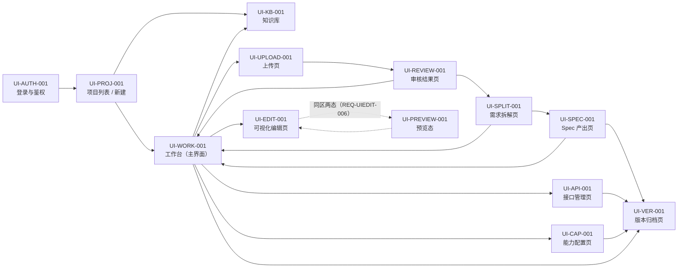

# AutoDevelopment 平台 UI Spec

> 版本：**v0.1.19** ｜ 来源 PRD：平台需求概要（平台自身的产品需求）v1.4 · 第 4 轮回写后 · 门禁阻断 0（document_id: `platform/平台需求概要.md`, revision: v1.4/S 2026-10-20）｜ 角色：UI ｜ 更新：2026-10-29（**工程接入（二期 · 增量写回）**：新增 `EL-WORK-036`~`038`（写回面板 / 「写回工程」按钮 / 补丁记录条目），元素总数 **447 → 450**）；上一轮 2026-10-29（**工程接入（一期）`F17`/`F18`**：新增 `EL-PROJ-048`~`057`（接入入口 + 弹窗）+ `EL-KB-025`/`026`（工程约束分区），元素总数 **435 → 447**）；上一轮 2026-10-26（**B9 审核补充与复审闭环**；新增 `EL-REVIEW-055`~`062`，元素总数 **435**；前轮审核流程优化：新增 `EL-REVIEW-054`「自动审核」开关；写回改为**按检查项标题落章** + `## 澄清答复`；上一版 v0.1.14 = 审核流程优化；更早v0.1.13 = 未通过项补充信息）；**本轮同版增量补正**：#8服务端哈希、初载/手动文档门禁、严格正文继承与当前doc历史；不另开轮次。
>
> ★ **元素 ID 约定**：`EL-<模块>-<三位>`，项目内**全局唯一、不可复用、不可回收**。它是「网页拖拽元素 →
> 原生安卓代码控件 → 埋点曝光点 → 测试用例定位」的统一主键，下游四份文档都以它对齐。
>
> **本次作业性质**：以 `platform/design/页面规格.md` 为**底稿**做格式转换 + 一致性对齐 + 缺口补齐，
> 不重新设计。冲突时**以 `platform/平台需求概要.md` 为准**并登记，不自行裁决。
>
> **来源标签**（沿用基线记法）：`§FX` / `§X` = `platform/平台需求概要.md`；`页面规格§X` = `platform/design/页面规格.md`；
> `数据模型§X` = `platform/design/数据模型.md`；`接口契约 #n` = `platform/design/接口契约.md`；`AC-*` / `E2E-*` = `platform/design/验收标准.md`；
> `[来源: 推断，待确认]` = 平台推导（属**假设**性质，原文标签**原样保留**，不阻塞开工）。

## 1 文档信息

| 项 | 内容 |
|---|---|
| 文档目的 | 供 UI 切图、App 开发对照实现；为接口角色提供数据需求来源 |
| 适用范围 | **平台自身**的 Web 界面（桌面浏览器，基准 1440×900）。**不含**被开发 App 的界面 —— 后者由用户在本平台的画布上拖拽产生，本期目标端**只有安卓原生**（`REQ-BASE-001`） |
| 不在范围 | 接口实现、后端规则（见接口 Spec / App Spec）；跨端（iOS / 跨平台 / 一端生成另一端，`D-X1`）；已有项目改样式（`D-X3`）；图表 / 地图 / Canvas / 复杂动画 / WebView / 视频剪辑 / AR（`D-X4`）；金额 / 计价 / 费率（`D-X5`）；组织 / 团队 / 多租户（`D-X6`）；数字资产安全的**增强策略**（防截屏 / 水印 / 防篡改 / 防泄露，`REQ-AUTH-007`） |
| 关联文档 | `baseline/需求追溯矩阵.md`、`platform/specs/接口-Spec.md`（同批产出）、`platform/specs/App-Spec.md`（同批产出）、`platform/specs/埋点-Spec.md`、`platform/specs/测试-Spec.md` |
| 页面数 | **13 个 `UI-*`**（与 `UI-需求包 §二` 页面清单逐行一致）；App 侧 `RT-*` 必须与之一一映射，**不允许多对一** |
| 底稿 | `platform/design/页面规格.md`（已确认基线，11 页 + 登录页；本 Spec 拆为 13 页，见 §2 备注） |

### 1.1 本 Spec 相对模板骨架的结构说明

严格按 `templates/UI-Spec.md` 的 10 节骨架填写，**仅新增 1 节**（第 6 节「近似渲染与真机差异清单」，项目约束 3 强制要求单独成节），其后各节顺延编号：

| 模板节 | 本 Spec 节 | 说明 |
|---|---|---|
| §1~§5 | §1~§5 | 一一对应 |
| （骨架无） | **§6 近似渲染与真机差异清单 ★** | 新增（`REQ-PREVIEW-003` 正文落点，约束 3） |
| §6 组件库与复用 | §7 | 顺延 |
| §7 页面跳转总览 | §8 | 顺延 |
| §8 需求追溯表 | §9 | 顺延 |
| §9 待澄清清单 | §10 | 顺延 |
| §10 变更记录 | §11 | 顺延 |

### 1.2 元素 ID 的两条本 Spec 约定（PRD 未定义，属平台推导）

| # | 约定 | 理由 | 标签 |
|---|---|---|---|
| 1 | 元素 ID 的**模块段 = 该元素所属页面的 `module_code`**（`UI-PROJ-001` → `EL-PROJ-xxx`），取页面英文短名、大写、2~12 字符 | `页面规格§1.1` + `数据模型 E5/E6`（`module_code` = 元素 id 的模块段）+ `D-A2` | `[来源: 推断，待确认]` |
| 2 | **全局组件**（Toast / 遮罩 / 顶部提示条 / 外发告知弹窗）不属于任何页面 → 模块段统一取 **`GLOBAL`**，`EL-GLOBAL-001`~`009`，在 §7 组件库登记归属与使用页面 | 「一元素一 id」要求这些也必须持 id；但它们无宿主页面 | `[来源: 推断，待确认]` → `[缺口-UI-07]` |

> ⚠️ **元素 ID 的使用红线**：`EL-*` 一旦发布**不可回收**。删除控件 → `Element.status=void`（单向终态），
> 该 id 不在画布与控件树中显示，但**永久保留在 id 台账**（`接口契约 #41`）中可查（`D-A4`、`AC-ED-07`）。

## 2 页面清单

| 页面 ID | 页面名 | 主题块段 | 对应 REQ-ID | 优先级 | 备注 |
|---|---|---|---|---|---|
| `UI-AUTH-001` | 登录与鉴权（全局页） | `AUTH` | `REQ-AUTH-001`、`REQ-AUTH-002`、`REQ-AUTH-004` | P0 | 飞书扫码登录；未登录态 / 会话过期态 / 403 态三合一页 |
| `UI-PROJ-001` | 项目列表 / 新建 / **接入已有工程** | `PROJ` | `REQ-PROJ-001`~`004`、`REQ-PROJ-002`、`REQ-KB-002`、**`REQ-INTAKE-001`** | P0 | 登录后默认落地页（`[来源: 推断，待确认]`，`页面规格§1`） |
| `UI-KB-001` | 知识库页 | `KB` | `REQ-KB-001`、`REQ-KB-002`、**`REQ-INTAKE-002`** | P1 | **五分区 Tab**（+ **工程约束**）+ revision 历史；页首常驻「只含本项目内容」 |
| `UI-WORK-001` | 工作台（主界面） | `WORK` | `REQ-PROJ-005`、`REQ-CHAT-001`、`REQ-UIEDIT-006`、`REQ-UIEDIT-007`、`REQ-GEN-005`、`REQ-GEN-007`、`REQ-GEN-008`、**`REQ-PATCH-001`** | P0 | **顶部状态条 + 左栏容器**；**对话为全局悬浮对话框**（不在页面布局内，见 §4.4 载体注）；左栏内容分属 `UI-EDIT-001` / `UI-PREVIEW-001` |
| `UI-UPLOAD-001` | 上传页 | `UPLOAD` | `REQ-UPLOAD-001`~`006` | P0 | 拖拽区 + 飞书链接 + 分块进度 + 部分成功标黄 |
| `UI-REVIEW-001` | 审核结果页 | `REVIEW` | `REQ-REVIEW-001`~`006`、`REQ-REVIEW-008` | P0 | 评分卡 + 待澄清清单 + 假设清单 + **门禁标准抽屉**（见 `[冲突-UI-02]`） |
| `UI-SPLIT-001` | 需求拆解页 | `SPLIT` | `REQ-SPLIT-001`~`004`、`REQ-SPEC-004` | P0 | 5 张角色包卡片 + 深度选择 + 埋点方案摘要 |
| `UI-EDIT-001` | 可视化编辑页（画布） | `EDIT` | `REQ-UIEDIT-001`~`010`、`REQ-GEN-001`、`REQ-GEN-004` | P0 | 本期核心交互；控件面板 / 画布 / 控件树 / 属性面板 / 事件面板 |
| `UI-PREVIEW-001` | 预览态 | `PREVIEW` | `REQ-PREVIEW-001`~`004`、`REQ-GEN-004` | P0 | 与 `UI-EDIT-001` **同区两态**（`REQ-UIEDIT-006`），App 侧为同一路由的两个状态 |
| `UI-API-001` | 接口管理页 | `API` | `REQ-API-001`~`003` | P0 | 清单 + 字段抽屉 + 版本区 |
| `UI-CAP-001` | 能力配置页 | `CAP` | `REQ-CAP-001`~`005`、`REQ-AUTH-004` | P0 | 7 项能力 + 目标端 + **外发大模型用户级开关**（P0 合规） |
| `UI-SPEC-001` | Spec 产出页 | `SPEC` | `REQ-SPEC-001`~`004`、`REQ-PROOF-001` | P0 | 五 tab + 追溯矩阵抽屉 + 《补充要求清单》 |
| `UI-VER-001` | 版本归档页 | `VER` | `REQ-DELIVER-001`、`REQ-DELIVER-002`、`REQ-DELIVER-003` | P1 | 时间线 + diff + 回滚 + 工程下载 |

**页面计数核对**：13 个 `UI-ID`（与 `UI-需求包 §二` 表格逐行一致，含登录页）。App 侧 `RT-*` 需 13 条，一一映射。

> **备注（底稿 11 页 → 本 Spec 13 页的三处拆分，均有基线依据，不是新增页面）**：
> ① `页面规格§2`（工作台）拆为 `UI-WORK-001`（顶部状态条 + 左栏容器；对话为**全局悬浮对话框**）、`UI-EDIT-001`（编辑态内容）、`UI-PREVIEW-001`（预览态内容）—— 依据 `REQ-UIEDIT-006`「同一区域的两个状态」+ `UI-需求包 §二` 页面清单已如此登记；
> ② `页面规格§11`（登录与鉴权）单列为 `UI-AUTH-001`；
> ③ 知识库页 `UI-KB-001` 来自 `REQ-KB-001/002`（`§F1 补充块`）。
> **不新增**任何 `页面规格` 与 `UI-需求包` 之外的页面。

## 3 全局样式规范

> ⚠️ **PRD 未定义视觉设计体系**（`§8` 只给页面清单、`§F13/§F14` 只给控件与属性取值域）。
> 下列全部数值为**本 Spec 的建议值**，标 `[建议，待设计确认]`，**不得当作 PRD 要求**（依据 `UI-需求包 §四` 末行 + `agents/02` 交付质量门槛）。
> **画布内控件**的样式数值**不属建议值**：它们严格取自 `数据模型 E7`（`§F14` 已确认基线），用户调出来的值就是生成代码里的值。

### 3.1 色彩

> 令牌格式：`C-nn`。每个令牌给出 **亮色 / 暗色** 两个 `#RRGGBB`，暗色一套见本表最右列（`REQ-AUTH-007` 之外，暗色模式 PRD 未定义 → 全部 `[建议，待设计确认]`）。

| 令牌 | 语义 | 亮色 | 暗色 | 用途 |
|---|---|---|---|---|
| `C-01` | 主色 | `#2563EB` | `#60A5FA` | 主按钮底、链接、选中描边 |
| `C-02` | 主色 · 按下 | `#1D4ED8` | `#3B82F6` | 主按钮 pressed |
| `C-03` | 主色 · 浅底 | `#EFF6FF` | `#1E2A3D` | 选中行底、当前 Tab 底 |
| `C-04` | 危险色 | `#DC2626` | `#F87171` | 删除类按钮、破坏性标题 |
| `C-05` | 危险 · 浅底 | `#FEF2F2` | `#3A1D1D` | 危险提示条底 |
| `C-06` | 成功 | `#16A34A` | `#4ADE80` | 「已通过」徽标、成功态图标 |
| `C-07` | 警告 | `#B45309` | `#FBBF24` | 「部分成功」「未通过」文字与图标 |
| `C-08` | 警告 · 浅底（标黄） | `#FFF7E6` | `#3A2E12` | 部分成功标黄条底（`REQ-UPLOAD-003` / `REQ-CAP-002` / `REQ-SPEC-001`） |
| `C-09` | 页面背景 | `#F5F6F8` | `#0F1115` | 页面底色 |
| `C-10` | 表面 | `#FFFFFF` | `#1B1E24` | 卡片、面板、弹窗底 |
| `C-11` | 表面 · 次 | `#F9FAFB` | `#22262E` | 表头、代码块、输入框底 |
| `C-12` | 边框 | `#E5E7EB` | `#2E333D` | 卡片描边、输入框描边 |
| `C-13` | 分割线 | `#EEF0F3` | `#2A2F38` | 列表行分隔 |
| `C-14` | 文字 · 主 | `#1F2329` | `#E8EAED` | 标题、正文 |
| `C-15` | 文字 · 次 | `#4E5969` | `#A9B0BA` | 说明文字（对比度 ≥ 7:1） |
| `C-16` | 文字 · 弱 | `#6B7280` | `#8A93A0` | 时间戳、灰色辅助（对比度 ≥ 4.5:1） |
| `C-17` | 禁用底 | `#F2F3F5` | `#262B33` | 置灰按钮底、未验证构建灰标底 |
| `C-18` | 禁用文字 | `#8A9099` | `#6B7280` | 置灰按钮文字（**必须同时有原因文案**） |
| `C-19` | 遮罩 | `rgba(15,17,21,0.45)` | `rgba(0,0,0,0.60)` | 弹窗 / 抽屉背景 |
| `C-20` | 焦点 / 选中描边 | `#2563EB` | `#60A5FA` | 画布选中框、键盘焦点环（**2px**） |
| `C-21` | 手机外框描边 | `#D0D3D9` | `#3A3F49` | 画布手机外框、安全区参考线 |
| `C-22` | 已过期 / 未验证 | `#F2F3F5` + 文字 `#6B7280` | `#2A2F38` + 文字 `#8A93A0` | 评分卡「已过期」、工程「未验证构建」 |
| `C-23` | 危险按钮文字 | `#FFFFFF` | `#1B1E24` | 危险色底上的文字 |

**硬约束**：色值一律 `#RRGGBB`（6 位，不含 alpha；透明度由独立属性控制，`D-A10`）。**状态绝不只靠颜色**（`REQ-NF-002`）：`C-06`/`C-07`/`C-22` 出现处**必须**伴随图标或文字。

### 3.2 字体与字号

> 平台界面为 Web（桌面浏览器），字号以 **px** 标注，并给出**等效 sp**（与画布内控件口径对齐）。
> **画布内控件**的字号**不使用本表**：`text_size_sp` 取值域 **8~72sp**（`数据模型 E7` / `D-A6`）。

| 令牌 | 层级 | 平台界面字号(px) | 等效 sp | 字重 | 行高(px) | 颜色 | 用途 |
|---|---|---|---|---|---|---|---|
| `FS-1` | 页面标题 | 20px | 20sp | 600 | 28 | `C-14` | 页面 `h1` |
| `FS-2` | 区块 / 弹窗标题 | 16px | 16sp | 600 | 24 | `C-14` | 面板标题、弹窗标题 |
| `FS-3` | 强调正文 | 14px | 14sp | 500 | 22 | `C-14` | 卡片标题、列表主字段 |
| `FS-4` | 正文 | 14px | 14sp | 400 | 22 | `C-14` | 一般正文 |
| `FS-5` | 次要说明 | 13px | 13sp | 400 | 20 | `C-15` | 字段说明、格式提示 |
| `FS-6` | 弱化 / 时间戳 | 12px | 12sp | 400 | 18 | `C-16` | 「最后更新于 X」、`v{n}` |
| `FS-7` | 按钮文字 | 14px | 14sp | 500 | 20 | 随按钮态 | 全部按钮 |
| `FS-8` | 徽标 / 标签 | 12px | 12sp | 500 | 16 | 随语义色 | 阶段标签、门禁徽标、状态标签 |
| `FS-9` | 字段级错误 | 12px | 12sp | 400 | 18 | `C-04` | 输入框下方错误气泡 |
| `FS-M` | 代码 / Markdown 等宽 | 13px | 13sp | 400 | 20 | `C-14` | Spec 渲染区、diff、id 显示 |

**字族**：平台界面 `-apple-system, "PingFang SC", "Microsoft YaHei", sans-serif` `[建议，待设计确认]`；
代码 / id / diff 区 `"SF Mono", Menlo, Consolas, monospace` `[建议，待设计确认]`。
**西文与数字**：与中文混排时使用同一字族，不做单独切分。

### 3.3 间距 / 圆角 / 阴影 / 图标

- **间距栅格**：**8px** 基准。令牌：`SP-4`=4、`SP-8`=8、`SP-12`=12、`SP-16`=16、`SP-24`=24、`SP-32`=32、`SP-48`=48。列表行内边距 `SP-12`／`SP-16`，区块间距 `SP-24`，页面外边距 `SP-32`。`[建议，待设计确认]`
- **圆角**：`R-2`=2px（徽标）、`R-4`=4px（输入框 / 按钮 / 小标签）、`R-6`=6px（卡片内小块）、`R-8`=8px（卡片 / 面板）、`R-12`=12px（弹窗 / 抽屉）、`R-16`=16px（画布手机外框）、`R-FULL`=999px（圆形头像 / 圆形加载）。`[建议，待设计确认]`
- **阴影**：`SH-0`=无；`SH-1`=`0 1px 2px rgba(15,17,21,0.06)`（卡片默认）；`SH-2`=`0 4px 12px rgba(15,17,21,0.10)`（悬浮 / 下拉）；`SH-3`=`0 12px 32px rgba(15,17,21,0.16)`（弹窗 / 抽屉）。暗色模式统一提高不透明度 ×1.5。`[建议，待设计确认]`
- **图标**：规格 **16 / 20 / 24px** 三档；**线性风格 `stroke`，线宽 1.5px**，圆角端点；颜色默认继承邻近文字色；危险操作图标与文字同色（`C-04`）。**图标不得单独承载语义**（必须图标 + 文字，`REQ-NF-002`）。`[建议，待设计确认]`
- **画布规格**（**不是建议值**，来自 `§F14 补充块`）：手机样式画布**基准宽 360dp**，展示比例 **1dp = 3px**（`D-A5`）；画布外框仅作视觉参照，**不代表真机**（见 §6）。
- **页面骨架与交互形态**（2026-10-22 补，形态参照飞书开放平台开发者后台）：**应用外壳顶栏**（全局，非 `EL-WORK-001`）高 **64px**（`EL-WORK-001`「顶部状态条」是**页内**元素，高 56px + 阶段导航 40px，**两者不是同一个东西**）、白底、底部 1px `C-12` 描边、**吸顶**（`position: sticky`）；品牌区 = 22×22 圆角标记（`R-4`）+ 平台名（`FS-2`）；**导航选中态**用 **2px `C-01` 下划线指示条 + 主色文字**（不只靠颜色，`REQ-NF-002`）；内容区外边距 **`SP-32`**，页面主体 `max-width 1180px` 居中。
- **卡片交互**：默认描边 `C-12` + `SH-1`，**悬浮升至 `SH-2` 且描边转 `C-21`**；表头用 `C-11`、行悬浮用 `C-09`；滚动条 8px、滑块 `C-21`、悬浮 `C-18`。以上过渡时长 `150ms`、仅作用于**颜色 / 阴影 / 描边**（**不引入位移或循环动画**，与「无动效」口径一致）。

### 3.4 暗色模式

**PRD 未定义暗色模式。** 本 Spec 给出**一套建议暗色值**（`C-01`~`C-23` 的暗色列），标 `[建议，待设计确认]`；
**不承诺**作本期交付项。若 PM 决定本期不做暗色，则 §3.1 暗色列作废，且须在 §10 登记（`[缺口-UI-08]`）。
暗色下**对比度门槛不变**：正文 ≥ 4.5:1、次要文字 ≥ 4.5:1、主色上的文字 ≥ 4.5:1。

### 3.5 组件状态规范（**全部交互组件通用，逐组件四态由此派生**）

> 「每个交互组件必须写全状态：默认 / 加载 / 空 / 错误」在本 Spec 的落法：
> **页面级**的空 / 加载 / 错误三视图写在每页的 `⑥ 状态` 表（三态是**三个不同视图**，不得合并，`页面规格§0.2`）；
> **组件级**的交互状态统一由本表定义，各页不再重复（避免同一事实写两处）。

| 组件 | 默认 | 悬浮(hover) | 按下(pressed) | 聚焦(focus) | 禁用 | 加载中 | 选中 | 错误 |
|---|---|---|---|---|---|---|---|---|
| 主按钮 | 底 `C-01`，文字 `#FFFFFF`，`FS-7` | 底 `C-02` | 底 `C-02` + `SH-0` | `C-20` 2px 外环 | 底 `C-17`，文字 `C-18`，**cursor: not-allowed + 原因文案** | 文案换成进行时 + 左侧 16px 转圈；**按钮保持禁用** | — | — |
| 次按钮 | 底透明，描边 `C-12`，文字 `C-14` | 底 `C-11` | 底 `C-11` + 内阴影 | `C-20` 2px 外环 | 文字 `C-18`，描边 `C-12` | 同主按钮 | — | — |
| 危险按钮 | 底 `C-04`，文字 `C-23`，**带 16px 图标** | 底 `#B91C1C` | 底 `#991B1B` | `C-20` 2px 外环 | 底 `C-17`，文字 `C-18` | 同主按钮 | — | — |
| 输入框 | 底 `C-11`，描边 `C-12`，圆角 `R-4`，`FS-4`，内边距 `SP-8`/`SP-12` | 描边 `#C9CDD4` | — | 描边 `C-20` 2px | 底 `C-17`，文字 `C-18` | 右侧 16px 转圈；**保留已输入内容** | — | 描边 `C-04` 2px + 下方 `FS-9` 错误文字；**已输入内容全部保留**（`REQ-NF-002`） |
| 搜索框 | 同输入框，左侧 16px 搜索图标 | 同输入框 | — | 同输入框 | 同输入框 | 同输入框 | — | 同输入框 |
| 下拉 / 选择器 | 底 `C-11`，描边 `C-12`，右侧 16px 箭头 | 底 `#F0F1F3` | — | 描边 `C-20` | 文字 `C-18` | — | 选中项带 **✓ 图标 + `C-03` 底**（不只靠颜色） | 描边 `C-04` |
| 勾选框 / 单选 | 16×16px，描边 `C-12`，圆角 `R-2` | 描边 `C-01` | — | `C-20` 2px 外环 | 底 `C-17` | — | **✓ 图标 + 文字加粗** | — |
| 开关 | 宽 40px 高 24px；关=底 `#C9CDD4`（暗 `#4A5058`）；开=底 `C-01` | 描边 `C-01` | 滑块 2px 内缩 | `C-20` 2px 外环 | 底 `C-17` | 滑块位显示 12px 转圈 | 开态滑块右侧 + **文字「已开启」**（12px，`C-15`） | — |
| 分段控件 | 底 `C-11`，`R-4` | 项 hover 底 `#E8EAED` | — | `C-20` | 文字 `C-18` | — | **选中项 = `C-10` 底 + `SH-1` + 图标 + 文字加粗**（`REQ-UIEDIT-006` 要求文字 + 图标，不只靠颜色） | — |
| 标签页(Tab) | 文字 `C-15`，下边框透明 | 文字 `C-14` | — | `C-20` | 文字 `C-18` | Tab 文字右侧 12px 转圈 | **文字 `C-01` + 2px `C-01` 下划线 + 文字加粗** | Tab 文字后 16px 红色感叹图标（`C-04`） |
| 列表行 | 底 `C-10`，下边框 `C-13` | 底 `C-11` | 底 `C-03` | `C-20` 2px 外环 | 文字 `C-18` | 行内骨架块 | **左侧 4px `C-01` 竖条 + 行底 `C-03` + 文字加粗** | 行内 `C-04` 文字 + 图标 |
| 弹窗 | 底 `C-10`，`R-12`，`SH-3`，宽 480px，内边距 `SP-24` | — | — | 打开时**焦点自动落在「取消」**（破坏性）或**首个输入框**（表单） | 确认按钮禁用 + 原因 | 确认按钮转圈 | — | 弹窗内错误条 `C-05` + `C-04` 文字 |
| 抽屉 | 右侧滑出，宽 560px，底 `C-10`，`R-12` 仅左侧 | — | — | 同弹窗 | — | — | — | — |
| Toast | 底部居中，底 `#1F2329`（暗 `#E8EAED`），文字 `#FFFFFF`（暗 `#1B1E24`），`R-8`，`FS-4`，`SH-2` | — | 点击立即消失 | — | — | — | — | 失败 Toast 底 `C-04` |
| 骨架块 | 底 `C-17`，`R-4`，**静态，无 shimmer 动画** | — | — | — | — | — | — | — |

**通用交互规则**（`页面规格§0.3`，逐页不再重复）：
1. **破坏性操作**一律二次确认，弹窗内**写明影响范围与不可撤销**（`D-A25`）。
2. **非法输入**字段级提示 + **保留用户已输入的全部内容**；提交类按钮请求期内禁用。
3. **重复提交**：提交类按钮请求期内禁用；同一次意图 **3s 内只产生一次副作用**（幂等键，`D-A12`）。
4. **键盘可达**：所有可点元素可 Tab 到达，焦点顺序 = 视觉从上到下、从左到右；`Enter`/`Space` 触发；`Esc` 关闭弹窗/抽屉；**拖拽有键盘替代**（见 §3.7）。
5. **长任务进度**：加载态超过 **3s** 追加进度说明；单任务统一 **5min** 超时（`D-A14`）。

### 3.6 全局文案与脱敏约束

- **文案口径**（`D-Q10-a`，**已确认**，逐页文案已按此写死）：平台**自称「平台」**（不出现「本系统」「本站」）；
  对使用者**统一第二人称「你」**，文案中**不出现「需求方」「用户」等角色词**；口吻 = 空态**积极引导**、错误态**陈述事实 + 给下一步**，
  **不道歉、不卖萌、不用感叹号**；中文全角标点；**按钮文案不加句号，提示句尾加句号**。
- **时间口径**（`REQ-NF-005`）：UTC 存储、**本地时区展示**；相对格式「最后更新于 X」；**缺失时间不得显示 1970**，
  统一显示 `时间未知`（兜底文案，见 `EL-PREVIEW-017`）；数量类 `null` = `未知`、`0` = `0`、`n/a` = `不适用`。
- **脱敏**（`REQ-AUTH-005`）：**PRD 正文与生成的业务代码内容不得出现在 URL、页面标题、错误提示、调试面板、Toast、日志**；
  界面**任何位置不得出现大模型 key / 飞书 token**（`AC-AU-05` / `AC-AU-06`）。
- **错误码 → 文案映射**（`接口契约§0.5`，逐页错误态统一取此表，`{...}` 为可填值）：

| code | 界面文案 |
|---|---|
| `INVALID_ARGUMENT` | 字段级提示，**保留已输入**（文案见各页）。**例外（登录页 `UI-AUTH-001`）**：`#72` 返回 400 时**复用 `EL-AUTH-010` 显示服务端 `message`**（因账号密码分栏无逐字段的错误位）；纯空白值仍走 `EL-AUTH-018`/`EL-AUTH-019` 字段级提示且**不发请求** |
| `UNAUTHENTICATED` | 「登录已过期，已为你保留未提交的内容。」+「重新登录」 |
| `FORBIDDEN` | 「你没有权限访问这个项目。」（**不透露对象是否存在**） |
| `NOT_FOUND` | 「这个内容已经不在了。」+「返回上一级」 |
| `VERSION_CONFLICT` | 「该内容已被他人修改。」+ diff + 「以我的为准」/「放弃我的改动」 |
| `IDEMPOTENT_REPLAY` | 无提示，直接采用首次结果 |
| `PAYLOAD_TOO_LARGE` | 「文件超过 20MB（当前 {n}MB）。请压缩后重试。」 |
| `FORMAT_UNSUPPORTED` | 「暂不支持该格式。请上传 .docx / .md 或飞书云文档链接。」 |
| `UPSTREAM_TIMEOUT` | 「上游服务响应超时（{n}s）。」+「重试」 |
| `UPSTREAM_UNAVAILABLE` | 「服务暂时不可用（{code}）。」+「重试」 |
| `RATE_LIMITED` | 「请求太频繁，{n} 秒后重试。」+ 倒计时 |
| `TASK_STALE` | 静默丢弃并提示「已为你使用最新一次生成的结果。」 |
| `INTERNAL` | 「出了点问题。」+「请把 request_id {id} 提供给我们。」+「重试」 |

### 3.6.1 补充：本轮语义核对发现的 4 条**契约/REQ 要求但 UI 未定义**的文案（2026-10-21 补）

> 来源：硬核对（`reviews/A1-硬核对报告-20261021.md` 的语义层复核）发现 App 侧引用了 4 条 UI 未定义的文案。
> 按「**UI 是文案权威**」的口径，此处补齐并冻结；App / 测试逐字引用本节。

| # | 场景 | 文案（逐字） | 依据 | 落点 |
|---|---|---|---|---|
| 1 | **部分加载标记** | `部分加载` | ⚠️ **`接口契约 §0.3` 强制要求**（`failed_parts` 非空时「前端**必须**显示『部分加载』标记，**不得当作完整展示**」），但 UI 侧此前**未定义该标记的文案与位置** | 全局：凡列表可能部分失败处（`EL-UPLOAD-014`、`EL-KB-010`、`EL-EDIT-051` 等），显示在列表标题右侧 |
| 2 | **分页超限** | `每页最多 100 条。` | `REQ-NF-004` / `接口契约 §0.3`（`page_size > 100` → `INVALID_ARGUMENT`）；UI 此前只定义了页大小选项（`EL-PROJ-008`） | 全局分页器（`EL-PROJ-032`、`EL-API-017` 等） |
| 3 | **Spec 页列表加载失败** | `Spec 列表没加载出来。` + `重试` | 与其余各页的「`X` 列表没加载出来。」同构（`项目列表没加载出来。`/`知识库没加载出来。`/`接口清单没加载出来。`/`版本历史没加载出来。`），Spec 页**独缺** | `UI-SPEC-001` `EL-SPEC-003`~`007` 区块 |
| 4 | **接口名为空** | `（未命名接口）` | `E9 ApiDef.name` 允许为空；`UI-API-001` 此前未定义空值兜底 | `UI-API-001` `EL-API-009` |
| 5 | **台账加载失败** | `台账没加载出来。` + `重试` | 与其余各页「`X` 没加载出来。」同构；元素 id 台账区块此前未定义 | `UI-EDIT-001` `EL-EDIT-051`/`052`（台账抽屉） |
| 6 | **外发设置加载失败** | `外发设置没加载出来。` + `重试`（**开关同时置灰**） | 同上；且 `EL-CAP-019`~`021` 为 **P0 合规**项，失败态必须有明确呈现 | `UI-CAP-001` `EL-CAP-019`~`021` |
| 7 | **追溯矩阵加载失败** | `追溯矩阵没加载出来。` + `重试` | 同上 | `UI-SPLIT-001` `EL-SPLIT-019`~`021` |
| 8 | **交付物下载失败** | Toast `下载失败了。` + `重试` | 与「导出失败了。」同构；平台**不做编译**，故**无任何构建进度 UI** | `UI-VER-001` `EL-VER-025`/`026` |
| 9 | **控件放置被拒** | `这个容器不能再放控件。` / `不支持的控件类型。` | 服务端对 `#36` 的二次校验（`INVALID_ARGUMENT`）；前端先拦、服务端再校验，**文案逐字一致** | `UI-EDIT-001` `EL-EDIT-004`/`EL-EDIT-029` |
| 10 | **能力配置保存** | 成功提示 `已自动备份`；失败 `配置没保存成功。` + `重试` | `#58`「保存即生成」的服务端自动备份语义需在界面回显 | `UI-CAP-001` `EL-CAP-009` |

### 3.7 无障碍与无动效底线（`REQ-NF-002` / `AC-NF-05~07`）

- **状态绝不只靠颜色**：选中 / 当前 / 失败必须有**图标或文字**伴随（逐页 `⑤ 样式` 已逐处标注）。
- **拖拽的键盘替代**（本期**唯一**的键盘替代路径，键位由本 Spec 建议）：
  ① `Tab` 聚焦控件面板中某控件 → ② `Enter` 进入「键盘放置」模式（画布显示焦点框 + 控件名）→
  ③ `Tab` 在候选容器间移动、`↑↓` 选兄弟位置 → ④ `Enter` 放置、`Esc` 取消 → ⑤ 放置后用 **`方向键` 微调位置**（每次 1dp，`Shift+方向键` 10dp，见 `REQ-UIEDIT-002`）。
  键位映射属本 Spec 建议值 → `[缺口-UI-09]`。
- **动效底线**：**未定义处一律「无动效」**（`D-A24`）。本 Spec 的全部动效见各页 `③ 动效`，
  **允许存在的仅两类**：① 不可移除的**进度指示器自身旋转**（ProgressBar）；② `页面规格§2.2` 明确要求的**输入框抖动**（空消息发送，240ms）。
  其余转场、面板展开、拖拽落位、选中切换、预览刷新**一律瞬时、无动效**（`页面规格§6.4`、`AC-NF-07`）。

## 4 页面详细设计

> 每页写全 **元素 / 交互 / 动效 / 字样 / 样式** 五项；`⑥ 状态` 给页面级四态；`⑦ 适配`；`⑧ 待澄清`。
> **样式表中的令牌**（`C-*` / `FS-*` / `SP-*` / `R-*` / `SH-*`）解析为 §3 的具体数值。
>
> **两条读表约定（保证 ①↔⑤ 一一对应）**：
> 1. `⑤ 样式` 允许**分组行**（如 `EL-KB-005`~`008`、`EL-API-023`~`025`），含义是「该区间内**每一个**元素都解析为同一组数值」；
>    区间符号（`~`、`/`）只是书写压缩，**不改变一元素一行的语义**。
> 2. **全局复用组件**（`EL-GLOBAL-001`~`009`）的样式**只在 §3.5 与 §7 定义一次**，各页 `⑤ 样式` 不再重复；
>    页面 `① 元素清单` 中出现它们时已注明「复用组件，定义见 §7」。

### 4.1 登录与鉴权（`UI-AUTH-001`，对应 `REQ-AUTH-001`、`REQ-AUTH-002`、`REQ-AUTH-004`）

> ⚠️ **本页 2026-10-21 新增的 `EL-AUTH-017`~`021`（账号密码登录）属「本机开发阶段扩展」—— 未过门禁、未进入第 4 轮基线冻结范围**；
> 其中账号密码登录为**阶段性方案**，**生产必须 `AD_PASSWORD_LOGIN=disabled`** 并改用企业自建应用扫码或已有账号体系。
> 判断渲染哪种登录方式一律以 `#72a`（`GET /auth/methods`）为准，**前端不得硬编码**。

> **入口**：未登录访问任意页面 → 跳本页 ｜ **出口**：登录成功 → `UI-PROJ-001`（默认落地页）。
> 底层依据：`页面规格§11`（`D-Q5`/`D-Q6` 已确认）。

**① 元素清单**

| 元素 ID | 元素名 | 类型 | 层级/父元素 | 是否可交互 |
|---|---|---|---|---|
| `EL-AUTH-001` | 登录页根容器 | 容器 | — | 否 |
| `EL-AUTH-002` | 平台标志 | 图片/图标 | `EL-AUTH-001` | 否 |
| `EL-AUTH-003` | 平台名标题「AutoDevelopment」 | 文本 | `EL-AUTH-001` | 否 |
| `EL-AUTH-004` | 一句话说明 | 文本 | `EL-AUTH-001` | 否 |
| `EL-AUTH-005` | 登录卡容器 | 卡片 | `EL-AUTH-001` | 否 |
| `EL-AUTH-006` | 飞书二维码图 | 图片 | `EL-AUTH-005` | 否 |
| `EL-AUTH-007` | 二维码状态提示 | 文本 | `EL-AUTH-005` | 否 |
| `EL-AUTH-008` | 二维码刷新按钮 | 次按钮 | `EL-AUTH-005` | 是 |
| `EL-AUTH-009` | 登录中提示 | 文本 + 加载 | `EL-AUTH-005` | 否 |
| `EL-AUTH-010` | 登录失败错误条 | 提示条 | `EL-AUTH-005` | 否 |
| `EL-AUTH-011` | 登录失败重试按钮 | 次按钮 | `EL-AUTH-005` | 是 |
| `EL-AUTH-012` | 会话过期提示卡 | 提示条 | `EL-AUTH-001` | 否 |
| `EL-AUTH-013` | 「重新登录」按钮 | 主按钮 | `EL-AUTH-012` | 是 |
| `EL-AUTH-014` | 403 无权限卡 | 空态卡 | `EL-AUTH-001` | 否 |
| `EL-AUTH-015` | 「返回上一级」按钮 | 次按钮 | `EL-AUTH-014` | 是 |
| `EL-AUTH-016` | 业务数据未登录遮罩 | 遮罩 | — | 否 |
| `EL-AUTH-017` | 登录方式切换（分段控件：「账号密码」/「飞书扫码」） | 分段控件 | `EL-AUTH-005` | 是 |
| `EL-AUTH-018` | 用户名输入框 | 输入框 | `EL-AUTH-005` | 是 |
| `EL-AUTH-019` | 密码输入框（密文） | 输入框 | `EL-AUTH-005` | 是 |
| `EL-AUTH-020` | 「登录」按钮 | 主按钮 | `EL-AUTH-005` | 是 |
| `EL-AUTH-021` | 开发登录提示（非正式登录方式的说明） | 文本 | `EL-AUTH-005` | 否 |
| `EL-GLOBAL-003` | 未登录业务数据遮罩（复用组件，定义见 §7） | 遮罩 | — | 否 |

**② 交互规则**

| 元素 ID | 触发 | 行为 | 跳转目标 | 可否重复触发 | 边界 |
|---|---|---|---|---|---|
| `EL-AUTH-006` | 页面加载 / 二维码过期 | 拉取二维码（`#63 GET /auth/feishu/qrcode` → `qrcode_url` / `expires_in_seconds`(120)，扫码状态走 `#64` **1.5s 轮询**。**原 `[缺口-UI-01]` 已闭合**：2026-10-21 补口 `#63`~`#66` 已转基线）；有效期 120s | — | 是（过期后） | 未登录访问任意业务接口 → 401 `UNAUTHENTICATED`，**页面跳本页且不渲染任何业务数据** |
| `EL-AUTH-008` | 点击 | 重新拉取二维码，`EL-AUTH-007` 回到「请用飞书扫一扫」 | — | 是（串行，点击期禁用 1s） | 二维码有效期内点击 → 仍刷新（允许） |
| `EL-AUTH-006` | 扫码成功 | 签发 `Bearer <token>`，`user_id` = 飞书 `open_id`；首次登录自动建用户 + 默认角色 = 需求方 | `UI-PROJ-001` | 否（成功后离开本页） | 登录中权限被撤销 → ≤5min 生效（`REQ-AUTH-003`） |
| `EL-AUTH-011` | 点击 | 重新拉起扫码流程 | — | 是 | — |
| `EL-AUTH-013` | 点击 | 重新认证 → **若存在未提交草稿则恢复**，恢复后 Toast「已恢复上次未提交的改动。」 | 原页面 | 是 | 认证失败 → 停留本页 + `EL-AUTH-010` |
| `EL-AUTH-015` | 点击 | 返回上一级；无上一级 → `UI-PROJ-001` | `UI-PROJ-001` | 是 | 403 态下**不得**显示对象是否存在 |
| `EL-AUTH-017` | 点击切换 | 在「账号密码」（`EL-AUTH-018`~`020`）与「飞书扫码」（`EL-AUTH-006`~`008`）之间切换；**切到飞书才拉二维码**（避免白轮询） | — | 是 | 服务端未启用账号密码登录 → **不渲染本控件**，直接呈现飞书扫码 |
| `EL-AUTH-020` | 点击 | 提交 `#72 POST /auth/password/login`；成功签发 `Bearer <token>` → `UI-PROJ-001`；失败停本页 + `EL-AUTH-010` | `UI-PROJ-001` | 是（串行，提交中禁用） | 用户名 / 密码为空 → 字段级提示；凭据错误 → **统一文案，不区分账号是否存在** |
| `EL-AUTH-018`/`019` | Enter | 等价于点 `EL-AUTH-020` | — | 是 | 提交中不可重复触发 |

**③ 动效**

| 元素/页面 | 触发条件 | 动效描述 | 时长 | 曲线 |
|---|---|---|---|---|
| `EL-AUTH-009` | 登录中 | **无动效**（仅 16px 转圈，指示器自身旋转） | — | — |
| 页面 | 进入 / 离开 | **无动效**（直接替换，`D-A24` 未定义处按无动效） | — | — |

**④ 文案字样**

| 位置 | 文案内容 | 备注 |
|---|---|---|
| `EL-AUTH-003` | `AutoDevelopment` | 平台名 |
| `EL-AUTH-004` | `把你的 PRD 拆成五份 Spec，并直接生成原生安卓工程。` | 一句话说明 |
| `EL-AUTH-007`（默认） | `请用飞书扫一扫，登录后开始。` | — |
| `EL-AUTH-007`（过期） | `二维码已过期。` | 与刷新按钮成对出现 |
| `EL-AUTH-008` | `刷新二维码` | 次按钮 |
| `EL-AUTH-009` | `正在登录…` | 登录中 |
| `EL-AUTH-010` | `登录没成功，请重试。` | 登录失败（原文案，不改写） |
| `EL-AUTH-011` | `重新扫码` | — |
| `EL-AUTH-012` | `登录已过期，已为你保留未提交的内容。` | 会话过期（原文案） |
| `EL-AUTH-013` | `重新登录` | 主按钮 |
| `EL-AUTH-014` | `你没有权限访问这个项目。` | 403（**不透露对象是否存在**） |
| `EL-AUTH-015` | `返回上一级` | — |
| `EL-AUTH-017` | `账号密码` / `飞书扫码` | 分段控件两项（2026-10-21 新增） |
| `EL-AUTH-018` | `用户名` ／ 占位 `请输入用户名` | — |
| `EL-AUTH-019` | `密码` ／ 占位 `请输入密码` | 密文显示 |
| `EL-AUTH-020` | `登录` | 主按钮 |
| `EL-AUTH-021` | `本地开发登录：用户名可用任意合法值，密码为开发密码。` | **由服务端下发**（`#72a` `password_login_hint`），前端不得硬编码 |
| `EL-AUTH-010`（凭据错误） | `用户名或密码不正确。` | 与 `EL-AUTH-010` 复用同一错误条；**与「账号不存在」同文案** |
| 全局 Toast（失败） | `登录没成功，请重试。` | 复用 `EL-GLOBAL-001` |

**⑤ 样式**

| 元素 ID | 尺寸 | 颜色 | 字号 | 间距 | 圆角 | 阴影 |
|---|---|---|---|---|---|---|
| `EL-AUTH-001` | 100%×100%（最小 1280×720） | 底 `C-09` | — | — | — | — |
| `EL-AUTH-002` | 48×48px | 主色 `C-01` | — | 下 `SP-16` | `R-8` | — |
| `EL-AUTH-003` | 自适应 | `C-14` | `FS-1` (20px/600/28) | 下 `SP-8` | — | — |
| `EL-AUTH-004` | 最大宽 480px | `C-15` | `FS-4` (14px/400/22) | 下 `SP-32` | — | — |
| `EL-AUTH-005` | 宽 400px，内边距 `SP-32` | 底 `C-10`，描边 `C-12` 1px | — | — | `R-12` | `SH-2` |
| `EL-AUTH-006` | 200×200px | 白底 + 深色码点 | — | 下 `SP-16` | `R-8` | `SH-1` |
| `EL-AUTH-007` | 自适应，居中 | `C-15` | `FS-5` (13px/400/20) | 下 `SP-16` | — | — |
| `EL-AUTH-008` | 高 32px，内边距 `SP-12` | 文字 `C-14`，描边 `C-12` | `FS-7` (14px/500/20) | — | `R-4` | `SH-0` |
| `EL-AUTH-009` | 高 20px | `C-15` | `FS-5` | 上 `SP-8` | — | — |
| `EL-AUTH-010` | 高 36px，内边距 `SP-12` | 底 `C-05`，文字 `C-04` + 16px 图标 | `FS-5` | 上 `SP-16` | `R-4` | `SH-0` |
| `EL-AUTH-011` | 高 32px | 文字 `C-14`，描边 `C-12` | `FS-7` | 上 `SP-8` | `R-4` | `SH-0` |
| `EL-AUTH-012` | 高 40px，内边距 `SP-16` | 底 `C-08`，文字 `C-07` + 20px 图标 | `FS-5` | 上 `SP-24` | `R-8` | `SH-0` |
| `EL-AUTH-013` | 高 36px，内边距 `SP-16` | 底 `C-01`，文字 `#FFFFFF` | `FS-7` | 左 `SP-16` | `R-4` | `SH-0` |
| `EL-AUTH-014` | 宽 480px，内边距 `SP-24` | 底 `C-10`，描边 `C-12` | `FS-4` → 文字 `C-14` | — | `R-8` | `SH-1` |
| `EL-AUTH-015` | 高 36px | 文字 `C-14`，描边 `C-12` | `FS-7` | 上 `SP-16` | `R-4` | `SH-0` |
| `EL-AUTH-016`/`EL-GLOBAL-003` | 100%×100% | `C-19` | — | — | — | — |

**⑥ 状态**

| 状态 | 呈现 | 触发条件 | 退出条件 |
|---|---|---|---|
| 默认（待扫码） | 二维码 + `请用飞书扫一扫，登录后开始。` | 未登录进入本页 | 扫码成功 / 点刷新 |
| 加载中 | 二维码位显示 200×200 骨架块 + `正在加载二维码…` | 二维码请求进行中（>3s 追加 `还在加载，已用 {n} 秒…`） | 请求返回 |
| 登录中 | `EL-AUTH-009` = `正在登录…`；二维码**不可点** | 扫码后换取 token 进行中 | 成功 → 跳转；失败 → 错误态 |
| 错误（登录失败） | `登录没成功，请重试。` + `重新扫码` | 换取 token 失败 / 网络异常 | 点重试 |
| 会话过期 | `EL-AUTH-012` + `EL-AUTH-013` | 业务接口返回 401 `UNAUTHENTICATED` | 点「重新登录」并成功 |
| 无权限（403） | `EL-AUTH-014` + `EL-AUTH-015`；**不显示对象名、不提示是否存在** | 逐对象鉴权返回 403 | 返回上一级 |
| 离线 | 顶栏复用 `CMP-005` 样式 + `连接已断开，正在重连…`（`EL-WORK-024` 口径） | 网络断开 | 网络恢复后自动重连 |

**⑦ 适配**：小屏（1280×720）：卡宽由 400px 降为 360px，外框内边距 `SP-24`；大屏（≥1920）：卡保持 400px 居中，剩余留白；横竖屏：始终**垂直居中**，不做横屏布局；安全区 / 刘海屏：Web 无安全区概念，本页不处理（画布内的安全区参考线见 §4.9）。`[建议，待设计确认]`

**⑧ 待澄清**：`[缺口-UI-01]`（飞书扫码登录**无接口**；原文误标为 `[缺口-UI-04]`）**已闭合**——2026-10-21 补口 `#63`~`#66`（二维码 / 扫码状态 / 登出 / 当前用户）已转基线；`[拆解缺口-Q4]`（缺 `User` 实体 → 昵称 / 头像 URL 无处落字段）**已闭合**——已补 `E22 User`。

### 4.2 项目列表 / 新建（`UI-PROJ-001`，对应 `REQ-PROJ-001`~`004`、`REQ-KB-002`）

> **入口**：登录成功后默认落地页（`[来源: 推断，待确认]`，`页面规格§1`）｜ **出口**：`UI-WORK-001`（进入项目）、`UI-KB-001`（知识库）。

**① 元素清单**

| 元素 ID | 元素名 | 类型 | 层级/父元素 | 是否可交互 |
|---|---|---|---|---|
| `EL-PROJ-001` | 顶部栏容器 | 容器 | — | 否 |
| `EL-PROJ-002` | 页面标题「项目」 | 文本 | `EL-PROJ-001` | 否 |
| `EL-PROJ-003` | 搜索框 | 输入框 | `EL-PROJ-001` | 是 |
| `EL-PROJ-004` | 搜索清除按钮 | 图标按钮 | `EL-PROJ-003` | 是 |
| `EL-PROJ-005` | 「新建项目」按钮 | 主按钮 | `EL-PROJ-001` | 是 |
| `EL-PROJ-006` | 用户菜单（头像 + 昵称 + 下拉） | 下拉菜单 | `EL-PROJ-001` | 是 |
| `EL-PROJ-007` | 排序下拉 | 下拉 | `EL-PROJ-001` | 是 |
| `EL-PROJ-008` | 每页条数下拉 | 下拉 | `EL-PROJ-001` | 是 |
| `EL-PROJ-009` | 项目列表容器 | 列表（网格） | — | 否 |
| `EL-PROJ-010` | 项目卡片 | 卡片 | `EL-PROJ-009` | 是（整卡可聚焦） |
| `EL-PROJ-011` | 卡片 · 项目名 | 文本 | `EL-PROJ-010` | 否 |
| `EL-PROJ-012` | 卡片 · 阶段标签 | 标签 | `EL-PROJ-010` | 否 |
| `EL-PROJ-013` | 卡片 · 最后更新时间 | 文本 | `EL-PROJ-010` | 否 |
| `EL-PROJ-015` | 卡片 · 「进入」按钮 | 主按钮 | `EL-PROJ-010` | 是 |
| `EL-PROJ-016` | 卡片 · 「知识库」按钮 | 次按钮 | `EL-PROJ-010` | 是 |
| `EL-PROJ-017` | 卡片 · 「重命名」按钮 | 次按钮 | `EL-PROJ-010` | 是 |
| `EL-PROJ-018` | 卡片 · 「删除」按钮 | 危险按钮 | `EL-PROJ-010` | 是 |
| `EL-PROJ-019` | 卡片 · 重命名行内输入框 | 输入框 | `EL-PROJ-010` | 是 |
| `EL-PROJ-020` | 空态区块 | 空态 | — | 否 |
| `EL-PROJ-021` | 空态标题 | 文本 | `EL-PROJ-020` | 否 |
| `EL-PROJ-022` | 空态正文 | 文本 | `EL-PROJ-020` | 否 |
| `EL-PROJ-023` | 空态 CTA 按钮 | 主按钮 | `EL-PROJ-020` | 是 |
| `EL-PROJ-024` | 搜索无结果区块 | 空态 | — | 否 |
| `EL-PROJ-025` | 搜索无结果文案 | 文本 | `EL-PROJ-024` | 否 |
| `EL-PROJ-026` | 「清除搜索」按钮 | 次按钮 | `EL-PROJ-024` | 是 |
| `EL-PROJ-027` | 骨架卡片组（×4） | 骨架块 | `EL-PROJ-009` | 否 |
| `EL-PROJ-028` | 加载文案 | 文本 | `EL-PROJ-009` | 否 |
| `EL-PROJ-029` | 错误态区块 | 错误态 | — | 否 |
| `EL-PROJ-030` | 「重试」按钮 | 次按钮 | `EL-PROJ-029` | 是 |
| `EL-PROJ-031` | 403 空态区块 + 「返回」 | 空态 | — | 是（返回按钮） |
| `EL-PROJ-032` | 分页器容器 | 容器 | — | 否 |
| `EL-PROJ-033` | 「上一页」按钮 | 次按钮 | `EL-PROJ-032` | 是 |
| `EL-PROJ-034` | 页码指示 | 文本 | `EL-PROJ-032` | 否 |
| `EL-PROJ-035` | 「下一页」按钮 | 次按钮 | `EL-PROJ-032` | 是 |
| `EL-PROJ-036` | 新建项目弹窗 | 弹窗 | — | 是 |
| `EL-PROJ-037` | 弹窗标题「新建项目」 | 文本 | `EL-PROJ-036` | 否 |
| `EL-PROJ-038` | 「项目名」输入框 | 输入框（必填） | `EL-PROJ-036` | 是 |
| `EL-PROJ-039` | 项目名字段级错误 | 错误文本 | `EL-PROJ-036` | 否 |
| `EL-PROJ-040` | 「说明」输入框 | 输入框（选填） | `EL-PROJ-036` | 是 |
| `EL-PROJ-041` | 「确定」按钮 | 主按钮 | `EL-PROJ-036` | 是 |
| `EL-PROJ-042` | 「取消」按钮 | 次按钮 | `EL-PROJ-036` | 是 |
| `EL-PROJ-043` | 删除确认弹窗 | 弹窗 | — | 是 |
| `EL-PROJ-044` | 删除确认标题 | 文本 | `EL-PROJ-043` | 否 |
| `EL-PROJ-045` | 删除确认影响范围正文 | 文本 | `EL-PROJ-043` | 否 |
| `EL-PROJ-046` | 「删除」危险按钮 | 危险按钮 | `EL-PROJ-043` | 是 |
| `EL-PROJ-047` | 「取消」按钮 | 次按钮 | `EL-PROJ-043` | 是 |
| `EL-PROJ-048` | 「接入已有工程」按钮 | 次按钮 | `EL-PROJ-001` | 是 |
| `EL-PROJ-049` | 接入已有工程弹窗 | 弹窗 | — | 是 |
| `EL-PROJ-050` | 弹窗标题「接入已有工程」 | 文本 | `EL-PROJ-049` | 否 |
| `EL-PROJ-051` | 「工程根目录」输入框（绝对路径） | 输入框（必填） | `EL-PROJ-049` | 是 |
| `EL-PROJ-052` | 「项目名」输入框 | 输入框（选填，默认目录名） | `EL-PROJ-049` | 是 |
| `EL-PROJ-053` | 「只读授权」勾选框 | 复选框（必勾） | `EL-PROJ-049` | 是 |
| `EL-PROJ-054` | 弹窗底部说明文案（提取范围） | 文本 | `EL-PROJ-049` | 否 |
| `EL-PROJ-055` | 「扫描并接入」按钮 | 主按钮 | `EL-PROJ-049` | 是 |
| `EL-PROJ-056` | 「取消」按钮（接入弹窗） | 次按钮 | `EL-PROJ-049` | 是 |
| `EL-PROJ-057` | 卡片 · 「已接入工程」标签 | 标签 | `EL-PROJ-010` | 否 |
| `EL-GLOBAL-001` | Toast（复用组件，定义见 §7） | Toast | — | 否 |
| `EL-GLOBAL-002` | 弹窗遮罩层（复用组件，定义见 §7） | 遮罩 | — | 否 |

**② 交互规则**

| 元素 ID | 触发 | 行为 | 跳转目标 | 可否重复触发 | 边界 |
|---|---|---|---|---|---|
| `EL-PROJ-005` / `EL-PROJ-023` | 点击 | 打开 `EL-PROJ-036` 新建弹窗，焦点落 `EL-PROJ-038` | — | 是 | **3s 内连点只创建一个项目**：按钮禁用 + 幂等键（`AC-PROJ-09`） |
| `EL-PROJ-041` | 点击 | 提交；成功 → 卡片进列表首位 + Toast「项目已创建」；失败 → **保留已填内容** + `EL-PROJ-039` | 关闭弹窗，留在本页 | 是 | `name` trim 后 1~50 可见字符（emoji 按 1 计）；**纯空白拒绝**；**同用户允许重名**（`AC-PROJ-03`/`AC-PROJ-04`） |
| `EL-PROJ-042` / `EL-PROJ-047` | 点击 | 关闭弹窗，**不写入** | — | 是 | `Esc` 同效 |
| `EL-PROJ-003` | 输入（防抖 300ms） | 按 `q`（≤100 字符）过滤，`updated_at` 倒序 | — | 是 | 无匹配 → `EL-PROJ-024`（**不得**显示为空态） |
| `EL-PROJ-004` / `EL-PROJ-026` | 点击 | 清空关键词，回到未搜索列表 | — | 是 | 已为空则隐藏 `EL-PROJ-004` |
| `EL-PROJ-015` / `EL-PROJ-010` + `Enter` | 点击 / 键盘 | 进入项目 | `UI-WORK-001` | 是 | 无权 → 403 文案 |
| `EL-PROJ-016` | 点击 | 进入本项目知识库 | `UI-KB-001` | 是 | 403 → 「你没有权限访问这个项目。」 |
| `EL-PROJ-017` | 点击 | 卡片切换为 `EL-PROJ-019` 行内编辑 | — | 是 | 名称规则同 `EL-PROJ-041` |
| `EL-PROJ-018` | 点击 | 打开 `EL-PROJ-043`；**弹窗内需二次 Tab 到「删除」**（防误触，`页面规格§1` 键盘条） | — | 是 | 确认后逻辑删除，30 天后物理清除（`AC-PROJ-08`/`AC-AU-07`） |
| `EL-PROJ-033` / `EL-PROJ-035` | 点击 | 翻页（每页 20 / 50 条） | — | 是 | 首页禁用「上一页」，末页禁用「下一页」；`page` 超总页数 → 空 `items` + 真实 `total`，**不报错**（`REQ-NF-004`） |
| `EL-PROJ-006` | 点击 | 展开用户菜单（昵称 / 头像 / 退出登录） | — | 是 | 昵称缺失 → 显示 `未命名用户`（`[缺口-UI-Q4 相关]`，见 §10） |
| `EL-PROJ-048` | 点击 | 打开 `EL-PROJ-049` 接入弹窗，焦点落 `EL-PROJ-051` | — | 是 | 已建项目（`intakePid`）时重开复用同一项目，**不重复建** |
| `EL-PROJ-055` | 点击 | 校验：根目录非空 + 已勾选授权 → 无则 `EL-GLOBAL-001` Toast（**两个互斥分支文案见 ④**，**不占 `EL-PROJ-054`**）；通过 → 建项目（首次）→ `#73` 只读扫描；成功 → 关闭弹窗 + Toast「已接入工程（{项目名}），提取约束 {n} 项」+ 刷新列表 | 留在本页 | 是 | `#73` 返回 400 → 展示服务端 `message`，**保留已填内容**；扫描中按钮 loading；`Esc` 同 `EL-PROJ-056` |

**③ 动效**

| 元素/页面 | 触发条件 | 动效描述 | 时长 | 曲线 |
|---|---|---|---|---|
| `EL-PROJ-010` | 新建成功入列 | **无动效**（卡片直接出现在首位） | — | — |
| `EL-PROJ-027` | 加载中 | **无动效**（静态灰色骨架块，**不做 shimmer**） | — | — |
| `EL-PROJ-036`/`043` | 打开 / 关闭 | **无动效**（直接显隐） | — | — |
| `EL-GLOBAL-001` | 提示出现 | **无动效**（直接出现，停留 3s 后直接消失） | 3s（停留） | — |

**④ 文案字样**

| 位置 | 文案内容 | 备注 |
|---|---|---|
| `EL-PROJ-002` | `项目` | 页面标题 |
| `EL-PROJ-003` | `搜索项目名` | 占位文案 |
| `EL-PROJ-005` / `EL-PROJ-023` | `新建项目` | 主按钮 |
| `EL-PROJ-007` | `最近更新`（默认） / `创建时间` / `名称` | 排序下拉三项，**无「等」** |
| `EL-PROJ-008` | `20` / `50` | 每页条数（`REQ-NF-004`：可选 20/50/100；`页面规格§1.1` 写 20/50，以 `REQ-NF-004` 的 20/50/100 为准 → `[冲突-UI-04]`） |
| `EL-PROJ-013` | `最后更新于 {相对时间}` | 如 `最后更新于 3 分钟前`；**缺失时显示 `时间未知`** |
| `EL-PROJ-015` | `进入` | — |
| `EL-PROJ-016` | `知识库` | 次按钮（`REQ-KB-002` 固定入口 ①） |
| `EL-PROJ-017` | `重命名` | — |
| `EL-PROJ-018` | `删除` | 危险色 + 图标 |
| `EL-PROJ-021` | `还没有项目` | 空态标题 |
| `EL-PROJ-022` | `新建一个项目，把 PRD 丢进来，平台会把它补到可开发。` | 空态正文（原文案） |
| `EL-PROJ-025` | `没有匹配「{关键词}」的项目。` | 搜索无结果（**与空态不同视图**） |
| `EL-PROJ-026` | `清除搜索` | — |
| `EL-PROJ-028` | `正在加载项目…` | 加载态（>3s 追加 `还在加载，已用 {n} 秒…`） |
| `EL-PROJ-029` | `项目列表没加载出来。` + `原因：服务暂时不可用（{code}）。` | 错误态（服务不可用） |
| `EL-PROJ-030` | `重试` | — |
| `EL-PROJ-048` | `接入已有工程` | 次按钮 |
| `EL-PROJ-050` | `接入已有工程` | 弹窗标题 |
| `EL-PROJ-051` | `/Users/you/StudioProjects/MyApp` | 占位（绝对路径示例） |
| `EL-PROJ-052` | `默认取目录名` | 占位 |
| `EL-PROJ-053` | `我确认授权平台只读扫描这个目录，提取 agent 配置与框架约束（一期不写任何工程文件）` | 复选框文案（**`只读` 三字加粗**） |
| `EL-PROJ-055` | `扫描并接入` | 主按钮 |
| `EL-PROJ-057` | `已接入工程` | 卡片标签（`source_kind=imported`） |
| `EL-PROJ-054` | `平台会提取：AGP / Kotlin / Gradle 版本、compileSdk / minSdk / targetSdk、模块与包名、依赖与版本锁定、AGENTS.md 等 agent 配置、代码风格工具、既有控件命名。每项都带来源，可在「知识库 · 工程约束」查看与编辑。` | 弹窗底部说明（**提取范围**） |
| `EL-PROJ-056` | `取消` | 接入弹窗取消（**不写入**） |
| `EL-GLOBAL-001` | `请填写本机 Android 工程的根目录（绝对路径）。` | 接入弹窗**提交前置拦截**（**根目录为空**）Toast |
| `EL-GLOBAL-001` | `请先确认授权平台只读扫描这个目录。` | 接入弹窗**提交前置拦截**（**未勾选授权**）Toast（与 `#73` 的 400 `message` 逐字一致） |
| `EL-GLOBAL-001` | `{服务端 message}` | 接入失败原样展示（如「这个目录里没找到 Android 工程（缺少 settings.gradle / build.gradle / AndroidManifest.xml）。」） |
| `EL-PROJ-031` | `你没有权限查看这些项目。` + `返回` | 403（**不透露对象是否存在**） |
| `EL-PROJ-034` | `第 {n} / {total_pages} 页，共 {total} 个项目` | 页码指示 |
| `EL-PROJ-037` | `新建项目` | 弹窗标题 |
| `EL-PROJ-038` | `项目名` | 字段标签；占位 `给项目起个名字，1~50 个字` |
| `EL-PROJ-039` | `项目名不能为空，长度 1~50。` | 字段级错误（原文案） |
| `EL-PROJ-040` | `说明（选填）` | 字段标签；占位 `一句话说明这个项目要做什么` |
| `EL-PROJ-041` | `确定` | — |
| `EL-PROJ-042` / `EL-PROJ-047` | `取消` | — |
| `EL-PROJ-044` | `删除项目「{名称}」？` | 删除确认标题 |
| `EL-PROJ-045` | `该项目下的 Spec、接口定义、生成的安卓代码与版本历史都会一并删除，30 天后彻底清除，期间不可恢复。` | 影响范围（原文案） |
| `EL-PROJ-046` | `删除` | 危险按钮 + 图标 |
| Toast ① | `项目已创建` | — |
| Toast ② | `名称已更新` | 重命名成功 |
| Toast ③ | `项目已删除，30 天后彻底清除` | 删除成功（**以 `UI-需求包 §一 REQ-PROJ-004` 行文案为准**；`页面规格§1.2` 写「项目已删除，30 天后彻底清除」——两处一致，无冲突） |
| Toast ④ | `名称不能为空，长度 1~50。` | 行内重命名失败 |

**⑤ 样式**

| 元素 ID | 尺寸 | 颜色 | 字号 | 间距 | 圆角 | 阴影 |
|---|---|---|---|---|---|---|
| `EL-PROJ-001` | 高 64px，100%宽 | 底 `C-10`，下边框 `C-13` 1px | — | 左右 `SP-32`，元素间 `SP-16` | — | `SH-0` |
| `EL-PROJ-002` | 自适应 | `C-14` | `FS-1` | — | — | — |
| `EL-PROJ-003` | 宽 280px，高 36px | 底 `C-11`，描边 `C-12` | `FS-4` | 内边距 `SP-8`/`SP-12` | `R-4` | `SH-0` |
| `EL-PROJ-004` | 16×16px | `C-16` | — | 右 `SP-8` | `R-FULL` | — |
| `EL-PROJ-005` | 高 36px，内边距 `SP-16` | 底 `C-01`，文字 `#FFFFFF` | `FS-7` | — | `R-4` | `SH-0` |
| `EL-PROJ-006` | 高 36px（头像 28×28px，`R-FULL`） | 文字 `C-14` | `FS-5` | 图标与文字 `SP-8` | `R-FULL` | `SH-0` |
| `EL-PROJ-007` / `EL-PROJ-008` | 高 32px | 底 `C-11`，描边 `C-12` | `FS-5` | — | `R-4` | `SH-0` |
| `EL-PROJ-009` | 网格 3 列（≥1600px）/ 2 列（1280~1600px），列间距 `SP-16`，行间距 `SP-16` | — | — | 上 `SP-24` | — | — |
| `EL-PROJ-010` | 卡片高 ≥148px，内边距 `SP-16` | 底 `C-10`，描边 `C-12` 1px | — | — | `R-8` | `SH-1`（hover 时 `SH-2`） |
| `EL-PROJ-011` | 自适应，单行省略 | `C-14` | `FS-3` | 下 `SP-8` | — | — |
| `EL-PROJ-012` | 高 20px，内边距 `SP-8` | 底 `C-03`，文字 `C-01`（**文字 + 阶段名，不只靠颜色**） | `FS-8` | 下 `SP-8` | `R-2` | — |
| `EL-PROJ-013` | 自适应 | `C-16` | `FS-6` | 下 `SP-4` | — | — |
| `EL-PROJ-015` | 高 32px | 底 `C-01`，文字 `#FFFFFF` | `FS-7` | 右 `SP-8` | `R-4` | `SH-0` |
| `EL-PROJ-016`/`017` | 高 32px | 文字 `C-14`，描边 `C-12` | `FS-7` | 右 `SP-8` | `R-4` | `SH-0` |
| `EL-PROJ-018` | 高 32px | 底 `C-04`，文字 `C-23` + 16px 图标 | `FS-7` | — | `R-4` | `SH-0` |
| `EL-PROJ-019` | 高 32px，宽 100% | 底 `C-11`，描边 `C-20` 2px | `FS-3` | — | `R-4` | `SH-0` |
| `EL-PROJ-020`/`024` | 宽 480px，居中，内边距 `SP-32` | 底 `C-10` | — | — | `R-12` | `SH-1` |
| `EL-PROJ-021`/`025` | 自适应 | `C-14` | `FS-2` | 下 `SP-8` | — | — |
| `EL-PROJ-022` | 自适应 | `C-15` | `FS-4` | 下 `SP-24` | — | — |
| `EL-PROJ-023`/`026`/`030` | 高 36px | `023` 底 `C-01` 文字 `#FFFFFF`；`026`/`030` 描边 `C-12` 文字 `C-14` | `FS-7` | — | `R-4` | `SH-0` |
| `EL-PROJ-027` | 每块 高 148px | 底 `C-17` | — | 同 `EL-PROJ-009` | `R-8` | `SH-0` |
| `EL-PROJ-028` | 自适应，居中 | `C-16` | `FS-5` | 上 `SP-16` | — | — |
| `EL-PROJ-029`/`031` | 宽 480px，居中 | 底 `C-10`；`031` 无危险色（**403 不是错误，是权限结论**） | `FS-4` | — | `R-8` | `SH-1` |
| `EL-PROJ-032` | 高 40px，居中 | — | — | 上 `SP-24` | — | — |
| `EL-PROJ-033`/`035` | 高 32px，最小宽 64px | 文字 `C-14`，描边 `C-12`；禁用用 `C-18` + `C-17` | `FS-7` | 左右 `SP-8` | `R-4` | `SH-0` |
| `EL-PROJ-034` | 自适应 | `C-15` | `FS-5` | — | — | — |
| `EL-PROJ-036`/`043` | 宽 480px，内边距 `SP-24` | 底 `C-10` | — | 字段间 `SP-16` | `R-12` | `SH-3` |
| `EL-PROJ-037`/`044` | 自适应 | `C-14`；`044` 用 `C-04` | `FS-2` | 下 `SP-16` | — | — |
| `EL-PROJ-038`/`040` | 高 36px，宽 100% | 底 `C-11`，描边 `C-12`；错误时描边 `C-04` 2px | `FS-4` | — | `R-4` | `SH-0` |
| `EL-PROJ-039` | 自适应 | `C-04` + 16px 图标 | `FS-9` | 上 `SP-4` | — | — |
| `EL-PROJ-041`/`046` | 高 36px，最小宽 88px | `041` 底 `C-01` 文字 `#FFFFFF`；`046` 底 `C-04` + 图标 | `FS-7` | 左上 `SP-16` | `R-4` | `SH-0` |
| `EL-PROJ-042`/`047` | 高 36px | 描边 `C-12`，文字 `C-14` | `FS-7` | 上 `SP-16` | `R-4` | `SH-0` |
| `EL-PROJ-045` | 自适应 | `C-15`；**「30 天后彻底清除，期间不可恢复」加粗 600 + `C-14`** | `FS-4` | 下 `SP-16` | — | — |

**⑥ 状态**

| 状态 | 呈现 | 触发条件 | 退出条件 |
|---|---|---|---|
| 默认（有数据） | 卡片网格 + 分页器 | 列表有项目 | 搜索 / 翻页 / 离开 |
| 加载中 | `EL-PROJ-027` 骨架卡片 ×4 + `正在加载项目…` | 首屏或翻页请求进行中 | 请求返回 |
| 空（零项目） | `EL-PROJ-020` 空态 + CTA | 请求成功且 `total = 0` 且**无搜索词** | 新建项目 |
| 空（搜索无结果） | `EL-PROJ-024` | 请求成功且有关键词、`total = 0` | 清除搜索 |
| 错误 · 服务不可用 | `项目列表没加载出来。` + 原因 + `重试` | 503 / 504 / 500 | 点重试 |
| 错误 · 403 | `你没有权限查看这些项目。` + `返回` | 逐对象鉴权失败 | 返回 |
| 提交中（新建 / 删除） | 对应按钮转圈 + 禁用 | 请求进行中 | 请求返回 |
| 二次确认中 | `EL-PROJ-043` 弹窗；焦点自动落 `取消` | 点删除 | 确认 / 取消 / `Esc` |
| 离线 | 顶栏复用 `CMP-005` 样式 + `连接已断开，正在重连…`（`EL-WORK-024` 口径） | 网络断开 | 网络恢复后自动重连 |

**⑦ 适配**：小屏（1280×720）：网格 2 列、卡片按钮换行排布；大屏（≥1920）：网格 3 列、卡片最大宽 420px；横竖屏：本页为列表页，窗口变窄时列数减少（不出现横向滚动）；安全区：不适用。`[建议，待设计确认]`

**⑧ 待澄清**：`[拆解缺口-Q4]`（用户菜单数据无实体）**已闭合**（已补 `E22 User`，2026-10-21）、`[冲突-UI-04]`（每页条数 20/50 vs 20/50/100，**待 PM**）。**原 `[拆解缺口-Q5]`（卡片「元素 id 前缀示例」无接口来源）已按 2026-10-21 拍板整项移除**，`EL-PROJ-014` 随之作废（**不回收号**），本页不再有该项。

### 4.3 知识库页（`UI-KB-001`，对应 `REQ-KB-001`、`REQ-KB-002`）

> **入口**：`UI-PROJ-001` 卡片「知识库」次按钮 / `UI-WORK-001` 顶部状态条入口（**两处固定入口**，`REQ-KB-002`）｜ **出口**：返回来源页。
> 元素构成与三态为 `[来源: 推断，待确认]`（`§F1 补充块`），**原样带标签**。

**① 元素清单**

| 元素 ID | 元素名 | 类型 | 层级/父元素 | 是否可交互 |
|---|---|---|---|---|
| `EL-KB-001` | 页首常驻提示条 | 提示条 | — | 否 |
| `EL-KB-002` | 页面标题「知识库 · {项目名}」 | 文本 | — | 否 |
| `EL-KB-003` | 「返回」按钮 | 次按钮 | — | 是 |
| `EL-KB-004` | 分区 Tab 容器 | 标签页 | — | 是 |
| `EL-KB-005` | Tab · PRD | 标签项 | `EL-KB-004` | 是 |
| `EL-KB-006` | Tab · Spec | 标签项 | `EL-KB-004` | 是 |
| `EL-KB-007` | Tab · 术语表 | 标签项 | `EL-KB-004` | 是 |
| `EL-KB-008` | Tab · 领域模型 | 标签项 | `EL-KB-004` | 是 |
| `EL-KB-009` | 分区搜索框 | 输入框 | — | 是 |
| `EL-KB-010` | 文档列表容器 | 列表 | — | 否 |
| `EL-KB-011` | 文档条目 · 标题 | 文本 | `EL-KB-010` | 否 |
| `EL-KB-012` | 文档条目 · 来源标签 | 标签 | `EL-KB-010` | 否 |
| `EL-KB-013` | 文档条目 · 更新时间 | 文本 | `EL-KB-010` | 否 |
| `EL-KB-014` | 文档条目 · 「编辑」按钮 | 次按钮 | `EL-KB-010` | 是 |
| `EL-KB-015` | PRD 区 revision 历史列表 | 列表 | `EL-KB-005` | 否 |
| `EL-KB-016` | revision 条目（编号 + 时间 + 「查看」） | 列表行 | `EL-KB-015` | 是 |
| `EL-KB-017` | Markdown 内容预览区 | 文本（Markdown 渲染） | — | 否 |
| `EL-KB-018` | 编辑态文本域 | 多行输入 | — | 是 |
| `EL-KB-019` | 「保存」按钮 | 主按钮 | — | 是 |
| `EL-KB-020` | 「取消」按钮 | 次按钮 | — | 是 |
| `EL-KB-021` | 空态区块 + CTA | 空态 | — | 是（CTA） |
| `EL-KB-022` | 加载态区块 | 加载 | — | 否 |
| `EL-KB-023` | 错误态区块 + 「重试」 | 错误态 | — | 是 |
| `EL-KB-024` | 403 区块 + 「返回」 | 空态 | — | 是 |
| `EL-KB-025` | Tab · 工程约束 | 标签项 | `EL-KB-004` | 是 |
| `EL-KB-026` | 工程约束分区空态文案 | 文本 | — | 否 |

**② 交互规则**

| 元素 ID | 触发 | 行为 | 跳转目标 | 可否重复触发 | 边界 |
|---|---|---|---|---|---|
| `EL-KB-005`~`008`、`EL-KB-025` | 点击 | 切换分区；**无动效**直接切换 | — | 是 | 切换保留各自 `EL-KB-009` 关键词 |
| `EL-KB-009` | 输入 | 本地 + 服务端按分区过滤（`q` ≤100 字符） | — | 是 | 无匹配 → 「没有匹配「{关键词}」的内容。」+「清除搜索」 |
| `EL-KB-014` | 点击 | 进入编辑态（`EL-KB-018` 替换 `EL-KB-017`），焦点落文本域 | — | 是 | 并发冲突 → 「该内容已被他人修改。」+ diff（`REQ-NF-003`） |
| `EL-KB-019` | 点击 | 保存；`origin` 置 `user_edited`；成功 Toast「知识库内容已保存」 | — | 是 | 保存中按钮禁用；`If-Match` 不匹配 → 409 |
| `EL-KB-020` | 点击 | 放弃本次编辑（**需二次确认**，防误丢） | — | 是 | 有未保存改动才确认 |
| `EL-KB-016` | 点击 | 查看该 revision 的解析结果 | — | 是 | 只读，**不覆盖**（`REQ-UPLOAD-005`） |
| `EL-KB-003` | 点击 | 返回来源页 | 来源页 | 是 | — |

**③ 动效**

| 元素/页面 | 触发条件 | 动效描述 | 时长 | 曲线 |
|---|---|---|---|---|
| 页面 / Tab / 编辑态 | 全部切换 | **无动效**（直接替换） | — | — |

**④ 文案字样**

| 位置 | 文案内容 | 备注 |
|---|---|---|
| `EL-KB-001` | `只含本项目内容` | **页首常驻**（`REQ-KB-001`） |
| `EL-KB-003` | `返回` | — |
| `EL-KB-009` | `搜索本区内容` | 占位 |
| `EL-KB-012` | `平台抽取`（`agent_extracted`） / `你编辑过`（`user_edited`） / `你上传的`（`user_uploaded`） | 来源标签（**不用英文枚举值**） |
| `EL-KB-013` | `更新于 {相对时间}` | 缺失 → `时间未知` |
| `EL-KB-014` | `编辑` | — |
| `EL-KB-019` | `保存` | — |
| `EL-KB-025` | `工程约束` | 第 5 分区 Tab（`sector=constraints`） |
| `EL-KB-026` | `这个项目还没有接入工程约束。回到项目列表点「接入已有工程」即可。` | 工程约束分区空态 |
| `EL-KB-020` | `取消` | — |
| `EL-KB-021` | `知识库还是空的。上传 PRD 后，平台会自动把内容抽进来。` + CTA `上传 PRD` | 空态（原文案） |
| `EL-KB-022` | `正在加载知识库…` | 加载态 |
| `EL-KB-023` | `知识库没加载出来。` + `重试` | 错误态（原文案） |
| `EL-KB-024` | `你没有权限访问这个项目。` + `返回` | 403（**不透露是否存在**） |
| 搜索无结果 | `没有匹配「{关键词}」的内容。` + `清除搜索` | 与空态不同视图 |
| Toast | `知识库内容已保存` | — |
| 放弃编辑确认 | `放弃这次编辑？` + `你改过的内容不会保存。` + `放弃` / `继续编辑` | 破坏性确认 |

**⑤ 样式**

| 元素 ID | 尺寸 | 颜色 | 字号 | 间距 | 圆角 | 阴影 |
|---|---|---|---|---|---|---|
| `EL-KB-001` | 高 36px，100%宽 | 底 `C-03`，文字 `C-01` + 16px 图标 | `FS-5` | 内边距 `SP-12` | `R-4` | `SH-0` |
| `EL-KB-002` | 自适应 | `C-14` | `FS-1` | 上 `SP-16`，下 `SP-16` | — | — |
| `EL-KB-003` | 高 32px | 文字 `C-14`，描边 `C-12` | `FS-7` | 右 `SP-16` | `R-4` | `SH-0` |
| `EL-KB-004` | 高 40px，100%宽 | 下边框 `C-13` 1px | — | — | — | — |
| `EL-KB-005`~`008` | 高 40px，内边距 `SP-16` | 默认 `C-15`；选中 `C-01` + 2px `C-01` 下划线 + 加粗 600 | `FS-4` | — | — | — |
| `EL-KB-009` | 宽 280px，高 36px | 底 `C-11`，描边 `C-12` | `FS-4` | 上 `SP-16` | `R-4` | `SH-0` |
| `EL-KB-010` | 100%宽 | 底 `C-10`，描边 `C-12` | — | 上 `SP-16` | `R-8` | `SH-1` |
| `EL-KB-011` | 自适应 | `C-14` | `FS-3` | — | — | — |
| `EL-KB-012` | 高 20px | 底 `C-03`，文字 `C-01`（**文字标签，不只靠颜色**） | `FS-8` | 左右 `SP-8` | `R-2` | — |
| `EL-KB-013` | 自适应 | `C-16` | `FS-6` | 左 `SP-12` | — | — |
| `EL-KB-014` | 高 32px | 文字 `C-14`，描边 `C-12` | `FS-7` | 右 `SP-12` | `R-4` | `SH-0` |
| `EL-KB-016` | 行高 44px | 底 `C-11`，下边框 `C-13` | `FS-5`（编号用 `FS-M`） | 内边距 `SP-12` | `R-4` | — |
| `EL-KB-017` | 最小高 320px，内边距 `SP-16` | 底 `C-11` | `FS-4`（代码块 `FS-M`） | — | `R-8` | `SH-0` |
| `EL-KB-018` | 最小高 320px，内边距 `SP-16` | 底 `C-10`，描边 `C-20` 2px | `FS-M` | — | `R-8` | `SH-0` |
| `EL-KB-019` | 高 36px | 底 `C-01`，文字 `#FFFFFF` | `FS-7` | 上 `SP-16` | `R-4` | `SH-0` |
| `EL-KB-020` | 高 36px | 描边 `C-12`，文字 `C-14` | `FS-7` | 上 `SP-16`，左 `SP-12` | `R-4` | `SH-0` |
| `EL-KB-021`~`024` | 宽 480px，内边距 `SP-32` | 底 `C-10` | `FS-4` | — | `R-12` | `SH-1` |
| `EL-KB-015` | 100%宽 | 底 `C-10`，描边 `C-12` | — | 上 `SP-12`，行间 `SP-4` | `R-8` | `SH-0` |

**⑥ 状态**

| 状态 | 呈现 | 触发条件 | 退出条件 |
|---|---|---|---|
| 默认（有数据） | 分区 Tab + 文档列表 + 内容区 | 知识库有文档 | 切换分区 / 编辑 |
| 加载中 | `正在加载知识库…` + 骨架列表 ×5（静态） | 首次进入或切换分区 | 请求返回 |
| 空（从未抽取） | `知识库还是空的。上传 PRD 后，平台会自动把内容抽进来。` + `上传 PRD` | 请求成功且 `total = 0` 且无关键词 | 上传 PRD |
| 空（新项目首次可用） | 同空态；**不报错**（`AC-KB-04`） | 新项目知识库为空 | 上传 PRD |
| 错误 | `知识库没加载出来。` + `重试` | 接口失败 | 点重试 |
| 403 | `你没有权限访问这个项目。` + `返回` | 逐对象鉴权失败 | 返回 |
| 编辑中（未保存） | `EL-KB-018` + `保存` 可用 | 点「编辑」 | 保存 / 取消 |
| 离线 | 顶栏复用 `CMP-005` 样式 + `连接已断开，正在重连…`（`EL-WORK-024` 口径） | 网络断开 | 网络恢复后自动重连 |

**⑦ 适配**：小屏：`EL-KB-009` 搜索框宽降为 200px，列表与内容区上下排列；大屏（≥1920）：列表 320px + 内容区自适应；横竖屏：同小屏规则；安全区：不适用。`[建议，待设计确认]`

**⑧ 待澄清**：`[拆解缺口-Q4]`（`updated_by` 指向不存在的 `User`）**已闭合**（已补 `E22 User`，2026-10-21）、元素构成 / 三态为 `[来源: 推断，待确认]`。

### 4.4 工作台（主界面）（`UI-WORK-001`，对应 `REQ-PROJ-005`、`REQ-CHAT-001`、`REQ-UIEDIT-006/007`、`REQ-GEN-005/007/008`）

> **入口**：从 `UI-PROJ-001` 进入项目 ｜ **出口**：`UI-UPLOAD-001` / `UI-REVIEW-001` / `UI-SPLIT-001` / `UI-EDIT-001` / `UI-PREVIEW-001` / `UI-SPEC-001` / `UI-API-001` / `UI-CAP-001` / `UI-VER-001` / `UI-KB-001`。
> 本页承载 **顶部状态条 + 左栏（容器 + 两态分段控件）**；左栏的两种状态内容分别见 §4.7 / §4.9。
>
> **对话容器已改为全局悬浮对话框**（2026-10-22 复核修正，`EL-WORK-013`）：由全局外壳挂载，
> **进入项目后（新建项目及以后的各子步骤）**在右下角呈现（**默认打开**；可拖动、`Esc`/收起按钮收起；**无位移动画**，仅拖动跟随指针）。
> **对象 = Project**：面板头部显示**项目名**（对话始终是「对这个项目」说的）；**项目列表页不显示**对话框。
> **线程 = 项目内的子步骤**：切到不同子步骤就是**另一个对话框**；顶部「切换对话」列出本项目**有消息的线程**（带条数）可**切回原对话**，
> 手选偏离当前步骤时出现「回到当前步骤」；任何路由变化都会重新跟随当前步骤。
> **消息与 AI 处理过程共用一个列表**〔2026-10-22 口径〕：agent 的步骤（`ai.step`）作为**列表条目**与用户/平台消息**按时间混排**在同一条时间线里（`EL-WORK-035`），**不再是独立折叠区块**；步骤按 `at`（**首次发生**时刻）落位，随消息列表一起滚动。

**① 元素清单**

| 元素 ID | 元素名 | 类型 | 层级/父元素 | 是否可交互 |
|---|---|---|---|---|
| `EL-WORK-001` | 顶部状态条容器 | 容器 | — | 否 |
| `EL-WORK-002` | 项目名 | 文本 | `EL-WORK-001` | 否 |
| `EL-WORK-003` | 当前阶段标签 | 标签 | `EL-WORK-001` | 否 |
| `EL-WORK-004` | 门禁状态徽标 | 徽标（图标 + 文字） | `EL-WORK-001` | 否 |
| `EL-WORK-005` | 版本号 | 文本 | `EL-WORK-001` | 否 |
| `EL-WORK-006` | 进行中任务数 | 文本 + 图标 | `EL-WORK-001` | 否 |
| `EL-WORK-007` | 「知识库」入口按钮 | 次按钮 | `EL-WORK-001` | 是 |
| `EL-WORK-008` | 用户菜单 | 下拉菜单 | `EL-WORK-001` | 是 |
| `EL-WORK-009` | 左栏容器 | 容器 | — | 否 |
| `EL-WORK-010` | 分段控件「编辑 ｜ 预览」 | 分段控件 | `EL-WORK-009` | 是 |
| `EL-WORK-011` | 分段 · 「编辑」项 | 分段项（图标 + 文字） | `EL-WORK-010` | 是 |
| `EL-WORK-012` | 分段 · 「预览」项 | 分段项（图标 + 文字） | `EL-WORK-010` | 是 |
| `EL-WORK-013` | 对话容器（**全局悬浮对话框**：**进入项目后**的各子步骤显示；原「右栏」）〔2026-10-22〕 | 容器 | — | 否 |
| `EL-WORK-014` | 消息列表 | 列表 | `EL-WORK-013` | 是（滚动） |
| `EL-WORK-015` | 消息气泡 · 你 | 气泡 | `EL-WORK-014` | 否 |
| `EL-WORK-016` | 消息气泡 · 平台（Markdown 渲染） | 气泡 | `EL-WORK-014` | 否 |
| `EL-WORK-017` | 消息失败态 + 「重发」 | 气泡（错误）+ 次按钮 | `EL-WORK-014` | 是 |
| `EL-WORK-018` | 流式生成中气泡 | 气泡（加载） | `EL-WORK-014` | 否 |
| `EL-WORK-019` | 消息输入框 | 多行输入 | `EL-WORK-013` | 是 |
| `EL-WORK-020` | 空消息提示条 | 提示条 | `EL-WORK-013` | 否 |
| `EL-WORK-021` | 超长提示条 | 提示条 | `EL-WORK-013` | 否 |
| `EL-WORK-022` | 「发送」按钮 | 主按钮 | `EL-WORK-013` | 是 |
| `EL-WORK-023` | 「停止生成」按钮 | 次按钮 | `EL-WORK-013` | 是 |
| `EL-WORK-024` | SSE 断线条 | 提示条（黄） | `EL-WORK-001` | 否（自动重连） |
| `EL-WORK-025` | 生成中状态条 | 状态条（加载） | `EL-WORK-009` | 否 |
| `EL-WORK-026` | 阶段导航（横向步骤条） | 导航 | `EL-WORK-001` | 是 |
| `EL-WORK-027` | 「上传 PRD」入口按钮 | 次按钮 | `EL-WORK-001` | 是 |
| `EL-WORK-028` | 对话历史加载态 | 加载 | `EL-WORK-013` | 否 |
| `EL-WORK-029` | 对话历史错误态 + 「重试」 | 错误态 | `EL-WORK-013` | 是 |
| `EL-WORK-030` | 对话空态 | 空态 | `EL-WORK-013` | 否 |
| `EL-WORK-031` | 对话面板 · 「收起」按钮 | 图标按钮 | `EL-WORK-013` | 是 |
| `EL-WORK-032` | 对话面板 · 「关闭」按钮 | 图标按钮 | `EL-WORK-013` | 是 |
| `EL-WORK-033` | 对话面板 · 「切换对话」选择器（本项目线程 + 条数） | 下拉选择 | `EL-WORK-013` | 是 |
| `EL-WORK-034` | 对话面板 · 「回到当前步骤」 | 次按钮（文字） | `EL-WORK-013` | 是（**仅手选线程偏离当前步骤时显示**） |
| `EL-WORK-035` | 对话面板 · AI 处理过程**条目**（agent 的步骤，**与消息同列混排**） | 列表条目（消息列表内） | `EL-WORK-013` | 否（无步骤时不显示） |
| `EL-WORK-036` | 写回既有工程面板（含说明文案与空态；**仅 `source_kind=imported` 时渲染**） | 面板 | — | 否 |
| `EL-WORK-037` | 「写回工程」按钮 | 主按钮 | `EL-WORK-036` | 是 |
| `EL-WORK-038` | 补丁记录条目（含「回滚」按钮） | 列表行 | `EL-WORK-036` | 是（回滚） |
| `EL-GLOBAL-001` | Toast（复用组件） | Toast | — | 否 |
| `EL-GLOBAL-004` | 外发大模型告知弹窗（复用组件，定义见 §7） | 弹窗 | — | 是 |

**② 交互规则**

| 元素 ID | 触发 | 行为 | 跳转目标 | 可否重复触发 | 边界 |
|---|---|---|---|---|---|
| `EL-WORK-011` / `EL-WORK-012` | 点击 | 编辑态 ↔ 预览态**立即切换**；**不丢失未提交改动**（草稿本地自动保存） | — | 是 | 预览态**只读**（`AC-PV-04`）；来源标签缺失 → `[拆解缺口-Q11]` |
| `EL-WORK-022` | 点击 | 发送消息（**串行**，不并发改写同一 PRD） | — | 是 | 空内容禁止；**3s 内连点只入库一条**；单条 ≤20000 字符；回复经 SSE `chat.delta` 流式回传 |
| `EL-WORK-019` | 输入 `Enter`（无 `Shift`） | 同 `EL-WORK-022` | — | 是 | `Shift+Enter` 换行 |
| `EL-WORK-023` | 点击 | 取消生成中任务：状态置 `canceled`，**丢弃本次产物、不写入项目版本**；预览**保持上一次成功结果不变**；回到编辑态 | — | 是 | **不呈现为错误态**（不用红色 / 不用感叹号）；不计重试次数（`AC-ED-18/19`） |
| `EL-WORK-031` | 点击 / `Esc` | **收起**对话框（保留未发送草稿与滚动位置；**不结束会话**） | — | 是 | 与 `EL-WORK-032` 行为一致（收起 ≠ 关闭会话） |
| `EL-WORK-032` | 点击 / `Esc` | **关闭**对话框（同上，面板隐藏、悬浮按钮复现） | — | 是 | — |
| `EL-WORK-033` | 点击 | 展开**本项目有消息的线程列表**（子步骤名 + 条数）；选中即**切到该线程** | — | 是 | 无任何线程时禁用；选中项 = 当前线程标「当前步骤」 |
| `EL-WORK-034` | 点击 | 撤回手选，**回到跟随当前步骤**的线程 | — | 是 | 仅 `手选线程 ≠ 当前步骤` 时显示 |
| `EL-WORK-035` | —（**不可点击**；无独立展开 / 折叠） | 步骤作为**列表条目**与用户 / 平台消息**按时间混排在同一条时间线**里，随消息列表一起滚动 | — | 否（纯展示） | 同 `step_id` **原地更新**（不追加新行）；最多保留 60 条；新步骤 / 新消息到达时列表**自动滚到底**〔2026-10-22 口径变更：原为独立可折叠区块〕 |
| `EL-WORK-037` | 点击 | 把**最近一次成功的代码生成任务**产物交服务端按既有工程结构合并后写回（`#79`）；成功 → 刷新面板 + Toast「已写回工程：新增 {n} 个、替换 {m} 个文件」；失败 → 展示服务端 `message`，**不改动工程** | — | 是 | 无成功生成任务 → 按钮**禁用**；写回中 loading；**冲突/禁碰整批拒绝**（服务端） |
| `EL-WORK-038`「回滚」 | 点击 | 二次确认后调 `#78`：`replace` 还原、`create` 删除；成功 Toast「已回滚：还原 {n} 个、删除 {m} 个文件」 | — | 是 | 已回滚的记录**不再显示回滚按钮** |
| `EL-WORK-007` | 点击 | 打开本项目知识库 | `UI-KB-001` | 是 | 403 → 统一文案 |
| `EL-WORK-027` | 点击 | 进入上传页 | `UI-UPLOAD-001` | 是 | **首次上传前**须先过 `EL-GLOBAL-004`（P0 合规） |
| `EL-WORK-026` | 点击某阶段 | 跳该阶段主页面 | 对应页面 | 是 | 未到达阶段 → 置灰 + 原因「先完成上一步：{上一步名}。」（**不做静默降级**） |
| `EL-WORK-024` | SSE 断开 | 自动重连；重连后按 `seq` 取最新结果 | — | 是（自动） | 断线期间**允许继续操作**；SSE 不可用自动降级 2s 轮询，**界面无差别** |
| `EL-WORK-017` | 点击「重发」 | 重发该条，**不重复入库** | — | 是 | 单条回复 60s 超时 |

**③ 动效**

| 元素/页面 | 触发条件 | 动效描述 | 时长 | 曲线 |
|---|---|---|---|---|
| `EL-WORK-010` | 切换分段 | **无动效**（瞬时切换，`页面规格§6.4`） | — | — |
| `EL-WORK-020` | 空消息发送 | **输入框水平抖动**：`translateX` 0 → −4px → +4px → 0，共 2 个来回 | 240ms | `linear` |
| `EL-WORK-018` | 流式回复 | 文字**逐段追加**（无淡入、无打字机动画，仅文本增长） | — | — |
| `EL-WORK-025` | 生成中 | **无动效**（文案 + 16px 转圈） | — | — |
| 页面 | 进入 / 切换阶段 | **无动效** | — | — |
| `EL-WORK-031` / `EL-WORK-032` | 收起 / 关闭 | **无动效**（瞬时隐藏） | — | — |
| `EL-WORK-033` | 切换线程 | **无动效**（列表直接替换） | — | — |
| `EL-WORK-035` | 步骤原地更新、随列表滚动 | **无动效**（进度条按百分比增长，**不加过渡动画**） | — | — |

**④ 文案字样**

| 位置 | 文案内容 | 备注 |
|---|---|---|
| `EL-WORK-003` | `{阶段中文名}` | 阶段值见 `数据模型 §3.1`（17 态）；中文映射本 Spec 建议：`新建` / `知识库就绪` / `审核中` / `对话补充中` / `门禁通过` / `拆解中` / `Spec 生成中` / `UI 定稿中` / `接口开发中` / `App 开发中` / `编辑中` / `生成中` / `验证中` / `预览就绪` / `测试中` / `已交付` / `需人工介入` |
| `EL-WORK-004` | `未审核` / `审核中` / `未通过` / `已通过` | 徽标文字 + 图标（**不只靠颜色**）；`未通过` 后带 `（{n} 项阻断）` |
| `EL-WORK-005` | `v{n}` | 无版本时显示 `尚无版本` |
| `EL-WORK-006` | `{n} 个任务进行中` | `n = 0` 时显示 `没有进行中的任务` |
| `EL-WORK-007` | `知识库` | 固定入口 ②（`REQ-KB-002`） |
| `EL-WORK-011` | `编辑` | 分段项（图标 + 文字） |
| `EL-WORK-012` | `预览` | 分段项（图标 + 文字） |
| `EL-WORK-019` | `说说要改什么，或回答平台的问题` | 占位文案（原文案） |
| `EL-WORK-020` | `先说点什么再发送。` | 空消息提示（原文案） |
| `EL-WORK-021` | `消息最多 20000 字符，当前 {n} 字符。` | 超长拒绝 |
| `EL-WORK-022` | `发送` | — |
| `EL-WORK-023` | `停止生成` | 生成中才出现 |
| `EL-WORK-031` | `收起对话框` | `aria-label`；图标按钮（无可见文字） |
| `EL-WORK-032` | `关闭对话框` | `aria-label`；图标按钮（无可见文字） |
| `EL-WORK-033` | `切换对话` + `{子步骤名}` | 当前线程名随步骤变化（工作台 / 知识库 / 上传 / 审核 / 拆解 / 编辑 / Spec / 接口 / 能力 / 版本） |
| `EL-WORK-034` | `回到当前步骤` | 仅手选偏离时显示 |
| `EL-WORK-035` | **无固定标题行**（不再有「AI 处理过程」汇总文案）；每个条目直接显示 `{步骤标题}` / `{模型} · {耗时}` / `{进度}%` | 步骤条目与消息气泡在**同一列表**中按时间交替出现；**不含正文**〔2026-10-22 口径变更：原为「`AI 处理过程` + `{n} 步已完成` / `{n} 项进行中 · 共 {m} 步` / `{m} 步完成 · {n} 项失败`」的折叠区块标题行，已删除〕 |
| `EL-WORK-036` | 面板标题 `写回既有工程（brownfield）`；说明（有成功生成任务）`把最近一次生成的结果按你工程的结构合并后写回（新增 / 定点插入，既有内容不动；冲突会整批拒绝）。`；说明（无生成任务）`还没有生成过代码。先在左侧编辑区生成并验证通过，再写回。`；空态 `还没有写回记录。`；右上角 `工程目录已接入`（悬浮显示工程根路径） | 仅 `source_kind=imported` 时渲染 |
| `EL-WORK-037` | 按钮 `写回工程`；成功 Toast `已写回工程：新增 {n} 个、替换 {m} 个文件`；失败展示服务端 `message`（兜底 `写回没成功。`） | 无成功生成任务 → 按钮禁用；写回中 loading |
| `EL-WORK-038` | 状态标签 `已写回` / `已回滚`；行内 `新增 {n} ｜ 替换 {m} ｜ {相对时间}`；二次确认标题 `回滚这次写回？`、说明 `替换过的文件会还原、新建的文件会删除。`、按钮 `回滚` / `取消`；成功 Toast `已回滚：还原 {n} 个、删除 {m} 个文件`；失败兜底 `回滚没成功。` | 已回滚的记录**不再显示**「回滚」按钮 |
| `EL-WORK-024` | `连接已断开，正在重连…` | 顶部黄条（原文案） |
| `EL-WORK-025` | `生成中…` | 状态条 |
| `EL-WORK-017` | `这条没发出去。` + `重发` | 失败态 |
| `EL-WORK-018` | `正在生成…` | 流式 |
| `EL-WORK-028` | `正在加载对话…` | — |
| `EL-WORK-029` | `对话没加载出来。` + `重试` | — |
| `EL-WORK-030` | `还没有对话。说说要改什么，或回答平台的问题。` | 空态 |
| `EL-WORK-026` | `新建` / `上传` / `审核` / `拆解` / `Spec` / `编辑` / `生成` / `预览` / `交付`（9 节点，对齐漏斗 `REQ-TRACK-001`） | 步骤条 |
| `EL-WORK-027` | `上传 PRD` | — |
| `EL-WORK-006`（置灰原因） | `先完成上一步：{上一步名}。` | 生成入口置灰原因 |
| `EL-GLOBAL-004` | 见 §7（P0 合规） | — |

**⑤ 样式**

| 元素 ID | 尺寸 | 颜色 | 字号 | 间距 | 圆角 | 阴影 |
|---|---|---|---|---|---|---|
| `EL-WORK-001` | 高 56px + 高 40px（阶段导航），100%宽 | 底 `C-10`，下边框 `C-13` 1px | — | 左右 `SP-24` | — | `SH-0` |
| `EL-WORK-002` | 自适应，单行省略 | `C-14` | `FS-2` | 右 `SP-12` | — | — |
| `EL-WORK-003` | 高 20px | 底 `C-11`，文字 `C-15` | `FS-8` | 右 `SP-8` | `R-2` | — |
| `EL-WORK-004` | 高 24px，内边距 `SP-8` | `已通过`：底 `#E8F5EC`，文字 `C-06` + ✓ 图标；`未通过`：底 `C-08`，文字 `C-07` + ✕ 图标；`审核中`：底 `C-03`，文字 `C-01` + 转圈；`未审核`：底 `C-11`，文字 `C-15` + `–` 图标 | `FS-8` | 右 `SP-12` | `R-FULL` | — |
| `EL-WORK-005` | 自适应 | `C-16` | `FS-6` | 右 `SP-12` | — | — |
| `EL-WORK-006` | 自适应 | `C-15` + 16px 图标 | `FS-6` | 右 `SP-12` | — | — |
| `EL-WORK-007` | 高 32px | 文字 `C-14`，描边 `C-12` | `FS-7` | 右 `SP-12` | `R-4` | `SH-0` |
| `EL-WORK-008` | 头像 28×28px | 文字 `C-14` | `FS-5` | — | `R-FULL` | — |
| `EL-WORK-009` | 100%宽，占左栏 | 底 `C-09` | — | `SP-16` | — | — |
| `EL-WORK-010` | 高 32px，宽 200px | 底 `C-11` | — | 下 `SP-12` | `R-4` | `SH-0` |
| `EL-WORK-011`/`012` | 各 100px×28px | 选中：底 `C-10` + 文字 `C-01` + 图标 + 加粗；未选：文字 `C-15` | `FS-5` | — | `R-2` | 选中 `SH-1` |
| `EL-WORK-013` | **悬浮面板 400×560**（不参与主内容排版） | 底 `C-10`，**四边描边 `C-12` 1px**（无「左边框」） | — | `SP-16` | `R-8` | `SH-2` |
| `EL-WORK-031` / `EL-WORK-032` | 图标 16px，点击区 24×24 | 图标 `C-15`，悬浮底 `C-09` | — | — | `R-4` | — |
| `EL-WORK-033` | 高 28px | 文字 `C-15`，底透明，悬浮底 `C-09`；选中项底 `C-03` + ✓ | `FS-6` | 左右 `SP-8` | `R-4` | — |
| `EL-WORK-034` | 高 28px | 链接色 `C-01`，底透明 | `FS-6` | — | `R-4` | — |
| `EL-WORK-035` | 列表条目，最大宽 320px（与消息气泡同列宽，**无独立滚动区**） | 底 `C-10`，**四边描边 `C-13` 1px**；运行中图标 `C-01`、完成 `C-06`✓、失败 `C-04`✕、取消 `C-16`；标题 `C-14`（失败转 `C-04`）、说明与自述 `C-16`；进度条底 `C-17`、条 `C-01` | `FS-6` | 内边距 `SP-8`／`SP-10` | `R-8` | `SH-0` |
| `EL-WORK-036` | 自适应宽 | 底 `C-10`，**四边描边 `C-13` 1px**；标题 `C-14`、说明与右上角 `C-16` | `FS-6`（标题）/`FS-8`（说明） | 内边距 `SP-12`，标题下 `SP-8` | `R-8` | `SH-0` |
| `EL-WORK-037` | 高 28px | 底 `C-01`、文字 `#FFFFFF`；禁用底 `C-11`、文字 `C-18` | `FS-5` | 右 `SP-8` | `R-4` | `SH-0` |
| `EL-WORK-038` | 行自适应，行间 `1px` 分隔线 | 底 `C-10`；标签 `已写回` 底 `C-03`/文字 `C-01`、`已回滚` 底 `C-11`/文字 `C-15`；正文 `C-14`；「回滚」危险色 `C-04` | `FS-7` | 行内 `SP-8` | `R-4` | — |
| `EL-WORK-014` | 自适应，`overflow-y:auto` | — | — | 气泡间 `SP-12` | — | — |
| `EL-WORK-015` | 最大宽 320px，内边距 `SP-12` | 底 `C-01`，文字 `#FFFFFF` | `FS-4` | — | `R-8` | `SH-0` |
| `EL-WORK-016` | 最大宽 320px，内边距 `SP-12` | 底 `C-11`，文字 `C-14`（Markdown 渲染，**转义 HTML、不执行标签**） | `FS-4` | — | `R-8` | `SH-0` |
| `EL-WORK-017` | 最大宽 320px | 底 `C-05`，文字 `C-04` + 16px 图标 | `FS-4` | — | `R-8` | `SH-0` |
| `EL-WORK-018` | 最大宽 320px | 底 `C-11`，文字 `C-15` + 16px 转圈 | `FS-4` | — | `R-8` | `SH-0` |
| `EL-WORK-019` | 宽 100%，高 72px（可增至 160px） | 底 `C-11`，描边 `C-12` | `FS-4` | 内边距 `SP-8`/`SP-12` | `R-4` | `SH-0` |
| `EL-WORK-020`/`021` | 高 32px | `020`：底 `C-05`，文字 `C-04`；`021`：底 `C-08`，文字 `C-07` | `FS-9` | 下 `SP-8` | `R-4` | — |
| `EL-WORK-022` | 高 32px | 底 `C-01`，文字 `#FFFFFF` | `FS-7` | 左 `SP-8` | `R-4` | `SH-0` |
| `EL-WORK-023` | 高 32px | 描边 `C-12`，文字 `C-14` | `FS-7` | 左 `SP-8` | `R-4` | `SH-0` |
| `EL-WORK-024` | 高 36px，100%宽 | 底 `C-08`，文字 `C-07` + 20px 图标 | `FS-5` | 内边距 `SP-12` | `R-0` | — |
| `EL-WORK-025` | 高 32px | 底 `C-03`，文字 `C-01` + 16px 转圈 | `FS-5` | — | `R-4` | — |
| `EL-WORK-026` | 高 40px | 当前节点：文字 `C-01` + 加粗 + ✓ 图标；已完成：文字 `C-06` + ✓；未到达：文字 `C-18` + `–` | `FS-5` | 节点间 `SP-8` | — | — |
| `EL-WORK-027` | 高 32px | 描边 `C-12`，文字 `C-14` | `FS-7` | 右 `SP-12` | `R-4` | `SH-0` |
| `EL-WORK-028`~`030` | 自适应 | 文字 `C-15` | `FS-5`/`FS-4` | `SP-16` | — | — |

**⑥ 状态**

| 状态 | 呈现 | 触发条件 | 退出条件 |
|---|---|---|---|
| 默认 | 顶部状态条 + 左栏（编辑/预览）**+ 悬浮对话面板（默认打开，独立于页面布局）** | 进入项目 | — |
| 加载中 | **对话面板内** `正在加载对话…`；中部 16px 转圈 | 进入项目、拉取对话与项目状态 | 请求返回 |
| 空（无对话） | `还没有对话。说说要改什么，或回答平台的问题。` | 对话列表为空 | 发送首条 |
| 空（该步骤无线程） | `这个步骤还没有对话。说说要改什么，或回答平台的问题。` | **当前线程**无消息（项目其它线程有消息也算空） | 在该线程发送首条 |
| 有线程可切 | `EL-WORK-033` 可用，列出本项目**有消息的线程**（带条数）；当前线程标「当前步骤」 | 本项目 ≥1 个线程有消息 | — |
| 手选偏离当前步骤 | 出现 `EL-WORK-034`「回到当前步骤」 | 用户从 `EL-WORK-033` 选了非当前步骤的线程 | 点「回到当前步骤」或**任何路由变化**（自动重新跟随） |
| AI 处理中有步骤 | 步骤**作为列表条目**出现在对话时间线里（进行中的条目带转圈图标 + 进度条），列表**自动滚到底** | 收到 `status=running` 的 `ai.step` | 全部步骤进入终态 |
| AI 处理无步骤 | **不出现任何步骤条目**（消息列表照常，**不显示空态**） | 该项目近期无 `ai.step` | 收到首个步骤 |
| 错误（对话） | `对话没加载出来。` + `重试` | 对话接口失败 | 点重试 |
| 断线 | 顶部 `连接已断开，正在重连…` | SSE 断开 | 重连成功（自动消失） |
| 生成中 | `EL-WORK-025` = `生成中…` + `EL-WORK-023` 可用 | 提交变更后有 `queued`/`running` 任务 | 任务结束 / 用户取消 |
| 已停止 | 任务条 `已停止`；预览保持上次成功结果；**非错误态（无红色、无感叹号）** | 点「停止生成」 | 再次提交变更 |
| 未登录 / 会话过期 | 跳 `UI-AUTH-001`；本页**不渲染任何业务数据** | 401 `UNAUTHENTICATED` | 重新认证（恢复草稿） |
| 离线 | 顶栏复用 `CMP-005` 样式 + `连接已断开，正在重连…`（`EL-WORK-024` 口径） | 网络断开 | 网络恢复后自动重连 |

**⑦ 适配**：**对话面板是固定尺寸悬浮层（400×560），不参与主内容排版** —— 小屏（1280×720）由用户拖动/收起（`Esc` 同效），**不挤压左栏**；大屏（≥1920）左栏按 `1dp = 3px` 不变、多余宽留白；横竖屏：**主内容仅左栏一栏**，不涉及左右并排（<1280px 左栏折叠为抽屉 → `[缺口-UI-10]`）；安全区：不适用。`[建议，待设计确认]`

**⑧ 待澄清**：`[拆解缺口-Q11]`（预览态只读缺来源标签）**已裁决**（2026-10-21 确认「预览态为只读」为正式要求；`页面规格§2.2` 的来源标签**已于 2026-10-21 更正**）、`[拆解缺口-Q4]`（用户菜单数据）**已闭合**（已补 `E22 User`）、`[缺口-UI-10]`（窄屏布局，**待 PM**）。

### 4.5 上传页（`UI-UPLOAD-001`，对应 `REQ-UPLOAD-001`~`006`）

> **入口**：`UI-WORK-001` →「上传 PRD」｜ **出口**：解析全部成功 → 自动进入 `UI-REVIEW-001`。
> **前置硬门**：**首次上传前**必须先通过 `EL-GLOBAL-004` 外发大模型告知弹窗（P0 合规，`REQ-AUTH-004`）——未确认不能继续。

**① 元素清单**

| 元素 ID | 元素名 | 类型 | 层级/父元素 | 是否可交互 |
|---|---|---|---|---|
| `EL-UPLOAD-001` | 页面标题「上传 PRD」 | 文本 | — | 否 |
| `EL-UPLOAD-002` | 「返回工作台」按钮 | 次按钮 | — | 是 |
| `EL-UPLOAD-003` | 拖拽区 | 容器（虚线框） | — | 是 |
| `EL-UPLOAD-004` | 拖拽区主文案 | 文本 | `EL-UPLOAD-003` | 否 |
| `EL-UPLOAD-005` | 文件选择控件（隐藏 input） | 文件输入 | `EL-UPLOAD-003` | 是（由 `EL-UPLOAD-003` 触发） |
| `EL-UPLOAD-006` | 支持格式说明 | 文本 | `EL-UPLOAD-003` | 否 |
| `EL-UPLOAD-007` | 飞书链接输入框 | 输入框 | — | 是 |
| `EL-UPLOAD-008` | 飞书链接错误条 | 错误文本 | `EL-UPLOAD-007` | 否 |
| `EL-UPLOAD-009` | 「去飞书授权」按钮 | 次按钮 | `EL-UPLOAD-008` | 是 |
| `EL-UPLOAD-010` | 已选条目容器 | 列表 | — | 否 |
| `EL-UPLOAD-011` | 条目 · 文件名 | 文本 | `EL-UPLOAD-010` | 否 |
| `EL-UPLOAD-012` | 条目 · 文件大小 | 文本 | `EL-UPLOAD-010` | 否 |
| `EL-UPLOAD-013` | 条目 · 移除按钮 | 图标按钮 | `EL-UPLOAD-010` | 是 |
| `EL-UPLOAD-014` | 「开始解析」按钮 | 主按钮 | — | 是 |
| `EL-UPLOAD-015` | 上传进度条 | 进度条 | — | 否 |
| `EL-UPLOAD-016` | 上传进度文案 | 文本 | `EL-UPLOAD-015` | 否 |
| `EL-UPLOAD-017` | 分块解析进度区 | 容器 | — | 否 |
| `EL-UPLOAD-018` | 分块 · 正文 | 状态行（图标 + 文字） | `EL-UPLOAD-017` | 否 |
| `EL-UPLOAD-019` | 分块 · 内嵌表格 | 状态行 | `EL-UPLOAD-017` | 否 |
| `EL-UPLOAD-020` | 分块 · 白板图 | 状态行 | `EL-UPLOAD-017` | 否 |
| `EL-UPLOAD-021` | 分块 · 附件 | 状态行 | `EL-UPLOAD-017` | 否 |
| `EL-UPLOAD-022` | 解析超时追加文案 | 文本 | `EL-UPLOAD-017` | 否 |
| `EL-UPLOAD-023` | 部分成功标黄条 | 提示条（黄） | — | 否 |
| `EL-UPLOAD-024` | 部分成功清单项 | 列表行 | `EL-UPLOAD-023` | 否 |
| `EL-UPLOAD-025` | 每条「手动补充」按钮 | 次按钮 | `EL-UPLOAD-024` | 是 |
| `EL-UPLOAD-026` | 解析失败态 + 「重试」 | 错误态 | — | 是（重试） |
| `EL-UPLOAD-027` | 空文档态 | 空态 | — | 否 |
| `EL-UPLOAD-028` | 格式不支持错误条 | 错误条 | — | 否 |
| `EL-UPLOAD-029` | 超 20MB 错误条 | 错误条 | — | 否 |
| `EL-UPLOAD-030` | 超 100 页错误条 | 错误条 | — | 否 |
| `EL-UPLOAD-031` | 上传中断错误条 + 「重试」 | 错误条 | — | 是（重试） |
| `EL-UPLOAD-032` | revision 历史列表 | 列表 | — | 是（查看） |
| `EL-UPLOAD-033` | revision 条目 | 列表行 | `EL-UPLOAD-032` | 是 |
| `EL-GLOBAL-004` | 外发大模型告知弹窗（复用组件，定义见 §7） | 弹窗 | — | 是 |

**② 交互规则**

| 元素 ID | 触发 | 行为 | 跳转目标 | 可否重复触发 | 边界 |
|---|---|---|---|---|---|
| `EL-UPLOAD-003` | 点击 | 打开系统文件选择器（`accept=.docx,.md`） | — | 是 | — |
| `EL-UPLOAD-003` | 拖入文件 | 校验 → 通过则加入 `EL-UPLOAD-010` | — | 是 | 拖入中**边框变 `C-01`**（不只靠颜色：同时显示文字「松开即可添加」） |
| `EL-UPLOAD-014` | 点击 | 上传 + 触发解析；上传成功 Toast「文件已上传，开始解析。」 | — | 是（串行排队，**不并行解析**） | **3s 内连点只上传一次**；上传期间按钮禁用；**首次上传前**先过 `EL-GLOBAL-004` |
| `EL-UPLOAD-013` | 点击 | 移除该条（未上传时直接移除） | — | 是 | 已上传条目移除需确认 |
| `EL-UPLOAD-007` | 粘贴 | 失焦即校验；（可选）支持点击「开始解析」一并提交 | — | 是 | 无效链接 / 无权限是**两条不同文案**（`AC-UP-07/08`） |
| `EL-UPLOAD-025` | 点击 | 打开该分块的手动补充输入区 | — | 是 | 仅 `partial` 态出现 |
| `EL-UPLOAD-026` / `EL-UPLOAD-031` | 点击「重试」 | 重传 / 重解析 | — | 是 | 失败**不静默卡死**；已传部分**不产生半成品记录** |
| `EL-UPLOAD-033` | 点击 | 查看该 revision（**不覆盖、不弹确认**） | — | 是 | 重复上传 → 新建 revision（`AC-UP-09`） |

**③ 动效**

| 元素/页面 | 触发条件 | 动效描述 | 时长 | 曲线 |
|---|---|---|---|---|
| `EL-UPLOAD-003` | 拖入悬浮 | **无动效**（边框与文字瞬时变化） | — | — |
| `EL-UPLOAD-015` | 上传中 | 进度条宽度随百分比变化（**非动画，逐次赋值**） | — | — |
| 页面 | 全部 | **无动效** | — | — |

**④ 文案字样**

| 位置 | 文案内容 | 备注 |
|---|---|---|
| `EL-UPLOAD-001` | `上传 PRD` | — |
| `EL-UPLOAD-002` | `返回工作台` | — |
| `EL-UPLOAD-004` | `把 PRD 拖到这里，或点击选择文件` | 原文案 |
| `EL-UPLOAD-004`（拖入中） | `松开即可添加` | 与边框变色同时出现 |
| `EL-UPLOAD-006` | `支持 .docx / .md / 飞书云文档链接，单文件 ≤ 20MB、≤ 100 页` | 原文案 |
| `EL-UPLOAD-007` | `粘贴飞书云文档链接` | 占位 |
| `EL-UPLOAD-008`（无效） | `链接无效或已失效。` | **与下一条分开** |
| `EL-UPLOAD-008`（无权限） | `平台没有这篇文档的访问权限。` | 附「去飞书授权」 |
| `EL-UPLOAD-009` | `去飞书授权` | — |
| `EL-UPLOAD-012` | `{n} MB` | 保留 1 位小数 |
| `EL-UPLOAD-013` | `移除` | 图标按钮 + 文字 |
| `EL-UPLOAD-014` | `开始解析` | — |
| `EL-UPLOAD-016` | `正在上传…{n}%` | — |
| `EL-UPLOAD-018`~`021` | `正文` / `内嵌表格` / `白板图` / `附件` + 状态（`已取到` / `没取到` / `跳过`） | 四块**逐块显示**，**状态不只靠颜色（图标 + 文字）** |
| `EL-UPLOAD-022` | `还在解析，已用 {n} 秒…` | 超 30s 追加（原文案） |
| `EL-UPLOAD-023` | `解析完成，但有 {n} 处没取到：` | **顶部标黄**，**不得显示为完全成功** |
| `EL-UPLOAD-024` | `内嵌表格 @{token}` / `白板图 @{token}` / `附件 {name}` | 逐条列出 |
| `EL-UPLOAD-025` | `手动补充` | — |
| `EL-UPLOAD-026` | `解析失败了。` + `原因：{可读原因}。` + `重试` | 原文案 |
| `EL-UPLOAD-027` | `这是个空文档，没有可解析的内容。` | **与解析失败区分** |
| `EL-UPLOAD-028` | `暂不支持该格式。请上传 .docx / .md 或飞书云文档链接。` | 原文案；**不写入记录** |
| `EL-UPLOAD-029` | `文件超过 20MB（当前 {n}MB）。请压缩后重试。` | 原文案 |
| `EL-UPLOAD-030` | `文档超过 100 页（当前 {n} 页）。请拆分后分批上传。` | 原文案 |
| `EL-UPLOAD-031` | `上传中断了。` + `重试` | 原文案 |
| Toast（上传成功） | `文件已上传，开始解析。` | 原文案 |
| Toast（解析完成） | `解析完成` | 全部成功后**自动跳审核结果页** |
| `EL-UPLOAD-032` | `历史版本（{n}）` | revision 列表标题 |
| `EL-UPLOAD-033` | `revision {短id} · {本地时间}` | 倒序；缺失时间 → `时间未知` |

**⑤ 样式**

| 元素 ID | 尺寸 | 颜色 | 字号 | 间距 | 圆角 | 阴影 |
|---|---|---|---|---|---|---|
| `EL-UPLOAD-001` | 自适应 | `C-14` | `FS-1` | 下 `SP-24` | — | — |
| `EL-UPLOAD-002` | 高 32px | 描边 `C-12`，文字 `C-14` | `FS-7` | 右 `SP-16` | `R-4` | `SH-0` |
| `EL-UPLOAD-003` | 高 200px，100%宽 | 底 `C-10`；描边 `C-12` **2px dashed**；拖入中描边 `C-01` + 底 `C-03` | — | 内边距 `SP-32` | `R-12` | `SH-0` |
| `EL-UPLOAD-004` | 自适应 | `C-14` | `FS-3` | 下 `SP-8` | — | — |
| `EL-UPLOAD-006` | 自适应 | `C-16` | `FS-6` | 上 `SP-8` | — | — |
| `EL-UPLOAD-007` | 宽 100%，高 36px | 底 `C-11`，描边 `C-12`（错误时 `C-04` 2px） | `FS-4` | 上 `SP-24` | `R-4` | `SH-0` |
| `EL-UPLOAD-008` | 自适应 | `C-04` + 16px 图标 | `FS-9` | 上 `SP-4` | — | — |
| `EL-UPLOAD-009` | 高 28px | 文字 `C-01` | `FS-5` | 左 `SP-8` | `R-4` | — |
| `EL-UPLOAD-010` | 100%宽 | 底 `C-10`，描边 `C-12` | — | 上 `SP-16` | `R-8` | `SH-1` |
| `EL-UPLOAD-011` | 自适应，单行省略 | `C-14` | `FS-3` | — | — | — |
| `EL-UPLOAD-012` | 自适应 | `C-16` | `FS-6` | 左 `SP-12` | — | — |
| `EL-UPLOAD-013` | 16×16px | `C-16` | — | 右 `SP-12` | `R-FULL` | — |
| `EL-UPLOAD-014` | 高 36px，内边距 `SP-16` | 底 `C-01`，文字 `#FFFFFF` | `FS-7` | 上 `SP-24` | `R-4` | `SH-0` |
| `EL-UPLOAD-015` | 高 6px，100%宽 | 底 `C-17`，进度 `C-01` | — | 上 `SP-16` | `R-FULL` | — |
| `EL-UPLOAD-016` | 自适应 | `C-15` | `FS-5` | 上 `SP-8` | — | — |
| `EL-UPLOAD-017` | 100%宽，内边距 `SP-16` | 底 `C-11` | — | 上 `SP-16` | `R-8` | `SH-0` |
| `EL-UPLOAD-018`~`021` | 行高 32px | 成功：`C-06` + ✓；失败：`C-07` + ⚠；跳过：`C-16` + `–` | `FS-4` | 行间 `SP-8` | — | — |
| `EL-UPLOAD-022` | 自适应 | `C-15` | `FS-5` | 上 `SP-8` | — | — |
| `EL-UPLOAD-023` | 100%宽，内边距 `SP-16` | 底 `C-08`，文字 `C-07` + 20px 图标 | `FS-5` | 上 `SP-16` | `R-8` | `SH-0` |
| `EL-UPLOAD-024` | 行高 32px | `C-14` | `FS-4` | 行间 `SP-4` | — | — |
| `EL-UPLOAD-025` | 高 28px | 文字 `C-01` + 下划线 | `FS-5` | 左 `SP-12` | `R-4` | — |
| `EL-UPLOAD-026` | 100%宽，内边距 `SP-24` | 底 `C-10`，描边 `C-12` | `FS-4` | 上 `SP-16` | `R-8` | `SH-1` |
| `EL-UPLOAD-027` | 同 `026` | 底 `C-10`；**无危险色**（空文档不是错误） | `FS-4` | 上 `SP-16` | `R-8` | `SH-1` |
| `EL-UPLOAD-028`~`031` | 高 36px，内边距 `SP-12` | 底 `C-05`，文字 `C-04` + 16px 图标 | `FS-5` | 上 `SP-12` | `R-4` | `SH-0` |
| `EL-UPLOAD-032` | 100%宽 | 底 `C-10`，描边 `C-12` | — | 上 `SP-24` | `R-8` | `SH-0` |
| `EL-UPLOAD-033` | 行高 40px | 底 `C-10`，下边框 `C-13` | `FS-5`（revision 短 id 用 `FS-M`） | 内边距 `SP-12` | — | — |
| `EL-UPLOAD-005` | 0×0px（视觉不可见，仅供 `EL-UPLOAD-003` 触发） | — | — | — | — | — |

**⑥ 状态**

| 状态 | 呈现 | 触发条件 | 退出条件 |
|---|---|---|---|
| 默认（未选文件） | 拖拽区 + 飞书链接输入框 + `开始解析` 禁用 | 进入本页 | 选入文件 / 填链接 |
| 上传中 | `正在上传…{n}%` + 进度条；`开始解析` 禁用 | 点「开始解析」后上传阶段 | 上传完成 |
| 解析中 | 四块分块状态逐个打勾 + `正在解析…`；>30s 追加 `还在解析，已用 {n} 秒…` | 解析任务 `parsing` | 解析结束 |
| 部分成功 | 顶部标黄 + 逐条清单 + `手动补充` | `parse_status = partial` | 手动补充完成 / 离开 |
| 空文档 | `这是个空文档，没有可解析的内容。`（**非错误态**） | `succeeded` 且 `empty_document = true` | 重新上传 |
| 错误（解析失败） | `解析失败了。` + 原因 + `重试` | `parse_status = failed` | 点重试 |
| 错误（上传中断） | `上传中断了。` + `重试`；**不产生半成品记录** | 网络中断 | 点重试 |
| 拒绝（格式 / 体积 / 页数） | 对应错误条（三条独立文案） | 规格校验不通过 | 更换文件 |
| 离线 | 顶栏复用 `CMP-005` 样式 + `连接已断开，正在重连…`（`EL-WORK-024` 口径） | 网络断开 | 网络恢复后自动重连 |

**⑦ 适配**：小屏：拖拽区高降为 160px、内边距 `SP-24`；大屏：内容区最大宽 720px 居中；横竖屏：同小屏；安全区：不适用。`[建议，待设计确认]`

**⑧ 待澄清**：无页面级新增（`revision` 历史展示粒度建议值与 `接口契约 #13` 一致，无需澄清）。

### 4.6 审核结果页（`UI-REVIEW-001`，对应 `REQ-REVIEW-001`~`006`、`REQ-REVIEW-008`）

> **入口**：解析成功后自动进入；或 `UI-WORK-001` →「审核结果」｜ **出口**：`UI-WORK-001` 对话补充（F4）/ `UI-SPLIT-001`。
> **本页承载门禁标准维护**（`REQ-REVIEW-005`）为**抽屉** —— 13 页清单中无独立「门禁标准配置页」，见 `[冲突-UI-02]`。
> **底部操作条**（`页面规格 §4.1`）：`EL-REVIEW-026`「提交复审」（主）+ `EL-REVIEW-014`「一键采纳全部建议」（次）+ `EL-REVIEW-052`「写回已勾选（{n} 项）」（次）+ `EL-REVIEW-027`「导出审核报告」。**写回 PRD 的两个入口**：`EL-REVIEW-014`（全部建议：勾选 `#22` → 弹窗）与 `EL-REVIEW-052`（已勾选子集：**不调 `#22`** → 弹窗）；**评分卡卡片内不放写回按钮**、卡片右上角不放上述两个按钮（**负向约束**）〔2026-10-23 定／同日补 `EL-REVIEW-052`〕。
> **未通过项的补充信息**（`EL-REVIEW-053`，`页面规格 §4.1/§4.2`）〔2026-10-26 定／同日改落地方式〕：评分卡里**结论 = 未通过**的行可展开一个「补充信息」多行输入（其余行不渲染）；非空输入即**自动勾选该行「采纳」**（仍可手动取消）；勾选并写回后，以**检查项标题为小节标题**写进 PRD **正文**（`## {检查项标题}` + 你填的内容），**仅为模型复审提供正文事实，不保证判 `pass`**；**只勾选、没填补充信息**的条目仍进文末「评审采纳建议」清单（**不自我盖章**：只有你真写了内容才落章）。只写「已勾选」的，沿用 `R-10`。
> **自动审核**（`EL-REVIEW-054`）〔2026-10-26 定〕：**设备级**界面偏好（`localStorage['ad.v1.device.reviewAuto']`，`App-Spec §7`；**默认开**）。**开** → 进页**没有报告时自动开审**（免一次点击）+ **正文 changed 且 GET #8 版本/hash/补充存在性核验成功后自动重审**（免「已过期 → 点重新审核」一跳）；**关** → 停在空态等用户点「开始审核」。空态 / 过期态 / 底部操作条**三处同一控件**；**自动发起的审核不报 `EVT_review_submit`**（非用户提交动作，见 `埋点-Spec §3.12`）。

**① 元素清单**

| 元素 ID | 元素名 | 类型 | 层级/父元素 | 是否可交互 |
|---|---|---|---|---|
| `EL-REVIEW-001` | 页面标题「审核结果」 | 文本 | — | 否 |
| `EL-REVIEW-002` | 「返回工作台」按钮 | 次按钮 | — | 是 |
| `EL-REVIEW-003` | 门禁结论徽标 | 徽标（图标 + 文字） | — | 否 |
| `EL-REVIEW-004` | 绑定 revision 展示 | 文本 | — | 否 |
| `EL-REVIEW-005` | 门禁标准版本号 | 文本 | — | 否 |
| `EL-REVIEW-006` | 评分卡容器 | 容器 | — | 否 |
| `EL-REVIEW-007` | 评分卡分组头（A~J 十类） | 分组标题（可折叠） | `EL-REVIEW-006` | 是 |
| `EL-REVIEW-008` | 评分卡行 · 编号 | 文本（等宽） | `EL-REVIEW-006` | 否 |
| `EL-REVIEW-009` | 评分卡行 · 等级 | 标签 | `EL-REVIEW-006` | 否 |
| `EL-REVIEW-010` | 评分卡行 · 结论 | 标签（图标 + 文字） | `EL-REVIEW-006` | 否 |
| `EL-REVIEW-011` | 评分卡行 · 证据链接 | 链接 | `EL-REVIEW-006` | 是 |
| `EL-REVIEW-012` | 评分卡行 · 完善建议 | 文本 | `EL-REVIEW-006` | 否 |
| `EL-REVIEW-013` | 评分卡行 · 「采纳」勾选框 | 勾选框 | `EL-REVIEW-006` | 是 |
| `EL-REVIEW-014` | 「一键采纳全部建议」按钮 | 次按钮 | — | 是 |
| `EL-REVIEW-015` | 待澄清清单容器 | 容器 | — | 否 |
| `EL-REVIEW-016` | 清单分组头（阻断 / 重要 / 建议） | 分组标题（可折叠） | `EL-REVIEW-015` | 是 |
| `EL-REVIEW-017` | 问题条目 · 编号 | 文本（等宽） | `EL-REVIEW-015` | 否 |
| `EL-REVIEW-018` | 问题条目 · 问题正文 | 文本 | `EL-REVIEW-015` | 否 |
| `EL-REVIEW-019` | 选项 A~E + `X. Other` 单选组 | 单选组 | `EL-REVIEW-015` | 是 |
| `EL-REVIEW-020` | 兜底项展示 | 文本 | `EL-REVIEW-015` | 否 |
| `EL-REVIEW-021` | 影响范围展示 | 文本 | `EL-REVIEW-015` | 否 |
| `EL-REVIEW-022` | 作答框（含 convert 假设下复用的补充答复） | 多行输入 | `EL-REVIEW-015` / `EL-REVIEW-023` | 是 |
| `EL-REVIEW-023` | 假设确认清单容器 | 容器 | — | 否 |
| `EL-REVIEW-024` | 假设条目 · 内容 + 来源标签 | 文本 | `EL-REVIEW-023` | 否 |
| `EL-REVIEW-025` | 假设条目 · accept / convert 选择控件 | 单选组 | `EL-REVIEW-023` | 是 |
| `EL-REVIEW-026` | 「提交复审」按钮 | 主按钮 | — | 是 |
| `EL-REVIEW-027` | 「导出审核报告」按钮 | 次按钮 | — | 是 |
| `EL-REVIEW-028` | 回写确认弹窗 | 弹窗 | — | 是 |
| `EL-REVIEW-029` | 回写弹窗标题 | 文本 | `EL-REVIEW-028` | 否 |
| `EL-REVIEW-030` | 回写弹窗影响说明 | 文本 | `EL-REVIEW-028` | 否 |
| `EL-REVIEW-031` | 「确认写入」按钮 | 主按钮 | `EL-REVIEW-028` | 是 |
| `EL-REVIEW-032` | 「取消」按钮 | 次按钮 | `EL-REVIEW-028` | 是 |
| `EL-REVIEW-033` | 评分卡过期条 | 提示条（灰） | — | 否 |
| `EL-REVIEW-034` | 「重新审核」按钮 | 次按钮 | `EL-REVIEW-033` | 是 |
| `EL-REVIEW-035` | 阻断未答拦截提示 | 提示条（红） | — | 是（点击高亮跳转） |
| `EL-REVIEW-036` | 回流轮次提示 | 文本 | — | 否 |
| `EL-REVIEW-051` | 评分卡所用模型标签 | 标签 | — | 否 |
| `EL-REVIEW-037` | 超限二选一按钮组 | 按钮组 | — | 是 |
| `EL-REVIEW-038` | 空态（0 条待澄清）+ CTA | 空态 | — | 是 |
| `EL-REVIEW-039` | 空态（尚未审核）+ CTA | 空态 | — | 是 |
| `EL-REVIEW-040` | 加载态 | 加载 | — | 否 |
| `EL-REVIEW-041` | 错误态 + 「重试」 | 错误态 | — | 是 |
| `EL-REVIEW-042` | agent 输出畸形降级提示 | 提示条 | — | 否 |
| `EL-REVIEW-043` | 门禁标准抽屉 | 抽屉 | — | 是 |
| `EL-REVIEW-044` | 抽屉 · 检查项列表（可增删） | 列表 | `EL-REVIEW-043` | 是 |
| `EL-REVIEW-045` | 抽屉 · 检查项等级下拉 | 下拉 | `EL-REVIEW-044` | 是 |
| `EL-REVIEW-046` | 抽屉 · 「新增检查项」按钮 | 次按钮 | `EL-REVIEW-043` | 是 |
| `EL-REVIEW-047` | 抽屉 · 「保存」按钮 | 主按钮 | `EL-REVIEW-043` | 是 |
| `EL-REVIEW-048` | 抽屉 · 当前版本号展示 | 文本 | `EL-REVIEW-043` | 否 |
| `EL-REVIEW-049` | 抽屉入口按钮（管理员可见） | 次按钮 | — | 是 |
| `EL-REVIEW-050` | 提交复审二次确认弹窗 | 弹窗 | — | 是 |
| `EL-REVIEW-052` | 「写回已勾选（{n} 项）」按钮 | 次按钮 | — | 是 |
| `EL-REVIEW-053` | 评分卡行 · 「补充信息」输入框（**仅「结论 = 未通过」的行**） | 多行输入 | `EL-REVIEW-006` | 是 |
| `EL-REVIEW-054` | 「自动审核」开关 | 开关 | — | 是 |
| `EL-REVIEW-055` | 「查看当前 PRD」/「查看已写入正文」入口 | 次按钮 | — | 是 |
| `EL-REVIEW-056` | 当前 PRD 正文 Drawer（含关闭） | 抽屉 | — | 是 |
| `EL-REVIEW-057` | 当前 PRD 标题、知识库版本及 revision 元信息 | 文本 | `EL-REVIEW-056` | 否 |
| `EL-REVIEW-058` | 「在知识库中打开」精确文档深链 | 次按钮 | `EL-REVIEW-056` | 是 |
| `EL-REVIEW-059` | 当前 PRD Markdown 正文 | 正文预览 | `EL-REVIEW-056` | 否 |
| `EL-REVIEW-060` | 提交复审暂不可用及原因 | 提示条（info） | — | 否 |
| `EL-REVIEW-061` | 写回核验成功/无变化通知 | 提示条（success） | — | 否 |
| `EL-REVIEW-062` | 正文读取/写回核验错误 | 提示条（error） | — | 否 |

**② 交互规则**

| 元素 ID | 触发 | 行为 | 跳转目标 | 可否重复触发 | 边界 |
|---|---|---|---|---|---|
| `EL-REVIEW-013` | 勾选 | 进入**批量 Accept 候选**；**不等于写入 PRD** | — | 是 | 勾选态可取消；**仅「有完善建议或有补充信息」的行可勾选**（`EL-REVIEW-053` 非空即启用，否则禁用） |
| `EL-REVIEW-053` | 输入（仅 fail 行，默认展开） | 按 item_code 记本地态；trim 非空即自动勾选 EL-REVIEW-013；确认后按检查项标题落成正文小节 | — | 是 | 用户可取消采纳；回写前不落库，#23 后落库/#18 回显；writing/deciding/superseded 时禁用；复审仍 fail 时说明保留但不能免审 |
| `EL-REVIEW-054` | 切换（即时生效并落盘） | **开** → 进页**没有报告时自动开审** + **正文 changed 且 GET #8 版本/hash/补充存在性核验成功后自动重审**；**关** → 停在空态等用户点「开始审核」 | — | 是 | **设备级**界面偏好（`localStorage['ad.v1.device.reviewAuto']`，`App-Spec §7`；**默认开**）；**自动发起的审核不报 `EVT_review_submit`**（`埋点-Spec §3.12`）；空态 / 过期态 / 底部操作条**三处同一控件** |
| `EL-REVIEW-014` | 点击 | #22 仅批量勾选，成功后立即弹 EL-REVIEW-028，不确认不写 PRD | — | 是 | 保存/选择/审核中、superseded、未选假设或阻断未答时 disabled；保留处理函数 unset 定位兜底，但不可宣称 disabled 点击仍触发跳转；不产生采纳点击埋点 |
| `EL-REVIEW-052` | 点击 | 不调 #22，直接弹 EL-REVIEW-028；#23 写入当前勾选项及非空答复 | — | 是 | canWrite 为 false 时禁用；accepted=∅ 且无规范化非空答复才额外禁用（有答复时允许 0 项写回） |
| `EL-REVIEW-031` | 确认写入 | `#23` 在一次事务中保存规范化答复、采纳集合、有效补充、原文快照；正文有变化才更新知识库 version 并产生同 document_id 的新 revision、作废旧审核。`#23` 成功后用返回的 `kb_doc_id` 调 `GET #8`，回读 `doc.version === kb_version`、`doc.content_hash === #23.content_hash`，并逐条确认补充正文存在。**#8 的 content_hash 由服务端对本次返回的 content_md 算 SHA-256**；前端仅比对返回字段，兼容 192.168 局域网 HTTP，不依赖浏览器安全上下文或客户端摘要 API。仅 `changed=true` 且核验成功、自动开关为开才发 `#16 force:true`；缺字段/GET8失败/版本或hash不匹配/正文缺补充 → documentError，停止自动复审并禁用手动复审与写回，不得手动绕过；`changed=false` 不生新版本、不自动重审。 | — | 是 | canWrite 同两个入口且要求!documentError；保存中 loading、禁关闭/遮罩关闭、禁取消；服务端拒绝未答阻断/unset/非当前报告，不保存一半 |
| `EL-REVIEW-026` | 满足条件后点击 | 先弹 EL-REVIEW-050；确认后二次校验条件，再 #16 force:true | — | 是 | `disabled = !reviewId \|\| !!documentError \|\| busy \|\| blockingOpen>0 \|\| unset>0 \|\| dirty \|\| !revisionChanged`；`busy = writing \|\| deciding \|\| loading`，`revisionChanged = 当前 PRD revision !== 报告 revision`。未答阻断按规范化后的答案判定，`dirty` 比较当前答复/补充与已加载的落库值；**评分项 `fail` 本身不是禁用条件**，修正后仍必须调用模型复审，不可静默免审。禁用时不弹窗、不发请求；显示 EL-REVIEW-060，不声称禁用按钮点击仍有高亮跳转 |
| `EL-REVIEW-022` | 输入（含假设下复用） | 只更新页面内存态，去掉起始 __other 并 trim；确认写入时随 #23 answers[] 原子保存 | — | 是 | 当前页面不在 blur 调 #20，不实现离页/刷新草稿自动恢复；writing/deciding/superseded 时禁用；仅 Other 标记/空白不算已答；#20 可独立保存非空答案，但不代表已写进 PRD |
| `EL-REVIEW-011` | 点击 | 跳原文对应章节·行号 | 原文视图 | 是 | 行号不存在 → 「这条证据的原文已变更，请重新审核。」 |
| `EL-REVIEW-007` / `EL-REVIEW-016` | 点击 | 折叠 / 展开分组 | — | 是 | **无动效，直接展开** |
| `EL-REVIEW-037` | 点击 | `接受并记录` → 记录后放行拆解；`中止` → 归档并终止本流程 | `UI-SPLIT-001` / 工作台 | 否（二选一后关闭） | 只在回流 >3 轮时出现 |
| `EL-REVIEW-047` | 点击 | 保存标准，`version +1`；Toast「门禁标准已保存（v{n}）。历史评分不重算。」 | — | 是 | 保存中禁用；并发冲突 → 409 文案 |
| `EL-REVIEW-049` | 点击 | 打开 `EL-REVIEW-043` 抽屉 | — | 是 | **仅管理员可见**（`D-Q5`） |

| `EL-REVIEW-025` | accept / convert | `#21 POST` 返回 `converted_question_code`（convert 为 `{assumption_code}_converted`，accept 为 null）；convert 创建/恢复 blocking 问题，accept 将对应问题 status 置 converted（归档但保留 answer）。`GET #19` 排除 status=converted；前端选择成功重拉 #19/#21，在假设下显示复用 `EL-REVIEW-022` 的补充答复框，与问题区同一 question_code/answer 状态联动；切回 convert 时服务端恢复历史答复。 | — | 是 | 选择请求中锁定；问题未加载显示告警，不编造已答 |
| `EL-REVIEW-055` / `058` | 点击 | 055 打开 056；058 跳精确 doc 深链 | `/projects/{project_id}/kb?sector=prd&doc={kb_doc_id}` | 是 | 055 无 savedPrd 时禁用；成功提示中的「查看已写入正文」复用同入口；不指向原始上传文件 |
| `EL-REVIEW-056` / `057` / `059` | 展开/关闭 | 宽 780px Drawer 展示已回读标题、v{version}、完整 revision_id 与 Markdown 正文；关闭只收起 | — | 是（关闭） | 阅读的是知识库当前版本缓存；不写正文；不声称每次打开重新取数 |
| `EL-REVIEW-060` / `061` / `062` | 条件/结果变化 | 分别显示禁用原因、写入核验结果、读取/核验错误 | — | 否 | 错误不冒充核验成功；禁止用 fail 项数量禁用提交 |

**③ 动效**

| 元素/页面 | 触发条件 | 动效描述 | 时长 | 曲线 |
|---|---|---|---|---|
| `EL-REVIEW-007`/`016` | 折叠展开 | **无动效**（直接展开 / 收起） | — | — |
| `EL-REVIEW-043` | 抽屉开合 | **无动效**（直接显隐） | — | — |
| 评分卡刷新 | 提交复审后 | **无动效**（直接替换为新评分卡） | — | — |

**④ 文案字样**

| 位置 | 文案内容 | 备注 |
|---|---|---|
| `EL-REVIEW-001` | `审核结果` | — |
| `EL-REVIEW-002` | `返回工作台` | — |
| `EL-REVIEW-003` | `已通过` / `未通过（{n} 项阻断）` | 徽标文字 + 图标；**不只靠颜色** |
| `EL-REVIEW-004` | `基于文档版本 {revision 短 id}` | — |
| `EL-REVIEW-005` | `门禁标准 v{standard_version}` | — |
| `EL-REVIEW-009` | `阻断` / `重要` / `建议` | 三级（`blocking`/`major`/`suggestion`） |
| `EL-REVIEW-010` | `通过` / `未通过` | 图标 + 文字（✓ / ✕） |
| `EL-REVIEW-011` | `§{章节} · 第 {行号} 行` | 可点击 |
| `EL-REVIEW-013` | `采纳` | 勾选框标签（**仅「有完善建议或有补充信息」的行可勾**） |
| `EL-REVIEW-053` | `在这里补充这条未通过项的说明 / 澄清` | 占位；**仅「结论 = 未通过」的行渲染**〔2026-10-26 增〕 |
| `EL-REVIEW-054` | `自动审核` | 开关标签；**默认开**〔2026-10-26 增〕 |
| 未通过项 · 补充信息说明 | `补充信息：勾选「采纳」并写回后，会以该检查项标题落成 PRD 正文小节；只勾选、没填的进文末「评审采纳建议」。` | 展开区次级说明〔2026-10-26 增／同日随落章口径改写〕 |
| `EL-REVIEW-014` | `一键采纳全部建议` | 次按钮（**文案不得暗示"已写入"**） |
| `EL-REVIEW-019` | `A. {选项}` / `B.` / `C.` / `D.` / `E.` / `X. Other` | 选项文案来自 `options` |
| `EL-REVIEW-020` | `兜底处置：{not_yet_defined 未定义 / none 无 / not_identified 未识别 / not_applicable 不适用}` | 兜底项 |
| `EL-REVIEW-021` | `影响范围：{…}` | — |
| `EL-REVIEW-022` | `在这里写下你的答复` | 占位 |
| `EL-REVIEW-024` | `{假设内容}` + `[assumption]` | 来源标签**原样显示** |
| `EL-REVIEW-025` | `接受（accept）` / `转成待澄清（convert）` | **不允许留"未选"**；未选时生成入口禁用 + 说明原因 |
| `EL-REVIEW-052` | `写回已勾选（{n} 项）` | 次按钮；n=0 且无非空答复才禁用〔B9〕 |
| `EL-REVIEW-026` | `提交复审` | 主按钮 |
| `EL-REVIEW-027` | `导出审核报告` | — |
| `EL-REVIEW-029` | `确认把这些内容写回 PRD？` | 原文案 |
| `EL-REVIEW-030` | `只会写入你已勾选「采纳」的内容，回写前会保留原文快照。` | 影响说明 |
| 回写弹窗 · 次级说明 | `已勾选 {n} 项（含 {m} 条补充信息）。写回时：填了补充信息的项会以检查项标题落成正文小节，未填的进文末「评审采纳建议」；待澄清作答与假设选择另成「澄清答复」。` | `n` = 当前已勾选数（与 `EL-REVIEW-052` 的 `{n}` 同源）；`m` = 已勾选条目中填了 `EL-REVIEW-053` 的条数〔2026-10-23 登记；2026-10-26 补 `{m}` 并随落地方式改口径〕 |
| `EL-REVIEW-031` | `确认写入` | — |
| `EL-REVIEW-032` | `取消` | — |
| `EL-REVIEW-033` | `这份评分卡已过期（PRD 已更新到 {revision}）。` | 原文案 |
| `EL-REVIEW-034` | `重新审核` | — |
| `EL-REVIEW-035` | `还有 {n} 项阻断没有作答，无法进入拆解。` | 原文案；可点击高亮跳转 |
| `EL-REVIEW-036` | `第 {n}/3 轮` | 回流轮次 |
| `EL-REVIEW-051` | `模型：{model}` | **门禁结论随模型而变**，必须让用户看到「这次是谁判的」；`model` 为空（历史数据）时**整块不渲染** |
| `EL-REVIEW-037` | `接受并记录` / `中止` | 超限二选一 |
| `EL-REVIEW-038` | `没有待澄清项，可以直接进入拆解。` + `进入需求拆解` | **与下一条区分** |
| `EL-REVIEW-039` | `还没开始审核。` + `开始审核` | — |
| `EL-REVIEW-040` | `正在审查这份 PRD…` | 加载态（预计耗时提示；>5min 追加上限说明「已超过 5 分钟，可以继续等待或稍后回来查看。」） |
| `EL-REVIEW-041` | `审核没跑完。` + `原因：{…}。` + `重试` | **已出的部分结果保留展示** |
| `EL-REVIEW-042` | `平台的输出格式不对，已自动重试一次仍失败。` + `需人工确认` | 原文案 |
| `EL-REVIEW-043` | `门禁标准` | 抽屉标题 |
| `EL-REVIEW-046` | `新增检查项` | — |
| `EL-REVIEW-047` | `保存` | — |
| `EL-REVIEW-048` | `当前版本 v{n}` | — |
| `EL-REVIEW-049` | `门禁标准` | 管理员入口 |
| `EL-REVIEW-050` | `提交复审？` + `旧评分卡会标记为「已过期」，不参与放行判定。` + `提交` / `取消` | — |
| Toast ① | —（**不再单独出 Toast**：`EL-REVIEW-014` 完成后**立即弹** `EL-REVIEW-028`；与 `App-Spec §4`「→ 弹 `EL-REVIEW-028`」一致）〔2026-10-23〕 | 一键采纳后 |
| Toast ② | `门禁标准已保存（v{n}）。历史评分不重算。` | — |
| Toast ③ | `审核报告已导出` | — |
| 假设未选阻止 | `还有 {n} 条假设没有选择，先逐条选完再继续。` | 触发点：① **两个写回入口**（点 `EL-REVIEW-014` 或 `EL-REVIEW-052`）→ 提示 **+ 滚动定位并高亮** `EL-REVIEW-025` **第一条未选**；② `进入需求拆解`（有 `unset` 时**禁用**，就地说明原因）〔2026-10-23〕 |

| `EL-REVIEW-022`（convert 复用） | `补充内容：{假设内容}`；`请说明这条假设应如何处理；确认写入后会保存到 PRD。`；`待澄清问题尚未加载，请重新选择或刷新问题列表。` | 与问题区同一答复状态；无新增 EL |
| `EL-REVIEW-055` / `056` / `058` | `查看当前 PRD` / `查看已写入正文`；`当前 PRD 正文`；`在知识库中打开` | 入口、Drawer 标题、深链按钮 |
| `EL-REVIEW-057` | `{title} · v{version} · 当前版本 {revision_id}` | 知识库当前版本元信息 |
| `EL-REVIEW-060` | `提交复审暂不可用` | 下面按条件拼接以下逐字原因 |
| `EL-REVIEW-060` 原因 | `正在保存或审核，请稍候。`；`还有 {n} 项阻断没有作答，请补充答复。`；`还有 {n} 条假设没有选择，先逐条选完再继续。`；`补充内容尚未写入 PRD，请先勾选采纳并确认写入。`；`PRD 尚无新的已写入版本，无需重复提交复审。` | revision 未变且 dirty 为 false 时显示最后一条 |
| `EL-REVIEW-061` | `已写回并核验 PRD v{version}，本次写入小节：{小节列表或评审采纳建议}。`；`正文没有新增内容，无需重复复审。` | 仅核验成功显示 |
| 写回 Toast | `补充内容已写回并通过正文核验。` / `正文没有变化。` | changed / 无变化 |
| `EL-REVIEW-062` | `当前 PRD 正文未读取成功，请重试。`；`后端未返回写回版本信息，不能确认内容已生效。`；`写回成功，但正文回读核验不一致，请查看当前 PRD，不要继续复审。`；`部分补充说明未在正文中找到，已停止自动复审。` | 其余显示异常 message 或 `回写没成功。` |

**⑤ 样式**

| 元素 ID | 尺寸 | 颜色 | 字号 | 间距 | 圆角 | 阴影 |
|---|---|---|---|---|---|---|
| `EL-REVIEW-001` | 自适应 | `C-14` | `FS-1` | 下 `SP-16` | — | — |
| `EL-REVIEW-002` | 高 32px | 描边 `C-12`，文字 `C-14` | `FS-7` | 右 `SP-16` | `R-4` | `SH-0` |
| `EL-REVIEW-003` | 高 28px，内边距 `SP-12` | `已通过`：底 `#E8F5EC` + `C-06` + ✓；`未通过`：底 `C-08` + `C-07` + ✕ | `FS-8` | 右 `SP-12` | `R-FULL` | — |
| `EL-REVIEW-004`/`005` | 自适应 | `C-16`（`004` revision 用 `FS-M`） | `FS-6` | 右 `SP-12` | — | — |
| `EL-REVIEW-006` | 100%宽，内边距 `SP-16` | 底 `C-10`，描边 `C-12` | — | 上 `SP-16` | `R-8` | `SH-1` |
| `EL-REVIEW-007` | 行高 40px | 底 `C-11`，文字 `C-14` + 折叠三角 | `FS-2`（16px/600） | 内边距 `SP-12` | `R-4` | — |
| `EL-REVIEW-008` | 宽 72px | `C-15`，等宽 `FS-M` | `FS-M` | — | — | — |
| `EL-REVIEW-009` | 高 20px | `阻断`：底 `C-05` + `C-04`；`重要`：底 `C-08` + `C-07`；`建议`：底 `C-11` + `C-15` | `FS-8` | 右 `SP-12` | `R-2` | — |
| `EL-REVIEW-010` | 高 20px | 同语义色 + 图标 | `FS-8` | 右 `SP-12` | `R-FULL` | — |
| `EL-REVIEW-011` | 自适应 | `C-01` + 下划线 | `FS-5` | 右 `SP-12` | — | — |
| `EL-REVIEW-012` | 自适应，最多 3 行省略 | `C-15` | `FS-5` | — | — | — |
| `EL-REVIEW-013` | 16×16px + 标签 | 选中 `C-01` 底 + ✓ | `FS-5` | 左 `SP-12` | `R-2` | — |
| `EL-REVIEW-014` | 高 36px | 描边 `C-12`，文字 `C-14` | `FS-7` | 上 `SP-16` | `R-4` | `SH-0` |
| `EL-REVIEW-015` | 100%宽，内边距 `SP-16` | 底 `C-10`，描边 `C-12` | — | 上 `SP-16` | `R-8` | `SH-1` |
| `EL-REVIEW-016` | 行高 40px | 按级别语义色 + 计数 | `FS-2` | 内边距 `SP-12` | `R-4` | — |
| `EL-REVIEW-017` | 宽 120px | `C-15`，等宽 `FS-M` | `FS-M` | — | — | — |
| `EL-REVIEW-019` | 行高 32px | 选中项文字 `C-01` + ✓ | `FS-5` | 行间 `SP-4` | `R-2` | — |
| `EL-REVIEW-020`/`021` | 自适应 | `C-16` | `FS-6` | 上 `SP-4` | — | — |
| `EL-REVIEW-022` | 宽 100%，高 88px | 底 `C-11`，描边 `C-12` | `FS-4` | `SP-8`/`SP-12` | `R-4` | — |
| `EL-REVIEW-023` | 100%宽，内边距 `SP-16` | 底 `C-10`，描边 `C-12` | — | 上 `SP-16` | `R-8` | `SH-1` |
| `EL-REVIEW-024` | 自适应 | `C-14`；`[assumption]` 用 `C-16` + `FS-M` | `FS-5` | — | — | — |
| `EL-REVIEW-026` | 高 36px | 底 `C-01`，文字 `#FFFFFF` | `FS-7` | 上 `SP-24`，右 `SP-12` | `R-4` | `SH-0` |
| `EL-REVIEW-027` | 高 36px | 描边 `C-12`，文字 `C-14` | `FS-7` | 上 `SP-24` | `R-4` | `SH-0` |
| `EL-REVIEW-028` | 宽 480px，内边距 `SP-24` | 底 `C-10` | — | — | `R-12` | `SH-3` |
| `EL-REVIEW-029` | 自适应 | `C-14` | `FS-2` | 下 `SP-16` | — | — |
| `EL-REVIEW-033` | 高 36px，100%宽 | 底 `C-22`，文字 `C-16` + 16px 图标 | `FS-5` | `SP-12` | `R-4` | — |
| `EL-REVIEW-035` | 高 36px，100%宽 | 底 `C-05`，文字 `C-04` + 图标 | `FS-5` | `SP-12` | `R-4` | — |
| `EL-REVIEW-036` | 自适应 | `C-16` | `FS-6` | 右 `SP-12` | — | — |
| `EL-REVIEW-037` | 两个高 32px 按钮 | `接受并记录` 主色；`中止` 描边 | `FS-7` | 按钮间 `SP-8` | `R-4` | `SH-0` |
| `EL-REVIEW-038`~`041` | 宽 480px，内边距 `SP-32` | 底 `C-10` | `FS-4` | — | `R-12` | `SH-1` |
| `EL-REVIEW-042` | 高 36px，100%宽 | 底 `C-08`，文字 `C-07` + 图标 | `FS-5` | `SP-12` | `R-4` | — |
| `EL-REVIEW-043` | 宽 560px，100%高，右侧滑出 | 底 `C-10`，左侧描边 `C-12` | — | 内边距 `SP-24` | `R-12`（仅左侧） | `SH-3` |
| `EL-REVIEW-044` | 行高 48px | 底 `C-10`，下边框 `C-13` | `FS-4` | `SP-12` | — | — |
| `EL-REVIEW-045` | 高 32px | 底 `C-11`，描边 `C-12` | `FS-5` | — | `R-4` | — |
| `EL-REVIEW-046`/`047` | 高 36px | `046` 描边 `C-12`；`047` 底 `C-01` | `FS-7` | 上 `SP-16` | `R-4` | `SH-0` |
| `EL-REVIEW-048` | 自适应 | `C-16` | `FS-6` | 下 `SP-16` | — | — |
| `EL-REVIEW-049` | 高 32px | 描边 `C-12`，文字 `C-14` | `FS-7` | 右 `SP-12` | `R-4` | `SH-0` |
| `EL-REVIEW-018` | 自适应，最多 3 行 | `C-14` | `FS-4` | 下 `SP-8` | — | — |
| `EL-REVIEW-025` | 行高 32px | 选中项文字 `C-01` + ✓；**前置拦截定位高亮**（2s 后自动消退）〔2026-10-23〕：底 `C-08` + **2px 描边 `C-07`** | `FS-5` | 下 `SP-8` | `R-2`（高亮态 `R-4`） | — |
| `EL-REVIEW-030` | 自适应 | `C-15`；「保留原文快照」加粗 600 + `C-14` | `FS-4` | 下 `SP-16` | — | — |
| `EL-REVIEW-052` | 高 36px | 描边 `C-12`，文字 `C-14` | `FS-7` | 上 `SP-16`，右 `SP-12` | `R-4` | `SH-0` |
| `EL-REVIEW-053` | 宽 100%，高 64px | 底 `C-11`，描边 `C-12` | `FS-4` | `SP-8`/`SP-12` | `R-4` | — |
| `EL-REVIEW-054` | 开关高 22px + 标签 | 标签文字 `C-14`，开关主色 | `FS-4` | 左 `SP-8`，右 `SP-12` | — | — |
| `EL-REVIEW-031`/`032` | 高 36px | `031` 底 `C-01` 文字 `#FFFFFF`；`032` 描边 `C-12` 文字 `C-14` | `FS-7` | 左上 `SP-16` | `R-4` | `SH-0` |
| `EL-REVIEW-034` | 高 28px | 文字 `C-01` + 下划线 | `FS-5` | 左 `SP-12` | — | — |
| `EL-REVIEW-050` | 宽 480px，内边距 `SP-24` | 底 `C-10` | `FS-4` | — | `R-12` | `SH-3` |

| `EL-REVIEW-055` / `058` | AntD 次按钮默认尺寸 | 主题次按钮 | 跟随主题 | 055 位于底部操作条；058 在 Drawer 内 | 默认 | 默认 |
| `EL-REVIEW-056` | **width=780px**，其余 AntD Drawer 默认 | 主题抽屉底 | 跟随主题 | 右侧抽屉 | 默认 | 默认 |
| `EL-REVIEW-057` / `059` | 自适应；059 为 Markdown 正文 | 主题正文 | 跟随 Markdown/主题 | Drawer 内 | — | — |
| `EL-REVIEW-060` / `061` / `062` | Alert 默认，showIcon | info / success / error | 跟随主题 | 上 12px | 默认 | 默认 |

**⑥ 状态**

| 状态 | 呈现 | 触发条件 | 退出条件 |
|---|---|---|---|
| 默认（已审核） | 徽标 + 评分卡 + 待澄清清单 + 假设清单 + 底部操作条 | 审核完成 | — |
| 加载中 | `正在审查这份 PRD…`（>5min 追加提示） | 审核任务 `running` | 审核结束 |
| 空（待澄清 0 条） | `没有待澄清项，可以直接进入拆解。` + `进入需求拆解` | 待澄清清单为空 | 进入拆解 |
| 空（尚未审核） | `还没开始审核。` + `开始审核` | 无 `ReviewReport` | 点开始审核 |
| 错误 | `审核没跑完。` + 原因 + `重试`；**已出的部分结果保留展示** | `verdict = failed` / 超时 | 点重试 |
| 评分卡过期 | `EL-REVIEW-033` + `重新审核` | **`#6` 的 `gate.review_revision_id ≠ data.current_revision_id`**（PRD 出新 revision；等价于原口径 `superseded = true`，但**进页即可判定、不必先跑一次审核**）〔2026-10-22 口径细化〕 | 重新审核 |
| agent 输出畸形 | `EL-REVIEW-042` | 自动重试 1 次仍失败 | 人工确认 |
| 提交不可用 | EL-REVIEW-060 + EL26/EL50 disabled；文档错误另显示EL62 | busy/阻断空答/unset/dirty/无新revision或documentError；不是fail评分项数 | 条件全满足且无文档错误后可提交，正常禁用无点击高亮 |
| 离线 | 顶栏复用 `CMP-005` 样式 + `连接已断开，正在重连…`（`EL-WORK-024` 口径） | 网络断开 | 网络恢复后自动重连 |

**⑦ 适配**：小屏：评分卡行由「一行五列」改为两行（编号 + 等级 + 结论 / 证据 + 建议）；大屏：内容区最大宽 1080px 居中；横竖屏：抽屉宽由 560px 降为 480px；安全区：不适用。`[建议，待设计确认]`

**⑧ 待澄清**：`[拆解缺口-Q2-附]`（评分卡「43 项」写死）**已闭合**（`AC-RV-01` 改为「按当前 `standard_version` 的全部检查项」（T0 默认 43 项），逐项明细由 `E23 ReviewItem` 承载）、`[拆解缺口-Q3]`（门禁标准归属层级与维护人）**已闭合**（**项目级 + 管理员维护**：`E21` 增 `project_id`，`#24` 改项目作用域）、`[冲突-UI-02]`（无独立门禁标准配置页）**已裁决（按现状）**、`[拆解缺口-Q6]`（自适应深度无落点）**已闭合**（落项目级 `E1.depth`，与拆解页深度控件同源）。

#### B9 状态与版本边界（2026-10-26）

- 提交条件：`disabled = !reviewId || !!documentError || busy || blockingOpen>0 || unset>0 || dirty || !revisionChanged`；`busy = writing || deciding || loading`，`revisionChanged = 当前 PRD revision !== 报告 revision`。未答阻断按规范化后的答案判定，`dirty` 比较当前答复/补充与已加载的落库值；**评分项 `fail` 本身不是禁用条件**，修正后仍必须调用模型复审，不可静默免审。
- 写回、回读、自动复审：`#23` 成功后用返回的 `kb_doc_id` 调 `GET #8`，回读 `doc.version === kb_version`、`doc.content_hash === #23.content_hash`，并逐条确认补充正文存在。**#8 的 content_hash 由服务端对本次返回的 content_md 算 SHA-256**；前端仅比对返回字段，兼容 192.168 局域网 HTTP，不依赖浏览器安全上下文或客户端摘要 API。仅 `changed=true` 且核验成功、自动开关为开才发 `#16 force:true`；缺字段/GET8失败/版本或hash不匹配/正文缺补充 → documentError，停止自动复审并禁用手动复审与写回，不得手动绕过；`changed=false` 不生新版本、不自动重审。
- 说明继承：新报告按同项目、同 `document_id` 的上一份 passed/blocked 报告按 `item_code` 取历史项；旧 `supplement` 非空且被当前审核正文包含才继承。`accepted` 仅本轮仍 fail、旧 accepted，且（上述有效 supplement 或 **旧/新 suggestion 相同、旧 suggestion 非空且当前 markdown 包含该 suggestion**）才继承。same-suggestion 分支已按当前代码加固，不再列“未落实建议被继承”缺口；不覆盖本轮模型 verdict/counts，不静默免审。
- 只读源文件 ≠ 当前 PRD：原始上传文件及旧 revision 快照不可覆盖；#23/#9 修改知识库当前正文并产生新 revision。Drawer/#8 读当前知识库正文，#17 顶层 revision_id 仍为报告绑定版本，prd.revision_id 是当前版本。
- KB 历史：#8/fetchKbDoc 返回 `document_id:string|null`；KbPage 仅 PRD 分区且当前 `openDoc.document_id` 非空时调用既有 #13，随当前详情文档切换；无 document_id 清空历史，不再固定示例文档。
- **同版增量已核实**：初次 loadAll 在 GET #17 → GET #8 后比对 `doc.version === prd.version` 与 `doc.content_hash === prd.content_hash`；读取/核验失败清 savedPrd 并置 documentError。`canSubmit` 与 `canWrite` 均要求 `!documentError`；superseded 提示的“重新审核” `disabled=!canSubmit`，独立 `phase=stale` 入口 `disabled=writing || deciding || !!documentError`。核验失败不得从上述手动入口绕过；EL60仍为原五类条件原因，文档错误由已有 EL62 呈现，不新增控件/原因文案。

### 4.7 需求拆解页（`UI-SPLIT-001`，对应 `REQ-SPLIT-001`~`004`、`REQ-SPEC-004`）

> **入口**：门禁通过后 ｜ **出口**：`UI-SPEC-001`（Spec 产出页）、`UI-WORK-001` 对话补充。

**① 元素清单**

| 元素 ID | 元素名 | 类型 | 层级/父元素 | 是否可交互 |
|---|---|---|---|---|
| `EL-SPLIT-001` | 页面标题「需求拆解」 | 文本 | — | 否 |
| `EL-SPLIT-002` | 「返回工作台」按钮 | 次按钮 | — | 是 |
| `EL-SPLIT-003` | 「重新拆解」按钮 | 次按钮 | — | 是 |
| `EL-SPLIT-004` | 「追溯矩阵」入口按钮 | 次按钮 | — | 是 |
| `EL-SPLIT-005` | 深度选择控件 | 分段控件 | — | 是 |
| `EL-SPLIT-006` | 门禁强度说明 | 文本 | — | 否 |
| `EL-SPLIT-007` | Minimal 角标 | 标签 | `EL-SPLIT-005` | 否 |
| `EL-SPLIT-008` | 角色需求包卡片容器 | 容器（网格） | — | 否 |
| `EL-SPLIT-009` | 卡片 · 角色名 | 文本 | `EL-SPLIT-008` | 否 |
| `EL-SPLIT-010` | 卡片 · REQ-ID 列表 | 列表（标签流） | `EL-SPLIT-008` | 否 |
| `EL-SPLIT-011` | 卡片 · 展开 / 收起按钮 | 次按钮 | `EL-SPLIT-008` | 是 |
| `EL-SPLIT-012` | 卡片 · 角色包空态 + 「回到对话补充」 | 空态 | `EL-SPLIT-008` | 是（按钮） |
| `EL-SPLIT-013` | 埋点方案摘要区 + 入口 | 区块 | — | 是 |
| `EL-SPLIT-014` | 重新拆解确认弹窗 | 弹窗 | — | 是 |
| `EL-SPLIT-015` | 拆解中拒绝提示 | 提示条 | — | 否 |
| `EL-SPLIT-016` | 加载态 | 加载 | — | 否 |
| `EL-SPLIT-017` | 错误态 + 「重试」 | 错误态 | — | 是 |
| `EL-SPLIT-018` | 空态 + 「开始拆解」 | 空态 | — | 是 |
| `EL-SPLIT-019` | 追溯矩阵抽屉 | 抽屉 | — | 是 |
| `EL-SPLIT-020` | 抽屉 · 矩阵行（REQ ↔ 角色条目） | 表格行 | `EL-SPLIT-019` | 是 |
| `EL-SPLIT-021` | 抽屉 · 覆盖状态文字标签 | 标签 | `EL-SPLIT-020` | 否 |
| `EL-GLOBAL-001` | Toast（复用组件） | Toast | — | 否 |

**② 交互规则**

| 元素 ID | 触发 | 行为 | 跳转目标 | 可否重复触发 | 边界 |
|---|---|---|---|---|---|
| `EL-SPLIT-011` | 点击 | 展开 / 收起该角色包；**无动效，直接展开** | — | 是 | — |
| `EL-SPLIT-003` | 点击 | 打开 `EL-SPLIT-014` 二次确认 | — | 是 | **同一项目同一时刻只允许一个拆解任务**；拆解中再点 → 按钮置禁用 + `EL-SPLIT-015` |
| `EL-SPLIT-014` 确认 | 点击 `重新拆解` | 提交；旧 Spec **归档为历史版本（不删除）** | — | 否（进行中禁用） | 重复触发 → 409，提示「上一次拆解还没结束。」 |
| `EL-SPLIT-005` | 选择档位 | 切换深度；`Minimal` 时显示 `EL-SPLIT-007` | — | 是 | **已闭合**（2026-10-21 `Q6`）：落点 = 项目级 `E1 Project.depth`，`#16`/`#28` 均可带可选 `depth` |
| `EL-SPLIT-004` / `EL-SPLIT-020` | 点击 | 打开追溯矩阵抽屉 / 跳到对应 Spec 并**高亮** | `UI-SPEC-001` | 是 | 覆盖状态四态**必须用文字**（`OK`/`GAP`/`N/A`/`Deferred` 的中文呈现，不只靠颜色） |
| `EL-SPLIT-013` | 点击 | 展开埋点方案摘要（`EVT_<模块>_<动作>` 列表） | — | 是 | **埋点方案不在此处配置**，仅展示与跳转（与 `REQ-UIEDIT-004` 是两条独立路径） |
| `EL-SPLIT-012` 按钮 | 点击 | 跳到工作台对话补充 | `UI-WORK-001` | 是 | — |

**③ 动效**

| 元素/页面 | 触发条件 | 动效描述 | 时长 | 曲线 |
|---|---|---|---|---|
| `EL-SPLIT-011` | 展开 / 收起 | **无动效**（直接展开，`页面规格§5.2` 明文） | — | — |
| `EL-SPLIT-019` | 抽屉开合 | **无动效** | — | — |
| 页面 | 全部 | **无动效** | — | — |

**④ 文案字样**

| 位置 | 文案内容 | 备注 |
|---|---|---|
| `EL-SPLIT-001` | `需求拆解` | — |
| `EL-SPLIT-002` | `返回工作台` | — |
| `EL-SPLIT-003` | `重新拆解` | — |
| `EL-SPLIT-004` | `追溯矩阵` | — |
| `EL-SPLIT-005` | `Minimal` / `Standard` / `Comprehensive` | 三档（`§F6`）；建议每档下加中文副标 `最小` / `标准` / `全面` `[建议，待设计确认]` |
| `EL-SPLIT-006` | `Minimal：只查 A/D/G + 角落扫描，只出受影响角色的 Spec。` / `Standard：全表检查。` / `Comprehensive：全表 + 强制角落全景 + 人工复核 + 安全合规小节。` | **与深度控件同屏可见**（`REQ-SPLIT-002`） |
| `EL-SPLIT-007` | `只查 A/D/G + 角落扫描` | Minimal 角标 |
| `EL-SPLIT-009` | `UI` / `接口` / `App` / `埋点` / `测试` | 五角色名 |
| `EL-SPLIT-011` | `展开` / `收起` | 文字 + 三角图标 |
| `EL-SPLIT-012` | `这一角色没有拆出需求。` + `回到对话补充` | 原文案 |
| `EL-SPLIT-013` | `埋点方案（{n} 个事件）` + 事件名列表 | 如 `EVT_HOME_CLICK` |
| `EL-SPLIT-014` | `重新拆解？` + `已生成的 5 份 Spec 会归档为历史版本（不删除），当前版本会被新结果替换。` + `重新拆解` / `取消` | 原文案 |
| `EL-SPLIT-015` | `上一次拆解还没结束。` | 原文案 |
| `EL-SPLIT-016` | `正在按角色拆分需求…` | 加载态 |
| `EL-SPLIT-017` | `拆解失败了。` + `重试` | 错误态 |
| `EL-SPLIT-018` | `还没有需求包。` + `开始拆解` | 空态 |
| `EL-SPLIT-021` | `已覆盖` / `有缺口` / `不适用` / `延后` | 覆盖状态**文字**呈现 |
| Toast | `拆解完成，共 {n} 条需求。` | 原文案 |

**⑤ 样式**

| 元素 ID | 尺寸 | 颜色 | 字号 | 间距 | 圆角 | 阴影 |
|---|---|---|---|---|---|---|
| `EL-SPLIT-001` | 自适应 | `C-14` | `FS-1` | 下 `SP-16` | — | — |
| `EL-SPLIT-002`~`004` | 高 32px | 描边 `C-12`，文字 `C-14` | `FS-7` | 右 `SP-12` | `R-4` | `SH-0` |
| `EL-SPLIT-005` | 高 32px，宽 360px | 底 `C-11`；选中项底 `C-10` + 文字 `C-01` + 加粗 | `FS-5` | 上 `SP-16` | `R-4` | `SH-0`/选中 `SH-1` |
| `EL-SPLIT-006` | 自适应 | `C-15` | `FS-5` | 上 `SP-8` | — | — |
| `EL-SPLIT-007` | 高 20px | 底 `C-08`，文字 `C-07` | `FS-8` | 左 `SP-8` | `R-2` | — |
| `EL-SPLIT-008` | 网格 2 列（≥1600px）/ 1 列（1280~1600px），列间距 `SP-16`，行间距 `SP-16` | — | — | 上 `SP-24` | — | — |
| `EL-SPLIT-009` | 自适应 | `C-14` | `FS-3` | 下 `SP-12` | — | — |
| `EL-SPLIT-010` | 标签流，标签高 22px | 底 `C-11`，文字 `C-15`，等宽 `FS-M`（**文字，不只靠颜色**） | `FS-M` | 标签间 `SP-4` | `R-2` | — |
| `EL-SPLIT-011` | 高 28px | 文字 `C-01` + 三角图标 | `FS-5` | 上 `SP-12` | `R-4` | — |
| `EL-SPLIT-012` | 卡片内区块 | 文字 `C-15` | `FS-5` | 上 `SP-12` | — | — |
| `EL-SPLIT-013` | 100%宽，内边距 `SP-16` | 底 `C-10`，描边 `C-12` | `FS-5` | 上 `SP-16` | `R-8` | `SH-1` |
| `EL-SPLIT-014` | 宽 480px，内边距 `SP-24` | 底 `C-10` | `FS-4` | — | `R-12` | `SH-3` |
| `EL-SPLIT-015` | 高 36px，100%宽 | 底 `C-08`，文字 `C-07` + 图标 | `FS-5` | `SP-12` | `R-4` | — |
| `EL-SPLIT-016`~`018` | 宽 480px，内边距 `SP-32` | 底 `C-10` | `FS-4` | — | `R-12` | `SH-1` |
| `EL-SPLIT-019` | 宽 720px，右侧滑出 | 底 `C-10` | — | 内边距 `SP-24` | `R-12`（仅左侧） | `SH-3` |
| `EL-SPLIT-020` | 行高 44px | 底 `C-10`，下边框 `C-13`；高亮行底 `C-03` + 左侧 4px `C-01` 竖条 | `FS-5` | `SP-12` | — | — |
| `EL-SPLIT-021` | 高 20px | `已覆盖`：`#E8F5EC` + `C-06`；`有缺口`：`C-05` + `C-04`；`不适用`：`C-11` + `C-15`；`延后`：`C-08` + `C-07` | `FS-8` | — | `R-2` | — |

**⑥ 状态**

| 状态 | 呈现 | 触发条件 | 退出条件 |
|---|---|---|---|
| 默认（拆解完成） | 5 张角色包卡片 + 深度控件 + 埋点方案摘要 | 拆解完成 | — |
| 加载中 | `正在按角色拆分需求…` + 骨架卡片 ×5（静态） | 拆解任务 `running` | 任务结束 |
| 空（未拆解） | `还没有需求包。` + `开始拆解` | 无拆解结果 | 点开始拆解 |
| 部分空（某角色 0 条） | `这一角色没有拆出需求。` + `回到对话补充` | 该角色包为空 | 对话补充 |
| 错误 | `拆解失败了。` + `重试` | 接口失败 / 超时 | 点重试 |
| 拆解中再次触发 | `EL-SPLIT-015` + 「重新拆解」按钮禁用 | 已有进行中拆解任务 | 任务结束 |
| 离线 | 顶栏复用 `CMP-005` 样式 + `连接已断开，正在重连…`（`EL-WORK-024` 口径） | 网络断开 | 网络恢复后自动重连 |

**⑦ 适配**：小屏：卡片 1 列、追溯抽屉宽降为屏宽 90%；大屏：卡片 2 列、内容最大宽 1080px；横竖屏：同小屏；安全区：不适用。`[建议，待设计确认]`

**⑧ 待澄清**：`[拆解缺口-Q6]`（深度无落点）**已闭合**（落项目级 `E1.depth`：`minimal`/`standard`/`comprehensive`，默认 `standard`）、`[冲突-UI-05]`（`REQ-SPLIT-004` 的 UI 落点与 `需求条目表` 角色列不一致，**待 PM**）、`[拆解缺口-Q7]`（平台自身埋点无实体）**已闭合**（不新增埋点实体，只走 `#62`、不留业务库）。

### 4.8 可视化编辑页（画布）（`UI-EDIT-001`，对应 `REQ-UIEDIT-001`~`010`、`REQ-GEN-001`、`REQ-GEN-004`）★ 本期核心

> **入口**：`UI-WORK-001` 左栏切到「编辑」｜ **出口**：提交变更 → `UI-PREVIEW-001`（预览态）。
> **本期硬边界**：事件面板**只生成空回调存根**（`action_type` 仅 `none`）；**面板内不得出现**跳转目标选择、接口参数、埋点上报参数等控件（约束 4 / `REQ-UIEDIT-004`）。

**① 元素清单**

| 元素 ID | 元素名 | 类型 | 层级/父元素 | 是否可交互 |
|---|---|---|---|---|
| `EL-EDIT-001` | 控件面板容器 | 容器 | — | 否 |
| `EL-EDIT-002` | 控件面板搜索框 | 输入框 | `EL-EDIT-001` | 是 |
| `EL-EDIT-003` | 控件分组标题（10 类） | 分组标题 | `EL-EDIT-001` | 否 |
| `EL-EDIT-004` | 控件项（图标 + 展示名，**37 项实例**） | 可拖拽条目 | `EL-EDIT-001` | 是 |
| `EL-EDIT-005` | 画布容器（手机外框） | 容器 | — | 是（放置目标） |
| `EL-EDIT-006` | 画布标尺线（拖拽时出现） | 装饰线 | `EL-EDIT-005` | 否 |
| `EL-EDIT-007` | 画布拖入提示（空态） | 文本 | `EL-EDIT-005` | 否 |
| `EL-EDIT-008` | 画布选中框 | 装饰框 | `EL-EDIT-005` | 否 |
| `EL-EDIT-009` | 尺寸手柄（×8） | 手柄 | `EL-EDIT-008` | 是 |
| `EL-EDIT-010` | 画布角标 · 元素 id | 文本（可复制） | `EL-EDIT-005` | 是（复制） |
| `EL-EDIT-011` | 落点插入线 | 装饰线 | `EL-EDIT-005` | 否 |
| `EL-EDIT-012` | 落点拒收提示 | 提示条 | `EL-EDIT-005` | 否 |
| `EL-EDIT-013` | 控件数上限提示 | 提示条 | `EL-EDIT-005` | 否 |
| `EL-EDIT-014` | 控件树容器 | 容器 | — | 否 |
| `EL-EDIT-015` | 控件树过滤框 | 输入框 | `EL-EDIT-014` | 是 |
| `EL-EDIT-016` | 控件树节点（缩进 + 折叠 + id + 别名） | 树节点 | `EL-EDIT-014` | 是 |
| `EL-EDIT-017` | 控件树节点删除按钮 | 图标按钮 | `EL-EDIT-016` | 是 |
| `EL-EDIT-018` | 控件树空态 | 空态 | `EL-EDIT-014` | 否 |
| `EL-EDIT-019` | 属性面板容器 | 容器 | — | 否 |
| `EL-EDIT-020` | 属性面板顶部 · 元素 id 显示 + 复制 | 文本 + 图标按钮 | `EL-EDIT-019` | 是（复制） |
| `EL-EDIT-021` | 属性行容器（**行清单以 `§F14` 为准**） | 容器 | `EL-EDIT-019` | 否 |
| `EL-EDIT-022` | 属性行 · 标签 | 文本 | `EL-EDIT-021` | 否 |
| `EL-EDIT-023` | 属性行 · 数值输入框 | 输入框 | `EL-EDIT-021` | 是 |
| `EL-EDIT-024` | 属性行 · 尺寸模式下拉（自适应 / 撑满） | 下拉 | `EL-EDIT-023` | 是 |
| `EL-EDIT-025` | 属性行 · 色值选择器 | 颜色输入 | `EL-EDIT-021` | 是 |
| `EL-EDIT-026` | 属性行 · 透明度百分比输入 | 输入框（百分比） | `EL-EDIT-021` | 是 |
| `EL-EDIT-027` | 属性行 · 对齐方式控件 | 双向选择组 | `EL-EDIT-021` | 是 |
| `EL-EDIT-028` | 属性行 · 可见性下拉 | 下拉 | `EL-EDIT-021` | 是 |
| `EL-EDIT-029` | 属性行 · 字段级错误气泡 | 错误文本 | `EL-EDIT-021` | 否 |
| `EL-EDIT-030` | 内 / 外边距四边联动锁 | 开关 | `EL-EDIT-021` | 是 |
| `EL-EDIT-031` | 事件面板容器 | 容器 | — | 否 |
| `EL-EDIT-032` | 事件 · 「点击」勾选框 | 勾选框 | `EL-EDIT-031` | 是 |
| `EL-EDIT-033` | 事件 · 「长按」勾选框 | 勾选框 | `EL-EDIT-031` | 是 |
| `EL-EDIT-034` | 事件 · 「双击」勾选框 | 勾选框 | `EL-EDIT-031` | 是 |
| `EL-EDIT-035` | 事件动作显示「暂无动作（TODO）」 | 文本 | `EL-EDIT-031` | 否 |
| `EL-EDIT-036` | 底部操作条容器 | 容器 | — | 否 |
| `EL-EDIT-037` | 「提交变更」按钮 | 主按钮 | `EL-EDIT-036` | 是 |
| `EL-EDIT-038` | 「撤销」按钮 | 图标按钮 | `EL-EDIT-036` | 是 |
| `EL-EDIT-039` | 「重做」按钮 | 图标按钮 | `EL-EDIT-036` | 是 |
| `EL-EDIT-040` | 「删除控件」按钮 | 危险按钮 | `EL-EDIT-036` | 是 |
| `EL-EDIT-041` | 草稿恢复提示条 | 提示条 | — | 否 |
| `EL-EDIT-042` | 未验证构建灰字 | 文本（灰标） | `EL-EDIT-005` | 是（悬浮说明） |
| `EL-EDIT-043` | 删除控件确认弹窗 | 弹窗 | — | 是 |
| `EL-EDIT-044` | 删除弹窗标题 | 文本 | `EL-EDIT-043` | 否 |
| `EL-EDIT-045` | 删除弹窗影响说明 | 文本 | `EL-EDIT-043` | 否 |
| `EL-EDIT-046` | 「删除」危险按钮 | 危险按钮 | `EL-EDIT-043` | 是 |
| `EL-EDIT-047` | 「取消」按钮 | 次按钮 | `EL-EDIT-043` | 是 |
| `EL-EDIT-048` | 画布空态文案 | 空态文本 | `EL-EDIT-005` | 否 |
| `EL-EDIT-049` | 页面加载态 | 加载 | `EL-EDIT-005` | 否 |
| `EL-EDIT-050` | 页面错误态 + 「重试」 | 错误态 | `EL-EDIT-005` | 是 |
| `EL-EDIT-051` | 「元素 id 台账」入口按钮 | 次按钮 | `EL-EDIT-014` | 是 |
| `EL-EDIT-052` | 元素 id 台账抽屉（含已作废 id） | 抽屉 | — | 是 |

**② 交互规则**

| 元素 ID | 触发 | 行为 | 跳转目标 | 可否重复触发 | 边界 |
|---|---|---|---|---|---|
| `EL-EDIT-004` | 拖拽入画布 | 落点合法 → **最近容器吸附 + 插入线**；id 由**服务端集中分配**（客户端只持临时 id） | — | 是 | 落点非法（画布外 / 层级不合法）→ **拒收** + `EL-EDIT-012`；第 201 个 → `EL-EDIT-013` + 拒收 |
| `EL-EDIT-004` | 键盘替代（`Enter` 进入放置模式） | 见 §3.7 键盘替代路径 | — | 是 | 键位为建议值 → `[缺口-UI-09]` |
| `EL-EDIT-005` | 点击控件 | 选中（**三重表达**：`EL-EDIT-008` 蓝框 + `EL-EDIT-009` 手柄 + `EL-EDIT-016` 树高亮） | — | 是 | — |
| `EL-EDIT-005` | 方向键 | 微调位置：1dp / 次；`Shift+方向键` 10dp / 次 | — | 是 | — |
| `EL-EDIT-009` | 拖拽手柄 | 改宽 / 高；同步 `EL-EDIT-023` 实时值 | — | 是 | `width/height` 为 `dp` 时 **1~2000dp**；**负值拒绝** |
| `EL-EDIT-023` / `EL-EDIT-025` / `EL-EDIT-026` / `EL-EDIT-027` / `EL-EDIT-028` | 改值 | **画布即时生效（本地）；不触发代码生成**（`D-Q12` / `AC-ED-04`） | — | 是 | 非法输入 → 字段级红框 + `EL-EDIT-029`；**已输入内容全部保留** |
| `EL-EDIT-032`~`034` | 勾选 | 三类事件**可并存、互不排斥**；勾选后显示 `EL-EDIT-035` | — | 是 | 同时配点击与双击 → **300ms 内第二次点击判为双击并取消单击回调**（`D-A11`） |
| `EL-EDIT-037` | 点击 | 元素树 + 样式 + 事件 + 元素 id 序列化为 JSON → 生成任务入队；若无进行中任务则立即提交 | — | 是 | **提交中继续编辑不阻塞**；后提交**排队**（串行化）；**首次生成前**须先过 `EL-GLOBAL-004`（P0 合规）+ 检查外发开关（关闭则按钮置灰 + 原因） |
| `EL-EDIT-038` / `EL-EDIT-039` | 点击 | 撤销 / 重做（本地草稿栈） | — | 是 | 栈空时按钮禁用 |
| `EL-EDIT-040` / `EL-EDIT-017` | 点击 | 打开 `EL-EDIT-043` 二次确认 | — | 是 | 确认后 `status=void`，**id 不可回收不复用**，仅在 `EL-EDIT-052` 台账可查 |
| `EL-EDIT-016` | 拖拽节点 | 调整**同级顺序** / **改变父容器**；落点规则与画布一致 | — | 是 | 跨层级非法 → 拒收 + 原因；**永不出现孤儿节点** |
| `EL-EDIT-015` | 输入 | 本地关键词过滤树节点 | — | 是 | 无匹配 → 「没有匹配「{关键词}」的控件。」 |
| `EL-EDIT-002` | 输入 | **本地筛选** 37 项原子控件（**不走接口**） | — | 是 | 无匹配 → 「没有这个控件。」+「清除搜索」 |
| `EL-EDIT-010` / `EL-EDIT-020` | 点击复制 | 复制 `EL-XXX-000` 到剪贴板 + Toast「已复制 {id}」 | — | 是 | 只显示**归一化后大写零填充**形式（`D-A2`） |
| `EL-EDIT-051` | 点击 | 打开 id 台账抽屉 | — | 是 | 已作废 id **可查不可用**，台账中以「作废」文字标注 |

**③ 动效**

| 元素/页面 | 触发条件 | 动效描述 | 时长 | 曲线 |
|---|---|---|---|---|
| 拖拽落位 | 释放 | **无动效**（瞬时吸附）`[来源: 推断，待确认]`（`页面规格§6.4`） | — | — |
| 面板展开 / 收起 | 点击 | **无动效** | — | — |
| 选中态切换 | 点击控件 | **无动效**（瞬时出现蓝框 + 手柄） | — | — |
| `EL-EDIT-029` | 非法输入 | **无动效**（瞬时出现红框与气泡） | — | — |
| 页面 / 画布 | 全部 | **无动效** | — | — |

**④ 文案字样**

| 位置 | 文案内容 | 备注 |
|---|---|---|
| `EL-EDIT-002` | `搜索控件` | 占位（原文案） |
| `EL-EDIT-003` | `文本与按钮` / `输入` / `媒体` / `容器与布局` / `列表与网格` / `选择` / `时间` / `进度与反馈` / `导航` / `其它` | 10 个类别名（`§F13`） |
| `EL-EDIT-004` | 37 项展示名（`文本` / `多行文本` / `富文本` / `标签` / `按钮` / `输入框` / `多行输入` / `密码输入` / `搜索框` / `图片` / `头像` / `视频播放` / `线性容器` / `约束容器` / `相对容器` / `滚动容器` / `卡片` / `列表` / `网格` / `轮播` / `单选按钮` / `多选按钮` / `单选组` / `多选组` / `开关` / `下拉选择` / `滑块` / `评分` / `日期选择器` / `时间选择器` / `进度条` / `加载中` / `顶部标题栏` / `底部导航` / `标签页` / `分割线` / `占位`） | 清单以 `数据模型 §4` 为唯一事实来源 |
| `EL-EDIT-007` / `EL-EDIT-048` | `这个页面还是空的。` + `从左边拖一个控件进来试试。` | 空态（原文案） |
| `EL-EDIT-012` | `这个位置放不了：{原因}。` | 原文案；`{原因}` 例：`画布外` / `这个容器放不下子控件` |
| `EL-EDIT-013` | `单页最多 200 个控件。` | 原文案 |
| `EL-EDIT-014` | `控件树` | 面板标题 |
| `EL-EDIT-015` | `过滤控件` | 占位 |
| `EL-EDIT-017` | `删除` | 图标 + 文字 |
| `EL-EDIT-018` | `画布上还没有控件。从左边控件面板拖一个进来。` | 空态（原文案） |
| `EL-EDIT-019` | `属性` | 面板标题 |
| `EL-EDIT-021` | 属性行标签 = `§F14` 表各行名称（**逐行清单以 `§F14` 为准，本 Spec 不写死**） | `[拆解缺口-Q2]` |
| `EL-EDIT-024` | `自适应` / `撑满` | 对应 `wrap_content` / `match_parent`；`dp` 固定值直接输入数字 |
| `EL-EDIT-026` | `{n}%` | 界面按**百分比**展示（0~100） |
| `EL-EDIT-027` | `左` / `中` / `右`；`上` / `中` / `下` | 水平 3 + 垂直 3 |
| `EL-EDIT-028` | `可见` / `占位不可见` / `隐藏` | 对应 `visible` / `invisible` / `gone` |
| `EL-EDIT-029` | `宽只能是 1~2000dp，或选「自适应 / 撑满」。` | 原文案；同类：`高只能是 1~2000dp，或选「自适应 / 撑满」。` / `字体大小只能是 8~72sp。` / `内边距只能是 0~200dp。` / `圆角只能是 0~200。` / `边框线宽只能是 0~10dp。` / `透明度只能是 0~100。` / `色值只能是 #RRGGBB 六位。` / `这里不能填负数。` |
| `EL-EDIT-030` | `四边联动` | 联动锁标签 |
| `EL-EDIT-031` | `事件` | 面板标题 |
| `EL-EDIT-032`~`034` | `点击` / `长按` / `双击` | 3 项（`§F14` 为准） |
| `EL-EDIT-035` | `暂无动作（TODO）` | 原文案 |
| `EL-EDIT-037` | `提交变更` | 原文案 |
| `EL-EDIT-038` / `EL-EDIT-039` | `撤销` / `重做` | 图标 + 文字 |
| `EL-EDIT-040` | `删除控件` | 危险色 + 图标 |
| `EL-EDIT-041` | `已恢复上次未提交的改动。` | 原文案 |
| `EL-EDIT-042` | `未验证构建` | 灰标；悬浮说明「本地构建结果尚未回传；不影响你继续使用。」 |
| `EL-EDIT-044` | `删除 {id}？` | 原文案，如 `删除 EL-HOME-003？` |
| `EL-EDIT-045` | `它的元素 id 会作废且不可复用（埋点与测试用例可能引用它）。` | 原文案 |
| `EL-EDIT-046` / `EL-EDIT-047` | `删除` / `取消` | — |
| `EL-EDIT-049` | `正在载入页面…` | 加载态 |
| `EL-EDIT-050` | `页面没载入出来。` + `重试` | 错误态 |
| `EL-EDIT-051` | `元素 id 台账` | — |
| `EL-EDIT-052` | 台账列：`元素 id` / `别名` / `状态（在用 / 作废）` / `作废时间` | 状态用**文字**（不只靠颜色） |
| Toast ① | `已复制 {id}` | — |
| Toast ② | `已恢复上次未提交的改动。` | 与 `EL-EDIT-041` 同文案 |
| 面板内提示（本期不做） | `后续要配跳转或调接口，走右侧对话补充。` | **明确告知本期事件面板不做动作配置**（`D-Q13`） |

**⑤ 样式**

| 元素 ID | 尺寸 | 颜色 | 字号 | 间距 | 圆角 | 阴影 |
|---|---|---|---|---|---|---|
| `EL-EDIT-001` | 宽 200px，100%高 | 底 `C-10`，右边框 `C-13` 1px | — | 内边距 `SP-8` | — | — |
| `EL-EDIT-002` | 宽 100%，高 32px | 底 `C-11`，描边 `C-12` | `FS-5` | 下 `SP-8` | `R-4` | — |
| `EL-EDIT-003` | 行高 28px | `C-16` | `FS-6` | 上 `SP-8` | — | — |
| `EL-EDIT-004` | 行高 32px（图标 16px + 文字） | 底 `C-10`；hover 底 `C-11`；拖拽中底 `C-03` + 描边 `C-01` | `FS-5` | 内边距 `SP-8` | `R-4` | — |
| `EL-EDIT-005` | 宽 360dp × 高 640dp，展示 **1dp = 3px**（1080×1920px） | 底 `C-10`，描边 `C-21` 2px | — | — | `R-16` | `SH-1` |
| `EL-EDIT-006` | 1px 虚线 | `C-20`（50% 不透明） | — | — | — | — |
| `EL-EDIT-007`/`048` | 居中 | `C-16` | `FS-5`/`FS-4` | — | — | — |
| `EL-EDIT-008` | 元素外框 +2px 偏移 | 描边 `C-20` 2px（**同时有手柄与树高亮**，三重表达） | — | — | `R-2` | — |
| `EL-EDIT-009` | 8×8px 方块 ×8 | 底 `C-01`，描边 `#FFFFFF` 1px | — | — | `R-2` | — |
| `EL-EDIT-010` | 高 20px，内边距 `SP-4` | 底 `#1F2329`，文字 `#FFFFFF`，等宽 `FS-M` | `FS-M` | 偏移 8px | `R-2` | — |
| `EL-EDIT-011` | 2px 实线 | `C-01` | — | — | — | — |
| `EL-EDIT-012`/`013` | 高 28px，内边距 `SP-8` | 底 `C-05`，文字 `C-04` + 16px 图标 | `FS-9` | 底部 `SP-8` | `R-4` | — |
| `EL-EDIT-014` | 宽 240px，100%高 | 底 `C-10`，右边框 `C-13` 1px | — | 内边距 `SP-8` | — | — |
| `EL-EDIT-015` | 宽 100%，高 28px | 底 `C-11`，描边 `C-12` | `FS-5` | 下 `SP-8` | `R-4` | — |
| `EL-EDIT-016` | 行高 28px（每层缩进 16px） | 底 `C-10`；选中底 `C-03` + 左侧 2px `C-01` 竖条（**同时加粗**） | `FS-M`（id）+ `FS-5`（别名） | 内边距 `SP-4` | `R-2` | — |
| `EL-EDIT-017` | 16×16px | `C-16`（hover `C-04`） | — | 右 `SP-4` | `R-FULL` | — |
| `EL-EDIT-018` | 面板内区块 | `C-16` | `FS-5` | `SP-8` | — | — |
| `EL-EDIT-019` | 宽 280px，100%高 | 底 `C-10`，左边框 `C-13` 1px | — | 内边距 `SP-8` | — | — |
| `EL-EDIT-020` | 高 24px | 底 `C-11`，文字 `C-14`，等宽 `FS-M` | `FS-M` | 下 `SP-8` | `R-2` | — |
| `EL-EDIT-021` | 行高 32px | — | — | 行间 `SP-4` | — | — |
| `EL-EDIT-022` | 宽 88px | `C-15` | `FS-5` | — | — | — |
| `EL-EDIT-023` | 高 28px，宽 120px | 底 `C-11`，描边 `C-12`（错误 `C-04` 2px） | `FS-M` | — | `R-4` | — |
| `EL-EDIT-024` | 高 28px，宽 88px | 底 `C-11`，描边 `C-12` | `FS-5` | 左 `SP-4` | `R-4` | — |
| `EL-EDIT-025` | 高 28px，宽 120px + 24×24px 色块 | 底 `C-11`，描边 `C-12`；色块描边 `C-12` 1px | `FS-M` | — | `R-4`/`R-2`（色块） | — |
| `EL-EDIT-026` | 高 28px，宽 120px | 同 `EL-EDIT-023` | `FS-M` | — | `R-4` | — |
| `EL-EDIT-027` | 高 28px，宽 168px | 底 `C-11`，选中项底 `C-01` + 文字 `#FFFFFF` | `FS-5` | — | `R-4` | — |
| `EL-EDIT-028` | 高 28px，宽 120px | 同 `EL-EDIT-024` | `FS-5` | — | `R-4` | — |
| `EL-EDIT-029` | 自适应 | `C-04` + 16px 图标 | `FS-9` | 上 `SP-4` | — | — |
| `EL-EDIT-030` | 40×24px | 见 §3.5 开关 | — | — | `R-FULL` | — |
| `EL-EDIT-031` | 100%宽 | 底 `C-10`，上边框 `C-13` 1px | — | 内边距 `SP-8` | — | — |
| `EL-EDIT-032`~`034` | 16×16px + 标签，行高 28px | 选中 `C-01` 底 + ✓ | `FS-5` | 行间 `SP-4` | `R-2` | — |
| `EL-EDIT-035` | 自适应 | `C-16` | `FS-6` | 上 `SP-8` | — | — |
| `EL-EDIT-036` | 高 48px，100%宽 | 底 `C-10`，上边框 `C-13` 1px | — | 内边距 `SP-8`/`SP-16` | — | — |
| `EL-EDIT-037` | 高 36px，内边距 `SP-16` | 底 `C-01`，文字 `#FFFFFF`（禁用见 §3.5 + **原因文案**） | `FS-7` | 右 `SP-12` | `R-4` | `SH-0` |
| `EL-EDIT-038`/`039` | 32×32px | 描边 `C-12`，图标 `C-14` | — | 右 `SP-8` | `R-4` | `SH-0` |
| `EL-EDIT-040` | 高 32px | 底 `C-04`，文字 `C-23` + 16px 图标 | `FS-7` | 右 `SP-12` | `R-4` | `SH-0` |
| `EL-EDIT-041` | 高 32px，100%宽 | 底 `C-03`，文字 `C-01` + 16px 图标 | `FS-5` | `SP-8` | `R-4` | — |
| `EL-EDIT-042` | 高 20px | 底 `C-22`，文字 `C-16` | `FS-6` | 底部 `SP-4` | `R-2` | — |
| `EL-EDIT-043` | 宽 480px，内边距 `SP-24` | 底 `C-10` | — | — | `R-12` | `SH-3` |
| `EL-EDIT-044` | 自适应 | `C-14`；`{id}` 用等宽 `FS-M` | `FS-2` | 下 `SP-16` | — | — |
| `EL-EDIT-045` | 自适应 | `C-15`；「作废且不可复用」加粗 600 + `C-14` | `FS-4` | 下 `SP-16` | — | — |
| `EL-EDIT-046` | 高 36px | 底 `C-04`，文字 `C-23` + 图标 | `FS-7` | 左上 `SP-16` | `R-4` | `SH-0` |
| `EL-EDIT-047` | 高 36px | 描边 `C-12`，文字 `C-14` | `FS-7` | 上 `SP-16` | `R-4` | `SH-0` |
| `EL-EDIT-051` | 高 28px | 文字 `C-01` | `FS-5` | 上 `SP-8` | `R-4` | — |
| `EL-EDIT-052` | 宽 560px，右侧滑出 | 底 `C-10` | `FS-M` | 内边距 `SP-24` | `R-12`（仅左侧） | `SH-3` |
| `EL-EDIT-049` | 居中 | 文字 `C-15` + 16px 转圈 | `FS-5` | — | — | — |
| `EL-EDIT-050` | 居中，最大宽 320px | 文字 `C-14` + 16px 图标；下接描边 `C-12` 的「重试」按钮 | `FS-4` | — | `R-8` | — |

**⑥ 状态**

| 状态 | 呈现 | 触发条件 | 退出条件 |
|---|---|---|---|
| 默认（已选中控件） | 画布选中框 + 手柄 + 树高亮；属性 / 事件面板可用 | 点击控件 | 取消选中 / 切预览态 |
| 默认（未选中控件） | 属性面板与事件面板**整体置灰** + 提示 `先在画布上选中一个控件。` | 打开页面未选中 | 选中控件 |
| 空（新页面无控件） | `这个页面还是空的。` + `从左边拖一个控件进来试试。`；控件树空态 `画布上还没有控件。从左边控件面板拖一个进来。` | 页面元素数为 0 | 拖入控件 |
| 加载中 | `正在载入页面…` + 骨架（静态） | 打开已有页面 | 加载完成 |
| 错误 | `页面没载入出来。` + `重试` | 页面 / 元素接口失败 | 点重试 |
| 草稿恢复 | `已恢复上次未提交的改动。` | 刷新 / 关闭后重新进入 | 手动关闭提示 |
| 生成中（局部） | 底部「提交变更」转圈 + 工作台状态条 `生成中…` | 有 `queued`/`running` 任务 | 任务结束 |
| 未验证构建 | `EL-EDIT-042` 灰字 | L2 未回传 | L2 回传 |
| 外发开关关闭 | 「提交变更」**置灰** + 原因 `你已关闭「PRD 与代码外发第三方大模型」，生成不可用。去开启` | `REQ-AUTH-004` 开关 = 关 | 开启开关 |
| 二次确认中 | `EL-EDIT-043`；焦点自动落「取消」 | 点删除控件 | 确认 / 取消 / `Esc` |
| 离线 | 顶栏复用 `CMP-005` 样式 + `连接已断开，正在重连…`（`EL-WORK-024` 口径） | 网络断开 | 网络恢复后自动重连 |

**⑦ 适配**：小屏（1280×720）：控件面板 160px、控件树 200px、属性面板 240px，画布按 `0.65` 缩放（**基准 360dp 不变**）；大屏（≥1920）：各面板加宽（200/240/280px），画布 `1dp = 3px` 不变；横竖屏：**画布始终竖版**（长宽比固定 9:16），窗口变矮时画布纵向滚动；安全区 / 刘海屏：**仅在画布内以参考线表达** —— 顶部状态栏参考线 24dp、底部导航栏参考线 48dp、左右安全区 0dp（`C-21` 虚线），**不做真实刘海裁切**，且该差异已在 §6 第 6 项披露。`[建议，待设计确认]`

**⑧ 待澄清**：`[拆解缺口-Q2]`（属性面板 11 项计数口径 ★ 定稿前必须闭合）**已闭合**：**11 = `§F14` 表格行数（宽 / 高合并一行）；12 = 枚举名；13 = `E7` 字段**（三种粒度，非矛盾；本 Spec 仍不写死清单）、`[缺口-UI-09]`（键盘替代键位，**待 PM**）、`[拆解缺口-Q13]`（画布写接口未标 `If-Match`）**已闭合**：`#39`/`#40` 已补 `If-Match`、`[缺口-UI-06]`（外发开关无接口落点；原文误标为 `[缺口-UI-05]`）**已闭合**：补口 `#68` 已转基线。

### 4.9 预览态（`UI-PREVIEW-001`，对应 `REQ-PREVIEW-001`~`004`、`REQ-GEN-004`）

> **入口**：`EL-WORK-012`（分段控件切到「预览」）｜ **出口**：切回编辑态。
> **本态 = 网页近似渲染，不是真机效果**（`D-R3`）。与真机的差异清单见 **§6**，并在本态通过 `EL-PREVIEW-004`~`007` **对用户可见**。

**① 元素清单**

| 元素 ID | 元素名 | 类型 | 层级/父元素 | 是否可交互 |
|---|---|---|---|---|
| `EL-PREVIEW-001` | 预览容器（只读） | 容器 | — | 否 |
| `EL-PREVIEW-002` | 渲染结果区 | 渲染画布 | `EL-PREVIEW-001` | 否（只读） |
| `EL-PREVIEW-003` | 顶部信息条「生成 #{seq} · {时间}」 | 文本条 | `EL-PREVIEW-001` | 否 |
| `EL-PREVIEW-004` | 「近似预览」常驻标记 | 徽标（图标 + 文字） | `EL-PREVIEW-001` | 是（点开） |
| `EL-PREVIEW-005` | 差异清单展开面板 | 浮层 | `EL-PREVIEW-004` | 是 |
| `EL-PREVIEW-006` | 差异项名称（默认可见） | 文本 | `EL-PREVIEW-005` | 是（展开详情） |
| `EL-PREVIEW-007` | 差异项详情 | 文本 | `EL-PREVIEW-006` | 否 |
| `EL-PREVIEW-008` | 空态 + 引导 | 空态 | `EL-PREVIEW-001` | 否 |
| `EL-PREVIEW-009` | 生成中态 + 进度百分比 | 加载 | `EL-PREVIEW-001` | 否 |
| `EL-PREVIEW-010` | 验证中态 + L1 逐条打勾列表 | 加载 | `EL-PREVIEW-001` | 否 |
| `EL-PREVIEW-011` | 生成失败态 + 「重新生成」 | 错误态 | `EL-PREVIEW-001` | 是（重新生成） |
| `EL-PREVIEW-012` | 验证失败态 + 「重试（还剩 {n} 次）」/「需要人工介入」 | 错误态 | `EL-PREVIEW-001` | 是 |
| `EL-PREVIEW-013` | 加载失败态 + 「重试」 | 错误态 | `EL-PREVIEW-001` | 是 |
| `EL-PREVIEW-014` | 「未验证构建」灰标 + 悬浮说明 | 徽标 | `EL-PREVIEW-001` | 是（悬浮） |
| `EL-PREVIEW-015` | 「停止生成」按钮 | 次按钮 | `EL-PREVIEW-001` | 是 |
| `EL-PREVIEW-016` | 任务条「已停止」 | 状态条 | `EL-PREVIEW-001` | 否 |
| `EL-PREVIEW-017` | 时间缺失兜底文案 | 文本 | `EL-PREVIEW-003` | 否 |

**② 交互规则**

| 元素 ID | 触发 | 行为 | 跳转目标 | 可否重复触发 | 边界 |
|---|---|---|---|---|---|
| `EL-PREVIEW-002` | 任意点击 / 拖拽 | **只读**：无编辑手柄、无可拖拽提示；点击仅高亮（不可改） | — | — | 「只读」来源标签缺失 → `[拆解缺口-Q11]` |
| `EL-PREVIEW-004` | 点击 | 展开 / 收起差异清单；**默认可见差异项名称** | — | 是 | **不作「接近真机」的任何承诺** |
| `EL-PREVIEW-006` | 点击 | 展开该项详情 | — | 是 | — |
| `EL-PREVIEW-011` | 点击「重新生成」 | 重新提交生成任务（**重试不改变元素树**） | — | 是 | 生成失败 ≠ 验证失败（两条独立路径、两套文案） |
| `EL-PREVIEW-012` | 点击「重试（还剩 {n} 次）」 | 重试，`n` 递减；`n = 0` 时按钮变为「需要人工介入」+「查看验证日志」 | — | 是（上限 3 次） | 上限 3 次后**停止自动重试** |
| `EL-PREVIEW-015` | 点击 | 取消生成中任务；预览**保持上一次成功结果不变**，回到编辑态 | — | 是 | **不呈现为错误态**；不计重试 |
| `EL-PREVIEW-014` | 悬浮 | 显示说明「本地构建结果尚未回传；不影响你继续使用。」 | — | 是 | **不阻断用户** |

**③ 动效**

| 元素/页面 | 触发条件 | 动效描述 | 时长 | 曲线 |
|---|---|---|---|---|
| `EL-PREVIEW-002` | 预览刷新（L1 通过） | **无动效 —— 明确不使用淡入**，直接替换内容并更新 `EL-PREVIEW-003`（`REQ-PREVIEW-001`、`页面规格§2.3`） | — | — |
| `EL-PREVIEW-005` | 展开 / 收起 | **无动效** | — | — |
| `EL-PREVIEW-009`/`010` | 生成中 / 验证中 | 进度条与打勾**逐条赋值**（无过渡动画）；16px 转圈为指示器自身旋转 | — | — |
| 页面 | 切换编辑 / 预览 | **无动效** | — | — |

**④ 文案字样**

| 位置 | 文案内容 | 备注 |
|---|---|---|
| `EL-PREVIEW-003` | `生成 #{seq} · {本地时间}` | 原文案；时间**本地时区** |
| `EL-PREVIEW-017` | `时间未知` | 时间戳缺失时的兜底（**不得显示 1970**） |
| `EL-PREVIEW-004` | `近似预览` | 常驻标记（文字 + 图标） |
| `EL-PREVIEW-005` | `预览是按安卓布局规则绘制的网页近似渲染，不是真机效果。真机效果以你本地构建运行的结果为准。` | 差异清单的引导语（**口吻遵循 `D-Q10-a`**） |
| `EL-PREVIEW-006` | 见 **§6** 的 10 个差异项名称 | **默认可见** |
| `EL-PREVIEW-007` | 见 **§6** 的「具体差异」与「对用户判断的影响」两列 | 逐项展开 |
| `EL-PREVIEW-008` | `还没生成过页面。` + `在左边拖几个控件，然后提交变更。` | 空态（原文案） |
| `EL-PREVIEW-009` | `正在生成代码…` + `{n}%` | **与验证中必须可区分** |
| `EL-PREVIEW-010` | `正在验证生成的代码…` + L1 逐条结果 | 五条规则逐条打勾（语法可解析 / 结构合法 / 元素 id 一一对应 / 属性取值在域内 / 引用完整） |
| `EL-PREVIEW-011` | `代码没生成出来。` + `原因：{可读原因}。` + `重新生成` | 生成失败（原文案） |
| `EL-PREVIEW-012` | `生成的代码没通过验证。` + `原因：{如「元素 id 与画布不一致：EL-HOME-003 缺失」}。` + `重试（还剩 {n} 次）` | 验证失败（原文案） |
| `EL-PREVIEW-012`（`n=0`） | `需要人工介入` + `查看验证日志` | 原文案 |
| `EL-PREVIEW-013` | `预览没加载出来。` + `重试` | 加载失败（原文案，30s 超时） |
| `EL-PREVIEW-014` | `未验证构建` + `本地构建结果尚未回传；不影响你继续使用。` | 原文案 |
| `EL-PREVIEW-015` | `停止生成` | — |
| `EL-PREVIEW-016` | `已停止` | **非错误态**，不用红色、不用感叹号 |

**⑤ 样式**

| 元素 ID | 尺寸 | 颜色 | 字号 | 间距 | 圆角 | 阴影 |
|---|---|---|---|---|---|---|
| `EL-PREVIEW-001` | 与 `EL-EDIT-005` 同区同尺寸 | 底 `C-09` | — | — | `R-16` | — |
| `EL-PREVIEW-002` | 宽 360dp × 高 640dp（1dp = 3px） | 底 `C-10`，描边 `C-21` 2px | — | — | `R-16` | `SH-1` |
| `EL-PREVIEW-003` | 高 28px，100%宽 | 底 `C-11`，文字 `C-15`，等宽 `FS-M` | `FS-M` | 内边距 `SP-8` | `R-4` | — |
| `EL-PREVIEW-004` | 高 24px，内边距 `SP-8` | 底 `C-08`，文字 `C-07` + 16px 图标（**文字 + 图标，不只靠颜色**） | `FS-8` | 右上 `SP-8` | `R-FULL` | `SH-1` |
| `EL-PREVIEW-005` | 宽 360px，最大高 480px，可滚动 | 底 `C-10`，描边 `C-12` | — | 内边距 `SP-16` | `R-8` | `SH-2` |
| `EL-PREVIEW-006` | 行高 28px | `C-14` + 折叠三角 | `FS-5` | 行间 `SP-4` | — | — |
| `EL-PREVIEW-007` | 自适应 | `C-15` | `FS-6` | 左 `SP-16`，下 `SP-8` | — | — |
| `EL-PREVIEW-008`~`013` | 居中，最大宽 360px，内边距 `SP-24` | 底 `C-10`，描边 `C-12` | `FS-4`/`FS-5` | — | `R-8` | `SH-1` |
| `EL-PREVIEW-014` | 高 20px | 底 `C-22`，文字 `C-16` + 16px 图标 | `FS-6` | 底部 `SP-4` | `R-2` | — |
| `EL-PREVIEW-015`/`016` | 高 32px | `015` 描边 `C-12` 文字 `C-14`；`016` 底 `C-11` 文字 `C-15` + `–` 图标 | `FS-7`/`FS-5` | 上 `SP-8` | `R-4` | — |
| `EL-PREVIEW-017` | 自适应 | `C-16` | `FS-M` | — | — | — |

**⑥ 状态（6 态，`REQ-PREVIEW-002`，逐态互不混淆）**

| 状态 | 呈现 | 触发条件 | 退出条件 |
|---|---|---|---|
| 空（尚无生成结果） | `还没生成过页面。` + `在左边拖几个控件，然后提交变更。` | 从未生成过 | 提交变更 |
| 生成中 | `正在生成代码…` + 进度百分比（来自 SSE `progress`） | `GenTask.status ∈ {queued, running}` | 进入验证中 / 失败 |
| 验证中 | `正在验证生成的代码…` + L1 五条规则逐条打勾 | `VerifyTask(L1).status = running` | 通过（刷新预览）/ 失败 |
| 生成失败（≠ 验证失败） | `代码没生成出来。` + 原因 + `重新生成` | `GenTask.status = failed` | 点重新生成 |
| 验证失败 | `生成的代码没通过验证。` + 原因 + `重试（还剩 {n} 次）`；`n = 0` → `需要人工介入` + `查看验证日志` | `VerifyTask.status = failed` 且 `attempt < 3` / `≥ 3` | 重试成功 / 转人工 |
| 加载失败（渲染 / 资源） | `预览没加载出来。` + `重试`（30s 超时） | 渲染器 / 资源加载失败 | 点重试 |
| 已停止（**非错误态**） | 任务条 `已停止`，预览保持上次成功结果 | 用户点「停止生成」 | 再次提交变更 |
| L2 未回传 | `未验证构建` 灰标 + 悬浮说明 | `l2_result.reported = false` | L2 回传 |
| 离线 | 顶栏复用 `CMP-005` 样式 + `连接已断开，正在重连…`（`EL-WORK-024` 口径） | 网络断开 | 网络恢复后自动重连 |

**⑦ 适配**：同 `UI-EDIT-001` 的 `EL-EDIT-005` 缩放规则（小屏 `0.65`、大屏 1:1）；横竖屏：画布始终竖版；安全区 / 刘海屏：**只以画布内参考线表达**，真机差异见 §6 第 6 项。`[建议，待设计确认]`

**⑧ 待澄清**：`[拆解缺口-Q11]`（预览态只读来源标签）**已裁决**（2026-10-21 确认「预览态为只读」为正式要求）、`[拆解缺口-Q8]`（`AC-ED-18/19` 编号复用，涉及本页的未回传态）**已闭合**（**编号已重编为 `AC-ED-21`/`AC-ED-22`**；`AC-ED-18`/`AC-ED-19` 归「取消」语义）。

### 4.10 接口管理页（`UI-API-001`，对应 `REQ-API-001`~`003`）

> **入口**：`UI-WORK-001` 阶段导航 →「接口」｜ **出口**：`UI-VER-001`（版本区 diff）。
> 本页管理的是**被开发项目的接口定义**，与「平台自身接口（`接口契约 #n`）」是两套，**不得混称**（术语表）。

**① 元素清单**

| 元素 ID | 元素名 | 类型 | 层级/父元素 | 是否可交互 |
|---|---|---|---|---|
| `EL-API-001` | 页面标题「接口」 | 文本 | — | 否 |
| `EL-API-002` | 「返回工作台」按钮 | 次按钮 | — | 是 |
| `EL-API-003` | 搜索框 | 输入框 | — | 是 |
| `EL-API-004` | 状态筛选下拉 | 下拉 | — | 是 |
| `EL-API-005` | 「新建接口」按钮 | 主按钮 | — | 是 |
| `EL-API-006` | 接口清单表容器 | 表格 | — | 否 |
| `EL-API-007` | 表头 | 文本行 | `EL-API-006` | 否 |
| `EL-API-008` | 行 · 编号 `code` | 文本（等宽） | `EL-API-006` | 否 |
| `EL-API-009` | 行 · 名称 | 文本 | `EL-API-006` | 否 |
| `EL-API-010` | 行 · 方法 | 标签 | `EL-API-006` | 否 |
| `EL-API-011` | 行 · 路径 | 文本（等宽） | `EL-API-006` | 否 |
| `EL-API-012` | 行 · 状态 | 标签（图标 + 文字） | `EL-API-006` | 否 |
| `EL-API-013` | 行 · 最后更新 | 文本 | `EL-API-006` | 否 |
| `EL-API-014` | 行操作 · 「编辑」 | 次按钮 | `EL-API-006` | 是 |
| `EL-API-015` | 行操作 · 「复制」 | 次按钮 | `EL-API-006` | 是 |
| `EL-API-016` | 行操作 · 「删除」 | 危险按钮 | `EL-API-006` | 是 |
| `EL-API-017` | 分页器 | 容器 | — | 是 |
| `EL-API-018` | 字段编辑抽屉 | 抽屉 | — | 是 |
| `EL-API-019` | 抽屉 · 字段名输入 | 输入框 | `EL-API-018` | 是 |
| `EL-API-020` | 抽屉 · 类型下拉 | 下拉（8 项） | `EL-API-018` | 是 |
| `EL-API-021` | 抽屉 · 必填勾选框 | 勾选框 | `EL-API-018` | 是 |
| `EL-API-022` | 抽屉 · 长度 | 输入框（数字） | `EL-API-018` | 是 |
| `EL-API-023` | 抽屉 · 精度 | 输入框（数字） | `EL-API-018` | 是 |
| `EL-API-024` | 抽屉 · 单位 | 输入框 | `EL-API-018` | 是 |
| `EL-API-025` | 抽屉 · 说明 | 多行输入 | `EL-API-018` | 是 |
| `EL-API-026` | 抽屉 · 字段级错误 | 错误文本 | `EL-API-018` | 否 |
| `EL-API-027` | 抽屉 · 「保存」按钮 | 主按钮 | `EL-API-018` | 是 |
| `EL-API-028` | 抽屉 · 「取消」按钮 | 次按钮 | `EL-API-018` | 是 |
| `EL-API-029` | 版本区容器 | 容器 | — | 否 |
| `EL-API-030` | 版本列表项 `v{n}` | 列表行 | `EL-API-029` | 是（点击查看） |
| `EL-API-031` | 版本 · diff 入口 | 次按钮 | `EL-API-030` | 是 |
| `EL-API-032` | 「生成新版本」按钮 | 次按钮 | `EL-API-029` | 是 |
| `EL-API-033` | 删除接口确认弹窗 | 弹窗 | — | 是 |
| `EL-API-034` | 删除弹窗标题 | 文本 | `EL-API-033` | 否 |
| `EL-API-035` | 删除弹窗影响说明 | 文本 | `EL-API-033` | 否 |
| `EL-API-036` | 「删除」/「取消」按钮组 | 按钮组 | `EL-API-033` | 是 |
| `EL-API-037` | 并发冲突提示条 + diff 视图 | 提示条 + 浮层 | — | 是 |
| `EL-API-038` | 「以我的为准」按钮 | 主按钮 | `EL-API-037` | 是 |
| `EL-API-039` | 「放弃我的改动」按钮 | 次按钮 | `EL-API-037` | 是 |
| `EL-API-040` | 保存成功 Toast 区 | Toast | — | 否 |
| `EL-API-041` | 空态 + 「新建接口」 | 空态 | — | 是 |
| `EL-API-042` | 筛选空态 + 「清除筛选」 | 空态 | — | 是 |
| `EL-API-043` | 加载态 | 加载 | — | 否 |
| `EL-API-044` | 错误态 + 「重试」 | 错误态 | — | 是 |
| `EL-GLOBAL-001` | Toast（复用组件） | Toast | — | 否 |

**② 交互规则**

| 元素 ID | 触发 | 行为 | 跳转目标 | 可否重复触发 | 边界 |
|---|---|---|---|---|---|
| `EL-API-014` / `EL-API-005` | 点击 | 打开 `EL-API-018` 字段抽屉 | — | 是 | — |
| `EL-API-027` | 点击 | 保存；成功 Toast「接口已保存（未纳入版本）」（**必须点「生成新版本」才进版本**） | — | 是 | **连点只保存一次**（幂等）；`If-Match` 不匹配 → 409 → `EL-API-037` |
| `EL-API-015` | 点击 | 复制该接口为新草稿（`code` 追加 `-copy`） | — | 是 | 保存前占位；重名冲突 → 字段级提示 |
| `EL-API-016` | 点击 | 打开 `EL-API-033` 二次确认 | — | 是 | 删除**在下次生成版本后生效**；引用它的 Spec 与验收标准标「需复核」 |
| `EL-API-032` | 点击 | 打项目级版本（整包快照 + diff） | — | 是 | `seq` 单调递增；**有且仅有一条 `current`** |
| `EL-API-031` / `EL-API-030` | 点击 | 查看该版本 / diff（接口**字段级**、Spec **文档级**） | `UI-VER-001` | 是 | 变更行带**文字标识**「新增 / 删除 / 修改」 |
| `EL-API-038` / `EL-API-039` | 点击 | 冲突处置：以我的为准覆盖 / 放弃我的改动 | — | 是 | **不静默覆盖**（`REQ-NF-003`） |
| `EL-API-003` / `EL-API-004` | 输入 / 选择 | 按 `q`（`code`/`name`/`path`）+ 状态筛选；`updated_at` 倒序 | — | 是 | 无匹配 → `EL-API-042`（**与 `EL-API-041` 不同视图**） |
| `EL-API-020` | 展开 | 显示**完整 8 项**，**无「等」** | — | 是 | 见 `④ 文案字样` |

**③ 动效**

| 元素/页面 | 触发条件 | 动效描述 | 时长 | 曲线 |
|---|---|---|---|---|
| `EL-API-018` | 抽屉开合 | **无动效**（直接显隐） | — | — |
| `EL-API-037` | 冲突提示 | **无动效** | — | — |
| 页面 | 全部 | **无动效** | — | — |

**④ 文案字样**

| 位置 | 文案内容 | 备注 |
|---|---|---|
| `EL-API-001` | `接口` | 页面标题 |
| `EL-API-003` | `搜索接口编号 / 名称 / 路径` | 占位 |
| `EL-API-004` | `全部` / `草稿` / `生效` / `已废弃` | 对应 `draft`/`effective`/`deprecated` |
| `EL-API-005` / `EL-API-041` | `新建接口` | — |
| `EL-API-007` | `编号` / `名称` / `方法` / `路径` / `状态` / `最后更新` / `操作` | 表头 |
| `EL-API-010` | `GET` / `POST` / `PUT` / `DELETE` / `PATCH` | 方法标签 |
| `EL-API-012` | `草稿` / `生效` / `已废弃` | 状态标签（**文字 + 图标**） |
| `EL-API-013` | `最后更新于 {相对时间}` | 缺失 → `时间未知` |
| `EL-API-014`~`016` | `编辑` / `复制` / `删除` | — |
| `EL-API-019` | `字段名` | 占位 `只能字母、数字、下划线` |
| `EL-API-020` | `string` / `int` / `long` / `double` / `bool` / `object` / `array` / `date` | **完整 8 项，禁写「等」** |
| `EL-API-021` | `必填` | — |
| `EL-API-022`~`024` | `长度` / `精度` / `单位` | 精度与单位**随字段声明**（每个量都带单位） |
| `EL-API-025` | `说明` | 占位 `这个字段用来做什么` |
| `EL-API-026` | `字段名不能为空，且只能是字母、数字、下划线。` | 原文案；**保留输入** |
| `EL-API-027` / `EL-API-028` | `保存` / `取消` | — |
| `EL-API-029` | `版本` | 版本区标题 |
| `EL-API-030` | `v{n} · {本地时间}` + （`current` 时）`当前` | **「当前」为文字标记，不只靠颜色** |
| `EL-API-031` | `查看变更` | — |
| `EL-API-032` | `生成新版本` | — |
| `EL-API-034` | `删除接口 {code}？` | 原文案 |
| `EL-API-035` | `引用它的 Spec 与验收标准会标记为"需复核"。此操作在下次生成版本后生效。` | 原文案 |
| `EL-API-036` | `删除` / `取消` | — |
| `EL-API-037` | `该接口已被他人修改。` | 原文案（表级统一为「该内容已被他人修改。」→ 本页用接口专属文案，**以 `页面规格§7.2` 为准**） |
| `EL-API-038` / `EL-API-039` | `以我的为准` / `放弃我的改动` | — |
| `EL-API-042` | `没有符合筛选条件的接口。` + `清除筛选` | **与空态区分** |
| `EL-API-041` | `还没有接口定义。` + `新建接口` | 空态 |
| `EL-API-043` | `正在加载接口…` | 加载态（>3s 追加进度说明） |
| `EL-API-044` | `接口清单没加载出来。` + `重试` | 错误态 |
| Toast | `接口已保存（未纳入版本）` | 原文案 |
| Toast | `已生成版本 v{n}。` | — |

**⑤ 样式**

| 元素 ID | 尺寸 | 颜色 | 字号 | 间距 | 圆角 | 阴影 |
|---|---|---|---|---|---|---|
| `EL-API-001` | 自适应 | `C-14` | `FS-1` | 下 `SP-16` | — | — |
| `EL-API-002` | 高 32px | 描边 `C-12`，文字 `C-14` | `FS-7` | 右 `SP-16` | `R-4` | `SH-0` |
| `EL-API-003` | 宽 280px，高 32px | 底 `C-11`，描边 `C-12` | `FS-4` | 右 `SP-12` | `R-4` | `SH-0` |
| `EL-API-004` | 高 32px，宽 120px | 底 `C-11`，描边 `C-12` | `FS-5` | 右 `SP-12` | `R-4` | `SH-0` |
| `EL-API-005` | 高 32px | 底 `C-01`，文字 `#FFFFFF` | `FS-7` | 上 `SP-16` | `R-4` | `SH-0` |
| `EL-API-006` | 100%宽 | 底 `C-10`，描边 `C-12` | — | 上 `SP-16` | `R-8` | `SH-1` |
| `EL-API-007` | 行高 40px | 底 `C-11`，文字 `C-15` | `FS-5` | 内边距 `SP-12` | — | — |
| `EL-API-008`/`011` | 自适应 | `C-14`，等宽 `FS-M` | `FS-M` | — | — | — |
| `EL-API-009` | 自适应，单行省略 | `C-14` | `FS-4` | — | — | — |
| `EL-API-010` | 高 20px | `GET`/`PUT`：`C-03` + `C-01`；`POST`：`#E8F5EC` + `C-06`；`DELETE`：`C-05` + `C-04`；`PATCH`：`C-08` + `C-07`（**均带方法文字**） | `FS-8` | — | `R-2` | — |
| `EL-API-012` | 高 20px | `草稿`：`C-11` + `C-15` + `–`；`生效`：`#E8F5EC` + `C-06` + ✓；`已废弃`：`C-22` + `C-16` + ✕ | `FS-8` | — | `R-2` | — |
| `EL-API-013` | 自适应 | `C-16` | `FS-6` | — | — | — |
| `EL-API-014`/`015` | 高 28px | 文字 `C-01`（`015` 同） | `FS-5` | 右 `SP-8` | `R-4` | — |
| `EL-API-016` | 高 28px | 文字 `C-04` + 16px 图标 | `FS-5` | — | `R-4` | — |
| `EL-API-017` | 高 40px | — | `FS-5` | 上 `SP-16` | — | — |
| `EL-API-018` | 宽 560px，右侧滑出 | 底 `C-10` | — | 内边距 `SP-24`，字段间 `SP-16` | `R-12`（仅左侧） | `SH-3` |
| `EL-API-019`/`022`~`025` | 高 32px，宽 100% | 底 `C-11`，描边 `C-12`（错误 `C-04` 2px） | `FS-4` | — | `R-4` | — |
| `EL-API-020` | 高 32px，宽 100% | 底 `C-11`，描边 `C-12` | `FS-4` | — | `R-4` | — |
| `EL-API-021` | 16×16px + 标签 | 选中 `C-01` + ✓ | `FS-5` | — | `R-2` | — |
| `EL-API-026` | 自适应 | `C-04` + 图标 | `FS-9` | 上 `SP-4` | — | — |
| `EL-API-027`/`028` | 高 36px | `027` 底 `C-01`；`028` 描边 `C-12` | `FS-7` | 上 `SP-16` | `R-4` | `SH-0` |
| `EL-API-029` | 100%宽，内边距 `SP-16` | 底 `C-10`，描边 `C-12` | — | 上 `SP-16` | `R-8` | `SH-0` |
| `EL-API-030` | 行高 40px | 底 `C-10`，下边框 `C-13`；`当前` 用 `C-03` 底 + `C-01` 文字标签 | `FS-5`/`FS-8` | 内边距 `SP-12` | `R-4` | — |
| `EL-API-031`/`032` | 高 28px | 文字 `C-01`（`031`）/描边 `C-12`（`032`） | `FS-5` | 右 `SP-8` | `R-4` | — |
| `EL-API-033` | 宽 480px，内边距 `SP-24` | 底 `C-10` | `FS-4` | — | `R-12` | `SH-3` |
| `EL-API-037` | 宽 720px，浮层 | 底 `C-08`，文字 `C-07` + 图标；diff 区底 `C-10` | `FS-4` | 内边距 `SP-16` | `R-8` | `SH-3` |
| `EL-API-038`/`039` | 高 32px | `038` 底 `C-01`；`039` 描边 `C-12` | `FS-7` | 上 `SP-12`，右 `SP-8` | `R-4` | `SH-0` |
| `EL-API-041`~`044` | 宽 480px，内边距 `SP-32` | 底 `C-10` | `FS-4` | — | `R-12` | `SH-1` |
| `EL-API-023`~`025` | 高 32px，宽 100% | 底 `C-11`，描边 `C-12` | `FS-4` | — | `R-4` | — |
| `EL-API-034` | 自适应 | `C-04`；`{code}` 用等宽 `FS-M` | `FS-2` | 下 `SP-16` | — | — |
| `EL-API-035` | 自适应 | `C-15`；「需复核」加粗 600 + `C-14` | `FS-4` | 下 `SP-16` | — | — |
| `EL-API-036` | 高 36px（两按钮） | `删除` 底 `C-04` + 文字 `C-23`；`取消` 描边 `C-12` + 文字 `C-14` | `FS-7` | 左上 `SP-16` | `R-4` | `SH-0` |
| `EL-API-040` | — | 复用组件 `EL-GLOBAL-001`，样式见 §3.5 | — | — | — | — |

**⑥ 状态**

| 状态 | 呈现 | 触发条件 | 退出条件 |
|---|---|---|---|
| 默认（有数据） | 表格 + 分页器 + 版本区 | 清单非空 | — |
| 加载中 | `正在加载接口…` + 骨架行 ×8（静态） | 首屏 / 筛选 / 翻页 | 请求返回 |
| 空（从未定义） | `还没有接口定义。` + `新建接口` | `total = 0` 且无筛选 | 新建 |
| 空（被筛掉） | `没有符合筛选条件的接口。` + `清除筛选` | `total = 0` 且有搜索词或状态筛选 | 清除筛选 |
| 错误 | `接口清单没加载出来。` + `重试` | 接口失败 | 点重试 |
| 保存中 | `保存` 按钮转圈 + 禁用 | 提交进行中 | 请求返回 |
| 冲突 | `EL-API-037` + diff + 两个处置按钮 | 409 `VERSION_CONFLICT` | 二选一后关闭 |
| 二次确认 | `EL-API-033`，焦点自动落 `取消` | 点删除 | 确认 / 取消 / `Esc` |
| 离线 | 顶栏复用 `CMP-005` 样式 + `连接已断开，正在重连…`（`EL-WORK-024` 口径） | 网络断开 | 网络恢复后自动重连 |

**⑦ 适配**：小屏：表格隐藏「最后更新」列（移入行内第二行）；大屏：内容最大宽 1200px；横竖屏：抽屉宽降为 480px；安全区：不适用。`[建议，待设计确认]`

**⑧ 待澄清**：无页面级新增（`field_type` 8 项、抽屉字段清单以 `数据模型 E9` 为准）。

### 4.11 能力配置页（`UI-CAP-001`，对应 `REQ-CAP-001`~`005`、`REQ-AUTH-004`）

> **入口**：`UI-WORK-001` 阶段导航 →「能力」｜ **出口**：返回工作台。
> ★ 本页承载 **P0 合规项**：外发第三方大模型的**用户级开关**（`REQ-AUTH-004` ②）。

**① 元素清单**

| 元素 ID | 元素名 | 类型 | 层级/父元素 | 是否可交互 |
|---|---|---|---|---|
| `EL-CAP-001` | 页面标题「能力配置」 | 文本 | — | 否 |
| `EL-CAP-002` | 「返回工作台」按钮 | 次按钮 | — | 是 |
| `EL-CAP-003` | 目标端显示 | 文本（标签） | — | 否 |
| `EL-CAP-004` | 能力行容器（固定 7 行） | 列表 | — | 否 |
| `EL-CAP-005` | 能力行 · 名称 | 文本 | `EL-CAP-004` | 否 |
| `EL-CAP-006` | 能力行 · 说明 | 文本 | `EL-CAP-004` | 否 |
| `EL-CAP-007` | 能力行 · 开关 | 开关 | `EL-CAP-004` | 是 |
| `EL-CAP-008` | 能力行 · 生成状态列 | 标签（图标 + 文字） | `EL-CAP-004` | 否 |
| `EL-CAP-009` | 「保存并生成」按钮 | 主按钮 | — | 是 |
| `EL-CAP-010` | 生成中文案 | 文本 | `EL-CAP-004` | 否 |
| `EL-CAP-011` | 部分失败标黄条 | 提示条（黄） | — | 否 |
| `EL-CAP-012` | 逐项「重试」按钮 | 次按钮 | `EL-CAP-011` | 是 |
| `EL-CAP-013` | 取消勾选确认弹窗 | 弹窗 | — | 是 |
| `EL-CAP-014` | 密钥灰字说明 | 文本 | — | 否 |
| `EL-CAP-015` | 依赖冲突提示 + 「查看版本对齐表」 | 提示条 + 次按钮 | — | 是 |
| `EL-CAP-016` | 空态 | 空态 | — | 否 |
| `EL-CAP-017` | 加载态 | 加载 | — | 否 |
| `EL-CAP-018` | 错误态 + 「重试」 | 错误态 | — | 是 |
| `EL-CAP-019` | ★ 外发大模型**用户级开关** | 开关 | — | 是 |
| `EL-CAP-020` | 外发开关说明文案 | 文本 | — | 否 |
| `EL-CAP-021` | 外发开关关闭后的原因提示 | 提示条 | — | 是（跳开启） |
| `EL-GLOBAL-001` | Toast（复用组件） | Toast | — | 否 |

**② 交互规则**

| 元素 ID | 触发 | 行为 | 跳转目标 | 可否重复触发 | 边界 |
|---|---|---|---|---|---|
| `EL-CAP-009` | 点击 | **保存即生成**接入代码；生成前自动备份旧代码；冲突**以配置为准** | — | 是 | 保存中按钮禁用；配置**纳入项目级版本快照** |
| `EL-CAP-007` | 关闭（已生成过代码） | 打开 `EL-CAP-013` 二次确认 | — | 是 | **仅移除配置**，已生成代码**保留并加注释标记**，不删手写代码 |
| `EL-CAP-007` | 打开 | 直接切换（**需点「保存并生成」才生效**） | — | 是 | 默认全关（`AC-CP-01`） |
| `EL-CAP-012` | 点击 | 只重试该项生成 | — | 是 | **整体不显示为成功**；顶部标黄 |
| `EL-CAP-019` | 关闭 | 保存到用户级设置；**生成类任务不可用** | — | 是 | **不做静默降级**；不表现为「点了没反应」（`AC-AU-09`） |
| `EL-CAP-021` | 点击 | 跳回本页开关处并高亮 | 本页 | 是 | — |
| `EL-CAP-015` 按钮 | 点击 | 打开版本对齐表浮层 | — | 是 | 只列出**冲突项**，不列全量依赖 |

**③ 动效**

| 元素/页面 | 触发条件 | 动效描述 | 时长 | 曲线 |
|---|---|---|---|---|
| `EL-CAP-007`/`019` | 切换 | **无动效**（滑块瞬时移动） | — | — |
| 生成状态列 | 状态变化 | **无动效**（图标与文字直接替换） | — | — |
| 页面 | 全部 | **无动效** | — | — |

**④ 文案字样**

| 位置 | 文案内容 | 备注 |
|---|---|---|
| `EL-CAP-001` | `能力配置` | — |
| `EL-CAP-002` | `返回工作台` | — |
| `EL-CAP-003` | `目标端：安卓（本期固定）` | 原文案；**界面不得出现 iOS / 跨平台等入口**（`REQ-BASE-001`） |
| `EL-CAP-005` | `推送` / `性能采集` / `崩溃上报` / `日志上报` / `统计 SDK` / `加固` / `隐私合规弹窗` | 7 项（固定） |
| `EL-CAP-006` | 逐项说明（如推送：`接入推送 SDK 与初始化代码。`；隐私合规弹窗：`生成启动时的隐私政策同意弹窗骨架。`） | 7 条说明文案 `[建议，待设计确认]` |
| `EL-CAP-008` | `未生成` / `已生成` / `部分生成` / `生成失败` | 对应 `not_generated`/`generated`/`partial`/`failed`；**文字 + 图标** |
| `EL-CAP-009` | `保存并生成` | 原文案 |
| `EL-CAP-010` | `正在生成接入代码…` | — |
| `EL-CAP-011` | `{n} 项生成失败：{列表}` | 原文案；**顶部标黄** |
| `EL-CAP-012` | `重试` | — |
| `EL-CAP-013` | `取消「推送」？` + `只会移除这项配置，已生成的接入代码会保留并加注释标记，不会删除你手写的代码。` + `取消勾选` / `保留` | 以「推送」为例，其余 6 项同结构替换能力名 |
| `EL-CAP-014` | `本期不采集密钥。接入代码里预留了占位，请在工程内自行填写。` | 原文案；**界面任何位置不得出现真实 key 的输入框** |
| `EL-CAP-015` | `{库名} 被两个能力要求了不同版本（{v1} / {v2}）。` + `查看版本对齐表` | 原文案 |
| `EL-CAP-016` | `还没有配置任何能力。` + `全部关掉也是可以的，想接入哪项再打开。` | 空态（指"从未保存过"，**全关是合法状态**） |
| `EL-CAP-017` | `正在保存配置…` | 加载态 |
| `EL-CAP-018` | `配置没保存成功。` + `重试` | 错误态 |
| `EL-CAP-019` | `PRD 正文与代码外发第三方大模型` | 开关标签（P0 合规） |
| `EL-CAP-020` | `打开后，你上传的 PRD 正文与平台生成的业务代码会发送至第三方大模型服务，用于生成 Spec 与安卓代码。` | 说明文案（**必须明说外发范围**） |
| `EL-CAP-021` | `你已关闭「PRD 与代码外发第三方大模型」，生成类任务不可用。` + `去开启` | 关闭后的原因（**不做静默降级**） |
| Toast ① | `接入代码已生成（{n} 项）` | 原文案 |
| Toast ② | `配置已保存，正在生成接入代码…` | — |
| Toast ③ | `已关闭「PRD 与代码外发第三方大模型」。` | — |

**⑤ 样式**

| 元素 ID | 尺寸 | 颜色 | 字号 | 间距 | 圆角 | 阴影 |
|---|---|---|---|---|---|---|
| `EL-CAP-001` | 自适应 | `C-14` | `FS-1` | 下 `SP-16` | — | — |
| `EL-CAP-002`/`003` | 高 32px（`003` 为标签高 24px） | `002` 描边 `C-12` 文字 `C-14`；`003` 底 `C-03` 文字 `C-01` | `FS-7`/`FS-8` | 右 `SP-12` | `R-4`/`R-2` | `SH-0` |
| `EL-CAP-004` | 100%宽 | 底 `C-10`，描边 `C-12` | — | 上 `SP-16` | `R-8` | `SH-1` |
| `EL-CAP-005` | 自适应 | `C-14` | `FS-3` | — | — | — |
| `EL-CAP-006` | 自适应 | `C-15` | `FS-5` | 上 `SP-4` | — | — |
| `EL-CAP-007` | 40×24px | 见 §3.5 开关 | — | — | `R-FULL` | — |
| `EL-CAP-008` | 高 20px | `未生成`：`C-11` + `C-15` + `–`；`已生成`：`#E8F5EC` + `C-06` + ✓；`部分生成`：`C-08` + `C-07` + ⚠；`生成失败`：`C-05` + `C-04` + ✕ | `FS-8` | — | `R-2` | — |
| `EL-CAP-009` | 高 36px | 底 `C-01`，文字 `#FFFFFF` | `FS-7` | 上 `SP-24` | `R-4` | `SH-0` |
| `EL-CAP-010` | 自适应 | `C-15` + 16px 转圈 | `FS-5` | 上 `SP-8` | — | — |
| `EL-CAP-011` | 高 40px，100%宽 | 底 `C-08`，文字 `C-07` + 20px 图标 | `FS-5` | `SP-12` | `R-4` | — |
| `EL-CAP-012` | 高 28px | 文字 `C-01` + 下划线 | `FS-5` | 左 `SP-12` | — | — |
| `EL-CAP-013` | 宽 480px，内边距 `SP-24` | 底 `C-10` | `FS-4` | — | `R-12` | `SH-3` |
| `EL-CAP-014` | 自适应 | `C-16` | `FS-6` | 上 `SP-16` | — | — |
| `EL-CAP-015` | 高 40px | 底 `C-05`，文字 `C-04` + 图标 | `FS-5` | 上 `SP-12` | `R-4` | — |
| `EL-CAP-016`~`018` | 宽 480px，内边距 `SP-32` | 底 `C-10` | `FS-4` | — | `R-12` | `SH-1` |
| `EL-CAP-019` | 40×24px（行高 48px） | 底 `C-10`；开 = `C-01`；关 = `#C9CDD4`；**带「已开启/已关闭」文字** | `FS-5` | 内边距 `SP-16` | `R-FULL` | `SH-1` |
| `EL-CAP-020` | 自适应 | `C-15` | `FS-5` | 上 `SP-4` | — | — |
| `EL-CAP-021` | 高 32px | 底 `C-08`，文字 `C-07` + 图标 | `FS-5` | 上 `SP-8` | `R-4` | — |

**⑥ 状态**

| 状态 | 呈现 | 触发条件 | 退出条件 |
|---|---|---|---|
| 默认（7 行全关） | 7 行开关全关 + 目标端标签 | 新项目首次进入 | 打开某能力 |
| 加载中 | `正在保存配置…` + 按钮转圈 | 保存 / 生成进行中 | 请求返回 |
| 空（从未保存过） | `还没有配置任何能力。` + 引导 | 无 `CapabilityConfig` 记录 | 保存一次 |
| 部分失败 | 顶部标黄 `{n} 项生成失败：{列表}` + 逐项 `重试`；**整体不显示为成功** | `code_status = partial` | 逐项重试成功 |
| 错误 | `配置没保存成功。` + `重试` | 保存接口失败 | 点重试 |
| 外发开关关闭 | `EL-CAP-021` 原因条；工作台/编辑页生成入口**置灰 + 原因** | `EL-CAP-019` = 关 | 开启开关 |
| 依赖冲突 | `EL-CAP-015` + `查看版本对齐表` | 两能力要求同一库不同版本 | 调整配置 |
| 离线 | 顶栏复用 `CMP-005` 样式 + `连接已断开，正在重连…`（`EL-WORK-024` 口径） | 网络断开 | 网络恢复后自动重连 |

**⑦ 适配**：小屏：能力行由「名称 + 说明 + 开关 + 状态」四列改为两行；大屏：内容最大宽 880px 居中；横竖屏：同小屏；安全区：不适用。`[建议，待设计确认]`

**⑧ 待澄清**：`[缺口-UI-06]`（外发开关**无接口落点** —— `接口契约` 的 `#58 /capabilities` 是项目级能力，开关是**用户级**；原文误标为 `[缺口-UI-05]`）**已闭合**：补口 `#68`（`GET`/`PUT /users/me/ai-egress`）**已转基线**、`[拆解缺口-Q3]`（与门禁标准归属无关，此处仅提示同一 `D-Q5` 权限矩阵来源；该缺口已随 `E21` 补 `project_id` 与 `#24` 项目作用域闭合）。

### 4.12 Spec 产出页（`UI-SPEC-001`，对应 `REQ-SPEC-001`~`004`、`REQ-PROOF-001`）

> **入口**：`UI-WORK-001` 阶段导航 →「Spec」｜ **出口**：`UI-VER-001`（版本）/ 导出 `.md`。

**① 元素清单**

| 元素 ID | 元素名 | 类型 | 层级/父元素 | 是否可交互 |
|---|---|---|---|---|
| `EL-SPEC-001` | 页面标题「Spec」 | 文本 | — | 否 |
| `EL-SPEC-002` | 五个 tab 容器 | 标签页 | — | 是 |
| `EL-SPEC-003` | Tab · UI | 标签项 | `EL-SPEC-002` | 是 |
| `EL-SPEC-004` | Tab · 接口 | 标签项 | `EL-SPEC-002` | 是 |
| `EL-SPEC-005` | Tab · App | 标签项 | `EL-SPEC-002` | 是 |
| `EL-SPEC-006` | Tab · 埋点 | 标签项 | `EL-SPEC-002` | 是 |
| `EL-SPEC-007` | Tab · 测试 | 标签项 | `EL-SPEC-002` | 是 |
| `EL-SPEC-008` | Markdown 渲染区 | 文本（Markdown） | — | 是（滚动 / 锚点） |
| `EL-SPEC-009` | 「导出 .md」按钮 | 次按钮 | — | 是 |
| `EL-SPEC-010` | 「重新生成」按钮 | 次按钮 | — | 是 |
| `EL-SPEC-011` | 「版本」按钮 | 次按钮 | — | 是 |
| `EL-SPEC-012` | 「追溯矩阵」入口按钮 | 次按钮 | — | 是 |
| `EL-SPEC-013` | 部分成功标黄条 | 提示条（黄） | — | 否 |
| `EL-SPEC-014` | 单份失败态 + 「重试这一份」 | 错误态 | — | 是 |
| `EL-SPEC-015` | 过期条 + 「重新生成」 | 提示条（灰） | — | 是 |
| `EL-SPEC-016` | 生成中文案 | 加载 | — | 否 |
| `EL-SPEC-017` | 重新生成确认弹窗 | 弹窗 | — | 是 |
| `EL-SPEC-018` | 空态 + 「开始生成」 | 空态 | — | 是 |
| `EL-SPEC-019` | 《补充要求清单》列表 | 列表 | — | 否 |
| `EL-SPEC-020` | 清单条目 · 「回流对话补充」入口 | 次按钮 | `EL-SPEC-019` | 是 |
| `EL-SPEC-021` | 追溯矩阵抽屉 | 抽屉 | — | 是 |
| `EL-SPEC-022` | 抽屉 · 矩阵行 + 覆盖状态文字 | 表格行 | `EL-SPEC-021` | 是 |
| `EL-GLOBAL-001` | Toast（复用组件） | Toast | — | 否 |

**② 交互规则**

| 元素 ID | 触发 | 行为 | 跳转目标 | 可否重复触发 | 边界 |
|---|---|---|---|---|---|
| `EL-SPEC-003`~`007` | 点击 | 切换 tab；**单份失败不阻断其余**，失败 tab 内独立错误态 | — | 是 | **整体不得置为成功**（`overall ≠ succeeded`） |
| `EL-SPEC-009` | 点击 | 导出 `{role}-spec.md`；成功 Toast「已导出 {role}-spec.md」 | — | 是 | **需鉴权**；无权限 → 统一 403 文案（**不泄露存在性**）；导出内容**不含密钥与内部凭据** |
| `EL-SPEC-010` | 点击 | 打开 `EL-SPEC-017` 二次确认 | — | 是 | 当前版本**归档为历史版本（不删除）** |
| `EL-SPEC-014` | 点击 | 只重试该份 | — | 是 | 单份 5min 超时置失败可重试 |
| `EL-SPEC-015` | 点击 | 重新生成该份 | — | 是 | 上游已变 → `stale` |
| `EL-SPEC-012` / `EL-SPEC-022` | 点击 | 打开矩阵 / 跳到对应 Spec 并**高亮** | 本页 / `UI-SPLIT-001` | 是 | 覆盖状态四态**用文字** |
| `EL-SPEC-020` | 点击 | 跳到工作台对话补充 | `UI-WORK-001` | 是 | 补不上的**回流聊天框**（`REQ-PROOF-001`） |
| `EL-SPEC-011` | 点击 | 跳到版本归档页 | `UI-VER-001` | 是 | — |

**③ 动效**

| 元素/页面 | 触发条件 | 动效描述 | 时长 | 曲线 |
|---|---|---|---|---|
| tab 切换 / 抽屉 / 锚点跳转 | 全部 | **无动效**（锚点跳转直接定位） | — | — |
| `EL-SPEC-016` | 生成中 | **无动效**（文案 + 16px 转圈） | — | — |

**④ 文案字样**

| 位置 | 文案内容 | 备注 |
|---|---|---|
| `EL-SPEC-001` | `Spec` | — |
| `EL-SPEC-003`~`007` | `UI` / `接口` / `App` / `埋点` / `测试` | 顺序即生成顺序（`UI → 接口 → App → 埋点 → 测试`） |
| `EL-SPEC-009` | `导出 .md` | — |
| `EL-SPEC-010` | `重新生成` | — |
| `EL-SPEC-011` | `版本` | — |
| `EL-SPEC-012` | `追溯矩阵` | — |
| `EL-SPEC-013` | `3 份已生成，2 份失败。` | 原文案（数字随实际替换） |
| `EL-SPEC-014` | `这份 Spec 没生成出来。` + `原因：{…}。` + `重试这一份` | 原文案 |
| `EL-SPEC-015` | `这份 Spec 已过期（需求变更为 {变更点}）。` + `重新生成` | 原文案 |
| `EL-SPEC-016` | `正在生成 {角色} Spec…` | 原文案；预计 ≤5min，>3s 追加进度说明 |
| `EL-SPEC-017` | `重新生成？` + `当前版本会归档为历史版本（不删除）。` + `重新生成` / `取消` | 原文案 |
| `EL-SPEC-018` | `还没有生成 Spec。` + `开始生成` | 原文案 |
| `EL-SPEC-019` | `补充要求清单` | 校对产出（`REQ-PROOF-001`） |
| `EL-SPEC-020` | `回流对话补充` | — |
| `EL-SPEC-022` | `已覆盖` / `有缺口` / `不适用` / `延后` | 覆盖状态**文字** |
| Toast ① | `已导出 {role}-spec.md` | 原文案 |
| Toast ② | `导出失败了。` + `重试` | 原文案 |
| Toast ③ | `已开始生成 {角色} Spec。` | — |

**⑤ 样式**

| 元素 ID | 尺寸 | 颜色 | 字号 | 间距 | 圆角 | 阴影 |
|---|---|---|---|---|---|---|
| `EL-SPEC-001` | 自适应 | `C-14` | `FS-1` | 下 `SP-16` | — | — |
| `EL-SPEC-002` | 高 40px，100%宽 | 下边框 `C-13` 1px | — | — | — | — |
| `EL-SPEC-003`~`007` | 高 40px，内边距 `SP-16` | 默认 `C-15`；选中 `C-01` + 2px 下划线 + 加粗；失败 tab 文字后加 16px `C-04` 感叹图标 | `FS-4` | — | — | — |
| `EL-SPEC-008` | 100%宽，内边距 `SP-24` | 底 `C-10` | `FS-4`（代码块 `FS-M`） | 行间距 `SP-8` | `R-8` | `SH-1` |
| `EL-SPEC-009`~`012` | 高 32px | 描边 `C-12`，文字 `C-14` | `FS-7` | 右 `SP-8` | `R-4` | `SH-0` |
| `EL-SPEC-013` | 高 40px，100%宽 | 底 `C-08`，文字 `C-07` + 20px 图标 | `FS-5` | `SP-12` | `R-4` | — |
| `EL-SPEC-014` | 100%宽，内边距 `SP-24` | 底 `C-10`，描边 `C-12` | `FS-4` | — | `R-8` | `SH-1` |
| `EL-SPEC-015` | 高 36px，100%宽 | 底 `C-22`，文字 `C-16` + 16px 图标 | `FS-5` | `SP-12` | `R-4` | — |
| `EL-SPEC-016` | 自适应 | `C-15` + 16px 转圈 | `FS-5` | `SP-16` | — | — |
| `EL-SPEC-017` | 宽 480px，内边距 `SP-24` | 底 `C-10` | `FS-4` | — | `R-12` | `SH-3` |
| `EL-SPEC-018` | 宽 480px，内边距 `SP-32` | 底 `C-10` | `FS-4` | — | `R-12` | `SH-1` |
| `EL-SPEC-019` | 100%宽 | 底 `C-10`，描边 `C-12` | — | 上 `SP-16` | `R-8` | `SH-1` |
| `EL-SPEC-020` | 高 28px（行高 44px） | 文字 `C-01` + 下划线 | `FS-5` | 右 `SP-12` | — | — |
| `EL-SPEC-021` | 宽 720px，右侧滑出 | 底 `C-10` | — | 内边距 `SP-24` | `R-12`（仅左侧） | `SH-3` |
| `EL-SPEC-022` | 行高 44px | 高亮行底 `C-03` + 左侧 4px `C-01` 竖条 + 加粗 | `FS-5` | `SP-12` | — | — |

**⑥ 状态**

| 状态 | 呈现 | 触发条件 | 退出条件 |
|---|---|---|---|
| 默认（全部成功） | 五 tab 正常 + Markdown 渲染 | 5 份均 `succeeded` | 上游变更 → 过期 |
| 加载中 | `正在生成 {角色} Spec…` + 转圈；tab 文字右侧 12px 转圈 | `SpecDoc.status = generating` | 生成结束 |
| 空（未生成） | `还没有生成 Spec。` + `开始生成` | 无 `SpecDoc` | 点开始生成 |
| 部分成功 | 顶部标黄 `3 份已生成，2 份失败。`；成功 tab 正常；失败 tab 内独立错误 | `overall = partial` | 逐份重试成功 |
| 过期 | `这份 Spec 已过期（需求变更为 {变更点}）。` + `重新生成` | `status = stale` | 重新生成 |
| 错误（单份失败） | `这份 Spec 没生成出来。` + 原因 + `重试这一份` | `status = failed` / 5min 超时 | 点重试 |
| 导出中 / 导出失败 | 按钮转圈 / Toast `导出失败了。` + `重试` | 导出请求 | 请求返回 |
| 离线 | 顶栏复用 `CMP-005` 样式 + `连接已断开，正在重连…`（`EL-WORK-024` 口径） | 网络断开 | 网络恢复后自动重连 |

**⑦ 适配**：小屏：Markdown 渲染区左右内边距 `SP-16`、工具条按钮换行；大屏：内容最大宽 960px 居中；横竖屏：矩阵抽屉宽降为屏宽 90%；安全区：不适用。`[建议，待设计确认]`

**⑧ 待澄清**：`[拆解缺口-Q12]`（埋点在串行链条中的位置）**已闭合**（2026-10-21 统一为「UI → 接口 → App → 埋点 → 测试」；本页 tab 顺序按 `§6` + `AC-SC-01` 与之逐字一致）。

### 4.13 版本归档页（`UI-VER-001`，对应 `REQ-DELIVER-001`~`003`）

> **入口**：`UI-WORK-001` 阶段导航 →「交付」/ `UI-SPEC-001` →「版本」｜ **出口**：无（终点页）。
> ⚠️ **界面不得出现任何"平台编译 / 打包 / 构建中"的按钮或文案**（`REQ-GEN-009`）：本页只到「下载工程源码」。

**① 元素清单**

| 元素 ID | 元素名 | 类型 | 层级/父元素 | 是否可交互 |
|---|---|---|---|---|
| `EL-VER-001` | 页面标题「版本与交付」 | 文本 | — | 否 |
| `EL-VER-002` | 「返回工作台」按钮 | 次按钮 | — | 是 |
| `EL-VER-003` | 版本时间线容器 | 容器 | — | 否 |
| `EL-VER-004` | 时间线节点 `v{n}` | 节点 | `EL-VER-003` | 是（选中） |
| `EL-VER-005` | 「当前」文字标记 | 标签 | `EL-VER-004` | 否 |
| `EL-VER-006` | 版本卡片 · 版本号 | 文本 | — | 否 |
| `EL-VER-007` | 版本卡片 · 时间 | 文本 | — | 否 |
| `EL-VER-008` | 版本卡片 · 操作人 | 文本 | — | 否 |
| `EL-VER-009` | 版本卡片 · 变更摘要 | 文本 | — | 否 |
| `EL-VER-010` | 版本卡片 · 产物清单 | 列表 | — | 否 |
| `EL-VER-011` | 「查看变更」diff 入口 | 次按钮 | — | 是 |
| `EL-VER-012` | diff 视图容器（左右对照） | 容器 | — | 否 |
| `EL-VER-013` | diff 行 · 变更标识 | 标签 | `EL-VER-012` | 否 |
| `EL-VER-014` | 「回滚到此版本」按钮 | 危险按钮 | — | 是 |
| `EL-VER-015` | 回滚确认弹窗 | 弹窗 | — | 是 |
| `EL-VER-016` | 回滚弹窗标题 | 文本 | `EL-VER-015` | 否 |
| `EL-VER-017` | 回滚弹窗影响说明 | 文本 | `EL-VER-015` | 否 |
| `EL-VER-018` | 「确认回滚」/「取消」按钮组 | 按钮组 | `EL-VER-015` | 是 |
| `EL-VER-019` | 回滚中文案 | 加载 | — | 否 |
| `EL-VER-020` | 回滚成功提示 + 「查看当前版本」 | 提示条 | — | 是 |
| `EL-VER-021` | 回滚失败提示 + 「重试」 | 错误态 | — | 是 |
| `EL-VER-022` | 空态 + 「生成第一个版本」 | 空态 | — | 是 |
| `EL-VER-023` | 加载态 | 加载 | — | 否 |
| `EL-VER-024` | 错误态 + 「重试」 | 错误态 | — | 是 |
| `EL-VER-025` | 「下载工程源码」按钮 | 次按钮 | — | 是 |
| `EL-VER-026` | 依赖版本锁定清单入口 | 链接 | — | 是 |
| `EL-VER-027` | 「导出 Spec 包」按钮 | 次按钮 | — | 是 |
| `EL-VER-028` | 「未验证构建」灰标 | 徽标 | — | 是（悬浮） |
| `EL-GLOBAL-001` | Toast（复用组件） | Toast | — | 否 |

**② 交互规则**

| 元素 ID | 触发 | 行为 | 跳转目标 | 可否重复触发 | 边界 |
|---|---|---|---|---|---|
| `EL-VER-014` | 点击 | 打开 `EL-VER-015` 二次确认（**最高风险破坏性操作**） | — | 是 | 弹窗内**必须**说明「正在编辑的内容会丢失」 |
| `EL-VER-018` 确认 | 点击 `确认回滚` | 整包回滚：Spec / 接口定义 / 能力配置 / 已生成的安卓代码 / 埋点方案**全部**恢复到该版本快照 | — | 否（进行中禁用） | **多步写入要么全成要么全不成**；快照只读保留 |
| `EL-VER-011` / `EL-VER-004` | 点击 | 选中版本 / 查看 diff（左右对照 + 变更行文字标识） | — | 是 | 接口 diff **字段级**、Spec diff **文档级** |
| `EL-VER-025` | 点击 | 下载安卓工程源码（含 `gradle wrapper` + 依赖版本锁定清单） | — | 是 | **需鉴权**；**平台不做编译**，无任何构建进度 UI |
| `EL-VER-027` | 点击 | 导出 Spec 包（Markdown） | — | 是 | 需鉴权；内容不含密钥 |
| `EL-VER-026` | 点击 | 查看依赖版本锁定清单 | — | 是 | — |
| `EL-VER-028` | 悬浮 | 显示「本地构建结果尚未回传；不影响你继续使用。」 | — | 是 | 不阻断 |

**③ 动效**

| 元素/页面 | 触发条件 | 动效描述 | 时长 | 曲线 |
|---|---|---|---|---|
| 时间线 / diff / 弹窗 | 全部 | **无动效**（直接显隐） | — | — |
| `EL-VER-019` | 回滚中 | **无动效**（文案 + 16px 转圈）；>30s 追加进度说明 | — | — |

**④ 文案字样**

| 位置 | 文案内容 | 备注 |
|---|---|---|
| `EL-VER-001` | `版本与交付` | — |
| `EL-VER-002` | `返回工作台` | — |
| `EL-VER-005` | `当前` | **文字标记，不只靠颜色**（`REQ-DELIVER-002`） |
| `EL-VER-006` | `v{n}` | — |
| `EL-VER-007` | `{本地时间}` | 缺失 → `时间未知` |
| `EL-VER-008` | `{操作人昵称}` | 缺失 → `未命名用户` |
| `EL-VER-009` | `{变更摘要}` | 如 `新增 3 个接口，更新 1 份 Spec。` |
| `EL-VER-010` | `产物：Spec / 接口定义 / 能力配置 / 安卓代码 / 埋点方案` | 逐项列出，缺失项显示 `未包含` |
| `EL-VER-011` | `查看变更` | — |
| `EL-VER-013` | `新增` / `删除` / `修改` | **文字标识**（不只靠颜色） |
| `EL-VER-014` | `回滚到此版本` | 危险色 + 图标 |
| `EL-VER-016` | `回滚到 {v_n}？` | 原文案 |
| `EL-VER-017` | `会把这些产物整体恢复到该版本：Spec、接口定义、能力配置、已生成的安卓代码、埋点方案。当前版本会归档保留，但正在编辑的内容会丢失。` | 原文案 |
| `EL-VER-018` | `确认回滚` / `取消` | — |
| `EL-VER-019` | `正在回滚…` | >30s 追加 `还在回滚，已用 {n} 秒…` |
| `EL-VER-020` | `已回滚到 {v_n}。` + `查看当前版本` | 原文案 |
| `EL-VER-021` | `回滚没完成，当前版本未变更。` + `重试` | 原文案 |
| `EL-VER-022` | `还没有版本记录。` + `生成第一个版本` | 原文案 |
| `EL-VER-023` | `正在加载版本历史…` | — |
| `EL-VER-024` | `版本历史没加载出来。` + `重试` | — |
| `EL-VER-025` | `下载工程源码` | **不出现「构建 / 编译 / 打包」字样** |
| `EL-VER-026` | `依赖版本锁定清单` | — |
| `EL-VER-027` | `导出 Spec 包` | — |
| `EL-VER-028` | `未验证构建` + `本地构建结果尚未回传；不影响你继续使用。` | — |
| Toast | `已开始下载工程源码。` / `Spec 包已导出。` | — |

**⑤ 样式**

| 元素 ID | 尺寸 | 颜色 | 字号 | 间距 | 圆角 | 阴影 |
|---|---|---|---|---|---|---|
| `EL-VER-001` | 自适应 | `C-14` | `FS-1` | 下 `SP-16` | — | — |
| `EL-VER-002` | 高 32px | 描边 `C-12`，文字 `C-14` | `FS-7` | 右 `SP-16` | `R-4` | `SH-0` |
| `EL-VER-003` | 宽 240px，100%高 | 左侧 2px 竖线 `C-13` | — | 内边距 `SP-16` | — | — |
| `EL-VER-004` | 行高 40px | 选中：底 `C-03` + 左侧 4px `C-01` 竖条 + 加粗 | `FS-4` | 行间 `SP-4` | `R-4` | — |
| `EL-VER-005` | 高 18px | 底 `C-03`，文字 `C-01` | `FS-8` | 左 `SP-8` | `R-2` | — |
| `EL-VER-006` | 自适应 | `C-14` | `FS-2` | 下 `SP-8` | — | — |
| `EL-VER-007`/`008` | 自适应 | `C-16` | `FS-6` | 右 `SP-12` | — | — |
| `EL-VER-009` | 自适应 | `C-15` | `FS-4` | 下 `SP-8` | — | — |
| `EL-VER-010` | 标签流 | 底 `C-11`，文字 `C-15` | `FS-6` | 标签间 `SP-4` | `R-2` | — |
| `EL-VER-011` | 高 32px | 描边 `C-12`，文字 `C-14` | `FS-7` | 上 `SP-12` | `R-4` | `SH-0` |
| `EL-VER-012` | 100%宽，两列各 50% | 底 `C-10`，描边 `C-12` | `FS-M` | `SP-16` | `R-8` | `SH-1` |
| `EL-VER-013` | 高 18px | `新增`：`#E8F5EC` + `C-06`；`删除`：`C-05` + `C-04`；`修改`：`C-08` + `C-07` | `FS-8` | 右 `SP-8` | `R-2` | — |
| `EL-VER-014` | 高 36px | 底 `C-04`，文字 `C-23` + 图标 | `FS-7` | 上 `SP-16` | `R-4` | `SH-0` |
| `EL-VER-015` | 宽 560px，内边距 `SP-24` | 底 `C-10` | `FS-4` | — | `R-12` | `SH-3` |
| `EL-VER-016` | 自适应 | `C-04` | `FS-2` | 下 `SP-16` | — | — |
| `EL-VER-017` | 自适应 | `C-15`；「当前版本会归档保留，但正在编辑的内容会丢失。」加粗 600 + `C-14` | `FS-4` | 下 `SP-16` | — | — |
| `EL-VER-019`~`021` | 高 40px，100%宽 | `019`：`C-03` + `C-01` + 转圈；`020`：`#E8F5EC` + `C-06`；`021`：`C-05` + `C-04` | `FS-5` | `SP-12` | `R-4` | — |
| `EL-VER-022`~`024` | 宽 480px，内边距 `SP-32` | 底 `C-10` | `FS-4` | — | `R-12` | `SH-1` |
| `EL-VER-025`/`027` | 高 36px | 描边 `C-12`，文字 `C-14` | `FS-7` | 上 `SP-16`，右 `SP-12` | `R-4` | `SH-0` |
| `EL-VER-026` | 自适应 | `C-01` + 下划线 | `FS-5` | 上 `SP-8` | — | — |
| `EL-VER-028` | 高 20px | 底 `C-22`，文字 `C-16` | `FS-6` | 上 `SP-8` | `R-2` | — |
| `EL-VER-018` | 高 36px（两按钮） | `确认回滚` 底 `C-04` + 文字 `C-23` + 图标；`取消` 描边 `C-12` + 文字 `C-14` | `FS-7` | 左上 `SP-16` | `R-4` | `SH-0` |

**⑥ 状态**

| 状态 | 呈现 | 触发条件 | 退出条件 |
|---|---|---|---|
| 默认（有版本） | 时间线 + 版本卡片 + diff + 交付按钮 | 存在 `ProjectVersion` | — |
| 加载中 | `正在加载版本历史…` + 骨架行（静态） | 首次进入 | 请求返回 |
| 空 | `还没有版本记录。` + `生成第一个版本` | 零版本 | 打版本 |
| 错误 | `版本历史没加载出来。` + `重试` | 接口失败 | 点重试 |
| 回滚中 | `正在回滚…`（>30s 追加进度）；回滚按钮禁用 | 点确认回滚 | 成功 / 失败 |
| 回滚成功 | `已回滚到 {v_n}。` + `查看当前版本` | 全部步骤完成 | 关闭提示 |
| 回滚失败 | `回滚没完成，当前版本未变更。` + `重试`；**当前版本未变更** | 任一步骤失败 | 点重试 |
| 未验证构建 | `EL-VER-028` 灰标 + 悬浮说明 | L2 未回传 | L2 回传 |
| 二次确认中 | `EL-VER-015`；焦点自动落 `取消` | 点回滚 | 确认 / 取消 / `Esc` |
| 离线 | 顶栏复用 `CMP-005` 样式 + `连接已断开，正在重连…`（`EL-WORK-024` 口径） | 网络断开 | 网络恢复后自动重连 |

**⑦ 适配**：小屏：时间线由左栏改为顶部横向滚动的步骤条；大屏：时间线 240px + 内容区最大宽 1080px；横竖屏：diff 由左右对照改为上下对照（**变更标识文字保留**）；安全区：不适用。`[建议，待设计确认]`

**⑧ 待澄清**：`[拆解缺口-Q9]`（接口总数计数口径）**已闭合**（不影响本页；**冻结基线为 71 接口** = 63 基线 + 补口 `#63`~`#68` + `#69`/`#70`；本机落地再 +4 = 75〔2026-10-21〕、**2026-10-29 工程接入再 +3 = 78**、**2026-10-29 二期写回再 +4 = 82**）。

## 5 元素-数据需求表（→ 交付给接口角色）

> ⚠️ **2026-10-29**：工程接入（`F17`/`F18`）新增 7 行（`EL-PROJ-048`/`051`/`052`/`053`/`055`/`057`、`EL-KB-025`），本表 **84 → 93 行**，与 `接口-Spec §3`（同 93 行）逐行对应。
> ⚠️ **2026-10-26**：新增元素 `EL-REVIEW-054`「自动审核」开关**不进本表**（**设备级**界面偏好，取数来自 `localStorage`，**无接口来源**；同 `EL-REVIEW-052` 之例）→ 该本地开关仍不进表；**B9 新增两行后当前为 84 行**。
> ⚠️ **2026-10-22 新增 2 行**（`EL-WORK-033`「切换对话」、`EL-WORK-035`「AI 处理过程」），本表 **80 → 82 行**；
> ⚠️ **2026-10-21 本机落地新增 2 行**（`EL-REVIEW-051`、`EL-GLOBAL-009`），本表 **78 → 80 行**；
> 连同 `EL-AUTH-017`~`021`，这些元素均属**开发阶段扩展、未过门禁**（冻结基线仍记 412 元素 / 78 行）。

> **本表是接口角色的输入**，也是「接口服务 UI」证据链的起点。
> **数据来源列**必须能对应到 `platform/design/接口契约.md` 的真实接口（用 `#n` 引用）；
> **对不上的不编造**，一律标 `❌ 无接口来源` 并给 `[缺口-UI-xx]` 编号（汇总见 §10）。
> **2026-10-21 复核**：本表**已无 `❌` 行** —— 原 8 行无来源项随「S6.5 补口落地」全部取得接口落点，逐行标「已闭合」；`EL-PROJ-014` 随 `[拆解缺口-Q5]` 整项移除。
> 时间格式统一：**UTC 存储 → 本地时区展示**；相对时间用「最后更新于 X」「3 分钟前」；**缺失一律 `时间未知`，禁止 1970**（`REQ-NF-005`）。
> 未知 / 零 / 不适用三态：`null` → `未知`、`0` → `0`、`n/a` → `不适用`（`数据模型 §5.5`）。

| 元素 ID | 所属页面 | 展示内容 | 数据格式要求 | 是否必需 | 为空时如何显示 | 数据来源（`接口契约 #n`） |
|---|---|---|---|---|---|---|
| `EL-AUTH-003` | `UI-AUTH-001` | 平台名 | 静态字符串 | 是 | — | 静态文案，无接口 |
| `EL-AUTH-006` | `UI-AUTH-001` | 飞书登录二维码图 | 图片 URL + 有效期 120s | 是 | 显示「二维码加载失败。」+「刷新二维码」 | `#63 GET /auth/feishu/qrcode` → `qrcode_url` / `expires_in_seconds`(120) + `#64` 扫码状态（1.5s 轮询）〔原 `❌`；`[缺口-UI-01]` **已闭合** 2026-10-21〕 |
| `EL-AUTH-007` | `UI-AUTH-001` | 扫码状态 | 枚举（待扫/已扫/过期） | 是 | `请用飞书扫一扫，登录后开始。` | 本地状态机，无接口 |
| `EL-AUTH-012` | `UI-AUTH-001` | 会话过期提示 | 固定文案 | 否 | 不显示 | 由 401 `UNAUTHENTICATED` 驱动 |
| `EL-PROJ-006` | `UI-PROJ-001` | 用户昵称 / 头像 | string / URL | 是 | `未命名用户` / 默认头像 | `#66 GET /users/me` → `nickname` / `avatar_url`〔原 `❌`；`[缺口-UI-01]` + `[拆解缺口-Q4]`（`E22 User`）**已闭合** 2026-10-21〕 |
| `EL-PROJ-011` | `UI-PROJ-001` | 项目名 | `string(50)`，trim 后 1~50 可见字符 | 是 | `未命名项目` | `#1 GET /projects` → `name` |
| `EL-PROJ-012` | `UI-PROJ-001` | 阶段标签 | `stage` 枚举 → 中文（17 态） | 是 | `未知阶段` | `#1` → `stage` |
| `EL-PROJ-013` | `UI-PROJ-001` | 最后更新时间 | UTC → 本地；相对格式「3 分钟前」 | 是 | `时间未知` | `#1` → `updated_at` |
| `EL-PROJ-034` | `UI-PROJ-001` | 分页信息 | `page` / `page_size` / `total`（整数） | 是 | `共 0 个项目` | `#1` → `page`/`page_size`/`total` |
| `EL-PROJ-039` | `UI-PROJ-001` | 项目名字段级错误 | `message` 中文文本 | 否 | 不显示 | `#2 POST /projects` → 400 `message` |
| `EL-KB-011` | `UI-KB-001` | 文档标题 | `string(120)` | 是 | `（无标题）` | `#7 GET /projects/{id}/kb-docs` → `title` |
| `EL-KB-012` | `UI-KB-001` | 文档来源标签 | `origin` 枚举 → 中文 | 是 | `未知来源` | `#7` → `origin` |
| `EL-KB-013` | `UI-KB-001` | 文档更新时间 | UTC → 本地；相对格式 | 是 | `时间未知` | `#7` → `updated_at` |
| `EL-KB-016` | `UI-KB-001` | revision 编号 + 时间 | `revision_id` 短 id（8 位）+ 本地时间 | 是 | `时间未知` | `#13 GET /documents/{id}/revisions` |
| `EL-KB-017` | `UI-KB-001` | 文档 Markdown 正文 | Markdown 原文（**转义 HTML、不执行标签**） | 是 | `这份文档还没有内容。` | `#8 GET /kb-docs/{id}` → `content_md` |
| `EL-WORK-002` | `UI-WORK-001` | 项目名 | `string(50)` | 是 | `未命名项目` | `#3 GET /projects/{id}` → `name` |
| `EL-WORK-003` | `UI-WORK-001` | 当前阶段 | `stage` 枚举 → 中文 | 是 | `未知阶段` | `#6 GET /projects/{id}/stats` → `stage` |
| `EL-WORK-004` | `UI-WORK-001` | 门禁状态徽标 | 枚举（未审核/审核中/未通过/已通过）+ 阻断数 | 是 | `未审核` | `#6` → 门禁状态与 `blocking` 计数 |
| `EL-WORK-005` | `UI-WORK-001` | 版本号 | `seq` → `v{n}` | 是 | `尚无版本` | `#6` → **`version_seq`**（`0` = 尚无版本）〔2026-10-22 按实现对齐〕/ 或 `#54` |
| `EL-WORK-006` | `UI-WORK-001` | 进行中任务数 | 整数 | 是 | `0` → `没有进行中的任务` | `#6` → 进行中任务数 |
| `EL-WORK-015`/`016` | `UI-WORK-001` | 对话消息（角色 / 正文 / 状态） | `role` 枚举；**`content`** Markdown；`status` 枚举；单条 ≤20000 字符 | 是 | 无消息 → 空态 | `#25 GET /projects/{id}/chat/messages` + SSE `chat.delta`（`#45`） |
| `EL-WORK-033` | `UI-WORK-001` | 对话线程列表（子步骤名 + 条数） | 线程 key ∈ 10 个子步骤；条数 **int ≥ 1**；按最近消息倒序 | 是 | 无任何线程 → **选择器禁用**（不显示空列表） | `#25 GET /projects/{id}/chat/messages`（**不给 `thread`** → 返回全部线程，前端按 `thread_key` 分组） |
| `EL-WORK-035` | `UI-WORK-001` | AI 处理过程条目（步骤标题 / 状态 / 模型 / 耗时 / 进度） | `status` ∈ `running`/`done`/`failed`/`canceled`；`duration_ms` int；最多 60 条 | 否（无步骤时**不出现条目**） | 无步骤 → **不渲染任何条目**（消息列表照常） | SSE `#45` 事件 **`ai.step`**（同 `step_id` 覆盖式更新；**`at` 为首次发生时刻**，新订阅补发） |
| `EL-WORK-025` | `UI-WORK-001` | 生成任务状态 | `status` 枚举 + `progress` 0~100 整数 | 是 | 无任务 → 不显示 | `#44 GET /tasks/{task_id}` / `#45` SSE |
| `EL-WORK-026` | `UI-WORK-001` | 阶段导航（9 节点） | `stage` 枚举 → 节点完成态 | 是 | — | `#6` |
| `EL-UPLOAD-012` | `UI-UPLOAD-001` | 文件大小 | 字节 → MB，**保留 1 位小数** | 是 | — | `#10` 响应 / 本地文件对象 |
| `EL-UPLOAD-016` | `UI-UPLOAD-001` | 上传进度百分比 | 整数 0~100 | 是 | — | `#10` 上传进度事件 |
| `EL-UPLOAD-018`~`021` | `UI-UPLOAD-001` | 四块解析状态 | `parts.{body,tables,whiteboards,attachments}[].status ∈ {ok,failed,skipped}` | 是 | `skipped` → `跳过` | `#14 GET /revisions/{id}/parse-result` → `parts` |
| `EL-UPLOAD-022` | `UI-UPLOAD-001` | 已解析秒数 | 整数秒 | 否 | 不显示（≤30s） | 本地计时（>30s 触发） |
| `EL-UPLOAD-024` | `UI-UPLOAD-001` | 未取到的块清单 | 块类型 + `token`（表格/白板）/ 附件名 | 是（`partial` 时） | 不显示 | `#14` → `parts` 中 `status=failed` 的项 |
| `EL-UPLOAD-033` | `UI-UPLOAD-001` | revision 历史条目 | `revision_id` 短 id + 本地时间，**倒序** | 是 | `时间未知` | `#13` |
| `EL-REVIEW-003` | `UI-REVIEW-001` | 门禁结论徽标 | `verdict` 枚举 + `counts.blocking` 整数 | 是 | `还没开始审核。` | `#17 GET /reviews/{review_id}` |
| `EL-REVIEW-004` | `UI-REVIEW-001` | 当前文档版本展示 | `prd.revision_id`短id，缺省用报告revision_id | 是 | `未知版本` | #17 prd.revision_id优先；报告绑定仍顶层revision_id，Drawer显示完整当前版本 |
| `EL-REVIEW-005`/`048` | `UI-REVIEW-001` | 门禁标准版本号 | 整数 → `v{n}` | 是 | `未知版本` | `#17` → `standard_version`；`#24 GET /gate-standards` |
| `EL-REVIEW-008`/`009`/`010`/`012`/`053` | `UI-REVIEW-001` | 评分卡逐项（编号 / 等级 / 结论 / 建议 / **补充信息**） | `item_code`（按报告标准版本）/ `level` 枚举 / `verdict` / 建议文本 / 补充文本 | 是（补充信息仅「未通过」行） | `暂无内容` | `#18 GET /reviews/{id}/items`（`supplement` 回显）；补充信息**写入** `#23 POST /reviews/{id}/writeback`〔2026-10-26〕 |
| `EL-REVIEW-011` | `UI-REVIEW-001` | 证据定位（章节 · 行号） | 章节号 + 行号（**可点击跳原文**） | **是**（**无证据的判定不得输出**） | 不显示该行 | `#18` → `evidence_ref` |
| `EL-REVIEW-017`~`019`/`022` | `UI-REVIEW-001` | 待澄清问题（编号 / 标题 / 选项 / 作答） | `question_code`(16) / `title` / `options`（A~E + `X. Other`）/ `answer` | 是 | 无问题 → 空态 | `#19 GET /reviews/{id}/questions`；作答可独立 `#20`；本页确认时随 `#23 answers[]` |
| `EL-REVIEW-020` | `UI-REVIEW-001` | 兜底项 | `fallback` 枚举 → 中文四值 | 是 | `未定义` | `#19` → `fallback` |
| `EL-REVIEW-021` | `UI-REVIEW-001` | 影响范围 | 文本 | 是 | — | `#19 GET /reviews/{id}/questions` → `impact`（`E18` 已增 `impact`）〔原 `❌`；`[缺口-UI-02]` **已闭合** 2026-10-21〕 |
| `EL-REVIEW-024`/`025` | `UI-REVIEW-001` | 假设条目（内容 / 来源标签 / 选择） | `content` / `source_tag` / `choice ∈ {unset,accept,convert}` | 是 | `choice` 为空**不得进入生成阶段** | `#21 GET/POST /reviews/{id}/assumptions` |
| `EL-REVIEW-036` | `UI-REVIEW-001` | 回流轮次 | 整数（1~3）→ `第 {n}/3 轮` | 是 | — | `#6 GET /projects/{id}/stats` → `loopback_round`〔原 `❌`；`[缺口-UI-03]` **已闭合** 2026-10-21〕 |
| `EL-REVIEW-051` | `UI-REVIEW-001` | 评分卡所用模型 | 字符串（模型 id）→ `模型：{model}` | 否 | **整块不渲染**（历史数据 `model` 为空） | `#17 GET /reviews/{id}` → `model`〔2026-10-21 新增〕 |
| `EL-REVIEW-055`/`056`/`057`/`058`/`059` | `UI-REVIEW-001` | 当前正文入口、Drawer、元信息、知识库深链、Markdown 正文 | `prd{revision_id,document_id,kb_doc_id,version,content_hash}`；正文 `content_md` | 是（能读取时） | 无 savedPrd 禁用入口；读取失败显示 062 | `#17` → prd；`GET #8 /kb-docs/{kb_doc_id}` → title/version/content_md；不新增 API |
| `EL-REVIEW-060`/`061`/`062` | `UI-REVIEW-001` | 提交不可用原因、核验结果、读取/核验错误 | 本地条件 + #23 回执 + #8 核验 | 条件触发 | 无原因/无结果/无错误不显示 | 页面状态 + #23/#8；不传 PRD 正文到日志/URL |
| `EL-GLOBAL-009` | 全部 13 页（顶栏） | 当前所选大模型 + 可选模型清单 | 下拉列表：模型名 + 描述；不可用项置灰并给原因 | 是 | 目录为空 → **整块不渲染** | `#71 GET /llm/models` → `items`/`selected_model`/`effective_model`；选择落 `#71a PUT /me/llm-model`〔2026-10-21 新增〕 |
| `EL-REVIEW-044`/`045` | `UI-REVIEW-001` | 门禁标准检查项（编号 / 等级 / 标题） | `items[] = {code, group, level, title}` | 是 | 空清单 → `还没有检查项。` | `#24 GET /gate-standards` |
| `EL-SPLIT-009` | `UI-SPLIT-001` | 角色名 | `spec_role` 枚举 → 中文 5 值 | 是 | — | `#29 GET /projects/{id}/requirements` |
| `EL-SPLIT-010` | `UI-SPLIT-001` | REQ-ID 列表 | `REQ-<模块>-<三位>`，**项目内唯一** | 是 | `这一角色没有拆出需求。` | `#29` |
| `EL-SPLIT-013` | `UI-SPLIT-001` | 埋点方案摘要 | `event_key` = `EVT_<模块>_<动作>` + 触发时机 | 是 | `还没有埋点方案。` | `#59 GET /projects/{id}/tracking-plan` |
| `EL-SPLIT-020`/`021` | `UI-SPLIT-001` | 追溯矩阵行 + 覆盖状态 | REQ-ID + 角色条目 + 状态四值（`OK`/`GAP`/`N/A`/`Deferred` → 中文） | 是 | **不允许留空** | `#67 GET /projects/{id}/traceability-matrix` → `items[]{req_id,summary,targets,coverage_status,orphan}` + `orphan_count`〔原 `❌`；`[缺口-UI-04]` **已闭合** 2026-10-21〕 |
| `EL-EDIT-004` | `UI-EDIT-001` | 37 项原子控件（图标 + 展示名） | 枚举 + Android 类映射 | 是 | — | 本地枚举（`数据模型 §4`），**本地筛选，不走接口** |
| `EL-EDIT-010`/`020` | `UI-EDIT-001` | 元素 id | `EL-<模块>-<三位>`，**归一化为大写零填充** | 是 | — | `#36 POST /pages/{id}/elements`（**服务端集中分配**） |
| `EL-EDIT-016` | `UI-EDIT-001` | 控件树节点（id + 别名） | `element_id` + `alias`（**alias 仅供展示**） | 是 | 树空 → 空态 | `#35 GET /projects/{id}/pages` + 元素列表 |
| `EL-EDIT-021`~`028` | `UI-EDIT-001` | 属性面板 11 项当前值 | 取值域见 `数据模型 E7`：尺寸 `dp`/`wrap_content`/`match_parent`；色值 `#RRGGBB`；字号 8~72sp；边距 0~200dp；圆角 0~200；边框线宽 0~10dp；alpha 0~100（**界面按百分比**）；对齐 3+3；可见性 3 值 | 是 | — | 读：元素详情；写：`#39 PUT /elements/{id}/style` |
| `EL-EDIT-029` | `UI-EDIT-001` | 字段级错误 | 中文 `message` + `field` 路径 | 否 | 不显示 | `#39` → 422 `INVALID_ARGUMENT` + `data.field` |
| `EL-EDIT-032`~`034` | `UI-EDIT-001` | 事件配置（3 类并存） | `event_type ∈ {click,long_click,double_click}`；**同一元素最多 3 条** | 否 | 全未勾 → 无事件 | `#40 PUT /elements/{id}/events` |
| `EL-EDIT-035` | `UI-EDIT-001` | 事件动作 | `action_type` —— **本期仅 `none`** | 是（已配事件时） | `暂无动作（TODO）` | `#40` → `action_type = none` |
| `EL-EDIT-042` | `UI-EDIT-001` | 未验证构建标记 | `l2_result.reported = false` | 否 | 不显示 | `#44 GET /tasks/{id}` / `#46 build-report` |
| `EL-EDIT-052` | `UI-EDIT-001` | 元素 id 台账（含已作废） | `element_id` + `alias` + `status ∈ {active,void}` + `voided_at` | 是 | 空台账 → `还没有分配过元素 id。` | `#41 GET /projects/{id}/element-id-ledger` |
| `EL-PREVIEW-002` | `UI-PREVIEW-001` | 渲染结果（近似渲染） | 元素树 → DOM/Canvas 近似图（**非真机系统渲染**，见 §6） | 是 | 空态文案 | `#47 GET /tasks/{id}/artifacts` + 本地渲染器 |
| `EL-PREVIEW-003` | `UI-PREVIEW-001` | 生成序号 + 时间 | `seq` 整数 + `finished_at`（UTC → 本地） | 是 | 时间缺失 → `时间未知` | `#45` SSE `task` 事件 → `seq`；`#44` → `finished_at` |
| `EL-PREVIEW-009` | `UI-PREVIEW-001` | 生成进度 | `progress` 0~100 整数 | 是 | — | `#45` SSE / `#44` |
| `EL-PREVIEW-010` | `UI-PREVIEW-001` | L1 逐规则结果 | `l1_result.checks[] = {rule, ok, evidence}` | 是 | — | `#49 GET /tasks/{id}/verifications` |
| `EL-PREVIEW-012` | `UI-PREVIEW-001` | 验证失败原因 + 剩余重试次数 | 文本原因 + `attempt`（上限 3） | 是 | — | `#49` + `#48` retry |
| `EL-PREVIEW-014` | `UI-PREVIEW-001` | L2 回传状态 | `l2_result.reported` / `passed` / `log_digest` | 否 | `未验证构建` | `#46` / `#44` |
| `EL-API-008`~`013` | `UI-API-001` | 接口清单行（编号/名称/方法/路径/状态/最后更新） | `code` `API-<模块>-<三位>`；`method ∈ 5 值`；`status ∈ {draft,effective,deprecated}`；时间相对格式 | 是 | `时间未知` | `#50 GET /projects/{id}/apis` |
| `EL-API-019`~`025` | `UI-API-001` | 字段表（字段名/类型/必填/长度/精度/单位/说明） | `field_type` **完整 8 项**（string/int/long/double/bool/object/array/date），**禁「等」**；精度与单位随字段声明 | 是 | — | `#53 PUT /apis/{id}/schema` / `#51` |
| `EL-API-026` | `UI-API-001` | 字段级错误 | 中文 message | 否 | 不显示 | `#51`/`#53` → 400 |
| `EL-API-030` | `UI-API-001` | 版本列表 `v{n}` + 「当前」 | `seq` 整数（项目内单调递增）+ `status = current` 唯一 | 是 | 空 → `还没有版本记录。` | `#54 GET /projects/{id}/versions` |
| `EL-API-037` | `UI-API-001` | 冲突 diff | 字段级 diff（左右对照 + 变更标识） | 是（冲突时） | — | `#51` → 409 `VERSION_CONFLICT`；`#56 GET /versions/{id}/diff` |
| `EL-CAP-005`~`008` | `UI-CAP-001` | 7 项能力（名称/说明/开关/生成状态） | `capability` 固定 7 枚举；`enabled` bool（**默认 false**）；`code_status ∈ {not_generated,generated,partial,failed}` | 是 | — | `#58 GET/PUT /projects/{id}/capabilities` |
| `EL-CAP-011` | `UI-CAP-001` | 生成失败项清单 | 能力名列表 + 数量 | 否 | 不显示 | `#58` 响应（部分失败） |
| `EL-CAP-015` | `UI-CAP-001` | 依赖版本冲突 | 库名 + `v1` / `v2` | 否 | 不显示 | `#58` 出参 → `conflicts[]=[{library,version_a,version_b}]` + `alignment_table[]`〔原 `❌`；`[缺口-UI-05]` **已闭合** 2026-10-21〕 |
| `EL-CAP-019`/`020`/`021` | `UI-CAP-001` | ★ 外发大模型开关状态 + 说明 + 关闭原因 | bool + 固定文案 | 是 | — | `#68 GET/PUT /users/me/ai-egress`（**用户级**）→ `egress_enabled` / `policy_text` / `disabled_reason` / `consent_acknowledged_at`〔原 `❌`；`[缺口-UI-06]` **已闭合** 2026-10-21〕 |
| `EL-SPEC-003`~`007` | `UI-SPEC-001` | 五份 Spec 状态 | `spec_role` 5 值；`status ∈ {queued,generating,succeeded,failed,stale}` | 是 | — | `#31 GET /projects/{id}/specs` |
| `EL-SPEC-008` | `UI-SPEC-001` | Spec 正文（Markdown） | `content_md`，**失败时为空** | 是 | `这份 Spec 还没生成内容。` | `#32 GET /specs/{spec_id}` |
| `EL-SPEC-013` | `UI-SPEC-001` | 部分成功计数 | `succeeded[]` / `failed[].role` / `overall = partial` | 是 | 全部成功 → 不显示 | `#30 POST /projects/{id}/specs:generate` |
| `EL-SPEC-014` | `UI-SPEC-001` | 单份失败原因 | `error_code` → 中文 | 是 | — | `#31` → `error_code`；`#32` |
| `EL-SPEC-019`/`020` | `UI-SPEC-001` | 《补充要求清单》条目 | 逐条文本 + 可回流标记 | 是 | 无补充要求 → `校对完成，没有补充要求。` | `#34 POST /projects/{id}/specs/{spec_id}/proofread` |
| `EL-SPEC-022` | `UI-SPEC-001` | 追溯矩阵行（同 `EL-SPLIT-020`） | 同上 | 是 | **不允许留空** | `#67 GET /projects/{id}/traceability-matrix`〔原 `❌`；`[缺口-UI-04]` **已闭合** 2026-10-21〕 |
| `EL-VER-006`~`010` | `UI-VER-001` | 版本卡片（版本号/时间/操作人/变更摘要/产物清单） | `seq` → `v{n}`；本地时间；操作人昵称；摘要文本；产物 5 项枚举 | 是 | 时间 `时间未知`；操作人 `未命名用户` | `#54 GET /projects/{id}/versions` |
| `EL-VER-012`/`013` | `UI-VER-001` | diff（接口字段级 / Spec 文档级） | 变更行 + 标识 `新增`/`删除`/`修改`（**文字**） | 是 | 无差异 → `这个版本与上一版没有差异。` | `#56 GET /versions/{version_id}/diff` |
| `EL-VER-025`/`026` | `UI-VER-001` | 安卓工程产物 | 源码 + `gradle wrapper` + 依赖版本锁定清单 | 是 | 未生成 → 按钮置灰 + `还没有生成过工程源码。` | `#60 GET /projects/{id}/deliverables`；`#47` |
| `EL-VER-028` | `UI-VER-001` | 未验证构建标记 | `l2_result.reported` | 否 | 不显示 | `#46` / `#44` |
| `EL-PROJ-048` | `UI-PROJ-001` | 「接入已有工程」入口 | 无（本地：打开弹窗） | 是 | — | —（本地交互，不取接口） |
| `EL-PROJ-051` | `UI-PROJ-001` | 工程根目录输入 | 绝对路径字符串 | 是 | 空 → `EL-GLOBAL-001` Toast「请填写本机 Android 工程的根目录（绝对路径）。」 | —（本地输入） |
| `EL-PROJ-052` | `UI-PROJ-001` | 接入后的项目名 | string(50) | 否 | 空 → 取目录名；仍空 → `接入的工程` | —（本地输入） |
| `EL-PROJ-053` | `UI-PROJ-001` | 只读授权勾选态 | bool | 是 | 未勾选 → 提交前拦截 | —（本地状态） |
| `EL-PROJ-055` | `UI-PROJ-001` | 接入扫描结果摘要 | `project_name` / `counts{items,modules,dependencies}` / `warnings[]` | 是 | 失败 → 服务端 `message` | `#73 POST /projects/{id}/engineering-intake` |
| `EL-PROJ-057` | `UI-PROJ-001` | 「已接入工程」标签 | `source_kind ∈ {new,imported}` | 否 | `new` → 不显示 | `#1 GET /projects` → `source_kind`；`#3` |
| `EL-KB-025` | `UI-KB-001` | 工程约束分区（列表） | 知识库文档（`sector=constraints`） | 是 | 空 → `EL-KB-026` | `#7 GET /projects/{id}/kb-docs?sector=constraints`；`#74 GET /projects/{id}/constraints` |

| `EL-WORK-037` | `UI-WORK-001` | 「写回工程」按钮与结果摘要 | `totals{create,replace}`、`notes[]`、`skipped[]` | 是 | 无成功生成任务 → 按钮禁用 | `#79 POST /projects/{id}/generation/{task_id}/writeback` |
| `EL-WORK-038` | `UI-WORK-001` | 补丁记录（状态 / 新增数 / 替换数 / 时间） | `patch_id`、`status ∈ {applied,rolled_back}`、`totals`、`created_at`、`rolled_back_at` | 是 | 无记录 → `还没有写回记录。` | `#77 GET /projects/{id}/patch-applications`；回滚 `#78` |
**统计**：本表共 **93 行**（2026-10-29 二期写回 +2：`EL-WORK-037`/`038`）（2026-10-29 工程接入 +7：`EL-PROJ-048`/`051`/`052`/`053`/`055`/`057`、`EL-KB-025`）（B9 +2：当前正文与闭环状态两组）（2026-10-22 +2：`EL-WORK-033`「切换对话」、`EL-WORK-035`「AI 处理过程」；2026-10-21：`EL-PROJ-014` 随 `[拆解缺口-Q5]` 移除，**79 → 78**；同日新增 `EL-REVIEW-051`、`EL-GLOBAL-009` 两行 → **80**），覆盖 **13 个页面**的全部数据展示元素（含一行为多元素的行）。
原标 `❌` 的 **8 行**（原文统计写「10 行」，实为 9 行；移除 `EL-PROJ-014` 后 8 行），其缺口已随 2026-10-21「S6.5 补口落地」**全部闭合**（逐行见上表「数据来源」列）—— **不是编造，也不是漏项**：
`[缺口-UI-01]` 登录（二维码 + 用户昵称/头像）→ `#63`/`#64`/`#66` **已闭合** ｜`[缺口-UI-02]` 待澄清问题「影响范围」→ `#19` 的 `impact` **已闭合** ｜`[缺口-UI-03]` 回流轮次 → `#6` 的 `loopback_round` **已闭合** ｜`[缺口-UI-04]` 追溯矩阵 → `#67` **已闭合** ｜`[缺口-UI-05]` 能力依赖冲突结构 → `#58` 的 `conflicts[]`/`alignment_table[]` **已闭合** ｜`[缺口-UI-06]` 外发大模型用户级开关 → `#68` **已闭合**。
另有 1 处展示项级缺口来自既有登记（`[拆解缺口-Q5]` 元素 id 前缀示例）——已按 2026-10-21 拍板**整项移除**，该行不存。

## 6 近似渲染与真机差异清单 ★（`REQ-PREVIEW-003` · 项目约束 3 · 强制节）

> **依据**：`§2` 第 152 行（第 4 轮授权追加的限定句）、`§2 补充块④`（`D-R3`）、`页面规格§2.3`、`AC-PV-05`、`UI-需求包 §三`。
> **平台左侧预览 = 按安卓布局规则绘制的网页近似渲染（DOM / Canvas），不是真机系统渲染。**
> 本清单**必须对用户可见**（`EL-PREVIEW-004` 常驻标记 → `EL-PREVIEW-005` 展开面板，`EL-PREVIEW-006` **默认可见差异项名称**）。
> **真机效果以你本地构建运行的结果为准。**

| # | 差异项 | 具体差异（到这一粒度） | 对用户判断的影响 |
|---|---|---|---|
| 1 | **字体度量** | 字体的字面高度、行距、字重、字距与 Android `TextView` 实际度量不同；同一 `sp` 值在网页里的占位宽度与真机不同 | 文本换行位置、单行能否放下 |
| 2 | **系统字体回退** | 真机可能回退到厂商字体（尤其中文），网页用固定字体栈 | 中文显示宽度与断行 |
| 3 | **阴影** | 网页用 CSS 近似（如 `box-shadow`），Android 用 `elevation` + 系统阴影；**`CardView` / 悬浮组件阴影最明显** | 卡片层次与视觉重量 |
| 4 | **部分控件原生外观** | `DatePicker` / `TimePicker` / `Spinner` / `SeekBar` / `RatingBar` / `Switch` / `CheckBox` / `RadioButton` **由系统主题决定实际外观**，网页只能画近似形 | 控件尺寸、选中态、系统主题差异 |
| 5 | **本地化与区域格式** | 日期 / 时间选择器的月份名、星期顺序、12/24 小时制随系统区域变化 | 文案与列宽 |
| 6 | **状态栏 / 导航栏 / 安全区** | 真机有状态栏、导航栏、刘海 / 挖孔安全区；网页以固定手机外框 + **参考线**近似 | 顶部与底部可用高度 |
| 7 | **圆角裁剪与图片缩放** | `CardView` 圆角裁剪、`ImageView` `scaleType` 的实际裁剪方式 | 图片变形与裁切位置 |
| 8 | **`RecyclerView` / `GridView` 的 item 复用** | 网页渲染为静态列表，真机是复用视图（滚动性能、item 奇数行差异可能显现） | 列表滚动后的表现 |
| 9 | **动画与转场** | 本期**无动效**（`页面规格§6.4`），真机的系统级默认动画（如 `Toast`、`Dialog` 弹出）仍存在 | 感知上的「动」 |
| 10 | **`Toast` / `Dialog`** | 二者**不是画布控件**（`数据模型 §4`），网页无法预览其真实样式 | 需要用户自行在真机确认 |

**呈现要求（逐条可核对）**：
1. 预览态**常驻「近似预览」标记**（`EL-PREVIEW-004`，文字 + 图标，位于预览区右上角）。
2. 点开即列出上表；可用折叠 / 分组，但**默认可见差异项名称**（`EL-PREVIEW-006`）。
3. 文案口吻遵循 `D-Q10-a`（**陈述事实 + 给下一步**，例：真机效果以你本地构建运行的结果为准）。
4. **不作「接近真机」的任何承诺**；不得出现「与真机一致」「所见即所得」类表述。
5. 与 **§4.9 `⑥ 状态`** 的联动：本清单在预览态**任一状态**下都可见（常驻标记不随状态隐藏），空态 / 失败态同样显示。

## 7 组件库与复用

> **全局组件**（模块段 `GLOBAL`，定义见 §1.2 约定 2）不属于任何单页，但同样遵守「一元素一 id、不可复用、不可回收」。

| 组件 ID | 组件名 | 底层元素 ID | 使用页面 | 状态数 | 是否全局复用 |
|---|---|---|---|---|---|
| `CMP-001` | Toast 轻提示 | `EL-GLOBAL-001` | 全部 13 页 | 3（默认 / 成功 / 失败） | 是 |
| `CMP-002` | 弹窗遮罩层 | `EL-GLOBAL-002` | 全部含弹窗的页 | 1 | 是 |
| `CMP-003` | 未登录业务数据遮罩 | `EL-GLOBAL-003` | 全部 13 页 | 1（未登录时覆盖） | 是 |
| `CMP-004` | 外发大模型告知弹窗 ★P0 | `EL-GLOBAL-004`（容器）+ `EL-GLOBAL-005`（标题）+ `EL-GLOBAL-006`（正文）+ `EL-GLOBAL-007`（「我已知悉，继续」）+ `EL-GLOBAL-008`（「取消」） | `UI-UPLOAD-001`（首次上传前）、`UI-EDIT-001` + `UI-WORK-001`（首次生成前） | 3（默认 / 提交中 / 取消） | 是 |
| `CMP-005` | 顶部系统提示条 | — （各页自持：`EL-UPLOAD-023` / `EL-WORK-024` / `EL-CAP-011` / `EL-SPEC-013`） | 4 页 | 2（info 蓝 / warn 黄） | **否**（样式复用，元素 id 各页独立） |
| `CMP-006` | 破坏性二次确认弹窗 | — （各页自持） | `UI-PROJ-001` / `UI-EDIT-001` / `UI-API-001` / `UI-CAP-001` / `UI-SPLIT-001` / `UI-SPEC-001` / `UI-VER-001` / `UI-KB-001` | 2（默认 / 提交中） | **否**（文案各自独立，**必须写明影响范围**） |
| `CMP-007` | 骨架块 | — （各页自持，如 `EL-PROJ-027`） | 5 页 | 1（**静态，无 shimmer**） | **否** |
| `CMP-008` | 空态区块 | — （各页自持） | 8 页 | 1（说明 + CTA） | **否** |
| `CMP-009` | 错误态区块 | — （各页自持） | 9 页 | 3（403 / 超时 / 服务不可用） | **否** |
| `CMP-010` | 分段控件 | — （`EL-WORK-010` / `EL-SPLIT-005`） | 2 页 | 3（默认 / 选中 / 禁用） | 样式复用 |
| `CMP-011` | 状态标签（文字 + 图标） | — （`EL-PROJ-012` / `EL-API-012` / `EL-CAP-008` / `EL-VER-013` / `EL-SPLIT-021` 等） | 6 页 | 4（成功 / 警告 / 危险 / 中性） | 样式复用，**元素 id 各页独立** |
| `CMP-012` | 分页器 | — （`EL-PROJ-032` / `EL-API-017`） | 2 页 | 3（默认 / 首页 / 末页） | 样式复用 |
| `CMP-013` | 元素 id 显示（可复制） | — （`EL-EDIT-010` / `EL-EDIT-020`） | 1 页（两处） | 2（默认 / 已复制） | 样式复用 |
| `CMP-014` | 近似预览差异浮层 | — （`EL-PREVIEW-005`~`007`） | 1 页 | 2（收起 / 展开） | 否（§6 专属） |
| `CMP-015` | 抽屉容器 | — （`EL-REVIEW-043` / `EL-API-018` / `EL-SPLIT-019` / `EL-SPEC-021` / `EL-EDIT-052`） | 5 页 | 1 | 样式复用 |
| `CMP-016` | 登录方式切换 | `EL-AUTH-017` | `UI-AUTH-001` | 2（账号密码 / 飞书扫码） | 否（单页） |
| `CMP-017` | 大模型选择器（顶栏） | `EL-GLOBAL-009` | 全部 13 页（应用外壳顶栏，**一份实现**） | 3（默认 / 展开 / 提交中） | **是** |

> **【重要】元素数上限规则**：`EL-*` 是**元素（画布控件实例）的唯一主键**，不是「组件实例编号」。
> 因此**同一组件在多个页面出现时，各页持各自独立的元素 id**（上表 `是否全局复用 = 否 / 样式复用` 者），
> 只有**真正跨页共用同一份实现**的 5 个组件（`CMP-001`~`004` + `CMP-017`）才使用 `EL-GLOBAL-*`。
> 这条规则是为了满足「一元素一 id、项目内全局唯一、不可复用」与「**画布控件（用户项目的元素）用 `EL-<页面模块>-<三位>`**」两条约束的并存（`[缺口-UI-07]`）。

### 7.1 ★ P0 合规组件：外发大模型告知弹窗（`CMP-004` · `REQ-AUTH-004` · 约束 5）

> 这是本项目**唯一的 P0 合规 UI 组件**，故单独给出逐字文案、三态与呈现规则（其余组件样式见 §3.5）。

**元素**：`EL-GLOBAL-004`（弹窗容器）｜`EL-GLOBAL-005`（标题）｜`EL-GLOBAL-006`（正文）｜`EL-GLOBAL-007`（主按钮「我已知悉，继续」）｜`EL-GLOBAL-008`（次按钮「取消」）

**出现时机（两处，均不可跳过）**：

| 时机 | 触发页面 | 未确认的后果 |
|---|---|---|
| **首次上传 PRD 前** | `UI-UPLOAD-001`（点「开始解析」时拦截） | 弹窗关闭、**不发起上传** |
| **首次生成代码前** | `UI-EDIT-001`（点「提交变更」时拦截）、`UI-WORK-001`（对话触发的生成） | 弹窗关闭、**不发起生成** |

**① 逐字文案（必须原样呈现）**

| 元素 ID | 文案内容 | 备注 |
|---|---|---|
| `EL-GLOBAL-005` | `关于代码外发，需要你先知悉` | 弹窗标题（陈述式，不卖萌、不感叹号） |
| `EL-GLOBAL-006` | `为了生成 Spec 与安卓代码，平台会把**你上传的 PRD 正文**与**平台生成的业务代码**发送至第三方大模型服务。平台的密钥托管在受保护存储中，不下发到浏览器。你可以随时在「能力配置」里关闭这项外发。` | **必须明说外发范围**（PRD 正文 + 生成的业务代码）与下一步动作 |
| `EL-GLOBAL-007` | `我已知悉，继续` | 主按钮（**未点击 = 未确认，不能继续**） |
| `EL-GLOBAL-008` | `取消` | 次按钮（危险动作按 `Esc` 同效） |

**② 三态**

| 状态 | 呈现 | 触发条件 | 退出条件 |
|---|---|---|---|
| 默认（待确认） | 标题 + 正文 + 两个按钮；焦点自动落 `取消`（破坏性默认） | 首次上传 / 首次生成且未确认过 | 点「我已知悉，继续」→ 关闭并要求继续原动作；点「取消」→ 关闭且不执行原动作 |
| 提交中 | `我已知悉，继续` 按钮转圈 + 双按钮禁用 | 点确认后写入确认状态进行中 | 写入返回 |
| 错误 | 弹窗内错误条（底 `C-05`，文字 `C-04`）＝ `确认状态没保存成功。` + 按钮恢复可用 | 写入失败 | 点确认重试 |

**③ 与开关的联动（`REQ-AUTH-004` ②）**

- 用户级开关位于 `UI-CAP-001`（`EL-CAP-019`）。
- 开关**关闭**后：两处生成入口（`EL-EDIT-037`、`UI-WORK-001` 的生成入口）**置灰并给出原因** ——
  `你已关闭「PRD 与代码外发第三方大模型」，生成类任务不可用。` + 跳转「去开启」（`EL-CAP-021`）。
- **不做静默降级**：不得出现「点了没反应」「无提示地跳过」的表现（`AC-AU-09`）。
- 关闭开关**不撤销**已完成的确认记录，但**不满足**生成前置条件（两者都需要满足）。

## 8 页面跳转总览

**路由映射约束**：上图 13 个节点 = App Spec 的 13 条 `RT-*` 路由，**一一映射，不允许多对一**（校对 Agent 会做 diff）。
`UI-EDIT-001` 与 `UI-PREVIEW-001` 之间的虚线表示**同一区域的两个状态**，App 侧可按**同一路由的两个状态**实现 —— 该映射关系**由 App 角色确认后回写**（`UI-需求包 §二` 注）。

## 9 需求追溯表（`REQ-ID` ↔ 页面覆盖情况）

> 覆盖状态四态：`OK`（覆盖，写出 target）/ `GAP`（有缺口）/ `N/A`（不适用，写理由）/ `Deferred`（延后，注明由谁覆盖）。
> `N/A` 判定依据 = `需求条目表.md` 的「涉及角色」列与 `需求追溯矩阵-骨架.md` 的 UI 列（**本轮未分配该角色**）。
> 与骨架不一致处已逐行备注（不自行裁决，见 §10）。

| REQ-ID | 需求摘要 | 承接页面 ID | 覆盖状态 | 备注 |
|---|---|---|---|---|
| `REQ-PROJ-001` | 新建项目（名称规则/重名/幂等） | `UI-PROJ-001` | OK | |
| `REQ-PROJ-002` | 项目列表（分页/排序/搜索；空态 vs 无匹配） | `UI-PROJ-001` | OK | `[拆解缺口-Q5]` **已拍板（2026-10-21）**：卡片「元素 id 前缀示例」**整项移除**，`EL-PROJ-014` 作废、**不回收号**（本需求其余展示项不受影响） |
| `REQ-PROJ-003` | 项目重命名 | `UI-PROJ-001` | OK | |
| `REQ-PROJ-004` | 项目删除（逻辑删除 30 天） | `UI-PROJ-001` | OK | |
| `REQ-PROJ-005` | 工作台顶部状态条 | `UI-WORK-001` | OK | |
| `REQ-KB-001` | 知识库内容 | `UI-KB-001` | OK | |
| `REQ-KB-002` | 知识库入口（两处）+ 三态 + 403 | `UI-PROJ-001`、`UI-WORK-001`、`UI-KB-001` | OK | 元素构成/三态带 `[来源: 推断，待确认]` |
| `REQ-UPLOAD-001` | 上传 PRD 并解析（含飞书链接） | `UI-UPLOAD-001` | OK | |
| `REQ-UPLOAD-002` | 规格校验与拒绝 | `UI-UPLOAD-001` | OK | |
| `REQ-UPLOAD-003` | 部分解析失败不阻断 + 手动补充 | `UI-UPLOAD-001` | OK | |
| `REQ-UPLOAD-004` | 空文档与解析失败区分 | `UI-UPLOAD-001` | OK | |
| `REQ-UPLOAD-005` | revision 不覆盖 | `UI-UPLOAD-001`、`UI-KB-001` | OK | |
| `REQ-UPLOAD-006` | 解析进度与超时反馈 | `UI-UPLOAD-001` | OK | |
| `REQ-REVIEW-001` | 门禁审核与评分卡 | `UI-REVIEW-001` | OK | `[拆解缺口-Q2-附]` **已闭合**（2026-10-21）：`AC-RV-01` 改为「按当前 `standard_version` 的全部检查项」（T0 默认 43 项），逐项证据由 `E23 ReviewItem` 承载 |
| `REQ-REVIEW-002` | 回写原 PRD | `UI-REVIEW-001` | OK | |
| `REQ-REVIEW-003` | 待澄清清单与逐条作答 | `UI-REVIEW-001` | OK | `[缺口-UI-02]` **已闭合**（2026-10-21）：`#19` 出参增 `impact`；`E18` 增 `impact` |
| `REQ-REVIEW-004` | 假设清单 Accept/Convert | `UI-REVIEW-001` | OK | |
| `REQ-REVIEW-005` | 门禁标准维护与版本号 | `UI-REVIEW-001`（抽屉） | OK | `[冲突-UI-02]` **已裁决（按现状）**：无独立页，落 `UI-REVIEW-001` 抽屉锚点 `?drawer=gate-standard`，13 页不变；`[拆解缺口-Q3]` **已闭合**：**项目级 + 管理员维护**（`E21` 增 `project_id`；`#24` 改 `/projects/{project_id}/gate-standards`） |
| `REQ-REVIEW-006` | 一键采纳 = 仅批量勾选 | `UI-REVIEW-001` | OK | |
| `REQ-REVIEW-007` | agent 输出校验与降级 | — | N/A | 本轮未分配 UI（文案已在 `EL-REVIEW-042` 落位） |
| `REQ-REVIEW-008` | 回流上限 3 轮与超限升级 | `UI-REVIEW-001`、`UI-WORK-001` | OK | `[缺口-UI-03]` **已闭合**（2026-10-21）：`#6` 出参增 `loopback_round`（1~3） |
| `REQ-REVIEW-009` | 超长 PRD 分块不截断 | — | N/A | 本轮未分配 UI |
| `REQ-REVIEW-010` | 指令定界隔离 | — | N/A | 本轮未分配 UI |
| `REQ-CHAT-001` | 对话发送与流式回复 | `UI-WORK-001` | OK | 见 `[冲突-UI-01]` |
| `REQ-CHAT-002` | 对话历史持久化与失败重发 | — | N/A | 本轮未分配 UI（历史由 `EL-WORK-014` 承载） |
| `REQ-SPLIT-001` | 拆解与 REQ-ID 统一编号 | `UI-SPLIT-001` | OK | |
| `REQ-SPLIT-002` | 自适应深度三档 | `UI-SPLIT-001` | OK | `[拆解缺口-Q6]` **已闭合**（2026-10-21）：落**项目级 `E1.depth`**（`minimal`/`standard`/`comprehensive`，默认 `standard`） |
| `REQ-SPLIT-003` | 重新拆解（破坏性/单飞） | `UI-SPLIT-001` | OK | |
| `REQ-SPLIT-004` | 被拆解项目的埋点方案 | `UI-SPLIT-001` | OK | 与骨架 UI 列 N/A 不一致 → `[冲突-UI-05]` |
| `REQ-SPEC-001` | 五角色 Spec 生成（串行/部分成功） | `UI-SPEC-001` | OK | |
| `REQ-SPEC-002` | Spec 过期与单份重试 | `UI-SPEC-001` | OK | |
| `REQ-SPEC-003` | Spec 导出（需鉴权/不含密钥） | `UI-SPEC-001` | OK | |
| `REQ-SPEC-004` | 需求追溯矩阵 | `UI-SPEC-001`、`UI-SPLIT-001` | OK | `[缺口-UI-04]` **已闭合**（2026-10-21）：补口 `#67 GET /projects/{project_id}/traceability-matrix`（四态 + 孤儿检测）已转基线 |
| `REQ-PROOF-001` | 角色校对与《补充要求清单》 | `UI-SPEC-001` | OK | |
| `REQ-UIEDIT-001` | 拖拽控件入画布 | `UI-EDIT-001` | OK | |
| `REQ-UIEDIT-002` | 手机样式画布（360dp/三重选中） | `UI-EDIT-001` | OK | |
| `REQ-UIEDIT-003` | 属性面板 11 项 | `UI-EDIT-001` | OK | `[拆解缺口-Q2]` **已闭合**（2026-10-21）：**11 = `§F14` 表格行数（宽 / 高合并一行）；12 = 枚举名；13 = `E7` 字段** |
| `REQ-UIEDIT-004` | 事件面板 3 项 | `UI-EDIT-001` | OK | |
| `REQ-UIEDIT-005` | 控件树 | `UI-EDIT-001` | OK | 带 `[来源: 推断，待确认]` |
| `REQ-UIEDIT-006` | 编辑态/预览态两态切换 | `UI-WORK-001`、`UI-EDIT-001`、`UI-PREVIEW-001` | OK | |
| `REQ-UIEDIT-007` | 画布草稿自动保存与恢复 | `UI-EDIT-001`、`UI-WORK-001` | OK | |
| `REQ-UIEDIT-008` | 删除控件（二次确认/id 作废/台账） | `UI-EDIT-001` | OK | |
| `REQ-UIEDIT-009` | 元素 id 规则与分配 | `UI-EDIT-001` + **全部含 `EL-*` 的页面** | OK | 溢出形式样例未给 → `[缺口-UI-12]` |
| `REQ-UIEDIT-010` | 控件面板（37 项 + 本地搜索） | `UI-EDIT-001` | OK | |
| `REQ-GEN-001` | 提交变更 → AI 生成安卓代码 | `UI-EDIT-001` | OK | |
| `REQ-GEN-002` | L1 静态验证五规则 | — | N/A | 本轮未分配 UI（结果由 `EL-PREVIEW-010` 呈现） |
| `REQ-GEN-003` | L2 本地构建代理回传 | — | N/A | 本轮未分配 UI（标记由 `EL-EDIT-042`/`EL-PREVIEW-014`/`EL-VER-028` 呈现） |
| `REQ-GEN-004` | 验证失败重试（上限 3） | `UI-PREVIEW-001`、`UI-EDIT-001` | OK | |
| `REQ-GEN-005` | 生成任务取消 | `UI-WORK-001`、`UI-PREVIEW-001` | OK | |
| `REQ-GEN-006` | 单调序号，只应用最新结果 | — | N/A | 本轮未分配 UI |
| `REQ-GEN-007` | 长任务模型 + SSE + 降级轮询 | `UI-WORK-001` | OK | |
| `REQ-GEN-008` | 统一 5min 超时；生成失败 ≠ 验证失败 | `UI-WORK-001`、`UI-PREVIEW-001` | OK | |
| `REQ-GEN-009` | 只出源码 + wrapper + 依赖锁定清单 | — | N/A | 本轮未分配 UI（**负向约束已落位**：全页不得出现构建按钮，见 §4.13 说明） |
| `REQ-GEN-010` | 外部依赖降级 | — | N/A | 本轮未分配 UI（错误文案经 §3.6 映射表落位） |
| `REQ-PREVIEW-001` | 预览显示与刷新时机 | `UI-PREVIEW-001` | OK | `[拆解缺口-Q11]` **已裁决**（2026-10-21：确认「预览态只读」为正式要求）；`页面规格§2.2` 的来源标签**已更正**（2026-10-21） |
| `REQ-PREVIEW-002` | 预览 6 态与文案 | `UI-PREVIEW-001` | OK | |
| `REQ-PREVIEW-003` | 近似预览与差异披露 ★ | `UI-PREVIEW-001` + **§6 全节** | OK | |
| `REQ-PREVIEW-004` | 预览溯源（序号 + 时间） | `UI-PREVIEW-001` | OK | |
| `REQ-API-001` | 接口定义增删改查（8 项类型枚举） | `UI-API-001` | OK | |
| `REQ-API-002` | 项目级版本（整包快照 + diff） | `UI-API-001`、`UI-VER-001` | OK | |
| `REQ-API-003` | 删除接口（影响范围 + 需复核） | `UI-API-001` | OK | |
| `REQ-CAP-001` | 能力配置 7 项默认全关 + 保存即生成 | `UI-CAP-001` | OK | |
| `REQ-CAP-002` | 能力生成部分失败逐项重试 | `UI-CAP-001` | OK | |
| `REQ-CAP-003` | 取消勾选（仅移除配置，代码保留） | `UI-CAP-001` | OK | |
| `REQ-CAP-004` | 第三方密钥本期不采集 | `UI-CAP-001` | OK | |
| `REQ-CAP-005` | 依赖版本冲突与版本对齐表 | `UI-CAP-001` | OK | `[冲突-UI-05]` 与骨架 UI 列 N/A 不一致（**待 PM**）；`[缺口-UI-05]` **已闭合**（2026-10-21）：`#58` 出参增 `conflicts[]=[{library,version_a,version_b}]` + `alignment_table[]` |
| `REQ-BASE-001` | 本期只做安卓、从新建项目开始 | **全部 13 页（全局约束）** | OK | UI 落点 = 界面不得出现 iOS / 跨平台 / 已有项目导入 / 图表地图等入口（哪怕是置灰占位） |
| `REQ-NF-001` | 耗时与超时指标 | `UI-UPLOAD-001`、`UI-REVIEW-001`、`UI-SPEC-001`、`UI-PREVIEW-001`、`UI-EDIT-001`、`UI-VER-001` | OK | 「正在…」+>3s 追加进度；L2 仅展示耗时、不作承诺 |
| `REQ-NF-002` | 可用性底线 | **全部 13 页（全局约束 §3.5 / §3.7）** | OK | 键盘含拖拽替代；状态不只靠颜色；无阻塞性动效；非法输入保留 |
| `REQ-NF-003` | 并发编辑冲突（乐观锁 + diff） | `UI-API-001`、`UI-KB-001`、`UI-EDIT-001`、`UI-CAP-001` | OK | `[拆解缺口-Q13]` **已闭合**（2026-10-21）：`#39`/`#40`（画布）、`#53`/`#58`（接口 / 能力）已补 `If-Match`，与 `#4`/`#9`/`#37`/`#51` 一致 |
| `REQ-NF-004` | 分页/排序/搜索全站统一 | — | N/A | 本轮未分配 UI（列表页实现受其约束，见 `[冲突-UI-04]`） |
| `REQ-NF-005` | 时间口径与"未知/零/不适用" | `UI-PROJ-001`、`UI-UPLOAD-001`、`UI-API-001`、`UI-VER-001`、`UI-PREVIEW-001` | OK | |
| `REQ-NF-006` | 提交类操作幂等（3s） | — | N/A | 本轮未分配 UI（各页按钮禁用态已落位） |
| `REQ-NF-007` | 多步写入原子性 | — | N/A | 本轮未分配 UI |
| `REQ-NF-008` | API 版本前缀与统一响应包 | — | N/A | 本轮未分配 UI |
| `REQ-AUTH-001` | 飞书扫码登录与 401 行为 | `UI-AUTH-001` | OK | `[缺口-UI-01]` **已闭合**（2026-10-21）：补口 `#63`/`#64`/`#65`/`#66`（二维码 / 扫码状态 1.5s 轮询 / 登出 / 当前用户）已转基线 |
| `REQ-AUTH-002` | 两角色权限矩阵 + 逐对象鉴权 | `UI-AUTH-001` + **全部 13 页（403 文案统一）** | OK | |
| `REQ-AUTH-003` | 权限撤销 ≤5min 生效 | — | N/A | 本轮未分配 UI（无界面元素） |
| `REQ-AUTH-004` | ★ 外发大模型告知与开关（P0） | `UI-AUTH-001`、`UI-UPLOAD-001`、`UI-EDIT-001`、`UI-CAP-001` | OK | 弹窗 `EL-GLOBAL-004`~`008`；开关 `EL-CAP-019`/`020`/`021`；`[缺口-UI-06]` **已闭合**（2026-10-21）：补口 `#68 GET/PUT /users/me/ai-egress`（**用户级**）已转基线 |
| `REQ-AUTH-005` | 日志脱敏与密钥管理 | — | N/A | 本轮未分配 UI（负向约束见 §3.6，界面不得透出正文/代码/key） |
| `REQ-AUTH-006` | 项目隔离 | — | N/A | 本轮未分配 UI |
| `REQ-AUTH-007` | 增强策略本期不做 | — | N/A | 本轮未分配 UI（负向约束：界面不得出现防截屏/水印/防篡改/防泄露开关） |
| `REQ-AUTH-008` | 个人数据最小化〔推断〕 | — | N/A | 本轮未分配 UI（带 `[来源: 推断，待确认]`） |
| `REQ-DELIVER-001` | 交付归档与导出（需鉴权） | `UI-VER-001`、`UI-SPEC-001` | OK | |
| `REQ-DELIVER-002` | 版本归档页（时间线/diff） | `UI-VER-001` | OK | |
| `REQ-DELIVER-003` | 整包回滚（全成或全不成） | `UI-VER-001` | OK | |
| `REQ-DELIVER-004` | 回环产物归档不物理删除 | — | N/A | 本轮未分配 UI |
| `REQ-DESIGN-001` | 设计参考（UE 仅作交互/动效参考） | **全部 13 页（动效节）** | **Deferred** | `[拆解缺口-Q10]` **已拍板**（2026-10-21）：§F15 本期仅作设计态参考、**不产出交付物**；验收口径 = 仅「无动效」（`AC-NF-07`） |
| `REQ-TRACK-001` | 平台自身埋点：主流程漏斗 9 节点 | — | N/A | 本轮未分配 UI；**但漏斗 9 节点的「成功/失败」判定点已在 §4.4 `EL-WORK-026` 标注**，供埋点角色定埋码点（`UI-需求包 §一 REQ-TRACK-001` 要求） |
| `REQ-TRACK-002` | 代码生成成功/失败与耗时事件 | — | N/A | 同上（判定点：`EL-PREVIEW-009`~`012` 的状态切换） |
| `REQ-TRACK-003` | 埋点上报批量 + 失败静默重试 | — | N/A | 本轮未分配 UI |

| `REQ-INTAKE-001` | 接入已有工程（入口与路径登记） | `UI-PROJ-001` | OK | 弹窗 + 只读授权勾选（`EL-PROJ-048`~`057`） |
| `REQ-INTAKE-002` | 工程约束（可查看 / 编辑） | `UI-KB-001` | OK | 第 5 分区 `EL-KB-025`/`026`；编辑复用 `EL-KB-017`~`020` |
| `REQ-INTAKE-003` | 约束注入下游与工程一致性 | — | N/A | 本轮未分配 UI；判定点在严格档审核页（`J` 组）与 Spec 内容 |
| `REQ-PATCH-001` | 增量写回（写回面板 / 补丁记录 / 回滚） | `UI-WORK-001` | OK | `EL-WORK-036`~`038`；**不新增路由**（挂在工作台） |
**覆盖统计**：`OK` **71 条** ｜ `N/A` **23 条** ｜ `Deferred` **1 条**（`REQ-DESIGN-001`）｜ `GAP` **0 条** —— **合计 95 条**，与 `需求条目表.md` 逐行对齐（2026-10-29 二期 `REQ-PATCH-001` 转正）。

> `GAP = 0` 的含义：**每个分配给 UI 的 REQ 都已在某一页 / 某一节落到元素与文案**。
> 原 **6 处数据链路缺口**（§5 末统计）属**接口侧缺口**而非 UI 覆盖缺口，已于 2026-10-21「S6.5 补口落地」中**全部闭合**（`#63`~`#68` / `#6` / `#19` / `#58`）—— **当前数据链路缺口 0**。

## 10 待澄清清单

> **不自行裁决**（`拆解期发现的问题.md` 口径）。等级：`P0` = 定稿前必须闭合；`P1` = 影响实现细节；`P2` = 可并行。
> **2026-10-21 状态复核**（依据 `platform/decisions/P0-补口裁决单.md`）：`[拆解缺口-Q5]` 已**整项移除**（该行不存）；其余 **13 条全部已闭合 / 已裁决**（见各行「状态」列），**无一条仍待 PM**。

### 10.1 引用既有缺口（来自 `拆解期发现的问题.md`，**原样带编号，不重复裁决**）

| 编号 | 问题 | 等级 | 影响页面 | 建议方案 | 状态 |
|---|---|---|---|---|---|
| `[拆解缺口-Q2]` | 属性面板「11 项」计数口径：`§F14` 11 行 / `§8` 与 `页面规格§6.1` 12 名 / `数据模型 E7` 13 字段 | **P0** | `UI-EDIT-001` | 按项目约束 6 以 `§F14` 为准；**本 Spec 不写死清单** | ✅ **已闭合**（2026-10-21）：**11 = `§F14` 表格行数（宽 / 高合并一行）；12 = 枚举名；13 = `E7` 字段** —— 三种粒度，非矛盾 |
| `[拆解缺口-Q11]` | 预览态「只读」非 `§F9` 原文，缺来源标签 | **P0** | `UI-PREVIEW-001`、`UI-WORK-001` | 补来源标签或确认其为正式条款 | ✅ **已裁决**（2026-10-21：确认「预览态只读」为正式要求）；`页面规格§2.2` 的来源标签**已更正**（2026-10-21） |
| `[拆解缺口-Q3]` | 门禁标准归属（项目级 vs 全局）与维护人 | P1 | `UI-REVIEW-001` | 拍板归属层级 + 维护人 | ✅ **已闭合**（2026-10-21）：**项目级 + 管理员维护**（需求方只读）；`E21` 增 `project_id`；`#24` → `/projects/{project_id}/gate-standards` |
| `[拆解缺口-Q4]` | 缺 `User` 实体 | P1 | `UI-PROJ-001`、`UI-AUTH-001`、`UI-VER-001` | 确认是否补 `E22 User` | ✅ **已闭合**（2026-10-21）：补 **`E22 User`**（`user_id`(=飞书 `open_id`) / `role` / `nickname` / `avatar_url` / `deleted_at`） |
| `[拆解缺口-Q6]` | 自适应深度无字段/接口落点 | P1 | `UI-SPLIT-001`、`UI-REVIEW-001` | 指定落点并补接口入参 | ✅ **已闭合**（2026-10-21）：落**项目级 `E1.depth`**（`minimal`/`standard`/`comprehensive`，默认 `standard`） |
| `[拆解缺口-Q8]` | `AC-ED-18` / `AC-ED-19` 编号复用 | P1 | `UI-PREVIEW-001`、`UI-WORK-001` | 授权重编编号 | ✅ **已闭合**（2026-10-21：**编号已重编为 `AC-ED-21`/`AC-ED-22`** —— `21` = 生成中不阻塞编辑、`22` = 未回传标「未验证构建」；`18`/`19` 归「取消」语义，引用保持不变） |
| `[拆解缺口-Q12]` | 埋点在串行链条中的位置三处不同 | P1 | `UI-SPEC-001` | 统一表述（本 Spec 按 `§6` + `AC-SC-01` 取 5 顺序） | ✅ **已闭合**（2026-10-21）：统一为 **UI → 接口 → App → 埋点 → 测试** |
| `[拆解缺口-Q13]` | 画布 / 能力配置写接口未标 `If-Match` | P1 | `UI-EDIT-001`、`UI-CAP-001` | 补乐观锁标注 | ✅ **已闭合**（2026-10-21）：`#39`/`#40` 已补 `If-Match`（画布），`#53`/`#58` 一并补（能力 / 接口管理） |
| `[拆解缺口-Q2-附]` | 「43 项评分卡」写死，与可维护标准冲突 | P1 | `UI-REVIEW-001` | 改为「按 `standard_version` 全部检查项」 | ✅ **已闭合**（2026-10-21）：`AC-RV-01` 已改措辞（T0 默认 43 项）；逐项明细补 **`E23 ReviewItem`** |
| `[拆解缺口-Q10]` | `§F15` 无可验收内容 | P2 | 全部页 | 明确产出物或确认仅作设计态参考 | ✅ **已拍板**（2026-10-21）：本期仅作设计态参考、**不产出交付物**；验收口径 = 仅「无动效」（`AC-NF-07`） |
| `[拆解缺口-Q7]` | 平台自身埋点无实体承载 | P2 | `UI-SPLIT-001` | 确认是否新增埋点事件实体 | ✅ **已闭合**（2026-10-21）：**不新增实体**，只走 `#62 POST /metrics/events`、不留业务库；保留与清理口径按 `埋点-Spec §8.2` 转正式 |
| `[拆解缺口-Q9]` | 接口总数计数口径（原文 62 vs 63） | P2 | 不影响页面 | 统一计数口径 | ✅ **已闭合**（2026-10-21）：口径统一；**冻结基线为 71 接口**（63 基线 + `#63`~`#68` + `#69`/`#70`） |
| `[拆解缺口-Q14]` | `E4` / `E16` 编号呈现不一致 | P2 | 无（仅编号） | 可不处理 | ✅ **已闭合**（2026-10-21）：`数据模型 §2` 已拆为 `### E4 DocRevision` 与 `### E16 ...` 两节，`E4` 行指针改为「`Document` 见 §2-E16」 |

### 10.2 本 Spec 新发现（**UI 角色发现，未自行裁决**）

| 编号 | 问题 | 等级 | 影响页面 | 建议方案 | 状态 |
|---|---|---|---|---|---|
| `[缺口-UI-01]` | **飞书扫码登录在当时的 63 个接口中没有对应接口**（`接口契约` 仅在 `§0.1` 给出 `Authorization` 头）→ 二维码、用户昵称、头像、退出登录均无数据来源 | **P0** | `UI-AUTH-001`、`UI-PROJ-001` | 补登录 / 用户信息接口（含 401 刷新、登出） | ✅ **已闭合**（2026-10-21）：补口 **`#63`~`#66`** 已转基线（二维码 / 扫码状态 / 登出 / 当前用户） |
| `[缺口-UI-02]` | 待澄清问题条目要求展示「**影响范围**」（`页面规格§4.1`），但 `#19` 与 `数据模型 E18` 均无该字段 | P1 | `UI-REVIEW-001` | 补 `impact` 字段（采纳，不移除展示项） | ✅ **已闭合**（2026-10-21）：`#19` 响应增 `impact`；`E18 GateQuestion` 增 `impact` |
| `[缺口-UI-03]` | 「回流轮次 第 {n}/3 轮」（`REQ-REVIEW-008`）无字段与入参来源 | P1 | `UI-REVIEW-001` | 在 `ReviewReport` 或项目级补轮次字段 | ✅ **已闭合**（2026-10-21）：**挂项目级** —— `#6 GET /projects/{id}/stats` 出参增 `loopback_round`（1~3） |
| `[缺口-UI-04]` | **需求追溯矩阵无接口**（`REQ-SPEC-004` 要求，`baseline/需求追溯矩阵.md` 只是文档，当时 63 接口中无 RTM 端点） | **P0** | `UI-SPEC-001`、`UI-SPLIT-001` | 补 RTM 查询接口（含覆盖状态四态与孤儿检测结果） | ✅ **已闭合**（2026-10-21）：补口 **`#67 GET /projects/{id}/traceability-matrix`** 已转基线（四态 + 孤儿检测） |
| `[缺口-UI-05]` | 能力依赖冲突（`REQ-CAP-005`）无返回结构定义 | P1 | `UI-CAP-001` | 在 `#58` 响应中定义冲突结构（库名 + 版本对 + 对齐表） | ✅ **已闭合**（2026-10-21）：`#58` 出参增 `conflicts[]=[{library,version_a,version_b}]` + `alignment_table[]` |
| `[缺口-UI-06]` | ★ **外发大模型用户级开关无接口落点**（`#58 /capabilities` 是**项目级**，开关是**用户级**；原文在 §4.8 / §4.11 误标为 `[缺口-UI-05]`） | **P0** | `UI-CAP-001`、`UI-UPLOAD-001`、`UI-EDIT-001` | 补用户级设置接口（读写开关 + 首次告知确认状态） | ✅ **已闭合**（2026-10-21）：补口 **`#68 GET/PUT /users/me/ai-egress`** 已转基线（=`[缺口-API-06]`） |
| `[缺口-UI-07]` | **全局组件的 `EL` 归属约定**（Toast / 遮罩 / 外发弹窗）PRD 未定义 | P2 | 全部页 | 本 Spec 建议模块段取 `GLOBAL`（§1.2 约定 2），请确认 | 待 PM |
| `[缺口-UI-08]` | 平台界面的**暗色模式、字号体系、间距栅格** PRD 全未定义 | P2 | 全部页 | 本 Spec 已给建议值并标 `[建议，待设计确认]`；请确认本期是否做暗色 | 待 PM |
| `[缺口-UI-09]` | **拖拽的键盘替代键位**未定义（`REQ-NF-002` 只要求"有"） | P1 | `UI-EDIT-001` | 本 Spec §3.7 给出一套键位建议，请确认 | 待 PM |
| `[缺口-UI-10]` | 工作台在 **< 1280px** 时**左栏是否折叠**未定义 | P1 | `UI-WORK-001` | 本 Spec 建议左栏折叠为抽屉，请确认；**对话已是悬浮层（400×560）、不再占栏**，不参与该判断〔2026-10-22 修订〕 | 待 PM |
| `[缺口-UI-11]` | **输入框抖动**（`页面规格§2.2`）与「未定义处按无动效」（`D-A24`）口径冲突 | P1 | `UI-WORK-001` | 本 Spec 暂按 240ms 抖动实现并显式声明，请裁决是否保留 | 待 PM |
| `[缺口-UI-12]` | 元素 id 序号超 999 后「扩展四位」的**具体形式**未给样例（`D-A2`） | P2 | `UI-EDIT-001` | 建议 `EL-HOME-1000`，请确认并写入术语表 | 待 PM |
| `[冲突-UI-01]` | `UI-需求包 §一` 把对话栏写作 `UI-CHAT-001`，`UI-需求包 §二` 页面清单与 `需求条目表` 无此页 | P1 | `UI-WORK-001` | 本 Spec 按**页面清单**处理（右栏归 `UI-WORK-001`），保持 13 页与 `RT-*` 一一映射 | 待确认 |
| `[冲突-UI-02]` | `UI-需求包` 为 `REQ-REVIEW-005` 指定「**门禁标准配置页**」，但 13 页清单中无此页 | **P0** | `UI-REVIEW-001` | 本 Spec 落为 `UI-REVIEW-001` 内的**抽屉**（`EL-REVIEW-043`~`048`） | ✅ **已裁决（按现状：无独立页）**（2026-10-21）：落 `UI-REVIEW-001` 的抽屉锚点 `?drawer=gate-standard`；**13 页与 `RT-*` 一一映射不变** |
| `[冲突-UI-03]` | `UI-需求包 §一` 要求 `UI-UPLOAD-001` 展示「**revision 历史列表**」，但 `REQ-UPLOAD-005` 只要求"可查"、未指定落点；本 Spec 同时落在上传页与知识库页 | P2 | `UI-UPLOAD-001`、`UI-KB-001` | 保留两处（上传页看本次、知识库看全量），请确认是否只留一处 | 待 PM |
| `[冲突-UI-04]` | 每页条数：`页面规格§1.1` 写 **20 / 50**，`REQ-NF-004` 写 **20 / 50 / 100** | P1 | `UI-PROJ-001`、`UI-API-001` | 本 Spec 取 `REQ-NF-004` 的 **20 / 50 / 100**，请确认 | 待 PM |
| `[冲突-UI-05]` | `需求条目表` 的「涉及角色」与 `RTM 骨架` 的 UI 列，把 `REQ-SPLIT-004`、`REQ-CAP-005` 判为 **UI 不参与**，但 `UI-需求包 §一` 与 `页面规格` 都给了 UI 展示点 | P1 | `UI-SPLIT-001`、`UI-CAP-001` | 本 Spec **保留 UI 展示点**并标 OK；请裁决以哪份为准 | 待 PM |

## 11 变更记录

| 版本 | 日期 | 变更内容 | 变更人 |
|---|---|---|---|
| v0.1 | 2026-10-20 | 初稿。以 `platform/design/页面规格.md` 为底稿做格式转换 + 一致性对齐 + 缺口补齐：13 页全覆盖（元素/交互/动效/字样/样式五项齐备）、`EL-*` 元素 id 全量发布 **412 个**（页面专属 404 个 + 全局组件 `EL-GLOBAL-001`~`008` 8 个；13 页 `① 元素清单` 合计 408 唯一已含 `EL-GLOBAL-001`~`004`）〔初稿含 `EL-PROJ-014`（共 413），该 id 已随 2026-10-21 `Q5` 裁决移除并**作废、不回收号**〕、§5《元素-数据需求表》**79 行**、§6 近似渲染差异清单 **10 项**、§9 需求追溯 **91 行**（GAP 0）、§10 待澄清（既有 **14 条** + 新增 **17 条**） | UI 角色（S5） |
| v0.1.1 | 2026-10-21 | **S6.5 补口落地重同步**（依据 `platform/decisions/P0-补口裁决单.md` §1/§4 与更新后的 `platform/design/` 基线：接口 **63 → 71**、实体 **21 → 23**、`AC-ED` 编号重编）：① `Q5` 已拍板 → 项目卡片「元素 id 前缀示例」**整项移除**，`EL-PROJ-014` 随之作废（**不回收号**），`EL-*` 总数 **413 → 412**（页面专属 405 → 404 + 全局 8），§4.2 `① 元素清单`/`④ 文案字样`/`⑤ 样式` 三行、§5 表行、§9 备注、§10 登记行的全部痕迹同步清除；② `Q2`（属性面板 11 项口径）**已闭合**：11 = `§F14` 表格行数（宽 / 高合并一行）/ 12 = 枚举名 / 13 = `E7` 字段；③ `Q13`（画布写接口未标 `If-Match`）**已闭合**：`#39`/`#40` 已补（`#53`/`#58` 一并补）；④ `Q8` **已闭合**：`AC-ED-18`/`19` 重编为 **`AC-ED-21`/`AC-ED-22`**，§4.4 `EL-WORK-023` 的「取消」语义引用**保持不变**；⑤ §5《元素-数据需求表》**79 → 78 行**，原 8 行 `❌ 无接口来源` 全部取得接口落点并标「已闭合」（`#63`~`#68` / `#6` / `#19` / `#58`），**当前 0 行无来源**；⑥ §9 追溯表 14 行备注、§10 总表状态按裁决单逐条复核（既有 **14 → 13 条**；§10.2 `[缺口-UI-01]`~`[缺口-UI-06]`、`[冲突-UI-02]` 标「已闭合 / 已裁决」），§4.x `⑧ 待澄清` 逐页同步；⑦ §9 覆盖统计**不变**（`OK` 68 / `N/A` 22 / `Deferred` 1 / `GAP` 0 = **91 行**）；⑧ **未改动**：§6 近似渲染差异清单、§7 `CMP-004` 外发弹窗、§8 路由映射、§3 全局样式规范。**遗留待办**：`页面规格§2.2` 的来源标签更正（`Q11`）**已于 2026-10-21 落地**，已在 §9/§10 标「已闭合」 | UI 角色（S6.5 重同步） |
| v0.1.2 | 2026-10-21 | **登录方式与模型选择落地重同步**（本机开发阶段扩展，接口 `71 → 75`：新增 `#71`/`#71a`/`#72`/`#72a`，见 `接口-Spec §5.4.13`）：① §4.1 登录页新增 `EL-AUTH-017`~`021`（登录方式切换 / 用户名 / 密码 / 登录按钮 / 开发登录提示），交互、文案逐条补齐（文案由 `#72a` 下发，前端不硬编码）；② §4.6 审核页新增 `EL-REVIEW-051`（评分卡所用模型），`#17` 出参增 `model`；③ §7 新增 `CMP-016`（登录方式切换，挂页面元素 `EL-AUTH-017`，**不属全局**）与 `CMP-017`（顶栏大模型选择器 `EL-GLOBAL-009`，**属全局**）→ **真跨页共用（`EL-GLOBAL-*`）组件由 4 个增至 5 个**；④ `EL-*` 总数 **412 → 419**（页面专属 404 → 410 + 全局 8 → 9），§5《元素-数据需求表》**78 → 80 行**；⑤ 变更理由：**门禁结论随模型而变**（同一 PRD 在不同模型下 blocking 数实测 0~9 不等），不记录模型则结论不可审计（`reviews/B5-真实上游接入验收记录.md §9`）；⑥ 状态：本机开发阶段扩展，**未过门禁、未进入第 4 轮基线冻结范围**；`#72` 为阶段性本地登录，生产必须关闭 | UI 角色（本机落地重同步） |
| v0.1.3 | 2026-10-21 | **语义核对补文案**（硬核对 `reviews/A1-硬核对报告-20261021.md` 的语义层复核）：App 侧引用了 4 条 UI 未定义、但**契约/REQ 明确要求**的文案 → 新增 **§3.6.1** 逐字冻结：① `部分加载`（`接口契约 §0.3` 强制要求的部分失败标记，UI 此前未定义）；② `每页最多 100 条。`（`REQ-NF-004`/§0.3 的分页超限）；③ `Spec 列表没加载出来。` + `重试`（其余各页均有同构文案，Spec 页独缺）；④ `（未命名接口）`（`E9.name` 允许为空）。**未新增元素、未改动 `EL-*` 与 §5 行数**（口径仍 419 元素 / 80 行） | UI 角色（语义核对补文案） |
| **v0.1.4** | **2026-10-22** | **「UI 样式与交互形态对齐」（参照飞书开放平台后台）**：① **修掉实现侧长期错配** —— 前端此前用 AntD 默认主色 `#1668dc`，与 §3.1 的 `C-01 #2563EB` **根本对不上**；现已把 `colorPrimary`/`colorLink`/`colorInfo` 收敛为 **`C-01`**，并按 `C-02`/`C-09`/`C-11`~`C-18`/`C-20`/`C-21` 逐项对齐（含 `R-4` 圆角、`SH-1`/`SH-2` 阴影、`SP-32` 页面外边距、`FS-1` 页面标题 20px/600）；② **新增页面骨架与交互形态规范**（写入 §3.3）：顶栏 64px + 吸顶 + 1px 描边、品牌标记 22×22/`R-4`、**导航选中态 2px `C-01` 下划线 + 主色文字**、内容区 `SP-32`、卡片 `SH-1`→悬浮 `SH-2`、表头 `C-11`、滚动条 8px/`C-21`，过渡 `150ms` 仅作用于颜色·阴影·描边；③ **修掉一处真实展示缺陷**：项目卡片的阶段标签此前用**旧枚举映射**（`uploading`/`gate_review`/`spec_ready`…），与后端下发的 17 值阶段（`数据模型 §3.1`）对不上 → 卡片上**直接显示英文枚举**（实测 `reviewing`/`kb_ready`/`preview_ready`）；已新建 `web/src/domain/stage.ts` 按 17 值口径统一，并为库中历史值（`spec_ready` 等）加兜底展示映射；④ **未改动**：任何 `EL-*` 元素 id、任何文案、任何交互语义（勾选/二次确认/五态）—— 本次为**纯视觉与布局**变更 | UI 角色（样式对齐） |
| **v0.1.5** | **2026-10-22** | **「对话框全局悬浮化 + 主体对象」**：① `EL-WORK-013` 由「右栏对话容器」改为 **全局悬浮对话框**（右下角圆形按钮 → 可拖动面板；`Esc` / 收起按钮收起；**沿用「无动效」口径**，仅拖动跟随指针）；② 新增**主体对象**口径：面板头部展示当前主体，**会话按主体分线程**（`kb_doc`/`spec`/`api_def`/`version`/`project`），切页面即切线程；未选中具体对象时退化为该页整体；③ 「AI 处理过程」区块（可折叠，展示平台 AI 的步骤、模型、耗时与进度）位于对话框内，属**观察面**、刷新后由服务端补发；④ **元素计数不变**（仍 **419**：未新增/删除任何 `EL-*`，仅改 `EL-WORK-013` 的载体与相邻说明） | UI 角色（对话框全局化） |
| **v0.1.6** | **2026-10-22** | **「对话框线程口径修正」**（PM 复核 v0.1.5 后明确）：① **对象 = Project**（原 v0.1.5 写的是「知识库文档 / Spec / 接口 / 版本」等具体对象 → 修正：对话**始终针对项目**）；② **只在新建项目及以后的步骤中显示**（项目列表页不显示）；③ **默认打开**（进入项目即展开，不再先给圆钮）；④ **线程 = 项目内的子步骤**（工作台/知识库/上传/审核/拆解/编辑/Spec/接口/能力/版本）—— **切换子步骤即换一个对话框**；⑤ **可切回**：面板顶部「切换对话」列出本项目**有消息的线程**（含条数），手选后偏离当前步骤时给「回到当前步骤」，路由变化自动重新跟随；⑥ **元素计数不变**（仍 **419**） | UI 角色（线程口径修正） |
| **v0.1.7** | **2026-10-22** | **「对话面板元素发号 + 右栏表述清理」**（依据 `reviews/五份Spec一致性校对报告.md §⑲` 的 B1/B4）：① §4.4 新增 **5 个元素** `EL-WORK-031`~`035`（收起 / 关闭 / 「切换对话」选择器 / 「回到当前步骤」 / 「AI 处理过程」区块），并补齐 **② 交互规则 / ③ 动效 / ④ 文案字样 / ⑤ 样式 / ⑥ 状态** 五处登记（含「收起 ≠ 关闭会话」「手选偏离才显示回到当前步骤」「无步骤时整块不渲染」）；② **清理全部「右栏」残留**（§2 页面清单、§4.4 载体注/⑤样式/⑥状态/⑦适配）：对话面板为**固定尺寸悬浮层 400×560、四边描边 `C-12`、`R-8`、`SH-2`**，不参与主内容排版；③ **计数**：元素 **419 → 424**；§5《元素-数据需求表》**80 → 82 行**（+`EL-WORK-033`/`EL-WORK-035`）；**未重排任何既有编号** | UI 角色（元素发号） |
| **v0.1.7a** | **2026-10-22** | **「第 5 轮一致性校对销项」**（依据 `reviews/五份Spec一致性校对报告.md §⑲`/`§⑳`/`§㉑`）：① 清理全部「右栏」等价表述（§2 页面清单 / §4.4 载体注 / ⑤样式 / ⑥状态 / ⑦适配；样式行改为悬浮面板 400×560、四边 `C-12`、`R-8`、`SH-2`）；② 修复 `§4.4 ② 交互规则` 中被切断的 `EL-WORK-023` 行（尾三格回位）；③ `[缺口-UI-10]` 改为「左栏是否折叠（对话已不占栏）」；④ 文首「更新」日期 → 2026-10-22；**元素计数仍 424、编号零重排** | UI 角色（第 5 轮销项） |
| **v0.1.8** | **2026-10-22** | **「Spec↔实现核对（B6）销项」**：§5《元素-数据需求表》的 `EL-WORK-015`/`016` 行，对话正文键 `content_md` → **`content`**（知识库 `EL-KB-017`、Spec `EL-SPEC-008` 的 `content_md` **不变**）；**元素计数仍 424、§5 仍 82 行** | UI 角色（B6 销项） |
| **v0.1.9** | **2026-10-22** | **「评分卡过期态触发条件细化（D-1 残余收口）」**：§4.5 `UI-REVIEW-001` 的 **⑥ 状态**表「评分卡过期」行的**触发条件**，由「PRD 出新 revision（`superseded = true`）」改为「**`#6` 的 `gate.review_revision_id ≠ data.current_revision_id`**」—— 语义等价，但**进页即可判定、不必先跑一次审核**；**文案 `EL-REVIEW-033`「这份评分卡已过期（PRD 已更新到 {revision}）。」、`EL-REVIEW-034`「重新审核」、样式（高 36px / 底 `C-22` / 文字 `C-16` + 16px 图标 / `FS-5` / 左 `SP-12` / `R-4`）与元素计数一律不变**；**未重排任何编号** | UI 角色（D-1 残余收口） |
| **v0.1.10** | **2026-10-22** | **「对话：agent 处理过程与消息共用一个列表」**（PM 口径）：① §4.4 载体注增一句 —— **消息与 AI 处理过程共用一个列表**，agent 步骤作为**列表条目**与消息**按时间混排**；② `EL-WORK-035` 定义由「**「AI 处理过程」区块（可折叠）**」改为「**AI 处理过程条目（与消息同列混排）**」，`② 交互规则`由「点击标题行展开/折叠」改为「**不可点击**、随消息列表滚动、同 `step_id` 原地更新、到新步骤自动滚到底」，`③ 动效`去掉展开/折叠，`④ 文案字样`**删除标题行的「`AI 处理过程` + 汇总」文案**（每个条目直接显示步骤标题 / 模型·耗时 / 进度），`⑤ 样式`由「标题行 32px + 列表区最高 190px」改为「**列表条目、最大宽 320px、无独立滚动区**，底 `C-10` + 四边 `C-13` 1px、`R-8`」；③ §4.4 `⑥ 状态`两行（有/无步骤）同步；④ §5 数据需求表该行补「**`at` 为首次发生时刻**」；⑤ **元素计数仍 424、§5 仍 82 行、编号零重排** | UI 角色（PM 口径 · 消息与过程共列） |
| **v0.1.12** | **2026-10-23** | **「审核页写回入口补 `EL-REVIEW-052`（PM 拍板『加』）」**：① **新增元素 `EL-REVIEW-052`「写回已勾选（{n} 项）」次按钮**（放**底部操作条**，紧随 `EL-REVIEW-014`）—— 点它**不调 `#22`**（勾选是本地态）→ **直接弹** `EL-REVIEW-028`，回写范围 = 当前已勾选集合（`accepted`）；`accepted = ∅` → **禁用**；**前置拦截同 `EL-REVIEW-014`**；② ① 元素表 / ② 交互规则 / ④ 文案 / ⑤ 样式各补该元素一行；③ §4.6 正文「写回唯一入口」改为「**两个入口**」（`EL-REVIEW-014` 全部 / `EL-REVIEW-052` 子集），负向约束同步；④ **`EL-*` 总数 424 → 425**（`§5` 数据需求表仍 **82 行** —— 该按钮只显示本地勾选数 `{n}`、无接口来源）；**编号零重排、未复用未回收** | UI 角色（PM 拍板 · 补子集写回入口） |
| **v0.1.13** | **2026-10-26** | **「审核页『未通过项 · 补充信息』（新增 `EL-REVIEW-053`）」（PM 口径「按建议口径」）**：① §4.6 新增元素 **`EL-REVIEW-053`「评分卡行 · 补充信息」多行输入**（**仅「结论 = 未通过」的行**可展开，其余行**不渲染**）；② ① 元素清单 / ② 交互规则 / ④ 文案字样 / ⑤ 样式 各补该元素一行；`EL-REVIEW-013` 勾选条件补「**有完善建议或有补充信息**才可勾选」；③ `EL-REVIEW-031` 回写内容补「**含其补充信息**（`- [编号] 补充：{文本}`）」；④ 回写弹窗次级说明补 `{m}`（已勾选条目中填了补充信息的条数）；⑤ §4.6 正文补「未通过项补充信息」段（`只做补充与澄清、不改写原文`；只写「已勾选」的，沿用 `R-10`）；⑥ §5 数据需求表 `EL-REVIEW-008/009/010/012` 行扩为 **`…/053`**（**行数仍 82**、未新增行）；⑦ **`EL-*` 总数 425 → 426**；**编号零重排、未复用未回收** | UI 角色（PM 口径 · 未通过项补充信息） |
| **v0.1.14** | **2026-10-26** | **「审核流程优化：一次收敛（新增 `EL-REVIEW-054`）」（PM 口径「按推荐口径」）**：① §4.6 新增元素 **`EL-REVIEW-054`「自动审核」开关**（**设备级**界面偏好 `localStorage['ad.v1.device.reviewAuto']`，**默认开**；空态 / 过期态 / 底部操作条**三处同一控件**）—— 开 → 进页**没有报告时自动开审** + **回写后自动重审**，关 → 停在空态等用户点；② **改 `EL-REVIEW-053` 的落地方式**：补充信息不再进文末清单，而是**以检查项标题为小节标题写进正文**（`## {检查项标题}`），复审该项即可判 `pass`；**只勾选、没填的仍进文末「评审采纳建议」**（不自我盖章）；③ `EL-REVIEW-031` 回写内容补「**按检查项标题落章** + **作答与假设选择另成 `## 澄清答复`**」；④ 回写弹窗次级说明**与展开区「未通过项 · 补充信息说明」**均改为逐字新文案（两处均与实现同串）；⑤ ①/②/④/⑤ 四处登记补 `EL-REVIEW-054`；⑥ §5 数据需求表**仍 82 行**（`EL-REVIEW-054` 为本地偏好、无接口来源，**不进表**）；⑦ **`EL-*` 总数 426 → 427**；**编号零重排、未复用未回收** | UI 角色（PM 口径 · 审核流程优化） |
| **v0.1.11** | **2026-10-23** | **「审核页写回入口与前置拦截（PM 拍板：入口走 A + 前置拦截按 B 只跳转）」**：① **写回入口收回底部操作条**（按 `页面规格 §4.1`）—— `EL-REVIEW-014`「一键采纳全部建议」= 写回**唯一入口**，点它 = 仅批量勾选（`#22`）后**立即弹** `EL-REVIEW-028`；**评分卡卡片内不放写回按钮**（原实现自造的「确认把这些内容写回 PRD？」删除）；② `EL-REVIEW-014` ② 交互规则新增**前置拦截（强度 = 只跳转）**：有 `unset` 假设 → **不弹窗、不发 `#22`**，提示「还有 {n} 条假设没有选择，先逐条选完再继续。」+ **滚动定位并高亮** `EL-REVIEW-025` 第一条未选（复用 `EL-REVIEW-035` 模式）、**不产生埋点事件**（`埋点-Spec §3.12`）；③ `EL-REVIEW-031` 边界改为「**入口已前置拦截**；绕过（并发/多端）才由服务端 400」；④ `EL-REVIEW-026` ② 交互规则补「**先弹 `EL-REVIEW-050` 二次确认**，取消则不提交」（**有未答阻断时不进二次确认、直接拒绝**）；⑤ ④ 文案「Toast ①」改为 **不再单独出 Toast**（弹窗即反馈）、「假设未选阻止」补两个触发点；⑥ ⑤ 样式把**定位高亮**（底 `C-08` + 2px 描边 `C-07`，2s 自动消退）**并入 `EL-REVIEW-025` 既有行**（不新增样式行、不重复 ID）；⑦ **§4.6 正文补底部操作条落点**（`EL-REVIEW-026` 主 + `EL-REVIEW-014` 次 + `EL-REVIEW-027`）与**负向约束**「卡片内不放写回按钮、卡片右上角不放 `EL-REVIEW-014`」；⑧ `EL-REVIEW-026` 边界明确「**有未答阻断 → 不进二次确认、直接拒绝**」（与 `埋点-Spec:158`「前端预检、不发 `#16`」同侧；`#16` 的 400 为**绕过兜底**，服务端已实现）。**元素计数仍 424、编号零重排、§5 仍 82 行**| UI 角色（PM 拍板 · 入口 A + 前置拦截 B） |
| **v0.1.15** | **2026-10-26** | **B9 审核补充与复审闭环（按磁盘代码同步）**：新增 8 个真实元素 EL-REVIEW-055~062（正文入口/Drawer/元信息/深链/正文/禁用原因/核验结果/错误）；converted 答复复用 EL-REVIEW-022；修正草稿与自动通过假声明；EL 427→435，§5 82→84；详见 `reviews/B9-审核补充与复审闭环-20261026.md`。本助手仅做文档静态自查；主Agent已反馈真实服务重启、supplement迁移与已执行回归，浏览器/真实写入及真实模型新正文判定仍待验收；不追加历史一致性报告 **同版增量补正**：#8摘要由服务端生成；初次#17→#8版本/hash核验，documentError禁用写回与手动复审；same-suggestion非空且正文包含才继承；KB历史绑定当前document_id。主Agent已跑b2 25/25、b3 21/21、b4 18/18；新脚本首轮47/47，门槛强化后46/47（01静态匹配待测试agent修订/复跑），不声称最终47通过。 | 文档同步 |
| **v0.1.16** | **2026-10-29** | **工程接入（一期）`F17`/`F18`**：① §4.2 新增 `EL-PROJ-048`~`057`（「接入已有工程」次按钮 + 接入弹窗：根目录/项目名/只读授权勾选/说明/确定/取消 + 卡片「已接入工程」标签），补 ② 交互规则 2 行、④ 文案 7 行；② §4.3 新增 `EL-KB-025`「工程约束」Tab + `EL-KB-026` 该分区空态；③ §2 页面清单 `UI-PROJ-001` 加 `REQ-INTAKE-001`、`UI-KB-001` 加 `REQ-INTAKE-002` 并改「五分区」；④ §5 元素-数据需求表 **84 → 91 行**（+7，逐行给 `#73`/`#74`/`#1`/`#3` 落点，**无 `❌`**）；⑤ **元素总数 435 → 447**（+12）；**编号一律续编、零重排**。来源：`平台需求概要 §13` / `接入已有Android工程-需求提案-v0.1.md §12` / `reviews/C1-工程接入一期落地记录-20261029.md` | UI 角色（工程接入一期） |
| **v0.1.17** | **2026-10-29** | **「第 27 轮一致性校对（`§㊸`）销项」**：① §9 追溯表 **91 → 94 行**（+`REQ-INTAKE-001/002/003`；统计 `OK` 68→**70**、`N/A` 22→**23**）；② **补 `AC-INTAKE-01` 的文案定义**（`§4.2 ④`：`EL-GLOBAL-001` Toast「请先确认授权平台只读扫描这个目录。」+「{服务端 message}」，**复用既有元素、不新增 `EL-*`**，元素总数仍 **447**）；③ §11 自检第 4 项 `84 行 → 91 行`。**元素计数与编号零重排** | UI 角色（`§㊸` 销项） |
| **v0.1.18** | **2026-10-29** | **「intake 前置校验文案两分支落定（`§㊿` 销项留痕）」**：① `§4.2 ④` 明确**两条互斥分支文案** —— `EL-GLOBAL-001` Toast「请填写本机 Android 工程的根目录（绝对路径）。」（**根目录为空**）与「请先确认授权平台只读扫描这个目录。」（**未勾选授权**）；② `§4.2 ②` 与 `§5` 的 `EL-PROJ-051` 行由「`EL-PROJ-054` 处提示」改为 **`EL-GLOBAL-001` Toast**（`EL-PROJ-054` 恢复为纯静态说明文本，**不占提示宿主**）；③ **元素计数仍 447、编号零重排**（复用既有 `EL-GLOBAL-001`） | UI 角色（`§㊿` 销项留痕） |
| **v0.1.19** | **2026-10-29** | **「工程接入（二期 · 增量写回）」**：① §4.4 新增 `EL-WORK-036`（写回面板，含说明与空态）/ `EL-WORK-037`（「写回工程」按钮）/ `EL-WORK-038`（补丁记录条目含「回滚」），并补 ② 交互规则 2 行；② §2 页面清单 `UI-WORK-001` 加 `REQ-PATCH-001`；③ §5 元素-数据需求表 **91 → 93 行**（+`EL-WORK-037`/`038`，落点 `#79` / `#77`+`#78`）；④ §9 追溯表 **94 → 95 行**（+`REQ-PATCH-001`，`OK` 70→**71**）；⑤ **元素总数 447 → 450**；**不新增路由、编号零重排**（回滚按钮并入 `EL-WORK-038`，不另立 id） | UI 角色（工程接入二期） |

---

### 附：本 Spec 的自检结论（对照 `agents/02-UI-角色Agent.md` 的 5 条输出前自检）

| # | 自检项 | 结论 |
|---|---|---|
| 1 | 每个 `UI-*` 页面 ID 都能在 App 路由表中被对应上（一一映射，不许多对一） | ✅ 13 个 `UI-ID`，已声明需 13 条 `RT-*`；`UI-EDIT-001` 与 `UI-PREVIEW-001` 的"同路由两状态"关系已交 App 角色确认后回写 |
| 2 | 每个组件四态齐备 | ✅ 页面级四态由各页 `⑥ 状态` 覆盖（空 / 加载 / 错误 / 默认及特有态）；组件级状态由 **§3.5** 统一穷举（默认 / 悬浮 / 按下 / 聚焦 / 禁用 / 加载 / 选中 / 错误） |
| 3 | 所有色值 / 字号是具体数字 | ✅ §3.1 全部 `#RRGGBB`（亮 / 暗两套）；§3.2 全部 px + 等效 sp；画布内控件严格用 `数据模型 E7` 的数值域（1~2000dp / 8~72sp / 0~200dp / 0~200 / 0~10dp / 0~100） |
| 4 | 《元素-数据需求表》覆盖所有要展示数据的元素 | ✅ **93 行**（2026-10-29 二期写回 +2、工程接入 +7；B9 +2）（`EL-PROJ-014` 已移除；+`EL-REVIEW-051`/`EL-GLOBAL-009`）；原 8 行标 `❌` 无接口来源**未编造**，已随 2026-10-21 补口**全部闭合**（`#63`~`#68` / `#6` / `#19` / `#58`），**当前 0 行无来源** |
| 5 | 待澄清清单非空项已汇总到文末 | ✅ §10 汇总既有 **13 条**（原 14 条，`[拆解缺口-Q5]` 已整项移除）+ 新增 **17 条**（12 个缺口 + 5 个冲突）；其中 **20 条已闭合 / 已裁决**、**10 条仍未闭合**（`[缺口-UI-07]`~`12` 待 PM；`[冲突-UI-01]` 待确认、`[冲突-UI-03]`/`04`/`05` 待 PM） |

> **本 Spec 不含**：接口实现、后端规则、被开发 App 的界面设计（那是用户在画布上产出的**产物**，不是本 Spec 的对象）。
> **下游开工前请先读**：§5（接口角色）、§7 + §9（App 角色）、`EL-*` 全量清单 + §4.4 `EL-WORK-026`（埋点角色）、§9 + §10（测试角色）。

