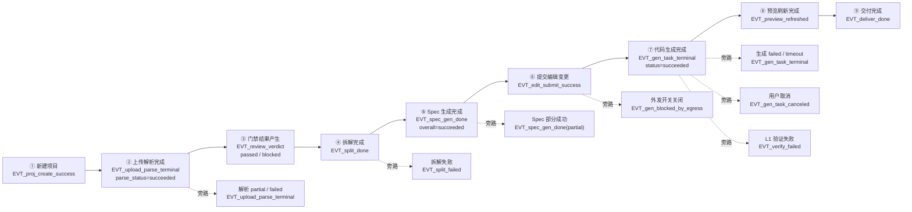

# AutoDevelopment 平台 埋点 Spec

> 版本：**v0.1.12** ｜ 来源 PRD：平台需求概要（平台自身的产品需求）v1.4 · 第 4 轮回写后 · 门禁阻断 0（document_id: `platform/平台需求概要.md`, revision: v1.4/S 2026-10-20）｜ 角色：埋点 ｜ 更新：2026-10-29（**工程接入（二期 · 增量写回）**：新增 2 条 `EVT_patch_writeback_*` 事件，事件总数 **57 → 59**，附节 C 同步）；上一轮 2026-10-29（**工程接入（一期）`F17`/`F18`**：新增 3 条 `EVT_intake_*` 事件，事件总数 **54 → 57**，附节 C 同步）；上一轮 2026-10-26（**B9：禁用无点击事件、写回需正文回读核验、查看正文/深链显式不埋**；**审核流程优化**：`EL-REVIEW-054` 自动审核开关本身、以及**自动开审 / 回写后自动重审**均显式表态不埋；`EL-*` 435）；**本轮同版增量补正**：#8服务端哈希、初载/手动文档门禁、严格正文继承与当前doc历史；不另开轮次。
>
> **本次作业性质**：以 `platform/design/数据模型.md`、`platform/design/验收标准.md`、`platform/design/接口契约.md` 为**底稿**做格式转换与对齐，
> 以 `platform/specs/UI-Spec.md`（**450 元素**；沿革 412 → **419**〔2026-10-21 本机落地 +7〕→ **424**〔2026-10-22 对话面板 +5〕→ **425**〔2026-10-23 审核页写回入口 `EL-REVIEW-052` +1〕→ **426**〔2026-10-26 审核页未通过项补充信息 `EL-REVIEW-053` +1〕→ **427**〔2026-10-26 审核流程优化 `EL-REVIEW-054` +1〕→ **435**〔2026-10-26 B9 +8〕→ **447**〔2026-10-29 工程接入 +12〕→ **450**〔2026-10-29 二期写回 +3〕，见 §1 关联文档）与 `platform/specs/App-Spec.md`（13 路由 / §10.1 的 **32 行**埋码点〔2026-10-21 本机落地后；早期为 25 行占位〕）为**对齐对象**，
> 以 `platform/requirements/埋点-需求包.md` 的 **9 节点漏斗 + 4 条负向事件 + 2 类合规事件**为**必收内容**，不重新设计产品。
> 冲突时**以 `platform/平台需求概要.md` 为准**并登记，不自行裁决。
>
> **来源标签**（沿用基线记法）：`§FX` / `§X` = `platform/平台需求概要.md`；`数据模型§X` = `platform/design/数据模型.md`；
> `接口契约 #n` / `#n` = `platform/design/接口契约.md` 与 `platform/specs/接口-Spec.md`；`AC-*` / `E2E-*` = `platform/design/验收标准.md`；
> `UI-Spec §X` / `App-Spec §X` = 同批上游 Spec；`[来源: 推断，待确认]` = 平台推导（属**假设**性质，原文标签**原样保留**，不阻塞开工）。
> ★ = **章节强调标记**（核心漏斗节点 / 合规专节）。**`#63`~`#68` 补口接口与字段级补口已于 2026-10-21 由草案转正式基线**（`platform/decisions/P0-补口裁决单.md` §4）—— 本 Spec **不再使用「★ = 草案」标记**，原带草案标记的接口引用一律按**正式基线**读（`[埋点-Q9]` 已闭合）。
>
> ★ **本 Spec 已定稿，`App-Spec §10` 可去除占位标记** —— **早期 25 行**占位名的正式命名与埋码点见 **附节 A**（`REQ-TRACK-001`）。

---

## 0 阅读约定：**两条埋点线必须分清（不混写）**

|  | **A 线：平台自身埋点** | **B 线：被开发项目的埋点方案** |
|---|---|---|
| 埋的是什么 | **AutoDevelopment 平台自己**的用户行为（谁在平台上做了什么） | **用户那个安卓 App** 的业务埋点（用户 App 里的行为） |
| 需求来源 | `§9 补充块⑦`（`D-Q21`）→ `REQ-TRACK-001`~`003` | `§F5` + `§6` → `REQ-SPLIT-004` |
| 需求方原话 | **「需要什么埋点」「什么场景埋点」** | 同（但对象是用户项目） |
| 载体 | 平台侧 `#62 POST /metrics/events`（批量 + 失败静默重试） | `数据模型 E12 TrackPlan`（`event_key` + `trigger_desc` + `params` + `element_id` + 状态四态） |
| 事件命名 | **由本 Spec 定义**（`EVT_<模块>_<动作>`，小写下划线，**全局唯一**） | `EVT_<模块>_<动作>`，**每个用户项目内唯一** |
| 本 Spec 的位置 | **§2~§11 全部内容** | **附节 B（方案规范）** —— 具体条目由平台按用户 PRD 生成，**不在本 Spec 逐条枚举** |
| 谁写代码 | 平台开发（S7） | **App 角色按本 Spec 附节 B 写入用户安卓工程**（S7） |
| 谁验证 | 测试角色（`AC-TR-01/02`） | 测试角色（`E2E-08`） |

> ⚠️ **三条不得混用的口径（逐条遵守，来源：`埋点-需求包 §1`）**：
> ① **埋点不经事件面板上报**。埋点由「**S4 定方案 → S7 写进代码**」落地；事件面板**只生成空回调存根**（`action_type` 本期仅 `none`）。
> 这是**两条独立路径**，本 Spec **不得**把它们合流（`§F14 补充块⑩`；**项目约束 4**）。
> ② **A 线的事件名与 B 线的事件名不共享命名空间**：A 线事件落平台埋点库（带 `source=platform`），
> B 线事件写进用户工程、**不进平台埋点库**（见 `[埋点-Q10]`）。
> ③ **A 线口径与 `REQ-NF-001` 严格一致**：**L1 计入指标、L2 仅记录**；`L2` 耗时**不得**混入 L1 指标。

**阶段定位**：埋点**不占独立流程阶段** —— **方案在 S4 定义（本 Spec）** → **代码在 S7 由 App 角色写入** → **验证在 S8 由测试角色执行**。
因此本 Spec 的每一条事件都必须写到**能被开发直接埋码、被测试直接判定**的程度（`埋点-需求包` 抬头 §阶段定位）。

---

## 1 文档信息

| 项 | 内容 |
|---|---|
| 文档目的 | 定义**需要什么埋点、什么场景埋点**，作为**开发埋码依据**与**测试验证依据** |
| 不在范围 | ① 数据仓库建模与报表；② 埋点数据的可视化看板；③ **B 线（被开发项目）埋点具体条目的枚举**（由平台按用户 PRD 生成，见附节 B）；④ 数据治理与 BI 口径 |
| 关联文档 | `UI-Spec.md`（**450 元素** / 13 页；412 → 419〔2026-10-21 本机落地 +7：`EL-AUTH-017`~`021`+`EL-REVIEW-051`+`EL-GLOBAL-009`〕→ **424**〔2026-10-22 对话面板 +5：`EL-WORK-031`~`035`〕→ **425**〔2026-10-23 审核页 `EL-REVIEW-052` +1〕→ **426**〔2026-10-26 审核页未通过项补充信息 `EL-REVIEW-053` +1〕→ **427**〔2026-10-26 审核流程优化 `EL-REVIEW-054` +1〕→ **435**〔2026-10-26 B9 +8〕→ **447**〔2026-10-29 工程接入 +12〕→ **450**〔2026-10-29 二期写回 +3〕）、`接口-Spec.md`（**82 接口** = 63 基线 + 8 补口 + 本机落地 `#71`/`#71a`/`#72`/`#72a` + **工程接入 `#73`~`#75`** + **二期写回 `#76`~`#79`**；原 **75** = 63 基线 + `#63`~`#68` 转基线 + `#69`/`#70` + **本机落地 `#71`/`#71a`/`#72`/`#72a`**）、`App-Spec.md`（13 路由 / §10.1 的 **32 行**埋码点〔2026-10-21 本机落地后；早期 25 行占位〕，已按附节 A 回填）、`测试-Spec.md`、`baseline/需求追溯矩阵.md`、`platform/decisions/P0-补口裁决单.md`（2026-10-21 补口裁决） |
| 上游需求包 | `platform/requirements/埋点-需求包.md`（两条埋点线 / 9 节点漏斗 / 埋码点要求 / 隐私合规） |
| 事件总数 | **59 条**（2026-10-29 二期写回 +2：`EVT_patch_writeback_done` / `EVT_patch_writeback_failed`；2026-10-29 工程接入 +3：`EVT_intake_click` / `EVT_intake_done` / `EVT_intake_failed`；此前 **54 条** = 其中 **早期 25 条**对应 `App-Spec §10` 的 25 行占位；27 条为本次新增，逐条给出业务问题与 EL-ID；**+2 条 = 2026-10-21 本机落地新增**：`EVT_auth_password_login`（§3.1）、`EVT_llm_model_switch`（§3.13，并新增业务问题 `G-014`）） |
| 核心漏斗 | **9 节点**（`REQ-TRACK-001`）+ **负向旁路 9 条**（`AC-TR-01` 的判定依据） |
| 术语口径 | 事件名 = `EVT_<模块>_<动作>`（**全小写下划线**）；元素 = `EL-<模块>-<三位>`（**大写零填充**，`D-A2`）；路由 = `RT-*`；页面 = `UI-*` |
| 生效范围 | 本期**只做安卓**目标端、平台侧为 **Web 工作台**（桌面浏览器 1440×900 基准）；账号 = **飞书扫码登录**（`user_id` = 飞书 `open_id`）；**2026-10-21 本机落地起并存「本地账号密码登录」**（`#72`，开发阶段扩展、生产必须关闭 `AD_PASSWORD_LOGIN=disabled`），登录页由 `EL-AUTH-017` 分段控件切换；本地登录下的 `user_hash` 口径**未定** → `[埋点-Q14]` |

### 1.1 本 Spec 相对模板骨架的结构说明

严格按 `templates/埋点-Spec.md` 的 §1~§11 骨架填写，**仅新增 3 个附节**（不改变模板节号）：

| 模板节 | 本 Spec 节 | 说明 |
|---|---|---|
| §1~§11 | §1~§11 | 一一对应，**不新增、不删减** |
| （骨架无） | **附节 A ★ `App-Spec §10` 埋码点回填对照表（25 个编号行 + 1 行补充映射）** | `REQ-TRACK-001` 要求「事件名与参数由埋点角色定义」的回填落点 |
| （骨架无） | **附节 B ★ B 线：被开发项目埋点方案（`TrackPlan`）规范** | `埋点-需求包 §0` 要求「两者都要在本 Spec 中成节」 |
| （骨架无） | **附节 C 事件名总表（59 条，供一致性比对）** | `需求追溯矩阵 §三-4`「埋点事件名 ↔ App 埋点位置 ↔ 测试用例事件名 三处一致」的核对索引 |

---

## 2 埋点目标与口径

> **设计方法：从业务问题出发，不是从页面出发。** 下表每一行先写「要用数据回答什么业务问题」；**没有业务问题的埋点不提**
> （不提的候选逐条表态，见 **§3.12**）。

| 目标编号 | 要回答的业务问题 | 对应 REQ-ID | 关键指标 | 口径说明 |
|---|---|---|---|---|
| `G-001` | **主流程漏斗在哪一步流失最多？** | `REQ-TRACK-001` | 9 节点逐节点转化率 | 节点到达 = 该节点绑定事件被上报的**去重用户数**（已登录按 `user_hash` 去重，未登录按 `anon_id`）；分母 = 节点 1 用户数。**同一用户同一节点只计 1 次** |
| `G-002` | **代码生成的成功率与耗时是否达标（L1 P95 ≤ 90s）？** | `REQ-TRACK-002`、`REQ-NF-001` | L1 成功率、P50 / P95 用时 | 取 `EVT_gen_task_terminal` 的 `status` 与 `duration_ms`；**`duration_ms` 服务端口径 = `started_at → finished_at`**；**L2 耗时只在 `EVT_l2_reported` 记录，不进本指标** |
| `G-003` | **上传解析的失败与部分失败有多严重？空文档算不算成功？** | `REQ-UPLOAD-001`、`003`、`004` | `partial` 率、`failed` 率、`empty_document` 率 | 取 `EVT_upload_parse_terminal.parse_status`；**`partial` 不得混进成功**（`AC-UP-06`）；`empty_document=true` 时**是否计入节点 2 见 `[埋点-Q1]`**（默认取**不计入**） |
| `G-004` | **门禁阻断是否卡住了用户？回流复审要几轮？** | `REQ-REVIEW-001`、`008` | 阻断率、平均回流轮次、复审及时率 | 阻断率 = `EVT_review_verdict` 中 `verdict=blocked` / 全部终态；祖先链按 `revision_id` 串联 |
| `G-005` | **拆解质量：是不是总有角色拆不出需求？** | `REQ-SPLIT-001` | `empty_role_count` 分布、REQ 总数分布 | 取 `EVT_split_done.req_count_by_role`；**某角色 0 条 = 「部分空」，不是页面空态** |
| `G-006` | **Spec 生成的单份失败率与各角色耗时？** | `REQ-SPEC-001`、`002` | `partial` 率、各角色 P50 / P95 | 取 `EVT_spec_gen_done.overall` 与 `duration_ms_by_role`；**`overall` 绝不置为成功** |
| `G-007` | **用户在哪一步对生成失去耐心（取消发生时的进度）？** | `REQ-GEN-005` | 取消率、取消时 `progress` 分布 | 取 `EVT_gen_task_canceled.progress`；**取消不计入失败、不计重试**（`AC-ED-18/19`；2026-10-21 重编后 `18`/`19` 专指「取消」语义，原第二组已重编为 `AC-ED-21`/`AC-ED-22`，见 §7.4） |
| `G-008` | **交付收口率：多少项目真正走到交付？** | `REQ-DELIVER-001` | 节点 9 / 节点 1 | 交付 = `EVT_deliver_done`（**导出成功之后**，不是点击下载时） |
| `G-009` | ★ **合规证据链：告知是否真的展示了、用户是否确认、关闭开关后有没有静默降级？** | `REQ-AUTH-004`、`AC-AU-08`、`AC-AU-09` | 告知展示数、确认率、取消率、开关关闭数、**被拦截的生成次数** | 见 **§8.3 专节**；「被拦截次数 > 0」是「**没有静默降级**」的正面证据 |
| `G-010` | **会话与鉴权中断对漏斗口径的干扰有多大？** | `REQ-AUTH-001`、`002`、`003` | 登录成功率、会话过期次数、403 次数 | 用于判断漏斗分母是否需要剔除中断会话（**401/403 期间的事件不得计入节点到达**） |
| `G-011` | **能力接入被用起来的程度与失败率？** | `REQ-CAP-001`、`002`、`005` | 保存并生成次数、`partial` 率、冲突数 | 取 `EVT_cap_save_generated.overall` / `failed_capabilities` |
| `G-012` | **对话通路是否稳定（回复失败 / 超时）？** | `REQ-CHAT-001`、`002` | 回复失败率、回复 P95 时长、空消息拦截次数 | 取 `EVT_chat_reply_terminal.status` 与 `EVT_chat_send_blocked`；**参数不含消息正文** |
| `G-013` | **元素 id 作废对已定稿的 B 线埋点与测试用例影响多大？** | `REQ-UIEDIT-008` | 作废 id 数、被引用 id 的作废数 | 取 `EVT_edit_element_voided`；**作废 id 不得再产生新事件**（`REQ-UIEDIT-009`） |
| `G-014` | **门禁结论的差异是不是「换了模型」造成的？这份判定是谁给的？** | `REQ-REVIEW-001`（派生：`#71` / `#71a`） | 模型切换次数与分布、按 `#17.model` 分组的 `blocking_count` 分布 | 以 `#17` 出参 `model`（审核页 `EL-REVIEW-051`）为**权威模型来源**，`EVT_llm_model_switch` 只提供**切换时间线与动机**，两者按 `client_ts` 互印证（§3.13 注）；**同模型内比质量、跨模型比能力**，不得混作质量回归 |

**口径的三条统一约定（全事件适用）**：

1. **去重主体**：漏斗类指标按**用户**去重；计数类指标（次数）按**事件条数**统计，但**必须先去重**（去重规则见 §3 各事件）。
2. **时间口径**：所有 `datetime` 参数 **UTC 存储**（ISO-8601），展示按浏览器本地时区；**时间戳缺失时不上报、不补 1970**（`REQ-NF-005`）。
3. **中断剔除**：`EVT_auth_session_expired` / `EVT_auth_forbidden` 期间发生的流程中断，**不计入漏斗节点的「到达」**，只计入 `G-010`。

---

## 3 事件字典

> **读法**：每张表给出 `事件名 | 触发场景 | 精确触发时机 | 上报参数（名:类型=取值） | 上报时机 | 去重规则 | 对应 REQ-ID | 页面（UI-* / RT-*） | 元素（EL-*） | 埋码点（类/方法/回调）`。
> **触发时机必须可判定**：禁止「操作时」「页面加载时」「数据变化时」这类表述；本文一律写成「**某动作成功/失败之后、某请求之前/之后**」。
> **★ 标记** = 核心漏斗节点；**旁路** = 负向事件；**合规** = `REQ-AUTH-004` 证据链事件。

### 3.1 账号与会话（辅助 · 回答 `G-010`）

| 事件名 | 触发场景 | 精确触发时机 | 上报参数（名:类型=取值） | 上报时机 | 去重规则 | 对应 REQ-ID | 页面 | 元素 | 埋码点 |
|---|---|---|---|---|---|---|---|---|---|
| `EVT_auth_scan_success` | 飞书扫码登录成功 | `#64` 轮询返回 `scan_status=confirmed` 且 `token` 写入 `STORE-GLOBAL/SESSION` **之后**、`replace` 到 `nextPath` **之前** | `duration_ms:int`（二维码首次展示→confirmed）、`qr_refresh_count:int(0~n)`、`reentry:bool`（由 `?next=` 存在与否判定） | 即时 flush | 同一 `session_id` 只报 1 次 | `REQ-AUTH-001` | `UI-AUTH-001` / `RT-AUTH-001` | `EL-AUTH-006`、`EL-AUTH-009` | `STORE-AUTH` 的 `#64` 回调 `onConfirmed(token)` 内（写 token 之后） |
| `EVT_auth_login_failed` | 扫码换取 token 失败 | `#64` 返回失败或网络异常，且 `EL-AUTH-010`「登录没成功，请重试。」**渲染之后** | `error_code:string`（`UPSTREAM_TIMEOUT`/`UPSTREAM_UNAVAILABLE`/`RATE_LIMITED`/`NOT_FOUND`）、`retry_index:int` | 即时 | 同一 `state` 只报 1 次（重试产生新 `state`） | `REQ-AUTH-001` | `RT-AUTH-001` | `EL-AUTH-010`、`EL-AUTH-011` | `#64` 失败分支回调（置 `EL-AUTH-010` 可见之后） |
| `EVT_auth_password_login` | **本地账号密码登录**（2026-10-21 本机落地） | **三互斥分支，逐支可判定**：① `result=blocked` —— 点 `EL-AUTH-020`（或 `EL-AUTH-018`/`019` 回车）后前端必填校验未通过、字段级提示**渲染之后**，且 **`#72` 请求尚未发出**（判定：网络面板无 `#72` 请求）；② `result=failed` —— `#72` 返回 **401 `UNAUTHENTICATED`**（`EL-AUTH-010` 文案 = **「用户名或密码不正确。」**，**与「账号不存在」同码同文案**），或 **400 `INVALID_ARGUMENT`**（`EL-AUTH-010` **显示服务端 `message`**）、超时 / 网络异常（文案 = 「登录没成功，请重试。」），且提示**渲染之后**、**停留本页**；③ `result=success` —— `#72` 返回 200 且 `token` 写入 `STORE-GLOBAL/SESSION` **之后**、`replace` 到 `nextPath`（或 `UI-PROJ-001`）**之前** | `result:enum{blocked,failed,success}`、`reason:string\|null`（仅 `failed` 非空：`UNAUTHENTICATED`（凭据错误的**统一码**，**不区分账号是否存在**）/`INVALID_ARGUMENT`/`UPSTREAM_TIMEOUT`/`UPSTREAM_UNAVAILABLE`/`NETWORK_ERROR`）、`block_reason:enum{empty_username,empty_password,submitting}\|null`（仅 `blocked` 非空）、`duration_ms:int`（点击/回车 → 本分支判定时刻；`blocked` 分支为点击 → 字段级提示渲染）、`retry_index:int(0~n)`（同一 `session_id` 内本次提交序号，首次 = 0）、`reentry:bool`（由 `?next=` 存在与否判定） | 即时 flush | `dedup_key` = `{session_id}:auth_password_login:{retry_index}`；**同一次点击只报 1 次**；`result=success` 另按**同一 `session_id` 只报 1 次**兜底（成功后立即跳转） | `REQ-AUTH-001`（**阶段替换**） | `UI-AUTH-001` / `RT-AUTH-001` | `EL-AUTH-020`、`EL-AUTH-018`、`EL-AUTH-019`、`EL-AUTH-010` | `#72` 的三个分支回调内（成功分支在写 `token` 之后、跳转之前；失败分支在 `EL-AUTH-010` 渲染之后；`blocked` 分支在前端表单校验失败分支内） |
| `EVT_auth_session_expired` | 会话过期 | **任意业务接口返回 401** 且已跳转 `RT-AUTH-001`、`EL-AUTH-012` **渲染之后** | `source_rt:string`（`RT-*`）、`source_api:string`（`#n`）、`had_draft:bool`（是否存在未提交本地草稿） | 即时 flush | 同一 `session_id` 只报 1 次 | `REQ-AUTH-001`、`REQ-AUTH-003` | 全局 | `EL-AUTH-012`、`EL-AUTH-013` | 全局响应拦截器 401 分支（跳转之后） |
| `EVT_auth_logout` | 退出登录 | 点用户菜单「退出登录」且 `#65` 返回成功（**或**网络失败走本地强制登出）**之后**、清会话状态**之后** | `forced:bool`（`true` = 网络失败本地强制登出） | 即时 flush | 同一 `session_id` 只报 1 次 | `REQ-AUTH-001` | `RT-PROJ-001`、`RT-WORK-001` | `EL-PROJ-006`、`EL-WORK-008` | 用户菜单「退出登录」项 `onClick` → `#65` 回调内 |
| `EVT_auth_forbidden` | 越权被拦截（统一 403 无权限态） | **任意业务接口返回 403** 且统一无权限态**渲染之后** | `source_rt:string`、`source_api:string`、`resource:enum{project,kb_doc,spec,spec_export,deliverable,api_def,capability,review}` | 批量 | 同一 `source_api` + `resource` 在 3s 内只报 1 次 | `REQ-AUTH-002`、`REQ-AUTH-003` | 全局 | `EL-AUTH-014`、`EL-PROJ-031` 等各页 403 区块 | 全局响应拦截器 403 分支（**不区分「不存在」与「无权限」**，参数也不得携带对象名） |

> ✅ `EVT_auth_*` 依赖的接口 **`#63`/`#64`/`#65`/`#66` 已于 2026-10-21 由草案转正式基线**（`[缺口-API-01]` 已闭合，`P0-补口裁决单` §4）—— **已就位，正向埋码**（`[埋点-Q9]` 已闭合）。
> `#62` 的上报体结构不变（见 §5）；本组事件的**成功分支**按正式基线实现，不再需要「契约未就绪走失败分支」的兜底。
> ⚠️ **`EVT_auth_password_login` 为 2026-10-21 本机落地扩展**（依赖 `#72` / `#72a`，`接口-Spec §5.4.13`）——**未过门禁、未进入第 4 轮基线冻结范围**。
> `REQ-AUTH-001` 原文要求「登录方式 = 飞书扫码登录……**不另建用户名/密码**」，本条属**阶段替换**；生产必须关闭该登录方式（`AD_PASSWORD_LOGIN=disabled`）→ `[埋点-Q13]`。
> 🔒 **本事件的安全红线**：**不得**上报用户名（`EL-AUTH-018` 输入值）、密码（`EL-AUTH-019` 输入值），
> **也不得上报其长度、掩码、哈希或任何派生值**；`#72` 对「账号不存在」与「密码错误」返回**同码同文案**（`UNAUTHENTICATED`），
> 埋点侧**不得**用任何参数把两者区分开（**含 `duration_ms` 的异常偏短/偏长**）——`duration_ms` 仅用于登录体验监控，**不得**用于判定账号存在性。
> 与 `EVT_auth_login_failed` 的关系：两者**共用同一错误区块 `EL-AUTH-010`，但互斥**（前者只在飞书扫码分支、后者只在账号密码分支产生），不会重复计数。
> 登录方式**切换**（`EL-AUTH-017` 点击）与 `#72a` 下发**均不埋**，逐条理由见 **§3.12**。

### 3.2 项目与激活（回答 `G-001` 的入口段、`G-008` 的分母）

| 事件名 | 触发场景 | 精确触发时机 | 上报参数（名:类型=取值） | 上报时机 | 去重规则 | 对应 REQ-ID | 页面 | 元素 | 埋码点 |
|---|---|---|---|---|---|---|---|---|---|
| `EVT_proj_create_click` | 点击「新建项目」 | `EL-PROJ-005` / `EL-PROJ-023` 的 `onClick` 内、`createDialog.open` 置 `true` **之前**（**不发请求**） | `entry:enum{header,empty_state}` | 批量 | 同一 `element_id` 在 **300ms** 内连点只报 1 次 | `REQ-PROJ-001` | `UI-PROJ-001` / `RT-PROJ-001` | `EL-PROJ-005`、`EL-PROJ-023` | 两元素 `onClick`（弹窗打开前）；**与「创建成功」是两个事件** |
| **★`EVT_proj_create_success`** | 项目创建成功（**漏斗节点 1**） | `#2` 返回成功、**列表已插入该项目**、Toast「项目已创建」**渲染之后**（`IDEMPOTENT_REPLAY` 分支**不报**） | `project_id:string(36)`、`stage:enum{created}`、`name_visible_chars:int(1~50)`（**只报长度，不上报名称文本**）、`duration_ms:int` | 即时 flush | `dedup_key` = `Idempotency-Key`；同一 `project_id` 只报 1 次 | `REQ-PROJ-001`、`REQ-NF-006` | `RT-PROJ-001` | `EL-PROJ-041`、`EL-PROJ-010` | `ProjectListStore.createProject()` 的 `onSuccess(resp)` 内（`items` 更新之后） |
| `EVT_proj_create_blocked` | 点击「确定」但**被校验拦截** | `#2` 返回 400（`INVALID_ARGUMENT`）且 `EL-PROJ-039` 字段级错误**渲染之后** | `code:string=INVALID_ARGUMENT`、`field:string=name`（**不含用户输入内容**） | 批量 | 同一 `dedup_key` 只报 1 次 | `REQ-PROJ-001` | `RT-PROJ-001` | `EL-PROJ-041`、`EL-PROJ-039` | `#2` 的 400 分支回调（错误文案渲染之后） |
| `EVT_proj_open_workbench` | 进入项目（激活起点） | 点 `EL-PROJ-015` / `EL-PROJ-010` 且 `#3` 项目详情返回成功、已进入 `RT-WORK-001` **之后** | `project_id:string(36)`、`stage:enum{created,kb_ready,reviewing,supplementing,gate_passed,splitting,spec_generating,ui_ready,api_developing,app_developing,editing,code_generating,verifying,preview_ready,manual_required,testing,delivered}`（`数据模型 §3.1`）、`from_entry:enum{card,enter_button}` | 批量 | 同一 `project_id` 且同一 `session_id` 只报 1 次 | `REQ-PROJ-002`、`REQ-PROJ-005` | `RT-PROJ-001` → `RT-WORK-001` | `EL-PROJ-015`、`EL-PROJ-010` | `#3` 成功回调内（路由进入之后） |
| `EVT_proj_deleted` | 项目删除 | 二次确认 `EL-PROJ-046` 后 `#5` 返回成功、卡片已移除、Toast「项目已删除，30 天后彻底清除」**渲染之后** | `project_id:string(36)`、`deleted_at:datetime`（UTC） | 即时 flush | 同一 `project_id` 只报 1 次 | `REQ-PROJ-004`、`REQ-AUTH-008` | `RT-PROJ-001` | `EL-PROJ-046`、`EL-PROJ-018` | `#5` 成功回调内（列表移除之后） |
| `EVT_intake_click` | 点击「接入已有工程」入口 | `EL-PROJ-048` 的 `onClick` 内、`EL-PROJ-049` 弹窗打开**之前**（**不发请求**） | `entry:enum{header}` | 批量 | 同一 `element_id` **300ms** 内连点只报 1 次 | `REQ-INTAKE-001` | `UI-PROJ-001` / `RT-PROJ-001` | `EL-PROJ-048` | `EL-PROJ-048` 的 `onClick`（弹窗打开前） |
| `EVT_intake_done` | 接入已有工程**成功** | `#73` 返回成功、约束包落库、Toast「已接入工程（{项目名}），提取约束 {n} 项」**渲染之后** | `project_id:string(36)`、`project_name_chars:int`（**只报长度，不上报工程名文本**）、`counts_items:int`、`counts_modules:int`、`counts_dependencies:int`、`warnings_count:int`、`duration_ms:int` | 即时 flush | `dedup_key` = `Idempotency-Key`；同一 `project_id` 只报 1 次 | `REQ-INTAKE-001`、`REQ-INTAKE-002` | `RT-PROJ-001` | `EL-PROJ-055`、`EL-PROJ-049` | `#73` 成功回调内（Toast 之后、列表刷新之前）；**工程根路径文本不上报** |
| `EVT_intake_failed` | 接入已有工程**失败** | `#73` 返回 400/404/409/超时/网络异常，且 **Toast 错误提示渲染之后**（**含「根目录为空」「未勾选授权」「路径非法」「非 Android 工程」四类前端与服务端拦截**；前端拦截**不发 `#73`**，同样上报本事件） | `error_code:string`（`INVALID_ARGUMENT`/`NOT_FOUND`/`VERSION_CONFLICT`/`UPSTREAM_TIMEOUT`/`UPSTREAM_UNAVAILABLE`/`NETWORK_ERROR`）、`block_reason:enum{no_root,no_consent,not_android,other}|null` | 批量 | 同一 `Idempotency-Key` 只报 1 次 | `REQ-INTAKE-001` | `RT-PROJ-001` | `EL-PROJ-055`、`EL-PROJ-051`、`EL-PROJ-053` | `#73` 失败分支回调内；**不得上报用户填写的路径 / 项目名文本** |


> **为什么「进入项目」要埋**：它回答「**建了项目但没用起来的比例（激活率）**」——这是 `G-001` 漏斗第一段唯一的可观测缺口（`REQ-PROJ-002` 要求：若提必须回答业务问题）。
> **`deleted_at` 的作用**：作为**埋点数据清理口径的时间基准**（`REQ-AUTH-008` + `[埋点-Q4]`），不是产品分析指标。

### 3.3 上传与解析（回答 `G-003`、漏斗节点 2）

| 事件名 | 触发场景 | 精确触发时机 | 上报参数（名:类型=取值） | 上报时机 | 去重规则 | 对应 REQ-ID | 页面 | 元素 | 埋码点 |
|---|---|---|---|---|---|---|---|---|---|
| `EVT_upload_entry_click` | 点击「上传 PRD」入口 | `EL-WORK-027` 的 `onClick` 内、**路由跳转之前**（即使随后被 `EL-GLOBAL-004` 告知弹窗拦截，本事件**已上报**） | `project_id:string(36)`、`gate:enum{notice_required,pass}` | 批量 | 300ms 内连点只报 1 次 | `REQ-UPLOAD-001` | `RT-WORK-001` | `EL-WORK-027` | `EL-WORK-027` 的 `onClick` 内（跳转前） |
| `EVT_upload_start` | 开始上传并触发解析 | 点 `EL-UPLOAD-014` 且**三个前置全部满足**（告知已确认 / 外发开关开启 / 前端规格预校验通过）后、`#10` 请求**发出之前** | `source_type:enum{file,feishu_link}`、`file_count:int(1~n)`、`total_size_mb:number`（**不上报文件名**） | 批量 | `dedup_key` = `Idempotency-Key`；3s 内同键只报 1 次 | `REQ-UPLOAD-001`、`REQ-NF-006` | `UI-UPLOAD-001` / `RT-UPLOAD-001` | `EL-UPLOAD-014` | `#10` 请求前（前置校验通过之后） |
| `EVT_upload_rejected` | 文件被规格校验拒绝（**旁路**） | 前端预校验失败并渲染 `EL-UPLOAD-028/029/030` **之后**；**或** `#10` 返回 413 / 422 **之后** | `reject_reason:enum{format_unsupported,too_large,too_many_pages}`、`size_mb:number`、`page_count:int\|null`（未知填 `null`，**不填 0**） | 批量 | 同一文件在同一次选择中只报 1 次 | `REQ-UPLOAD-002` | `RT-UPLOAD-001` | `EL-UPLOAD-028`、`EL-UPLOAD-029`、`EL-UPLOAD-030`、`EL-UPLOAD-003` | 前端预校验失败分支 / `#10` 的 413、422 分支回调 |
| **★`EVT_upload_parse_terminal`** | 解析任务到达终态（**漏斗节点 2**） | 解析任务进入**终态**（SSE `task` 终态 **或** `#44` 轮询到终态）且 `#14` 结果写入 `STORE-UPLOAD.parseResult` **之后** | `parse_status:enum{succeeded,partial,failed}`、`empty_document:bool`、`failed_parts_count:int(0~4)`、`parts_ok_count:int(0~4)`、`duration_ms:int`、`revision_id:string(36)`、`source_type:enum{file,feishu_link}`、`error_code:string\|null` | 即时 flush | **以 `task_id` 去重**（SSE 重连不重复上报同一终态） | `REQ-UPLOAD-001`、`003`、`004`、`006` | `RT-UPLOAD-001` | `EL-UPLOAD-018`~`021`、`EL-UPLOAD-026`、`EL-UPLOAD-027` | `ParseStore.onTaskTerminal(status)` 回调内（`parseResult` 写入之后） |
| `EVT_upload_part_manual_supplement` | 对部分失败分块手动补充 | 点 `EL-UPLOAD-025`「手动补充」且 `#15` 返回成功、该块 `status → ok` **之后** | `part_key:enum{body,tables,whiteboards,attachments}` | 批量 | 同一 `revision_id` + `part_key` 只报 1 次 | `REQ-UPLOAD-003` | `RT-UPLOAD-001` | `EL-UPLOAD-025`、`EL-UPLOAD-023`、`EL-UPLOAD-024` | `#15` 成功回调内（该块状态更新之后） |

> **`partial` 不得混进成功**：`parse_status=partial` **单独取值**上报，且**必须**带 `failed_parts_count`（`AC-UP-06`）。
> **`empty_document`**：与 `failed` 区分（`REQ-UPLOAD-004`）；是否计入节点 2 → `[埋点-Q1]`。

### 3.4 门禁审核（回答 `G-004`、漏斗节点 3）

| 事件名 | 触发场景 | 精确触发时机 | 上报参数（名:类型=取值） | 上报时机 | 去重规则 | 对应 REQ-ID | 页面 | 元素 | 埋码点 |
|---|---|---|---|---|---|---|---|---|---|
| `EVT_review_submit` | 提交审核 / 复审 | 点 `EL-REVIEW-026`（或空态 `EL-REVIEW-039` 的「开始审核」）且二次确认通过、`#16` 返回 **202**、`review_id` + `task_id` 写入 **之后** | `review_id:string(36)`、`revision_id:string(36)`、`standard_version:int`、`entry:enum{submit_review,empty_state_start}` | 即时 flush | `dedup_key` = `Idempotency-Key`；同一 `revision_id` + `standard_version` 只报 1 次 | `REQ-REVIEW-001` | `RT-REVIEW-001` | `EL-REVIEW-026`、`EL-REVIEW-050`、`EL-REVIEW-039` | `#16` 的 202 回调内（**与「审核完成」是两个事件**） |
| `EVT_review_submit_blocked` | 保留事件定义：阻断未答拦截 | **B9 现状：EL-REVIEW-026 已 disabled，正常点击无 onClick，不发 #16；ReviewPage 当前无本事件 track 调用**。不得声称已发拦截事件/高亮；若保留负向统计目标，主 Agent 另定非点击触发与去重方案 | blocking_open:int(≥1)、code:string=INVALID_ARGUMENT | 批量（定义保留） | 实现待定，禁止禁用每次 render 计数 | `REQ-REVIEW-003` | `RT-REVIEW-001` | `EL-REVIEW-026`、`EL-REVIEW-060` | **待补：当前无可达埋码点**，不删事件以掩盖缺口 |
| **★`EVT_review_verdict`** | 门禁结果产生（**漏斗节点 3**） | `#17` **首次**返回终态 `verdict` 且 `STORE-REVIEW.report` 写入 **之后** | `verdict:enum{running,passed,blocked,failed,superseded}`、`blocking_count:int`、`major_count:int`、`suggestion_count:int`、`revision_id:string(36)`、`standard_version:int`、`duration_ms:int`、`malformed:bool`（agent 输出畸形降级，`REQ-REVIEW-007`）、`superseded_after_hours:number\|null` | 即时 flush | 以 `review_id` 去重；`superseded` 后续翻转**不重复上报**（只随下一次 `EVT_review_verdict` 体现） | `REQ-REVIEW-001`、`REQ-REVIEW-007` | `RT-REVIEW-001` | `EL-REVIEW-003`、`EL-REVIEW-005`、`EL-REVIEW-006` | `ReviewStore.onVerdict(report)` 回调内（首次拿到终态时） |
| `EVT_review_writeback` | 原子写回并经正文回读核验 | #23 成功 → GET #8 成功，version/hash 与回执一致且补充正文存在 → 更新 writeNotice 后；包含 changed=false 核验成功分支 | deleted_lines:int、modified_lines:int、added_lines:int、accepted_items_count:int、new_revision_id:string | **即时 flush（当前代码 immediate:true）** | dedupKey=reviewId，same review only once | `REQ-REVIEW-002`、`REQ-REVIEW-006` | `RT-REVIEW-001` | `EL-REVIEW-031`、`EL-REVIEW-061` | doWriteback 正文核验成功分支；核验失败**不报**，不把 PRD/答复/hash 文本纳入事件 |
| `EVT_review_standard_saved` | 维护门禁标准 | 点抽屉 `EL-REVIEW-047` 保存且 `#24` 返回成功、版本号回显「门禁标准已保存（v{n}）」**之后** | `standard_version:int`、`items_count:int` | 批量 | 同一 `standard_version` 只报 1 次 | `REQ-REVIEW-005` | `RT-REVIEW-001`（`?drawer=gate-standard`） | `EL-REVIEW-047`、`EL-REVIEW-048`、`EL-REVIEW-049` | `#24` PUT 成功回调内（版本号回显之后） |
| `EVT_review_loopback_exceeded` | 超限二选一 | 回流轮次 > 3 时 `EL-REVIEW-037` 渲染后，用户点任一按钮且该动作完成 **之后** | `choice:enum{accept_and_record,abort}`、`loopback_round:int` | 即时 flush | 同一 `revision_id` 只报 1 次 | `REQ-REVIEW-008` | `RT-REVIEW-001` | `EL-REVIEW-037` | `EL-REVIEW-037` 分支回调（动作完成之后） |

> ✅ `loopback_round` **已闭合**（`[缺口-API-03]`，2026-10-21 转基线）：服务端 **`#6` 出参**提供 `loopback_round`（1~3）→ 按**服务端口径**上报，**取消本地轮次计数兜底**（`[埋点-Q8]` 已闭合）。

### 3.5 拆解与 Spec 生成（回答 `G-005`、`G-006`；漏斗节点 4、5）

| 事件名 | 触发场景 | 精确触发时机 | 上报参数（名:类型=取值） | 上报时机 | 去重规则 | 对应 REQ-ID | 页面 | 元素 | 埋码点 |
|---|---|---|---|---|---|---|---|---|---|
| `EVT_split_start` | 发起 / 重新发起拆解 | 点空态 `EL-SPLIT-018`「开始拆解」**或** `EL-SPLIT-014` 确认「重新拆解」，且 `#28` 返回 **202**、`runningTask` 写入 **之后** | `trigger:enum{first_run,re_split}`、`depth_ui:enum{minimal,standard,comprehensive}`（**生效档位**：默认取项目级 `E1.depth`，`#28` 请求体可带可选 `depth` 覆盖 —— `[拆解缺口-Q6]` 已闭合）、`project_id:string(36)` | 即时 flush | `dedup_key` = `Idempotency-Key`；409 拒绝分支**不报**本事件 | `REQ-SPLIT-001`、`REQ-SPLIT-003` | `RT-SPLIT-001` | `EL-SPLIT-018`、`EL-SPLIT-014`、`EL-SPLIT-005` | `#28` 的 202 回调内（**409 分支不报**） |
| **★`EVT_split_done`** | 拆解完成（**漏斗节点 4**） | 拆解任务终态 `succeeded` 且 `#29` 返回、**5 个角色包全部落库**（`packages` 写入）**之后** | `req_total:int(≥0)`、`req_count_by_role:object{ui:int,api:int,app:int,track:int,test:int}`、`empty_role_count:int(0~5)`、`duration_ms:int`、`depth_ui:enum`（生效档位，`[拆解缺口-Q6]` 已闭合） | 即时 flush | 以 `task_id` 去重 | `REQ-SPLIT-001` | `RT-SPLIT-001` | `EL-SPLIT-008`、`EL-SPLIT-009`、`EL-SPLIT-010` | `SplitStore.onSuccess()` 回调内（`#29` 返回、5 包落库之后） |
| `EVT_split_failed` | 拆解失败 / 超时（**旁路**） | 拆解任务终态 `failed` 或 `timeout` 且失败态**渲染之后** | `status:enum{failed,timeout}`、`error_code:string`、`duration_ms:int` | 即时 flush | 以 `task_id` 去重 | `REQ-SPLIT-001`、`REQ-NF-001` | `RT-SPLIT-001` | `EL-SPLIT-017`、`EL-SPLIT-016` | `SplitStore` 失败回调内（失败态渲染之后） |
| **★`EVT_spec_gen_done`** | Spec 生成完成（**漏斗节点 5**） | `#30` 返回（**含 `overall`**）且 `genResult` 写入、五份列表刷新 **之后** | `overall:enum{succeeded,partial,failed}`、`succeeded_roles:string[]⊆{ui,api,app,track,test}`、`failed_roles:string[]`、`duration_ms_by_role:object{ui:int,api:int,app:int,track:int,test:int}`、`total_duration_ms:int` | 即时 flush | `dedup_key` = `Idempotency-Key`；同一 `project_id` + 同一 `overall` 时刻只报 1 次 | `REQ-SPEC-001`、`REQ-SPEC-002` | `RT-SPEC-001` | `EL-SPEC-013`、`EL-SPEC-003`~`007`、`EL-SPEC-014` | `SpecStore.onGenerateResponse(result)` 回调内（**`partial` 不得走成功分支**） |
| `EVT_spec_export` | 导出单份 Spec | 点 `EL-SPEC-009`「导出 .md」且 `#33` 返回成功、下载已触发与 Toast **渲染之后** | `role:enum{ui,api,app,track,test}`、`doc_size_kb:number`（**不含正文**） | 批量 | 同一 `role` 在 3s 内只报 1 次 | `REQ-SPEC-003` | `RT-SPEC-001` | `EL-SPEC-009` | `#33` 成功回调内（下载触发之后） |

> **节点 5 口径**：`overall=succeeded` 计为**到达**；`partial` / `failed` **单独统计、不得计入成功**（`AC-SC-02`）。
> `duration_ms_by_role` 直接对应「**Spec 生成 ≤5min/份**」指标（`REQ-NF-001`）。

### 3.6 对话（回答 `G-012`）

| 事件名 | 触发场景 | 精确触发时机 | 上报参数（名:类型=取值） | 上报时机 | 去重规则 | 对应 REQ-ID | 页面 | 元素 | 埋码点 |
|---|---|---|---|---|---|---|---|---|---|
| `EVT_chat_send_success` | 消息发送成功 | 点 `EL-WORK-022`「发送」或 `EL-WORK-019` 回车，且内容非空、未超长，`#26` 返回后本地消息追加为 `status=sent` **之后** | `message_id:string(36)`、`char_count:int(1~20000)`、`message_seq:int`、`phase:enum{created,kb_ready,reviewing,supplementing,gate_passed}`（当前项目阶段） | 批量 | `dedup_key` = `Idempotency-Key`；**3s 内连点只报 1 次** | `REQ-CHAT-001`、`REQ-NF-006` | `RT-WORK-001` | `EL-WORK-022`、`EL-WORK-019` | `#26` 成功回调内（本地消息置 `sent` 之后） |
| `EVT_chat_send_blocked` | 点击发送但**被拦截** | 空内容 → `EL-WORK-020`「先说点什么再发送。」抖动提示**渲染之后**；超长 → `EL-WORK-021`「消息最多 20000 字符，当前 {n} 字符。」**渲染之后**（**均不发请求**） | `reason:enum{empty,over_length}`、`char_count:int`、`limit:int=20000` | 批量 | 同一 `reason` 在 1s 内只报 1 次 | `REQ-CHAT-001` | `RT-WORK-001` | `EL-WORK-020`、`EL-WORK-021` | 拦截分支内（**不发 `#26`**） |
| `EVT_chat_reply_terminal` | 回复结束 | 该条回复的 SSE `chat.delta` 收到**完成标记**，**或** 60s 超时置 `failed` **之后** | `status:enum{completed,failed,timeout}`、`duration_ms:int`、`message_id:string(36)` | 批量 | 以 `message_id` 去重 | `REQ-CHAT-002` | `RT-WORK-001` | `EL-WORK-016`、`EL-WORK-018`、`EL-WORK-017` | SSE `chat.delta` 完成回调 / 60s 超时分支内 |
| `EVT_chat_resend` | 失败重发 | 点 `EL-WORK-017`「重发」且 `#27` 返回成功、该消息就地转 `streaming` **之后** | `message_id:string(36)`、`retry_index:int(≥1)` | 批量 | 同一 `message_id` 的同一 `retry_index` 只报 1 次 | `REQ-CHAT-002` | `RT-WORK-001` | `EL-WORK-017` | `#27` 成功回调内 |

> ⚠️ **对话类事件一律不得携带消息正文**（PRD 内容风险，`REQ-AUTH-005`）；`char_count` 只报长度。
>
> **载体变更（2026-10-22）**：对话已由「工作台右栏」改为**全局悬浮对话框**（**进入项目后**的各子步骤显示、默认打开；对象 = 项目，线程 = 子步骤，可切回）。
> 因此本组事件的「**页面**」列**不再是固定 `RT-WORK-001`** —— `page_rt`/`prev_rt` 一律取**发起时所在的实际路由**（`App-Spec §3` 的 `RT-*`）；
> 事件定义、参数、上报时机与去重规则**均不变**（`EVT_chat_*` 仍为 4 条；**事件总数 59**〔2026-10-29 二期写回 +2、工程接入 +3 后〕）。
> 另：对话框内的「AI 处理过程」是**观察面**（SSE `ai.step`，非埋点事件），**不新增 `EVT_*`**、不计入本 Spec 的事件字典。**2026-10-22**：其展示形态改为**与用户/平台消息共用一个列表**（步骤作为列表条目按时间混排），**仍是观察面、仍不埋点**。

### 3.7 编辑与生成（回答 `G-002`、`G-007`、`G-013`；漏斗节点 6、7）

| 事件名 | 触发场景 | 精确触发时机 | 上报参数（名:类型=取值） | 上报时机 | 去重规则 | 对应 REQ-ID | 页面 | 元素 | 埋码点 |
|---|---|---|---|---|---|---|---|---|---|
| `EVT_edit_drop_rejected` | 拖拽落点被拒收（**旁路**） | 前端落点校验失败并渲染 `EL-EDIT-012` **之后**；**或** `#36` 返回 400 **之后**；第 201 个控件时渲染 `EL-EDIT-013` **之后** | `reject_reason:enum{outside_canvas,invalid_hierarchy,limit_exceeded,unsupported_widget}`、`widget_type:string`（37 项枚举之一）、`current_count:int(0~200)` | 批量 | 同一 `widget_type` + 同一 `reject_reason` 在 1s 内只报 1 次 | `REQ-UIEDIT-001` | `RT-EDIT-001` | `EL-EDIT-012`、`EL-EDIT-013`、`EL-EDIT-004` | 落点校验失败分支 / `#36` 的 400 分支回调 |
| `EVT_edit_event_config` | 配置事件面板 | 勾选/取消 `EL-EDIT-032`~`034`，且 `#42` 草稿保存成功、服务端回写 `element_id` **之后**〔2026-10-22 口径变更：原挂 `#40`，见 §版本变更〕 | `element_id:string(24)`（**归一化大写零填充**）、`event_types:string[]⊆{click,long_click,double_click}`、`action_type:enum{none}`（**固定 `none`**）、`count:int(1~3)` | 批量 | 同一 `element_id` 在 1s 内只报 1 次（**只报最终态**） | `REQ-UIEDIT-004` | `RT-EDIT-001` | `EL-EDIT-032`、`EL-EDIT-033`、`EL-EDIT-034`、`EL-EDIT-035` | `#42` 草稿保存成功回调内（**只报「配了哪类事件」，不报动作语义**）。**全部取消 → 空集不可表达（`count` 下限 `1`），该 `element_id` 不上报** |
| `EVT_edit_element_voided` | 删除控件（id 作废） | 点 `EL-EDIT-040` / `EL-EDIT-017` 并经 `EL-EDIT-043` 二次确认、`#38` 返回成功、节点已移出渲染树 **之后** | `element_id:string(24)`、`widget_type:string`、`child_count:int` | 即时 flush | 同一 `element_id` 只报 1 次（**`void` 是单向终态**） | `REQ-UIEDIT-008`、`REQ-UIEDIT-009` | `RT-EDIT-001` | `EL-EDIT-040`、`EL-EDIT-017`、`EL-EDIT-046`、`EL-EDIT-052` | `#38` 成功回调内（节点移出渲染树之后） |
| `EVT_edit_submit_blocked` | 点「提交变更」但**被拦截** | 点 `EL-EDIT-037` 且以下任一成立并给出提示**之后**（**不发 `#43`**）：告知未确认 / 外发开关关闭 / 存在 `unset` 假设 / 离线 / 无页面 | `block_reason:enum{notice_unconfirmed,egress_disabled,assumption_unset,offline,no_page}`、`page_id:string(36)` | 批量 | 同一 `block_reason` 在 1s 内只报 1 次 | `REQ-UIEDIT-001`、`REQ-AUTH-004`、`REQ-REVIEW-004` | `RT-EDIT-001` | `EL-EDIT-037` | `EL-EDIT-037` 的 `onClick` 拦截分支（**成功分支见下一条，二者互斥**） |
| **★`EVT_edit_submit_success`** | 提交编辑变更（**漏斗节点 6**） | 点 `EL-EDIT-037` 且前置通过、`#43` 返回 **202** 且 `task_id` + `seq` 写入 **之后**（**首次收到 `queued` 之前**） | `task_id:string(36)`、`seq:int`、`page_id:string(36)`、`element_count:int(0~200)`、`widget_type_dist:object{<widget_type>:int}` | 即时 flush | `dedup_key` = `Idempotency-Key`；同一 `task_id` 只报 1 次 | `REQ-UIEDIT-001`、`REQ-GEN-001`、`REQ-NF-006` | `RT-EDIT-001` | `EL-EDIT-037` | `EditorStore.submitChanges()` 的 `onAccepted(task_id, seq)` 回调内 |
| `EVT_gen_task_enqueued` | 生成任务入队 | `TaskHub.onTaskEvent` **首次**收到该 `task_id` 的 `queued` 事件时 | `task_id:string(36)`、`seq:int`、`source:enum{edit_submit,preview_regenerate,chat_generate}` | 批量 | **以 `task_id` 去重**（SSE 重连不重复计数） | `REQ-GEN-001`、`REQ-GEN-007` | `RT-EDIT-001`、`RT-PREVIEW-001` | `EL-EDIT-037`、`EL-PREVIEW-009` | `TaskHub.onTaskEvent` 的 `queued` 分支（本地 `queuedTaskIds` 集合判定首次） |
| **★`EVT_gen_task_terminal`** | 生成任务终态（**漏斗节点 7**） | `TaskHub.onTaskEvent` 收到该 `task_id` 终态（`succeeded` / `failed` / `timeout`）且产物引用写入 **之后** | `status:enum{succeeded,failed,timeout}`、`task_id:string(36)`、`seq:int`、`error_code:string\|null`、`duration_ms:int`（**服务端 `started_at → finished_at`；L1 计入指标**）、`queue_ms:int`、`attempt:int(1~3)` | 即时 flush | **以 `task_id` + `status` 去重**；`canceled` **不走本事件** | `REQ-GEN-001`、`REQ-GEN-008`、`REQ-NF-001`、`REQ-TRACK-002` | `RT-EDIT-001`、`RT-PREVIEW-001` | `EL-PREVIEW-009`、`EL-PREVIEW-011` | `TaskHub.onTaskEvent(terminal)` 回调内（本地 `reportedTaskIds` 判定首次） |
| `EVT_gen_task_canceled` | 用户主动取消生成（**旁路**） | 点 `EL-PREVIEW-015` / `EL-WORK-023`「停止生成」且 `#44a` 返回成功、状态置 `canceled` **之后** | `task_id:string(36)`、`progress:int(0~100)`、`elapsed_ms:int`、`entry:enum{preview,workbench}` | 即时 flush | 以 `task_id` 去重；**不得与 `failed` 合并**、**不计入重试次数** | `REQ-GEN-005` | `RT-PREVIEW-001`、`RT-WORK-001` | `EL-PREVIEW-015`、`EL-PREVIEW-016`、`EL-WORK-023` | `#44a` 成功回调内（分支按 `status` **互斥枚举**，非 `if` 串联） |
| `EVT_patch_writeback_done` | 增量写回**成功** | `#79` 返回成功、Toast「已写回工程：新增 {n} 个、替换 {m} 个文件」**渲染之后**、面板刷新**之前** | `project_id:string(36)`、`patch_id:string(36)`、`create_count:int`、`replace_count:int`、`skipped_count:int`、`duration_ms:int` | 即时 flush | `dedup_key` = `patch_id`；同一 `patch_id` 只报 1 次 | `REQ-PATCH-001` | `UI-WORK-001` / `RT-WORK-001` | `EL-WORK-037` | `#79` 成功回调内（Toast 之后）；**不上报文件路径文本** |
| `EVT_patch_writeback_failed` | 增量写回**失败** | `#79` 返回 400/409/超时/网络异常，且**错误提示渲染之后**（含**冲突整批拒绝**、**硬禁碰/越界拦截**、**XML 既有 id 丢失拦截**） | `project_id:string(36)`、`error_code:string`（`INVALID_ARGUMENT`/`VERSION_CONFLICT`/`UPSTREAM_TIMEOUT`/`UPSTREAM_UNAVAILABLE`/`INTERNAL`/`NETWORK_ERROR`）、`block_reason:enum{conflict,forbidden_path,id_removal,no_increment,other}\|null` | 批量 | 同一 `Idempotency-Key` 只报 1 次 | `REQ-PATCH-001` | `UI-WORK-001` | `EL-WORK-037` | `#79` 失败分支回调内；**不上报文件路径文本** |

### 3.8 预览与验证（回答 `G-006`、漏斗节点 8）

| 事件名 | 触发场景 | 精确触发时机 | 上报参数（名:类型=取值） | 上报时机 | 去重规则 | 对应 REQ-ID | 页面 | 元素 | 埋码点 |
|---|---|---|---|---|---|---|---|---|---|
| `EVT_verify_failed` | L1 验证失败（**旁路**，与生成失败分开） | `#49` 返回 L1 终态 `failed` 且 `verify_failed` 态**渲染之后** | `failed_rules:string[]⊆{syntax,structure,element_id_mapping,style_range,reference}`、`task_id:string(36)`、`attempt:int(1~3)`、`error_code:string` | 即时 flush | 以 `task_id` + `attempt` 去重 | `REQ-GEN-002`、`REQ-GEN-004` | `RT-PREVIEW-001` | `EL-PREVIEW-012`、`EL-PREVIEW-010` | `VerifyStore` 失败回调（`#49` 终态、失败态渲染之后）；**只报规则名，不报代码内容** |
| **★`EVT_preview_refreshed`** | 预览刷新完成（**漏斗节点 8**） | **L1 `passed`** 且 `PreviewStore.applyPreview(seq)` **内部已完成内容替换之后**（该方法**只在 `seq > appliedSeq` 时被调用**） | `seq:int`、`task_id:string(36)`、`l1_duration_ms:int`、`page_id:string(36)` | 即时 flush | **`seq` 单调递增，只报最新**：旧响应后到**不上报** | `REQ-PREVIEW-001`、`REQ-PREVIEW-004`、`REQ-GEN-006` | `RT-PREVIEW-001` | `EL-PREVIEW-002`、`EL-PREVIEW-003` | `PreviewStore.applyPreview(seq)` 内部（内容替换之后） |
| `EVT_l2_reported` | 本地构建结果回传 | `#46` 回传到达且 `l2_result.reported=true` 写入 **之后** | `task_id:string(36)`、`l2_passed:bool`、`l2_duration_ms:int`（**仅记录**）、`log_digest_len:int` | 批量 | 以 `task_id` 去重（**未回传不报**） | `REQ-GEN-003`、`REQ-NF-001` | `RT-VER-001`、`RT-PREVIEW-001` | `EL-VER-028`、`EL-PREVIEW-014` | `TaskHub` 收到 `#46` 后的回调内 |

> ⚠️ **L1 / L2 严格分层**：`EVT_l2_reported.l2_duration_ms` **不得混入** `G-002` 的 L1 指标（`REQ-NF-001`、项目约束 2）；
> 平台侧**不得**出现任何「构建 / 打包 / 编译」类埋点（`REQ-GEN-009`，**负向约束**）。

### 3.9 交付与版本（回答 `G-008`、漏斗节点 9）

| 事件名 | 触发场景 | 精确触发时机 | 上报参数（名:类型=取值） | 上报时机 | 去重规则 | 对应 REQ-ID | 页面 | 元素 | 埋码点 |
|---|---|---|---|---|---|---|---|---|---|
| **★`EVT_deliver_done`** | 交付完成（**漏斗节点 9**） | 点 `EL-VER-025`「下载工程源码」/ `EL-VER-027`「导出 Spec 包」且 `#60`/`#61` 返回成功、**下载已触发之后** | `deliver_type:enum{android_source,spec_package}`、`version_seq:int`、`file_count:int`、`duration_ms:int`（**不含任何文件内容**） | 即时 flush | `dedup_key` = `Idempotency-Key`；同一 `version_seq` + `deliver_type` 在同一 `session_id` 内只报 1 次 | `REQ-DELIVER-001`、`REQ-NF-006` | `RT-VER-001` | `EL-VER-025`、`EL-VER-027`、`EL-VER-026` | `DeliverStore.onDownloaded()` 回调内（下载触发之后） |
| `EVT_version_rolled_back` | 整包回滚 | 点 `EL-VER-018`「确认回滚」且 `#57` 返回（成功或失败均报）且 UI 状态已整体回退/更新 **之后** | `result:enum{succeeded,failed}`、`target_version_seq:int`、`from_version_seq:int`、`duration_ms:int` | 即时 flush | `dedup_key` = `Idempotency-Key`；同一次回滚只报 1 次 | `REQ-DELIVER-003` | `RT-VER-001` | `EL-VER-018`、`EL-VER-020`、`EL-VER-021` | `#57` 回调内（成功与失败两个分支） |

> **导出被拒（403）不再单独设事件**：统一走 `EVT_auth_forbidden`（`resource=deliverable`），
> 理由见 **附节 A** 的合并说明（同一全局 403 路径、同一文案，分散成多事件会使「越权率」这个业务问题需要 union 多个事件）。

### 3.10 能力配置（回答 `G-011`）

| 事件名 | 触发场景 | 精确触发时机 | 上报参数（名:类型=取值） | 上报时机 | 去重规则 | 对应 REQ-ID | 页面 | 元素 | 埋码点 |
|---|---|---|---|---|---|---|---|---|---|
| `EVT_cap_save_generated` | 保存能力配置并生成接入代码 | 点 `EL-CAP-009`「保存并生成」且 `#58` 返回（含 `overall`）、`items` 写入 **之后** | `overall:enum{succeeded,partial,failed}`、`enabled_capabilities:string[]⊆{push,apm,crash_report,log_report,stats_sdk,hardening,privacy_dialog}`、`failed_capabilities:string[]`、`conflicts_count:int`、`duration_ms:int` | 批量 | `dedup_key` = `Idempotency-Key`；同一 `overall` 时刻只报 1 次 | `REQ-CAP-001`、`REQ-CAP-002`、`REQ-CAP-005` | `RT-CAP-001` | `EL-CAP-009`、`EL-CAP-011`、`EL-CAP-012` | `#58` 回调内（**`partial` 不得走成功分支**） |
| `EVT_cap_disable_confirmed` | 取消勾选已生成过的能力 | 关闭 `EL-CAP-007` 并经 `EL-CAP-013` 二次确认、`#58` 返回成功 **之后** | `capability:string`（7 项枚举之一）、`code_status_before:enum{not_generated,generated,partial,failed}` | 批量 | 同一 `capability` 只报 1 次 | `REQ-CAP-003` | `RT-CAP-001` | `EL-CAP-007`、`EL-CAP-013` | `#58` 成功回调内（确认之后） |

> ✅ `conflicts_count` **已闭合**（`[缺口-API-05]`，2026-10-21 转基线）：`#58` 出参定为 `conflicts[]=[{library,version_a,version_b}]` + `alignment_table[]` → 按服务端口径上报，**不再留空**（未知仍填 `null`，不填 `0`）。
> ⚠️ **任何能力相关事件不得上报任何密钥**（`REQ-CAP-004`、`AC-AU-06`）。

### 3.11 ★ 外发大模型合规事件（P0 · 回答 `G-009`；**单独成节**，项目约束 5）

> **本节是合规证据链的唯一落点**（`REQ-AUTH-004`；`AC-AU-08` / `AC-AU-09`；`§9 补充块③`）。
> ✅ **依赖的接口 `#68` 已于 2026-10-21 由草案转正式基线**（`[缺口-API-06]` **P0 合规**，已闭合）—— **已就位，正向埋码**（`[埋点-Q9]` 已闭合）。
> **脱敏要求**：本组事件的**任何参数都不得包含 PRD 正文、生成的业务代码、姓名/邮箱等个人数据**；只允许出现布尔、枚举、时间戳与标识。

| 事件名 | 触发场景 | 精确触发时机 | 上报参数（名:类型=取值） | 上报时机 | 去重规则 | 对应 REQ-ID | 页面 | 元素 | 埋码点 |
|---|---|---|---|---|---|---|---|---|---|
| `EVT_aiegress_notice_shown` ★合规 | 外发告知弹窗展示 | `EL-GLOBAL-004` 弹窗容器**挂载（`onShow`）完成且逐字文案渲染之后** | `trigger_scene:enum{upload_first,generate_first,workbench_generate}` | 即时 flush | 同一 `trigger_scene` 在**同一 `session_id`** 内只报 1 次（`consent_acknowledged_at` 为 `null` 时才会出现） | `REQ-AUTH-004` | `RT-UPLOAD-001`、`RT-EDIT-001`、`RT-WORK-001` | `EL-GLOBAL-004`、`EL-GLOBAL-005`、`EL-GLOBAL-006` | 弹窗组件 `CMP-004` 的 `onShow` 生命周期（渲染之后） |
| `EVT_aiegress_notice_confirmed` ★合规 | 用户确认告知 | 点 `EL-GLOBAL-007`「我已知悉，继续」且 `#68` PUT 返回成功、`consent_acknowledged_at` 写入 **之后**、**原动作继续执行之前** | `consent_acknowledged_at:datetime`（UTC）、`trigger_scene:enum{upload_first,generate_first,workbench_generate}` | 即时 flush | 同一 `trigger_scene` 只报 1 次（**成功后不再弹窗**） | `REQ-AUTH-004` | 同上 | `EL-GLOBAL-007` | `#68` PUT 成功回调内（**不上报 PRD 正文**） |
| `EVT_aiegress_notice_write_failed` ★合规 | 确认状态写入失败 | `#68` PUT 返回失败且弹窗内错误条「确认状态没保存成功。」**渲染之后** | `error_code:string`、`trigger_scene:enum` | 即时 flush | 同一 `trigger_scene` + `error_code` 在 3s 内只报 1 次 | `REQ-AUTH-004` | 同上 | `EL-GLOBAL-004`、`EL-GLOBAL-007` | `#68` PUT 失败分支回调 |
| `EVT_aiegress_notice_canceled` ★合规 | 用户拒绝 / 关闭告知弹窗 | 点 `EL-GLOBAL-008`「取消」**或**按 `Esc` 关闭弹窗，且**原动作未执行** **之后** | `trigger_scene:enum{upload_first,generate_first,workbench_generate}` | 即时 flush | 同一 `trigger_scene` 在 1s 内只报 1 次 | `REQ-AUTH-004` | 同上 | `EL-GLOBAL-008` | 弹窗关闭回调内（**判定原动作未执行之后**） |
| `EVT_aiegress_disabled` ★合规 | 用户关闭外发开关 | 切换 `EL-CAP-019` 至 `false` 且 `#68` PUT 返回成功、Toast「已关闭「PRD 与代码外发第三方大模型」。」**渲染之后** | `egress_enabled:bool=false`、`disabled_reason_len:int`（**只报文案长度，不报全文**） | 即时 flush | 同一 `session_id` 内的同一取值只报 1 次 | `REQ-AUTH-004` | `RT-CAP-001` | `EL-CAP-019`、`EL-CAP-020`、`EL-CAP-021` | `#68` PUT 成功回调内（`egress_enabled=false`） |
| `EVT_aiegress_enabled` ★合规 | 用户重新开启外发开关 | 切换 `EL-CAP-019` 至 `true` 且 `#68` PUT 返回成功 **之后** | `egress_enabled:bool=true` | 即时 flush | 同上 | `REQ-AUTH-004` | `RT-CAP-001` | `EL-CAP-019` | `#68` PUT 成功回调内（`egress_enabled=true`） |
| `EVT_gen_blocked_by_egress` ★合规 | 外发关闭导致生成类任务不可用 | ① 生成入口置灰并给出原因文案**渲染之后**（`EL-EDIT-037` / `EL-WORK-027`）；**或** ② `#10`/`#12`/`#43`/`#58` 返回 `UPSTREAM_UNAVAILABLE` 且原因**渲染之后** | `entry:enum{upload,edit_submit,preview_regenerate,chat_generate,capability}`、`code:string=UPSTREAM_UNAVAILABLE` | 即时 flush | 同一 `entry` 在 3s 内只报 1 次 | `REQ-AUTH-004`、`AC-AU-09` | `RT-EDIT-001`、`RT-WORK-001`、`RT-UPLOAD-001`、`RT-CAP-001` | `EL-EDIT-037`、`EL-WORK-027`、`EL-UPLOAD-014`、`EL-CAP-021` | 入口置灰分支 / 不可用错误码分支（**用于证明「没有静默降级」**） |

**合规证据链的三段式**（供测试按 `AC-AU-08` / `AC-AU-09` 直接断言）：

```
① 告知被展示  : EVT_aiegress_notice_shown   （trigger_scene = upload_first / generate_first）
② 用户已确认  : EVT_aiegress_notice_confirmed（consent_acknowledged_at 非空）→ 原动作继续
   ↳ 或用户拒绝: EVT_aiegress_notice_canceled → 原动作未执行（可判定的流失）
③ 关闸不静默  : EVT_aiegress_disabled（开关关闭）
              + EVT_gen_blocked_by_egress（**拦截发生**，entry 可定位是哪个入口）
              → 「拦截次数 > 0」= 没有静默降级；「拦截次数 = 0 且无成功事件」= 疑似静默降级，判失败
```

### 3.12 明确**不埋**的事件与理由（显式表态，逐条给业务问题层面上的理由）

> 依据：`埋点-需求包 §2 REQ-PROJ-002`「**若提，必须回答"要用数据回答什么业务问题"**；**不设事件也要在 Spec 中显式写「不提，理由：无业务问题」**」。

| 候选埋点 | 涉及元素 / REQ | **不提的理由** |
|---|---|---|
| 项目列表曝光 / 搜索 / 排序 / 翻页 / 每页条数 | `EL-PROJ-003`、`007`、`008`、`033`、`035`；`REQ-PROJ-002`、`REQ-NF-004` | **无业务问题**：列表是导航页，其唯一有价值的转化是「是否进入项目」，已由 `EVT_proj_open_workbench` 单事件回答；搜索/翻页不改变任何漏斗口径 |
| 控件逐次拖入**成功** | `EL-EDIT-004`；`REQ-UIEDIT-001` | **无增量业务问题**：控件类型分布已在 `EVT_edit_submit_success.widget_type_dist` **一次性**覆盖（对应节点 6 口径）；逐次上报只增数据量、不增解释力。**只埋「拖了但没放成」**（`EVT_edit_drop_rejected`） |
| 属性面板 11 项改值 / 尺寸手柄拖拽 | `EL-EDIT-023`~`028`、`EL-EDIT-009`；`REQ-UIEDIT-003` | **无业务问题**：样式改动**本地即时生效、不触发代码生成**（`AC-ED-04`）；行为高频且不可解释。若需「用户调了哪些属性」，属可用性研究或 B 线范畴 |
| 控件树过滤 / 展开折叠 / id 台账抽屉 | `EL-EDIT-015`、`016`、`051`；`REQ-UIEDIT-005` | **无业务问题**：纯本地视图态（过滤不走接口），与任何指标无关 |
| 编辑态 ↔ 预览态切换 | `EL-WORK-010`~`012`；`REQ-UIEDIT-006` | **无业务问题**：切换频次不能解释任何流失或质量指标；且两态共享同一路由、会污染 `referrer_page` 口径 |
| 草稿恢复提示出现 | `EL-EDIT-041`；`REQ-UIEDIT-007` | **已被覆盖**：草稿恢复的根因是「会话过期 / 刷新」，前者由 `EVT_auth_session_expired`（带 `had_draft`）覆盖，无需重复 |
| 项目重命名 | `EL-PROJ-017`、`019`；`REQ-PROJ-003` | **无业务问题**（本期）：重命名不改变漏斗口径；失败分支为本地校验文案，已由字段级错误覆盖 |
| 工作台顶部状态条展示 | `EL-WORK-001`~`006`；`REQ-PROJ-005` | **无业务问题**：展示型组件，其内容来源已被各节点事件覆盖 |
| 知识库内容浏览 / 分区切换 / 检索 / 编辑保存 | `EL-KB-005`~`009`、`019`；`REQ-KB-001`、`002` | **同类指标重复**：「人工修订率」这一质量问题已由**更强的信号**承担 —— 门禁阻断率（`G-004`）、L1 验证失败率（`G-006` 侧）、回滚率（`EVT_version_rolled_back`）；本期不增设二阶质量指标。**建议列入下一期「生成质量」专项**（见 `[埋点-Q12]`） |
| 接口管理页增删改查 / 版本区 diff | `EL-API-005`~`016`、`031`；`REQ-API-001`~`003` | **同上**：接口定义维护行为不改变漏斗口径，其成果由 `EVT_spec_export` / `EVT_deliver_done` 覆盖；版本号已作为交付事件参数上报 |
| 一键采纳全部建议 | `EL-REVIEW-014`；`REQ-REVIEW-006` | **无增量业务问题**：最终采纳量已由 `EVT_review_writeback.accepted_items_count` 覆盖 |
| **写回入口（`EL-REVIEW-052`「写回已勾选（{n} 项）」）本身** | `EL-REVIEW-052`；`REQ-REVIEW-006` | **无增量业务问题**：与「一键采纳全部建议」同属写回入口，最终采纳量由 `EVT_review_writeback.accepted_items_count` 一次覆盖〔2026-10-23〕 |
| **点写回入口但被 `unset` 假设拦截** | `EL-REVIEW-014`／`EL-REVIEW-052`；`REQ-REVIEW-004`、`REQ-REVIEW-006` | **规则性拦截、无信息量**：假设未定稿**必然**被拦（`UI-Spec EL-REVIEW-014` 边界），**不含用户选择自由度**，不能解释任何流失或质量问题；「假设是否已定稿」已由 `#17`/`#21` 状态与 `EVT_review_writeback` 的**到达与否**还原〔2026-10-23 PM 拍板「前置拦截按 B 只跳转」后显式表态〕 |
| **未通过项的「补充信息」输入（`EL-REVIEW-053`）本身** | `EL-REVIEW-053`；`REQ-REVIEW-002` | **无增量业务问题**：补充信息的**最终写入量已由 `EVT_review_writeback.added_lines`（含补充行）与 `#23` 的 `diff_summary` 一次覆盖**，输入过程不承载独立业务问题〔2026-10-26〕 |
| convert 假设下补充答复输入 | 复用 `EL-REVIEW-022`；`REQ-REVIEW-003`/`004` | 无增量业务问题：与问题区同一答案；不埋正文、题目、假设内容，最终写入由核验后的 EVT_review_writeback 承担 |
| 查看当前正文/Drawer/元信息/正文/精确知识库深链 | `EL-REVIEW-055`~`059`；`REQ-REVIEW-001`/`002`、`REQ-KB-001` | 与知识库浏览相同，不新增二阶指标；不能为新增真实控件发明事件，正文不入URL或日志 |
| 提交暂不可用/核验成功/错误提示 | `EL-REVIEW-060`~`062`；`REQ-REVIEW-001`/`002`/`003`/`004` | 提示是状态而非点击，渲染不报重复事件；保留 submit_blocked 定义但当前无埋码点，待主 Agent 决定，不把缺口写成已完成 |
| **「自动审核」开关（`EL-REVIEW-054`）本身** | `EL-REVIEW-054`；`REQ-REVIEW-002` | **无增量业务问题**：开关是**设备级**界面偏好（`localStorage`），最终表现为「审核有没有跑」，已由 `EVT_review_verdict`（评分卡终态）一次覆盖〔2026-10-26〕 |
| **自动开审 / 回写后自动重审（自动发起的 `#16`）** | `EL-REVIEW-054`；`REQ-REVIEW-001`、`REQ-REVIEW-002` | **不算用户提交**：`EVT_review_submit` 的语义是「**用户提交动作**」（触发时机 = 点 `EL-REVIEW-026` 且二次确认通过），自动发起**不报**该事件；「审核是否真的跑了」由 `EVT_review_verdict` 还原，**漏斗节点 3 不丢**〔2026-10-26〕 |
| 预览「近似预览」差异清单展开 | `EL-PREVIEW-004`、`006`；`REQ-PREVIEW-003` | **无业务问题**：差异清单是**常驻说明**，展开行为不可解释；若要看「近似渲染是否被误解」，需先有反馈入口，本期无 |
| 空态 / 加载态 / 错误态的出现 | 各页 `EL-*-0xx` | **已被覆盖**：错误率由各流程的 `blocked` / `failed` 事件与全局 `EVT_auth_forbidden` 覆盖；纯展示态无独立业务问题 |
| 页面 PV / UV（通用浏览统计） | 全部 `RT-*` | **无业务问题**：漏斗已由 9 个节点事件还原，页面级 PV 无法解释任何转化或流失 |
| 切换登录方式（分段控件 `EL-AUTH-017` 点击） | `EL-AUTH-017`；`REQ-AUTH-001`（`#72a`） | **无业务问题**：切换本身不是业务结果。「两种登录方式各自是否被真正使用」由**结果事件**回答 —— 账号密码走 `EVT_auth_password_login`（`result=success`）、飞书扫码走 `EVT_auth_scan_success`；且 `#72a` 未启用账号密码登录时 `EL-AUTH-017` **不渲染**（直接呈现飞书扫码），此时根本不存在该点击 |
| 登录方式下发（`#72a GET /auth/methods`） | `EL-AUTH-017`、`EL-AUTH-021`；`REQ-AUTH-001` | **无用户行为**：服务端下发「可用登录方式 + 开发登录提示文案（`password_login_hint`）」，前端据此决定默认展示与是否渲染分段控件；这是**渲染输入**，不是用户动作 |
| 大模型选择器展开 / 收起 / 查看不可用原因 | `EL-GLOBAL-009`；`REQ-REVIEW-001`（派生） | **无增量业务问题**：展开不改变 `effective_model`；有业务意义的是「**换了哪个模型**」，已由 `EVT_llm_model_switch` 单事件回答。不可用项**置灰不可选**（`available=false`），其原因是 `#71.items[].reason` 的**清单自带字段**，无需埋点复述 |
| 审核页「模型标签」`EL-REVIEW-051` 的展示 / 悬停 | `EL-REVIEW-051`；`REQ-REVIEW-001` | **已被覆盖**：标签内容 = `#17` 出参 `model`（服务端口径），展示行为无独立业务问题；「这份判定是谁给的」由 `#17.model` 与 `EVT_llm_model_switch` 互相印证回答（`G-014`，§3.13） |

| **AI 处理过程（`ai.step` 的展示）** | 它是 **SSE 观察面**（服务端推、不落库、刷新后补发），**不是埋点事件** | 需要统计「过程被看了多久」时应另立事件，本期**不埋**〔2026-10-22〕 |
| **切换对话线程（`EL-WORK-033`）** | 属**实现细节级交互**，其业务含义已由对话业务事件（`EVT_chat_*`）覆盖；单独埋会与 `page_rt` 口径重复 | 本期**不埋**〔2026-10-22〕 |
| **对话面板收起 / 展开（`EL-WORK-031`/`032`）** | 纯载体开合，**不含业务意图**（收起 ≠ 结束会话） | 本期**不埋**〔2026-10-22〕 |

### 3.13 全局偏好：大模型选择（辅助 · 回答 `G-014`）

> **本节排在 §3.12 之后，是为遵守「既有节号一律不重排」的约束**（`§3.12` 被 §2 / §9 / 附节 C 多处以编号引用）；
> 阅读顺序上本节属 **§3 的全局类事件**，与 §3.11（★合规）并列。
> ⚠️ **本事件为 2026-10-21 本机落地扩展**（依赖 `#71 GET /llm/models`、`#71a PUT /me/llm-model`）——**未过门禁、未进入第 4 轮基线冻结范围**。
> **业务问题（`G-014`）**：**门禁结论的差异是不是「换了模型」造成的？这份判定是谁给的？**
> —— 同一份 PRD 在不同模型下 `blocking` 数实测 **0~9** 不等（`reviews/B5-真实上游接入验收记录.md §9`），不记录模型则结论**不可审计**。

| 事件名 | 触发场景 | 精确触发时机 | 上报参数（名:类型=取值） | 上报时机 | 去重规则 | 对应 REQ-ID | 页面 | 元素 | 埋码点 |
|---|---|---|---|---|---|---|---|---|---|
| `EVT_llm_model_switch` | 在顶栏大模型选择器中切换模型 | **两互斥分支**：① `result=succeeded` —— 在下拉中选中一个 `available=true`（**未置灰**）项、`#71a PUT /me/llm-model` 返回 200、`selected_model` 回显为所选模型 **之后**、下拉收起 **之前**（**选中的与当前生效模型相同 → 不产生本事件**）；② `result=failed` —— `#71a` 返回 400 `INVALID_ARGUMENT` 或超时/网络异常，且选择器**已回滚显示原模型**（`effective_model` 未变）**之后** | `result:enum{succeeded,failed}`、`from_model:string(≤64)\|null`（切换前**生效**模型 id，取 `#71.effective_model`；取不到填 `null`，**不得填 `''` 或 `unknown`**）、`to_model:string(≤64)`（本次**目标**模型 id = 下拉中被选中的项）、`available_model_count:int(≥0)`（`#71.items[]` 中 `available=true` 的数量）、`last_verdict:enum{none,passed,blocked,failed,superseded}`（本会话最近一次 `EVT_review_verdict` 终态；取不到 = `none`；用于回答「是不是刚被判 `blocked` 就换模型」）、`reason:string\|null`（仅 `failed` 非空：`INVALID_ARGUMENT`/`UPSTREAM_TIMEOUT`/`NETWORK_ERROR`） | 批量 | `dedup_key` = `{session_id}:llm_model_switch:{from_model}->{to_model}:{result}`；同一 `session_id` 内同一 `from→to` 对在 **3s 内只报 1 次** | `REQ-REVIEW-001`（**派生**：`#71` / `#71a`） | 全部 13 页顶栏（`RT-*` 全部） | `EL-GLOBAL-009` | `ModelSelectorStore.selectModel(id)` 的 `#71a` 回调内（成功分支在 `selected_model` 回显之后；失败分支在选择器回滚之后） |

> **与 `#17` 出参 `model` 字段的互相印证（按此判定，不得混用）**：
> ① **权威来源在服务端**：某次审核**实际使用**的模型 = `#17` 出参 `model`（落库 `tbl_review_report.model`，审核页展示于 `EL-REVIEW-051`）。
> **`EVT_llm_model_switch` 不是模型来源**，它只回答「**谁在什么时刻把模型换掉了**」。
> ② **正向印证**：对同一 `review_id`，取 **`EVT_review_submit.client_ts` 之前最后一条** `EVT_llm_model_switch`（`result=succeeded`）的 `to_model`，**应等于** `#17` 的 `model`。
> ③ **不等即异常**：不相等 → 存在**未埋到的切换路径**（或用户在别处切换），判**埋点缺口**，需回查；**不得**用本事件的 `to_model` 覆盖 `#17.model`。
> ④ **从未切换的情形**：用户一次都没切换过 → **不产生 `EVT_llm_model_switch`**；此时 `model` = `#71.effective_model` 的默认值（**默认值由服务端定，埋点不推断**）。
> ⑤ **解释差异的用法**：`EVT_review_verdict.blocking_count` 的差异按 `#17.model` **分组**比较（`G-014`）——**同模型内比质量、跨模型比能力**，两类不得混作「质量回归」；本事件提供分组所需的**时间线与动机**（`last_verdict`）。
> ⑥ **点击但被拦截的处置**：「不可用项置灰」= **不可选、不产生事件**；「`#71a` 拒绝」= **以 `result=failed` 上报**（参数上与「切换成功」可区分）——**不另设事件**（理由见 §3.12）。
> ⑦ **脱敏**：`*_model` 为配置项 id（非用户内容），**直接上报、无需脱敏**；但**不得**与 `user_hash` 组合用于「个人偏好画像」（`REQ-AUTH-008` 最小化）。

---

## 4 场景清单

> **场景 → 页面（`UI-*`）→ 动作 → 事件 → 是否核心漏斗节点**。核心漏斗节点标记 `★节点n`。

| 场景 | 涉及页面(UI-ID) | 涉及动作 | 事件 | 是否核心漏斗节点 |
|---|---|---|---|---|
| 用户扫码登录平台 | `UI-AUTH-001` | 扫飞书二维码并确认 | `EVT_auth_scan_success` | 否（辅助） |
| 扫码换取凭证失败 | `UI-AUTH-001` | 点 `EL-AUTH-011` 重试 | `EVT_auth_login_failed` | 否（辅助） |
| 会话过期被踢回登录 | 全局 | 任意业务接口 401 | `EVT_auth_session_expired` | 否（辅助） |
| 主动退出登录 | `UI-PROJ-001`、`UI-WORK-001` | 用户菜单「退出登录」 | `EVT_auth_logout` | 否（辅助） |
| 越权访问被拦 | 全局 | 任意业务接口 403 | `EVT_auth_forbidden` | 否（辅助） |
| 账号密码登录平台（本机开发阶段） | `UI-AUTH-001` | 切到「账号密码」→ 填 `EL-AUTH-018`/`EL-AUTH-019` → 点 `EL-AUTH-020`（或回车） | `EVT_auth_password_login` | 否（辅助）；`result=blocked`/`failed` 即「点击但被拦截 / 登录失败」 |
| 切换顶栏大模型 | 全局（全部 13 页顶栏） | 在 `EL-GLOBAL-009` 选中另一可用模型并保存成功 | `EVT_llm_model_switch` | 否（辅助：门禁结论归因，`G-014`） |
| **新建项目** | `UI-PROJ-001` | 点「新建项目」→ 填名 → 点「确定」 | `EVT_proj_create_click` → `EVT_proj_create_success` | **是（★节点 1）** |
| 新建被校验拦截 | `UI-PROJ-001` | 点「确定」但名称为空/超 50 字 | `EVT_proj_create_blocked` | 否（点击但被拦截） |
| 进入项目开工 | `UI-PROJ-001` → `UI-WORK-001` | 点卡片 /「进入」 | `EVT_proj_open_workbench` | 否（辅助：激活率） |
| 删除项目 | `UI-PROJ-001` | 二次确认后删除 | `EVT_proj_deleted` | 否（辅助：清理口径基准） |
| 进入上传页 | `UI-WORK-001` → `UI-UPLOAD-001` | 点「上传 PRD」 | `EVT_upload_entry_click` | 否（辅助：告知拦截流失） |
| **上传 PRD 并开始解析** | `UI-UPLOAD-001` | 选文件 / 填飞书链接 → 点「开始解析」 | `EVT_upload_start` | 否（辅助） |
| 上传被规格拒绝 | `UI-UPLOAD-001` | 拖入超 20MB / 超 100 页 / 非支持格式 | `EVT_upload_rejected` | 否（旁路） |
| **PRD 解析完成** | `UI-UPLOAD-001` | 解析任务进入终态 | `EVT_upload_parse_terminal` | **是（★节点 2）** |
| 部分失败后手工补救 | `UI-UPLOAD-001` | 点某分块「手动补充」 | `EVT_upload_part_manual_supplement` | 否（辅助） |
| 提交/重提交审核 | `UI-REVIEW-001` | 点「提交复审」并二次确认 | `EVT_review_submit` | 否（辅助） |
| 提交被阻断项拦截 | UI-REVIEW-001 | B9阻断未答→disabled | EVT_review_submit_blocked定义保留但当前无可达埋码点 | 否；不声称禁用按钮点击上报 |
| **门禁结果产生** | `UI-REVIEW-001` | 评分卡出终态 | `EVT_review_verdict` | **是（★节点 3）** |
| 回写原 PRD | UI-REVIEW-001 | #23→GET8版本/hash/补充核验成功（含无变化成功） | EVT_review_writeback | 否；核验失败不报 |
| 维护门禁标准 | `UI-REVIEW-001`（抽屉） | 改检查项 → 点「保存」 | `EVT_review_standard_saved` | 否（辅助） |
| 回流超限二选一 | `UI-REVIEW-001` | 点「接受并记录」/「中止」 | `EVT_review_loopback_exceeded` | 否（旁路） |
| 发起/重新拆解 | `UI-SPLIT-001` | 点「开始拆解」/ 确认「重新拆解」 | `EVT_split_start` | 否（辅助） |
| **需求拆解完成** | `UI-SPLIT-001` | 5 个角色包落库 | `EVT_split_done` | **是（★节点 4）** |
| 拆解失败/超时 | `UI-SPLIT-001` | 任务终态 failed/timeout | `EVT_split_failed` | 否（旁路） |
| **五份 Spec 生成完成** | `UI-SPEC-001` | `#30` 返回含 `overall` | `EVT_spec_gen_done` | **是（★节点 5）** |
| 导出单份 Spec | `UI-SPEC-001` | 点「导出 .md」 | `EVT_spec_export` | 否（辅助） |
| 对话提问 | `UI-WORK-001` | 输入 → 点「发送」/ 回车 | `EVT_chat_send_success` | 否（辅助） |
| 对话空消息/超长被拦 | `UI-WORK-001` | 点「发送」但内容为空/超长 | `EVT_chat_send_blocked` | 否（点击但被拦截） |
| 对话回复结束 | `UI-WORK-001` | SSE 流结束或 60s 超时 | `EVT_chat_reply_terminal` | 否（辅助） |
| 对话失败重发 | `UI-WORK-001` | 点「重发」 | `EVT_chat_resend` | 否（辅助） |
| 拖拽落点被拒 | `UI-EDIT-001` | 拖控件到非法落点 | `EVT_edit_drop_rejected` | 否（旁路） |
| 配置事件面板 | `UI-EDIT-001` | 勾选点击/长按/双击 | `EVT_edit_event_config` | 否（辅助） |
| 删除控件（id 作废） | `UI-EDIT-001` | 二次确认后删除 | `EVT_edit_element_voided` | 否（辅助：影响 B 线与测试定位） |
| 提交变更被拦截 | `UI-EDIT-001` | 点「提交变更」但前置不满足 | `EVT_edit_submit_blocked` | 否（点击但被拦截） |
| **提交编辑变更** | `UI-EDIT-001` | 点「提交变更」且 `#43` 返回 202 | `EVT_edit_submit_success` | **是（★节点 6）** |
| 生成任务入队 | `UI-EDIT-001`、`UI-PREVIEW-001` | 首次收到 `queued` | `EVT_gen_task_enqueued` | 否（辅助：排队时长） |
| **代码生成完成** | `UI-PREVIEW-001` | 任务终态 `succeeded`/`failed`/`timeout` | `EVT_gen_task_terminal` | **是（★节点 7）** |
| 用户停止生成 | `UI-PREVIEW-001`、`UI-WORK-001` | 点「停止生成」 | `EVT_gen_task_canceled` | 否（旁路） |
| L1 验证失败 | `UI-PREVIEW-001` | `#49` 返回 failed | `EVT_verify_failed` | 否（旁路） |
| **预览刷新完成** | `UI-PREVIEW-001` | L1 通过且内容已替换 | `EVT_preview_refreshed` | **是（★节点 8）** |
| 本地构建结果回传 | `UI-VER-001`、`UI-PREVIEW-001` | `#46` 到达 | `EVT_l2_reported` | 否（仅记录） |
| 保存能力配置并生成 | `UI-CAP-001` | 点「保存并生成」 | `EVT_cap_save_generated` | 否（辅助） |
| 取消已生成过的能力 | `UI-CAP-001` | 关开关 + 二次确认 | `EVT_cap_disable_confirmed` | 否（辅助） |
| 外发告知弹窗展示 | `UI-UPLOAD-001`、`UI-EDIT-001`、`UI-WORK-001` | 首次上传前 / 首次生成前 | `EVT_aiegress_notice_shown` | 否（★合规） |
| 用户确认外发告知 | 同上 | 点「我已知悉，继续」 | `EVT_aiegress_notice_confirmed` | 否（★合规） |
| 确认状态写入失败 | 同上 | `#68` PUT 失败 | `EVT_aiegress_notice_write_failed` | 否（★合规） |
| 用户拒绝外发告知 | 同上 | 点「取消」/ `Esc` | `EVT_aiegress_notice_canceled` | 否（★合规） |
| 关闭 / 重开外发开关 | `UI-CAP-001` | 切换 `EL-CAP-019` | `EVT_aiegress_disabled` / `EVT_aiegress_enabled` | 否（★合规） |
| 外发关闭致生成不可用 | `UI-EDIT-001`、`UI-WORK-001`、`UI-UPLOAD-001`、`UI-CAP-001` | 入口置灰 / `UPSTREAM_UNAVAILABLE` | `EVT_gen_blocked_by_egress` | 否（★合规） |
| **交付完成** | `UI-VER-001` | 点「下载工程源码」/「导出 Spec 包」 | `EVT_deliver_done` | **是（★节点 9）** |
| 整包回滚 | `UI-VER-001` | 二次确认「确认回滚」 | `EVT_version_rolled_back` | 否（辅助：质量反向指标） |

---

## 5 公共参数

> **所有事件必带**（除标注「未登录场景」者）。字段名**逐字固定**，不得改名（`需求追溯矩阵 §三-2` 会逐字比对）。

| 参数名 | 类型 | 取值 / 来源 | 说明 |
|---|---|---|---|
| `event_id` | string(36) | 客户端生成 UUID v4 | **幂等键**：服务端按 `event_id` 去重（重发同一事件不产生第二条） |
| `event_name` | string(64) | 本 Spec §3 的枚举 | 事件名，**小写下划线、全局唯一** |
| `client_ts` | datetime | 客户端事件发生时刻 | **UTC ISO-8601**；缺失时**不上报该条**（不补 `1970`，`REQ-NF-005`） |
| `schema_version` | string(8) | 构建注入，如 `1.0` | 事件结构版本，供上报体演进 |
| `device_id` | string(36) | 浏览器 `localStorage` 持久 UUID | 设备级标识，清除浏览器数据即更换 |
| `anon_id` | string(36) | 未登录场景的 `device_id` 派生值 | **仅登录页 / 未登录场景**使用（本 Spec 中为 `EVT_auth_login_failed`，以及 2026-10-21 新增的 `EVT_auth_password_login` 的 `blocked`/`failed` 分支；成功后由服务端按 `Bearer` 解析身份并填 `user_hash`） |
| `user_hash` | string(32) | **★ 服务端**由 `Authorization: Bearer` 解析 `open_id` 后做 `HMAC-SHA256(open_id, server_salt)` 取前 32 hex | **前端不上报、上报库内不落 `open_id` 明文**（`埋点-需求包 §5` 第 2 条，`[来源: 推断，待确认]`）→ `[埋点-Q3]` |
| `session_id` | string(36) | 登录成功时新建；登出/会话过期结束；**30 分钟无任何事件**即切新会话 | 会话口径**可判定**（不用「页面停留」这类模糊表述） |
| `app_version` | string(32) | 平台前端构建版本，如 `2026.10.20+a1b2c3d` | 平台自身版本（**不是**被开发工程版本） |
| `platform` | string | 固定 `web` | 本期平台侧只有 Web 工作台（桌面浏览器） |
| `page_rt` | string(24) | `RT-*`（App Spec §3 的 13 条路由） | 事件发生时的路由 |
| `prev_rt` | string(24) \| null | 上一路由 `RT-*` | **来源页**；无上一页时为 `null`（**不填 `''`**） |
| `project_id` | string(36) \| null | 系统 UUID（`数据模型 E1`） | **系统生成、非用户内容**，可直接上报；**项目名等用户文本一律不上报**。`UI-AUTH-001` 的场景为 `null` |
| `dedup_key` | string(64) \| null | 业务幂等键（各事件表内给出） | 用于「同一次用户意图只上报一次」 |
| `seq` | int \| null | 生成任务序号（`数据模型 E14`） | 仅任务类事件使用 |

**上报体禁含项（硬约束，测试按此断言）**：`PRD 正文`、`生成的业务代码`、`对话消息正文`、`文件名`、`项目名`、`任何密钥/令牌`、`open_id 明文`、**`登录表单输入（用户名 / 密码，含其长度、掩码与哈希）`**（末项为 2026-10-21 本机落地新增；`REQ-AUTH-005`、`REQ-AUTH-008`、`REQ-TRACK-003`、`AC-AU-05/06`）。

**上报通道与时机（`REQ-TRACK-003`、`接口契约 #62`）**：

| 项 | 约定 |
|---|---|
| 通道 | `#62 POST /metrics/events`（**批量**）；`Authorization: Bearer <token>`；**上报失败不影响任何业务流程，界面不暴露上报错误** |
| 默认时机 | **批量**：内存队列满 **20 条** 或距上次 flush **30s** 触发一次 |
| 即时 flush | **漏斗节点事件、旁路事件、★合规事件**（本 Spec 中标注「即时 flush」者）入队后**立即 flush**（异步，**不阻塞业务与离开页面**） |
| 退出补报 | `visibilitychange = hidden` / `pagehide` 时 flush 一次（`sendBeacon` 语义，**不得因上报而延迟卸载**） |
| 断网补报 | 队列持久化到 `localStorage`（**上限 200 条，超出丢最旧**）；`online` 事件触发后按 FIFO 补报 |
| 重试 | **静默指数退避重试 ≤2 次**（1s / 3s）；仍失败则丢弃该批并**在本地计数**（**不上报失败事件、不弹任何提示**） |
| 去重主体 | 服务端按 `event_id` 幂等；业务侧去重键见各事件「去重规则」列 |

---

## 6 漏斗定义

> 依据 `埋点-需求包 §3`：**9 节点**，逐节点绑定事件，必须能**逐节点还原**（`AC-TR-01`）。



| 节点 | 节点名 | 绑定事件 | 计为「到达」的判定（**可判定**） | 归属 REQ | 备注 |
|---|---|---|---|---|---|
| 1 | 新建项目 | `EVT_proj_create_success` | 创建接口返回成功、**列表已插入该项目之后**上报的那一条（**不是点击「新建」时**） | `REQ-PROJ-001` | 点击但被拦截走 `EVT_proj_create_blocked`，**不计到达** |
| 2 | 上传解析完成 | `EVT_upload_parse_terminal` | `parse_status=succeeded` **且** `empty_document=false` | `REQ-UPLOAD-001` | `partial`/`failed` 走旁路；`empty_document=true` → `[埋点-Q1]` |
| 3 | 门禁结果产生 | `EVT_review_verdict` | `verdict ∈ {passed, blocked}`（**阻断也算到达**，计「到达未通过」） | `REQ-REVIEW-001` | `failed` / `superseded` **不计到达** |
| 4 | 拆解完成 | `EVT_split_done` | 拆解任务成功、**5 个角色包落库之后**上报 | `REQ-SPLIT-001` | 某角色 0 条仍计到达（`empty_role_count` 参数体现） |
| 5 | Spec 生成完成 | `EVT_spec_gen_done` | `overall=succeeded` | `REQ-SPEC-001` | `partial` **单独统计、不计成功**（`AC-SC-02`） |
| 6 | 提交编辑变更 | `EVT_edit_submit_success` | 生成任务创建成功、返回 `task_id` + `seq` **之后** | `REQ-UIEDIT-001` | 被拦截走 `EVT_edit_submit_blocked`，不计到达 |
| 7 | 代码生成完成 | `EVT_gen_task_terminal` | `status=succeeded` | `REQ-GEN-001` | `failed`/`timeout` 走旁路；`canceled` **另有事件**、不计失败 |
| 8 | 预览刷新 | `EVT_preview_refreshed` | **L1 `passed` 且预览内容已替换之后** | `REQ-PREVIEW-001` | 旧 `seq` 结果不上报（`REQ-GEN-006`） |
| 9 | 交付完成 | `EVT_deliver_done` | 交付归档完成 / 导出成功**之后** | `REQ-DELIVER-001` | 403 走 `EVT_auth_forbidden`，不计到达 |

**必埋的负向（旁路）事件清单**（`埋点-需求包 §3` 要求，本期一条不少）：

| 旁路 | 事件 | 判定口径 |
|---|---|---|
| 代码生成失败 / 超时 | `EVT_gen_task_terminal`（`status ∈ {failed,timeout}`） | 生成任务终态，`failed` 与 `timeout` **均可辨识** |
| 验证失败 | `EVT_verify_failed` | L1 逐规则结果，**只报失败规则名**；与生成失败**分开**（`REQ-GEN-008`） |
| 生成取消 | `EVT_gen_task_canceled` | **独立事件**，带取消时 `progress`；**不得与失败合并**（`REQ-GEN-005`） |
| 外发开关关闭导致生成不可用 | `EVT_gen_blocked_by_egress` | 入口置灰 / `UPSTREAM_UNAVAILABLE` 分支；**证明没有静默降级**（`REQ-AUTH-004`） |

**漏斗口径补充**：`G-001` 的分子分母一律**按用户去重**；`EVT_auth_session_expired` / `EVT_auth_forbidden` 期间的中断**不计入任何节点的到达**。

---

## 7 数据校验与验收

> **本节即测试角色的埋点层验证依据**（`AC-TR-01` / `AC-TR-02` / `E2E-08`）。每个事件给出**验证方法**、**预期结果**、**边界**。

### 7.1 逐事件验证方法

| 事件名 | 验证方法 | 预期结果 | 边界（连续点击 / 断网 / 退出 / 重放 / 取消） |
|---|---|---|---|
| `EVT_auth_scan_success` | 扫码登录成功 → 查上报日志 | 恰 1 条；`duration_ms ≥ 0`；无 `open_id` 明文；`user_hash` 由服务端填充 | 重复扫码：同一 `session_id` 仍只 1 条 |
| `EVT_auth_login_failed` | 断网后重试扫码 → 查日志 | 1 条/次失败；`error_code` 属 4 值枚举 | 连续失败 3 次 → 3 条（不同 `state`） |
| `EVT_auth_password_login` | ① 用正确凭据登录 → 查上报日志；② 故意输错密码 → 查日志；③ 用户名留空点「登录」→ 查日志；④ 用**不存在的账号**再登一次 → 与 ② 逐字段比对 | ① 恰 1 条 `result=success`，`reason=null`、`block_reason=null`；② 恰 1 条 `result=failed` + `reason=UNAUTHENTICATED`；③ 恰 1 条 `result=blocked` + `block_reason=empty_username`，**且网络面板确无 `#72` 请求**；④ 两条 `failed` 事件的**参数名与取值完全相同**（同码同文案，**不可区分账号是否存在**）；四条**均无用户名、密码、长度、掩码、哈希** | ① **3s 内连点「登录」→ 只 1 条**；② 提交中（按钮禁用）重复回车 → **不产生第 2 条**；③ 断网后登录 → `reason=NETWORK_ERROR`，恢复后补报**仍 1 条**（`event_id` 幂等） |
| `EVT_auth_session_expired` | 登录后使 token 失效再操作 → 查日志 | 恰 1 条；`had_draft` 与实际一致 | 多接口同时 401 → **仍只 1 条** |
| `EVT_auth_logout` | 点「退出登录」→ 查日志 | 恰 1 条；`forced` 与实际分支一致 | 网络失败 → `forced=true` 且**只报 1 条** |
| `EVT_auth_forbidden` | 用 A 账号请求 B 项目 → 查日志 | 1 条；`resource` 正确；**参数无对象名** | 3s 内重复 403 → 只 1 条 |
| `EVT_proj_create_click` | 点「新建项目」→ 查日志 | 1 条；**此时无 `project_id`** | 300ms 内连点 5 次 → **只 1 条** |
| `EVT_proj_create_success` | 新建项目成功 → 查日志 | 1 条；`project_id` 非空；**无项目名文本**；`name_visible_chars` = 实际可见字符数 | ① 3s 内连点「确定」→ **只 1 条**（幂等，`AC-PROJ-09`）；② `IDEMPOTENT_REPLAY` 分支 → **不产生第 2 条**；③ 断网重放 → 恢复后补报**仍 1 条** |
| `EVT_proj_create_blocked` | 项目名填空 → 提交 → 查日志 | 1 条；`code=INVALID_ARGUMENT`；`field=name`；**无输入内容** | 连续提交 3 次非法 → 3 条（每次点击各 1 条） |
| `EVT_proj_open_workbench` | 从列表进入项目 → 查日志 | 1 条；`stage` 与卡片标签一致 | 同一会话内反复进出 → 只 1 条/项目 |
| `EVT_proj_deleted` | 删除项目 → 查日志 | 1 条；`deleted_at` 为 UTC | 删除失败 → **不报** |
| `EVT_upload_entry_click` | 点「上传 PRD」→ 查日志 | 1 条；`gate` 与是否弹告知一致 | 300ms 连点 → 只 1 条 |
| `EVT_upload_start` | 选文件后点「开始解析」→ 查日志 | 1 条；`total_size_mb` > 0；**无文件名** | ① 3s 内连点 → 只 1 条；② 告知未确认 → **不发 `#10`、不报本事件**（报 `EVT_aiegress_notice_canceled`） |
| `EVT_upload_rejected` | 拖入 30MB 文件 → 查日志 | 1 条；`reject_reason=too_large`；**无文件名**；`page_count` 未知时为 `null` | 同一文件重复拖入 → 每次选择 1 条 |
| `EVT_upload_parse_terminal` | 上传含白板图的 PRD（取不到）→ 查日志 | 1 条；`parse_status=partial`；`failed_parts_count ≥ 1`；**未混入 succeeded** | ① **SSE 断线重连 → 仍只 1 条**（`task_id` 去重）；② 离开页面再回 → 按 `task_id` 续查，**不重复**；③ 断网期间的终态 → 恢复后补报 1 条 |
| `EVT_upload_part_manual_supplement` | `partial` 态点某块「手动补充」→ 查日志 | 1 条/块；同一块重复补充 → 只 1 条 | 补充失败 → **不报** |
| `EVT_review_submit` | 提交复审 → 查日志 | 1 条；`review_id` + `revision_id` 非空 | 3s 连点 → 只 1 条；**B9：有未答阻断 → disabled，不发 #16、不报 submit 或 submit_blocked；后者当前埋码点待补** |
| `EVT_review_submit_blocked` | B9 静态/浏览器验证 disabled 分支 | 当前阻断未答时按钮禁用，无 #16、无提交事件、**无本事件**；保留定义但埋码点待补 | 不得用“点禁用按钮高亮并上报”作为通过预期 |
| `EVT_review_verdict` | 跑完一次审核 → 查日志 | 1 条/`review_id`；`counts` 三项齐全；`standard_version` 与评分卡一致 | ① 轮询多次拿到同一终态 → **只 1 条**；② 新 revision 后旧卡 `superseded` → **不产生第二条**；③ 审核失败 → `verdict=failed` 1 条 |
| `EVT_review_writeback` | #23→GET #8 回读版本/hash/补充核验后查事件 | 核验成功恰1条，同review去重；changed=false 仍可发成功事件但不自动复审 | 缺字段、GET8失败、version/hash不一致或缺补充→0条；事件不含正文/答复 |
| `EVT_review_standard_saved` | 保存门禁标准 → 查日志 | 1 条；`standard_version` = 回显版本号 | 未改动直接保存 → 视实现；**同一版本号只 1 条** |
| `EVT_review_loopback_exceeded` | 回流第 4 轮 → 二选一 → 查日志 | 1 条；`choice` 与点击一致；`loopback_round` 取服务端 `#6` 口径 | `[埋点-Q8]` **已闭合**（2026-10-21）：`loopback_round` 由 `#6` 出参提供，不再需要本地计数兜底 |
| `EVT_split_start` | 点「开始拆解」→ 查日志 | 1 条；`trigger=first_run`；`depth_ui` 为当前档位 | ① 409 拒绝分支 → **不报本事件**；② 3s 连点 → 只 1 条 |
| `EVT_split_done` | 拆解成功 → 查日志 | 1 条；`req_count_by_role` 五键齐全且**合计 = `req_total`** | 某角色 0 条 → 仍 1 条且 `empty_role_count ≥ 1`；SSE 重连 → 仍 1 条 |
| `EVT_split_failed` | 拆解超时（>5min）→ 查日志 | 1 条；`status=timeout` | 不再自动重试到死（界面给可重试失败态） |
| `EVT_spec_gen_done` | 生成 5 份（人为让 1 份失败）→ 查日志 | 1 条；`overall=partial`；`failed_roles` 非空 | **`partial` 不得上报为成功**；`overall` 不得为 `succeeded`（`AC-SC-02`） |
| `EVT_spec_export` | 导出一份 Spec → 查日志 | 1 条；`role` 正确；**无正文、无密钥** | 403 → 走 `EVT_auth_forbidden`；3s 内重复导出 → 1 条 |
| `EVT_chat_send_success` | 发一条消息 → 查日志 | 1 条；`char_count` = 实际字符数；**无正文** | ① **3s 内连点「发送」→ 只 1 条**（`AC-CH-02`）；② Enter 与点击同时 → 只 1 条 |
| `EVT_chat_send_blocked` | 空内容点发送 → 查日志 | 1 条；`reason=empty`；**无 `#26` 请求** | 连续抖动点击 → 1s 内只 1 条 |
| `EVT_chat_reply_terminal` | 正常回复 / 断流 → 查日志 | 各 1 条；`duration_ms` 与流时长一致 | SSE 重连 → 按 `message_id` 仍 1 条 |
| `EVT_chat_resend` | 失败后重发 → 查日志 | 1 条；`retry_index=1` 起递增 | 重发再失败 → 不重复入库、不重复计数 |
| `EVT_edit_drop_rejected` | 拖到画布外 → 查日志 | 1 条；`reject_reason=outside_canvas`；`widget_type` 合法 | 第 201 个控件 → `limit_exceeded` 且 `current_count=200` |
| `EVT_edit_event_config` | 勾选「点击」+「双击」→ 等草稿保存成功 → 查日志 | 1 条；`event_types=["click","double_click"]`；`action_type=none` | **只报类别，不报动作语义**；1s 内连续勾选 → 只报最终态 1 条；**保存失败 → 不上报**；**全部取消 → 不上报** |
| `EVT_edit_element_voided` | 删除控件 → 查日志 | 1 条；`element_id` 为归一化形式 | 同一 `element_id` **不得出现第二条**（`void` 单向终态）；**作废 id 之后不得再产生新事件**（`REQ-UIEDIT-009`） |
| `EVT_edit_submit_blocked` | 未确认告知时点「提交变更」→ 查日志 | 1 条；`block_reason=notice_unconfirmed`；**无 `#43` 请求** | **与 `EVT_edit_submit_success` 互斥**，同一次点击只可能出现其一 |
| `EVT_edit_submit_success` | 提交变更 → 查日志 | 1 条；`task_id` + `seq` 非空；`widget_type_dist` 合计 = `element_count` | ① 3s 连点 → 只 1 条；② 提交中继续编辑 → **不阻塞**，后续提交各 1 条 |
| `EVT_gen_task_enqueued` | 提交后观察 → 查日志 | 1 条/`task_id` | **SSE 重连 → 不重复** |
| `EVT_gen_task_terminal` | 生成成功 / 失败 / 超时各一次 → 查日志 | 各 1 条；`duration_ms` 与 `started_at/finished_at` 一致；`L2` 耗时**不在**其中 | ① **旧响应后到 → 不上报**（`REQ-GEN-006`）；② **取消 → 走 `EVT_gen_task_canceled`，本事件不出**（互斥）；③ 重复轮询同一终态 → 只 1 条 |
| `EVT_gen_task_canceled` | 生成中点「停止生成」→ 查日志 | 1 条；`progress ∈ [0,100]`；**无成功/失败事件** | **不得与 `failed` 合并**；非 `running` 时点 → 400，**不报本事件** |
| `EVT_verify_failed` | 构造 L1 不过的产物 → 查日志 | 1 条；`failed_rules` 非空；**无代码内容** | `attempt` 递增 1→3；`n=0` 后停止自动重试（不再产生本事件） |
| `EVT_preview_refreshed` | L1 通过 → 查日志 | 1 条；`seq` 单调递增 | **旧 `seq` 后到 → 不上报**（写入点位于 `applyPreview` 内部） |
| `EVT_l2_reported` | 本地构建后回传 → 查日志 | 1 条/`task_id`；**未回传 → 无事件**（不是失败态） | 重复回传 → 只 1 条；**L2 耗时不得进入 L1 指标** |
| `EVT_cap_save_generated` | 开 2 项能力 → 保存并生成 → 查日志 | 1 条；`enabled_capabilities` 长度 = 2；`overall` 正确 | ① `partial` **不得上报为成功**；② 保存中连点 → 只 1 条；③ **无任何密钥** |
| `EVT_cap_disable_confirmed` | 关闭已生成能力 → 查日志 | 1 条；`code_status_before` 正确 | 未确认的关闭 → 不报 |
| `EVT_aiegress_notice_shown` | 首次上传前 → 查日志 | 1 条；`trigger_scene=upload_first` | ① 同一会话重复触发 → 只 1 条；② `consent_acknowledged_at` 非空时 → **不再出现**（`AC-AU-08`） |
| `EVT_aiegress_notice_confirmed` | 点「我已知悉，继续」→ 查日志 | 1 条；`consent_acknowledged_at` 非空；**原动作继续**（随后出现 `EVT_upload_start`） | 写入失败 → 报 `..._write_failed`，**不报本事件** |
| `EVT_aiegress_notice_write_failed` | 断网后点确认 → 查日志 | 1 条；错误条渲染 | 恢复后重试成功 → 补报 `..._confirmed` 1 条 |
| `EVT_aiegress_notice_canceled` | 点「取消」/ `Esc` → 查日志 | 1 条；**原动作未执行**（无 `EVT_upload_start` / 无 `EVT_edit_submit_*`） | 连续开关弹窗 → 1s 内只 1 条 |
| `EVT_aiegress_disabled` | 关闭开关 → 查日志 | 1 条；`egress_enabled=false` | 重复切换同值 → 只 1 条/会话 |
| `EVT_aiegress_enabled` | 重新开启 → 查日志 | 1 条；`egress_enabled=true` | 同上 |
| `EVT_gen_blocked_by_egress` | 关闭开关后点「提交变更」→ 查日志 | 1 条；`entry=edit_submit`；`code=UPSTREAM_UNAVAILABLE`；**界面有明确原因**（`AC-AU-09`） | **不得出现「点了没反应」且无本事件**的情况（否则判「静默降级」失败） |
| `EVT_deliver_done` | 下载工程源码 → 查日志 | 1 条；`deliver_type=android_source`；**无文件内容** | ① 未生成过 → 按钮置灰，**不报**；② 403 → `EVT_auth_forbidden`；③ 同一版本同一会话重复下载 → 只 1 条 |
| `EVT_version_rolled_back` | 回滚成功 / 失败各一次 → 查日志 | 各 1 条；`result` 正确 | 回滚失败 → **1 条 `failed`**（不得报成功）；回滚中不自动重试 |
| `EVT_llm_model_switch` | 在 `EL-GLOBAL-009` 从 A 模型切到 B 模型 → 查日志；随后**立即**跑一次审核，对比 `#17` 出参 `model` 与评分卡 `EL-REVIEW-051` | 恰 1 条；`result=succeeded`、`from_model=A`、`to_model=B`；该次审核的 `#17.model`（= `EL-REVIEW-051` 显示值）**等于 `B`**（**正向印证**，§3.13 注②） | ① 选中的就是当前生效模型 → **不报**；② 选中置灰的 `available=false` 项 → **不可选**，无事件；③ `#71a` 返回 400 → **1 条 `result=failed` 且 `effective_model` 未变**；④ 3s 内重复提交同一 `from→to` → 只 1 条；⑤ 从未切换过模型 → **0 条**（`model` 取服务端默认值） |

| `EVT_intake_click` | 在项目列表点「接入已有工程」入口 → 查上报日志 | 恰 1 条；`entry=header`；**不含工程路径 / 工程名文本** | 同一 `element_id` **300ms** 内连点 → 只 1 条（弹窗打开前上报） |
| `EVT_intake_done` | 接入一次合法的本机 Android 工程 → 查日志 | 恰 1 条；`counts_items`/`counts_modules`/`counts_dependencies`/`warnings_count` 与 `#73` 返回一致；`project_name_chars` = 工程名长度；`duration_ms ≥ 0`；**不上报工程名与工程根路径文本** | 同目录重复接入（`Idempotency-Key` 重放）→ 同一 `project_id` 只 1 条 |
| `EVT_intake_failed` | ① 根目录为空；② 未勾选只读授权；③ 填相对路径 / 目录不存在 / 非 Android 工程；④ 服务端 400/404/超时 → 各查日志 | 每次失败 1 条；`error_code` ∈ `{INVALID_ARGUMENT,NOT_FOUND,VERSION_CONFLICT,UPSTREAM_TIMEOUT,UPSTREAM_UNAVAILABLE,NETWORK_ERROR}`、`block_reason` ∈ `{no_root,no_consent,not_android,other}`（前端拦截**不发 `#73`** 也上报）；**不得上报路径 / 工程名文本** | 同一 `Idempotency-Key` 只报 1 次 |
| `EVT_patch_writeback_done` | 已有成功生成任务的项目点「写回工程」→ 查日志 | 恰 1 条；`create_count`/`replace_count`/`skipped_count` 与 `#79` 出参一致；`duration_ms ≥ 0`；**不上报文件路径文本** | 同一 `patch_id` 重放 → 只 1 条（`dedup_key = patch_id`） |
| `EVT_patch_writeback_failed` | ① 提交与既有文件冲突的补丁（未带 overwrite）；② 命中硬禁碰 / 越界；③ 替换 `res/layout/*.xml` 丢失既有 `@+id`；④ 无安全增量 → 各查日志 | 每次失败 1 条；`error_code` ∈ `{INVALID_ARGUMENT,VERSION_CONFLICT,UPSTREAM_TIMEOUT,UPSTREAM_UNAVAILABLE,INTERNAL,NETWORK_ERROR}`；`block_reason` ∈ `{conflict,forbidden_path,id_removal,no_increment,other}` | 同一 `Idempotency-Key` 只报 1 次 |
### 7.2 通用验收断言（每条事件都适用，测试可直接写成用例）

| # | 断言 | 判定 |
|---|---|---|
| V-01 | 事件名 ∈ 本 Spec 的 **59 条**枚举 | 出现枚举外事件名 = **失败**（含拼写、大小写、下划线不合法） |
| V-02 | 事件名**小写下划线**、形式为 `EVT_<模块>_<动作>` | 出现 `EVT_PROJ_*` 这类**大写**形式 = **失败** |
| V-03 | 带 `element_id` 的事件，其值**必须是 `UI-Spec` 中真实存在的 `EL-*`**，且为**归一化大写零填充**形式 | 自造 id / 别名 / 小写形式 = **失败**（`REQ-UIEDIT-009`） |
| V-04 | **作废（`void`）的 `EL-*` 不得再出现在任何新事件的 `element_id` 中** | 出现 = **失败**（可查 `#41` 台账） |
| V-05 | 必填公共参数齐全（§5 表中除标注者） | 缺一 = **失败** |
| V-06 | **上报体不含** PRD 正文 / 生成代码 / 对话正文 / 文件名 / 项目名 / 密钥 / `open_id` 明文 | 命中任一 = **失败**（`AC-AU-05/06`） |
| V-07 | 所有 `datetime` 为 UTC ISO-8601；**无 `1970-01-01`** | 出现 1970 = **失败**（`REQ-NF-005`） |
| V-08 | `null`（未知）/ `0`（零）/ `n/a`（不适用）三者**可区分**，禁止用 `0` 表示未知 | 用 `0` 表未知 = **失败** |
| V-09 | 断网期间产生的事件，恢复后**补齐**且**不重复**（按 `event_id`） | 丢失或重复 = **失败** |
| V-10 | 上报失败**不影响业务**：断网 / `#62` 返回错误时，流程仍可正常走完、界面**无任何上报错误提示** | 出现阻塞或错误 UI = **失败**（`REQ-TRACK-003`） |
| V-11 | 离开页面（关闭 / 刷新 / 切后台）时队列已 flush，**不出现「为上报而延迟卸载」** | 页面被上报阻塞 = **失败** |
| V-12 | `L1` 与 `L2` 耗时**不混**：`G-002` 指标中不含任何来自 `EVT_l2_reported` 的耗时 | 混入 = **失败**（`REQ-NF-001`、项目约束 2） |

### 7.3 六个易错点的埋点侧判定（对应 `埋点-需求包 §4`，逐条可判）

| 易错点 | 本 Spec 的落法（可判定） | 验证动作 |
|---|---|---|
| **旧响应后到**（`REQ-GEN-006`） | 上报点写在 `PreviewStore.applyPreview(seq)` **内部**，该方法**只在 `seq > appliedSeq` 时被调用** | 构造乱序响应：先发 `seq=3` 再发 `seq=2` → 只有 1 条 `EVT_preview_refreshed(seq=3)` |
| **幂等重放**（`REQ-NF-006`） | 成功类事件带 `dedup_key`（= `Idempotency-Key`）；`IDEMPOTENT_REPLAY` 分支**不报成功事件** | 3s 内连点新建 → `EVT_proj_create_success` **只 1 条** |
| **取消**（`REQ-GEN-005`） | 上报分支按 `status` **互斥枚举**（`switch` 而非 `if` 串联） | 取消一次 → **只有** `EVT_gen_task_canceled`，无成功/失败事件 |
| **部分成功**（`REQ-UPLOAD-003` / `REQ-SPEC-001` / `REQ-CAP-002`） | `partial` **单独取值**上报且带失败计数；三处上报点均在 `partial` 分支内 | 构造部分失败 → `overall=partial` / `parse_status=partial`，**绝不出现成功值** |
| **SSE 重连**（`REQ-GEN-007`） | 任务终态上报以 **`task_id` 去重**（本地 `reportedTaskIds` + 服务端 `(event_name, task_id)` 唯一） | 断线重连 3 次 → 同一 `task_id` 终态**只 1 条** |
| **空消息被拦截**（`REQ-CHAT-001`） | 单独事件 `EVT_chat_send_blocked` 挂在**拦截分支**（`EL-WORK-020` 提示处），与发送成功区分 | 空消息点发送 → 1 条 `blocked`、**0 条 `send_success`** |

### 7.4 验收条目映射（供测试角色引用）

| 验收条目 | 本 Spec 的判定依据 |
|---|---|
| `AC-TR-01`（可还原漏斗） | §6 的 9 节点 × 绑定事件；按 `G-001` 口径可逐节点还原 |
| `AC-TR-02`（成功/失败均有事件且带耗时） | `EVT_gen_task_terminal`（成功/失败/超时 + `duration_ms`）、`EVT_verify_failed`（+ `attempt`）、`EVT_split_failed`、`EVT_spec_gen_done` |
| `AC-AU-08`（首传前显式告知，未确认不能继续） | `EVT_aiegress_notice_shown` + `..._confirmed` + `..._canceled`（**取消后无 `EVT_upload_start`**） |
| `AC-AU-09`（关闭开关 → 不可用且给原因，不静默降级） | `EVT_aiegress_disabled` + `EVT_gen_blocked_by_egress` |
| `AC-AU-05` / `AC-AU-06`（日志与前端产物无 PRD/代码/密钥） | V-06、V-10；全部事件参数的禁含项 |
| `AC-NF-03`（L1 P95 ≤ 90s） | `G-002`（`EVT_gen_task_terminal.duration_ms`，**L2 不计**） |
| `AC-ED-18/19`（取消不呈现为错误、不计重试） | `EVT_gen_task_canceled` 的**互斥分支**；`[拆解缺口-Q8]` **已闭合**（2026-10-21 重编：原第二组「生成中继续编辑不阻塞」/「未回传标未验证构建」→ **`AC-ED-21`/`AC-ED-22`**；`AC-ED-18`/`AC-ED-19` 归「取消」语义，**引用不再需要按语义加注**） |

---

## 8 隐私与合规

### 8.1 通用脱敏要求（全事件适用）

| 事件 / 参数 | 涉及的敏感数据 | 脱敏要求 | 合规依据 |
|---|---|---|---|
| 全部事件 | **PRD 正文、生成的业务代码、对话消息正文** | **一律不上报**（连哈希、长度以外的任何形式都不允许） | `REQ-AUTH-005`、`REQ-TRACK-003`、`AC-AU-05` |
| 全部事件 | **密钥 / 令牌**（大模型 key、飞书 token、`Authorization`） | **一律不上报**；`#62` 自身走 `Bearer` 头，**不得**把 token 写进事件参数 | `REQ-AUTH-005`、`REQ-CAP-004`、`AC-AU-06` |
| 全部事件 | **用户标识（飞书 `open_id`）** | **前端不上报、上报库不落明文**；落库前 `HMAC-SHA256(open_id, server_salt)` 取前 32 hex，盐存**受保护存储**、不下发前端 | `REQ-AUTH-001`、`REQ-AUTH-008`；`埋点-需求包 §5` 第 2 条（`[来源: 推断，待确认]`）→ `[埋点-Q3]` |
| 全部事件 | **昵称 / 头像 URL** | **一律不上报**（属个人数据，`REQ-AUTH-008` 最小化原则） | `REQ-AUTH-008`、`[拆解缺口-Q4]` |
| `EVT_proj_create_success` | 项目名（用户内容） | **只上报长度** `name_visible_chars`，**不上报文本** → `[埋点-Q12]` | `REQ-PROJ-001`（「不得含项目名以外的用户内容」）、`埋点-需求包 §5` |
| `EVT_upload_start` / `EVT_upload_rejected` | 文件名、路径 | **一律不上报**；只上报 `size_mb` / `page_count` / `reject_reason` | `REQ-UPLOAD-002`、`REQ-AUTH-005` |
| `EVT_chat_send_success` / `EVT_chat_send_blocked` | 消息正文 | **只上报 `char_count`**，不上报任何文本片段 | `REQ-CHAT-001`、`REQ-AUTH-005` |
| `EVT_verify_failed` | 生成的代码内容 | **只上报失败规则名**（`failed_rules`）与 `error_code` | `REQ-GEN-004`、`REQ-AUTH-005` |
| `EVT_auth_forbidden` | 对象名 / 存在性 | **不上报对象名**；`resource` 只到类型级（**不区分「不存在」与「无权限」**） | `REQ-AUTH-002`、`AC-AU-01` |
| `EVT_auth_password_login` | **登录表单输入（用户名 `EL-AUTH-018` / 密码 `EL-AUTH-019`）**、账号是否存在 | **一律不上报** —— 含**长度、掩码、哈希与任何派生值**（比项目名更严：项目名可报长度，**凭据连长度也不报**）；`duration_ms` **不得**用于判定账号存在性 | `REQ-AUTH-005`、`REQ-AUTH-008`、`AC-AU-05/06` |
| `EVT_llm_model_switch` | 模型 id（**配置项，非用户内容**） | **无需脱敏**（模型 id 不含个人数据）；但**不得**与 `user_hash` 组合用于「个人偏好画像」（最小化原则） | `REQ-AUTH-008` |
| **定位 / 设备位置** | — | **本期不采集任何定位信息**（项目约束 8 / `REQ-AUTH-007` 范围外）；`device_id` 为随机 UUID，**不含** IP、地理位置、机型指纹 | `REQ-AUTH-008` 最小化 |

### 8.2 数据保留与清理口径（`REQ-AUTH-008`；`埋点-需求包 §5` 第 5 条）

> ✅ **正式口径（2026-10-21 已裁决，不再是建议）**：平台自身埋点**不新增埋点实体，只走 `#62 POST /metrics/events`、不留业务库**（`数据模型` **23 实体**中无埋点事件实体；`E12 TrackPlan` 是**被开发项目**的方案）→ `[拆解缺口-Q7]` **已闭合**、`[埋点-Q4]` **已闭合**（`P0-补口裁决单` §4）。
> 下表为**已确认的正式保留与清理口径**（`REQ-AUTH-008`），本节不再使用「建议 / 待确认」字样。

| 数据 | 保留期 | 清理方式 | 触发 | 依据 |
|---|---|---|---|---|
| 明细事件（原始上报体） | **180 天** | 按 `client_ts` 分区滚动删除 | 定时任务 | `REQ-AUTH-008` 最小化 |
| 与项目关联的事件（`project_id` 非空） | **随项目：逻辑删除后 30 天物理清除** | 按 `project_id` 级联物理删除（**时间基准 = `EVT_proj_deleted.deleted_at`**） | 项目删除 30 天后 | `REQ-PROJ-004`、`AC-AU-07` |
| 与用户关联的标识（`user_hash`） | **随账号注销一并删除**；注销后 30 天物理清除 | 按 `user_hash` 删除或不可逆脱敏 | 账号注销 | `REQ-AUTH-008` |
| 聚合指标（漏斗转化率等，**不含个人标识**） | 长期保留 | — | — | `G-001`~`G-014` 的分析需求 |

### 8.3 ★ 外发大模型合规埋点（P0 · 单独成节 · 项目约束 5）

> **合规结论**：「**PRD 正文与生成的业务代码外发第三方大模型**」的**告知与开关是 P0 合规项**（`§9 补充块③`、`REQ-AUTH-004`、`AC-AU-08/09`）。
> 本节的 7 条事件是**唯一的合规证据链落点**，**已随 `#68` 转正式基线一并就位**（2026-10-21；`[埋点-Q9]` 已闭合）。

| # | 合规要求 | 证据事件 | 证据链判定 | 涉及的个人数据与脱敏 |
|---|---|---|---|---|
| 1 | **首次上传前 / 首次生成前弹窗显式告知**，未确认不能继续 | `EVT_aiegress_notice_shown`、`EVT_aiegress_notice_canceled` | 展示 ≥ 1 次；取消后**确无**原动作事件（`EVT_upload_start` / `EVT_edit_submit_*`） | **弹窗内容与用户输入一律不上报**；只上报 `trigger_scene` 枚举 |
| 2 | **确认状态被持久化** | `EVT_aiegress_notice_confirmed` / `..._write_failed` | `consent_acknowledged_at` 非空且此后**不再展示**弹窗 | 只上报时间戳（UTC），**不含 PRD 任何片段** |
| 3 | **提供用户级开关**（与项目级 `#58` 分离） | `EVT_aiegress_disabled`、`EVT_aiegress_enabled` | 关闭/开启各可追溯；**不撤销已完成的确认记录** | 只上报布尔与文案长度，**不上报文案全文**（`disabled_reason_len`） |
| 4 | **关闭后生成类任务不可用并给原因，不做静默降级** | `EVT_gen_blocked_by_egress` | **拦截次数 > 0** = 有明确反馈；**拦截次数 = 0 且无成功事件** = **判「静默降级」失败** | 只上报 `entry` + `code`，**不含被拦截的内容** |
| 5 | **上报体不含 PRD 正文与生成代码** | 全部事件（V-06 断言） | 抽样全量参数文本，匹配不到正文片段 | — |

**本节的红线（逐条遵守）**：
- ✅ **`#68` 已于 2026-10-21 由草案转正式基线**（`[缺口-API-06]` 已闭合）；本组事件**正向埋码**（`[埋点-Q9]` 已闭合）；无论接口状态如何，**不得伪造成功**。
- ★ 本组事件**不得**上报任何形式的 PRD 正文、生成代码、提示词内容（连截断片段也不允许）。
- ★ 开关关闭**不得**表现为「点了没反应」；若出现该表现，**必须**同时出现 `EVT_gen_blocked_by_egress`（`AC-AU-09`）。

---

## 9 需求追溯表

> **逐行对齐 `需求条目表.md` 的 95 条 `REQ-ID`**（与 `platform/requirements/需求追溯矩阵-骨架.md` 的「埋点」列口径一致）。
> **覆盖状态四态**：`OK`（已覆盖，写出承接事件）/ `GAP`（有缺口，挂编号）/ `N/A`（不适用，写理由）/ `Deferred`（延后，注明由谁覆盖）。**不允许留空。**
> 骨架中判为 `N/A` 的 4 条（`REQ-BASE-001`、`REQ-NF-002`、`REQ-AUTH-007`、`REQ-DESIGN-001`）**原样保留 `N/A`**。

| REQ-ID | 需求摘要 | 承接事件 | 覆盖状态 | 备注 |
|---|---|---|---|---|
| `REQ-PROJ-001` | 新建项目（名称规则/重名/幂等） | `EVT_proj_create_click`、`EVT_proj_create_success`、`EVT_proj_create_blocked` | OK | ★节点 1；点击与成功、拦截三分 |
| `REQ-PROJ-002` | 项目列表（分页/排序/搜索） | `EVT_proj_open_workbench` | OK | 列表类行为**不提**，理由见 §3.12；`[拆解缺口-Q5]` 不影响埋点 |
| `REQ-PROJ-003` | 项目重命名 | — | N/A | 不改变任何漏斗或质量口径；失败为本地字段级校验 |
| `REQ-PROJ-004` | 项目删除（逻辑删除 30 天） | `EVT_proj_deleted` | OK | `deleted_at` 兼作埋点数据清理基准（§8.2） |
| `REQ-PROJ-005` | 工作台顶部状态条 | `EVT_proj_open_workbench`（`stage` 参数） | OK | 状态条本身为展示型，不单独埋 |
| `REQ-KB-001` | 知识库内容（抽取写入/可编辑/隔离） | — | N/A | 「人工修订率」与更强质量信号重复，见 §3.12；建议下一期专项 `[埋点-Q12]` |
| `REQ-KB-002` | 知识库入口（两处）+ 三态 + 403 | `EVT_auth_forbidden`（`resource=kb_doc`） | OK | 入口点击不构成漏斗节点，**不提**；越权由统一 403 事件覆盖 |
| `REQ-UPLOAD-001` | 上传 PRD 并解析（含飞书链接） | `EVT_upload_entry_click`、`EVT_upload_start`、`EVT_upload_parse_terminal` | OK | ★节点 2 |
| `REQ-UPLOAD-002` | 规格校验与拒绝 | `EVT_upload_rejected` | OK | 三条拒绝文案各有 `reject_reason` 取值 |
| `REQ-UPLOAD-003` | 部分解析失败不阻断 + 手动补充 | `EVT_upload_parse_terminal`（`partial`）、`EVT_upload_part_manual_supplement` | OK | `partial` 单独取值，**不混入成功** |
| `REQ-UPLOAD-004` | 空文档与解析失败区分 | `EVT_upload_parse_terminal`（`empty_document`） | OK | 是否计入节点 2 → `[埋点-Q1]`（默认不计入） |
| `REQ-UPLOAD-005` | revision 不覆盖 | `EVT_upload_parse_terminal`（`revision_id`） | OK | revision 号随节点 2 上报，不单独设事件 |
| `REQ-UPLOAD-006` | 解析进度与超时反馈 | `EVT_upload_parse_terminal`（`duration_ms`、`error_code`） | OK | 超时表现为 `failed` + `error_code` |
| `REQ-REVIEW-001` | 门禁审核与评分卡（证据/绑定 revision/过期） | `EVT_review_submit`、`EVT_review_verdict`、`EVT_llm_model_switch`（**派生**：`#71`/`#71a`） | OK | ★节点 3；`superseded` 为 `verdict` 取值；**门禁结论随模型而变** → 审核所用模型以 `#17.model`（`EL-REVIEW-051`）为准，`EVT_llm_model_switch` 提供切换时间线与动机，两者互印证（`G-014`，§3.13 注） |
| `REQ-REVIEW-002` | 回写原 PRD（快照/仅 Accept/删改 0 行） | `EVT_review_writeback` | OK | `deleted_lines`+`modified_lines`=0 可核验 |
| `REQ-REVIEW-003` | 待澄清清单与逐条作答 | EVT_review_submit_blocked（定义保留） | OK | 文档映射存在，但B9正常disabled路径无可达埋码点；不代表事件落地完成 |
| `REQ-REVIEW-004` | 假设 Accept/Convert（unset 阻止生成） | `EVT_edit_submit_blocked`（`assumption_unset`） | OK | 落点在生成入口 |
| `REQ-REVIEW-005` | 门禁标准维护与版本号 | `EVT_review_standard_saved` | OK | `[拆解缺口-Q3]`（归属）不影响埋点 |
| `REQ-REVIEW-006` | 一键采纳 = 仅批量勾选 | `EVT_review_writeback`（`accepted_items_count`） | OK | 最终采纳量已覆盖，不单独埋 |
| `REQ-REVIEW-007` | agent 输出校验与降级 | `EVT_review_verdict`（`malformed`） | OK | 作为参数承载，不新增事件 |
| `REQ-REVIEW-008` | 回流上限 3 轮与超限升级 | `EVT_review_loopback_exceeded` | OK | `loopback_round` 由 **`#6` 出参**提供（`[缺口-API-03]` **已闭合**）→ `[埋点-Q8]` 已闭合 |
| `REQ-REVIEW-009` | 超长 PRD 分块不截断 | — | N/A | 服务端内部行为，无用户动作；如需分块率，建议由 `#16` 出参补标记 |
| `REQ-REVIEW-010` | 指令定界隔离（注入防护） | — | N/A | 安全机制，命中应进**安全告警**而非埋点 |
| `REQ-CHAT-001` | 对话发送与流式回复 | `EVT_chat_send_success`、`EVT_chat_send_blocked` | OK | 空消息拦截**单独事件**；**不含正文** |
| `REQ-CHAT-002` | 对话历史与失败重发 | `EVT_chat_reply_terminal`、`EVT_chat_resend` | OK | 按 `message_id` 去重 |
| `REQ-SPLIT-001` | 拆解产出 5 个角色包 | `EVT_split_start`、`EVT_split_done`、`EVT_split_failed` | OK | ★节点 4 |
| `REQ-SPLIT-002` | 自适应深度三档 | `EVT_split_start` / `EVT_split_done`（`depth_ui`） | OK | 深度已裁决为**项目级 `E1.depth`**（`minimal`/`standard`/`comprehensive`，默认 `standard`），`#16`/`#28` 请求体可带可选 `depth` 覆盖（`[拆解缺口-Q6]` **已闭合**）；`AC-SP-05` 据此可判定 |
| `REQ-SPLIT-003` | 重新拆解 + 单飞 | `EVT_split_start`（`trigger=re_split`） | OK | 409 分支**不报** |
| `REQ-SPLIT-004` | **B 线：被开发项目埋点方案** | 附节 B 的 `TrackPlan` 规范 | OK | 具体条目由平台按用户 PRD 生成，**不进 A 线事件字典** |
| `REQ-SPEC-001` | 五份 Spec 串行生成 | `EVT_spec_gen_done` | OK | ★节点 5；`overall` 绝不置为成功 |
| `REQ-SPEC-002` | 上游变更标「已过期」+ 超时可重试 | `EVT_spec_gen_done`（`duration_ms_by_role`） | OK | `stale` 由 `#31` 状态承载；如需「过期率」建议增独立事件（本 Spec 不设） |
| `REQ-SPEC-003` | 导出 Spec 需鉴权 | `EVT_spec_export`、`EVT_auth_forbidden`（`resource=spec_export`） | OK | 403 走统一事件 |
| `REQ-SPEC-004` | 需求追溯矩阵（四态 + 孤儿检测） | — | N/A | 展示物，四态由 `#67`（已转基线）给出，**无用户行为需埋点** |
| `REQ-PROOF-001` | 角色校对与《补充要求清单》 | — | N/A | 校对为自动过程；回流行为由对话事件覆盖 |
| `REQ-UIEDIT-001` | 拖拽生成代码 + 落点拒收 + 上限 200 | `EVT_edit_drop_rejected`、`EVT_edit_submit_blocked`、`EVT_edit_submit_success` | OK | ★节点 6 |
| `REQ-UIEDIT-002` | 画布手机样式 + 三重选中表达 | — | N/A | 选中/微调为高频本地操作，无业务问题 |
| `REQ-UIEDIT-003` | 属性面板 11 项 | — | N/A | 本地即时生效、**不触发生成**（`AC-ED-04`）；`[拆解缺口-Q2]` 不影响埋点 |
| `REQ-UIEDIT-004` | 事件面板 3 项 + 只生成空存根 | `EVT_edit_event_config` | OK | **只报配了哪类事件**；`action_type` 固定 `none` |
| `REQ-UIEDIT-005` | 控件树 | — | N/A | 与画布同一棵树、纯本地视图，无业务问题 |
| `REQ-UIEDIT-006` | 编辑态 ↔ 预览态同区两态 | — | N/A | 切换频次不能解释任何指标；且会污染 `prev_rt` 口径 |
| `REQ-UIEDIT-007` | 本地草稿自动保存与恢复 | `EVT_auth_session_expired`（`had_draft`） | OK | 根因覆盖，不单独埋草稿恢复 |
| `REQ-UIEDIT-008` | 删除控件 id 作废 | `EVT_edit_element_voided` | OK | 保护 B 线埋点与测试用例定位（`G-013`） |
| `REQ-UIEDIT-009` | 元素 id 规则与归一化 | 全部带 `element_id` 的事件（**参数级约束**） | OK | 落为 V-03 / V-04 断言，不单独设事件 |
| `REQ-UIEDIT-010` | 控件面板 37 项 | — | N/A | 本地筛选（不走接口）；控件类型分布已在节点 6 事件覆盖 |
| `REQ-GEN-001` | 提交变更 → 生成代码（幂等/原子落盘） | `EVT_edit_submit_success`、`EVT_gen_task_enqueued`、`EVT_gen_task_terminal` | OK | ★节点 6 / 7 |
| `REQ-GEN-002` | L1 五条规则 | `EVT_verify_failed`（`failed_rules`） | OK | 规则名为枚举，**不含代码内容** |
| `REQ-GEN-003` | L2 本地构建验证 | `EVT_l2_reported` | OK | **仅记录、不计平台指标** |
| `REQ-GEN-004` | L1 失败重试上限 3 | `EVT_verify_failed`（`attempt`） | OK | `attempt=3` 后停止自动重试 |
| `REQ-GEN-005` | 停止生成 | `EVT_gen_task_canceled` | OK | **独立事件，不与失败合并** |
| `REQ-GEN-006` | 旧响应后到不覆盖新预览 | `EVT_preview_refreshed`（`seq` 单调） | OK | 上报点位于 `applyPreview` 内部（§7.3） |
| `REQ-GEN-007` | SSE + 断线重连 + 降级轮询 | `EVT_gen_task_terminal`、`EVT_gen_task_enqueued`（`task_id` 去重） | OK | 重连不重复上报 |
| `REQ-GEN-008` | 5min 超时；生成失败 ≠ 验证失败 | `EVT_gen_task_terminal`（`timeout`）、`EVT_verify_failed` | OK | 两条独立路径、两个事件 |
| `REQ-GEN-009` | 只发源码、不做服务端构建 | `EVT_l2_reported` | OK | **负向约束**：本 Spec **不含**任何构建/编译类事件 |
| `REQ-GEN-010` | 外部依赖 60s 超时 + 退避 | `EVT_gen_task_terminal`（`error_code`） | OK | 超时以 `error_code` 可辨识 |
| `REQ-PREVIEW-001` | 预览刷新时机 = L1 完成后 | `EVT_preview_refreshed` | OK | ★节点 8 |
| `REQ-PREVIEW-002` | 预览六态 | `EVT_gen_task_terminal`、`EVT_verify_failed`、`EVT_preview_refreshed` | OK | 生成失败 / 验证失败两态由两个事件区分 |
| `REQ-PREVIEW-003` | 网页近似渲染 + 差异清单 | — | N/A | 呈现说明，无用户行为；需先有反馈入口才可度量 `[埋点-Q12]` |
| `REQ-PREVIEW-004` | 显示序号 + 时间戳 | `EVT_preview_refreshed`（`seq`） | OK | 时间戳随公共参数 `client_ts` 与任务 `finished_at` 上报 |
| `REQ-API-001` | 接口增删改查 + 字段抽屉 | — | N/A | 维护行为不改变漏斗口径，成果由交付/导出事件覆盖（§3.12） |
| `REQ-API-002` | 版本控制 = 项目整体版本 | `EVT_deliver_done`（`version_seq`） | OK | 版本号作为参数随交付事件上报 |
| `REQ-API-003` | 删除接口 + 影响范围 | — | N/A | 同 `REQ-API-001` |
| `REQ-CAP-001` | 7 项能力配置 + 保存即生成 | `EVT_cap_save_generated` | OK | `G-011` |
| `REQ-CAP-002` | 部分失败逐项重试 | `EVT_cap_save_generated`（`overall=partial`、`failed_capabilities`） | OK | `partial` **不得上报为成功** |
| `REQ-CAP-003` | 取消勾选二次确认 | `EVT_cap_disable_confirmed` | OK | 破坏性操作可追溯 |
| `REQ-CAP-004` | 密钥本期不采集 | 全部事件（**上报体禁含项**） | OK | 落为 V-06 断言 |
| `REQ-CAP-005` | 依赖版本冲突提示 | `EVT_cap_save_generated`（`conflicts_count`） | OK | `#58` 出参 `conflicts[]` **已转基线**（`[缺口-API-05]` **已闭合**） |
| `REQ-BASE-001` | 只做安卓 + 范围声明 | — | N/A | 骨架已判 `N/A`（范围声明，无行为） |
| `REQ-NF-001` | 耗时与超时指标（L1 计入 / L2 仅记录） | `EVT_gen_task_terminal`、`EVT_verify_failed`、`EVT_l2_reported`、`EVT_upload_parse_terminal`、`EVT_spec_gen_done` | OK | **L1/L2 严格分层**（`G-002`） |
| `REQ-NF-002` | 可用性底线（键盘/非颜色/无动效） | — | N/A | 骨架已判 `N/A` |
| `REQ-NF-003` | 并发编辑冲突统一处理 | — | N/A | 本期单用户场景低频；**建议**下一期由全局拦截器统一埋一条「冲突检测」类事件（本期**不定义**、不进事件字典） |
| `REQ-NF-004` | 列表类全站统一 | — | N/A | 列表类行为不埋（§3.12） |
| `REQ-NF-005` | 时间口径（UTC；无 1970） | 全部带时间参数的事件 | OK | 落为 V-07 断言 |
| `REQ-NF-006` | 提交类操作幂等 | `EVT_proj_create_success`、`EVT_upload_start`、`EVT_chat_send_success`、`EVT_edit_submit_success`、`EVT_review_submit`（均带 `dedup_key`） | OK | 3s 内只产生一次副作用 |
| `REQ-NF-007` | 多步写入原子性 | `EVT_gen_task_terminal`（`failed`） | OK | 中断以失败态可观测，无半成品事件 |
| `REQ-NF-008` | 平台 API 约定 | — | N/A | 技术约定，无用户行为 |
| `REQ-AUTH-001` | 飞书扫码登录 + 401 处理 | `EVT_auth_scan_success`、`EVT_auth_login_failed`、`EVT_auth_session_expired`、`EVT_auth_logout`、`EVT_auth_password_login`（**2026-10-21 本机落地 · 阶段替换**） | OK | 依赖 `#63`~`#66`（`[缺口-API-01]` **已闭合**，2026-10-21 转基线）→ `[埋点-Q9]` 已闭合；另：本地账号密码登录（`#72`/`#72a`）属**阶段替换**（原文要求「不另建用户名/密码」），生产必须关闭 → `[埋点-Q13]`；本地登录下的 `user_hash` 口径**未定** → `[埋点-Q14]` |
| `REQ-AUTH-002` | 角色与权限矩阵 + 逐对象鉴权 | `EVT_auth_forbidden` | OK | 参数**不携带对象名**、不区分存在性 |
| `REQ-AUTH-003` | 权限撤销 ≤5min 生效 | `EVT_auth_forbidden` | OK | 生效体现为 403 事件；周期值 `[待澄清-A04]` |
| `REQ-AUTH-004` | ★ 外发告知与开关（P0） | `EVT_aiegress_notice_shown`、`..._confirmed`、`..._write_failed`、`..._canceled`、`EVT_aiegress_disabled`、`EVT_aiegress_enabled`、`EVT_gen_blocked_by_egress` | OK | 见 **§8.3 专节**；依赖 `#68`（`[缺口-API-06]` **已闭合**，2026-10-21 转基线） |
| `REQ-AUTH-005` | 日志脱敏与密钥管理 | 全部事件（**禁含项**） | OK | 落为 V-06 / V-10 断言 |
| `REQ-AUTH-006` | 项目隔离（`project_id` 强制过滤） | 全部带 `project_id` 的事件 | OK | 登录类事件 `project_id=null`，已在 §5 显式列举 |
| `REQ-AUTH-007` | 数字资产安全增强策略本期不做 | — | N/A | 骨架已判 `N/A` |
| `REQ-AUTH-008` | 个人数据最小化与清理 | `EVT_proj_deleted` | OK | 保留期与清理口径**已转正式**（§8.2；明细 180 天 / 随项目 30 天物理清除 / 随账号注销删除）；`deleted_at` 为清理时间基准（`[拆解缺口-Q7]`、`[埋点-Q4]` **已闭合**） |
| `REQ-DELIVER-001` | 交付归档与导出（需鉴权） | `EVT_deliver_done`、`EVT_auth_forbidden`（`resource=deliverable`） | OK | ★节点 9 |
| `REQ-DELIVER-002` | 版本归档页（时间线/diff） | — | N/A | 展示型；版本号随交付事件上报 |
| `REQ-DELIVER-003` | 整包回滚（全成或全不成） | `EVT_version_rolled_back` | OK | `result=succeeded/failed` 二分 |
| `REQ-DELIVER-004` | 回环产物归档不物理删除 | — | N/A | 服务端行为，无用户动作 |
| `REQ-DESIGN-001` | 设计参考（UE） | — | N/A | 骨架已判 `N/A`（`[拆解缺口-Q10]`） |
| `REQ-TRACK-001` | 平台自身埋点：主流程漏斗 9 节点 | §6 的 9 个节点事件（+ 旁路 9 条） | OK | **本 Spec 主体**；回填 `App-Spec §10` 见附节 A |
| `REQ-TRACK-002` | 生成成功/失败均有事件且带耗时 | `EVT_gen_task_terminal`、`EVT_verify_failed`、`EVT_preview_refreshed`（`l1_duration_ms`）、`EVT_l2_reported` | OK | `AC-TR-02`；**L1/L2 分层** |
| `REQ-TRACK-003` | 批量上报 + 失败静默重试 + 不含正文 | 全部事件的上报通道（§5） | OK | 落为 V-09 / V-10 / V-11 断言 |

| `REQ-INTAKE-001` | 接入已有工程 | `EVT_intake_click`、`EVT_intake_done`、`EVT_intake_failed` | OK | 辅助事件（**非漏斗节点**）；参数不含路径 / 工程名文本 |
| `REQ-INTAKE-002` | 工程约束（查看 / 编辑） | — | N/A | 无独立业务问题，**显式不埋** |
| `REQ-INTAKE-003` | 约束注入下游 | — | N/A | 服务端提示词层，客户端不可观测，**显式不埋** |
| `REQ-PATCH-001` | 增量写回（应用 / 记录 / 回滚） | `EVT_patch_writeback_done`、`EVT_patch_writeback_failed` | OK | 辅助 + 旁路；**不上报文件路径文本** |
**覆盖率小结（本表口径，机核）**：**95 行**已逐行对齐 = `OK` **70 条** + `N/A` **25 条** + `GAP` **0 条** + `Deferred` **0 条**；**无空白行**（2026-10-29 二期 `REQ-PATCH-001` 转正）。
`N/A` 的 25 条中，4 条沿用骨架判定（`REQ-BASE-001`、`REQ-NF-002`、`REQ-AUTH-007`、`REQ-DESIGN-001`），其余 21 条的理由逐条写在备注列（汇总口径见 §3.12）。
原两条 `GAP`（`REQ-SPLIT-002`、`REQ-AUTH-008`）已随 `[拆解缺口-Q6]`/`[拆解缺口-Q7]` 的裁决**于 2026-10-21 复核为 `OK`**（`P0-补口裁决单` §4），**`GAP` 归零**；`[埋点-Q1]`/`[埋点-Q2]` 仍为开放项，但**不影响本表判定**。
**本表行数不因 2026-10-21 本机落地扩展而变化**：新增的 2 条事件分别承接到**既有** `REQ-AUTH-001`（阶段替换）与 `REQ-REVIEW-001`（派生），**未新增 `REQ-ID`**，故本轮为 **95 行**（`OK` 70 / `N/A` 25 / `GAP` 0 / `Deferred` 0；2026-10-29 二期 `REQ-PATCH-001` 转正、工程接入 +3）。

---

## 10 待澄清清单

> **口径**：`埋点-Qn` = 本角色新发现；括号内为**既有缺口编号**，原样带出、不重复裁决、不升级标签。

| 编号 | 问题 | 等级 | 影响事件 | 建议方案 | 状态 |
|---|---|---|---|---|---|
| `[埋点-Q1]` | **`empty_document=true` 的「解析成功但无内容」是否计入漏斗节点 2？** `REQ-UPLOAD-004` 只说与失败区分，未说是否算成功 | P1 | `EVT_upload_parse_terminal`、`G-001` | **建议：不计入节点 2**（计旁路），但 `parse_status=succeeded` + `empty_document=true` 单独统计为「空文档率」；理由是空文档无法推进后续流程（不自动跳审核） | 待需求方 |
| `[埋点-Q2]` | **`partial` 是否计入节点 2 / 节点 5 的「到达」？** 需求包要求「不得混进成功」，但未定义是否算到达 | P1 | `EVT_upload_parse_terminal`、`EVT_spec_gen_done` | **建议：不计入「成功」，但计入「到达」并单列**（转化率分母保留，便于看「部分成功能否被补救」）；漏斗图中 `partial` 走旁路虚线 | 待需求方 |
| `[埋点-Q3]` | **`user_hash` 哈希口径与盐的归属**（前端不传 vs `#66` 下发 `user_hash`） | P1 | 全部事件的 `user_hash` | **建议：服务端哈希**（前端只带 `Bearer`，服务端解析 `open_id` 后 `HMAC-SHA256` 落库，盐存受保护存储）；若要求前端直传，则需为 `#66` 补 `user_hash` 字段（**字段级补口，草案**） | 待 PM（`埋点-需求包 §5` 第 2 条标 `[来源: 推断，待确认]`） |
| `[埋点-Q4]` | **平台自身埋点数据的保留期与清理口径**（原无实体承载） | P0 | 全部事件（合规） | **正式口径（2026-10-21 已定，不再是建议）**：明细 180 天；随项目 30 天物理清除（基准 = `EVT_proj_deleted.deleted_at`）；随账号注销删除 | ✅ **已闭合**（`P0-补口裁决单` §4；**`[拆解缺口-Q7]`**） |
| `[埋点-Q5]` | **是否新增「埋点事件」实体**（`数据模型` 23 实体无承载；`E12 TrackPlan` 是 B 线方案） | P1 | 全部事件（存储侧） | **正式口径（2026-10-21 已定）**：本期只走 `#62` 接口**不留业务实体**；若需可查询，落独立埋点事件表（**不进 23 实体**，避免污染领域模型） | ✅ **已闭合**（`P0-补口裁决单` §4；**`[拆解缺口-Q7]`**） |
| `[埋点-Q6]` | **埋点 Spec 的产出阶段表述**（`§9 补充块⑦` 说事件命名在 S4；`§F7` 生成顺序不含埋点） | P2 | 本 Spec 的生成时机 | **已统一（2026-10-21 裁决）**：顺序 = UI → 接口 → App → **埋点** → 测试（本 Spec 即第 4 位产出）；埋点**代码在 S7 写入、验证在 S8** | ✅ **已闭合**（**`[拆解缺口-Q12]`**） |
| `[埋点-Q7]` | **`#62` 批量上报的请求体 schema** | P0 | 全部事件（上报通道） | **正式口径（2026-10-21 已定）**：请求体 `{schema_version, batch:[{event_id, event_name, client_ts, 公共参数…, 事件参数…}]}`；失败响应 `rejected[]` 时**前端只本地计数、不重试**（`接口契约 #62` 已同步） | ✅ **已闭合**（`P0-补口裁决单` §4） |
| `[埋点-Q8]` | **`loopback_round` 无字段**，超限事件无法带准确轮次 | P2 | `EVT_review_loopback_exceeded` | **正式口径（2026-10-21 已定）**：服务端 **`#6` 出参**提供 `loopback_round`（1~3），**按服务端口径上报**，取消本地计数兜底 | ✅ **已闭合**（**`[缺口-API-03]`**） |
| `[埋点-Q9]` | **`#63`~`#68` 补口接口的埋码时机** | P0 | 账号类 5 条 + 合规类 7 条 | **`#63`~`#68` 已于 2026-10-21 由草案转正式基线** → 本组事件**已就位，正向埋码**（正常走成功分支）；`#68`（P0 合规）随本轮一并闭合并转基线 | ✅ **已闭合**（`P0-补口裁决单` §4；**`[缺口-API-01]` / `[缺口-API-06]`**） |
| `[埋点-Q10]` | **A 线（平台）与 B 线（用户项目）事件名同名风险**：两者都用 `EVT_<模块>_<动作>`，若同库会撞名 | P1 | A 线全部 + 附节 B | **建议：物理隔离 + 显式字段** —— A 线落平台埋点库并带 `source=platform`；B 线只写进用户工程、**不进平台埋点库** | 待 PM/架构 |
| `[埋点-Q11]` | **SSE 断线降级轮询下，耗时与 `progress` 以谁为准？** | P2 | `EVT_gen_task_terminal`、`EVT_gen_task_canceled` | **建议：一律以服务端 `started_at`/`finished_at`/`progress` 为准**，前端只做展示，避免口径漂移 | 待接口角色 |
| `[埋点-Q12]` | **「人工修订率」类二阶质量指标本期不埋**（知识库编辑 / 接口维护 / 属性调整 / 近似预览误解） | P2 | §3.12 的 N/A 条目 | **建议：列入下一期「生成质量」专项**，届时统一设计一组质量反向指标，避免本期指标重复与噪音 | 待 PM |
| `[埋点-Q13]` | **本地账号密码登录（`#72`）与 `REQ-AUTH-001`「登录方式 = 飞书扫码登录、**不另建用户名/密码**」直接冲突**：该登录方式是否长期保留？生产关闭后 `EVT_auth_password_login` 是否随之作废？ | P1 | `EVT_auth_password_login`；`REQ-AUTH-001` | **建议：保留事件定义、随能力开关停用上报**（不删定义，避免历史数据断档）：`#72a` 未启用时 `EL-AUTH-017`/`EL-AUTH-020` 不渲染 → 事件自然为 0，无需额外分支。**需 PM 明确「生产是否保留本地登录」并同步 `REQ-AUTH-001` 的表述** | 待 PM（本机开发阶段扩展，未过门禁） |
| `[埋点-Q14]` | **本地账号密码登录下 `user_hash` 口径缺失**：`user_hash` 原定义为服务端由飞书 `open_id` 做 `HMAC-SHA256`，本地登录**没有 `open_id`** → 登录后全部事件的**用户级去重**（`G-001` 分母、`G-010`）无落点 | P1 | 全部事件的 `user_hash`；`G-001`、`G-010` | **建议**：服务端对本地账号 `user_id` 用**同一 salt 的同一函数**做 `HMAC-SHA256`，前端仍不上报任何账号标识（不得下发盐、不得落明文）。**同时需明确**：同一人若两种方式都登录过，其 `user_hash` 是否应相同 —— 不同则会被算作两个用户，**直接抬高漏斗分母** | 待 PM / 接口角色（`#72` 为开发阶段扩展） |
| `[埋点-Q15]` | **是否给 `EVT_review_verdict` 增 `model` 参数**（让埋点侧自带「本次判定所用模型」，免去与服务端 `#17` 做时间线 join）？ | P2 | `EVT_review_verdict`；`G-014` | **建议：下一轮门禁前随基线一起加**（与 `#17.model` **同源同值**，**不得由前端推断**）；**本期不改既有事件**，`G-014` 暂以 `#17.model` + `EVT_llm_model_switch` 时间线印证（§3.13 注②③） | 待 PM / 接口角色 |

**既有缺口引用（原样带出、不重复裁决；状态按 `P0-补口裁决单` 于 2026-10-21 复核，**全部已闭合**）**：`[拆解缺口-Q6]`（深度无落点 → **已闭合**：项目级 `E1.depth`）、`[拆解缺口-Q7]`（埋点无实体承载 → **已闭合**：只走 `#62`、不留业务库）、`[拆解缺口-Q8]`（`AC-ED-18/19` 编号复用 → **已闭合**：已重编为 `AC-ED-21`/`AC-ED-22`）、`[拆解缺口-Q12]`（埋点阶段表述 → **已闭合**：统一为 UI→接口→App→埋点→测试）、`[缺口-API-01]`（鉴权链路无接口 → **已闭合**：`#63`~`#66` 转基线）、`[缺口-API-03]`（`loopback_round` 缺字段 → **已闭合**：`#6` 出参提供）、`[缺口-API-05]`（`#58` 冲突结构未定义 → **已闭合**：`conflicts[]`/`alignment_table[]` 转基线）、`[缺口-API-06]`（外发开关无落点，P0 合规 → **已闭合**：`#68` 转基线）、`[缺口-UI-06]`（= `[缺口-API-06]` → **已闭合**）、**`[冲突-UI-02]`**（门禁标准配置页独立与否 → **已裁决：按现状无独立页**，落为 `RT-REVIEW-001` 的抽屉锚点 `?drawer=gate-standard`；`EVT_review_standard_saved` 的页面列保持 `RT-REVIEW-001` / `UI-REVIEW-001`，13 页与 `page_rt` 枚举**不变**）。

---


### B9 本轮边界

事件词典仍54条，未新增/删除/重排事件。默认自动开审、changed且核验成功的自动复审均不报 EVT_review_submit；正常手动提交仅 canSubmit=true（含!documentError）后可达；初次#17→#8与写回后均比较服务端返回version/content_hash，不由浏览器算摘要。canWrite也要求!documentError；superseded重新审核disabled=!canSubmit，stale文档错禁用。原文、supplement、answer、假设内容、content_hash 不增设事件参数；深链只有 sector/doc 标识，不带正文。当前 submit_blocked 定义与可达实现有缺口，详见 B9，计数不等于落地率。
## 11 变更记录

| 版本 | 日期 | 变更内容 | 变更人 |
|---|---|---|---|
| v0.1 | 2026-10-20 | 初稿：① 建立《埋点目标与口径》13 条业务问题；② 事件字典 **52 条**（9 节点漏斗 + 旁路 + ★合规 7 条 + 辅助），每条给可判定的触发时机、参数类型、上报时机、去重规则、`REQ-ID`、`EL-*` 与埋码点；③ 场景清单 **49 行**；④ 公共参数 13 项 + 上报通道与断网补报约定；⑤ 9 节点漏斗绑定与旁路清单；⑥ 逐事件验证方法 + 12 条通用断言 + 6 个易错点判定；⑦ 隐私合规与**外发大模型专节**；⑧ 需求追溯表 **91 行**（`OK` 66 / `N/A` 23 / `GAP` 2 / `Deferred` 0）；⑨ 待澄清 **12 条** + 既有缺口引用；⑩ **附节 A** 回填 `App-Spec §10` 的 25 行；⑪ **附节 B** B 线 `TrackPlan` 规范；⑫ **附节 C** 事件名总表 | 埋点角色（第 4 环） |
| v0.1.1 | 2026-10-21 | **S6.5 补口落地重同步**（依据 `platform/decisions/P0-补口裁决单.md` §4 与新基线：接口 63→71、实体 21→23）：① `[埋点-Q4]` §8.2 保留与清理口径由「建议」升为**正式口径**；② `[埋点-Q7]` `#62` 请求体 schema 定稿（`{schema_version, batch:[…]}`、失败响应 `rejected[]`、前端只本地计数不重试）标正式；③ `[埋点-Q9]` `#63`~`#68` 由草案**转正式基线** → 处置改为「**已就位，正向埋码**」，§3.1/§3.11/§8.3 脚注、§10 缺口引用段同步标「已闭合」，全文去除「★ = 草案」标记（图例改为「★ = 章节强调标记」）；④ `[拆解缺口-Q8]` → `AC-ED-18/19` 已重编为 `AC-ED-21/22`，§2 与 §7.4 引用加注重编、标「已闭合」；⑤ `[拆解缺口-Q6]` 自适应深度落 **项目级 `E1.depth`** → 已闭合；⑥ `[拆解缺口-Q12]` 阶段顺序统一 **UI→接口→App→埋点→测试** → 已闭合；⑦ `[拆解缺口-Q7]` 平台自身埋点**只走 `#62`、不留业务库** → 已闭合（`[埋点-Q5]` 一并闭合）；⑧ §9 追溯表按新基线复核：`GAP` **2 → 0**（`REQ-SPLIT-002`、`REQ-AUTH-008` 改 `OK`），`OK` **66 → 68**，`N/A` 23、`Deferred` 0 不变；**事件总数仍为 52 条、`EVT_*`/`G-0xx` 编号未变** | 埋点角色（S6.5 重同步） |
| v0.1.2 | 2026-10-21 | **登录方式 + 模型选择落地重同步**（**本机开发阶段扩展**；接口 `71 → 75`：新增 `#71`/`#71a`/`#72`/`#72a`，见 `接口-Spec §5.4.13`；UI `412 → 419` 元素，`UI-Spec v0.1.2`；正文内其余 3 处 `412` 引用（§0 作业性质、附节 B.2、附节 B.4）已就地加注）：① **事件总数 52 → 54** —— §3.1 新增 `EVT_auth_password_login`（本地账号密码登录结果；`result` 三分支 `blocked`/`failed`/`success` 互斥，与飞书扫码的 `EVT_auth_scan_success` / `EVT_auth_login_failed` **并存且互斥**），新增 **§3.13 全局偏好：大模型选择** 与 `EVT_llm_model_switch`（`from_model`/`to_model`/`result`/`available_model_count`/`last_verdict`），并新增业务问题 **`G-014`**；② §2 目标表增 `G-014`（门禁结论随模型而变，`#17.model` ↔ `EVT_llm_model_switch` 互印证）；③ §3.12 增 **4 条「明确不埋」**（切换登录方式 `EL-AUTH-017`、`#72a` 登录方式下发、模型选择器展开/不可用原因、`EL-REVIEW-051` 展示）；④ §4 场景清单 **50 → 52 行**；⑤ §5 `anon_id` 适用范围补 `EVT_auth_password_login` 的 `blocked`/`failed` 分支，**上报体禁含项增「登录表单输入（用户名/密码，含长度、掩码、哈希）」**；⑥ §7.1 增 2 行逐事件验证方法，§7.2 `V-01` **52 → 54**；⑦ §8.1 增 2 行脱敏要求（凭据连长度也不报；模型 id 无需脱敏但不得用于个人偏好画像），§8.2 指标范围 `G-001`~`G-013` → `G-001`~`G-014`；⑧ §9 `REQ-AUTH-001`（+`EVT_auth_password_login`，标**阶段替换**）与 `REQ-REVIEW-001`（+`EVT_llm_model_switch`，标**派生**）两行同步，**91 行 / `OK` 68 / `N/A` 23 / `GAP` 0 / `Deferred` 0 均不变**（未新增 `REQ-ID`）；⑨ §10 增 `[埋点-Q13]`（`#72` 与 `REQ-AUTH-001`「不另建用户名/密码」冲突）、`[埋点-Q14]`（本地登录下 `user_hash` 口径缺失，影响用户级去重与漏斗分母）、`[埋点-Q15]`（是否给 `EVT_review_verdict` 增 `model` 参数）；⑩ **改的理由**：接口与 UI 已变而埋点未同步，会让 `V-01` 判出枚举外事件、并让「谁在什么时刻换了模型」无法追溯 —— 而**门禁结论随模型而变**（同一 PRD 在不同模型下 `blocking` 数实测 0~9 不等），不记录则结论不可审计；⑪ **既有 `EVT_*` / `G-0xx` 编号一律未改，只增不改**。**状态：本机开发阶段扩展，未过门禁、未进入第 4 轮基线冻结范围**；`#72` 为阶段性本地登录，生产必须关闭。**遗留已收口（2026-10-21 同步轮）**：`测试-Spec`（`TC-TRACK-213` 及 §6.1 标题/§6 覆盖对象）、`App-Spec`（§1 关联文档 / §10 前言 / 文末自检）、`baseline/需求追溯矩阵`（附节 C 核对行）三处**已同步为 54**；`测试-Spec` 另已补本 2 个事件的埋点层用例（`TC-AUTH-233`/`234`、`TC-TRACK-221`/`222`） | 埋点角色（本机落地重同步） |
| **v0.1.10** | **2026-10-29** | **「工程接入（一期）`F17`/`F18`」**：① §3.2 新增 3 条事件 `EVT_intake_click`（点击接入入口）/ `EVT_intake_done`（接入成功，含 `counts_*` 与 `duration_ms`，**只报工程名长度、不上报工程名与路径文本**）/ `EVT_intake_failed`（接入失败，`error_code` + `block_reason`）；② **事件总数 54 → 57**，附节 C 事件名总表同步（3 行）；③ §1 关联文档 `UI-Spec` 元素 **435 → 447**、`接口-Spec` 接口 **75 → 78**；④ **既有 `EVT_*` / `G-0xx` 编号一律未改，只增不改**。依据：`平台需求概要 §13` / `接入已有Android工程-需求提案-v0.1.md §12` / `reviews/C1-工程接入一期落地记录-20261029.md` | 埋点角色（工程接入一期） |
| **v0.1.3** | **2026-10-22** | **「对话载体与元素计数同步」**：① §3.6 加载体变更注（对话改为**全局悬浮对话框**，`page_rt` 取**实际路由**；**事件定义、参数、上报时机、去重规则均不变，事件总数仍 54**；「AI 处理过程」是 `ai.step` 观察面、**不是埋点事件**）；② 关联文档与全文的 `EL-*` 计数 **419 → 424**（对话面板 +5：`EL-WORK-031`~`035`）；③ **未增删任何 `EVT_*`、未重排编号** | 埋点角色（同步） |
| **v0.1.3a** | **2026-10-22** | **「第 5 轮一致性校对销项」**：① 全文 `EL-*` 计数 **419 → 424**（对话面板 +5：`EL-WORK-031`~`035`）；② §3.6 载体变更注沿用（`page_rt` = 实际路由；事件总数仍 **54**）；③ §3.12 登记「AI 处理过程 / 切换对话 / 面板开合」**本期不埋**；④ 修 4 处未转义竖线（`\|\|null` → `\|null`）；⑤ **未增删任何 `EVT_*`、编号零重排** | 埋点角色（第 5 轮销项） |
| **v0.1.4** | **2026-10-22** | **「`EVT_edit_event_config` 埋码点改挂草稿保存」（PM 裁决）**：① §3.7 该事件的**触发时机**由「`#40` 返回成功、`eventsDraft` 写入之后」改为「`#42` 草稿保存成功、服务端回写 `element_id` 之后」；**埋码位置**由「`#40` 成功回调内」改为「`#42` 草稿保存成功回调内」；② **理由**：前端**从来不调用 `#40`** —— 事件配置只写本地草稿、随草稿树经 `#42` 落库，**没有 `#40` 成功回调可挂**（`reviews/A3-埋点前端落地记录-20261022.md §2.4`）；③ 同步 §7.1 该事件的用例（补「保存失败 → 不上报」「全部取消 → 不上报」）、附节 C 命名规范化表的 `#40 → #42`、`App-Spec §10.4` 同批对齐；④ **参数、取值枚举（`long_press` 对外归一为 `long_click`）、去重规则（同 `element_id` 1s 只报 1 次）、事件总数 54、编号全部不变** | 埋点角色（PM 裁决落地） |
| **v0.1.6** | **2026-10-23** | **「审核页写回入口补 `EL-REVIEW-052`：显式表态不埋」**（PM 拍板『加』后同步）：① §3.12 新增一行 —— 「**写回入口（`EL-REVIEW-052`「写回已勾选（{n} 项）」）本身**」**本期不埋**（与「一键采纳全部建议」同属写回入口，最终采纳量已由 `EVT_review_writeback.accepted_items_count` 一次覆盖）；② §3.12 既有「点写回入口但被 `unset` 假设拦截」一行**适用范围扩至两个入口**；③ 全文 `EL-*` 计数 **424 → 425**（4 处）。**事件总数仍 54、编号零重排** | 埋点角色（PM 拍板同步） |
| **v0.1.5** | **2026-10-23** | **「审核页写回前置拦截：显式表态不埋」**（PM 拍板「前置拦截按 B 只跳转」后同步）：§3.12 新增一行 —— 「**点写回入口但被 `unset` 假设拦截**」（`EL-REVIEW-014`；`REQ-REVIEW-004`、`REQ-REVIEW-006`）**本期不埋**，理由：该拦截是**规则性**的（假设未定稿必然被拦），**不含用户选择自由度**、不能解释任何流失或质量问题；「假设是否定稿」已由 `#17`/`#21` 的状态与 `EVT_review_writeback` 的到达与否还原。**事件总数仍 54、`EL-*` 计数不变、编号零重排** | 埋点角色（PM 拍板同步） |
| **v0.1.7** | **2026-10-26** | **「审核页未通过项补充信息 `EL-REVIEW-053`：显式表态不单埋」**（PM 口径「按建议口径」后同步）：① §3.12 新增一行 —— 「**未通过项的『补充信息』输入（`EL-REVIEW-053`）本身**」**本期不埋**（输入过程无独立业务问题；最终写入量已由 `EVT_review_writeback.added_lines` 与 `#23` 的 `diff_summary` 一次覆盖）；② 全文 `EL-*` 计数 **425 → 426**（4 处：§作业性质、§1 关联文档、附节 B.2、附节 B.4）。**事件总数仍 54、编号零重排** | 埋点角色（PM 口径同步） |
| **v0.1.8** | **2026-10-26** | **「审核流程优化：`EL-REVIEW-054` 与自动审核：显式表态不埋」**（PM 口径「按推荐口径」后同步）：① §3.12 新增**两行** —— 「**`EL-REVIEW-054` 开关本身**」不埋（**设备级**界面偏好，已由 `EVT_review_verdict` 覆盖）；「**自动开审 / 回写后自动重审（自动发起的 `#16`）**」**不报 `EVT_review_submit`**（该事件语义 = **用户提交动作**；「审核有没有跑」由 `EVT_review_verdict` 还原，漏斗节点 3 不丢）；② 全文 `EL-*` 计数 **426 → 427**（4 处）；③ **术语同步**（同轮就地修正）—— `EL-REVIEW-054` 的定性统一为「**设备级界面偏好**」（`§3.12 :286` 与本行，共 2 处），与 `App-Spec §7` 新增的 `device` scope 对齐。**事件总数仍 54、编号零重排** | 埋点角色（PM 口径同步） |
| **v0.1.9** | **2026-10-26** | **B9 审核补充与复审闭环（按代码同步）**：正文/深链/状态8元素显式不埋；#23→GET8核验后才发writeback；disabled无点击，submit_blocked当前缺可达埋码点如实登记；事件54、漏斗9不变，EL435；详见 `reviews/B9-审核补充与复审闭环-20261026.md`。不代表实机/真实模型验收完成，不追加历史一致性报告 **同版增量补正**：#8摘要由服务端生成；初次#17→#8版本/hash核验，documentError禁用写回与手动复审；same-suggestion非空且正文包含才继承；KB历史绑定当前document_id。主Agent已跑b2 25/25、b3 21/21、b4 18/18；新脚本首轮47/47，门槛强化后46/47（01静态匹配待测试agent修订/复跑），不声称最终47通过。 | 文档同步 |
| **v0.1.11** | **2026-10-29** | **「第 27 轮一致性校对（`§㊸`）销项」**：① §9 追溯表 **91 → 94 行**（+`REQ-INTAKE-001`/`002`/`003`；覆盖率小结 `OK` 68→**69**、`N/A` 23→**25**）；② §2 V-01 与 §3 计数核对、附节 C 沿革与 §0 处的 `54` **全量改为 57**（§3.2 = 5 → **8**、辅助 32 → **35**）；③ 沿革串补 `435`/`447`（原止于 427）。**事件名与编号零重排** | 埋点角色（`§㊸` 销项） |
| **v0.1.12** | **2026-10-29** | **「工程接入（二期 · 增量写回）」**：① §3.7 新增 2 条事件 `EVT_patch_writeback_done`（写回成功，含 `create_count`/`replace_count`/`skipped_count`/`duration_ms`，**不上报路径文本**）/ `EVT_patch_writeback_failed`（写回失败，`error_code` + `block_reason`：`conflict`/`forbidden_path`/`id_removal`/`no_increment`/`other`）；② **事件总数 57 → 59**，附节 C 同步（2 行）；③ §9 追溯表 **94 → 95 行**（+`REQ-PATCH-001`，`OK` 69→**70**）；④ §1 关联文档 `UI-Spec` 元素 **447 → 450**、`接口-Spec` **78 → 82**。**未改任何既有 `EVT_*` 编号** | 埋点角色（工程接入二期） |

## 附节 A ★ `App-Spec §10` 埋码点回填对照表（**25 个编号行 + 1 行补充映射**）

> **★ 本 Spec 已定稿，`App-Spec §10` 已按本表完成回填并去除全部占位标记。**
> 下表保留 `App-Spec §10.1` 的 **25 行早期草稿占位名**（该表现为 **27 行**）（**均已作废，不作为实现依据**）→ **正式事件名**的映射留档（`REQ-TRACK-001`：具体事件名与参数由埋点角色定义）。
> **已同步完成的修改**：① `App-Spec §10.1` 表格的「事件名 EVT」列（25 行）已换为正式名；② `§10.1` 表头下的占位注释已移除；
> ③ `§10.2` 末行已更新为 `EVT_chat_send_blocked`。**正式事件名一律小写下划线**（表中第二列大写形式仅作历史对照留档，已作废）。

| # | `App-Spec §10.1` 早期草稿名（**已作废，不作为实现依据**） | **正式事件名** | 页面（`RT-*` / `UI-*`） | 元素（`EL-*`） | 埋码点（类 / 方法 / 回调） | 变化说明 |
|---|---|---|---|---|---|---|
| 1 | `EVT_PROJ_CREATE_SUCCESS` | **`EVT_proj_create_success`** | `RT-PROJ-001` / `UI-PROJ-001` | `EL-PROJ-041`、`EL-PROJ-010` | `ProjectListStore.createProject()` 的 `onSuccess(resp)`（列表已插入之后） | 命名规范化；★漏斗节点 1 |
| 2 | `EVT_PROJ_CREATE_CLICK` | **`EVT_proj_create_click`** | `RT-PROJ-001` | `EL-PROJ-005`、`EL-PROJ-023` | 两元素 `onClick`（弹窗打开**前**） | 同上；新增 300ms 连点去重 |
| 3 | `EVT_PROJ_CREATE_BLOCKED` | **`EVT_proj_create_blocked`** | `RT-PROJ-001` | `EL-PROJ-041`、`EL-PROJ-039` | `#2` 的 400 分支回调（错误文案渲染之后） | 同上；参数**不含用户输入** |
| 4 | `EVT_UPLOAD_PARSE_TERMINAL` | **`EVT_upload_parse_terminal`** | `RT-UPLOAD-001` / `UI-UPLOAD-001` | `EL-UPLOAD-018`~`021`、`EL-UPLOAD-026`、`EL-UPLOAD-027` | `ParseStore.onTaskTerminal(status)`（`#14` 写入之后） | 命名规范化；★节点 2；`task_id` 去重 |
| 5 | `EVT_UPLOAD_REJECTED` | **`EVT_upload_rejected`** | `RT-UPLOAD-001` | `EL-UPLOAD-028`~`030`、`EL-UPLOAD-003` | 前端预校验失败分支 / `#10` 的 413、422 分支 | 命名规范化；**无文件名** |
| 6 | `EVT_REVIEW_VERDICT` | **`EVT_review_verdict`** | `RT-REVIEW-001` / `UI-REVIEW-001` | `EL-REVIEW-003`、`EL-REVIEW-005`、`EL-REVIEW-006` | `ReviewStore.onVerdict(report)`（首次拿到终态） | 命名规范化；★节点 3；新增 `superseded`、`malformed` 取值 |
| 7 | `EVT_REVIEW_SUBMIT` | **`EVT_review_submit`** | `RT-REVIEW-001` | `EL-REVIEW-026`、`EL-REVIEW-050`、`EL-REVIEW-039` | `#16` 的 202 回调 | 命名规范化；**与「审核完成」是两个事件** |
| 8 | `EVT_REVIEW_WRITEBACK` | **`EVT_review_writeback`** | `RT-REVIEW-001` | `EL-REVIEW-031`、`EL-REVIEW-028` | `#23`→GET8正文回读核验成功分支 | 命名规范化；新增 `accepted_items_count` |
| 9 | `EVT_SPLIT_DONE` | **`EVT_split_done`** | `RT-SPLIT-001` / `UI-SPLIT-001` | `EL-SPLIT-008`~`010` | `SplitStore.onSuccess()`（`#29` 返回、5 包落库之后） | 命名规范化；★节点 4；新增 `empty_role_count` |
| 10 | `EVT_SPEC_GEN_DONE` | **`EVT_spec_gen_done`** | `RT-SPEC-001` / `UI-SPEC-001` | `EL-SPEC-013`、`EL-SPEC-003`~`007`、`EL-SPEC-014` | `SpecStore.onGenerateResponse(result)` | 命名规范化；★节点 5；`duration_ms_by_role` 五键 |
| 11 | `EVT_EDIT_SYNC_SUBMIT` | **`EVT_edit_submit_success`** | `RT-EDIT-001` / `UI-EDIT-001` | `EL-EDIT-037` | `EditorStore.submitChanges()` 的 `onAccepted(task_id, seq)`（`#43` 202） | **改名**（原「SYNC」表述与「提交变更」语义不符）；★节点 6 |
| 12 | `EVT_EDIT_DROP_REJECTED` | **`EVT_edit_drop_rejected`** | `RT-EDIT-001` | `EL-EDIT-012`、`EL-EDIT-013`、`EL-EDIT-004` | 落点校验失败分支 / `#36` 的 400 分支 | 命名规范化；`reject_reason` 四值枚举 |
| 13 | `EVT_EDIT_EVENT_CONFIG` | **`EVT_edit_event_config`** | `RT-EDIT-001` | `EL-EDIT-032`~`034`、`EL-EDIT-035` | `#42` 成功回调〔2026-10-22 由 `#40` 改挂〕 | 命名规范化；`action_type` **固定 `none`** |
| 14 | `EVT_GEN_TASK_ENQUEUED` | **`EVT_gen_task_enqueued`** | `RT-EDIT-001` / `RT-PREVIEW-001` | `EL-EDIT-037`、`EL-PREVIEW-009` | `TaskHub.onTaskEvent` 的 `queued` 分支（首次） | 命名规范化；`task_id` 去重 |
| 15 | `EVT_GEN_TASK_TERMINAL` | **`EVT_gen_task_terminal`** | `RT-EDIT-001` / `RT-PREVIEW-001` | `EL-PREVIEW-009`、`EL-PREVIEW-011` | `TaskHub.onTaskEvent(terminal)`（`reportedTaskIds` 判定首次） | 命名规范化；★节点 7；**L1 计入、L2 不计** |
| 16 | `EVT_GEN_TASK_CANCELED` | **`EVT_gen_task_canceled`** | `RT-PREVIEW-001` / `UI-PREVIEW-001` | `EL-PREVIEW-015`、`EL-PREVIEW-016`、`EL-WORK-023` | `#44a` 成功回调（**互斥枚举分支**） | 命名规范化；**独立事件、不与失败合并** |
| 17 | `EVT_PREVIEW_REFRESHED` | **`EVT_preview_refreshed`** | `RT-PREVIEW-001` / `UI-PREVIEW-001` | `EL-PREVIEW-002`、`EL-PREVIEW-003` | `PreviewStore.applyPreview(seq)` **内部**（内容替换之后） | 命名规范化；★节点 8；`seq` 单调去重 |
| 18 | `EVT_VERIFY_FAILED` | **`EVT_verify_failed`** | `RT-PREVIEW-001` | `EL-PREVIEW-012`、`EL-PREVIEW-010` | `VerifyStore` 失败回调（`#49` 终态） | 命名规范化；**只报失败规则名** |
| 19 | `EVT_L2_REPORTED` | **`EVT_l2_reported`** | `RT-VER-001` / `RT-PREVIEW-001` | `EL-VER-028`、`EL-PREVIEW-014` | `TaskHub` 收到 `#46` 后的回调 | 命名规范化；**仅记录、不计指标** |
| 20 | `EVT_DELIVER_DONE` | **`EVT_deliver_done`** | `RT-VER-001` / `UI-VER-001` | `EL-VER-025`、`EL-VER-027`、`EL-VER-026` | `DeliverStore.onDownloaded()`（下载触发之后） | 命名规范化；★节点 9 |
| 21 | `EVT_DELIVER_FORBIDDEN` | **`EVT_auth_forbidden`**（`resource=deliverable`） | `RT-VER-001` | `EL-VER-025`、`EL-VER-027` | 全局响应拦截器 403 分支 | **合并**：403 是同一全局路径、同一文案，分散成多事件会让「越权率」需 union 多个事件 |
| 22 | `EVT_AI_EGRESS_NOTICE_SHOWN` | **`EVT_aiegress_notice_shown`** | `RT-UPLOAD-001` / `RT-EDIT-001` / `RT-WORK-001` | `EL-GLOBAL-004`、`005`、`006` | 弹窗组件 `CMP-004` 的 `onShow`（渲染之后） | 命名规范化；★合规证据链第 1 环 |
| 23 | `EVT_AI_EGRESS_NOTICE_CONFIRMED` | **`EVT_aiegress_notice_confirmed`** | 同上 | `EL-GLOBAL-007` | `#68` PUT 成功回调（**原动作继续之前**） | 命名规范化；**不上报 PRD 正文** |
| 24 | `EVT_AI_EGRESS_DISABLED` | **`EVT_aiegress_disabled`** | `RT-CAP-001` / `UI-CAP-001` | `EL-CAP-019`、`EL-CAP-020`、`EL-CAP-021` | `#68` PUT 成功回调（`egress_enabled=false`） | 命名规范化；新增 `EVT_aiegress_enabled` 成对 |
| 25 | `EVT_GEN_BLOCKED_BY_EGRESS` | **`EVT_gen_blocked_by_egress`** | `RT-EDIT-001` / `RT-WORK-001` / `RT-UPLOAD-001` / `RT-CAP-001` | `EL-EDIT-037`、`EL-WORK-027`、`EL-UPLOAD-014`、`EL-CAP-021` | 入口置灰分支 / `UPSTREAM_UNAVAILABLE` 分支 | 命名规范化；**证明没有静默降级** |
| — | （`App-Spec §10.2` 早期出现的占位名 `EVT_CHAT_SEND_BLOCKED`，**已作废**） | **`EVT_chat_send_blocked`** | `RT-WORK-001` | `EL-WORK-020`、`EL-WORK-021` | 拦截分支（不发 `#26`） | 命名规范化 |

**回填后的三处一致性（供校对 Agent 比对）**：`埋点-Spec` 的事件名 ↔ `App-Spec §10.1` 的埋码位置 ↔ `测试-Spec` 的用例事件名
—— 本表即三者的**对照基准**（`需求追溯矩阵 §三-4`），事件名总表见 **附节 C**。

---

## 附节 B ★ B 线：被开发项目埋点方案（`TrackPlan`）规范

> **依据**：`REQ-SPLIT-004`（S4 产出被开发项目的埋点方案）、`数据模型 E12 TrackPlan`（`event_key` / `trigger_desc` / `params` / `element_id` / `status` 四态）、`埋点-需求包 §2 REQ-SPLIT-004`。
> **本节的定位**：定义「**平台为用户的安卓工程产出什么样格式的埋点方案**」，**不逐条枚举** —— 具体条目由平台按用户 PRD 生成（每个项目不同），经 `#59 GET /projects/{id}/tracking-plan` 展示（`UI-SPLIT-001` 的 `EL-SPLIT-013` 埋点方案摘要区）。
> **谁写代码**：**App 角色（S7）** 按本规范写入用户安卓工程；**谁验证**：测试角色（S8，`E2E-08`）。

### B.1 每个 `TrackPlan` 条目必须给出的 8 项（缺一即不合格）

| # | 字段 | 要求 | 反例（**禁止**） |
|---|---|---|---|
| B1 | `event_key` | `EVT_<模块>_<动作>`，**小写下划线**，**项目内唯一**；模块段 = 页面 `module_code`（小写） | `EVT_Home_Submit`、`EVT_HOME-001`、`submit_event` |
| B2 | `trigger_desc` | 触发时机，**精确到可判定**：写成「某动作成功/失败之后、某请求之前/之后」 | 「操作时」「页面加载时」「数据变化时」「提交时」 |
| B3 | `params` | 每个参数给 **名 / 类型 / 取值或示例** | 「相关参数」「必要的上下文信息」 |
| B4 | `element_id` | `EL-<模块>-<三位>`（**归一化大写零填充**），**必须真实存在于该项目** | 别名、临时 id、自造 id、`el-home-1` |
| B5 | 埋码点 | 页面（`RT-*`）/ 元素（`EL-*`）/ **具体回调**（如 `onClick`、`onResume`、任务状态回调） | 「在页面里埋」「点这个按钮的时候」 |
| B6 | 去重规则 | 同一次用户意图只上报一次（幂等 / 取消重试 / 旧响应后到均不得重复计数） | 留空 |
| B7 | 上报时机 | **即时 / 批量 / 退出** 三选一（明确写出） | 留空 |
| B8 | 对应 `REQ-ID` | **每个事件必须挂到该项目的一条 `REQ-ID`**（禁止凭空造事件） | 无上游需求的事件 |

### B.2 与 A 线的三条隔离（不得混用）

| # | 隔离要求 | 理由 |
|---|---|---|
| ① | **B 线不经事件面板配置**：事件面板只生成**空回调存根**（`action_type` 本期仅 `none`），B 线埋点由**方案 + 代码**两条路径落地 | 项目约束 4；`§F14 补充块⑩`（`D-Q13`） |
| ② | **B 线事件不进平台埋点库**：只写进用户工程，**不得**经 `#62` 上报到平台 | 见 `[埋点-Q10]`；避免与 A 线事件名撞名 |
| ③ | **B 线的 `element_id` 与 A 线的 `EL-*` 是两套命名空间**：A 线用**平台自己的** **450** 个元素（2026-10-29 工程接入 +12；B9 +8）（沿革：412 → 419〔2026-10-21 本机落地〕→ 424〔2026-10-22 对话面板〕→ **425**〔2026-10-23 审核页写回入口 `EL-REVIEW-052`〕→ **426**〔2026-10-26 审核页未通过项补充信息 `EL-REVIEW-053`〕→ **427**〔2026-10-26 审核流程优化 `EL-REVIEW-054`〕→ **435**〔2026-10-26 B9 +8〕→ **447**〔2026-10-29 工程接入 +12〕→ **450**〔2026-10-29 二期写回 +3〕）；B 线用**用户项目**的 `EL-*`（`数据模型 E6`，由服务端集中分配） | `REQ-UIEDIT-009`；两者都遵同一规范但**互不引用** |

### B.3 状态四态流转（`数据模型 E12`）

```
draft ──S4 定方案──▶ confirmed ──S7 写入用户安卓工程──▶ implemented ──S8 验证通过──▶ verified
```

| 状态 | 含义 | 谁推进 | 可判定条件 |
|---|---|---|---|
| `draft` | 方案已生成、未经确认 | 平台（S4） | `#59` 返回该条目 |
| `confirmed` | 方案定稿（`E2E-05` 要求本阶段达到此态） | 拆解任务成功 | 5 个角色包落库且埋点方案条目 `status=confirmed` |
| `implemented` | 已写入用户工程 | App 角色（S7） | 工程内存在对应的埋码点（代码可查） |
| `verified` | 已被验证 | 测试角色（S8） | 埋点层用例通过（`E2E-08`） |

### B.4 格式示例（**仅为格式示意，非本项目/非真实项目的事件**）

| 字段 | 示例值 |
|---|---|
| `event_key` | `EVT_cart_submit_success` |
| `trigger_desc` | 「点击提交按钮且前端校验通过后、发请求之前」 |
| `params` | `item_count:int=3`；`total_amount:double=129.00`（**本期平台无金额场景**，此处仅示意参数写法）；`source:enum{list,detail}` |
| `element_id` | `EL-CART-007` |
| 埋码点 | 页面 `RT-CART-001` / 元素 `EL-CART-007` / `setOnClickListener` 内（校验通过后、发请求前） |
| 去重规则 | 同一 `order_draft_id` 只上报 1 次 |
| 上报时机 | 批量 |
| 对应 `REQ-ID` | `REQ-CART-003`（该项目自己的 REQ-ID） |

> ⚠️ **示例中的 `EL-CART-007` 与 `REQ-CART-003` 属格式示意，不代表本平台的元素或需求**；
> 本平台的元素以 `UI-Spec` 的 **450** 个 `EL-*`（2026-10-29 工程接入 +12；B9 +8）（沿革：412 → 419〔2026-10-21〕→ 424〔2026-10-22〕→ **425**〔2026-10-23〕→ **426**〔2026-10-26 审核流程优化前〕→ **427**〔2026-10-26〕→ **435**〔2026-10-26 B9 +8〕→ **447**〔2026-10-29 工程接入 +12〕→ **450**〔2026-10-29 二期写回 +3〕）为唯一权威来源，需求以 `需求条目表` 的 95 条 `REQ-ID` 为唯一权威来源。

---

## 附节 C 事件名总表（59 条，供一致性比对）

> 用途：`需求追溯矩阵 §三-4`「**埋点事件名 ↔ App 埋点位置 ↔ 测试用例事件名** 三处一致」的核对索引。
> **事件名一律小写下划线**；同一名称在本 Spec 内**不重复定义**。

| 事件名 | 章节 | 对应 REQ-ID | 漏斗/旁路/合规 |
|---|---|---|---|
| `EVT_aiegress_disabled` | §3.11 | `REQ-AUTH-004` | ★合规 |
| `EVT_aiegress_enabled` | §3.11 | `REQ-AUTH-004` | ★合规 |
| `EVT_aiegress_notice_canceled` | §3.11 | `REQ-AUTH-004` | ★合规 |
| `EVT_aiegress_notice_confirmed` | §3.11 | `REQ-AUTH-004` | ★合规 |
| `EVT_aiegress_notice_shown` | §3.11 | `REQ-AUTH-004` | ★合规 |
| `EVT_aiegress_notice_write_failed` | §3.11 | `REQ-AUTH-004` | ★合规 |
| `EVT_auth_forbidden` | §3.1 | `REQ-AUTH-002`、`REQ-AUTH-003` | 辅助 |
| `EVT_auth_login_failed` | §3.1 | `REQ-AUTH-001` | 辅助 |
| `EVT_auth_logout` | §3.1 | `REQ-AUTH-001` | 辅助 |
| `EVT_auth_password_login` | §3.1 | `REQ-AUTH-001`（阶段替换） | 辅助（点击被拦 / 失败 / 成功三分支） |
| `EVT_auth_scan_success` | §3.1 | `REQ-AUTH-001` | 辅助 |
| `EVT_auth_session_expired` | §3.1 | `REQ-AUTH-001` | 辅助 |
| `EVT_cap_disable_confirmed` | §3.10 | `REQ-CAP-003` | 辅助 |
| `EVT_cap_save_generated` | §3.10 | `REQ-CAP-001`、`002`、`005` | 辅助 |
| `EVT_chat_reply_terminal` | §3.6 | `REQ-CHAT-002` | 辅助 |
| `EVT_chat_resend` | §3.6 | `REQ-CHAT-002` | 辅助 |
| `EVT_chat_send_blocked` | §3.6 | `REQ-CHAT-001` | 辅助（点击被拦） |
| `EVT_chat_send_success` | §3.6 | `REQ-CHAT-001` | 辅助 |
| `EVT_deliver_done` | §3.9 | `REQ-DELIVER-001` | **★节点 9** |
| `EVT_edit_drop_rejected` | §3.7 | `REQ-UIEDIT-001` | 旁路 |
| `EVT_edit_element_voided` | §3.7 | `REQ-UIEDIT-008`、`009` | 辅助 |
| `EVT_edit_event_config` | §3.7 | `REQ-UIEDIT-004` | 辅助 |
| `EVT_edit_submit_blocked` | §3.7 | `REQ-UIEDIT-001`、`REQ-AUTH-004` | 辅助（点击被拦） |
| `EVT_edit_submit_success` | §3.7 | `REQ-UIEDIT-001`、`REQ-GEN-001` | **★节点 6** |
| `EVT_gen_blocked_by_egress` | §3.11 | `REQ-AUTH-004` | ★合规 |
| `EVT_gen_task_canceled` | §3.7 | `REQ-GEN-005` | 旁路 |
| `EVT_patch_writeback_done` | §3.7 | `REQ-PATCH-001` | 辅助（写回成功） |
| `EVT_patch_writeback_failed` | §3.7 | `REQ-PATCH-001` | 旁路（写回失败） |
| `EVT_gen_task_enqueued` | §3.7 | `REQ-GEN-001`、`007` | 辅助 |
| `EVT_gen_task_terminal` | §3.7 | `REQ-GEN-001`、`008`、`REQ-NF-001` | **★节点 7** |
| `EVT_intake_click` | §3.2 | `REQ-INTAKE-001` | 辅助（点击） |
| `EVT_intake_done` | §3.2 | `REQ-INTAKE-001`、`REQ-INTAKE-002` | 辅助（接入成功） |
| `EVT_intake_failed` | §3.2 | `REQ-INTAKE-001` | 旁路（接入失败） |
| `EVT_l2_reported` | §3.8 | `REQ-GEN-003`、`REQ-NF-001` | 仅记录 |
| `EVT_llm_model_switch` | §3.13 | `REQ-REVIEW-001`（派生） | 辅助 |
| `EVT_preview_refreshed` | §3.8 | `REQ-PREVIEW-001`、`004` | **★节点 8** |
| `EVT_proj_create_blocked` | §3.2 | `REQ-PROJ-001` | 辅助（点击被拦） |
| `EVT_proj_create_click` | §3.2 | `REQ-PROJ-001` | 辅助 |
| `EVT_proj_create_success` | §3.2 | `REQ-PROJ-001` | **★节点 1** |
| `EVT_proj_deleted` | §3.2 | `REQ-PROJ-004`、`REQ-AUTH-008` | 辅助 |
| `EVT_proj_open_workbench` | §3.2 | `REQ-PROJ-002`、`005` | 辅助 |
| `EVT_review_loopback_exceeded` | §3.4 | `REQ-REVIEW-008` | 旁路 |
| `EVT_review_standard_saved` | §3.4 | `REQ-REVIEW-005` | 辅助 |
| `EVT_review_submit` | §3.4 | `REQ-REVIEW-001` | 辅助 |
| `EVT_review_submit_blocked` | §3.4 | `REQ-REVIEW-003` | 辅助定义保留；B9正常disabled无可达埋码点 |
| `EVT_review_verdict` | §3.4 | `REQ-REVIEW-001`、`007` | **★节点 3** |
| `EVT_review_writeback` | §3.4 | `REQ-REVIEW-002`、`006` | 辅助 |
| `EVT_spec_export` | §3.5 | `REQ-SPEC-003` | 辅助 |
| `EVT_spec_gen_done` | §3.5 | `REQ-SPEC-001`、`002` | **★节点 5** |
| `EVT_split_done` | §3.5 | `REQ-SPLIT-001` | **★节点 4** |
| `EVT_split_failed` | §3.5 | `REQ-SPLIT-001`、`REQ-NF-001` | 旁路 |
| `EVT_split_start` | §3.5 | `REQ-SPLIT-001`、`003` | 辅助 |
| `EVT_upload_entry_click` | §3.3 | `REQ-UPLOAD-001` | 辅助 |
| `EVT_upload_parse_terminal` | §3.3 | `REQ-UPLOAD-001`、`003`、`004`、`006` | **★节点 2** |
| `EVT_upload_part_manual_supplement` | §3.3 | `REQ-UPLOAD-003` | 辅助 |
| `EVT_upload_rejected` | §3.3 | `REQ-UPLOAD-002` | 旁路 |
| `EVT_upload_start` | §3.3 | `REQ-UPLOAD-001`、`REQ-NF-006` | 辅助 |
| `EVT_verify_failed` | §3.8 | `REQ-GEN-002`、`004` | 旁路 |
| `EVT_version_rolled_back` | §3.9 | `REQ-DELIVER-003` | 辅助 |

**计数核对**：上表 **59 条** = §3 各分节之和（**§3.1 = 6**、§3.2 = 8、§3.3 = 5、§3.4 = 6、§3.5 = 5、§3.6 = 4、§3.7 = 10、§3.8 = 3、§3.9 = 2、§3.10 = 2、§3.11 = 7、**§3.13 = 1**；**§3.12 为「明确不埋」清单、不含事件，故不计入**）= **59**。
**漏斗节点 9 条**（★节点 1~9 各 1 条）+ **旁路 6 条** + **★合规 7 条** + **辅助 37 条**（原 30 + 本机落地 2 + 工程接入 3 + 二期写回 2）= 59。

---
