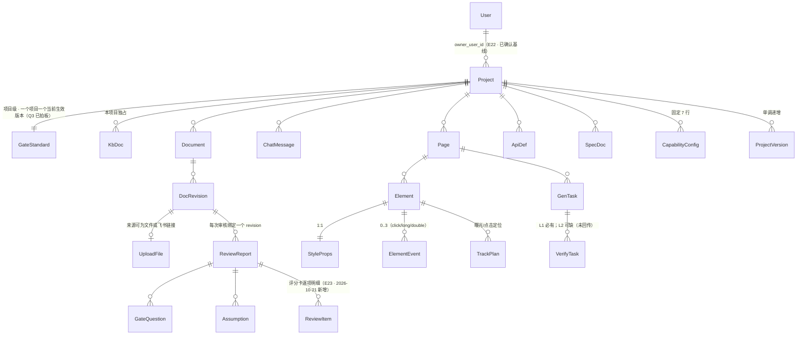
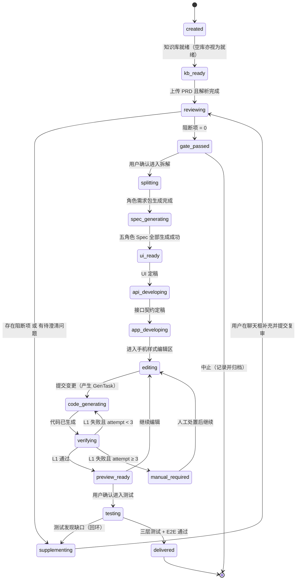
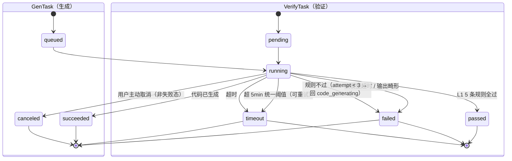
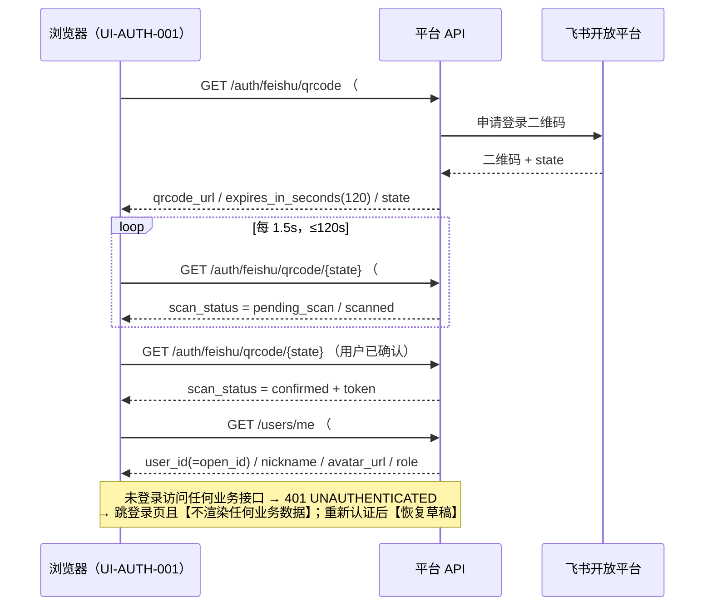
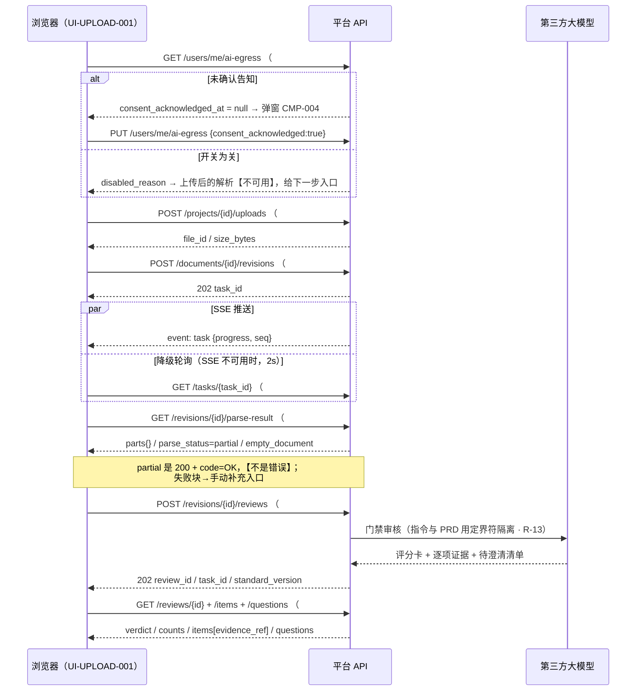
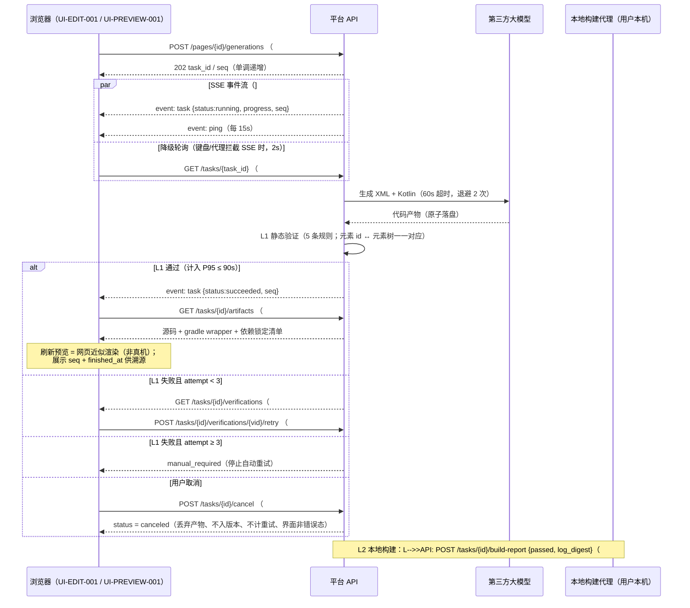
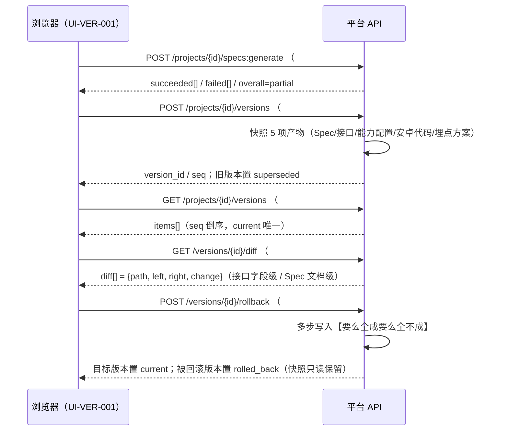

# AutoDevelopment 平台 接口 Spec

> 版本：**v0.16** ｜ 来源 PRD：平台需求概要（**平台自身**的产品需求）v1.4 · 第 4 轮回写后 · 门禁阻断 0（document_id: `platform/平台需求概要.md`, revision: v1.4/S 2026-10-20）｜ 角色：接口 ｜ 更新：2026-10-26（**B9 审核补充与复审闭环**；#17 prd、#20 空答拒绝、#21 convert、#23 原子保存与可核验回执；前轮审核流程优化：`#23` 改为**按检查项标题落章** + `## 澄清答复`、`#16` 复审**继承已采纳态**、`#24` 的 `items[].title` = 检查项小节标题；上一版 v0.15 = 审核流程优化；更早v0.14 = 未通过项补充信息）；**本轮同版增量补正**：#8服务端哈希、初载/手动文档门禁、严格正文继承与当前doc历史；不另开轮次。
>
> **本次作业性质**：以 `platform/design/接口契约.md`（**冻结基线 71 个平台自身接口** + 本机落地 4 = **75**，已确认基线 · 2026-10-21 补口落地后）为**底稿**做
> **格式转换 + 一致性对齐 + 缺口补齐**，**不重新设计接口**。字段名以 `platform/design/数据模型.md` 为**唯一权威**，
> 冲突时**以 `platform/平台需求概要.md` 为准**并登记，**不自行裁决**。
>
> **来源标签**（沿用基线记法）：`§FX` / `§X` = `platform/平台需求概要.md`；`数据模型§X` / `E<n>` = `platform/design/数据模型.md`；
> `接口契约 #n` = `platform/design/接口契约.md`；`页面规格§X` = `platform/design/页面规格.md`；`AC-*` / `E2E-*` = `platform/design/验收标准.md`；
> `UI-Spec §X` / `EL-*` = `platform/specs/UI-Spec.md`；`[拆解缺口-Q#]` = `platform/requirements/拆解期发现的问题.md`；
> `[缺口-UI-##]` / `[冲突-UI-##]` = `UI-Spec §10.2`；
> `[来源: 推断，待确认]` = 平台推导（属**假设**性质，原文标签**原样保留**，不阻塞开工）。

---

## 0 阅读约定：**两套接口**必须先分清（不混写）

> 本平台有**两套完全不同的接口**。混写是本次最容易犯的错，故单列一节。

| 名称 | 是什么 | 谁产出 | 编号 | 本 Spec 中的角色 |
|---|---|---|---|---|
| **① 平台自身接口** | AutoDevelopment 平台**前后端之间**的接口（建项目、上传、审核、生成…） | 平台侧，已在 `platform/design/接口契约.md` **冻结为基线** | **`#n`**（基线 `#1`~`#62` + `#44a` + `#63`~`#70` = **71 个**；+ `#71`/`#71a`/`#72`/`#72a` = **75 个**〔2026-10-21 本机落地，见 §5.4.13〕） | **★ 本 Spec 的产出对象** |
| **② 被开发 App 的接口** | 用户在平台里为**他自己那个 App** 定义的业务接口（`§F12` 接口能力管理） | **平台生成**（`§F12`；实体 `E9 ApiDef`；管理接口 `#50`~`#53`） | **`API-<模块>-<三位>`** | **不在本 Spec 枚举**，只描述其**数据契约形态**（§4.2 `E9`、§5.4 `#50`~`#53`） |

**硬约束（三条，来自 `接口-需求包 §0`）**：

1. **严禁**把被开发 App 的 `API-*` 当成平台接口来写；
2. **严禁**给平台自身接口另编 `API-*` 编号 —— 本文一律沿用 `接口契约` 的 `#n`；
3. 本 Spec 另设**文档内引用键** `API-PLAT-<三位>`（见 §1.2 约定 1），仅用于与 App Spec / 测试 Spec 对齐，**不替代 `#n`**。

**本 Spec 的三类编号命名空间**（互不串用）：

| 命名空间 | 归属 | 例子 |
|---|---|---|
| `#n` | **平台自身接口**（权威编号，继承基线） | `#44a POST /tasks/{task_id}/cancel` |
| `API-PLAT-<三位>` | 本 Spec 的**文档内引用键**（与 `#n` 一一对应） | `API-PLAT-044A` ↔ `#44a` |
| `API-<模块>-<三位>` | **被开发 App 的接口**（平台产出物，**不是本 Spec 的对象**） | `API-ORDER-001`（示例） |

---

## 1 文档信息

| 项 | 内容 |
|---|---|
| 文档目的 | 定义**满足 UI 展示与交互所需的全部数据契约**（平台自身接口） |
| 设计原则 | **由 UI 的《元素-数据需求表》倒推接口，而非正向设计**（`agents/03-接口-角色Agent.md`） |
| 适用范围 | **平台自身**的前后端接口。**不含**被开发 App 的接口（那是平台产出物）、不含界面实现、不含客户端实现 |
| 不在范围 | UI 实现（UI Spec）、App 客户端实现（App Spec）、被开发 App 的 `API-*` 枚举（`§F12` 产物） |
| 主输入 | `UI-Spec §5《元素-数据需求表》`（**84 行**，本 Spec §3 逐行覆盖） |
| 底稿 | `platform/design/接口契约.md`（**75 个接口** = 基线 71 + 本机落地 4〔2026-10-21〕+ SSE + 13 错误码）；`platform/design/数据模型.md`（23 实体，**字段名称与类型的唯一权威**） |
| 关联文档 | `UI-Spec`、`App-Spec`（同批）、`埋点-Spec`、`测试-Spec`、`baseline/需求追溯矩阵.md`、`platform/requirements/需求追溯矩阵-骨架.md` |
| 接口总数 | **75** = 基线 **63**（`#1`~`#62` + `#44a`）+ **补口 8**（`#63`~`#68`〔2026-10-21 由草案转基线〕+ `#69` 导出审核报告 / `#70` 中止流程）+ **本机落地 4**（`#71`/`#71a`/`#72`/`#72a`，2026-10-21） |

### 1.1 本 Spec 相对模板骨架的结构说明

严格按 `templates/接口-Spec.md` 的 12 节骨架填写，**新增 1 节**（§0「阅读约定：两套接口的区分」），其余节号不变：

| 模板节 | 本 Spec 节 | 说明 |
|---|---|---|
| （骨架无） | **§0 阅读约定：两套接口的区分** | 新增（项目上下文强制：平台接口 vs 被开发 App 接口） |
| §1~§12 | §1~§12 | 一一对应，节号未变 |

> **§3《UI 数据供给对照表》是本 Spec 的第一优先级章节**（模板已将其标注为「核心章节」；本节逐行覆盖 `UI-Spec §5` 的 84 行，**无空白**）。
> §5 接口定义按模板「每接口一节」展开；因底稿基线为 71 个接口、本机落地再增 4 个（共 **75**），本 Spec 采「**§5.4 接口总表（覆盖全部 75 个）+ §5.5 关键接口完整契约（31 节）**」的写法，并显式声明覆盖边界（§5.3）。

### 1.2 本 Spec 的四条编号与格式约定（PRD 未定义者属平台推导，带标签）

| # | 约定 | 理由 | 标签 |
|---|---|---|---|
| 1 | 平台自身接口保留基线 **`#n`**；本 Spec 增设引用键 **`API-PLAT-<三位>`**（`#44a` → `API-PLAT-044A`），**不改动 `#n`** | `接口-需求包 §0` 明令不得给平台接口另编 `API-*`；但 App Spec / 测试 Spec 需要一个稳定引用键 | `[来源: 推断，待确认]` |
| 2 | 响应字段名一律 **snake_case**；实体字段名**逐字**取自 `数据模型`（含 `E7 StyleProps` 的 13 个字段名，**不改写、不意译、不合并**） | 校对 Agent 对 App Spec 做 diff；「宽/高」在 `数据模型` 中**分立**为 `width` / `height` | `[来源: 推断，待确认]` |
| 3 | 未被 `数据模型` 覆盖的**派生/聚合字段**（如 `#6` 状态条、`#18` 逐项、`#54` 版本卡片），本 Spec 在 **§5.0.3 字段名冻结表** 中一次性给出（2026-10-21 已随补口落地定为**正式基线**） | 满足「字段名与 App Spec 逐字一致」的可核对性 | `[来源: 推断，待确认]` |
| 4 | 「是否满足」列使用 **✅ / ⚠️ / ❌** 三值（**无第四种、无空白**），图例见 §3.1 | 底稿未定义处**不编造**，也不假装满足 | `[来源: 推断，待确认]` |

---

## 2 范围与总览

### 2.1 模块范围（与 `接口契约 §1` 的 11 组一致）

| 组 | 模块 | 接口 | 对应页面（`UI-Spec §2`） |
|---|---|---|---|
| 1.1 | 项目 | `#1`~`#6` | `UI-PROJ-001`、`UI-WORK-001` |
| 1.2 | 知识库 | `#7`~`#9` | `UI-KB-001` |
| 1.3 | 上传与解析 | `#10`~`#15` | `UI-UPLOAD-001` |
| 1.4 | 门禁审核 | `#16`~`#24` | `UI-REVIEW-001` |
| 1.5 | 对话 | `#25`~`#27` | `UI-WORK-001` |
| 1.6 | 拆解与 Spec | `#28`~`#34` | `UI-SPLIT-001`、`UI-SPEC-001` |
| 1.7 | 可视化编辑 | `#35`~`#42` | `UI-EDIT-001` |
| 1.8 | 代码生成与验证 | `#43`~`#49`（含 `#44a`） | `UI-EDIT-001`、`UI-PREVIEW-001` |
| 1.9 | 接口定义管理 | `#50`~`#53` | `UI-API-001` |
| 1.10 | 版本 | `#54`~`#57` | `UI-VER-001`、`UI-API-001` |
| 1.11 | 能力 / 埋点 / 交付 / 上报 | `#58`~`#62` | `UI-CAP-001`、`UI-VER-001` |
| **★ 本 Spec 补口** | 鉴权与用户 / 追溯矩阵 / 外发开关 / 审核报告导出 / 中止流程 | **`#63`~`#70`** | `UI-AUTH-001`、`UI-PROJ-001`、`UI-SPLIT-001`、`UI-SPEC-001`、`UI-CAP-001`、`UI-REVIEW-001` |

### 2.2 接口总数与标记约定

- **基线 63 个**（`#1`~`#62` + `#44a`）+ **补口 8 个**（`#63`~`#68` 已于 **2026-10-21 由草案转正式基线**；`#69` 导出审核报告 / `#70` 中止流程）+ **本机落地 4 个**（`#71`/`#71a`/`#72`/`#72a`，2026-10-21，见 §5.4.13）= **75 个**。
- 沿用 `接口契约` 的标记：`⬛` = **破坏性操作**（必须二次确认，**服务端亦须校验**）；`⚡` = **长任务型**（配 SSE）。
- **计数口径**：`[拆解缺口-Q9]` **已闭合** —— `接口契约 §1` 表头已统一为 **75**（ = 基线 71 + 本机落地 4）。⚠️ `平台需求概要 §11.7 C` 仍记 **71**（冻结基线口径），**本机落地的 4 个接口属开发阶段扩展、未过门禁**，两者的差异是**有意保留**的，不是漏改；**本 Spec 逐条引用 `#n`，不依赖总数**。

### 2.3 非功能指标（**PRD 未给者一律标 `[待澄清]`，不自行拍数**）

| 项 | 目标 | 来源 |
|---|---|---|
| L1 代码生成 + 静态验证 | **P95 ≤ 90s**（**平台侧、可度量**） | `§9` 第 657 行（`D-R2` 已改写）·`REQ-NF-001` |
| L2 本地构建 | **仅记录、不计平台指标**（`l2_result` 单独字段，不进平台 KPI） | `§9` 第 657、681 行 ·`REQ-NF-001` |
| PRD 解析耗时 | ≤ 30s（20 页以内） | `§9` 第 655 行 |
| Spec 生成耗时 | ≤ 5min / 份 | `§9` 第 656 行 |
| **长任务统一超时** | **5min / 次**；超时置 `timeout`（**可重试**），全程给进度 | `§9` 补充块①（`D-A14`） |
| 大模型 / 飞书外部调用 | **60s / 次**；指数退避 + 抖动，最多 **2 次** | `§9` 补充块⑩（`D-A22`）；`接口契约 §0.6` |
| 验证失败自动重试 | 上限 **3 次**，超限 → `manual_required` | `§9` 补充块①（`D-A15`） |
| 幂等窗口 | 同 `Idempotency-Key` **3s 内**只产生一次副作用 | `§0.1`（`D-A12`） |
| 权限变更生效 | **≤ 5min** | `§9` 第 717 行（`D-Q5`） |
| SSE 心跳 | **15s** | `接口契约 §0.4` |
| SSE 降级轮询 | **2s** | `接口契约 §0.4`（`D-Q15`） |
| **QPS** | **`[待澄清-QPS]`** | **PRD 未给** |
| **并发用户数** | **`[待澄清-CONC]`** | **PRD 未给** |
| **数据保留期**（除已明确的「项目删除 30 天后物理清除」） | **`[待澄清-RET]`** | PRD 仅给这一条；日志 / 快照 / 派生产物的保留期未给 |
| 单文件上限 | ≤ **20MB** / ≤ **100 页** | `§F2` 补充块（`D-A17`） |
| 单页元素上限 | **200** 个 | `§F13` 补充块 |
| 单条对话上限 | **20000** 字符 | `§F4`；`数据模型 E20` |

---

## 3 UI 数据供给对照表（★ 第一优先级章节 · 逐行覆盖 `UI-Spec §5` 的 84 行）

> **需求方原话**：「**必须满足 UI 展示及交互所需的数据**」。本节即该命题的证据链。
> **数据来源列**必须对应到真实接口（用 `#n` 引用）；**对不上的不编造**，标 ⚠️ / ❌ 并给编号。

### 3.1 本的读法与「是否满足」图例

| 值 | 含义 | 处理要求 |
|---|---|---|
| **✅** | **满足**：由 `design/接口契约.md` 的**基线接口**（`#1`~`#62`、`#44a`、`#63`~`#70`）直接覆盖 | 无需动作 |
| **⚠️** | **需补口**：基线未定义，**本 Spec 已给出补口**（新增接口 `#63`~`#70`，或字段级补口）但**尚有未闭合项**（2026-10-21 后仅余 1 行） | 见本行「不满足时的处理」+ §3.3 缺口汇总 |
| **❌** | **不满足**：无来源，且本 Spec **不提出**补口（须改 UI 或由 PM 决策） | 见本行处理列 |

> **2026-10-21 更新（S6.5 补口落地重同步）**：原 **12 行 ⚠️** 中 **10 行已闭合**（补口 `#63`~`#68` 由草案转正式基线 + 字段级补口转正）→ 计 ✅；
> `EL-PROJ-014` 因 `Q5` 已裁决**移除该展示项**（`页面规格 §1.1` 已删、`UI-Spec §5` 同步删除）→ **该行已从本表移除**（**79 → 78 行**；接口侧不再供给，`#1` 不增字段）；
> `EL-REVIEW-008~012` **仅部分闭合**（逐项明细实体已补 `E23 ReviewItem`，但「完善建议」`suggestion` 字段基线**仍未给出**）→ 仍计 ⚠️。
> **现构成：✅ 84 行 ｜ ⚠️ 0 行 ｜ ❌ 0 行 = 合计 84 行。** 原构成（供核对）：**8 行**由 `UI-Spec §5` 原标 ❌ 直接承接（`EL-AUTH-006`、`EL-PROJ-006`、`EL-REVIEW-021`、`EL-REVIEW-036`、`EL-SPLIT-020`/`021`、`EL-CAP-015`、`EL-CAP-019`/`020`/`021`、`EL-SPEC-022` → 归并为 6 个 `[缺口-UI-01]`~`-06`）；**1 行**由既有登记承接（`EL-PROJ-014` → `[拆解缺口-Q5]`）；**1 行**为**本 Spec 对 `UI-Spec §5` 判读的更正**（`EL-AUTH-007`）；**1 行**为**本 Spec 新发现**（`EL-VER-006`~`010` → `[缺口-API-07]`）；**1 行**为**基线字段缺失**（`EL-REVIEW-008`~`012` → `[拆解缺口-Q2-附]`）。
> **原句「这不代表缺口已闭合…需求方未答复前不得视为已满足」已随 2026-10-21 补口转基线而失效**：除上列 1 行外，其余各行**均已由正式基线接口覆盖**（`P0-补口裁决单 §4`）。
> 时间格式统一：**UTC ISO-8601 存储 → 浏览器本地时区展示**；相对时间由前端负责（「3 分钟前」）；**缺失一律 `null` → 前端显示「时间未知」，禁止 `0` / `1970`**（`REQ-NF-005`、`数据模型 §5.5`）。
> 未知 / 零 / 不适用三态：**`null` = 未知、`0` = 零、`n/a` = 不适用**（`数据模型 §5.5`）。

### 3.2 对照表（84 行，逐行对齐 `UI-Spec §5`）

| EL-ID | UI 元素 | 需要的数据 | 格式要求（精度/单位/时间格式） | 来源接口 | 来源字段 | 是否满足 | 不满足时的处理 |
|---|---|---|---|---|---|---|---|
| `EL-AUTH-003` | 登录页 · 平台名 | 平台名文本 | 静态字符串（无精度/单位要求） | —（**静态文案，不走接口**） | — | ✅ | 前端常量；与门禁 E1「无一项凭空显示」不冲突（**静态文案不是数据**） |
| `EL-AUTH-006` | 登录页 · 飞书登录二维码图 | 二维码图片 URL + 有效期 120s | 绝对 URL（https）+ 剩余秒数 **int，0~120** | `#63` `GET /auth/feishu/qrcode`（2026-10-21 转基线） | `data.qrcode_url` / `data.expires_in_seconds` / `data.state` | ✅ | `[缺口-API-01]`（= `[缺口-UI-01]`，**P0**）**已闭合（2026-10-21）** —— 补口 `#63` 转正式基线，见 §5.5.31。为空/失败 → 显示「二维码加载失败。」+「刷新二维码」→ 重调 `#63` |
| `EL-AUTH-007` | 登录页 · 扫码状态 | 状态枚举：待扫 / 已扫 / 过期 / 已确认 | `enum{pending_scan,scanned,expired,confirmed}` | `#64` `GET /auth/feishu/qrcode/{state}`（2026-10-21 转基线） | `data.scan_status` | ✅ | `UI-Spec §5` 原标「**本地状态机，无接口**」。**接口侧判读：状态迁移必须有上游来源，否则「已扫」永不发生** → 补口 `#64`（**1.5s 轮询**）。**已闭合（2026-10-21）**：`#64` 转正式基线，见 §5.5.31。`[缺口-API-01]` |
| `EL-AUTH-012` | 登录页 · 会话过期提示 | 固定文案（由 401 驱动） | `code = "UNAUTHENTICATED"`（HTTP 401） | **全部业务接口**（全局错误码） | `code` / `message` | ✅ | 全局鉴权中间件统一返回；前端跳登录并**恢复草稿**（`§9` 补充块⑧） |
| `EL-PROJ-006` | 项目列表 · 用户昵称 / 头像 | 昵称 + 头像 URL | `string(64)` / URL；缺失 → `未命名用户` / 默认头像 | `#66` `GET /users/me`（2026-10-21 转基线） | `data.nickname` / `data.avatar_url` | ✅ | `[缺口-API-01]`（= `[缺口-UI-01]`，**P0**）+ `[拆解缺口-Q4]` —— **均已闭合（2026-10-21）**：补口 `#66` 转正式基线；`E22 User` 已确认为**正式基线实体**（见 §4.1 / §4.2），`ref(User)` 不再悬空 |
| `EL-PROJ-011` | 项目列表 · 项目名 | 项目名 | `string(50)`，trim 后 **1~50 可见字符**（emoji/组合字符按可见字符计） | `#1` `GET /projects` | `data.items[].name` | ✅ | 缺省 → 前端「未命名项目」（服务端 `name` 必填，理论不出现） |
| `EL-PROJ-012` | 项目列表 · 阶段标签 | `stage` 枚举 → 中文（**17 态**） | `enum`（`数据模型 §3.1` 全 17 值） | `#1` | `data.items[].stage` | ✅ | 未知值（对端新增字段容忍）→ 前端「未知阶段」 |
| `EL-PROJ-013` | 项目列表 · 最后更新时间 | `updated_at` | **UTC ISO-8601** → 本地；相对格式「3 分钟前」 | `#1` | `data.items[].updated_at` | ✅ | `null` → 「时间未知」；**禁 `0` / `1970`** |
| `EL-PROJ-034` | 项目列表 · 分页信息 | `page` / `page_size` / `total` | **int**；`page ≥ 1`，`page_size ∈ {20,50,100}`，`total ≥ 0` | `#1` | `data.page` / `data.page_size` / `data.total` | ✅ | `total = 0` → 「共 0 个项目」（**零项目 vs 搜索无结果**由 `q` 是否为空区分，见 §6.1 R-01） |
| `EL-PROJ-039` | 项目列表 · 项目名字段级错误 | `message` 中文文本 | `string`，**可直接展示** | `#2` `POST /projects` | `message` + `data.field` | ✅ | HTTP 400 `INVALID_ARGUMENT`；**字段级提示并保留已输入** |
| `EL-KB-011` | 知识库 · 文档标题 | `title` | `string(120)` | `#7` `GET /projects/{id}/kb-docs` | `data.items[].title` | ✅ | 缺省 → 「（无标题）」 |
| `EL-KB-012` | 知识库 · 文档来源标签 | `origin` 枚举 → 中文 | `enum{agent_extracted,user_edited,user_uploaded}` | `#7` | `data.items[].origin` | ✅ | 未知 → 「未知来源」 |
| `EL-KB-013` | 知识库 · 文档更新时间 | `updated_at` | UTC → 本地；相对格式 | `#7` | `data.items[].updated_at` | ✅ | `null` → 「时间未知」 |
| `EL-KB-016` | 知识库 · revision 编号 + 时间 | `revision_id` 短 id（**8 位**）+ 本地时间 | `string(36)` → 取前 8 位展示；时间 UTC | `#13` `GET /documents/{id}/revisions` | `data.items[].revision_id` / `data.items[].created_at` | ✅ | 空列表 → 空态；时间 `null` → 「时间未知」 |
| `EL-KB-017` | 知识库 · 文档 Markdown 正文 | `content_md` | **Markdown 原文**；渲染时**转义 HTML、不执行任何标签** | `#8` `GET /kb-docs/{id}` | `data.content_md` | ✅ | 空串 → 「这份文档还没有内容。」 |
| `EL-WORK-002` | 工作台 · 项目名 | `name` | `string(50)` | `#3` `GET /projects/{id}` | `data.name` | ✅ | — |
| `EL-WORK-003` | 工作台 · 当前阶段 | `stage` 枚举 → 中文 | `enum`（17 值） | `#6` `GET /projects/{id}/stats` | `data.stage` | ✅ | 未知 → 「未知阶段」 |
| `EL-WORK-004` | 工作台 · 门禁状态徽标 | 4 态 + **阻断数** | `enum{unreviewed,running,blocked,passed}` + `blocking` **int ≥ 0** | `#6` | **`data.gate.verdict`** / **`data.gate.blocking_count`** | ✅ | 未审核 → 「未审核」；计数为 `0` 与「未知」由 `verdict` 区分（`unreviewed` = 未审核）。〔2026-10-22 按实现对齐：原声明 `gate_status`/`gate_counts.*`，见 §5.5.4〕 |
| `EL-WORK-005` | 工作台 · 版本号 | `seq` → `v{n}` | **int ≥ 1**，项目内单调递增 | `#6`（或 `#54`） | **`data.version_seq`**（`当前版本` 唯一） | ✅ | **`0` → 「尚无版本」**（实现返回 `0` 而非 `null`）〔2026-10-22 按实现对齐〕 |
| `EL-WORK-006` | 工作台 · 进行中任务数 | 整数 | **int ≥ 0** | `#6` | **`data.running_tasks`** | ✅ | `0` → 「没有进行中的任务」（`0` 是零，不是未知）〔2026-10-22 按实现对齐〕 |
| `EL-WORK-015` / `016` | 工作台 · 对话消息（角色 / 正文 / 状态） | `role` / **`content`** / `status` / `seq` | `enum{user,agent,system}`；Markdown（转义）；`enum{sent,streaming,failed}`；**单条 ≤ 20000 字符**；`seq` int 升序 | `#25` `GET /projects/{id}/chat/messages` + `#45` SSE `chat.delta` | `data.items[].role/content/status/seq`；SSE `delta` | ✅ | 无消息 → 空态；流式失败 → `status=failed` + 「重发」（`#27`，**不重复入库**） |
| `EL-WORK-033` | 工作台 · 「切换对话」选择器（线程 + 条数） | 本项目**有消息的线程** + 各自条数 | 线程 key ∈ `workbench`/`kb`/`upload`/`review`/`split`/`editor`/`specs`/`apis`/`capabilities`/`versions`；条数 **int ≥ 1** | `#25` `GET /projects/{id}/chat/messages`（**不给 `thread`**） | `data.items[].thread_key`（前端按此分组计数） | ✅ | 无任何线程 → 选择器禁用〔2026-10-22 新增〕 |
| `EL-WORK-035` | 对话框 · AI 处理过程条目（**与消息同列混排**） | 步骤标题 / 状态 / 模型 / 耗时 / 进度 | `status` ∈ `running`/`done`/`failed`/`canceled`；`duration_ms` int；最多 60 条 | SSE `#45` 事件 **`ai.step`** | `data.{step_id,task_id,kind,title,detail,model,status,progress,duration_ms,phase,at}` | ✅ | 无步骤 → **不出现条目**（消息列表照常）；**不含正文**；**`at` = 该步首次发生时刻**（同 `step_id` 后续更新**不刷新 `at`**，否则与消息按时间混排时顺序会倒）〔2026-10-22 新增；口径见 §11 v0.12〕 |
| `EL-WORK-025` | 工作台 · 生成任务状态 | `status` + `progress` | `enum{queued,running,succeeded,failed,timeout,canceled}` + **int 0~100** | `#44` `GET /tasks/{task_id}` / `#45` | `data.status` / `data.progress` | ✅ | 无任务 → 不显示；`canceled` **不得呈现为错误态**（`D-Q22`） |
| `EL-WORK-026` | 工作台 · 阶段导航（9 节点） | `stage` 枚举 → 节点完成态 | `enum`（17 值）→ **本地映射表**（前端常量） | `#6` | `data.stage` | ✅ | 映射表为本前端常量，**不走接口**；未知阶段 → 全部节点置灰 |
| `EL-UPLOAD-012` | 上传页 · 文件大小 | `size_bytes` → MB，**保留 1 位小数** | `long`（字节）；显示 `23.4 MB` | `#10` `POST /projects/{id}/uploads` 响应 | `data.size_bytes` | ✅ | 上传中为本地 `File.size`；服务端回填后以服务端为准 |
| `EL-UPLOAD-016` | 上传页 · 上传进度百分比 | 整数 **0~100** | `int` | `#10`（**客户端 XHR `upload.onprogress`**） | —（**服务端不推上传进度**） | ✅ | **接口侧判读**：底稿未定义上传进度事件 → 进度由浏览器 XHR 事件本地产生；服务端只在接收完成后返回 `file_id`。**若需求方要求服务端进度，须补口**（当前不必） |
| `EL-UPLOAD-018`~`021` | 上传页 · 四块解析状态 | `parts.{body,tables,whiteboards,attachments}[].status` | `enum{ok,failed,skipped}`；`body.status` 为单值，其余为数组 | `#14` `GET /revisions/{id}/parse-result` | `data.parts.body.status` / `.tables[].status` / `.whiteboards[].status` / `.attachments[].status` | ✅ | `skipped` → 「跳过」；`failed` → 「未取到」+ 手动补充入口（`#15`） |
| `EL-UPLOAD-022` | 上传页 · 已解析秒数 | 整数秒 | `int`（秒） | **本地计时**（基准时间取 `#44` `started_at`） | `data.started_at`（`#44`） | ✅ | `≤ 30s` **不显示**；> 30s 由本地计时触发提示。**接口不需新增字段** |
| `EL-UPLOAD-024` | 上传页 · 未取到的块清单 | 块类型 + `token`（表格/白板）/ 附件名 | `string`（`token` 为飞书侧标识） | `#14` | `data.parts.tables[] / .whiteboards[] / .attachments[]` 中 `status = failed` 的项 | ✅ | 仅 `parse_status = partial` 时显示 |
| `EL-UPLOAD-033` | 上传页 · revision 历史条目 | `revision_id` 短 id + 本地时间，**倒序** | `string(36)` → 8 位；UTC → 本地 | `#13` | `data.items[]`（**倒序**） | ✅ | 空 → 空态；与 `EL-KB-016` **同一接口**（`[冲突-UI-03]` 两处展示**保留**） |
| `EL-REVIEW-003` | 审核页 · 门禁结论徽标 | `verdict` 枚举 + `counts.blocking` 整数 | `enum{running,passed,blocked,failed}` + int | `#17` `GET /reviews/{review_id}` | `data.verdict` / `data.counts.blocking` | ✅ | 未开始 → 「还没开始审核。」；新 revision 后 `superseded = true` → 「已过期」 |
| `EL-REVIEW-004` | 审核页 · 绑定文档版本 | `revision_id` 短 id | `string(36)` → 8 位 | `#17` | `data.revision_id` | ✅ | 缺省 → 「未知版本」 |
| `EL-REVIEW-005` / `048` | 审核页 · 门禁标准版本号 | 整数 → `v{n}` | `int ≥ 1` | `#17`（`standard_version`）/ `#24` `GET /projects/{project_id}/gate-standards` | `data.standard_version` / `data.version` / `data.project_id` | ✅ | 缺省 → 「未知版本」；**历史评分不重算**，按当时版本留痕 |
| `EL-REVIEW-008` / `009` / `010` / `012` / `053` | 评分卡逐项与补充 | item_code / level / verdict / suggestion / supplement | string / enum / enum / text / text | #18；补充 #23 supplements[] | data.items[].item_code/level/verdict/suggestion/supplement | ✅ | B9 按磁盘实际 DTO，suggestion 已由接口返回，不再标未闭合；条目数量依报告标准 |
| `EL-REVIEW-011` | 审核页 · 证据定位（章节 · 行号） | `evidence_ref`，**可点击跳原文** | `{chapter: string, line: int}`（章节号 + 行号） | `#18` | `data.items[].evidence_ref` | ✅ | **无证据的判定不得输出**（`§F3` 补充块）→ 该行不返回 |
| `EL-REVIEW-017`~`019` / `022` | 待澄清与 converted 假设答复复用 | question_code/title/options/answer/status | string/text/array/text/enum | GET #19；独立 #20；本页 #23 answers[] | data.items[] | ✅ | 排除 status=converted 归档题；normalizeAnswer 后非空才算已答；本页无 blur 自动保存 |
| `EL-REVIEW-020` | 审核页 · 兜底项 | `fallback` 枚举 → 中文四值 | `enum{not_yet_defined,none,not_identified,not_applicable}` | `#19` | `data.items[].fallback` | ✅ | 缺省 → 「未定义」 |
| `EL-REVIEW-021` | 审核页 · 影响范围 | 文本 | `text` | `#19` 响应 `impact`；`E18 GateQuestion.impact`（2026-10-21 转基线） | `data.items[].impact` | ✅ | `[缺口-API-02]`（= `[缺口-UI-02]`，P1）**已闭合（2026-10-21）**：按方案① —— `#19` 出参增 `impact`、`数据模型 E18` 增 `impact text N`，均已落地 |
| `EL-REVIEW-024` / `025` | 审核页 · 假设条目（内容 / 来源标签 / 选择） | `content` / `source_tag` / `choice` | `text` / `string(64)` / `enum{unset,accept,convert}` | `#21` `GET`/`POST /reviews/{id}/assumptions` | `data.items[].content/source_tag/choice` | ✅ | **`choice = unset` 不得进入生成阶段**（服务端在 `#23` 前校验，否则 400）；本条 UI 不允许留空 |
| `EL-REVIEW-036` | 审核页 · 回流轮次 | 整数 → `第 {n}/3 轮` | `int`，**1 ≤ n ≤ 3** | `#6` `GET /projects/{id}/stats`（**挂项目级**） | `data.loopback_round` | ✅ | `[缺口-API-03]`（= `[缺口-UI-03]`，P1）**已闭合（2026-10-21）**：按方案② —— **挂项目级**，`#6` 出参增 `loopback_round`（**1~3**，见 §5.5.4）；`E17` **不落该字段**。超限（>3）→ 服务端返回「接受并记录 / 中止」二选一态（`REQ-REVIEW-008`），「中止」落点 = `#70`（已闭合） |
| `EL-REVIEW-051` | 审核页 · 评分卡所用模型 | 本次审核实际使用的模型 id → `模型：{model}` | 字符串；**空值时整块不渲染** | `API-PLAT-017`（`#17`） | `data.model` | ✅ | —（2026-10-21 本机落地新增） |
| `EL-REVIEW-055`/`056`/`057`/`058`/`059` | 当前 PRD 正文查看与深链 | revision_id/document_id/kb_doc_id/version/content_hash/title/content_md | string/int/SHA-256/text | #17 prd + GET #8 | data.prd；#8 data.title/version/content_md/document_id/content_hash | ✅ | 无当前正文禁用入口；原始上传只读不等于知识库当前正文 |
| `EL-REVIEW-060`/`061`/`062` | 提交原因/核验通知/错误 | submitReasons/writeNotice/documentError | text + bool + SHA-256 核验 | #23 + GET #8 + 页面状态 | changed/new_revision_id/kb_doc_id/kb_version/content_hash/sections_added[] | ✅ | 无变化不自动重审；初载/回读失败置documentError禁用写回与手动复审；不新增接口 |
| `EL-GLOBAL-009` | 应用外壳顶栏 · 大模型选择器 | 可选模型清单 + 当前所选 + 生效模型 | 下拉列表：模型名 + 描述；**不可用项置灰并给原因**；目录为空时整块不渲染 | `API-PLAT-071`（`#71`）／`API-PLAT-071A`（`#71a`） | `data.items[]`、`data.selected_model`、`data.effective_model`、`data.default_model` | ✅ | —（2026-10-21 本机落地新增） |
| `EL-REVIEW-044` / `045` | 审核页 · 门禁标准检查项（编号 / 等级 / 标题） | `items[] = {code, level, title}` | `string` / `enum{blocking,major,suggestion}` / `string` | `#24` `GET /projects/{project_id}/gate-standards` | `data.items[].code/level/title` | ✅ | 空清单 → 「还没有检查项。」；`PUT` **每次保存版本 +1**（**维护人 = 管理员**，需求方只读） |
| `EL-SPLIT-009` | 拆解页 · 角色名 | `spec_role` 枚举 → 中文 **5 值** | `enum{ui,api,app,track,test}` | `#29` `GET /projects/{id}/requirements` | `data.items[].role` | ✅ | 固定 5 值，**不多不少** |
| `EL-SPLIT-010` | 拆解页 · REQ-ID 列表 | `REQ-<模块>-<三位>` | `string`，**项目内唯一** | `#29` | `data.items[].req_ids[]` | ✅ | 该角色无需求 → 「这一角色没有拆出需求。」 |
| `EL-SPLIT-013` | 拆解页 · 埋点方案摘要 | `event_key` + `trigger_desc` | `EVT_<模块>_<动作>`（`string(64)`，项目内唯一）+ `string(200)` | `#59` `GET /projects/{id}/tracking-plan` | `data.items[].event_key/trigger_desc` | ✅ | 空 → 「还没有埋点方案。」 |
| `EL-SPLIT-020` / `021` | 拆解页 · 追溯矩阵行 + 覆盖状态 | REQ-ID + 角色条目 + **状态四值** | `enum{OK,GAP,N/A,Deferred}` → 中文；**不允许留空** | `#67` `GET /projects/{project_id}/traceability-matrix`（2026-10-21 转基线） | `data.items[].req_id / targets{} / coverage_status` | ✅ | `[缺口-API-04]`（= `[缺口-UI-04]`，**P0**）**已闭合（2026-10-21）**：补口 `#67` 转正式基线，见 §5.5.29。**四态由接口给出，不只在前端算**（`REQ-SPEC-004`） |
| `EL-EDIT-004` | 编辑页 · 37 项原子控件（图标 + 展示名） | 枚举值 + Android 类映射 | 枚举（**37 项封闭集合**，禁「等」） | **本地枚举，不走接口**（`数据模型 §4`）；服务端校验于 `#36` | —（`widget_type`） | ✅ | `REQ-UIEDIT-010` + `接口契约 §0.3` 明确：**控件面板本地筛选、不走接口**；`#36` 落库时校验 |
| `EL-EDIT-010` / `020` | 编辑页 · 元素 id | `EL-<模块>-<三位>`，**归一化为大写零填充** | `string(24)`；序号 **001~999**，溢出扩四位 | `#36` `POST /pages/{id}/elements`（**服务端集中分配**） | `data.element_id` | ✅ | 客户端只持**临时 id**；`EL-HOME-001` 与 `el-home-1` **归一化后视为同一元素**。溢出形式归 `[缺口-UI-12]`（P2，待 PM） |
| `EL-EDIT-016` | 编辑页 · 控件树节点（id + 别名） | `element_id` + `alias` | `string(24)` + `string(50)`（**alias 仅供展示，不参与匹配**） | `#35` `GET /projects/{id}/pages` + 元素列表 | `element_id` / `alias` / `parent_element_id` / `order_index` | ✅ | `REQ-UIEDIT-005`：树与画布**同一份数据**，接口**不得出现第二份元素树**；树空 → 空态 |
| `EL-EDIT-021`~`028` | 编辑页 · 属性面板 11 项当前值 | 取值域见 `数据模型 E7` | 尺寸 `dp`/**1~2000**/`wrap_content`/`match_parent`；色值 **`#RRGGBB`（只接受 6 位）**；字号 **8~72sp**；内外边距 **0~200dp**（四边独立）；圆角 **0~200**；边框线宽 **0~10dp**；`alpha` **0~100 整数**（界面按**百分比**）；对齐 3+3；可见性 3 值；**负值一律拒绝** | 读：元素详情；写：`#39` `PUT /elements/{id}/style` | `StyleProps.*`（**13 个字段**，名见 §4.2 `E7`） | ✅ | 计数口径（11 行 / 12 名 / 13 字段）归 `[拆解缺口-Q2]`（**P0**，**本 Spec 不写死清单**，以 `§F14` 为准）。失败 → 字段级 `INVALID_ARGUMENT` |
| `EL-EDIT-029` | 编辑页 · 字段级错误 | 中文 `message` + `field` 路径 | `string` + `string`（如 `style.width`）+ `data.received` | `#39` | `message` / `data.field` / `data.received` | ✅ | HTTP 422/400 `INVALID_ARGUMENT`；**保留用户已输入的全部内容**；服务端在**生成前二次校验** |
| `EL-EDIT-032`~`034` | 编辑页 · 事件配置（3 类并存） | `event_type`，**同一元素最多 3 条** | `enum{click,long_click,double_click}`；三类**可并存** | `#40` `PUT /elements/{id}/events` | `data.events[].event_type` | ✅ | 全未勾 → 无事件；> 3 条 → 400 `INVALID_ARGUMENT`；同时配 `click`+`double_click` 时 **300ms** 内第二次点击判双击并**取消单击回调**（`D-A11`） |
| `EL-EDIT-035` | 编辑页 · 事件动作 | `action_type` —— **本期仅 `none`** | `enum{none,navigate,api_call,track}`，本期**只取 `none`** | `#40` | `data.events[].action_type` | ✅ | 其余枚举位**保留、本期不可选**（`D-Q13`）；`action_payload` 为 `null`；界面显示「暂无动作（TODO）」 |
| `EL-EDIT-042` | 编辑页 · 未验证构建标记 | `l2_result.reported = false` | `bool` | `#44` `GET /tasks/{id}` / `#46` `POST /tasks/{id}/build-report` | `data.l2_result.reported` | ✅ | `reported = false` → 「未验证构建」，**不阻断用户**（`D-R1`、`REQ-GEN-003`） |
| `EL-EDIT-052` | 编辑页 · 元素 id 台账（含已作废） | `element_id` + `alias` + `status` + `voided_at` | `string(24)` / `string(50)` / `enum{active,void}` / datetime（UTC，`void` 时非空） | `#41` `GET /projects/{id}/element-id-ledger` | `data.items[].element_id/alias/status/voided_at` | ✅ | 空台账 → 「还没有分配过元素 id。」；**作废 id 可查不可用、不可回收**（`D-A4`） |
| `EL-PREVIEW-002` | 预览页 · 渲染结果（近似渲染） | 元素树 → DOM/Canvas 近似图 | **非真机系统渲染**（差异 10 项见 `UI-Spec §6`） | `#47` `GET /tasks/{id}/artifacts` + **本地渲染器** | `data.artifacts[]`（元素树快照） | ✅ | `REQ-PREVIEW-003`：**纯前端渲染能力**，差异清单为前端静态说明数据；**只在 L1 `passed` 后**才提供可渲染结果（接口不得在 L1 未过时返回「已就绪」） |
| `EL-PREVIEW-003` | 预览页 · 生成序号 + 时间 | `seq` + `finished_at` | `int`（单调递增）+ **UTC ISO-8601** → 本地 | `#45` SSE `task` 事件 / `#44` | SSE `data.seq`；`#44` `data.finished_at` | ✅ | **时间缺失返回 `null`**（不得 `0`/`1970`）→ 前端「时间未知」；**只应用序号最新的结果**（`TASK_STALE`） |
| `EL-PREVIEW-009` | 预览页 · 生成进度 | `progress` **0~100** 整数 | `int` | `#45` SSE / `#44` | `data.progress` | ✅ | 降级轮询（2s）时 `#44` 出参**必须自足**（`REQ-GEN-007`），界面无差别 |
| `EL-PREVIEW-010` | 预览页 · L1 逐规则结果 | `l1_result.checks[] = {rule, ok, evidence}` | `json`；`rule` 为 **5 条 L1 规则**之一 | `#49` `GET /tasks/{id}/verifications` | `data.items[].evidence.checks[]` | ✅ | L1 规则集**穷举 5 条**：① 语法可解析 ② 结构合法 ③ **元素 id 与元素树一一对应** ④ 属性取值在域内 ⑤ 引用完整（`数据模型 E14` 节） |
| `EL-PREVIEW-012` | 预览页 · 验证失败原因 + 剩余重试次数 | 文本原因 + `attempt`（**上限 3**） | `string` + `int`（0~3） | `#49` + `#48` `POST /tasks/{id}/verifications/{vid}/retry` | `data.error_code` / `data.attempt` / 剩余次数 | ✅ | `attempt ≥ 3` → `manual_required`，**停止自动重试**；`#48` 返回**剩余次数**供前端显示 |
| `EL-PREVIEW-014` | 预览页 · L2 回传状态 | `reported` / `passed` / `log_digest` | `bool` / `bool` / `string`（日志摘要，**不含 PRD 与代码正文**） | `#46` / `#44` | `data.l2_result.reported/passed/log_digest` | ✅ | `reported = false` → 「未验证构建」；**L2 不计平台指标**，只记录 |
| `EL-API-008`~`013` | 接口管理页 · 接口清单行 | `code` / `name` / `method` / `path` / `status` / `updated_at` | `API-<模块>-<三位>`（项目内唯一）/ `string` / `enum{GET,POST,PUT,DELETE,PATCH}`（**5 值**）/ `string` / `enum{draft,effective,deprecated}` / UTC → 本地相对 | `#50` `GET /projects/{id}/apis` | `data.items[]` | ✅ | 空 → 空态；时间 `null` → 「时间未知」。**注意：这里的 `API-*` 是「被开发 App 的接口」，是平台产出物，不是本 Spec 的接口编号** |
| `EL-API-019`~`025` | 接口管理页 · 字段表 | 字段名 / 类型 / 必填 / 长度 / 精度 / 单位 / 说明 | `field_type` **完整 8 项**：`string`/`int`/`long`/`double`/`bool`/`object`/`array`/`date`（**禁写「等」**）；`length` / `precision` / `unit` **随字段声明**（每个量都带单位） | `#53` `PUT /apis/{id}/schema` / `#51` `GET /apis/{id}` | `data.req_schema` / `data.resp_schema` → `{name,type,required,length,precision,unit,desc}` | ✅ | **注意**：`double` 仅用于非金额场景；本期无金额 / 计价 / 费率（`D-X5`）。 |
| `EL-API-026` | 接口管理页 · 字段级错误 | 中文 `message` | `string` | `#51` / `#53` | `message` + `data.field` | ✅ | HTTP 400 `INVALID_ARGUMENT`；**保留已输入** |
| `EL-API-030` | 接口管理页 · 版本列表 `v{n}` + 「当前」 | `seq` 整数 + `status = current` **唯一** | `int`（项目内单调递增）+ `enum{current,superseded,rolled_back,archived}` | `#54` `GET /projects/{id}/versions` | `data.items[].seq` / `data.items[].status` | ✅ | 空 → 「还没有版本记录。」；**有且仅有一条 `current`** |
| `EL-API-037` | 接口管理页 · 冲突 diff | 字段级 diff（左右对照 + 变更标识） | `{path, left, right, change}`；`change ∈ {新增,删除,修改}`（**文字**，不只靠颜色） | `#51` → **409 `VERSION_CONFLICT`**；`#56` `GET /versions/{id}/diff` | `data.diff[]` | ✅ | 冲突提示「**该接口已被他人修改。**」+ diff；**不静默覆盖**（`D-Q14`） |
| `EL-CAP-005`~`008` | 能力配置页 · 7 项能力（名称/说明/开关/生成状态） | `capability` 固定 **7 枚举**；`enabled` bool（**默认 false**）；`code_status` | `enum{push,apm,crash_report,log_report,stats_sdk,hardening,privacy_dialog}` / `bool` / `enum{not_generated,generated,partial,failed}` | `#58` `GET`/`PUT /projects/{id}/capabilities` | `data.items[].capability/enabled/code_status/note` | ✅ | **每项目固定 7 行**，不多不少；`note` **只承载占位说明，不含任何真实密钥**（`REQ-CAP-004`） |
| `EL-CAP-011` | 能力配置页 · 生成失败项清单 | 能力名列表 + 数量 | `string[]` + `int` | `#58` 响应（部分失败） | `data.failed[]` / `data.overall` | ✅ | **整体不得返回成功**：`partial` 必须可辨识（`REQ-CAP-002`） |
| `EL-CAP-015` | 能力配置页 · 依赖版本冲突 | 库名 + `v1` / `v2` | `{library: string, version_a: string, version_b: string}` | `#58` `GET`/`PUT /projects/{id}/capabilities` | `data.conflicts[]` / `data.alignment_table[]` | ✅ | `[缺口-API-05]`（= `[缺口-UI-05]`，P1）**已闭合（2026-10-21）**：`#58` 出参增 `conflicts[] = [{library, version_a, version_b}]` + `alignment_table[]`，已转正式基线 |
| `EL-CAP-019` / `020` / `021` | 能力配置页 · ★ 外发大模型开关状态 + 说明 + 关闭原因 | `bool` + 固定文案 | `bool` / `string` / `string`（关闭原因，可直接展示） | `#68` `GET`/`PUT /users/me/ai-egress`（2026-10-21 转基线） | `data.egress_enabled` / `data.policy_text` / `data.disabled_reason` / `data.consent_acknowledged_at` | ✅ | `[缺口-API-06]`（= `[缺口-UI-06]`，**P0 合规项**）**已闭合（2026-10-21）**：补口 `#68`（**用户级** `/users/me/ai-egress`）转正式基线；`#10`/`#12`/`#43`/`#58` 增 `UPSTREAM_UNAVAILABLE` 不可用分支。`REQ-AUTH-004` ① 告知确认状态 ② 用户级开关 ③ 关闭后**返回明确不可用原因、不得静默降级** —— 三项均已落接口 |
| `EL-SPEC-003`~`007` | Spec 产出页 · 五份 Spec 状态 | `spec_role` 5 值；`status` 5 值 | `enum{ui,api,app,track,test}` / `enum{queued,generating,succeeded,failed,stale}` | `#31` `GET /projects/{id}/specs` | `data.items[].role/status` | ✅ | `stale` = 上游已变（重拆 / 回滚 / major 变更）；每角色**最多一份当前版** |
| `EL-SPEC-008` | Spec 产出页 · Spec 正文（Markdown） | `content_md` | Markdown；**失败时为空** | `#32` `GET /specs/{spec_id}` | `data.content_md` | ✅ | 空 → 「这份 Spec 还没生成内容。」 |
| `EL-SPEC-013` | Spec 产出页 · 部分成功计数 | `succeeded[]` / `failed[].role` / `overall` | `string[]` / `[{role, error_code}]` / `enum{succeeded,partial,failed}` | `#30` `POST /projects/{id}/specs:generate` | `data.succeeded` / `data.failed` / `data.overall` | ✅ | **`overall` 绝不置为 `succeeded`**（部分成功时置 `partial`）；全部成功 → 不显示该条 |
| `EL-SPEC-014` | Spec 产出页 · 单份失败原因 | `error_code` → 中文 | `string`（错误码之一） | `#31` / `#32` | `data.items[].error_code` | ✅ | 一份失败**不阻断**其余四份；失败的单独错误态 + **单份重试**（`REQ-SPEC-002`） |
| `EL-SPEC-019` / `020` | Spec 产出页 · 《补充要求清单》条目 | 逐条文本 + 可回流标记 | `text` + `bool`（`can_loopback`） | `#34` `POST /projects/{id}/specs/{spec_id}/proofread` | `data.items[].content` / `data.items[].can_loopback` | ✅ | 无补充要求 → 「校对完成，没有补充要求。」；补不上的条目**带「回流对话」标记**（`REQ-PROOF-001`） |
| `EL-SPEC-022` | Spec 产出页 · 追溯矩阵行 | 同 `EL-SPLIT-020` | 同 `EL-SPLIT-020` | `#67`（**与拆解页同一接口**，2026-10-21 转基线） | `data.items[]` | ✅ | `[缺口-API-04]`（= `[缺口-UI-04]`，**P0**）**已闭合（2026-10-21）**：`#67` 已转正式基线 —— 同一接口同时服务 `UI-SPLIT-001` 与 `UI-SPEC-001` |
| `EL-VER-006`~`010` | 版本归档页 · 版本卡片（版本号/时间/操作人/变更摘要/产物清单） | `seq` → `v{n}`；本地时间；操作人昵称；摘要文本；产物 5 项枚举 | `int` / UTC → 本地 / `string(64)` / `text` / `enum{spec,apis,capabilities,android_code,tracking_plan}` | `#54` `GET /projects/{id}/versions` | `seq` / `created_at` / `created_by_name` / `summary` / `artifacts[]` | ✅ | ★ **本 Spec 新发现** `[缺口-API-07]` **已闭合（2026-10-21）**：`E10 ProjectVersion` 增 `created_by`（`ref(User)` N）/ `summary`（`text` N）/ `artifacts`（`json` N），`#54` 出参同步（含 `created_by_name`）；「操作人昵称」依赖的 `E22 User` 亦已转正式基线（`[拆解缺口-Q4]` 已闭合） |
| `EL-VER-012` / `013` | 版本归档页 · diff（接口字段级 / Spec 文档级） | 变更行 + 标识 `新增`/`删除`/`修改` | `{path, left, right, change}`；**文字标识**（不只靠颜色） | `#56` `GET /versions/{version_id}/diff` | `data.diff[]` | ✅ | 无差异 → 「这个版本与上一版没有差异。」；粒度 = 接口**字段级**、Spec **文档级**（`D-Q16`） |
| `EL-VER-025` / `026` | 版本归档页 · 安卓工程产物 | 源码 + `gradle wrapper` + **依赖版本锁定清单** | 文件清单（`string[]`）；**不得**含「平台构建结果 / apk」（构建在用户本机） | `#60` `GET /projects/{id}/deliverables`；`#47` | `data.items[].artifacts[]` / `data.artifacts[]` | ✅ | 未生成 → 按钮置灰 + 「还没有生成过工程源码。」；`REQ-GEN-009`：**平台不提供服务端构建** |
| `EL-VER-028` | 版本归档页 · 未验证构建标记 | `l2_result.reported` | `bool` | `#46` / `#44` | `data.l2_result.reported` | ✅ | `false` → 「未验证构建」；**不阻断交付** |

**统计**：本表 **84 行**（B9 新增两行）（2026-10-22 +2：`EL-WORK-033`/`EL-WORK-035`；2026-10-21：`EL-PROJ-014` 随 `[拆解缺口-Q5]` 移除，**79 → 78**；同日**本机落地 +2 行**〔`EL-REVIEW-051`、`EL-GLOBAL-009`〕，**78 → 80**），与 `UI-Spec §5`（同为 **84 行**）**逐行一一对应**；`是否满足` 列 **无空白**。

| 值 | 行数 | 说明 |
|---|---|---|
| ✅ 满足 | **84** | B9 +2数据组；#18 suggestion实际供给已对齐；不含运行验收承诺 |
| ⚠️ 部分满足 | **0** | #18 已按当前实现返回 suggestion/supplement |
| ❌ 不满足 | **0** | `EL-PROJ-014` 一行已随 `[拆解缺口-Q5]`（移除展示项）退出本表；`UI-Spec §5` 当前为 84 行〔B9 +2〕 |
| 合计 | **84** | 84✅ + 0⚠️ + 0❌ |

> **2026-10-21 本机落地新增 2 行**（随 `UI-Spec v0.1.2`，`UI-Spec §5` **78 → 80 行**）：
> `EL-REVIEW-051`（评分卡所用模型 ← `#17` 新增字段 `model`）、`EL-GLOBAL-009`（顶栏大模型选择器 ← `#71`/`#71a`）。
> 二者均由本 Spec **§5.4.13** 提供接口落点，**已满足**（不计入 ⚠️）。

### 3.3 缺口汇总与回应（★ 必须逐条回应 `UI-Spec §10.2` 点名的 6 处）

| 缺口编号 | `UI-Spec` 原描述 | UI 等级 | 本 Spec 的**接口侧回应** | 关联新增接口 / 字段 | 本 Spec 新增编号 | 状态 |
|---|---|---|---|---|---|---|
| `[缺口-UI-01]` | **飞书扫码登录在 63 个接口中没有对应接口**（原口径） → 二维码、用户昵称、头像、退出登录均无数据来源 | **P0** | **应答：确认为真实缺口，且比 UI 描述的更宽** —— 除登录链路外，`数据模型` 连 `E22 User` 实体都没有（`E1 owner_user_id`、`E2 updated_by` 的 `ref(User)` **悬空**）。**补口（2026-10-21 转正式基线）：`#63`~`#66` 四个接口 + `E22 User` 实体** | `#63` 取二维码 / `#64` 扫码状态 / `#65` 登出 / `#66` 当前用户信息；实体 `E22 User` | **`[缺口-API-01]`** | ✅ **已闭合（2026-10-21）**：`#63`~`#66` 四个接口 + `E22 User` 实体**均已转正式基线** |
| `[缺口-UI-02]` | 待澄清问题条目要求展示「**影响范围**」，但 `#19` 与 `数据模型 E18` 均无该字段 | P1 | **应答：确认为真实缺口。** 字段级补口：`#19` 响应增 `impact`，`E18 GateQuestion` 增同名字段（`text`，`N`） | `#19` → `data.items[].impact` | **`[缺口-API-02]`** | ✅ **已闭合（2026-10-21）**：按方案① 补 `impact` 字段（`#19` + `E18` 同步落地） |
| `[缺口-UI-03]` | 「回流轮次 第 {n}/3 轮」无字段与入参来源 | P1 | **应答：确认为真实缺口。** 字段级补口：`ReviewReport` 或项目级补 `loopback_round`（`int`，1~3） | `#6` → `data.loopback_round` | **`[缺口-API-03]`** | ✅ **已闭合（2026-10-21）**：落点 = **项目级** → `#6` 出参 `loopback_round`（1~3），见 §5.5.4 |
| `[缺口-UI-04]` | **需求追溯矩阵无接口**（`REQ-SPEC-004` 要求，原 63 接口中无 RTM 端点） | **P0** | **应答：确认为真实缺口。** 补口 `#67`（2026-10-21 转基线）：按 `REQ-ID` 返回**四态覆盖**（`OK`/`GAP`/`N/A`/`Deferred`）+ **正向 target 列表** + **反向上游 REQ-ID** + **孤儿检测结果**。**四态必须由接口给出，不能只在前端算**（`REQ-SPEC-004` 原文） | `#67` `GET /projects/{project_id}/traceability-matrix` | **`[缺口-API-04]`** | ✅ **已闭合（2026-10-21）**：补口 `#67` 转正式基线 |
| `[缺口-UI-05]` | 能力依赖冲突（`REQ-CAP-005`）无返回结构定义 | P1 | **应答：确认为真实缺口。** 字段级补口（已转基线）：`#58` 响应增 `conflicts[] = [{library, version_a, version_b}]` + `alignment_table[]` | `#58` → `data.conflicts[]` | **`[缺口-API-05]`** | ✅ **已闭合（2026-10-21）**：`#58` 出参增 `conflicts[]` + `alignment_table[]` |
| `[缺口-UI-06]` | ★ **外发大模型用户级开关无接口落点**（`#58` 是项目级，开关是用户级） | **P0 合规** | **应答：确认为真实缺口，且是 4 轮门禁里唯一"合规项缺落点"。** 补口 `#68`（2026-10-21 转基线）：① **告知确认状态**（`consent_acknowledged_at`，首次上传前 / 首次生成前）② **用户级开关读写**（`egress_enabled`）③ **关闭后生成类接口返回明确不可用原因**（`disabled_reason`，**不得静默降级、不得返回 200 假装在跑**） | `#68` `GET`/`PUT /users/me/ai-egress`；并在 `#10`/`#12`/`#43`/`#58` 增加**不可用分支**错误码 | **`[缺口-API-06]`** | ✅ **已闭合（2026-10-21）**：补口 `#68` 转正式基线 + `#10`/`#12`/`#43`/`#58` 的 `UPSTREAM_UNAVAILABLE` 分支 |

**另有 1 处既有登记缺口 + 1 处本 Spec 新发现**：

| 缺口编号 | 描述 | 本 Spec 的回应 | 状态 |
|---|---|---|---|
| `[拆解缺口-Q5]` | 项目卡片「元素 id 前缀示例」无接口来源（`页面规格§1.1` vs `接口契约 §2` 收口结论冲突） | **已拍板移除该展示项**（原二选一方案作废）：`#1` 不增 `element_id_prefix_sample` 字段；`UI-Spec §5` 同步删除本行 | ✅ **已闭合（2026-10-21，PM 拍板）**：**移除该展示项**（`页面规格 §1.1` 已删）→ 接口侧不再供给 |
| **`[缺口-API-07]`**（★ 本 Spec 新发现） | `EL-VER-006`~`010` 版本卡片要求「操作人 / 变更摘要 / 产物清单」，但 `E10 ProjectVersion` **无 `created_by`、无 `summary`、无 `artifacts`**，`#54` 也未定义 → **UI 与 `接口契约 §2` 均未发现此缺口** | 字段级补口（已转基线）：`E10` 增 `created_by`（`ref(User)` N）/ `summary`（`text` N）/ `artifacts`（`json` N）；`#54` 出参同步 | ✅ **已闭合（2026-10-21）**：`E10` 增三字段 + `#54` 出参同步 |

> ✅ **2026-10-21 更新**：上列 `[缺口-UI-01]`~`[缺口-UI-06]`、`[缺口-API-01]`~`[缺口-API-07]` 及 `[拆解缺口-Q5]` **全部已闭合** ——
> 补口接口 `#63`~`#68` 已由草案转**正式基线**（并新增 `#69` 导出审核报告 / `#70` 中止流程），字段级补口**全部转正**（依据 `P0-补口裁决单 §4`）。
> **B9 当前更新**：#18 suggestion 已在实际DTO与本Spec冻结表定义，不再把其标为待字段补口；既有历史描述保留在变更记录。运行/交互待补与证据边界详见B9。

### 3.4 本节自检

| # | 自检项 | 结论 |
|---|---|---|
| 1 | 是否逐行覆盖 `UI-Spec §5` 的 84 行 | ✅ **84 / 84**（`UI-Spec §5` 同为 84 行），行序与 EL-ID 一致 |
| 2 | 「是否满足」列是否有空白 | ✅ **无空白**（✅ **84** / ⚠️ 0 / ❌ 0 = **84 行**） |
| 3 | 每一个"需要的数据"是否都能追到接口或说明为何不需要 | ✅ 当前 **81 行**追到既有接口 + **3 行**不走接口（EL-AUTH-003/EL-EDIT-004/EL-UPLOAD-022）= **84 行**；#18 suggestion 实际供给已对齐，新增两组复用 #17/#8/#23 |
| 4 | 是否有编造 | ✅ **无**。对不上的**不编造**，全部标编号并保留 `UI-Spec §5` 原判读，只**增注**接口侧判读（如 `EL-AUTH-007`） |
| 5 | 格式要求列是否给出精度/单位/时间格式 | ✅ 逐行给出（时间统一 UTC → 本地；MB 保留 1 位；百分比 0~100 整数；色值 6 位；dp/sp/字节等） |

---

## 4 数据模型

> **唯一权威**：`platform/design/数据模型.md`（已确认基线，**23 实体** / 37 项原子控件枚举 / 状态机；2026-10-21 补口落地）。
> 本节做的是**格式转换 + 表名补全 + 缺口登记**：**字段名、类型、必填、枚举取值一律逐字取自该文件，零改写、零意译**。
> 表名规则 `TBL_<模块>_<实体>` 为 `agents/03-接口-角色Agent.md` 的模板要求（`数据模型.md` 未给表名，属**模板要求的补充**，标 `[来源: 推断，待确认]`）。

### 4.1 实体清单（**23**）

| # | 实体 | 表名 `[来源: 推断，待确认]` | 对应 REQ-ID | 说明（逐字取自 `数据模型 §1.1`） |
|---|---|---|---|---|
| E1 | `Project` 项目 | `TBL_PROJ_PROJECT` | `REQ-PROJ-001`~`005` | 一切数据的隔离根 |
| E2 | `KbDoc` 知识库文档 | `TBL_KB_KB_DOC` | `REQ-KB-001` | 只放本项目 |
| E3 | `UploadFile` 上传文件 | `TBL_UPLOAD_UPLOAD_FILE` | `REQ-UPLOAD-001`/`002` | 以系统 id 存储 |
| E4 | `DocRevision` 文档 revision | `TBL_DOC_DOC_REVISION` | `REQ-UPLOAD-005` | 一次上传/解析的版本 |
| E5 | `Page` 页面 | `TBL_EDIT_PAGE` | `REQ-UIEDIT-002` | 画布承载的页面 |
| E6 | `Element` 元素 | `TBL_EDIT_ELEMENT` | `REQ-UIEDIT-001`/`009` | `EL-<模块>-<三位>` |
| E7 | `StyleProps` 样式属性 | `TBL_EDIT_STYLE_PROPS` | `REQ-UIEDIT-003` | 与元素 **1:1** |
| E8 | `ElementEvent` 事件 | `TBL_EDIT_ELEMENT_EVENT` | `REQ-UIEDIT-004` | 点击 / 长按 / 双击 |
| E9 | `ApiDef` 接口定义 | `TBL_API_API_DEF` | `REQ-API-001`/`003` | **平台内被开发 App 的接口**（**不是**本 Spec 的接口） |
| E10 | `ProjectVersion` 项目级版本 | `TBL_VER_PROJECT_VERSION` | `REQ-API-002` | 方案 A，整包快照 + diff |
| E11 | `SpecDoc` Spec 文档 | `TBL_SPEC_SPEC_DOC` | `REQ-SPEC-001`/`002` | 五角色各一份 |
| E12 | `TrackPlan` 埋点方案 | `TBL_TRACK_TRACK_PLAN` | `REQ-SPLIT-004` | S4 定方案 |
| E13 | `CapabilityConfig` 能力配置 | `TBL_CAP_CAPABILITY_CONFIG` | `REQ-CAP-001`~`005` | 7 项，默认全关 |
| E14 | `GenTask` 生成任务 | `TBL_GEN_GEN_TASK` | `REQ-GEN-001`~`010` | 提交变更后的代码生成 |
| E15 | `VerifyTask` 验证任务 | `TBL_GEN_VERIFY_TASK` | `REQ-GEN-002`~`004` | L1 静态 / L2 本地构建 |
| E16 | `Document` 文档（revision 的父） | `TBL_DOC_DOCUMENT` | `REQ-UPLOAD-001` | §F2 产出 `document_id` **且** `revision_id`，二者父子关系 |
| E17 | `ReviewReport` 门禁评分卡 | `TBL_REVIEW_REVIEW_REPORT` | `REQ-REVIEW-001` | §8「审核结果：门禁评分卡…待澄清清单」 |
| E18 | `GateQuestion` 待澄清问题 | `TBL_REVIEW_GATE_QUESTION` | `REQ-REVIEW-003` | 门禁口径问题（与原文 Q1~Q17 **不同命名空间**） |
| E19 | `Assumption` 假设 | `TBL_REVIEW_ASSUMPTION` | `REQ-REVIEW-004` | Accept / Convert 必须落库 |
| E20 | `ChatMessage` 对话消息 | `TBL_CHAT_CHAT_MESSAGE` | `REQ-CHAT-001`/`002` | 右侧对话框 |
| E21 | `GateStandard` 门禁标准 | `TBL_REVIEW_GATE_STANDARD` | `REQ-REVIEW-005` | 三级标准，每次保存版本 +1 |
| E22 | `User` 用户 | `TBL_AUTH_USER` | `REQ-AUTH-001`/`002`/`008` | **已确认基线**（2026-10-21）→ `[拆解缺口-Q4]` / `[缺口-API-01]` **已闭合**；`E1 owner_user_id` / `E2 updated_by` / `E10 created_by` 的 `ref(User)` 不再悬空 |
| E23 | `ReviewItem` 评分卡逐项 | `TBL_REVIEW_REVIEW_ITEM` | `REQ-REVIEW-001` | **已确认基线**（2026-10-21）：评分卡逐项明细与 `evidence_ref` 的宿主（`AC-RV-01`）；`[拆解缺口-Q2-附]` **部分闭合** |

> **只做这 23 个，不新增组件。** E16~E21 是 PRD 已点名的页面/产物所必需。
> **`E22 User` / `E23 ReviewItem` 已于 2026-10-21 随补口落地转为正式基线实体**（`[拆解缺口-Q4]` / `[缺口-API-01]`；`[拆解缺口-Q2-附]` 部分闭合）；字段表见 §4.2。

### 4.2 字段字典（字段名 / 类型 / 长度 / 可空 / 默认值 / 枚举完整取值 / 说明）

> 记法沿用 `数据模型 §0`：`string(n)` 字符上限 ｜ `int` / `long` ｜ `bool` ｜ `enum{...}` ｜ `json` ｜ `datetime`（UTC ISO-8601）｜ `ref(<实体>)` ｜ `ref[]`。
> **可空**列：`Y` = 必填；`N` = 可空；`Y*` = 创建时可缺省但写入后必非空（系统赋默认值；**默认值列即该默认值**）。
> **所有实体均隐含 `created_at: datetime Y` / `updated_at: datetime Y`**（UTC）。
> **所有带 `project_id` 的实体，每一次读写都做逐对象鉴权**（含列表、搜索、导出）；越权 **403 且不泄露对象是否存在**。

#### E1 `Project` → `TBL_PROJ_PROJECT`

| 字段 | 类型 | 长度 | 可空 | 默认值 | 枚举完整取值 | 说明 |
|---|---|---|---|---|---|---|
| `project_id` | string | 36 | Y | — | — | 系统生成 UUID，主键 |
| `name` | string | 50 | Y | — | — | trim 后 **1~50 可见字符**（emoji/组合字符按可见字符计）；**同用户内允许重名**；纯空白 → 拒绝 |
| `owner_user_id` | ref(User) | — | Y | — | — | 创建者（`ref` 现**悬空** → `[拆解缺口-Q4]`） |
| `stage` | enum | — | Y | `created` | `created`｜`kb_ready`｜`reviewing`｜`supplementing`｜`gate_passed`｜`splitting`｜`spec_generating`｜`ui_ready`｜`api_developing`｜`app_developing`｜`editing`｜`code_generating`｜`verifying`｜`preview_ready`｜`manual_required`｜`testing`｜`delivered`（**17 值**） | 见 §6.2 状态机 |
| `current_revision_id` | ref(DocRevision) | — | N | `null` | — | 最近一次 PRD 解析版本 |
| `current_version_id` | ref(ProjectVersion) | — | N | `null` | — | 当前项目级版本 |
| `element_id_seq` | json | — | Y* | `{}` | — | 各模块已分配最大序号，如 `{"HOME":12,"CART":3}` |
| `deleted_at` | datetime | — | N | `null` | — | **逻辑删除**标记；写入后 **30 天物理清除** |

#### E2 `KbDoc` → `TBL_KB_KB_DOC`

| 字段 | 类型 | 长度 | 可空 | 默认值 | 枚举完整取值 | 说明 |
|---|---|---|---|---|---|---|
| `kb_doc_id` | string | 36 | Y | — | — | 主键 |
| `project_id` | ref(Project) | — | Y | — | — | **检索强制按此过滤**（跨库即阻断） |
| `sector` | enum | — | Y | — | `prd`｜`spec`｜`glossary`｜`domain` | §F1 列出的四类〔2026-10-22 按实现对齐：原 `doc_type`〕 |
| `title` | string | 120 | Y | — | — | — |
| `content_md` | text | — | Y | — | — | Markdown（与交付格式一致） |
| `origin` | enum | — | Y | `agent_extracted` | `agent_extracted`｜`user_edited`｜`user_uploaded` | — |
| `updated_by` | ref(User) | — | Y | — | — | — |

#### E3 `UploadFile` → `TBL_UPLOAD_UPLOAD_FILE`

| 字段 | 类型 | 长度 | 可空 | 默认值 | 枚举完整取值 | 说明 |
|---|---|---|---|---|---|---|
| `file_id` | string | 36 | Y | — | — | 主键 |
| `project_id` | ref(Project) | — | Y | — | — | — |
| `original_name` | string | 255 | N | `null` | — | **仅作展示**；古怪文件名与普通名同样处理 |
| `storage_key` | string | 128 | Y | — | — | **系统生成的存储键**，不含用户可控路径 |
| `size_bytes` | long | — | Y | — | — | ≤ **20MB** |
| `page_count` | int | — | N | `null` | — | 解析后回填；≤ **100 页** |
| `checksum` | string | 64 | Y | — | — | 内容 SHA-256 |
| `status` | enum | — | Y | — | `uploading`｜`uploaded`｜`rejected` | — |
| `reject_reason` | enum | — | N | `null` | `format_unsupported`｜`too_large`｜`too_many_pages`｜`empty`｜`corrupted` | **仅 `rejected` 时非空** |

#### E16 `Document` → `TBL_DOC_DOCUMENT`

| 字段 | 类型 | 长度 | 可空 | 默认值 | 枚举完整取值 | 说明 |
|---|---|---|---|---|---|---|
| `document_id` | string | 36 | Y | — | — | 主键 |
| `project_id` | ref(Project) | — | Y | — | — | — |
| `source_type` | enum | — | Y | — | `file`｜`feishu_link` | — |
| `feishu_token` | string | 128 | N | `null` | — | `source_type = feishu_link` 时**必填** |
| `latest_revision_id` | ref(DocRevision) | — | N | `null` | — | — |

#### E4 `DocRevision` → `TBL_DOC_DOC_REVISION`

| 字段 | 类型 | 长度 | 可空 | 默认值 | 枚举完整取值 | 说明 |
|---|---|---|---|---|---|---|
| `revision_id` | string | 36 | Y | — | — | 主键。**所有审核结论、评分卡都绑定它** |
| `document_id` | ref(Document) | — | Y | — | — | — |
| `file_id` | ref(UploadFile) | — | N | `null` | — | — |
| `parse_status` | enum | — | Y | `pending` | `pending`｜`parsing`｜`succeeded`｜`partial`｜`failed` | **`succeeded` 与 `partial` 必须可区分** |
| `parts` | json | — | Y | — | 每块 `status ∈ {ok,failed,skipped}` | `{body:{status,chars}, tables:[{token,status}], whiteboards:[{token,status}], attachments:[{name,status}]}` |
| `empty_document` | bool | — | Y | `false` | — | **「解析成功但无内容」独立标记**，与 `failed` 区分 |

**约束**：同一文档重复上传 → **新建 revision，旧 revision 保留可查、不覆盖**。

#### E5 `Page` → `TBL_EDIT_PAGE`

| 字段 | 类型 | 长度 | 可空 | 默认值 | 枚举完整取值 | 说明 |
|---|---|---|---|---|---|---|
| `page_id` | string | 36 | Y | — | — | 主键 |
| `project_id` | ref(Project) | — | Y | — | — | — |
| `name` | string | 50 | Y | — | — | 页面名（可中文） |
| `module_code` | string | 12 | Y | — | — | 元素 id 的模块段：**英文短名、大写、2~12 字符**，项目内唯一 |
| `order_index` | int | — | Y | — | — | 排序键 |
| `status` | enum | — | Y | `draft` | `draft`｜`defined`｜`generating`｜`generated` | — |

#### E6 `Element` → `TBL_EDIT_ELEMENT`

| 字段 | 类型 | 长度 | 可空 | 默认值 | 枚举完整取值 | 说明 |
|---|---|---|---|---|---|---|
| `element_id` | string | 24 | Y | — | — | 主键，格式 `EL-<模块>-<三位>`；**项目内全局唯一、不可复用、不可回收** |
| `project_id` | ref(Project) | — | Y | — | — | — |
| `page_id` | ref(Page) | — | Y | — | — | — |
| `parent_element_id` | ref(Element) | — | N | `null` | — | 空 = 根级；**同一父下 `order_index` 唯一** |
| `widget_type` | enum | — | Y | — | **37 项原子控件枚举**（见 §4.4） | 每一取值**对应唯一确定的 Android 类** |
| `order_index` | int | — | Y | — | — | 同级内顺序 |
| `alias` | string | 50 | N | `null` | — | **仅供展示，不参与任何匹配** |
| `status` | enum | — | Y | `active` | `active`｜`void` | 删除后置 `void`（**单向终态**） |
| `voided_at` | datetime | — | N | `null` | — | `status = void` 时非空 |

**约束**：① id 由**服务端集中分配**，客户端只持临时 id；② 序号 `001~999`，超出后**扩展四位**并在术语表登记；③ `EL-HOME-001` 与 `el-home-1` 归一化为**大写零填充**后比较（**一条成文规则，绝不重复计数**）；④ 单页 **200** 个上限，超限拒绝拖入。

#### E7 `StyleProps`（与 `Element` 1:1）→ `TBL_EDIT_STYLE_PROPS`

| 字段 | 类型 | 长度 | 可空 | 默认值 | 枚举完整取值 / 取值域 | 说明 |
|---|---|---|---|---|---|---|
| `element_id` | ref(Element) | — | Y | — | — | 主键（1:1） |
| `width` | json | — | Y | — | `{mode: enum{dp,wrap_content,match_parent}, value: int}` | `mode=dp` 时 `value` **1~2000dp**；其余模式 `value` **必须为 null** |
| `height` | json | — | Y | — | 同 `width` | 同上 |
| `background_color` | string | 7 | N | `null` | **`#RRGGBB`**（不含 alpha） | 只接受 **6 位**；`#FFF` 与 `#FFFFFF` 视为不同 |
| `text_color` | string | 7 | N | `null` | 同上 | 同上 |
| `text_size_sp` | int | — | N | `null` | **8~72** | 单位 sp |
| `padding` | json | — | N | `null` | `{top,right,bottom,left: int}` | 每边 **0~200dp**，**四边独立**，支持联动锁 |
| `margin` | json | — | N | `null` | 同 `padding` | 同上 |
| `corner_radius_dp` | int | — | N | `null` | **0~200** | — |
| `border` | json | — | N | `null` | `{width_dp: int, color: string(7), style: enum{solid,dashed,dotted}}` | `width_dp` **0~10** |
| `alpha` | int | — | N | `null` | **0~100 整数**（对应 0.0~1.0） | 界面按**百分比**展示 |
| `align_h` | enum | — | Y | `left` | `left`｜`center`｜`right` | — |
| `align_v` | enum | — | Y | `top` | `top`｜`center`｜`bottom` | — |
| `visibility` | enum | — | Y | `visible` | `visible`｜`invisible`｜`gone` | — |

> **字段计数说明**：本表 **13 个字段**（`width`/`height` 分立、`align_h`/`align_v` 分立），
> 而 `§F14` 的**属性行**为 **11 行**、「宽 / 高」合并为一行、对齐方式合并为一行。
> **「11 项」的计数口径归 `[拆解缺口-Q2]`（P0），本 Spec 不写死清单**，一律以 `§F14` 为准（项目约束 6）。
> **通用校验**：负值一律拒绝；非法输入**字段级提示、指明字段、保留已输入全部内容**；服务端在**生成前二次校验**。

#### E8 `ElementEvent` → `TBL_EDIT_ELEMENT_EVENT`

| 字段 | 类型 | 长度 | 可空 | 默认值 | 枚举完整取值 | 说明 |
|---|---|---|---|---|---|---|
| `event_id` | string | 36 | Y | — | — | 主键 |
| `element_id` | ref(Element) | — | Y | — | — | 同一元素**最多 3 条**（每 `event_type` 一条） |
| `event_type` | enum | — | Y | — | `click`｜`long_click`｜`double_click` | 三类**可并存、互不排斥** |
| `action_type` | enum | — | Y | `none` | `none`｜`navigate`｜`api_call`｜`track` | **本期只取 `none`** —— 只生成空回调存根；其余取值**保留枚举位、本期不可选** |
| `action_payload` | json | — | N | `null` | — | `none` 时为空 |

> **判定窗**：同一元素同时配 `click` 与 `double_click` 时，**300ms** 内的第二次点击判为双击，并**取消已触发的单击回调**。

#### E22 `User`（**已确认基线** · 2026-10-21）→ `TBL_AUTH_USER`

> **本表已于 2026-10-21 转为正式基线**（`[拆解缺口-Q4]` / `[缺口-API-01]` **已闭合**）。依据：`§9` 补充块②（`D-Q6`：飞书扫码、`user_id` = `open_id`、不另建用户名/密码、只取飞书返回最小集）
> + `§9` 补充块①（`D-Q5`：两角色）+ `数据模型 §5.1`（`role` 枚举）+ `REQ-AUTH-008`（个人数据范围）。
> **登记（不裁决）**：`数据模型 E22` 收录 `user_id` / `role` / `nickname` / `avatar_url` / `deleted_at`；本表末两行（`consent_ai_egress_at` / `ai_egress_enabled`）是补口接口 `#68`（**已转基线**）的状态承载，**实体侧尚未同步收录**。

| 字段 | 类型 | 长度 | 可空 | 默认值 | 枚举完整取值 | 说明 |
|---|---|---|---|---|---|---|
| `user_id` | string | 64 | Y | — | — | 主键；**取飞书 `open_id`**（`D-Q6` 已确认） |
| `nickname` | string | 64 | N | `null` | — | 飞书返回的最小集；缺省 → UI 显示「未命名用户」 |
| `avatar_url` | string | 512 | N | `null` | — | 缺省 → UI 显示默认头像 |
| `role` | enum | — | Y | `requester` | `requester`｜`admin` | **已确认两角色**；本期**不设第三类角色** |
| `consent_ai_egress_at` | datetime | — | N | `null` | — | **首次告知确认时间**（外发大模型，`REQ-AUTH-004`）；`[缺口-API-06]` **已闭合**（对应 `#68` 的 `consent_acknowledged_at`） |
| `ai_egress_enabled` | bool | — | Y | `true`〔推断〕 | — | **用户级外发大模型开关**（`#68` 的 `egress_enabled`）；`[缺口-API-06]` **已闭合**。默认值「开 + 首次强制告知」；PRD 未给默认 → `[待澄清-API-08]` |
| `deleted_at` | datetime | — | N | `null` | — | 账号注销即删（`REQ-AUTH-008`） |

#### E23 `ReviewItem` 评分卡逐项（**已确认基线** · 2026-10-21）→ `TBL_REVIEW_REVIEW_ITEM`

> **主键 = (`review_id`, `item_code`) 复合**；原字段来自 `数据模型 §2`；B9 按实际 #18/#23 补 accepted/suggestion/group_code，不新增实体。

| 字段 | 类型 | 长度 | 可空 | 默认值 | 枚举完整取值 | 说明 |
|---|---|---|---|---|---|---|
| `review_id` | ref(ReviewReport) | — | Y | — | — | 归属评分卡（`E17`） |
| `item_code` | string | 16 | Y | — | — | 检查项编号，**∈ 门禁 A~I 族**（同实际 `#18` 的 `item_code`） |
| `level` | enum | — | Y | — | `blocking`｜`major`｜`suggestion` | — |
| `verdict` | enum | — | Y | — | `pass`｜`fail`｜`na` | 逐项结论 |
| `evidence_ref` | string | 128 | N | `null` | — | 证据定位（章节 / 行号）；**无证据的判定不得输出**（`R-05`） |
| `group_code` | string | — | N | — | — | 实际存储分组，#18映射为group/group_title |
| `suggestion` | text | — | N | `""` | — | 模型建议；不把建议或标题当成已满足正文 |
| `accepted` | bool语义（存储0/1） | — | N | false | — | #22/#23采纳态；不改变verdict；#16继承当前有suggestion相同分支待正文门槛加固 |
| `supplement` | text | — | N | `""` | — | **未通过项的补充信息**（`EL-REVIEW-053`）〔2026-10-26 增〕：由 `#23` 的 `supplements[]` 落库，`#18` 回显 |

> **来源**：`数据模型 E23`（2026-10-21 补口落地）；承载 `#18 GET /reviews/{id}/items` 的逐项明细与 `EL-REVIEW-011` 的 `evidence_ref`（B9实际DTO字段供给已对齐；不代表真实模型验收通过）。

#### E9 `ApiDef`（**被开发 App 的接口**）→ `TBL_API_API_DEF`

| 字段 | 类型 | 长度 | 可空 | 默认值 | 枚举完整取值 | 说明 |
|---|---|---|---|---|---|---|
| `api_id` | string | 36 | Y | — | — | 主键 |
| `project_id` | ref(Project) | — | Y | — | — | — |
| `code` | string | 32 | Y | — | — | 项目内唯一，形如 `API-<模块>-<三位>` |
| `name` | string | — | Y | — | — | — |
| `path` | string | — | Y | — | — | — |
| `method` | enum | — | Y | — | `GET`｜`POST`｜`PUT`｜`DELETE`｜`PATCH` | — |
| `req_schema` | json | — | N | `null` | — | 字段表：`{name,type,required,length,precision,unit,desc}` |
| `resp_schema` | json | — | N | `null` | — | 同上 |
| `field_type` | enum | — | Y | — | `string`｜`int`｜`long`｜`double`｜`bool`｜`object`｜`array`｜`date`（**完整 8 项，禁写「等」**） | — |
| `status` | enum | — | Y | `draft` | `draft`｜`effective`｜`deprecated` | 随项目级版本冻结 |
| `version_id` | ref(ProjectVersion) | — | N | `null` | — | 随项目级版本 |

> ⚠️ 数值精度与单位**随字段声明**（每个量都带单位）；删除接口为破坏性操作 → 二次确认 + 说明影响范围。
> ⚠️ **`double` 仅用于非金额场景；本期无金额 / 计价 / 费率**（`D-X5`）。

#### E10 `ProjectVersion` → `TBL_VER_PROJECT_VERSION`

| 字段 | 类型 | 长度 | 可空 | 默认值 | 枚举完整取值 | 说明 |
|---|---|---|---|---|---|---|
| `version_id` | string | 36 | Y | — | — | 主键 |
| `project_id` | ref(Project) | — | Y | — | — | — |
| `seq` | int | — | Y | — | — | **项目内单调递增**，展示为 `v1`/`v2`… |
| `snapshot_ref` | string | 128 | Y | — | — | 整包快照（Spec + 接口定义 + 能力配置 + 已生成安卓代码 + 埋点方案） |
| `diff_ref` | string | 128 | N | `null` | — | 与上一版本的 diff（接口**字段级**、Spec **文档级**） |
| `status` | enum | — | Y | `current` | `current`｜`superseded`｜`rolled_back`｜`archived` | **有且仅有一条 `current`** |
| `created_by` | ref(User) | — | N | `null` | — | 操作人（`ref(User)`，`E22` 已为正式基线）；`[缺口-API-07]` **已闭合**（2026-10-21） |
| `summary` | text | — | N | `null` | — | 变更摘要；`[缺口-API-07]` **已闭合**（2026-10-21） |
| `artifacts` | json | — | N | `null` | `["spec","apis","capabilities","android_code","tracking_plan"]` 的子集 | 产物清单；`[缺口-API-07]` **已闭合**（2026-10-21） |

> **回滚语义**：回滚 = 上述**全部产物**恢复到该版本快照；**快照只读保留**，回滚后数据仍可读；回滚属破坏性操作 → 二次确认 + 说明影响范围。
> **`created_by` / `summary` / `artifacts` 三字段已于 2026-10-21 转为正式基线**（`[缺口-API-07]` **已闭合**）；`#54` 出参同步给出 `created_by` / `created_by_name` / `summary` / `artifacts[]`。

#### E11 `SpecDoc` → `TBL_SPEC_SPEC_DOC`

| 字段 | 类型 | 长度 | 可空 | 默认值 | 枚举完整取值 | 说明 |
|---|---|---|---|---|---|---|
| `spec_id` | string | 36 | Y | — | — | 主键 |
| `project_id` | ref(Project) | — | Y | — | — | — |
| `role` | enum | — | Y | — | `ui`｜`api`｜`app`｜`track`｜`test`（**固定 5 个**） | 项目内每角色最多一份当前版 |
| `status` | enum | — | Y | `queued` | `queued`｜`generating`｜`succeeded`｜`failed`｜`stale` | `stale` = 上游已变（重拆 / 回滚 / major 变更） |
| `content_md` | text | — | N | `null` | — | **失败时为空** |
| `version_id` | ref(ProjectVersion) | — | N | `null` | — | — |
| `generated_at` | datetime | — | N | `null` | — | — |
| `error_code` | string | 64 | N | `null` | — | 见 §5.2 |

#### E12 `TrackPlan` → `TBL_TRACK_TRACK_PLAN`

| 字段 | 类型 | 长度 | 可空 | 默认值 | 枚举完整取值 | 说明 |
|---|---|---|---|---|---|---|
| `track_id` | string | 36 | Y | — | — | 主键 |
| `project_id` | ref(Project) | — | Y | — | — | — |
| `event_key` | string | 64 | Y | — | 形如 `EVT_<模块>_<动作>` | 项目内唯一 |
| `element_id` | ref(Element) | — | N | `null` | — | 曝光/点击类事件的**定位键** |
| `trigger_desc` | string | 200 | Y | — | — | 触发时机 |
| `params` | json | — | N | `null` | — | 参数名/类型/必填 |
| `status` | enum | — | Y | `draft` | `draft`｜`confirmed`｜`implemented`｜`verified` | 对应 S4 定方案 → S7 写码 → S8 验证 |

#### E13 `CapabilityConfig`（每项目**固定 7 行**）→ `TBL_CAP_CAPABILITY_CONFIG`

| 字段 | 类型 | 长度 | 可空 | 默认值 | 枚举完整取值 | 说明 |
|---|---|---|---|---|---|---|
| `config_id` | string | 36 | Y | — | — | 主键 |
| `project_id` | ref(Project) | — | Y | — | — | — |
| `capability` | enum | — | Y | — | `push`｜`apm`｜`crash_report`｜`log_report`｜`stats_sdk`｜`hardening`｜`privacy_dialog`（**固定 7 项**） | — |
| `enabled` | bool | — | Y | `false` | — | **默认全关** |
| `code_status` | enum | — | Y | `not_generated` | `not_generated`｜`generated`｜`partial`｜`failed` | 保存即触发生成 |
| `note` | text | — | N | `null` | — | 第三方 key **占位说明**；**本期不采集真实密钥** |

#### E14 `GenTask` → `TBL_GEN_GEN_TASK`

| 字段 | 类型 | 长度 | 可空 | 默认值 | 枚举完整取值 | 说明 |
|---|---|---|---|---|---|---|
| `task_id` | string | 36 | Y | — | — | 主键 |
| `project_id` | ref(Project) | — | Y | — | — | — |
| `page_id` | ref(Page) | — | Y | — | — | — |
| `seq` | int | — | Y | — | — | **单调递增**；前后端**只应用序号最新的结果** |
| `status` | enum | — | Y | `queued` | `queued`｜`running`｜`succeeded`｜`failed`｜`timeout`｜`canceled` | **保留 `canceled`**：取消后**丢弃本次产物、不入版本** |
| `idempotency_key` | string | 64 | Y | — | — | `project_id` + **元素树哈希** |
| `input_hash` | string | 64 | Y | — | — | 元素树 + 样式 + 事件 + 元素 id 的规范化哈希 |
| `attempt` | int | — | Y | `0` | — | 同一输入的尝试次数，**上限 3** |
| `artifact_ref` | string | 128 | N | `null` | — | 生成的代码产物（**原子落盘**：先写临时再改名） |
| `l1_result` | json | — | N | `null` | — | `{passed, checks:[{rule,ok,evidence}], duration_ms}` |
| `l2_result` | json | — | N | `null` | — | `{reported:bool, passed:bool, log_digest:string, reported_at}`；**`reported=false` → 标「未验证构建」，不阻断用户** |
| `error_code` | string | 64 | N | `null` | — | 见 §5.2 |
| `progress` | int | — | Y | `0` | **0~100** | 供 SSE 推送 |
| `type` | enum | — | Y | — | `parse`｜`review`｜`split`｜`spec_gen`｜`code_gen`｜`verify_l1`｜`verify_l2` | 长任务统一模型的类型（`数据模型 §5.1 task_type`） |
| `started_at` | datetime | — | N | `null` | — | 用于「已用 {n} 秒」与 **L1 P95 ≤ 90s** 度量 |
| `finished_at` | datetime | — | N | `null` | — | 预览溯源（`D-A26`） |

**L1 校验规则集（穷举 5 条）**：① Kotlin/XML **语法可解析**；② 结构合法（根布局、父子关系闭包）；③ **元素 id 与画布元素树一一对应**（多一个/少一个都判失败）；④ 属性取值在允许域内；⑤ 引用完整（`R.id.*`、字符串资源、drawable 均存在）。**L1 通过 = 刷新预览**。

#### E15 `VerifyTask` → `TBL_GEN_VERIFY_TASK`

| 字段 | 类型 | 长度 | 可空 | 默认值 | 枚举完整取值 | 说明 |
|---|---|---|---|---|---|---|
| `verify_id` | string | 36 | Y | — | — | 主键 |
| `task_id` | ref(GenTask) | — | Y | — | — | — |
| `layer` | enum | — | Y | — | `L1`｜`L2` | L1 必有；L2 可缺（未回传） |
| `status` | enum | — | Y | `pending` | `pending`｜`running`｜`passed`｜`failed`｜`timeout` | — |
| `attempt` | int | — | Y | `0` | — | 上限 **3** |
| `evidence` | json | — | Y | — | — | L1 逐规则证据；L2 日志摘要 |
| `started_at` | datetime | — | N | `null` | — | — |
| `finished_at` | datetime | — | N | `null` | — | — |

#### E17 `ReviewReport` → `TBL_REVIEW_REVIEW_REPORT`

| 字段 | 类型 | 长度 | 可空 | 默认值 | 枚举完整取值 | 说明 |
|---|---|---|---|---|---|---|
| `review_id` | string | 36 | Y | — | — | 主键 |
| `project_id` | ref(Project) | — | Y | — | — | — |
| `revision_id` | ref(DocRevision) | — | Y | — | — | **绑定 revision** |
| `standard_version` | int | — | Y | — | — | 门禁标准版本 |
| `verdict` | enum | — | Y | `running` | `running`｜`passed`｜`blocked`｜`failed` | — |
| `counts` | json | — | Y | — | `{blocking:int, major:int, suggestion:int}` | — |
| `superseded` | bool | — | Y | `false` | — | 新 revision 后置 `true` =「已过期」，**不参与放行判定** |

> **`loopback_round` 不落在 `E17`**：`[缺口-API-03]` 已裁决**挂项目级**（2026-10-21）→ 由 `#6 GET /projects/{id}/stats` 出参给出（见 §5.5.4）。

#### E18 `GateQuestion` → `TBL_REVIEW_GATE_QUESTION`

| 字段 | 类型 | 长度 | 可空 | 默认值 | 枚举完整取值 | 说明 |
|---|---|---|---|---|---|---|
| `question_code` | string | 16 | Y | — | — | 门禁口径 `[待澄清-Qn]`，**与原文 Q1~Q17 不同命名空间** |
| `review_id` | ref(ReviewReport) | — | Y | — | — | — |
| `level` | enum | — | Y | — | `blocking`｜`major`｜`suggestion` | — |
| `title` | string | — | Y | — | — | — |
| `options` | json | — | Y | — | **A~E + `X. Other`** | — |
| `fallback` | enum | — | Y | — | `not_yet_defined`｜`none`｜`not_identified`｜`not_applicable` | — |
| `answer` | text | — | N | `null` | — | — |
| `status` | enum | — | Y | `open` | `open`｜`answered`｜`converted` | 未 `answered` 的阻断项 → 不允许 `gate_passed` |
| `impact` | text | — | N | `null` | — | 影响范围；`[缺口-API-02]` **已闭合**（2026-10-21，`#19` 出参同步） |

#### E19 `Assumption` → `TBL_REVIEW_ASSUMPTION`

| 字段 | 类型 | 长度 | 可空 | 默认值 | 枚举完整取值 | 说明 |
|---|---|---|---|---|---|---|
| `assumption_code` | string | — | Y | — | 形如 `假设-An` / `D-An` | — |
| `review_id` | ref(ReviewReport) | — | Y | — | — | — |
| `content` | text | — | Y | — | — | — |
| `source_tag` | string | 64 | Y | — | — | — |
| `choice` | enum | — | Y | `unset` | `unset`｜`accept`｜`convert` | **`unset` 不允许进入生成阶段** |
| `converted_question_code` | string | — | N | `null` | — | **B9派生响应标识**：POST convert返回code_converted/accept=null；当前不是tbl_assumption新落库字段，真实问题在GateQuestion |

#### E20 `ChatMessage` → `TBL_CHAT_CHAT_MESSAGE`

| 字段 | 类型 | 长度 | 可空 | 默认值 | 枚举完整取值 | 说明 |
|---|---|---|---|---|---|---|
| `message_id` | string | 36 | Y | — | — | 主键 |
| `project_id` | ref(Project) | — | Y | — | — | — |
| `seq` | int | — | Y | — | — | **串行**，禁并发改写同一 PRD |
| `role` | enum | — | Y | — | `user`｜`agent`｜`system` | — |
| **`content`** | text | — | Y | — | — | **单条上限 20000 字符**；渲染时转义 HTML〔2026-10-22 按实现对齐：原写 `content_md`，见 `reviews/B6-Spec与实现一致性核对.md` D-1〕 |
| `thread_key` | string | — | N | `workbench` | `workbench`｜`kb`｜`upload`｜`review`｜`split`｜`editor`｜`specs`｜`apis`｜`capabilities`｜`versions` | **对话线程 = 项目内的子步骤**（对象恒为 Project）；缺省 `workbench`〔2026-10-22 按实现补〕 |
| `status` | enum | — | Y | `sent` | `sent`｜`streaming`｜`failed` | — |

#### E21 `GateStandard` → `TBL_REVIEW_GATE_STANDARD`

| 字段 | 类型 | 长度 | 可空 | 默认值 | 枚举完整取值 | 说明 |
|---|---|---|---|---|---|---|
| `standard_id` | string | 36 | Y | — | — | 主键 |
| `version` | int | — | Y | `1` | — | **每次保存 +1** |
| `items` | json | — | Y | — | `[{code, level, title}]`，`code ∈ A1~I4 族` | — |
| `is_current` | bool | — | Y | — | — | — |
| `project_id` | ref(Project) | — | Y | — | — | **项目级归属**（`[拆解缺口-Q3]` **已拍板** · 2026-10-21）：`#24` 路径 = `/projects/{project_id}/gate-standards`；**维护人 = 管理员**，需求方只读 |

> **标准变更后历史评分不重算，按当时版本留痕。**
> ✅ **归属已定（2026-10-21 拍板）**：**项目级** —— `E21` 增 `project_id`（见上表）；`#24` 路径随之改为 **`/projects/{project_id}/gate-standards`**；**维护人 = 管理员**（`D-Q5`），需求方只读自己项目的当前标准。`[拆解缺口-Q3]` **已闭合**。

### 4.3 实体关系



> **`User` 一行已转正式基线（2026-10-21）**：`E1 owner_user_id` / `E2 updated_by` / `E10 created_by` 均为 `ref(User)`，随 `E22 User` 落地后**不再悬空**（`[拆解缺口-Q4]` 已闭合）；`ReviewReport ||--o{ ReviewItem`（`E23`）为本轮新增。

**唯一事实来源声明**（对应角落「同一事实存了两份」）：

- 元素身份 → `Element.element_id`，**唯一**；别名仅供展示。
- 元素树的当前状态 → `Element` + `StyleProps` + `ElementEvent` **三表合成**；**画布与预览均从它派生，不得反向修改它**（`#36`/`#37`/`#38` 是唯一写入口，接口**不得出现第二份元素树**）。
- 版本态 → `ProjectVersion`；**「当前版本」只在 `ProjectVersion.status = current` 上**。

### 4.4 原子控件枚举（37 项，封闭集合，禁「等」）

> 整表已随 `D-Q20` **冻结为本期基线**（PM 第 3 轮 T0 `Accept` + 第 4 轮转正）。**每项 = 一个确定的 Android 类**。
> **本节为 `EL-EDIT-004`（控件面板）的数据来源** —— **纯本地枚举，不走接口**（`REQ-UIEDIT-010`）；`widget_type` 由 `#36` 落库校验。

| # | 枚举值 | 展示名 | Android 类 | 可作容器 |
|---|---|---|---|---|
| 1 | `TEXT` | 文本 | `TextView` | 否 |
| 2 | `MULTILINE_TEXT` | 多行文本 | `TextView`（多行） | 否 |
| 3 | `RICH_TEXT` | 富文本 | `TextView`（Spannable） | 否 |
| 4 | `LABEL` | 标签 | `TextView`（单行，窄内边距） | 否 |
| 5 | `BUTTON` | 按钮 | `Button` | 否 |
| 6 | `INPUT` | 输入框 | `EditText` | 否 |
| 7 | `MULTILINE_INPUT` | 多行输入 | `EditText`（多行） | 否 |
| 8 | `PASSWORD_INPUT` | 密码输入 | `EditText`（密码） | 否 |
| 9 | `SEARCH_BOX` | 搜索框 | `SearchView` | 否 |
| 10 | `IMAGE` | 图片 | `ImageView` | 否 |
| 11 | `AVATAR` | 头像 | `ImageView`（圆形裁剪） | 否 |
| 12 | `VIDEO` | 视频播放 | `VideoView` | 否 |
| 13 | `LINEAR_LAYOUT` | 线性容器 | `LinearLayout` | **是** |
| 14 | `CONSTRAINT_LAYOUT` | 约束容器 | `ConstraintLayout` | **是** |
| 15 | `RELATIVE_LAYOUT` | 相对容器 | `RelativeLayout` | **是** |
| 16 | `SCROLL_VIEW` | 滚动容器 | `ScrollView`（单子） | **是** |
| 17 | `CARD` | 卡片 | `CardView` | **是** |
| 18 | `LIST` | 列表 | `RecyclerView` | **是**（item 模板） |
| 19 | `GRID` | 网格 | `GridView` | **是** |
| 20 | `BANNER` | 轮播 | `ViewPager2` | **是** |
| 21 | `RADIO_BUTTON` | 单选按钮 | `RadioButton` | 否 |
| 22 | `CHECK_BOX` | 多选按钮 | `CheckBox` | 否 |
| 23 | `RADIO_GROUP` | 单选组 | `RadioGroup` | **是** |
| 24 | `CHECK_GROUP` | 多选组 | `LinearLayout`（纵向 + 一组 `CheckBox`） | **是** |
| 25 | `SWITCH` | 开关 | `Switch` | 否 |
| 26 | `SPINNER` | 下拉选择 | `Spinner` | 否 |
| 27 | `SEEKBAR` | 滑块 | `SeekBar` | 否 |
| 28 | `RATING_BAR` | 评分 | `RatingBar` | 否 |
| 29 | `DATE_PICKER` | 日期选择器 | `DatePicker` | 否 |
| 30 | `TIME_PICKER` | 时间选择器 | `TimePicker` | 否 |
| 31 | `PROGRESS_BAR` | 进度条 | `ProgressBar`（条形） | 否 |
| 32 | `LOADING` | 加载中 | `ProgressBar`（圆形） | 否 |
| 33 | `TOOLBAR` | 顶部标题栏 | `Toolbar` | **是** |
| 34 | `BOTTOM_NAV` | 底部导航 | `BottomNavigationView` | 否 |
| 35 | `TAB_LAYOUT` | 标签页 | `TabLayout` | **是** |
| 36 | `DIVIDER` | 分割线 | `View`（1dp 高） | 否 |
| 37 | `SPACE` | 占位 | `Space` | 否 |

> **两个非布局元素**：`Toast`（轻提示）与 `Dialog`/`AlertDialog`（弹窗）**不是可拖入画布的 View** → **不作为画布控件**；其触发只在事件面板的 `action_type` 中体现（本期只 `none`）。
> **明确不在范围**：图表、地图、自定义绘制（Canvas）、复杂动画、WebView 内嵌页、视频剪辑、AR。
> 原表被「原子化掉」的三类（多行文本/富文本 → 拆两项；列表 `RecyclerView`/`ListView` → **只保留 `LIST` = `RecyclerView`**；整行「其它」→ **删除**，由本封闭集合承担）处置口径见 `数据模型 §4`。

### 4.5 其余枚举完整取值（穷举，禁「等」）

- **`role`（平台角色）**：`requester`｜`admin`（**已确认为两角色**；本期不设第三类角色）
- **`spec_role`**：`ui`｜`api`｜`app`｜`track`｜`test`（**固定 5 个**）
- **`gate_level`**：`blocking`｜`major`｜`suggestion`
- **`task_type`**：`parse`｜`review`｜`split`｜`spec_gen`｜`code_gen`｜`verify_l1`｜`verify_l2`
- **`visibility`**：`visible`｜`invisible`｜`gone`
- **`align_h`**：`left`｜`center`｜`right`；**`align_v`**：`top`｜`center`｜`bottom`
- **`border.style`**：`solid`｜`dashed`｜`dotted`
- **`size.mode`**：`dp`｜`wrap_content`｜`match_parent`
- **`event_type`**：`click`｜`long_click`｜`double_click`
- **`action_type`**：`none`｜`navigate`｜`api_call`｜`track`（**本期只 `none`**；其余保留枚举位、本期不可选）
- **`capability`**（固定 7 项，默认全关）：`push`｜`apm`｜`crash_report`｜`log_report`｜`stats_sdk`｜`hardening`｜`privacy_dialog`
- **`method`**（被开发 App 的接口）：`GET`｜`POST`｜`PUT`｜`DELETE`｜`PATCH`
- **`field_type`**（被开发 App 的接口字段）：`string`｜`int`｜`long`｜`double`｜`bool`｜`object`｜`array`｜`date`

### 4.6 「未知 / 不适用 / 零」三者必须可区分

- 数量类一律用 **`null` = 未知**、**`0` = 零**、**`n/a` = 不适用**；**禁止**用 `0` 或 `1970-01-01` 表示未知时间。
- 分页 `total` 与 `has_more` 在**部分来源失败**时必须连同 `failed_parts[]` 一起返回，**部分合计不得当作完整展示**（E5）。

---

## 5 接口定义

### 5.0 全局约定（**直接继承基线，本 Spec 不重定义**）

| 项 | 约定 | 来源 |
|---|---|---|
| Base URL | `/api/v1/`（**平台自身 API 版本前缀**） | `接口契约 §0.1`（`D-A21`） |
| 版本策略 | **对端新增字段容忍**；删除字段 = 破坏性变更，须升版本 | `D-A21`；`REQ-NF-008` |
| 内容类型 | `application/json; charset=utf-8`；上传为 `multipart/form-data` | `接口契约 §0.1` |
| 鉴权 | `Authorization: Bearer <token>`（**飞书扫码登录**后签发；`user_id` = 飞书 `open_id`） | `接口契约 §0.1`；`D-Q6` |
| 时间 | 一律 **UTC ISO-8601**（`2026-10-20T12:34:56Z`）；展示由前端转本地时区 | `D-A20` |
| 幂等 | 提交类接受 `Idempotency-Key` 头；**同键 3s 内重放返回首次结果**（不产生第二次副作用） | `D-A12` |
| 乐观锁 | 可编辑资源带 `version`；`PATCH` 须带 `If-Match: <version>`；不匹配 → `VERSION_CONFLICT` | `D-Q14` |
| 逐对象鉴权 | 每一次读写都做逐对象鉴权（**含列表、搜索、导出**）；越权 **403 且不泄露对象是否存在** | `D-A28`；`D-Q5` |
| 脱敏 | PRD 正文与生成代码**不入日志、不入 URL**；密钥**不下发前端** | `D-Q7`；`D-A34` |

#### 5.0.1 统一响应包

```json
{ "code": "OK", "message": "", "data": { }, "request_id": "req_..." }
```

- **成功**：HTTP 200/201 + `code = "OK"`。
- **失败**：HTTP 4xx/5xx + `code` = §5.2 错误码之一 + `message` 为**可直接展示的中文**（口吻遵 `D-Q10-a`：陈述事实 + 给下一步，不道歉、不卖萌、不用感叹号）。
- `request_id` 全链路透传，供问题排查（**不含任何 PRD / 代码内容**）。
- **部分成功不是失败**：`parse_status = partial` / `overall = partial` 时 **HTTP 200 + `code = "OK"`**，由 `data` 内的状态字段表达。

#### 5.0.2 请求头（全站统一）

| 字段 | 必填 | 说明 |
|---|---|---|
| `Authorization` | **是**（除 `#63`/`#64`） | `Bearer <token>` |
| `Content-Type` | 是（有 body 时） | `application/json; charset=utf-8` ／ 上传为 `multipart/form-data` |
| `Idempotency-Key` | 提交类**是** | `#2`/`#10`/`#16`/`#26`/`#43`/`#55`/`#57` 等 |
| `If-Match` | 可编辑资源**是** | 值为该资源当前 `version`；不匹配 → 409 `VERSION_CONFLICT` |
| `X-Request-Id` | 否 | 客户端可自带，服务端回显；**不得含业务内容** |

#### 5.0.3 ★ 字段名冻结表（**供 App Spec / 测试 Spec 逐字对齐** · 2026-10-21 定稿）

> 以下字段名在 `数据模型` 中**未逐字给出**（它们是聚合/派生 DTO，不是实体字段），**本 Spec 一次性给出并冻结** —— 2026-10-21 补口转基线后，**本表内全部字段均为正式基线**。
> 校对 Agent 对 App Spec 做 diff 时，**以本表为准**。

| 接口 | 冻结字段名 | 类型 | 说明 |
|---|---|---|---|
| `#6` | `stage` / **`current_revision_id`** / **`version_seq`** / **`running_tasks`** / **`loopback_round`** / **`gate{verdict,blocking_count,major_count,review_revision_id}`** | enum / string(36)\|null / int / int / int / json | 状态条；`loopback_round` 为**项目级**回流轮次（1~3，`[缺口-API-03]` 已闭合）；`current_revision_id` 与 `gate.review_revision_id` 供审核页判「评分卡是否过期」〔2026-10-22 新增〕。〔其余按实现对齐，见 §5.5.4〕 |
| `#18` | `item_code` / `group` / `group_title` / `level` / `verdict` / `evidence_ref` / `suggestion` / `accepted` / `supplement` | string / string / string / enum / enum / string / text / bool / text | B9 按 GET #18 实际 DTO；supplement 回显已写入说明；group_title 只负责分组展示，不是落章标题 |
| `#23` | `deleted_lines` / `modified_lines` / `added_lines` / `diff_summary{deleted_lines,modified_lines,added_lines}` / `changed` / `new_revision_id` / `kb_doc_id` / `kb_version` / `content_hash` / `sections_added[]` / `snapshot` / `snapshot_id` | int / object / bool / string / int / SHA-256 / string[] | flat diff 与 diff_summary 同值保兼容；changed=false 复用原 revision/version；sections_added 是本次处理的落章标题去重，不保证全是新建小节 |
| `#17` | `prd{revision_id,document_id,kb_doc_id,version,content_hash}` 或 `null` | object / null | 当前项目 PRD 元信息，不覆盖顶层报告绑定 revision_id |
| `#8` | `document_id` / `content_md` / `version` / `content_hash`（其余详情字段见§5.4.2） | string或null / text / int / string(SHA-256 hex) | digest(content_md)随本次读取计算，非新增持久列；fetchKbDoc返回document_id/content_hash，供#17初载与#23回读核验 |
| `#21 POST` | `assumption_code` / `choice` / `converted_question_code` | string / enum / string或null | convert 问题标识；accept 为 null；不是新增 API 或新实体 |
| `#19` | `question_code` / `level` / `title` / `options` / `fallback` / `answer` / `status` / `impact` | string(16) / enum / string / json / enum / text / enum / text | `impact`：`[缺口-API-02]` **已闭合**（2026-10-21 转基线） |
| `#30` | `succeeded[]` / `failed[{role,error_code}]` / `overall` | string[] / json / enum{`succeeded`,`partial`,`failed`} | 部分成功形态 |
| `#44` | `task_id` / `type` / `status` / `progress` / `seq` / `result_ref` / `error_code` / `started_at` / `finished_at` / **`l2_result{reported,passed,log_digest}`** | string / enum / enum / int / int / string / string / datetime / datetime / json | 长任务统一出参；`l2_result` 为 **2026-10-21 转基线**的补口字段 |
| `#45` SSE `task` | `data.{task_id,type,status,progress,seq}` | string/enum/enum/int/int | SSE `data` 体 |
| `#45` SSE `chat.delta` | `data.{message_id,seq,delta,thread_key}` | string/int/string/string | 对话流式；`thread_key` 区分线程〔2026-10-22〕 |
| `#45` SSE `ai.step` | `data.{step_id,task_id,kind,title,detail,model,status,progress,duration_ms,phase,at}` | string/string/string/string/string/string/enum/int/int/string/datetime | **平台 AI 处理过程**〔2026-10-22 新增〕；同 `step_id` 覆盖式更新（**`at` 保留首次发生时刻**）、**新订阅补发**、**不落库** |
| `#54` | `version_id` / `project_id` / `seq` / `status` / `snapshot_ref` / `diff_ref` / `created_at` / `created_by` / `created_by_name` / `summary` / `artifacts[]` | 见 §4.2 `E10` | `created_by`/`created_by_name`/`summary`/`artifacts[]`：`[缺口-API-07]` **已闭合**（2026-10-21 转基线） |
| `#58` | `items[{capability,enabled,code_status,note}]` / `overall` / `failed[{capability,error_code}]` / `conflicts[{library,version_a,version_b}]` / `alignment_table[]` | 见 §4.2 `E13` | `conflicts[]`/`alignment_table[]`：`[缺口-API-05]` **已闭合**（2026-10-21 转基线）；`PUT` 须带 `If-Match` |
| `#67` | `items[{req_id,summary,targets{ui,api,app,track,test},coverage_status,orphan}]` / `orphan_count` | json / int | 已转正式基线（2026-10-21） |
| `#68` | `egress_enabled` / `policy_text` / `disabled_reason` / `consent_acknowledged_at` | bool / string / string / datetime | 已转正式基线（2026-10-21） |
| `#63` | `qrcode_url` / `expires_in_seconds` / `state` | string / int / string | 已转正式基线（2026-10-21） |
| `#64` | `scan_status` / `token`（`confirmed` 时） | enum{`pending_scan`,`scanned`,`expired`,`confirmed`} / string | 已转正式基线（2026-10-21） |
| `#66` | `user_id` / `nickname` / `avatar_url` / `role` | string(64) / string(64) / string(512) / enum | 已转正式基线（2026-10-21） |
| `#69` | 文件流（审核报告 `.md`） | — | 已转正式基线（2026-10-21）；**需鉴权、不含密钥** |
| `#70` | `status` → `archived` | enum | 已转正式基线（2026-10-21）；**中止并归档本流程**，二次确认 + 服务端校验 |

### 5.1 ★ 长任务与 SSE 统一模型（**对应 E3 / `D-Q15`；与 L1 90s 指标的关系见 §5.1.5**）

#### 5.1.1 统一模型

- **所有长任务**（`parse` / `review` / `split` / `spec_gen` / `code_gen` / `verify_l1` / `verify_l2`）用**同一套**状态查询 + 推送机制，**不各造一套**。
- 触发类接口一律返回 `task_id`（HTTP **202**）+ 可选 `review_id` 等业务 id。

#### 5.1.2 状态查询（降级路径的**自足出参**）

```
GET /api/v1/tasks/{task_id}
→ 200 { "code":"OK","data":{
    "task_id":"tk_...", "type":"code_gen", "status":"running", "progress":42, "seq":7,
    "result_ref":null, "error_code":null,
    "started_at":"2026-10-20T12:00:00Z", "finished_at":null } }
```

| 名称 | 类型 | 必有 | 说明 |
|---|---|---|---|
| `task_id` | string(36) | 是 | — |
| `type` | enum | 是 | `parse`｜`review`｜`split`｜`spec_gen`｜`code_gen`｜`verify_l1`｜`verify_l2` |
| `status` | enum | 是 | `queued`｜`running`｜`succeeded`｜`failed`｜`timeout`｜`canceled` |
| `progress` | int | 是 | **0~100** |
| `seq` | int | 是 | **单调递增**；前后端**只应用序号最新的结果** |
| `result_ref` | string(128) | 否 | `succeeded` 时非空；供 `#47`/`#49`/`#31` 取详情 |
| `error_code` | string(64) | 否 | `failed`/`timeout` 时非空，见 §5.2 |
| `l2_result` | json | 否 | `{reported, passed, log_digest}`；**`reported = false` → 标「未验证构建」，不阻断用户**（`[缺口-APP-02]` **已闭合**，2026-10-21 转基线） |
| `started_at` / `finished_at` | datetime(UTC) | 否 | 缺失返回 **`null`**（**不得 `0`/`1970`**） |

> **降级可用性硬要求（`REQ-GEN-007`）**：SSE 不可用时前端 2s 轮询本接口，**界面必须无差别** → 本接口出参**必须自足**（`status` + `progress` + `seq` + `finished_at` 足以驱动 `EL-WORK-025` / `EL-PREVIEW-003` / `EL-PREVIEW-009` 全部 UI）。

#### 5.1.3 SSE 推送

```
GET /api/v1/projects/{project_id}/tasks/stream         （SSE）
Header: Accept: text/event-stream
        Content-Type: text/event-stream
        Cache-Control: no-cache
```

| 事件名 `event:` | `data` 结构 | 触发时机 |
|---|---|---|
| **`task`** | `{"task_id","type","status","progress","seq"}` | 任务状态或进度变化；**含 `canceled` 与 `timeout`** |
| **`chat.delta`** | `{"message_id","seq","delta","thread_key"}` | 对话流式输出（**复用同一机制**，`D-Q15`）；`thread_key` 区分线程〔2026-10-22〕 |
| **`ai.step`** | `{"step_id","task_id","kind","title","detail","model","status","progress","duration_ms","phase","at"}` | **平台 AI 处理过程**（任务生命周期 + 大模型调用）〔2026-10-22 新增〕：同 `step_id` **覆盖式更新**（**`at` 保留首次发生时刻**，`status`/`title`/`detail`/`duration_ms` 等刷新 —— 见 §11 v0.12）；**新订阅时补发该项目近期步骤**（内存环形缓存 ≤60 条 / 30 分钟，**不落库**）；**不含 PRD 正文、生成代码、对话正文** |
| **`ping`** | `{"ts":"2026-10-20T12:00:15Z"}` | **每 15s 心跳**（用于发现断线；**不含业务内容**） |

#### 5.1.4 断线重连与降级（四态穷举）

| 情形 | 行为 |
|---|---|
| **正常** | `EventSource` 保持连接；`ping` 每 15s 到达即视为在线 |
| **断线** | 浏览器 `EventSource` **自动重连**；重连成功后前端**先 `GET /tasks/{id}` 按 `seq` 取最新结果**，**只应用序号最新的结果**（`D-A13`，旧响应后到不覆盖新预览） |
| **重连风暴** | 连续失败 → 前端**指数退避**重连；期间**自动降级为每 2s 轮询** `GET /tasks/{id}` |
| **SSE 不可用**（企业代理拦截等） | 前端**自动降级为每 2s 轮询**，**界面无差别** |
| **旧结果后到** | 服务端拒绝应用旧序号 → **`TASK_STALE`（409）**；前端**静默丢弃并提示已用最新结果** |

#### 5.1.5 ★ 与 **L1 P95 ≤ 90s** 指标的关系（**这一条直接决定超时与心跳设计**）

| 项 | 设计 | 依据 |
|---|---|---|
| **L1 是平台侧可度量指标** | `code_gen` + `verify_l1` 两段合计 **P95 ≤ 90s**；度量取 `#44` 的 `started_at` → `finished_at`（落 `GenTask.l1_result.duration_ms`） | `§9` 第 657 行（`D-R2`）；`REQ-NF-001` |
| **心跳周期 15s 必须 ≪ 90s** | 15s 心跳保证用户在 **90s 指标窗口内至少收到 6 次 `ping`**，能**区分「慢」与「断」** | 由 L1 指标 + `接口契约 §0.4` 推导 `[来源: 推断，待确认]` |
| **进度必须可见** | `progress` 必须随 `task` 事件推送；**90s 内用户不应面对"无反馈的等待"**（`§9` 补充块①「超出即给进度反馈」） | `D-A14`；`REQ-UPLOAD-006` |
| **统一 5min 上限 ≠ L1 指标** | 5min 是**任务级超时兜底**（`timeout` 可重试），**90s 是 L1 的性能指标**；两者不是同一个数，**不得互相替代** | `D-A14` vs `D-R2` `[来源: 推断，待确认]` |
| **L2 不进本机制的性能口径** | L2（本地构建）发生在**用户本机**，`#46` 回传，**仅记录、不计平台指标**；因此**不设 L2 超时指标**，`reported=false` 即标「未验证构建」 | `§9` 第 657、681 行；`D-R1`；`REQ-NF-001` |
| **平台不做服务端构建** | 平台**只发 `gradle wrapper` + 依赖版本锁定清单**；**不提供服务端构建、不接第三方云 CI** | 项目约束 1；`§F13` 补充块②；`REQ-GEN-009` |

### 5.2 错误码表（**13 个，与 `接口契约 §0.5` 一致**）

| code | HTTP | 含义 | 触发条件 | 客户端应如何处理 |
|---|---|---|---|---|
| `INVALID_ARGUMENT` | 400 | 参数非法 | 项目名空白、属性超范围、`page_size > 100`、事件 > 3 条、空消息、`choice = unset` 却提交生成 | **字段级提示**（`message` + `data.field` + `data.received`），**保留已输入** |
| `UNAUTHENTICATED` | 401 | 未登录 / 会话过期 | 未登录访问业务接口；token 过期 | 跳登录，**恢复草稿**（绝不静默丢弃） |
| `FORBIDDEN` | 403 | 越权 | 访问他人项目；含**列表 / 搜索 / 导出** | 「你没有权限…」；**不泄露对象是否存在**（与 `NOT_FOUND` 的文案**不得有可区分差异**） |
| `NOT_FOUND` | 404 | 对象不存在 | id 不存在或已被物理清除 | 返回上一级 + 刷新列表 |
| `VERSION_CONFLICT` | 409 | 乐观锁冲突 | 并发编辑（`If-Match` 不匹配） | 「该内容已被他人修改」+ **diff 视图**；**不静默覆盖** |
| `IDEMPOTENT_REPLAY` | 409 | 幂等重放 | 同 `Idempotency-Key` **3s 内**重放 | **直接采用返回的首次结果**（不再产生副作用） |
| `PAYLOAD_TOO_LARGE` | 413 | 超 20MB | 上传 | 「文件超过 20MB（当前 23.4MB）。请压缩后重试。」 |
| `FORMAT_UNSUPPORTED` | 422 | 格式不支持 | `.pdf`/`.txt`/其他 | 「暂不支持该格式。请上传 .docx / .md 或飞书云文档链接。」 |
| `UPSTREAM_TIMEOUT` | 504 | 大模型 / 飞书超时 | 60s 超时 + 退避 2 次仍失败 | 可重试失败态 |
| `UPSTREAM_UNAVAILABLE` | 503 | 上游不可用 | 大模型 / 飞书服务不可用 | 「服务暂时不可用」+ 重试 |
| `RATE_LIMITED` | 429 | 限流 | 同项目并发生成 > 1 | 「请求太频繁，{n} 秒后重试。」+ 倒计时 |
| `TASK_STALE` | 409 | 提交了旧序号结果 | 基于旧 `seq` 提交生成 | **静默丢弃**并提示已用最新结果 |
| `INTERNAL` | 500 | 未预期错误 | — | 「出了点问题」+ `request_id` |

> **⚠️ 口径登记（本 Spec 发现，不裁决）**：`数据模型 §5.4` 列出 **14 行**，其中多出的一行是
> **`PARSE_PARTIAL`（HTTP **200**，`parse_status = partial`，**非错误**）**。
> `接口契约 §0.5` 的 13 个**错误码**不含它，但 `接口契约 §0.5` 表头却写「与《数据模型》§5.4 一致」——
> **二者并不完全一致**。本 Spec 采 **13 个错误码 + 1 个非错误标记 `PARSE_PARTIAL`（HTTP 200）** 的表述，
> 并登记为 **`[待澄清-错误码口径]`**（P2），**不自行裁决**。

### 5.3 分页 / 排序 / 筛选（**全站统一**，对应 E2）

**入参**：`page`（默认 **1**，≥1）、`page_size`（默认 **20**，可选 **20 / 50 / 100**）、`q`（关键词，**最长 100 字符**）、`sort`（默认 `updated_at:desc`）、`order`。

**出参**：

```json
{ "items": [ ], "page": 1, "page_size": 20, "total": 137, "has_more": true,
  "sort": "updated_at:desc", "failed_parts": [] }
```

| 规则 | 内容 |
|---|---|
| **默认排序** | `updated_at` 倒序 |
| **稳定次序键** | `updated_at` 相同时再按 `id` **升序**（避免翻页乱序 / 重复） |
| **上限** | `page_size > 100` → `INVALID_ARGUMENT` |
| **`page` 超总页数** | 返回**空 `items` + 真实 `total`**，**不报错** |
| **`failed_parts`** | **部分来源失败**时列出失败来源（如 `["whiteboard:docx_2"]`）；此时 `total` **只统计成功的部分**，前端**必须显示「部分加载」标记，不得当作完整展示**（E5） |
| **分页方式** | **页码式**（`page` / `page_size`），**全站一致；不采用游标式** |
| **`q` 匹配字段** | 项目 → `name`；接口（`ApiDef`）→ `code`/`name`/`path`；待澄清清单 → `title`；Spec → `role`/标题；**控件面板 → 本地筛选，不走接口** |

**边界清单的接口侧表态（14 条，逐条）**

| # | 边界 | 接口侧表态 |
|---|---|---|
| 1 | 列表为空 vs 筛掉 | **可区分**：`total = 0` + `q`/筛选条件是否为空由出参一并返回 |
| 2 | 部分来源失败 | `failed_parts[]` + `total` 只计成功部分 + 前端「部分加载」标记 |
| 3 | `page` 超总页数 | 空 `items` + 真实 `total`，**不报错** |
| 4 | 未知 vs 零 vs 不适用 | `null` / `0` / `n/a` 三者可区分；**禁止用 `0`/`1970` 表示未知时间** |
| 5 | 重复提交 | 幂等键 + `IDEMPOTENT_REPLAY` 返回**首次结果** |
| 6 | 并发编辑 | 乐观锁 + `VERSION_CONFLICT` + diff；**不静默覆盖** |
| 7 | 旧结果后到 | 单调 `seq` + `TASK_STALE`；前端只应用最新 |
| 8 | 取消 vs 失败 | `canceled` 与 `failed` 是**两个状态、两套文案、两种重试语义**（取消**不计重试、不入版本**） |
| 9 | 生成失败 vs 验证失败 | 两条独立路径：`GenTask.status=failed` 与 `VerifyTask.status=failed`，错误码与文案**可区分** |
| 10 | 上游不可用 | 60s 超时 + 退避 2 次 + **可重试失败态**，**绝不静默成功 / 静默写入** |
| 11 | 越权 | 403 且**不泄露对象是否存在**（含列表、搜索、导出） |
| 12 | 密钥 | **不出参、不入日志、不下发前端** |
| 13 | 长任务降级 | SSE 不可用 → 2s 轮询，**界面无差别**（`#44` 出参必须自足） |
| 14 | 破坏性操作 | `⬛` 接口**服务端亦须校验**，不能只靠前端确认弹窗 |

**首屏 / 翻页的数据差异**

| 场景 | 差异 |
|---|---|
| **列表首屏** | 返回**完整字段**（含 `stage`、`updated_at`、`counts` 等派生字段），以便一次渲染卡片 |
| **翻页** | 返回**同一 `items` 结构**（**不做摘要裁剪**）；理由：稳定次序键已保证顺序一致，且 `#1` 列表项字段量小 |
| **详情接口** | `#3` / `#8` / `#17` / `#32` / `#51` 返回**单对象完整字段**，不受分页影响 |
| **长列表** | `#29`（REQ-ID 列表）、`#50`（接口清单）、`#19`（待澄清清单）**必须分页**；`#35`（页面列表）、`#58`（固定 7 行）、`#59`（埋点方案）**不分页** |

### 5.4 接口总表（**覆盖全部 75 个**：基线 63 + 补口 8 + 本机落地 4）

> `⬛` = 破坏性操作（服务端亦须校验）；`⚡` = 长任务型（配 SSE）；★ = **章节强调标记**（**补口接口已于 2026-10-21 全部转正式基线，★ 不再表示补口草案**）。
> **鉴权列**：`B` = `Bearer <token>` + 逐对象鉴权；`无` = 公开端点。

#### 5.4.1 项目（组 1.1）

| # | 方法 | 路径 | 用途 | 对应 REQ-ID | 鉴权 | 幂等 | 分页 | 出参要点 | 错误分支 |
|---|---|---|---|---|---|---|---|---|---|
| **#1** | `GET` | `/projects` | 项目列表 | `REQ-PROJ-002` | B | — | ✅ 页码式 | `items[]`（`name`/`stage`/`updated_at`）/ `page`/`page_size`/`total`/`has_more` | `INVALID_ARGUMENT` |
| **#2** | `POST` | `/projects` | 新建项目 | `REQ-PROJ-001`、`REQ-NF-006` | B | ✅ `Idempotency-Key` | — | `project_id`/`name`/`stage`/`created_at` | `INVALID_ARGUMENT`、`IDEMPOTENT_REPLAY` |
| **#3** | `GET` | `/projects/{project_id}` | 项目详情 | `REQ-PROJ-002` | B | — | — | **全量 11 字段**：`project_id`/`owner_user_id`/`name`/`description`/`stage`/`depth`/`version`/`current_revision_id`/`current_version_id`/`created_at`/`updated_at`〔2026-10-22 按实现**列全**，见 `reviews/B6-Spec与实现一致性核对.md` D-3〕 | `NOT_FOUND`、`FORBIDDEN` |
| **#4** | `PATCH` | `/projects/{project_id}` | 重命名 / 改说明 | `REQ-PROJ-003`、`REQ-NF-003` | B | — | — | 更新后的对象 | `VERSION_CONFLICT`、`INVALID_ARGUMENT` |
| **#5** | `⬛ DELETE` | `/projects/{project_id}` | **逻辑删除**（30 天后物理清除；`body {confirm:true}`，`⬛` **服务端亦校验**） | `REQ-PROJ-004` | B | — | — | `deleted_at` | `INVALID_ARGUMENT`（缺 `confirm`）、`NOT_FOUND`、`FORBIDDEN` |
| **#6** | `GET` | `/projects/{project_id}/stats` | 状态条：门禁徽标 / 版本号 / 进行中任务数 / **回流轮次** / **评分卡绑定的 revision** | `REQ-PROJ-005`、`REQ-REVIEW-008` | B | — | — | `stage`/**`version_seq`**/**`running_tasks`**/**`loopback_round`**/**`gate{verdict,blocking_count,major_count,review_revision_id}`**/**`current_revision_id`**（字段名**按 2026-10-22 实况对齐**；`current_revision_id` 与 `gate.review_revision_id` 为 2026-10-22 新增，见 §5.5.4） | `NOT_FOUND`、`FORBIDDEN` |

#### 5.4.2 知识库（组 1.2）

| # | 方法 | 路径 | 用途 | 对应 REQ-ID | 鉴权 | 幂等 | 分页 | 出参要点 | 错误分支 |
|---|---|---|---|---|---|---|---|---|---|
| **#7** | `GET` | `/projects/{project_id}/kb-docs` | 知识库列表（**强制按 `project_id` 过滤**） | `REQ-KB-001`、`REQ-KB-002` | B | — | ✅ | `items[]` **全量 9 字段**：`kb_doc_id`/`project_id`/`document_id`/`title`/`sector`/`origin`/`version`/`created_at`/`updated_at`〔2026-10-22 按实现对齐：原写 `doc_type`〕 | `FORBIDDEN`（不泄露存在性） |
| **#8** | `GET` | `/kb-docs/{kb_doc_id}` | 详情（Markdown 原文） | `REQ-KB-001` | B | — | — | `kb_doc_id`/`project_id`/`document_id`(string或null)/`title`/`sector`/`origin`/`content_md`/`version`/`created_at`/`updated_at` + `content_hash`(string，服务端SHA-256本次content_md) | `NOT_FOUND`、`FORBIDDEN` |
| **#9** | `PUT` | `/kb-docs/{kb_doc_id}` | 用户编辑（`origin` 置 `user_edited`） | `REQ-KB-001`、`REQ-NF-003` | B | — | — | 更新后的对象 | `VERSION_CONFLICT` |

#### 5.4.3 上传与解析（组 1.3）

| # | 方法 | 路径 | 用途 | 对应 REQ-ID | 鉴权 | 幂等 | 分页 | 出参要点 | 错误分支 |
|---|---|---|---|---|---|---|---|---|---|
| **#10** | `POST` | `/projects/{project_id}/uploads` | 上传文件（`multipart/form-data`；≤20MB / ≤100 页） | `REQ-UPLOAD-001`、`REQ-UPLOAD-002`、`REQ-NF-006` | B | ✅ | — | `file_id`/**`document_id`**/`size_bytes`/`status`/`reject_reason` | `PAYLOAD_TOO_LARGE`、`FORMAT_UNSUPPORTED`、`IDEMPOTENT_REPLAY`、`UPSTREAM_UNAVAILABLE`（外发关闭，2026-10-21 转基线） |
| **#11** | `POST` | `/projects/{project_id}/documents` | 从飞书链接建文档 | `REQ-UPLOAD-001` | B | ✅ | — | `document_id`/`source_type` | `UPSTREAM_TIMEOUT`、`UPSTREAM_UNAVAILABLE` |
| **#12** | `⚡ POST` | `/documents/{document_id}/revisions` | **触发解析** | `REQ-UPLOAD-001`、`REQ-UPLOAD-005` | B | ✅ | — | `task_id`/`revision_id`（202） | `UPSTREAM_TIMEOUT`、`UPSTREAM_UNAVAILABLE`（外发关闭） |
| **#13** | `GET` | `/documents/{document_id}/revisions` | revision 列表（**倒序**） | `REQ-UPLOAD-005` | B | — | ✅ | `items[]`（`revision_id`/`parse_status`/`created_at`） | `NOT_FOUND` |
| **#14** | `GET` | `/revisions/{revision_id}/parse-result` | 分块结果 | `REQ-UPLOAD-003`、`REQ-UPLOAD-004` | B | — | — | `parts{}`/`parse_status`/`empty_document`；**`partial` 返回 200 + `code=OK`** | `NOT_FOUND`（另见 §5.2 `PARSE_PARTIAL` 口径） |
| **#15** | `POST` | `/revisions/{revision_id}/parts/{part_key}/manual-supplement` | 部分解析失败的手动补充入口 | `REQ-UPLOAD-003` | B | ✅ | — | 该块的 `status` → `ok` | `INVALID_ARGUMENT`、`NOT_FOUND` |

#### 5.4.4 门禁审核（组 1.4）

| # | 方法 | 路径 | 用途 | 对应 REQ-ID | 鉴权 | 幂等 | 分页 | 出参要点 | 错误分支 |
|---|---|---|---|---|---|---|---|---|---|
| **#16** | `⚡ POST` | `/revisions/{revision_id}/reviews` | 触发门禁审核（**新报告的逐项勾选态按 `item_code` 继承上一份报告**；仅本轮仍判 `fail` 的条目〔2026-10-26 增〕） | `REQ-REVIEW-001`、`REQ-REVIEW-010` ；请求体可带**可选 `depth`**（覆盖 `E1.depth`）与**可选 `force`**（缺省 `false` = **复用**同 revision+同 `standard_version`+同 `depth` 的未作废报告，不重跑；`true` = 强制重跑） | B | ✅ | — | `review_id`/`task_id`（复用已有终态报告时为 `null`）/`standard_version`/`depth`/`reused`（202 新跑 ｜ 200 复用） | `UPSTREAM_TIMEOUT`、`UPSTREAM_UNAVAILABLE`；入参 `depth`/`force`（**可选**，已落）〔`force` 与复用语义为 2026-10-22 决策 D-1 新增〕 |
| **#17** | `GET` | `/reviews/{review_id}` | 评分卡与当前 PRD 元信息 | `REQ-REVIEW-001` | B | — | — | verdict/counts/standard_version/superseded/revision_id/model + prd{revision_id,document_id,kb_doc_id,version,content_hash}或null | NOT_FOUND/FORBIDDEN |
| **#18** | `GET` | `/reviews/{review_id}/items` | 评分卡逐项与已写入说明 | `REQ-REVIEW-001` | B | — | — | items[] = {item_code,group,group_title,level,verdict,evidence_ref,suggestion,accepted,supplement} | NOT_FOUND/FORBIDDEN |
| **#19** | `GET` | `/reviews/{review_id}/questions` | 待澄清清单 | `REQ-REVIEW-003` | B | — | ✅ | `items[] = {question_code,level,title,options,fallback,answer,status,impact}`（`impact` 2026-10-21 转基线） | `NOT_FOUND` |
| **#20** | `POST` | `/questions/{question_code}/answers` | 逐条作答 | `REQ-REVIEW-003` | B | ✅ | — | `status` → `answered` | `INVALID_ARGUMENT` |
| **#21** | `GET`/`POST` | `/reviews/{review_id}/assumptions` | 假设清单 / 提交选择 | `REQ-REVIEW-004` | B | ✅（POST） | ✅（GET） | `content`/`source_tag`/`choice` | `INVALID_ARGUMENT` |
| **#22** | `POST` | `/reviews/{review_id}/accept-candidates` | **一键采纳 = 仅批量勾选**（**不写 PRD**） | `REQ-REVIEW-006` | B | ✅ | — | 勾选结果（**无写 PRD 副作用**） | `INVALID_ARGUMENT` |
| **#23** | `⬛ POST` | `/reviews/{review_id}/writeback` | **显式确认后**回写原 PRD（**补充信息按检查项标题落成正文小节** + `## 澄清答复`） | `REQ-REVIEW-002` | B | ✅ | — | diff 统计（**删除/修改行数 = 0 可核验**）+ **`sections_added[]`** | `INVALID_ARGUMENT`（含 `choice=unset` 未清） |
| **#24** | `GET`/`PUT` | `/projects/{project_id}/gate-standards` | **项目级**门禁标准 + 版本（`items[].title` = 该检查项的**小节标题**，回写落章用〔2026-10-26 改为按检查项取值〕） | `REQ-REVIEW-005` | B（`PUT` 需 **admin**） | ✅（PUT） | — | `items[] = {code,level,title}`/`version`/`is_current`/`project_id` | `INVALID_ARGUMENT`、`FORBIDDEN`（**维护人 = 管理员**，需求方只读本项目标准） |

#### 5.4.5 对话（组 1.5）

| # | 方法 | 路径 | 用途 | 对应 REQ-ID | 鉴权 | 幂等 | 分页 | 出参要点 | 错误分支 |
|---|---|---|---|---|---|---|---|---|---|
| **#25** | `GET` | `/projects/{project_id}/chat/messages` | 历史（按 `seq` **升序**）；**可选 `thread` 取某一子步骤的对话线程**；不给 → 返回该项目**全部线程**（面板自行分组）〔2026-10-22 修正〕 | `REQ-CHAT-001`、`REQ-CHAT-002` | B | — | ✅ | **`thread`**（回显生效线程；未给时 `null`）+ `items[] = {message_id,project_id,seq,role,content,status,thread_key,created_at}` | `FORBIDDEN` |
| **#26** | `⚡ POST` | `/projects/{project_id}/chat/messages` | 发送（≤20000 字符）；请求体**可选** `thread`（**对象恒为 Project、线程 = 项目内的子步骤**，缺省 `workbench`）〔2026-10-22 修正〕 | `REQ-CHAT-001`、`REQ-NF-006` | B | ✅ | — | `message_id`/`seq`；回复经 SSE `chat.delta` | `INVALID_ARGUMENT`、`UPSTREAM_TIMEOUT` |
| **#27** | `POST` | `/chat/messages/{message_id}/retry` | 失败重发（**不重复入库**） | `REQ-CHAT-002` | B | ✅ | — | 同一 `message_id` | `UPSTREAM_TIMEOUT` |

#### 5.4.6 拆解与 Spec（组 1.6）

| # | 方法 | 路径 | 用途 | 对应 REQ-ID | 鉴权 | 幂等 | 分页 | 出参要点 | 错误分支 |
|---|---|---|---|---|---|---|---|---|---|
| **#28** | `⬛ ⚡ POST` | `/projects/{project_id}/splits` | 重新拆解（**同项目同时刻只允许一个**） | `REQ-SPLIT-003`、`REQ-SPLIT-002` | B | ✅ | — | `task_id`（202） | **409**（已有在跑）、入参 `depth`（**可选**，已落） |
| **#29** | `GET` | `/projects/{project_id}/requirements` | 角色需求包 + REQ-ID 列表 | `REQ-SPLIT-001` | B | — | ✅ | `items[] = {role, req_ids[]}` | `FORBIDDEN` |
| **#30** | `⚡ POST` | `/projects/{project_id}/specs:generate` | 生成 5 份 Spec（**单份失败不阻断**） | `REQ-SPEC-001`、`REQ-SPEC-002` | B | ✅ | — | `succeeded[]`/`failed[{role,error_code}]`/`overall` | `UPSTREAM_TIMEOUT`、`UPSTREAM_UNAVAILABLE` |
| **#31** | `GET` | `/projects/{project_id}/specs` | 五份列表 | `REQ-SPEC-001`、`REQ-SPEC-002` | B | — | ✅ | `items[] = {spec_id,role,status,stale,error_code}` | `FORBIDDEN` |
| **#32** | `GET` | `/specs/{spec_id}` | 单份 Markdown 内容 | `REQ-SPEC-001` | B | — | — | `content_md`（失败时为空） | `NOT_FOUND` |
| **#33** | `GET` | `/specs/{spec_id}/export` | 导出 `.md`（**需鉴权**） | `REQ-SPEC-003` | B | — | — | 文件流；**不写入访问日志正文** | `FORBIDDEN`、`NOT_FOUND` |
| **#34** | `POST` | `/projects/{project_id}/specs/{spec_id}/proofread` | 角色校对 → 《补充要求清单》 | `REQ-PROOF-001` | B | ✅ | — | `items[] = {content, can_loopback}` | `UPSTREAM_TIMEOUT` |

#### 5.4.7 可视化编辑（组 1.7）

| # | 方法 | 路径 | 用途 | 对应 REQ-ID | 鉴权 | 幂等 | 分页 | 出参要点 | 错误分支 |
|---|---|---|---|---|---|---|---|---|---|
| **#35** | `GET` | `/projects/{project_id}/pages` | 页面列表（含 `module_code`） | `REQ-UIEDIT-002` | B | — | —（不分页） | `items[] = {page_id,name,module_code,order_index,status}` | `FORBIDDEN` |
| **#36** | `POST` | `/pages/{page_id}/elements` | 新增控件（**id 服务端集中分配**） | `REQ-UIEDIT-001`、`REQ-UIEDIT-009`、`REQ-UIEDIT-010` | B | ✅ | — | `element_id`（**归一化大写零填充**） | `INVALID_ARGUMENT`（>200 个 / 落点非法 / `widget_type` 不在 37 项内） |
| **#37** | `PATCH` | `/elements/{element_id}` | 改 `alias` / `parent_element_id` / `order_index` | `REQ-UIEDIT-005`、`REQ-NF-003` | B | — | — | 更新后的元素 | `VERSION_CONFLICT` |
| **#38** | `⬛ DELETE` | `/elements/{element_id}` | **置 `status=void`**（id 不可回收） | `REQ-UIEDIT-008` | B | — | — | `status`/`voided_at` | `FORBIDDEN` |
| **#39** | `PUT` | `/elements/{element_id}/style` | 全量样式（11 项）+ 服务端二次校验 | `REQ-UIEDIT-003`、`REQ-NF-003` | B | — | — | 更新后的 `StyleProps` | `INVALID_ARGUMENT`（`data.field` + `data.received`）；`If-Match` **须带**（2026-10-21 转基线 · `Q13` 已闭合） |
| **#40** | `PUT` | `/elements/{element_id}/events` | 事件（≤3 条），`action_type` 默认 `none` | `REQ-UIEDIT-004` | B | — | — | `events[]` | `INVALID_ARGUMENT`（>3）；`If-Match` **须带**（2026-10-21 转基线） |
| **#41** | `GET` | `/projects/{project_id}/element-id-ledger` | **id 台账**（含已作废 id） | `REQ-UIEDIT-008`、`REQ-UIEDIT-009` | B | — | ✅ | `items[] = {element_id,alias,status,voided_at}` | `FORBIDDEN` |
| **#42** | `GET`/`PUT` | `/pages/{page_id}/draft` | 画布草稿读写 | `REQ-UIEDIT-007`、`REQ-UIEDIT-006` | B | — | — | `draft`（**未提交改动绝不静默丢弃**） | `VERSION_CONFLICT` |

#### 5.4.8 代码生成与验证（组 1.8）★

| # | 方法 | 路径 | 用途 | 对应 REQ-ID | 鉴权 | 幂等 | 分页 | 出参要点 | 错误分支 |
|---|---|---|---|---|---|---|---|---|---|
| **#43** | `⚡ POST` | `/pages/{page_id}/generations` | 提交变更 → 生成任务 | `REQ-GEN-001`、`REQ-GEN-006` | B | ✅ `Idempotency-Key` + `input_hash` | — | `task_id`/`seq`（202） | `TASK_STALE`、`IDEMPOTENT_REPLAY`、`RATE_LIMITED`、`UPSTREAM_UNAVAILABLE`（外发关闭） |
| **#44** | `GET` | `/tasks/{task_id}` | 任务状态 | `REQ-GEN-006`、`REQ-GEN-008`、`REQ-PREVIEW-002` | B | — | — | 见 §5.1.2（**降级路径必须自足**） | `NOT_FOUND` |
| **#44a** | `POST` | `/tasks/{task_id}/cancel` | **取消生成中任务** | `REQ-GEN-005` | B | ✅ | — | `status` → `canceled`；**丢弃产物、不入版本、不计重试** | `INVALID_ARGUMENT`（非 `running`） |
| **#45** | `GET` | `/projects/{project_id}/tasks/stream` | **SSE** | `REQ-GEN-007`、`REQ-PREVIEW-001` | B | — | — | `task` / `chat.delta` / **`ai.step`**〔2026-10-22〕 / `ping(15s)` | 断线自动重连 → 降级 2s 轮询 |
| **#46** | `POST` | `/tasks/{task_id}/build-report` | **本地构建代理回传** | `REQ-GEN-003` | B（代理令牌） | ✅ | — | `l2_result`；**未回传不阻断用户** | `INVALID_ARGUMENT` |
| **#47** | `GET` | `/tasks/{task_id}/artifacts` | 生成的代码产物 | `REQ-GEN-009`、`REQ-PREVIEW-001` | B | — | — | 源码 + `gradle wrapper` + **依赖版本锁定清单**；**不得**返回 apk / 构建结果 | `NOT_FOUND`、`CONFLICT`（L1 未过） |
| **#48** | `POST` | `/tasks/{task_id}/verifications/{verify_id}/retry` | 重试（**上限 3 次**） | `REQ-GEN-004` | B | ✅ | — | `attempt` + **剩余次数** | `INVALID_ARGUMENT`（≥3 → `manual_required`） |
| **#49** | `GET` | `/tasks/{task_id}/verifications` | L1 / L2 两次验证的**证据** | `REQ-GEN-002`、`REQ-GEN-004` | B | — | — | `items[] = {layer,status,attempt,evidence}` | `NOT_FOUND` |

#### 5.4.9 接口定义管理（组 1.9）— **管理的是「被开发 App 的接口」**

| # | 方法 | 路径 | 用途 | 对应 REQ-ID | 鉴权 | 幂等 | 分页 | 出参要点 | 错误分支 |
|---|---|---|---|---|---|---|---|---|---|
| **#50** | `GET`/`POST` | `/projects/{project_id}/apis` | 清单 / 新建 | `REQ-API-001` | B | ✅（POST） | ✅（GET） | `items[] = {api_id,code,name,method,path,status,updated_at}` | `INVALID_ARGUMENT`（`code` 重复） |
| **#51** | `GET`/`PATCH` | `/apis/{api_id}` | 详情 / 编辑 | `REQ-API-001`、`REQ-NF-003` | B | — | — | 单对象完整字段 | `VERSION_CONFLICT` |
| **#52** | `⬛ DELETE` | `/apis/{api_id}` | 删除（**下次生成版本后生效**） | `REQ-API-003` | B | — | — | **影响范围**（被引用的 Spec 标「需复核」） | `FORBIDDEN` |
| **#53** | `PUT` | `/apis/{api_id}/schema` | 字段表（`field_type` **完整 8 项**） | `REQ-API-001`、`REQ-NF-003` | B | — | — | `req_schema`/`resp_schema` | `INVALID_ARGUMENT`；`If-Match` **须带**（2026-10-21 转基线） |

#### 5.4.10 版本（组 1.10）★ **接口版本控制 = 项目整体版本**

| # | 方法 | 路径 | 用途 | 对应 REQ-ID | 鉴权 | 幂等 | 分页 | 出参要点 | 错误分支 |
|---|---|---|---|---|---|---|---|---|---|
| **#54** | `GET` | `/projects/{project_id}/versions` | 版本列表（`seq` 倒序，`current` **唯一**） | `REQ-API-002`、`REQ-DELIVER-002` | B | — | ✅ | `items[] = {version_id,seq,status,created_at,created_by,created_by_name,summary,artifacts[]}`（三字段 2026-10-21 转基线） | `FORBIDDEN` |
| **#55** | `POST` | `/projects/{project_id}/versions` | **打版本（整包快照）** | `REQ-API-002` | B | ✅ | — | `version_id`/`seq`；**旧版置 `superseded`** | `INVALID_ARGUMENT`、`IDEMPOTENT_REPLAY` |
| **#56** | `GET` | `/versions/{version_id}/diff` | diff（接口**字段级** / Spec **文档级**） | `REQ-API-002`、`REQ-DELIVER-002` | B | — | — | `diff[] = {path,left,right,change}` | `NOT_FOUND` |
| **#57** | `⬛ POST` | `/versions/{version_id}/rollback` | **整包回滚** | `REQ-DELIVER-003`、`REQ-DELIVER-004` | B | ✅ | — | **多步写入要么全成要么全不成**；快照只读保留 | `INVALID_ARGUMENT`、`VERSION_CONFLICT` |

#### 5.4.11 能力 / 埋点 / 交付 / 上报（组 1.11）

| # | 方法 | 路径 | 用途 | 对应 REQ-ID | 鉴权 | 幂等 | 分页 | 出参要点 | 错误分支 |
|---|---|---|---|---|---|---|---|---|---|
| **#58** | `GET`/`PUT` | `/projects/{project_id}/capabilities` | 7 项能力（默认全关）；**保存即生成** | `REQ-CAP-001`~`005` | B | ✅（PUT） | —（固定 7 行） | `items[] = {capability,enabled,code_status,note}`/`overall`/`failed[]`/`conflicts[]`/`alignment_table[]` | `INVALID_ARGUMENT`、`conflicts` 冲突态；`If-Match` **须带**（均 2026-10-21 转基线） |
| **#59** | `GET` | `/projects/{project_id}/tracking-plan` | 埋点方案（**被开发项目**的） | `REQ-SPLIT-004` | B | — | ✅ | `items[] = {event_key,trigger_desc,params,element_id,status}` | `FORBIDDEN` |
| **#60** | `GET` | `/projects/{project_id}/deliverables` | 交付归档（Spec 包 + 安卓工程） | `REQ-DELIVER-001` | B | — | — | `artifacts[]` + 版本号 | `FORBIDDEN` |
| **#61** | `POST` | `/projects/{project_id}/deliverables/export` | 打包导出（**需鉴权**） | `REQ-DELIVER-001` | B | ✅ | — | 压缩包流；**不含密钥与内部凭据** | `FORBIDDEN` |
| **#62** | `POST` | `/metrics/events` | **平台自身埋点**上报（批量） | `REQ-TRACK-001`~`003` | B | ✅（可重放） | — | 请求体 **`{schema_version: string, batch:[…]}`**（`schema_version` **必为字符串**）；`accepted`/`rejected[]`（`rejected` 时前端**只本地计数、不重试**）；**失败不阻塞业务** | `INVALID_ARGUMENT`（`schema_version` 缺失 → 「不能为空」；类型非 string → 「必须是字符串」）；**不含 PRD 正文与生成代码**〔2026-10-22 语义核对销项〕 |

#### 5.4.12 补口接口（组 1.12，**2026-10-21 已转正式基线**）

| # | 方法 | 路径 | 用途 | 对应 REQ-ID | 鉴权 | 幂等 | 分页 | 出参要点 | 错误分支 |
|---|---|---|---|---|---|---|---|---|---|
| **#63** | `GET` | `/auth/feishu/qrcode` | 取飞书登录二维码 | `REQ-AUTH-001` | **无** | — | — | `qrcode_url`/`expires_in_seconds`(120)/`state` | `UPSTREAM_UNAVAILABLE`、`RATE_LIMITED` |
| **#64** | `GET` | `/auth/feishu/qrcode/{state}` | 扫码状态（确认后签发 token；**1.5s 轮询**） | `REQ-AUTH-001` | **无** | — | — | `scan_status` ∈ 4 值；`confirmed` 时含 `token` | `NOT_FOUND`（state 失效）、`UPSTREAM_TIMEOUT` |
| **#65** | `POST` | `/auth/logout` | 登出（失效当前 token） | `REQ-AUTH-001` | B | ✅ | — | 无业务数据 | `UNAUTHENTICATED` |
| **#66** | `GET` | `/users/me` | 当前用户信息 | `REQ-AUTH-001`、`REQ-AUTH-002`、`REQ-AUTH-008` | B | — | — | `user_id`(=open_id)/`nickname`/`avatar_url`/`role` | `UNAUTHENTICATED` |
| **#67** | `GET` | `/projects/{project_id}/traceability-matrix` | **需求追溯矩阵**（四态 + 孤儿检测） | `REQ-SPEC-004` | B | — | ✅ | `items[] = {req_id,summary,targets{},coverage_status,orphan}`/`orphan_count` | `FORBIDDEN` |
| **#68** | `GET`/`PUT` | `/users/me/ai-egress` | **外发大模型：告知确认状态 + 用户级开关** | `REQ-AUTH-004` | B | ✅（PUT） | — | `egress_enabled`/`policy_text`/`disabled_reason`/`consent_acknowledged_at` | `INVALID_ARGUMENT`；**关闭后** `#10`/`#12`/`#43`/`#58` 返 `UPSTREAM_UNAVAILABLE` |
| **#69** | `GET` | `/projects/{project_id}/reviews/{review_id}/export` | **导出审核报告**（`.md`） | `REQ-REVIEW-001` | B | — | — | 文件流；**需鉴权、不含密钥** | `FORBIDDEN`、`NOT_FOUND` |
| **#70** | `⬛ POST` | `/projects/{project_id}/abort` | **中止并归档本流程** | `REQ-REVIEW-008` | B | ✅ | — | `status` → `archived` | `INVALID_ARGUMENT`、`FORBIDDEN` |

> **补口 8 个接口的状态**：**已由草案全部转正式基线**（2026-10-21，依据 `P0-补口裁决单 §4`）；`[缺口-API-01]`/`04`/`06` 与 `[缺口-APP-03]`/`04` **均已闭合**，下游可直接使用。
> **对应关系**：`#63`~`#66` → `[缺口-UI-01]`；`#67` → `[缺口-UI-04]`；`#68` → `[缺口-UI-06]`；`#69` → `[缺口-APP-03]`；`#70` → `[缺口-APP-04]`（超限二选一的「中止」落点）

#### 5.4.13 本机落地（组 1.13，**2026-10-21 · 开发阶段扩展**）

> ⚠️ **来源与状态**：为**本机跑通链路**而加，**未过门禁、未进入第 4 轮基线冻结范围**（原始 71 个）。
> `#72` 是**阶段性的本地登录**，生产必须关闭（`AD_PASSWORD_LOGIN=disabled`）。

| # | 方法 | 路径 | 用途 | 对应 REQ-ID | 鉴权 | 幂等 | 分页 | 出参要点 | 错误分支 |
|---|---|---|---|---|---|---|---|---|---|
| **#71** | `GET` | `/llm/models` | **可选大模型清单**（含不可用项与原因） | `REQ-REVIEW-001`（**派生**） | B | — | — | `items[]={id,name,description,available,reason?}`/`default_model`/`selected_model`/`effective_model` | `UNAUTHENTICATED` |
| **#71a** | `PUT` | `/me/llm-model` | 保存**当前用户所选模型**（按用户隔离） | `REQ-REVIEW-001`（**派生**） | B | — | — | `selected_model`/`effective_model` | `INVALID_ARGUMENT`（模型不存在或不可选） |
| **#72** | `POST` | `/auth/password/login` | **本地账号密码登录**（开发阶段） | `REQ-AUTH-001`（**阶段替换**） | **无** | — | — | `token`/`created`/`user` | 未启用或入参非法 → `INVALID_ARGUMENT`；凭据错误 → `UNAUTHENTICATED`（**不区分账号是否存在**） |
| **#72a** | `GET` | `/auth/methods` | 可用的登录方式（前端据此决定默认展示） | `REQ-AUTH-001`（**派生**） | **无** | — | — | `password_login`/`password_login_hint`/`feishu_login` | — |

**`API-PLAT` 编号映射**（供 App / 测试逐字引用，**勿自行推导**）：
`#71` ↔ **`API-PLAT-071`**｜`#71a` ↔ **`API-PLAT-071A`**｜`#72` ↔ **`API-PLAT-072`**｜`#72a` ↔ **`API-PLAT-072A`**。

**字段类型冻结**（避免下游各自理解）：`#72a` 的 `password_login` = **bool**；`password_login_hint` = **string**；`feishu_login` = **string 枚举 `real`/`development`**（**不是 bool**）。

**新增字段（改既有接口）**：`#17` 评分卡出参增 **`model`**（本次审核实际使用的模型）；
`#69` 导出报告 Markdown 头部写明 `使用模型：<id>`。
**理由**：门禁结论**随模型而变**（同一 PRD 在不同模型下 blocking 数实测 0~9 不等），不记录则**不可审计** —— 见 `reviews/B5-真实上游接入验收记录.md` §9。

#### 5.4.14 内部端点（**不占编号、不计入 75 个对外接口**）

> 依据 `reviews/A1-硬核对报告-20261021.md §1.2` 与 `reviews/B6-Spec与实现一致性核对.md §五`：
> 以下端点**实现存在**但**不属于对外契约**，为避免「契约外实现」长期悬空，**明确登记为内部端点**（**不占 `#n` 编号**，因此 **接口总数仍 75**）。

| 方法 | 路径 | 用途 | 状态 | 说明 |
|---|---|---|---|---|
| `GET` | `/projects/{project_id}/kb-sectors` | 知识库页的**板块列表**（`prd`/`spec`/`glossary`/`domain`） | **内部端点** | 前端分组用；与 `#7` 的 `sector` 取值同源 |
| `GET` | `/projects/{project_id}/tasks` | 项目下的**任务列表**（供前端重连后按 `seq` 对齐；`#44` 只覆盖单任务） | **内部端点** | 契约 §0.4 只登记了 `GET /tasks/{id}` 与 SSE `stream` |
| `GET` | `/auth/feishu/callback` | 真实飞书登录的 **OAuth 重定向**回调 | **开发 / 未启用** | 当前个人版账号下真实登录走不通（见 `B5-真实上游接入验收记录`），故**未启用**、未进契约；改用真实企业自建应用时启用 |
| `POST` | `/auth/feishu/qrcode/{state}/simulate` | 开发适配器**推进扫码状态** | **开发专用** | `B5` 已说明：真实环境由手机扫码推进，此端点**有意不进契约** |

> ⚠️ 若 PM 要求把它们纳入正式契约，需**同步变更接口总数**（75 → 78/79）并连带 `测试-Spec`/`App-Spec`/`埋点-Spec`/`RTM` 的计数面 —— 本 Spec 采「**登记为内部端点、不占编号**」以免触发计数涟漪。

### 5.5 关键接口完整契约（32 节，B9补展开既有 #20；对外API仍75）

> 选取原则：**UI 展示/交互直接依赖**（§3 的来源接口）+ **本 Spec 有补口** + **约束 1/2/5 直接相关**（L1 90s、SSE、外发开关）。
> 本节 31 节共覆盖 **38 个接口**（部分节含多个，如 §5.5.28 覆盖 `#54`~`#57`、§5.5.31 覆盖 `#63`~`#66`）。
> **其余 37 个接口**（`#4`、`#5`、`#7`、`#8`、`#9`、`#11`、`#13`、`#15`、`#20`、`#22`、`#24`、`#27`、`#28`、`#29`、`#31`、`#32`、`#33`、`#37`、`#38`、`#41`、`#42`、`#48`、`#49`、`#50`、`#51`、`#52`、`#53`、`#59`、`#60`、`#61`、`#62`、`#69`、`#70`、`#71`、`#71a`、`#72`、`#72a`）的契约以 **§5.4 总表 + `接口契约` 底稿**为准
> —— 底稿已冻结其**路径 / 入参 / 出参 / 错误分支**，本 Spec **不重述、不改写**（避免与基线产生第二份事实来源）。

#### 5.5.1 项目列表（`API-PLAT-001` ↔ `#1`，对应 `REQ-PROJ-002`）

| 项 | 内容 |
|---|---|
| 方法 / 路径 | `GET /api/v1/projects` |
| 用途 | 项目列表；承载 `EL-PROJ-011`~`014`、`EL-PROJ-034`、`EL-PROJ-039` |
| 鉴权 | `Bearer` + **逐对象鉴权**（只返回调用者可见的项目） |
| 幂等 | 不适用（只读） |
| 限流 | `[待澄清-QPS]`（PRD 未给） |
| 分页 | **页码式**：`page` / `page_size`（20/50/100） |
| 排序 / 筛选 | `sort` 默认 `updated_at:desc`；`q` 匹配 `name`（≤100 字符） |

**请求参数**

| 名称 | 类型 | 必填 | 约束 | 示例 | 说明 |
|---|---|---|---|---|---|
| `page` | int | 否 | ≥1，默认 1 | `1` | — |
| `page_size` | int | 否 | ∈{20,50,100}，默认 20 | `20` | >100 → `INVALID_ARGUMENT` |
| `q` | string | 否 | ≤100 字符 | `点餐` | 匹配 `name` |
| `sort` | string | 否 | `字段:方向` | `updated_at:desc` | 稳定次序键见 §5.3 |

**响应结构**

| 名称 | 类型 | 必有 | 示例 | 说明 |
|---|---|---|---|---|
| `code` | string | 是 | `"OK"` | 成功 |
| `data.items[].project_id` | string(36) | 是 | `"p_..."` | — |
| `data.items[].name` | string(50) | 是 | `"点餐 App"` | `EL-PROJ-011` |
| `data.items[].stage` | enum | 是 | `"editing"` | `EL-PROJ-012`（17 值） |
| `data.items[].updated_at` | datetime | 是 | `"2026-10-20T12:00:00Z"` | `EL-PROJ-013`；UTC |
| ~~`data.items[].element_id_prefix_sample`~~ | — | — | — | `EL-PROJ-014` **已按 `Q5` 移除该展示项**（2026-10-21）→ **本字段不再需要**，`#1` 不增字段 |
| `data.page` / `data.page_size` / `data.total` | int | 是 | `1`/`20`/`137` | `EL-PROJ-034` |
| `data.has_more` | bool | 是 | `true` | — |
| `data.sort` | string | 是 | `"updated_at:desc"` | — |
| `data.failed_parts` | string[] | 是 | `[]` | E5 部分失败 |
| `request_id` | string | 是 | `"req_..."` | — |

**空数据 / 缺省形态**
- 零项目：`data.items = []`，`data.total = 0`，`data.has_more = false` → UI「共 0 个项目」+ 空态引导。
- **搜索无结果**：`data.items = []`，`data.total = 0`，但 `q` 非空 → UI 显示「没有匹配的项目」（**与零项目可区分**，边界 #1）。
- `page` 超总页数：`data.items = []`，`data.total` = **真实值**（不报错）。
- （原「`element_id_prefix_sample` 缺省 → 整行隐藏」的逻辑**已随 `Q5` 移除该展示项而作废**，2026-10-21。）

**错误码**

| code | message | 触发条件 | 客户端应如何处理 |
|---|---|---|---|
| `INVALID_ARGUMENT` | 「每页最多 100 条。」 | `page_size > 100` | 收起筛选条件、保留已输入 |
| `UNAUTHENTICATED` | 「登录已过期，请重新扫码登录。」 | 未登录 / 过期 | 跳登录、**恢复草稿** |
| `FORBIDDEN` | 「你没有权限…」 | 越权 | **不泄露存在性** |

#### 5.5.2 新建项目（`API-PLAT-002` ↔ `#2`，对应 `REQ-PROJ-001`）

| 项 | 内容 |
|---|---|
| 方法 / 路径 | `POST /api/v1/projects` |
| 用途 | 新建项目；承载 `EL-PROJ-039`（字段级错误） |
| 鉴权 | `Bearer` |
| 幂等 | ✅ `Idempotency-Key`（同键 3s 内返回首次结果 + `IDEMPOTENT_REPLAY`） |
| 限流 | `[待澄清-QPS]` |
| 分页 | 不适用 |

**请求头**：`Content-Type: application/json; charset=utf-8`；`Idempotency-Key: <uuid>`

**请求参数**

| 名称 | 类型 | 必填 | 约束 | 示例 | 说明 |
|---|---|---|---|---|---|
| `name` | string(50) | **是** | trim 后 **1~50 可见字符**；纯空白 → 拒绝 | `"点餐 App"` | 同用户内**允许重名** |
| `description` | string | 否 | — | `""` | — |

**响应结构**：`code`(string) / `data.project_id`(string 36) / `data.name`(string 50) / `data.stage`(enum, 默认 `created`) / `data.created_at`(datetime UTC) / `request_id`

**空数据 / 缺省形态**：`description` 缺省 → `""`（**不是 `null`**）。

**错误码**

| code | message | 触发条件 | 客户端应如何处理 |
|---|---|---|---|
| `INVALID_ARGUMENT` | 「项目名不能为空，长度 1~50。」 | 空 / 纯空白 / 超 50 | **字段级提示** + 保留已输入 |
| `IDEMPOTENT_REPLAY` | 「已创建。」 | 3s 内同键重放 | 直接采用返回的首次结果 |
| `RATE_LIMITED` | 「请求太频繁，{n} 秒后重试。」 | 限流 | 倒计时 |

#### 5.5.3 项目详情（`API-PLAT-003` ↔ `#3`，对应 `REQ-PROJ-002`）

`GET /api/v1/projects/{project_id}` ｜ 鉴权 `B` ｜ 无分页 ｜ 出参（**全量 11 字段**）：`project_id` / `owner_user_id` / `name` / `description` / `stage` / `depth` / `version` / `current_revision_id` / `current_version_id` / `created_at` / `updated_at`。
- `current_revision_id`、`current_version_id` 未产生时为 **`null`**（→ UI「尚无版本」）。
- 错误：`NOT_FOUND`（不存在）、`FORBIDDEN`（越权，**与 `NOT_FOUND` 文案一致，不泄露存在性**）。

#### 5.5.4 工作台状态条（`API-PLAT-006` ↔ `#6`，对应 `REQ-PROJ-005`）

`GET /api/v1/projects/{project_id}/stats` ｜ 鉴权 `B` ｜ 无分页

**响应结构**（字段名冻结见 §5.0.3）

| 名称 | 类型 | 必有 | 示例 | 说明 |
|---|---|---|---|---|
| `data.stage` | enum | 是 | `"editing"` | `EL-WORK-003`、`EL-WORK-026` |
| `data.current_revision_id` | string(36) \| null | 是 | `"rev_..."` | **2026-10-22 新增**：项目当前 revision；**没有解析产出时为 `null`**。与 `gate.review_revision_id` 一起判「评分卡是否过期」 |
| `data.gate.verdict` | enum | 是 | `"passed"` | `EL-WORK-004`；`unreviewed`｜`running`｜`blocked`｜`passed`〔2026-10-22 按实现对齐〕 |
| `data.gate.blocking_count` | int | 是 | `0` | `EL-WORK-004`；「未知」由 `gate.verdict=unreviewed` 表达 |
| `data.gate.major_count` | int | 是 | `2` | 实现**不提供 `suggestion` 计数**（2026-10-22 实测；如需展示须先补实现） |
| `data.gate.review_revision_id` | string(36) \| null | 是 | `"rev_..."` | **2026-10-22 新增**：最新一条审核报告**绑定的 revision**；**无任何报告时为 `null`**。`≠ data.current_revision_id` → `EL-REVIEW-033`「评分卡已过期」 |
| `data.version_seq` | int | 是 | `3` | `EL-WORK-005`；**`0` → 「尚无版本」**（**不是 `null`**，实现为 `currentVersion?.seq ?? 0`） |
| `data.running_tasks` | int | 是 | `0` | `EL-WORK-006` |
| `data.loopback_round` | int | 否 | `2` | `EL-REVIEW-036`；**1~3**；`[缺口-API-03]` **已闭合**（2026-10-21，挂项目级） |

**评分卡三态判定**（2026-10-22 新增，供审核页进页用；**判定顺序不可换**）：

| 条件 | 判定 | 审核页行为 |
|---|---|---|
| `gate.verdict === "unreviewed"` | 从未审核 | `EL-REVIEW-039`「还没开始审核。」+「开始审核」 |
| `gate.review_revision_id ≠ data.current_revision_id`（两者都非 `null`） | **评分卡已过期** | `EL-REVIEW-033`「这份评分卡已过期（PRD 已更新到 {revision}）。」+ `EL-REVIEW-034`「重新审核」；**进页不得自动开审** |
| 其余 | 已审核且对应当前 revision | 直接展示已有评分卡（`#16` 不带 `force` → 复用） |

**空数据 / 缺省形态**（2026-10-22 **按实测**重写）：新项目 → `stage="created"`、`current_revision_id=null`、`version_seq=0`、`running_tasks=0`、`loopback_round=1`、`gate={verdict:"unreviewed",blocking_count:0,major_count:0,review_revision_id:null}`。
> ⚠️ **`loopback_round` 在无回流时返回 `1`（不是 `null`）**、**`version_seq` 无版本时返回 `0`（不是 `null`）** —— 与本节原声明不同，已按实况修正。

**错误码**：`NOT_FOUND`、`FORBIDDEN`。

#### 5.5.5 上传文件（`API-PLAT-010` ↔ `#10`，对应 `REQ-UPLOAD-001`/`002`；★ **约束 5 的落点之一**）

| 项 | 内容 |
|---|---|
| 方法 / 路径 | `POST /api/v1/projects/{project_id}/uploads` |
| 用途 | 上传 PRD；承载 `EL-UPLOAD-012`（大小）；**出参含 `document_id`**（闭合 `file_id→document_id` 链，2026-10-21 转基线） |
| 鉴权 | `Bearer` + 逐对象鉴权 |
| 幂等 | ✅ `Idempotency-Key` |
| 限流 | `[待澄清-QPS]` |
| 分页 | 不适用 |

**请求头**：`Content-Type: multipart/form-data`；`Idempotency-Key`
**请求参数**

| 名称 | 类型 | 必填 | 约束 | 示例 | 说明 |
|---|---|---|---|---|---|
| `file` | binary | 是 | `.docx` / `.md`；**≤20MB、≤100 页** | `prd.docx` | — |

**响应结构**：`code` / `data.file_id`(string 36) / **`data.document_id`(string 36)** / `data.size_bytes`(long，**字节**，UI 转 MB 保留 1 位小数) / `data.status`(enum `uploading|uploaded|rejected`) / `data.reject_reason`(enum，仅 `rejected` 时非空) / `request_id`

**空数据 / 缺省形态**：`reject_reason` 在 `status ≠ rejected` 时为 **`null`**。

**错误码**

| code | message | 触发条件 | 客户端应如何处理 |
|---|---|---|---|
| `PAYLOAD_TOO_LARGE` | 「文件超过 20MB（当前 23.4MB）。请压缩后重试。」 | > 20MB | 提示 + 保留表单 |
| `FORMAT_UNSUPPORTED` | 「暂不支持该格式。请上传 .docx / .md 或飞书云文档链接。」 | 其它后缀 | 同上 |
| `UPSTREAM_UNAVAILABLE` | 「你已关闭「PRD 与代码外发大模型」，上传后的解析暂不可用。可在「能力配置」里重新打开。」 | **外发开关关闭**（`#68`，2026-10-21 已转基线） | **不得静默降级**；给下一步入口（`REQ-AUTH-004`③） |
| `IDEMPOTENT_REPLAY` | 「已上传。」 | 3s 内同键重放 | 采用首次结果 |

> **⚠️ 上传进度说明**：**服务端不推送上传进度**；`EL-UPLOAD-016` 的 0~100 由**客户端 XHR `upload.onprogress`** 本地产生（§3.2 已表态）。

#### 5.5.6 触发解析（`API-PLAT-012` ↔ `#12`，对应 `REQ-UPLOAD-001`/`005`）

`⚡ POST /api/v1/documents/{document_id}/revisions` ｜ 鉴权 `B` ｜ 幂等 ✅ ｜ 返回 **202**：`data.task_id` + `data.revision_id`。
- **重复上传 → 新建 revision，旧 revision 保留可查、不覆盖**（`D-A18`）。
- 错误：`UPSTREAM_TIMEOUT`(504)、`UPSTREAM_UNAVAILABLE`(503)、外发关闭不可用分支（2026-10-21 转基线）。

#### 5.5.7 分块解析结果（`API-PLAT-014` ↔ `#14`，对应 `REQ-UPLOAD-003`/`004`）

`GET /api/v1/revisions/{revision_id}/parse-result` ｜ 鉴权 `B` ｜ 无分页

**响应结构**

| 名称 | 类型 | 必有 | 示例 | 说明 |
|---|---|---|---|---|
| `data.parse_status` | enum | 是 | `"partial"` | `pending`｜`parsing`｜`succeeded`｜`partial`｜`failed` |
| `data.parts.body` | json | 是 | `{"status":"ok","chars":12400}` | `EL-UPLOAD-018` |
| `data.parts.tables[]` | json[] | 是 | `[{"token":"tbl_x","status":"failed"}]` | `EL-UPLOAD-019`、`EL-UPLOAD-024` |
| `data.parts.whiteboards[]` | json[] | 是 | `[{"token":"wb_y","status":"ok"}]` | `EL-UPLOAD-020` |
| `data.parts.attachments[]` | json[] | 是 | `[{"name":"a.png","status":"skipped"}]` | `EL-UPLOAD-021` |
| `data.empty_document` | bool | 是 | `false` | **「解析成功但无内容」独立标记** |

**空数据 / 缺省形态**
- **为空数组而非缺字段**：无表格 → `parts.tables = []`（**不返回 `null`**）。
- **`partial` 是 200 + `code = "OK"`，不是错误**（§5.2 口径登记）。
- `succeeded` 且 `empty_document = true` ≠ 失败（`REQ-UPLOAD-004`）。

**错误码**：`NOT_FOUND`、`FORBIDDEN`。

#### 5.5.8 触发门禁审核（`API-PLAT-016` ↔ `#16`，对应 `REQ-REVIEW-001`/`010`）

`⚡ POST /api/v1/revisions/{revision_id}/reviews` ｜ 鉴权 `B` ｜ 幂等 ✅

**请求参数**

| 名称 | 类型 | 必填 | 约束 | 示例 | 说明 |
|---|---|---|---|---|---|
| `depth` | enum | 否 | `minimal`｜`standard`｜`comprehensive` | `"standard"` | **✅ 已闭合**（2026-10-21）：`接口契约 #16`/`#28` **已写入可选 `depth`**（覆盖项目级 `E1.depth`）|
| `force` | boolean | 否 | 缺省 `false` | `true` | **2026-10-22 新增（决策 D-1）**：`false` 时**复用**同 `revision_id` + 同 `standard_version` + 同 `depth` 且**未 `superseded`** 的已有报告 —— **不新建报告、不作废旧报告、不调用大模型**；`true` 时强制重跑（「重新审核 / 提交复审 / 重试」用）。**缺省即复用**，进页自动加载不得传 `true` |

**响应（`202` 新跑 / `200` 复用已有终态报告）**：`data.review_id` / `data.task_id` / `data.standard_version`(int) / `data.depth` / `data.reused`(boolean)。

| `data.task_id` 取值 | 含义 | 调用方行为 |
|---|---|---|
| string | 新起了审核任务，**或**复用时上一次审核仍在跑（`verdict="running"`，服务端把在跑任务的 `task_id` 交回，**不另起第二个任务**） | 轮询该任务至终态后拉 `#17` |
| `null` | 复用了**已有终态报告**（`reused=true`） | **不要再轮询任务**，直接按 `data.review_id` 拉 `#17`/`#18`/`#19`/`#21` |

> **复用的判定**（2026-10-22 决策 D-1，对齐 `UI-Spec`「默认（已审核）→ 展示已有 `ReviewReport`」）：
> ① 门禁标准改版（`standard_version` 变化）或 PRD 出新 revision → 必然重跑；
> ② `depth` 不入 `tbl_review_report`，比对的是 `review:{review_id}` 里落盘的 `depth` —— **早期无该键的报告不复用**（宁可多跑一次，不可给错档位的结论）；
> ③ 报告若卡在 `running` 而任务已不在（进程重启等），**落到重跑**，避免永远等不到终态。

> **B9 force 兜底**：仅 force:true 且同 revision 有未 superseded 既有报告时检查阻断题未 answered/converted 与假设 choice=unset，返回 INVALID_ARGUMENT 且不建任务；复用分支在前，非 force 复用不拦。
> **B9 继承事实**：新报告按同项目、同 `document_id` 的上一份 passed/blocked 报告按 `item_code` 取历史项；旧 `supplement` 非空且被当前审核正文包含才继承。`accepted` 仅本轮仍 fail、旧 accepted，且（上述有效 supplement 或 **旧/新 suggestion 相同、旧 suggestion 非空且当前 markdown 包含该 suggestion**）才继承。same-suggestion 分支已按当前代码加固，不再列“未落实建议被继承”缺口；不覆盖本轮模型 verdict/counts，不静默免审。

**错误码**：`INVALID_ARGUMENT`、`UPSTREAM_TIMEOUT`、`UPSTREAM_UNAVAILABLE`。

> **指令定界隔离（`REQ-REVIEW-010`，接口层责任）**：服务端**不得**把 PRD 内容拼进 agent 指令位；PRD 与指令之间用定界符隔离。接口入参**只接受 id 与档位**，**不接受**任何可改变指令的文本。
> **超长分块（`REQ-REVIEW-009`）**：出参须含**被分块的部分清单**（`parts`），**绝不静默截断**。

#### 5.5.9 评分卡（`API-PLAT-017` ↔ `#17`，对应 `REQ-REVIEW-001`/`008`）

`GET /api/v1/reviews/{review_id}` ｜ 鉴权 `B` ｜ 无分页

**响应结构**

| 名称 | 类型 | 必有 | 示例 | 说明 |
|---|---|---|---|---|
| `data.review_id` | string(36) | 是 | `"rv_..."` | — |
| `data.revision_id` | string(36) | 是 | `"rev_..."` | `EL-REVIEW-004`；**评分卡绑定 revision** |
| `data.standard_version` | int | 是 | `3` | `EL-REVIEW-005` |
| `data.verdict` | enum | 是 | `"blocked"` | `EL-REVIEW-003`；`running`｜`passed`｜`blocked`｜`failed` |
| `data.counts.blocking` / `.major` / `.suggestion` | int | 是 | `1`/`3`/`5` | `EL-REVIEW-003` |
| `data.superseded` | bool | 是 | `false` | 新 revision 后 `true` =「已过期」，**不参与放行判定** |
| `data.model` | string | 是 | `"gpt-6-luna-dhwork"` | `EL-REVIEW-051`（新增）；**本次审核实际使用的模型**。门禁结论随模型而变（同一 PRD 不同模型 blocking 数实测 0~9 不等），**不记录则该结论不可审计**；老数据为 `""`（表示未记录） |
| `data.prd` | object或null | 是 | `{revision_id,document_id,kb_doc_id,version,content_hash}` | 当前项目 current_revision_id 所属 PRD 与知识库 sector=prd 文档；任一不存在为 null；content_hash=SHA-256(kb.content_md)，与顶层报告 revision_id 区别 |

**空数据 / 缺省形态**：审核未开始 → `verdict = "running"`、`counts = {0,0,0}`；`model` 为 `""`（历史数据）。
**回流轮次不在本接口**：`[缺口-API-03]` 已裁决**挂项目级**（2026-10-21）→ 由 `#6` 出参 `loopback_round` 给出（见 §5.5.4）。
**错误码**：`NOT_FOUND`、`FORBIDDEN`。

#### 5.5.10 评分卡逐项（`API-PLAT-018` ↔ `#18`，对应 `REQ-REVIEW-001`）

`GET /api/v1/reviews/{review_id}/items` ｜鉴权 B｜当前实现无分页；`data.items[]` 按 item_code 排序。

| 名称 | 类型 | 必有 | 示例 | 说明 |
|---|---|---|---|---|
| `item_code` | string | 是 | A3 | 报告标准检查项编号 |
| `group` / `group_title` | string | 是 | A / 需求完整性 | 展示分组；不作为补充小节标题 |
| `level` | enum | 是 | major | blocking / major / suggestion |
| `verdict` | enum | 是 | fail | pass / fail / na；未通过项不能因勾选/写回被直接改为 pass |
| `evidence_ref` | string | 是 | §3 | 实际返回字符串；无证据的上游结果拒绝应用 |
| `suggestion` | text | 是 | 补充目标 | 模型建议，空串允许；不是补充正文 |
| `accepted` | bool | 是 | true | 采纳状态，不等于已解决/审核通过 |
| `supplement` | text | 是 | 范围说明 | 缺省空串；#23 保存后回显；同文档链复审仅正文存在才继承说明 |

条目数按本报告 standard_version 与 depth 的检查项集合，不写死数量；本轮不新增实体。

#### 5.5.11 待澄清清单（`API-PLAT-019` ↔ `#19`，对应 `REQ-REVIEW-003`）★ **`[缺口-UI-02]` 落点（已闭合）**

`GET /api/v1/reviews/{review_id}/questions` ｜ 鉴权 `B` ｜当前实现无分页、按 question_code 排序，**排除 status=converted 的归档问题**

**响应结构**：`data.items[]`

| 名称 | 类型 | 必有 | 示例 | 说明 |
|---|---|---|---|---|
| `question_code` | string(16) | 是 | `"[待澄清-Q5]"` | `EL-REVIEW-017`；**与原文 Q1~Q17 不同命名空间** |
| `level` | enum | 是 | `"blocking"` | `EL-REVIEW-018` |
| `title` | string | 是 | `"权限矩阵归属"` | `EL-REVIEW-018` |
| `options` | json | 是 | `["A. ...","B. ...","X. Other"]` | `EL-REVIEW-019`；**A~E + `X. Other`** |
| `fallback` | enum | 是 | `"not_yet_defined"` | `EL-REVIEW-020`；四值穷举 |
| `answer` | text | 否 | `null` | `EL-REVIEW-022` |
| `status` | enum | 是 | `"open"` | `open`｜`answered`｜`converted` |
| `impact` | text | 否 | `"影响 REQ-AUTH-002、REQ-REVIEW-005"` | `EL-REVIEW-021`；`[缺口-API-02]` **已闭合**（2026-10-21 转基线） |

**空数据 / 缺省形态**：无问题 → `items = []`（**不返回 `null`**）→ UI 空态。
**未 `answered` 的阻断项** → `gate_passed` 前服务端校验，否则 400（`EL-REVIEW-024`/`025` 的 `choice` 同理）。

#### 5.5.11a 逐条作答（`API-PLAT-020` ↔ `#20`）

`POST /api/v1/questions/{question_code}/answers`；body `{answer}`。当前实现 `String(answer ?? "").replace(/^__other/, "").trim()`；清理后为空（含仅 `__other` 或空白）→ 400 INVALID_ARGUMENT「请先填写答复。」；非空自由文本可保存（不要求属于 options）。只更新 answer/status=answered，响应 `{question_code,status:"answered"}`；校验当前报告，否则 TASK_STALE。独立 #20 保存不产生 PRD 新版本；审核页本轮用 #23 answers[] 同补充原子写入，不在 blur 预保存。

#### 5.5.12 假设清单（`API-PLAT-021` ↔ `#21`，对应 `REQ-REVIEW-004`）

`GET` / `POST /api/v1/reviews/{review_id}/assumptions`，GET items[] 的业务字段为 assumption_code/content/source_tag/choice（当前实现 SELECT * 亦含 review_id）。POST 请求 `{assumption_code,choice:"accept"|"convert"}`；unset/非法选择 INVALID_ARGUMENT。

`#21 POST` 返回 `converted_question_code`（convert 为 `{assumption_code}_converted`，accept 为 null）；convert 创建/恢复 blocking 问题，accept 将对应问题 status 置 converted（归档但保留 answer）。`GET #19` 排除 status=converted；前端选择成功重拉 #19/#21，在假设下显示复用 `EL-REVIEW-022` 的补充答复框，与问题区同一 question_code/answer 状态联动；切回 convert 时服务端恢复历史答复。

服务器在 #23 与 force #16 校验 unset，进入拆解仍由 assertSplitGate 检查 unset、当前报告和真实 passed/阻断数，不因补充或 accepted 自动放行。

#### 5.5.13 回写原 PRD（`API-PLAT-023` ↔ `#23`，对应 `REQ-REVIEW-002`）

`⬛ POST /api/v1/reviews/{review_id}/writeback`；鉴权 B；提交带 Idempotency-Key（沿用全局机制）。

| 名称 | 类型 | 必填 | 约束 | 示例 | 说明 |
|---|---|---|---|---|---|
| `confirm` | bool | 是 | 必须 true | true | 否则 INVALID_ARGUMENT |
| `snapshot` | bool | 是 | 必须 true | true | 否则 INVALID_ARGUMENT；总是保存回写前快照，含无变化成功 |
| `accepted_items` | string[] | 否（当前实现缺省 []） | 所有编号须属于报告 | [A1] | 未知编号 INVALID_ARGUMENT，不静默忽略 |
| `supplements` | object[] | 否 | [{item_code,text}]，trim、同 item_code 后值去重，仅已 accepted 非空项生效 | [{item_code:A1,text:范围正文}] | 非数组按空处理；未 Accept/空白忽略；生效项若非 fail 或不属评分卡拒绝；仅有效补充落库，不自动清空历史说明 |
| `answers` | object[] | 否 | [{question_code,answer}]；必须是本报告未归档问题，两个字段为 string；同 code 后值覆盖 | [{question_code:rv_Q1,answer:实际内容}] | 非数组/未知或归档问题/字段类型错误 INVALID_ARGUMENT；去掉起始 __other 后 trim，与已保存答复合并；合并后任何 blocking 答案为空则整次拒绝 |

**事务与正文**：`#23` 在一次事务中保存规范化答复、采纳集合、有效补充、原文快照；正文有变化才更新知识库 version 并产生同 document_id 的新 revision、作废旧审核。进入事务前校验 unset、当前报告、KB 存在、revisionText 与 kb.content_md 一致；拒绝时不保存部分答案/补充。

1. 有效 supplement 以**本报告 standard_version 的检查项 title**落章；历史 title 缺失或恰为 GROUP_TITLES[group] 时只在写回映射 DEFAULT_ITEM_TITLES（未知项兜底「补充说明（code）」），去掉标题换行；**不修改历史标准版本/自定义标题**。
2. `upsertSection` 跳过代码围栏内标题，匹配同名 #~###### 小节，在下一个同级或更高标题前插入；片段已存在该小节则不重复写；不存在标题才文末新增 `## title`。保留已有正文、旧 revision 快照与原始上传文件，不保证整篇旧文是新文的字节前缀（可在小节中间插入）。
3. 未归档问题合并后的规范化非空答复 + 所有非 unset 假设选择进入「澄清答复」；只勾选而没有效补充的 suggestion 进入「评审采纳建议」。**有标题/采纳/写回成功均不等于通过**；仍由真实模型审新正文，fail 不被静默改写。

**响应字段集（冻结表同集）**：`deleted_lines` / `modified_lines` / `added_lines` / `diff_summary{deleted_lines,modified_lines,added_lines}` / `changed` / `new_revision_id` / `kb_doc_id` / `kb_version` / `content_hash` / `sections_added[]` / `snapshot` / `snapshot_id`。flat 三项与 diff_summary 对应同值；deleted_lines=modified_lines=0，added_lines 为 changed 时新旧换行分割长度差，否则 0（不是语义逐行 diff）。changed=false 不加 KB version、不生 revision、不作废报告，new_revision_id 为原 revision，kb_version 为现版本；仍有快照。sections_added 为本次处理的落章标题去重，即使合并旧节/无变化也可能有标题，不等于实际新增标题数量；文末 leftover 清单不单独列入 landed。

**前端生效判定**：`#23` 成功后用返回的 `kb_doc_id` 调 `GET #8`，回读 `doc.version === kb_version`、`doc.content_hash === #23.content_hash`，并逐条确认补充正文存在。**#8 的 content_hash 由服务端对本次返回的 content_md 算 SHA-256**；前端仅比对返回字段，兼容 192.168 局域网 HTTP，不依赖浏览器安全上下文或客户端摘要 API。仅 `changed=true` 且核验成功、自动开关为开才发 `#16 force:true`；缺字段/GET8失败/版本或hash不匹配/正文缺补充 → documentError，停止自动复审并禁用手动复审与写回，不得手动绕过；`changed=false` 不生新版本、不自动重审。

**初载与手动门禁**：初次 loadAll 在 GET #17 → GET #8 后比对 `doc.version === prd.version` 与 `doc.content_hash === prd.content_hash`；读取/核验失败清 savedPrd 并置 documentError。`canSubmit` 与 `canWrite` 均要求 `!documentError`；superseded 提示的“重新审核” `disabled=!canSubmit`，独立 `phase=stale` 入口 `disabled=writing || deciding || !!documentError`。核验失败不得从上述手动入口绕过；EL60仍为原五类条件原因，文档错误由已有 EL62 呈现，不新增控件/原因文案。

**错误码**：INVALID_ARGUMENT（未确认、未快照、unset、阻断空答、错误 answer/条目/非 fail 补充）；TASK_STALE（旧报告/KB 不可用/正文与快照不一致）；FORBIDDEN；INTERNAL（生成版本正文核验失败）。原文快照、答复、PRD 不入日志/URL；#22 仍只勾选，与 #23 分离，**无新增 API 数量**。

#### 5.5.14 对话历史（`API-PLAT-025` ↔ `#25`，对应 `REQ-CHAT-001`/`002`）

`GET /api/v1/projects/{project_id}/chat/messages` ｜ 鉴权 `B` ｜ **分页** ｜ **按 `seq` 升序**（**注意：与全站默认 `updated_at:desc` 不同，此处以 `seq` 升序为准**）

**响应结构**：**`data.thread`**（string｜null，**回显生效的线程**：给了 `thread` 则回落后的值，未给则 `null`）+ `data.items[] = {message_id, project_id, seq, role, content, status, thread_key, created_at}`（`thread_key` = 对话线程，取值见 §5.4.5；**正文字段名是 `content`**）
- `role`：`user`｜`agent`｜`system`；`status`：`sent`｜`streaming`｜`failed`；**`content`** ≤ **20000 字符**。
**空数据 / 缺省形态**：无消息 → `items = []` → UI 空态。
**渲染约束（接口层）**：**`content`** 按 Markdown 渲染且**转义 HTML、不执行任何标签**。

#### 5.5.15 发送消息（`API-PLAT-026` ↔ `#26`，对应 `REQ-CHAT-001`）

`⚡ POST /api/v1/projects/{project_id}/chat/messages` ｜ 鉴权 `B` ｜ 幂等 ✅ ｜ 返回 202：`data.message_id` + `data.seq`；回复经 SSE `chat.delta` 流式回传。
- **串行处理**：禁并发改写同一 PRD（`数据模型 E20 seq` 注明）。
- 空内容 → 400 `INVALID_ARGUMENT`；**单条 60s 超时**（`REQ-CHAT-002`）。

#### 5.5.16 生成 5 份 Spec（`API-PLAT-030` ↔ `#30`，对应 `REQ-SPEC-001`/`002`）

`⚡ POST /api/v1/projects/{project_id}/specs:generate` ｜ 鉴权 `B` ｜ 幂等 ✅

**响应结构（部分成功形态，HTTP 200）**

| 名称 | 类型 | 必有 | 示例 | 说明 |
|---|---|---|---|---|
| `data.succeeded[]` | string[] | 是 | `["ui","api","app"]` | 成功的角色 |
| `data.failed[].role` | enum | 是 | `"track"` | `ui`｜`api`｜`app`｜`track`｜`test` |
| `data.failed[].error_code` | string | 是 | `"UPSTREAM_TIMEOUT"` | 见 §5.2 |
| `data.overall` | enum | 是 | `"partial"` | `succeeded`｜`partial`｜`failed`；**绝不置为 `succeeded`**（部分成功时） |

**空数据 / 缺省形态**：全部成功 → `failed = []`、`overall = "succeeded"`；**单份失败不阻断其余**。
**顺序**：**UI → 接口 → App → 埋点 → 测试（串行）**（`§6` + `AC-SC-01`）；`§F7` 的旧表述不含埋点 → `[拆解缺口-Q12]`（**本 Spec 不裁决**）。

#### 5.5.17 角色校对（`API-PLAT-034` ↔ `#34`，对应 `REQ-PROOF-001`）

`POST /api/v1/projects/{project_id}/specs/{spec_id}/proofread` ｜ 鉴权 `B` ｜ 幂等 ✅
- 出参：`data.items[] = {content: text, can_loopback: bool}` —— **补不上的条目必须带「回流对话」标记**。
- 空：`items = []` → UI「校对完成，没有补充要求。」

#### 5.5.18 页面列表（`API-PLAT-035` ↔ `#35`，对应 `REQ-UIEDIT-002`）

`GET /api/v1/projects/{project_id}/pages` ｜ 鉴权 `B` ｜ **不分页**
- 出参：`items[] = {page_id, name, module_code, order_index, status}`。
- **画布基准（360dp / 1dp = 3px）是前端渲染约定，接口不承载**（`REQ-UIEDIT-002`）。
- （原「`module_code` 可作 `EL-PROJ-014` 的本地合成来源」的口径**已随 `Q5` 移除该展示项而作废**，2026-10-21。）

#### 5.5.19 新增元素（`API-PLAT-036` ↔ `#36`，对应 `REQ-UIEDIT-001`/`009`/`010`）

| 项 | 内容 |
|---|---|
| 方法 / 路径 | `POST /api/v1/pages/{page_id}/elements` |
| 用途 | 拖拽落点 → 新建控件；承载 `EL-EDIT-010`/`020` |
| 鉴权 | `B` |
| 幂等 | ✅ `Idempotency-Key`（防拖拽重复提交） |
| 限流 | `[待澄清-QPS]` |
| 分页 | 不适用 |

**请求参数**

| 名称 | 类型 | 必填 | 约束 | 示例 | 说明 |
|---|---|---|---|---|---|
| `widget_type` | enum | 是 | **37 项原子控件枚举**之一 | `"BUTTON"` | 不在集合内 → 400 |
| `parent_element_id` | string(24) | 否 | 必须是容器控件或 `null`（根级） | `"EL-HOME-003"` | **落点非法由前端拦截，服务端亦校验父子合法性** |
| `order_index` | int | 是 | 同一父下唯一 | `2` | — |
| `alias` | string(50) | 否 | 仅展示 | `"提交订单"` | — |
| `temp_id` | string | 否 | 客户端临时 id | `"tmp_7"` | **服务端忽略，仅用于回执匹配** |

**响应结构**：`data.element_id`（string(24)，**归一化大写零填充**，如 `EL-HOME-001`）/ `data.status`(`active`) / `data.order_index`。

**空数据 / 缺省形态**：`alias` 缺省 → `null`（UI 显示 `element_id`）。

**错误码**

| code | message | 触发条件 | 客户端应如何处理 |
|---|---|---|---|
| `INVALID_ARGUMENT` | 「一页最多 200 个控件。」 | 超 **200** | 拒绝拖入并提示 |
| `INVALID_ARGUMENT` | 「这个容器不能再放控件。」 | `parent_element_id` 非容器 / 层级非法 | 拒收并给出原因 |
| `INVALID_ARGUMENT` | 「不支持的控件类型。」 | `widget_type` 不在 37 项内 | 刷新控件面板 |

#### 5.5.20 全量样式（`API-PLAT-039` ↔ `#39`，对应 `REQ-UIEDIT-003`；★ **`[拆解缺口-Q13]` 落点**）

| 项 | 内容 |
|---|---|
| 方法 / 路径 | `PUT /api/v1/elements/{element_id}/style` |
| 用途 | 属性面板 **11 项**全量写入；承载 `EL-EDIT-021`~`028`、`EL-EDIT-029` |
| 鉴权 | `B` |
| 幂等 | 天然幂等（全量覆盖） |
| 乐观锁 | **须带 `If-Match: <version>`** —— `D-Q14` 要求乐观锁覆盖「画布」；`接口契约 #39` 已于 **2026-10-21 补入 `If-Match`**（`[拆解缺口-Q13]` **已闭合**）。不匹配 → `409 VERSION_CONFLICT` |
| 分页 | 不适用 |

**请求参数**（**字段名逐字取自 `数据模型 E7`，13 个字段**；`§F14` 的 11 行 → 13 字段的映射归 `[拆解缺口-Q2]`）

| 名称 | 类型 | 必填 | 约束 | 示例 | 说明 |
|---|---|---|---|---|---|
| `width` | json | 是 | `{mode, value}`；`dp` 时 value **1~2000** | `{"mode":"dp","value":320}` | 其余模式 value 必须 `null` |
| `height` | json | 是 | 同上 | `{"mode":"wrap_content","value":null}` | — |
| `background_color` | string(7) | 否 | **`#RRGGBB`（6 位）** | `"#FFFFFF"` | 缺 `#` 自动补；非法 → 字段级报错 |
| `text_color` | string(7) | 否 | 同上 | `"#333333"` | — |
| `text_size_sp` | int | 否 | **8~72** | `16` | — |
| `padding` | json | 否 | 每边 **0~200dp** | `{"top":8,"right":0,"bottom":8,"left":0}` | 四边独立 |
| `margin` | json | 否 | 同上 | `{"top":0,"right":0,"bottom":0,"left":0}` | — |
| `corner_radius_dp` | int | 否 | **0~200** | `8` | — |
| `border` | json | 否 | `width_dp` **0~10** | `{"width_dp":1,"color":"#E5E5E5","style":"solid"}` | — |
| `alpha` | int | 否 | **0~100 整数** | `80` | UI 按百分比展示 |
| `align_h` | enum | 是 | `left`｜`center`｜`right` | `"left"` | 默认 `left` |
| `align_v` | enum | 是 | `top`｜`center`｜`bottom` | `"top"` | 默认 `top` |
| `visibility` | enum | 是 | `visible`｜`invisible`｜`gone` | `"visible"` | 默认 `visible` |

**错误码**

| code | message | 触发条件 | 客户端应如何处理 |
|---|---|---|---|
| `INVALID_ARGUMENT` | 「宽只能是 1~2000dp，或选「自适应 / 撑满」。」 | 超范围 / 负值 / 字母当尺寸 | **字段级提示 + `data.field` + `data.received`，保留已输入** |
| `INVALID_ARGUMENT` | 「颜色只能填 6 位十六进制，例如 #FFFFFF。」 | 色值非法 / 3 位 | 同上 |
| `VERSION_CONFLICT` | 「该内容已被他人修改。」 | `If-Match` 不匹配 | 给 **diff**，**不静默覆盖** |

#### 5.5.21 事件（`API-PLAT-040` ↔ `#40`，对应 `REQ-UIEDIT-004`）

`PUT /api/v1/elements/{element_id}/events` ｜ 鉴权 `B` ｜ 幂等（全量覆盖）
- 请求：`{events: [{event_type, action_type, action_payload?}]}`；**≤3 条**，每 `event_type` 至多一条，三类**可并存**。
- `action_type` **默认且本期仅 `none`**；`action_payload` 为 `null`；其余枚举位**保留、不可选**（`D-Q13`）。
- >3 条 → 400 `INVALID_ARGUMENT`。**须带 `If-Match`**（`接口契约 #40` 已于 2026-10-21 补入，`[拆解缺口-Q13]` **已闭合**）。

#### 5.5.22 提交生成（`API-PLAT-043` ↔ `#43`，对应 `REQ-GEN-001`/`006`；★ **约束 2 落点**）

| 项 | 内容 |
|---|---|
| 方法 / 路径 | `⚡ POST /api/v1/pages/{page_id}/generations` |
| 用途 | 提交画布变更 → 生成任务；承载 `EL-WORK-025`、`EL-PREVIEW-003/009` |
| 鉴权 | `B`（逐对象鉴权） |
| 幂等 | ✅ `Idempotency-Key`（= `project_id` + **元素树哈希**）+ 请求体 `input_hash` |
| 限流 | **同项目并发生成 > 1 → 429 `RATE_LIMITED`** |
| 分页 | 不适用 |

**请求参数**

| 名称 | 类型 | 必填 | 约束 | 示例 | 说明 |
|---|---|---|---|---|---|
| `input_hash` | string(64) | 是 | 元素树 + 样式 + 事件 + 元素 id 的规范化哈希 | `"9f2c..."` | 与 `#43` 的幂等键配合 |
| `base_seq` | int | 是 | 客户端基于的任务序号 | `7` | **旧序号 → 409 `TASK_STALE`** |

**响应（202）**：`data.task_id` / `data.seq`（**单调递增**）。
**空数据 / 缺省形态**：不适用（无列表）。
**错误码**

| code | message | 触发条件 | 客户端应如何处理 |
|---|---|---|---|
| `TASK_STALE` | 「已使用最新结果。」 | 提交基于**旧序号**的结果 | **静默丢弃**并提示已用最新 |
| `IDEMPOTENT_REPLAY` | 「已提交。」 | 同 `Idempotency-Key` 3s 内重放 | 返回**首次 `task_id`** |
| `RATE_LIMITED` | 「请求太频繁，{n} 秒后重试。」 | 同项目并发生成 > 1 | 倒计时；**不重复提交** |
| `UPSTREAM_UNAVAILABLE` | 「你已关闭「PRD 与代码外发大模型」，生成不可用。可在「能力配置」里重新打开。」 | 外发开关关闭（`#68`，2026-10-21 已转基线） | **不得静默降级、不得返回 200 假装在跑**（`REQ-AUTH-004`③） |

#### 5.5.23 任务状态（`API-PLAT-044` ↔ `#44`）与**取消**（`API-PLAT-044A` ↔ `#44a`）

`GET /api/v1/tasks/{task_id}` —— 出参见 §5.1.2（**降级路径必须自足**）。

`POST /api/v1/tasks/{task_id}/cancel`（`REQ-GEN-005`）：鉴权 `B`；幂等 ✅。
- 效果：**终止任务 → `status = canceled` → 丢弃本次产物 → 不写入项目版本**。
- **`canceled` 是「非失败态」**：**不计入重试次数**（`attempt` 不变）、**不产生版本记录**、**界面不呈现为错误态**。
- 错误：任务非 `running` → 400 `INVALID_ARGUMENT`（`message` 提示当前状态）。
- **接口语义上不得复用 `failed` 分支**（边界 #8）。

#### 5.5.24 SSE 端点（`API-PLAT-045` ↔ `#45`）★

完整契约见 **§5.1**（事件名 / 心跳 15s / 重连 / 降级 2s 轮询 / 与 L1 90s 指标的关系）。
- 头部：`Accept: text/event-stream`；响应 `Content-Type: text/event-stream` + `Cache-Control: no-cache`。
- 鉴权：`Bearer`（SSE 经 `EventSource` **不能自定义头** → ★ **`[待澄清-SSE-AUTH]`**：需 `Cookie` 会话或 `query` 令牌方案，PRD 未定义，**本 Spec 不自行拍板**）。

#### 5.5.25 本地构建回传（`API-PLAT-046` ↔ `#46`，对应 `REQ-GEN-003`；★ **约束 1/2 落点**）

`POST /api/v1/tasks/{task_id}/build-report` ｜ 鉴权：**本地构建代理令牌**（`[待澄清-代理鉴权]`）
- 请求：`{passed: bool, log_digest: string}` —— **`log_digest` 为日志摘要，不含 PRD 正文与生成代码**。
- 落点：`GenTask.l2_result = {reported:true, passed, log_digest, reported_at}`。
- **未回传不阻断用户**：`reported = false` → 工程标「未验证构建」。
- **L2 耗时仅记录、不计平台指标**（`REQ-NF-001`）。

#### 5.5.26 代码产物（`API-PLAT-047` ↔ `#47`，对应 `REQ-GEN-009`/`REQ-PREVIEW-001`；★ **约束 1/3 落点**）

`GET /api/v1/tasks/{task_id}/artifacts` ｜ 鉴权 `B`
- 出参：源码（Kotlin / XML）+ **`gradle wrapper`** + **依赖版本锁定清单**。
- **不得**返回「平台构建结果 / 构建产物 apk」——**平台不做服务端构建**（项目约束 1）。
- **只在 L1 `passed` 后**才返回可渲染结果；L1 未过 → **不得**返回「已就绪」（`REQ-PREVIEW-001`）。
- 预览为**网页近似渲染**，差异 10 项见 `UI-Spec §6`（项目约束 3）。

#### 5.5.27 能力配置（`API-PLAT-058` ↔ `#58`，对应 `REQ-CAP-001`~`005`；★ **含 `[缺口-UI-05]` 落点**）

| 项 | 内容 |
|---|---|
| 方法 / 路径 | `GET` / `PUT /api/v1/projects/{project_id}/capabilities` |
| 用途 | 7 项能力开关；**保存即生成**；承载 `EL-CAP-005`~`008`、`EL-CAP-011`、`EL-CAP-015` |
| 鉴权 | `B` |
| 幂等 | `PUT` ✅ `Idempotency-Key` |
| 乐观锁 | **须带 `If-Match: <version>`** —— `接口契约 #58` 已于 **2026-10-21 补入 `If-Match`**（`[拆解缺口-Q13]` **已闭合**） |
| 分页 | **不适用**（每项目**固定 7 行**） |

**请求参数（`PUT`）**：`{items: [{capability, enabled}]}` —— `capability` **必须且只能是 7 项枚举**；`enabled` **bool，默认 `false`**。

**响应结构**

| 名称 | 类型 | 必有 | 示例 | 说明 |
|---|---|---|---|---|
| `data.items[].capability` | enum | 是 | `"push"` | 固定 7 值 |
| `data.items[].enabled` | bool | 是 | `false` | **默认全关** |
| `data.items[].code_status` | enum | 是 | `"not_generated"` | `not_generated`｜`generated`｜`partial`｜`failed`（`EL-CAP-008`） |
| `data.items[].note` | text | 否 | `"第三方 key 请自行填入"` | **仅占位说明；不含任何真实密钥** |
| `data.overall` | enum | 是 | `"partial"` | **整体不得返回成功**（`REQ-CAP-002`） |
| `data.failed[]` | json[] | 是 | `[{"capability":"apm","error_code":"UPSTREAM_TIMEOUT"}]` | `EL-CAP-011` |
| `data.conflicts[]` | json[] | 是 | `[{"library":"okhttp","version_a":"4.9.0","version_b":"4.11.0"}]` | `EL-CAP-015`；`[缺口-API-05]` **已闭合**（2026-10-21 转基线） |
| `data.alignment_table[]` | json[] | 否 | `[{"library":"okhttp","resolved":"4.11.0"}]` | 版本对齐表（`§F11` 补充块）；2026-10-21 转基线 |

**空数据 / 缺省形态**：无冲突 → `conflicts = []`（**不返回 `null`**）→ UI 不显示。
**错误码**：`INVALID_ARGUMENT`（`capability` 不在 7 项内 / 取消勾选未二次确认）、`conflicts` 非空时的冲突态（`REQ-CAP-005`，2026-10-21 转基线）、`VERSION_CONFLICT`。

> **取消勾选 = 仅移除配置**（`enabled=false`），`code_status` 保留 + 注释标记；**接口不得删除已生成代码**（`REQ-CAP-003`）。
> **接口不出参、不接收、日志不记录任何真实 key**（`REQ-CAP-004`）。

#### 5.5.28 版本：打版本 / diff / 整包回滚（`API-PLAT-054`/`055`/`056`/`057`，对应 `REQ-API-002`/`REQ-DELIVER-002`/`003`/`004`）★ **接口版本控制 = 项目整体版本**

**a) `GET /projects/{project_id}/versions`（`#54`）** — `seq` 倒序，`current` **唯一**

| 名称 | 类型 | 必有 | 示例 | 说明 |
|---|---|---|---|---|
| `data.items[].version_id` | string(36) | 是 | `"v_..."` | — |
| `data.items[].seq` | int | 是 | `3` | 展示 `v3`（`EL-VER-006`、`EL-API-030`） |
| `data.items[].status` | enum | 是 | `"current"` | `current`｜`superseded`｜`rolled_back`｜`archived` |
| `data.items[].created_at` | datetime | 是 | `"2026-10-20T12:00:00Z"` | `EL-VER-007`；`null` → 「时间未知」 |
| `data.items[].created_by` | string(64) | 否 | `"ou_..."` | 操作人 = 飞书 `open_id`；`[缺口-API-07]` **已闭合**（2026-10-21 转基线） |
| `data.items[].created_by_name` | string(64) | 否 | `"张三"` | `EL-VER-008`；缺省 → 「未命名用户」 |
| `data.items[].summary` | text | 否 | `"新增接口 API-ORDER-002"` | `EL-VER-009`；`[缺口-API-07]` **已闭合**（2026-10-21 转基线） |
| `data.items[].artifacts[]` | json | 否 | `["spec","apis","capabilities","android_code","tracking_plan"]` | `EL-VER-010`；`[缺口-API-07]` **已闭合**（2026-10-21 转基线） |

**空数据 / 缺省形态**：无版本 → `items = []` → UI「还没有版本记录。」

**b) `POST /projects/{project_id}/versions`（`#55`，打版本 = 整包快照）**
- 幂等 ✅ `Idempotency-Key`；`data.version_id` + `data.seq`；**旧版本置 `superseded`**。
- **触发时机**：**每次生成 Spec 打一个项目级版本号**（`§F12` 方案 A）。
- **快照范围（穷举 5 项）**：Spec 文档 / 接口定义 / 能力配置 / 已生成的安卓代码 / **埋点方案**。

**c) `GET /versions/{version_id}/diff`（`#56`）**
- 出参：`data.diff[] = {path, left, right, change}`，`change ∈ {新增, 删除, 修改}`（**文字标识，不只靠颜色**）。
- **粒度**：接口定义按**字段级**、Spec 按**文档级**（`D-Q16`）。
- 无差异 → `diff = []` → UI「这个版本与上一版没有差异。」

**d) `⬛ POST /versions/{version_id}/rollback`（`#57`，整包回滚）**

| 项 | 内容 |
|---|---|
| 用途 | 回滚**全部受版本管理产物**到该版本快照 |
| 鉴权 | `B`（`⬛` 服务端亦须校验，**不能只靠前端确认弹窗**） |
| 幂等 | ✅ `Idempotency-Key` |
| 事务性 | **多步写入要么全成要么全不成**（`REQ-NF-007`）；失败 → 数据不变 + 可重试 |

- **语义**：Spec / 接口定义 / 能力配置 / 已生成安卓代码 / 埋点方案 **整体恢复**；**快照只读保留**，回滚后数据仍可读。
- **状态迁移**：目标版本置 `current`；被回滚掉的版本置 `rolled_back`。
- **回环归档不删**：`testing → supplementing` 回环前的产物 → `archived`，**不物理删除**（`REQ-DELIVER-004`）。
- **错误码**：`INVALID_ARGUMENT`、`VERSION_CONFLICT`、`FORBIDDEN`。

#### 5.5.29 ★ 需求追溯矩阵（`#67`，对应 `REQ-SPEC-004`；**`[缺口-UI-04]` 的落点 · 已闭合**）

| 项 | 内容 |
|---|---|
| 方法 / 路径 | `GET /api/v1/projects/{project_id}/traceability-matrix` |
| 用途 | 承载 `EL-SPLIT-020`/`021`、`EL-SPEC-022`（**两页共用**） |
| 鉴权 | `B` |
| 幂等 | 不适用（只读） |
| 分页 | **页码式** |
| 状态 | **✅ 已转正式基线**（2026-10-21；`[缺口-API-04]` 已闭合，P0） |

**请求参数**：`page` / `page_size` / `q`（匹配 `req_id`）/ `coverage_status`（筛选四态之一）。

**响应结构**

| 名称 | 类型 | 必有 | 示例 | 说明 |
|---|---|---|---|---|
| `data.items[].req_id` | string | 是 | `"REQ-AUTH-004"` | — |
| `data.items[].summary` | string | 是 | `"外发大模型告知与开关"` | — |
| `data.items[].targets.ui` | string | 是 | `"EL-CAP-019"` 或 `"N/A：本轮未分配该角色"` | **N/A 必须写理由** |
| `data.items[].targets.api` | string | 是 | `"#68"` | 本 Spec 的接口编号（`#n`） |
| `data.items[].targets.app` | string | 是 | `"RT-WORK-001"` | — |
| `data.items[].targets.track` | string | 是 | `"aiegress_disabled"`（事件名前缀 `EVT_`，此处只列动作段示例） | — |
| `data.items[].targets.test` | string | 是 | `"TC-CAP-001"` | — |
| `data.items[].coverage_status` | enum | 是 | `"GAP"` | `OK`｜`GAP`｜`N/A`｜`Deferred` → 中文 |
| `data.items[].orphan` | bool | 是 | `false` | **孤儿检测**：有 target 但无 REQ / 有 REQ 但无 target |
| `data.orphan_count` | int | 是 | `0` | — |

**空数据 / 缺省形态**：**不允许留空**（`UI-Spec §5` 原话）→ 五列**每列必有值**；未产出 → `"—待填"` 并计入 `GAP`。
**错误码**：`FORBIDDEN`、`NOT_FOUND`。

#### 5.5.30 ★ 外发大模型告知与用户级开关（`#68`，对应 `REQ-AUTH-004`；**`[缺口-UI-06]` 的落点 · P0 合规 · 已闭合**）

| 项 | 内容 |
|---|---|
| 方法 / 路径 | `GET` / `PUT /api/v1/users/me/ai-egress` |
| 用途 | 承载 `EL-CAP-019`/`020`/`021`（**用户级**，**不是** `#58` 的项目级能力）+ `EL-GLOBAL-004`~`008`（告知弹窗） |
| 鉴权 | `B`（**用户级资源**，逐对象鉴权 = 只能读写本人） |
| 幂等 | `PUT` ✅ `Idempotency-Key` |
| 分页 | 不适用 |
| 状态 | **✅ 已转正式基线**（2026-10-21；`[缺口-API-06]` 已闭合，**P0 合规**） |

**`GET` 响应结构**

| 名称 | 类型 | 必有 | 示例 | 说明 |
|---|---|---|---|---|
| `data.egress_enabled` | bool | 是 | `true` | **用户级开关当前状态**（`EL-CAP-019`） |
| `data.policy_text` | string | 是 | `"PRD 正文与生成的业务代码会发送至第三方大模型服务。"` | `EL-CAP-020`；**固定文案，服务端下发以便统一口径** |
| `data.disabled_reason` | string | 否 | `"你已关闭外发，生成类任务暂不可用。"` | `EL-CAP-021`；**仅关闭时非空**，**可直接展示** |
| `data.consent_acknowledged_at` | datetime | 否 | `null` | **首次告知确认时间**；`null` = **尚未确认** → **首次上传前 / 首次生成前必须弹窗**（`§9` 补充块③①） |

**`PUT` 请求参数**：`{egress_enabled: bool, consent_acknowledged: bool?}`
- 关闭（`egress_enabled = false`）→ 后续 `#10`/`#12`/`#43`/`#58` 的生成类调用**返回明确不可用原因**（见 §5.5.5 / §5.5.22 的错误分支），**不得静默降级、不得返回 200 假装在跑**（`REQ-AUTH-004`③）。

**错误码**：`INVALID_ARGUMENT`、`UNAUTHENTICATED`。

> **为什么必须是用户级**：`#58 /capabilities` 管的是**某个项目**的 7 项能力；本开关管的是**这个人**是否同意把内容外发给第三方大模型 —— **粒度不同、生命周期不同、合规语义不同**，**不得合并到 `#58`**。

#### 5.5.31 ★ 鉴权链路（`#63`/`#64`/`#65`/`#66`，对应 `REQ-AUTH-001`；**`[缺口-UI-01]` 的落点 · 已闭合**）

> ✅ **四个接口已于 2026-10-21 随补口转正式基线**（`[缺口-API-01]` **已闭合**，P0）。
> **底稿现状（2026-10-21 后）**：`接口契约 §1.12` 已收录 `#63`~`#66`；`数据模型` 已补 `E22 User` 实体（见 §4.2）。

**a) `GET /auth/feishu/qrcode`（`#63`）** — **公开端点（无鉴权）**

| 名称 | 类型 | 必有 | 示例 | 说明 |
|---|---|---|---|---|
| `data.qrcode_url` | string | 是 | `"https://..."` | **绝对 URL**；承载 `EL-AUTH-006` |
| `data.expires_in_seconds` | int | 是 | `120` | **0~120**；承载 `EL-AUTH-006` |
| `data.state` | string | 是 | `"st_..."` | 供 `#64` 轮询 |

**b) `GET /auth/feishu/qrcode/{state}`（`#64`）** — **公开端点**

| 名称 | 类型 | 必有 | 示例 | 说明 |
|---|---|---|---|---|
| `data.scan_status` | enum | 是 | `"scanned"` | `pending_scan`｜`scanned`｜`expired`｜`confirmed`；承载 `EL-AUTH-007` |
| `data.token` | string | 否 | `"..."` | **仅 `confirmed` 时非空**；后续请求置于 `Authorization: Bearer` |

**轮询建议**：**1.5s**（`[来源: 推断，待确认]`，PRD 未给）。**过期** → `expired`，UI 显示「刷新二维码」→ 重调 `#63`。
**错误码**：`NOT_FOUND`（`state` 失效）、`UPSTREAM_TIMEOUT`、`UPSTREAM_UNAVAILABLE`、`RATE_LIMITED`。

**c) `POST /auth/logout`（`#65`）** — 鉴权 `B`；失效当前 token；幂等 ✅；出参无业务数据。

**d) `GET /users/me`（`#66`）** — 鉴权 `B`

| 名称 | 类型 | 必有 | 示例 | 说明 |
|---|---|---|---|---|
| `data.user_id` | string(64) | 是 | `"ou_..."` | **= 飞书 `open_id`**（`D-Q6` 已确认） |
| `data.nickname` | string(64) | 否 | `"张三"` | 承载 `EL-PROJ-006`；缺省 → 「未命名用户」 |
| `data.avatar_url` | string(512) | 否 | `"https://..."` | 承载 `EL-PROJ-006`；缺省 → 默认头像 |
| `data.role` | enum | 是 | `"requester"` | `requester`｜`admin` |

**错误码**：`UNAUTHENTICATED`（→ 跳登录、**恢复草稿**）。

---

## 6 业务规则与状态机

### 6.1 业务规则

| 规则 ID | 对应 REQ-ID | 规则描述 | 触发条件 | 例外 |
|---|---|---|---|---|
| `R-01` | `REQ-NF-004` | **零项目 vs 搜索无结果必须可区分**：`total = 0` + 出参带 `q` 是否为空 | 列表接口 | — |
| `R-02` | `REQ-UPLOAD-003` | **部分解析失败不阻断其余**：某块 `failed` 但至少一块 `ok` → `parse_status = partial`，**HTTP 200 + `code = OK`** | 解析完成 | 全部失败 → `failed` |
| `R-03` | `REQ-UPLOAD-004` | **空文档 ≠ 失败**：`succeeded` + `empty_document = true` 是独立标记 | 解析完成 | — |
| `R-04` | `REQ-UPLOAD-005` | **重复上传新建 revision，旧 revision 保留可查、不覆盖** | 同文档再次上传 | — |
| `R-05` | `REQ-REVIEW-001` | **无证据的判定不得输出**：`#18` 每项必有 `evidence_ref{chapter,line}` | 生成评分卡 | 无证据 → **该行不返回** |
| `R-06` | `REQ-REVIEW-001` | **评分卡绑定 revision**；新 revision 后旧评分卡 `superseded = true`，**不参与放行判定** | 新 revision 产生 | — |
| `R-07` | `REQ-REVIEW-003` | **未 `answered` 的阻断项不允许 `gate_passed`**（服务端校验） | 提交复审 / 进入下一阶段 | — |
| `R-08` | `REQ-REVIEW-004` | **`choice = unset` 的假设不允许进入生成阶段**（服务端在 `#23` 前校验，否则 400） | 生成 / 回写前 | — |
| `R-09` | `REQ-REVIEW-006` | **`#22` 一键采纳 = 仅批量勾选，不写 PRD**；与 `#23` **语义上不得合并** | 采纳操作 | — |
| `R-10` | `REQ-REVIEW-002` | **回写只写已 Accept 内容**；回写前留快照；**删除 / 修改行数 = 0 可核验** | `#23` 提交 | — |
| `R-11` | `REQ-REVIEW-005` | **门禁标准每次保存版本 +1**；**历史评分不重算**，按当时 `standard_version` 留痕 | `#24 PUT` | — |
| `R-12` | `REQ-REVIEW-009` | **超长 PRD 分块不静默截断**：出参须含被分块的部分清单 | 审核 | — |
| `R-13` | `REQ-REVIEW-010` | **指令定界隔离**：接口层**不得**把 PRD 内容拼进指令位；入参只接受 id 与档位 | 审核 / 生成 | — |
| `R-14` | `REQ-SPLIT-003` | **同一项目同一时刻只允许一个拆解任务**，重复触发 → **409**；旧 Spec **归档不删** | `#28` | — |
| `R-15` | `REQ-SPEC-001` | **单份 Spec 失败不阻断其余**；`overall` **绝不置为 `succeeded`** | 生成 5 份 | — |
| `R-16` | `REQ-SPEC-002` | 上游变更（重拆 / 回滚 / major 变更）→ 相关 Spec 置 **`stale`**；支持**单份重触发** | 上游变化 | — |
| `R-17` | `REQ-SPEC-003` | Spec 导出**需鉴权**；**不写入访问日志正文**；内容**不含密钥与内部凭据** | `#33` / `#61` | — |
| `R-18` | `REQ-UIEDIT-001` | **元素 id 由服务端集中分配**；落点非法前端拦截 + **服务端亦校验父子合法性** | `#36` | — |
| `R-19` | `REQ-UIEDIT-008` | **删除控件 = 置 `void`**；id **不可回收、不可复用**；作废 id 可查不可用 | `#38` | — |
| `R-20` | `REQ-UIEDIT-009` | **id 归一化**：`EL-HOME-001` 与 `el-home-1` 视为同一元素（存储与比较均按大写零填充） | 全部涉及 id 的接口 | — |
| `R-21` | `REQ-UIEDIT-004` | **同一元素最多 3 条事件**，三类可并存；`action_type` **本期只 `none`**、其余枚举位保留不可选 | `#40` | — |
| `R-22` | `REQ-UIEDIT-003` | 样式**服务端二次校验**；负值一律拒绝；**字段级提示 + 保留已输入**；色值只接受 **6 位** | `#39` / 生成前 | — |
| `R-23` | `REQ-GEN-001` | **同项目并发生成 > 1 → 429**；`seq` 单调递增；幂等键 = `project_id` + 元素树哈希 | `#43` | — |
| `R-24` | `REQ-GEN-006` | **服务端拒绝应用旧序号**（`TASK_STALE`）；前后端**只应用序号最新的结果** | 全部任务结果 | — |
| `R-25` | `REQ-GEN-005` | **取消 ≠ 失败**：`canceled` 非失败态、**不计重试**、**不产生版本记录**、**界面不呈现为错误态** | `#44a` | — |
| `R-26` | `REQ-GEN-008` | **`GenTask.failed` 与 `VerifyTask.failed` 是两条独立路径**，错误码与文案可区分 | 生成 / 验证 | — |
| `R-27` | `REQ-GEN-004` | **自动重试上限 3 次**，超限 → `manual_required`，**停止自动重试** | `#48` | L2 失败由用户决定是否重新生成 |
| `R-28` | `REQ-GEN-002` | **L1 规则穷举 5 条**；**元素 id 与元素树一一对应**（多一个少一个都失败）；**L1 通过才刷新预览** | `#49` | — |
| `R-29` | `REQ-GEN-003` | **L2 未回传不阻断用户**：`reported = false` → 标「未验证构建」 | `#46` | — |
| `R-30` | `REQ-PREVIEW-001` | **接口不得在 L1 未过时返回「已就绪」** | `#47` | — |
| `R-31` | `REQ-PREVIEW-004` | 预览出参带 `seq` 与 `finished_at`；**时间缺失返回 `null`**（不得 `0` / `1970`） | `#44` / `#45` | — |
| `R-32` | `REQ-CAP-001` | **保存即生成**；`PUT` 前**自动备份旧代码**；冲突**以配置为准** | `#58 PUT` | — |
| `R-33` | `REQ-CAP-002` | **整体不得返回成功**：`partial` 必须可辨识（逐项 `code_status`） | `#58` | — |
| `R-34` | `REQ-CAP-003` | **取消勾选 = 仅移除配置**（`enabled=false`），`code_status` 保留 + 注释标记；**不得删除已生成代码** | `#58 PUT` | — |
| `R-35` | `REQ-CAP-004` | **接口不出参、不接收、日志不记录任何真实 key**；`note` 仅占位说明 | `#58` | — |
| `R-36` | `REQ-CAP-005` | 两能力要求同一库不同版本 → **报错并指明冲突项**（库名 + 两个版本号） | `#58` | `[缺口-API-05]` **已闭合**（2026-10-21 转基线） |
| `R-37` | `REQ-API-002` | **版本控制 = 项目整体版本**（方案 A）：每次生成 Spec 打版本，整包快照 + diff，可整包回滚；`seq` 单调递增；`current` 唯一 | `#54`~`#57` | — |
| `R-38` | `REQ-API-003` | 删除接口**下次生成版本后生效**；引用它的 Spec 标「需复核」；**须返回影响范围** | `#52` | — |
| `R-39` | `REQ-DELIVER-003` | **整包回滚多步写入要么全成要么全不成**；快照只读保留；`⬛` **服务端亦须校验** | `#57` | — |
| `R-40` | `REQ-DELIVER-004` | 回环前 Spec 与代码**归档为历史版本**（`archived`），**不物理删除** | `#57` / `#54` | — |
| `R-41` | `REQ-NF-006` | 新建项目 / 上传 / 发送消息 / 提交生成 / 提交审核：`Idempotency-Key`，**同键 3s 内一次副作用** | `#2`/`#10`/`#26`/`#43`/`#16` | — |
| `R-42` | `REQ-NF-007` | 代码文件**原子落盘**；回滚**多步写入要么全成要么全不成** | `#47` / `#57` | — |
| `R-43` | `REQ-AUTH-004` | ★ **外发大模型**：首次上传前 / 首次生成前**弹窗显式告知**；**用户级开关**；关闭后生成类任务**不可用并给出原因**，**不做静默降级** | `#68` + `#10`/`#12`/`#43`/`#58` 的不可用分支 | **已闭合**（2026-10-21 转基线） |
| `R-44` | `REQ-AUTH-002` | **逐对象鉴权**（含列表、搜索、导出）；越权 **403 且不泄露对象是否存在**；`FORBIDDEN` 与 `NOT_FOUND` 的文案**不得有可区分差异** | 全部接口 | — |
| `R-45` | `REQ-AUTH-006` | 知识库检索、缓存键、日志、文件路径**均带 `project_id`**；跨项目检索**不可能发生**（**接口层强制过滤，非前端过滤**） | `#7`/`#8`/`#9` | — |
| `R-46` | `REQ-AUTH-005` | PRD 正文与生成代码**不入日志、不入 URL**；`request_id` 不含内容；**不向前端下发任何密钥** | 全部接口 | — |
| `R-47` | `REQ-AUTH-007` | 接口**不得提供**防截屏 / 水印 / 防篡改 / 防泄露相关能力 | — | **负向约束**（接口侧 N/A） |
| `R-48` | `REQ-TRACK-003` | 埋点上报**失败静默重试、不阻塞业务**；上报体**不含 PRD 正文与生成代码** | `#62` | — |
| `R-49` | `REQ-GEN-009` | **平台只发 `gradle wrapper` + 依赖版本锁定清单**；**不提供服务端构建、不接第三方云 CI**；产物**不得**含 apk | `#47` / `#60` | 项目约束 1 |
| `R-50` | `REQ-NF-001` | **L1 P95 ≤ 90s 是平台指标**；**L2 仅记录、不计平台指标**；各 `⚡` 任务出参带 `started_at`/`finished_at`/耗时 | `#44` / `#49` | 项目约束 2 |

### 6.2 状态机

#### 6.2.1 `Project.stage`（17 态，穷举；每态至少一入边一出边）



| 状态 | 允许操作 | 迁移到 | 触发条件 |
|---|---|---|---|
| `created` | 建知识库、上传 | `kb_ready` | 知识库就绪（**空库也算**） |
| `kb_ready` | 上传 PRD | `reviewing` | 解析完成 |
| `reviewing` / `supplementing` | 复审 / 对话补充 | 互为回环 | 阻断项存在 ↔ 已补充 |
| `gate_passed` | 进入拆解 / 中止 | `splitting` / `[*]` | 阻断 = 0；或用户中止 |
| `splitting` / `spec_generating` | 查看角色包 / Spec | `spec_generating` / `ui_ready` | 拆解完成 / 5 份全成功 |
| `ui_ready` / `api_developing` / `app_developing` | 定稿 / 进入画布 | 下一段 | 前一段定稿 |
| `editing` | 拖拽 / 改样式 / 配事件 / 提交 | `code_generating` | 产生 `GenTask` |
| `code_generating` | 取消生成 | `verifying` / `editing` | 代码生成成功 / `canceled`（**回编辑态**） |
| `verifying` | 重试（≤3） | `preview_ready` / `code_generating` / `manual_required` | L1 通过 / 失败且 <3 / 失败且 ≥3 |
| `manual_required` | 人工处置 | `editing` | 处置后继续 |
| `preview_ready` | 继续编辑 / 进入测试 | `editing` / `testing` | 用户确认 |
| `testing` | 回环补充 / 交付 | `supplementing` / `delivered` | 发现缺口 / 三层 + E2E 通过 |
| `delivered` | 归档 | `[*]` | — |

> **编辑态 ↔ 预览态**（`D-Q10`）：`editing` = 编辑态；`preview_ready` = 预览态 —— 同一区域的**两个状态**，切换由**分段控件「编辑 ｜ 预览」**承担，**切换不丢未提交改动**（`#42` 草稿）。

#### 6.2.2 `GenTask.status` / `VerifyTask.status`（两条独立路径）



| 对象 | 状态（穷举） | 关键迁移条件 |
|---|---|---|
| `Project.stage` | 见 §6.2.1（17 态） | — |
| `DocRevision.parse_status` | `pending` → `parsing` → `succeeded` \| `partial` \| `failed` | `partial` = 某块 `failed` 但至少一块 `ok`；**`succeeded` + `empty_document = true` ≠ 失败** |
| `UploadFile.status` | `uploading` → `uploaded` \| `rejected` | 超 20MB / 超 100 页 / 非 `.docx`·`.md` → `rejected` + `reject_reason` |
| `Page.status` | `draft` → `defined` → `generating` → `generated` | `generating` 由 `GenTask` 驱动 |
| `Element.status` | `active` → `void` | **单向**，`void` 无出边（id 不可回收）→ **有意终态** |
| `ApiDef.status` | `draft` → `effective` → `deprecated` | 随项目级版本冻结 |
| `ProjectVersion.status` | `current` → `superseded` \| `rolled_back` \| `archived` | 新版本产生 → 旧版 `superseded`；`rollback` → 目标版本 `current`、被回滚版本 `rolled_back`（**快照保留**） |
| `SpecDoc.status` | `queued` → `generating` → `succeeded` \| `failed`；`succeeded` → `stale` | 上游变更 → `stale` |
| `TrackPlan.status` | `draft` → `confirmed` → `implemented` → `verified` | 对应 S4 / S7 / S8 |
| `CapabilityConfig.code_status` | `not_generated` → `generated` \| `partial` \| `failed` | 保存即触发生成 |
| `GenTask.status` | `queued` → `running` → `succeeded`；`running` → `failed` \| `timeout` \| `canceled` | `timeout` = 5min 阈值；`canceled` = 用户主动取消（**非失败态**、**不计重试**、**不产生版本记录**） |
| `VerifyTask.status` | `pending` → `running` → `passed` \| `failed` \| `timeout` | L1 失败且 `attempt < 3` → 回 `code_generating`；`≥ 3` → `manual_required` |
| `ReviewReport.verdict` | `running` → `passed` \| `blocked` \| `failed`；`passed`/`blocked` →（新 revision 后）`superseded` | — |
| `GateQuestion.status` | `open` → `answered` → `converted` | 未 `answered` 的阻断项 → 不允许 `gate_passed` |
| `Assumption.choice` | `unset` → `accept` \| `convert` | **`unset` 不得进入生成阶段** |
| `ChatMessage.status` | `sent` → `streaming` → `sent`；`streaming` → `failed` | 失败可重发且**不重复入库** |

**生成失败 ≠ 验证失败**：`GenTask.status = failed`（大模型超时 / 输出畸形）与 `VerifyTask.status = failed`（L1 规则不过）是**两条独立路径**，各有自己的文案与重试入口 —— **接口侧体现为不同的 `error_code` 与不同的重试端点**（`#48` 只重试验证）。

---

## 7 关键时序

### 7.1 登录链路（`[缺口-API-01]` **已闭合** · `#63`~`#66` 2026-10-21 转正式基线）



### 7.2 上传 → 解析 → 门禁审核（含部分失败）



### 7.3 生成 → L1 验证 → 预览刷新（★ 与 L1 90s 指标）



### 7.4 项目级版本：打版本 → diff → 整包回滚



---

## 8 安全与非功能

### 8.1 鉴权 / 权限模型

| 项 | 内容 | 来源 |
|---|---|---|
| 登录方式 | **飞书扫码登录**；`user_id` = 飞书 `open_id`；**不另建用户名 / 密码** | `D-Q6`（已确认） |
| 角色 | **两角色**：`requester`（仅自己创建的项目）、`admin`（全部项目 + 删除任意项目 + 维护门禁标准） | `D-Q5`（已确认） |
| **本期不设** | 「只读访客」「门禁标准维护者」等第三类角色；**不引入组织 / 团队 / 多租户** | `D-X6` |
| 鉴权头 | `Authorization: Bearer <token>` | `接口契约 §0.1` |
| **逐对象鉴权** | 每一次对项目及其子对象的读写都校验（**含列表、搜索、导出**） | `D-A28` |
| 越权 | **403 且不泄露对象是否存在**；`FORBIDDEN` 与 `NOT_FOUND` 文案**不得有可区分差异** | `D-A28` / `D-Q5` |
| 权限变更生效 | **≤ 5min**（token / 缓存策略须支持） | `D-Q5` |
| 未登录 | 全站业务接口 **401 `UNAUTHENTICATED`**；页面跳登录、**不渲染任何业务数据** | `D-Q6` |
| ★ SSE 鉴权 | ★ **`[待澄清-API-01]`**：`EventSource` **不能自定义请求头** → `Bearer` 头无法直接用于 `#45`。需 `Cookie` 会话 / `query` 一次性令牌 / `fetch` + `ReadableStream` 之一。**PRD 未定义，本 Spec 不自行拍板** | 本 Spec 发现 |

### 8.2 敏感数据加密与脱敏

| 项 | 要求 | 来源 |
|---|---|---|
| PRD 正文 | **不入日志、不入 URL** | `D-Q7` / `REQ-AUTH-005` |
| 生成代码 | **不入日志、不入 URL** | `D-Q7` |
| `request_id` | 全链路透传，**不含任何 PRD / 代码内容** | `接口契约 §0.2` |
| 密钥（大模型 key、飞书 token） | 运行时从受保护存储加载；**不入日志、不下发前端** | `D-A34` |
| 第三方 key（能力配置） | **本期不采集**；`note` 仅占位说明；**接口不出参、不接收、日志不记录** | `REQ-CAP-004` |
| L2 日志 | `log_digest` 仅为**摘要**，不含 PRD 正文与生成代码 | `REQ-GEN-003` |
| 埋点上报体 | **不含 PRD 正文与生成代码** | `REQ-TRACK-003` |
| 导出 | Spec 导出**需鉴权**；内容**不含密钥与内部凭据**；**不写入访问日志正文** | `REQ-SPEC-003` |
| 项目隔离 | 检索 / 缓存键 / 日志 / 文件路径**均带 `project_id`**；**接口层强制过滤，非前端过滤** | `REQ-AUTH-006` |
| 文件存储 | **系统生成的存储键**，不含用户可控路径（无越出根目录风险） | `数据模型 E3` |
| ★ 外发合规 | **「PRD 与生成代码外发第三方大模型」的告知与开关是 P0 合规项**；须 ① 首次上传前 / 首次生成前**显式告知** ② **用户级开关** ③ 关闭后生成类任务**不可用并给出原因**，**不做静默降级** | `§9` 补充块③；`REQ-AUTH-004` ｜ **落点 = `#68`（2026-10-21 已转基线）** |

### 8.3 日志与审计

- **审计留痕**：回写（`#23`）留原文快照；门禁标准（`#24`）每次保存版本 +1；版本（`#55`）整包快照；**历史评分不重算**。
- **不入日志**：PRD 正文、生成代码、密钥、上报体业务内容。
- **保留期**：项目删除 **30 天后物理清除**（`D-A34`）；**其余保留期 `[待澄清-API-02]`**（PRD 未给）。

### 8.4 缓存策略与失效

- **权限缓存**：因「权限变更 ≤5min 生效」，缓存 TTL **必须 ≤ 5min**（`REQ-AUTH-003`）。
- **知识库缓存键**：**必须带 `project_id`**（`REQ-AUTH-006`）。
- **版本快照**：**只读保留**，不做缓存失效（回滚后仍可读）。
- 其余缓存策略：**PRD 未定义 → `[待澄清-API-03]`**。

### 8.5 非功能指标（**PRD 未给者标 `[待澄清]`，不拍数**）

见 **§2.3**（QPS / 并发 / 保留期三处标 `[待澄清]`；L1 90s、5min 超时、60s 外部超时、幂等 3s、心跳 15s、降级 2s 均有来源）。

**可用性底线（接口层须保证）**（`REQ-NF-002`）：

1. 非法输入返回**字段级定位**（供前端保留已输入）；
2. **状态不只靠颜色**所需的信息必须由接口给出（如 `canceled` 与 `failed` **必须可区分**）；
3. 取消与失败**两套文案、两种重试语义**。

---

## 9 外部依赖

| 依赖系统 | 用途 | 协议 | 超时 | 失败降级 |
|---|---|---|---|---|
| **第三方大模型** | 门禁审核 / Spec 生成 / 代码生成 / L1 验证辅助 | HTTPS | **60s / 次** | **指数退避 + 抖动、最多 2 次**；仍失败 → 任务置 `failed`，**绝不静默写入**；界面给**可重试失败态**；错误码 `UPSTREAM_TIMEOUT`(504) / `UPSTREAM_UNAVAILABLE`(503) |
| **飞书开放平台** | 读云文档、内嵌表格、白板图；**扫码登录**（`#63`/`#64`，2026-10-21 转基线） | HTTPS / OAuth | 60s | 同上；**部分失败不阻断其余**（`D-A23`）；`failed_parts[]` 标「部分加载」 |
| **本地构建代理** | 用户本机回传 `assembleDebug` 成功/失败 + 日志摘要 | 平台 API（`#46`） | `[待澄清-API-04]`（PRD 未给） | **未回传不阻断用户** → 仅标「未验证构建」（`D-R1`） |
| **安卓构建工具链** | — | — | — | ★ **不在平台侧**：构建在**用户本机**；平台只发 `gradle wrapper` + 依赖版本锁定清单；**不提供服务端构建、不接第三方云 CI**（项目约束 1） |

---

## 10 需求追溯表（91 行，REQ 集合与 `需求条目表.md` 一致；模块内行序按本 Spec 自定）

**覆盖状态**：`OK` = 已覆盖（**写出 target**）；`N/A` = 不适用（**写出理由**）；`Deferred` = 延后（**注明覆盖阶段**）；`GAP` = 有缺口（**必须暴露**）。**不允许留空。**

| REQ-ID | 需求摘要 | 承接接口 ID | 覆盖状态 | 备注 |
|---|---|---|---|---|
| `REQ-API-001` | 接口定义管理（清单/字段/8 项枚举） | `#50`、`#51`、`#53` | OK | 管理的是**被开发 App 的接口** |
| `REQ-API-002` | 项目级版本（打版/快照/diff/回滚） | `#54`、`#55`、`#56`、`#57` | OK | 方案 A；diff 粒度见 `#56` |
| `REQ-API-003` | 删除接口（下版本生效 + 需复核） | `#52` | OK | 返回**影响范围** |
| `REQ-AUTH-001` | 飞书扫码登录与 401 | `#63`、`#64`、`#65`、`#66` + 全局 401 | OK | **`[缺口-API-01]` 已闭合**（2026-10-21 转基线） |
| `REQ-AUTH-002` | 权限矩阵与 403 | 全局鉴权中间件（覆盖 `#1`~`#70`）+ `#66` | OK | 逐对象鉴权含列表/搜索/导出 |
| `REQ-AUTH-003` | 权限撤销 ≤5min 生效 | 全局 token / 缓存策略 | OK | 接口层体现为 TTL ≤ 5min |
| `REQ-AUTH-004` | ★ 外发大模型告知与开关 | `#68` + `#10`/`#12`/`#43`/`#58` 的**不可用分支** | OK | **P0 合规；`[缺口-API-06]` 已闭合**（2026-10-21 转基线） |
| `REQ-AUTH-005` | 脱敏与密钥不下发 | 全局（全部接口） | OK | 见 §8.2 |
| `REQ-AUTH-006` | 项目隔离（强制 `project_id` 过滤） | `#7`、`#8`、`#9` + 全局 | OK | 接口层强制，非前端过滤 |
| `REQ-AUTH-007` | 增强策略不做 | — | **N/A** | **负向约束**：接口**不得提供**防截屏/水印/防篡改/防泄露能力（§6.1 `R-47`） |
| `REQ-AUTH-008` | 个人数据〔推断〕 | `#66` + `E22 User` | OK | `E22 User` **已转正式基线**（2026-10-21，`[拆解缺口-Q4]` 已闭合） |
| `REQ-BASE-001` | 本期只做安卓 | `#47`、`#60` | OK | 产物 = 安卓工程源码（**平台不构建**） |
| `REQ-CAP-001` | 能力配置（7 项/默认全关/保存即生成） | `#58` | OK | — |
| `REQ-CAP-002` | 部分失败可辨识 | `#58` | OK | `overall` 不得为 `succeeded` |
| `REQ-CAP-003` | 取消勾选 = 仅移除配置 | `#58` | OK | **不得删除已生成代码** |
| `REQ-CAP-004` | 密钥不采集 | `#58` | OK | 接口不出参、不接收、不记日志 |
| `REQ-CAP-005` | 依赖版本冲突 | `#58` → `data.conflicts[]` | OK | **字段级补口 `[缺口-API-05]` 已闭合**（2026-10-21 转基线） |
| `REQ-CHAT-001` | 对话发送与流式 | `#25`、`#26`、`#45`（`chat.delta`） | OK | 串行；≤20000 字符 |
| `REQ-CHAT-002` | 历史持久化与失败重发 | `#27`、`#25` | OK | **不重复入库**；单条 60s 超时 |
| `REQ-DELIVER-001` | 交付归档与导出 | `#60`、`#61` | OK | **需鉴权** |
| `REQ-DELIVER-002` | 版本归档页数据齐备 | `#54`、`#56` | OK | **字段级补口 `[缺口-API-07]` 已闭合**（2026-10-21 转基线） |
| `REQ-DELIVER-003` | 整包回滚 | `#57` | OK | 事务性 + `⬛` 服务端校验 |
| `REQ-DELIVER-004` | 回环归档不删 | `#57`、`#54` | OK | `archived`，**不物理删除** |
| `REQ-DESIGN-001` | §F15 设计参考 | — | **Deferred** | `§F15` **无可验收内容**（`[拆解缺口-Q10]`）；由 PM 明确产出物后覆盖，**接口侧无可承接内容** |
| `REQ-GEN-001` | 生成任务（幂等/序号/并发） | `#43` | OK | `TASK_STALE` / `IDEMPOTENT_REPLAY` / `RATE_LIMITED` |
| `REQ-GEN-002` | L1 验证（5 条规则） | `#49` | OK | **元素 id ↔ 元素树一一对应** |
| `REQ-GEN-003` | L2 回传 | `#46` | OK | **未回传不阻断** |
| `REQ-GEN-004` | 验证失败重试（上限 3） | `#48`、`#49` | OK | 返回**剩余次数** |
| `REQ-GEN-005` | 取消生成 | `#44a` | OK | `canceled` **非失败态**、不计重试、不入版本 |
| `REQ-GEN-006` | 序号与旧响应 | `#43`、`#44`、`#45` | OK | `TASK_STALE` |
| `REQ-GEN-007` | SSE 与降级 | `#45`、`#44` | OK | **`#44` 出参必须自足**；★SSE 鉴权 `[待澄清-API-01]` |
| `REQ-GEN-008` | 超时与双路径 | `#44`、`#49` | OK | 5min 阈值；两条独立路径 |
| `REQ-GEN-009` | 产物形态（不发 apk） | `#47`、`#60` | OK | 源码 + wrapper + 依赖锁定清单 |
| `REQ-GEN-010` | 外部依赖降级 | `#12`、`#16`、`#30`、`#43`（各 `⚡`） | OK | 60s + 退避 2 次；**绝不静默成功** |
| `REQ-KB-001` | 知识库内容（抽取/可编辑/隔离） | `#7`、`#8`、`#9` | OK | 强制 `project_id` 过滤 |
| `REQ-KB-002` | 知识库入口 + 三态 + 403 | `#7` + 403 | OK | 进入即校验项目权限 |
| `REQ-NF-001` | 耗时指标（L1 90s / L2 仅记录） | `#44`、`#49`、`#46` | OK | `started_at`/`finished_at`/`duration_ms` |
| `REQ-NF-002` | 可用性底线 | 全部接口（字段级错误 + 状态码可区分） | OK | 见 §8.5 |
| `REQ-NF-003` | 乐观锁 | `#4`、`#9`、`#37`、`#51`、`#39`、`#40`、`#53`、`#58` | OK | `[拆解缺口-Q13]` **已闭合**：后四条已于 2026-10-21 补入 `If-Match` |
| `REQ-NF-004` | 分页排序筛选 | 全站统一（§5.3） | OK | `20/50/100`；稳定次序键 |
| `REQ-NF-005` | 时间与「未知」三态 | 全站统一（§4.6） | OK | **禁 `0`/`1970`** |
| `REQ-NF-006` | 幂等 | `#2`、`#10`、`#16`、`#26`、`#43` | OK | 3s 窗口 + `IDEMPOTENT_REPLAY` |
| `REQ-NF-007` | 原子性 | `#47`、`#57` | OK | 原子落盘 + 事务性回滚 |
| `REQ-NF-008` | API 版本与响应包 | 全站（`/api/v1/` + 统一包 + 错误码） | OK | 新增字段容忍 |
| `REQ-PREVIEW-001` | 预览刷新时机（L1 后） | `#47`、`#45` | OK | **L1 未过不得返回「已就绪」** |
| `REQ-PREVIEW-002` | 预览各态可区分 | `#44`、`#49`、`#46` | OK | 5 态可区分 |
| `REQ-PREVIEW-003` | 近似渲染 | — | **N/A** | **纯前端渲染能力，无接口**；差异清单为**前端静态说明数据**（`接口需求包 §3` 明确） |
| `REQ-PREVIEW-004` | 预览溯源 | `#44`、`#45` | OK | `seq` + `finished_at`；**缺失返 `null`** |
| `REQ-PROJ-001` | 新建项目 | `#2` | OK | 幂等 + 字段级错误 |
| `REQ-PROJ-002` | 项目列表 | `#1` | OK | **零项目 vs 无匹配可区分** |
| `REQ-PROJ-003` | 项目重命名 | `#4` | OK | `If-Match` + 409 |
| `REQ-PROJ-004` | 项目删除（逻辑删除 30 天） | `#5` | OK | — |
| `REQ-PROJ-005` | 工作台状态条 | `#6` | OK | 字段名见 §5.0.3 |
| `REQ-PROOF-001` | 角色校对与补充要求清单 | `#34` | OK | 带**回流标记** |
| `REQ-REVIEW-001` | 门禁审核与评分卡 | `#16`、`#17`、`#18`、`#69`（导出审核报告） | OK | **无证据不得输出**；绑定 revision；逐项明细实体 = `E23 ReviewItem` |
| `REQ-REVIEW-002` | 回写原 PRD | `#23` | OK | 快照 + 仅 Accept + 删改 0 行可核验 |
| `REQ-REVIEW-003` | 待澄清清单与作答 | `#19`、`#20` | OK | `impact` 字段级补口 `[缺口-API-02]` **已闭合**（2026-10-21） |
| `REQ-REVIEW-004` | 假设清单 Accept/Convert | `#21` | OK | **`unset` 阻止生成** |
| `REQ-REVIEW-005` | 门禁标准维护与版本号 | `#24`（**项目级**路径） | OK | `[拆解缺口-Q3]` **已拍板**：项目级 + 管理员维护（2026-10-21） |
| `REQ-REVIEW-006` | 一键采纳 = 仅批量勾选 | `#22` | OK | 与 `#23` **语义上不得合并** |
| `REQ-REVIEW-007` | agent 输出校验与降级 | 全部 agent 产出接口 | OK | 结构校验 + 重试 1 次 + 「需人工确认」态；**绝不静默写入** |
| `REQ-REVIEW-008` | 回流上限 3 轮与超限升级 | `#6` → `loopback_round`；超限「中止」→ `#70` | OK | **`[缺口-API-03]` 已闭合**（挂项目级，2026-10-21）；`[缺口-APP-04]` 由 `#70` 闭合 |
| `REQ-REVIEW-009` | 超长 PRD 分块不截断 | `#16`、`#14` | OK | 出参含**被分块的部分清单** |
| `REQ-REVIEW-010` | 指令定界隔离 | `#16`（接口层） | OK | **不得把 PRD 拼进指令位** |
| `REQ-SPEC-001` | 五角色 Spec 生成（串行/部分成功） | `#30`、`#31`、`#32` | OK | `overall` 不得为 `succeeded` |
| `REQ-SPEC-002` | Spec 过期与单份重试 | `#30`、`#31` | OK | `stale` 状态 |
| `REQ-SPEC-003` | Spec 导出（鉴权/不含密钥） | `#33` | OK | **不写访问日志正文** |
| `REQ-SPEC-004` | 需求追溯矩阵（四态 + 孤儿检测） | `#67` | OK | **P0 补口 `[缺口-API-04]` 已闭合**（2026-10-21 转基线） |
| `REQ-SPLIT-001` | 拆解与 REQ-ID 统一编号 | `#29` | OK | REQ-ID 项目内唯一 |
| `REQ-SPLIT-002` | 自适应深度三档 | `#28` / `#16` → 可选入参 `depth`（项目级 `E1.depth` 可覆盖） | OK | **✅ 已闭合（2026-10-21 `Q6`）**：`E1.depth` + `#16`/`#28` 可选 `depth` 入参已落 `接口契约` |
| `REQ-SPLIT-003` | 重新拆解（破坏性/单飞） | `#28` | OK | 409 单飞；旧 Spec 归档不删 |
| `REQ-SPLIT-004` | 被拆解项目的埋点方案 | `#59` | OK | `TrackPlan`，**不是平台自身埋点** |
| `REQ-TRACK-001` | 平台自身埋点漏斗 9 节点 | `#62` | OK | 批量上报；**无实体承载 → `[拆解缺口-Q7]`** |
| `REQ-TRACK-002` | 生成成功/失败与耗时 | `#62` | OK | 耗时口径与 `REQ-NF-001` 一致 |
| `REQ-TRACK-003` | 上报降级 | `#62` | OK | **失败静默重试、不阻塞业务** |
| `REQ-UIEDIT-001` | 拖拽与生成 | `#36` | OK | id 服务端集中分配；超 200 → 400 |
| `REQ-UIEDIT-002` | 画布 | `#35` | OK | 画布基准 360dp/1dp=3px 为**前端约定，接口不承载** |
| `REQ-UIEDIT-003` | 属性面板 | `#39` | OK | **服务端二次校验** + 字段级定位；口径 `[拆解缺口-Q2]` |
| `REQ-UIEDIT-004` | 事件面板 | `#40` | OK | ≤3 条；`action_type` 仅 `none` |
| `REQ-UIEDIT-005` | 控件树 | `#36`、`#37`、`#38` | OK | 与画布**同一份元素树**，无第二份数据 |
| `REQ-UIEDIT-006` | 两态切换 | — | **N/A** | **纯前端状态，不产生接口调用**；切换不丢草稿由 `#42` 保证 |
| `REQ-UIEDIT-007` | 草稿 | `#42` | OK | **绝不静默丢弃**；会话过期后恢复 |
| `REQ-UIEDIT-008` | 删除控件 | `#38`、`#41` | OK | `void` + id 台账 |
| `REQ-UIEDIT-009` | 元素 id 规则 | `#36`、`#41` | OK | 归一化；★溢出形式 `[缺口-UI-12]`（P2） |
| `REQ-UIEDIT-010` | 控件面板 | —（本地枚举） | **N/A** | **控件面板为前端本地数据，不走接口**；`widget_type` 由 `#36` 落库校验 |
| `REQ-UPLOAD-001` | 上传 PRD 并解析（含飞书链接） | `#10`、`#11`、`#12` | OK | — |
| `REQ-UPLOAD-002` | 规格校验与拒绝 | `#10` | OK | **失败不产生文件记录**（`rejected` + `reject_reason`） |
| `REQ-UPLOAD-003` | 部分解析失败不阻断 + 手动补充 | `#14`、`#15` | OK | `partial` 是 200，**不是错误** |
| `REQ-UPLOAD-004` | 空文档与解析失败区分 | `#14` | OK | `empty_document` 独立标记 |
| `REQ-UPLOAD-005` | revision 不覆盖 | `#13`、`#12` | OK | 倒序；旧 revision 保留 |
| `REQ-UPLOAD-006` | 解析进度与超时反馈 | `#12`、`#44`、`#45` | OK | `progress` + `started_at`；**超时不静默** |

**覆盖统计**：`OK` **86 条** ｜ `N/A` **4 条**（`REQ-AUTH-007`、`REQ-PREVIEW-003`、`REQ-UIEDIT-006`、`REQ-UIEDIT-010`）｜ `Deferred` **1 条**（`REQ-DESIGN-001`）｜ **`GAP` 0 条** —— **合计 91 条**，与 `需求条目表.md` **集合一致**（模块内行序按本 Spec 自定）。

> **`GAP = 0` 的含义**：**每个分配给接口的 REQ 都已落到接口与字段**。但 **10 处补口（6 个新增接口 + 7 项字段级补口，去重后 10 处）曾标 `[待澄清]`，2026-10-21 已全部转基线** ——
> **2026-10-21 更新**：8 个补口接口（`#63`~`#70`）与全部已裁决的字段级补口**均已转正式基线**，相关行的 `OK` **不再依附于草案**；
> **B9 当前**：#18 suggestion实际供给已对齐；其他原待澄清（QPS/并发/保留期）不在本轮裁决。闭环实现待补独立见B9。

---

## 11 待澄清清单（**不自行裁决**）

> 等级：`P0` = 定稿前必须闭合；`P1` = 影响实现细节；`P2` = 可并行。

### 11.1 引用既有缺口（来自 `拆解期发现的问题.md`，**原样带编号，不重复裁决**）

| 编号 | 问题 | 等级 | 影响接口 | 本 Spec 的表态 | 状态 |
|---|---|---|---|---|---|
| `[拆解缺口-Q1]` | 文首第 66 行残留 | P2 | 无（程序性） | **已闭合**（原文已清除） | ✅ 已闭合 |
| `[拆解缺口-Q2]` | 属性面板「11 项」= 11 行 / 12 名 / 13 字段 | **P0** | `#39` | **不写死清单**（项目约束 6：以 `§F14` 为准）；`E7` 保持 **13 字段** | **已闭合**（2026-10-21；口径注已补入 `页面规格 §6.1`） |
| `[拆解缺口-Q3]` | 门禁标准归属：项目级 vs 全局 vs 谁维护 | P1 | `#24` | **已拍板（项目级 + 管理员维护）**：`E21` 增 `project_id`；`#24` 路径改为 `/projects/{project_id}/gate-standards` | **已闭合**（2026-10-21） |
| `[拆解缺口-Q4]` | 缺 `User` 实体（`ref(User)` 悬空） | P1 | `#66`、全局 `owner_user_id`/`updated_by` | **已补 `E22 User`**（§4.2 字段表；`数据模型 E22` 同步） | **已闭合**（2026-10-21） |
| `[拆解缺口-Q5]` | 项目卡片「元素 id 前缀示例」无接口来源 | **P0** | `#1`（或 `#35`） | **已拍板：移除该展示项**（`页面规格 §1.1` 已删）→ 接口侧不再供给，`#1` 不增字段 | **已闭合**（2026-10-21） |
| `[拆解缺口-Q6]` | 自适应深度 | P1 | `#28`、`#16` | **✅ 已闭合**（2026-10-21）：`E1.depth`（项目级）+ `接口契约 #16`/`#28` 可选 `depth` 入参均已落地 | ✅ 已闭合 |
| `[拆解缺口-Q7]` | 平台自身埋点无实体承载 | P2 | `#62` | **✅ 已闭合**：只走 `#62`、不留业务库（`P0-补口裁决单` §2 `Q7`） | ✅ 已闭合 |
| `[拆解缺口-Q8]` | `AC-ED-18`/`AC-ED-19` 编号复用 | P1 | 无（AC 编号） | **✅ 已闭合**：重编为 `AC-ED-21`/`AC-ED-22` | ✅ 已闭合 |
| `[拆解缺口-Q9]` | 接口总数 62 vs 63 | P2 | 不影响接口 | **本 Spec 逐条引用 `#n`，不依赖总数**；总数已统一为 **71**（63 基线 + 8 补口）；**2026-10-21 本机落地再 +4 = 75**（`#71`/`#71a`/`#72`/`#72a`，见 §5.4.13） | **已闭合**（2026-10-21） |
| `[拆解缺口-Q10]` | `§F15` 无可验收内容 | P2 | 无 | **✅ 已闭合**：`Q10` 拍板「仅设计态参考、验收=无动效」，接口侧确无承接 | ✅ 已闭合 |
| `[拆解缺口-Q11]` | 预览态「只读」来源标签 | **P0** | `#42`、`#47` | **✅ 已闭合**（2026-10-21）：`页面规格 §2.2` 来源标签已更正 | ✅ 已闭合 |
| `[拆解缺口-Q12]` | 埋点位置表述 | P1 | `#30` | **✅ 已闭合**：统一为 **UI → 接口 → App → 埋点 → 测试** | ✅ 已闭合 |
| `[拆解缺口-Q13]` | `#39`/`#40`/`#53`/`#58` 未标 `If-Match` | P1 | `#39`、`#40`、`#53`、`#58` | **已补 `If-Match` + `version`**（`接口契约 §0.1` + 四行） | **已闭合**（2026-10-21） |
| `[拆解缺口-Q14]` | `E4`/`E16` 编号呈现 | P2 | 无 | **✅ 已闭合**：`数据模型 §2` 已拆为 `E4 DocRevision` / 指针 `E16` | ✅ 已闭合 |

### 11.2 引用 `UI-Spec §10.2` 的缺口与冲突（**接口侧逐条表态**）

**a) 已回应（6 条，见 §3.3）**

| 编号 | UI 等级 | 接口侧状态 | 本 Spec 编号 |
|---|---|---|---|
| `[缺口-UI-01]` 飞书扫码登录无接口 | **P0** | ✅ **已闭合（2026-10-21）**：`#63`~`#66` 四个接口 + `E22 User` 均已转正式基线 | `[缺口-API-01]` |
| `[缺口-UI-02]` 待澄清问题「影响范围」 | P1 | ✅ **已闭合（2026-10-21）**：`#19.impact` + `E18.impact` 已转正式基线 | `[缺口-API-02]` |
| `[缺口-UI-03]` 回流轮次 | P1 | ✅ **已闭合（2026-10-21）**：挂**项目级** → `#6` 出参 `loopback_round` | `[缺口-API-03]` |
| `[缺口-UI-04]` 追溯矩阵无接口 | **P0** | ✅ **已闭合（2026-10-21）**：`#67` 已转正式基线 | `[缺口-API-04]` |
| `[缺口-UI-05]` 能力依赖冲突结构 | P1 | ✅ **已闭合（2026-10-21）**：`#58.conflicts[]` + `alignment_table[]` 已转正式基线 | `[缺口-API-05]` |
| `[缺口-UI-06]` 外发大模型用户级开关 | **P0 合规** | ✅ **已闭合（2026-10-21）**：`#68` 已转正式基线 | `[缺口-API-06]` |

> **★ 关于「UI Spec 的三点提请注意」**：`UI-Spec §10.2` 未使用该措辞；本 Spec 按语义对齐其 **3 条 P0 提请注意** —— `[缺口-UI-01]`（登录）、`[缺口-UI-04]`（追溯矩阵）、`[缺口-UI-06]`（用户级外发开关），**三条均已在 §3.3 逐条回应**（`#63`~`#66` / `#67` / `#68`），并已于 **2026-10-21 全部闭合**。
> 若需求方本意指的「三点」是别的三项，请指出 —— **本 Spec 不自行认定**。

**b) 接口侧**无**承接内容（明确表态，**不属于接口角色的裁决范围**）**

| 编号 | 问题 | 等级 | 为何接口侧不回应 |
|---|---|---|---|
| `[缺口-UI-07]` | 全局组件 `EL` 归属约定（`GLOBAL` 模块段） | P2 | **前端 / UI 侧编号约定**，不产生接口数据需求 |
| `[缺口-UI-08]` | 暗色模式 / 字号体系 / 间距栅格未定义 | P2 | **纯视觉**，无接口字段 |
| `[缺口-UI-09]` | 拖拽键盘替代键位未定义 | P1 | **纯前端交互**，无接口 |
| `[缺口-UI-10]` | 工作台 < 1280px 布局未定义 | P1 | **纯前端布局**，无接口 |
| `[缺口-UI-11]` | 输入框抖动 vs「未定义处按无动效」 | P1 | **纯动效**，无接口 |
| `[缺口-UI-12]` | 元素 id 超 999 后扩展四位的**具体形式** | P2 | **影响 `#36` 的 `element_id` 形态** → 建议 `EL-HOME-1000`；**接口侧待 PM 确认后写入术语表**（本 Spec **不裁决**） |
| `[冲突-UI-01]` | 对话栏 `UI-CHAT-001` vs 页面清单 | P1 | **页面归属**问题；接口侧 `#25`/`#26` 不受影响 |
| `[冲突-UI-02]` | 门禁标准配置页 vs 抽屉 | **P0** | `#24` 接口**不变**；仅页面数 13 vs 14 的差异 → **影响 App 路由，不影响接口** |
| `[冲突-UI-03]` | revision 历史落两处 | P2 | 接口侧 `#13` **同时服务两处**，**无需变更** |
| `[冲突-UI-04]` | 每页条数 20/50 vs 20/50/100 | P1 | **接口侧取 `REQ-NF-004` 的 20/50/100**（`接口契约 §0.3`）；与 UI Spec 一致 |
| `[冲突-UI-05]` | RTM 骨架把 `REQ-SPLIT-004`/`REQ-CAP-005` 判为 UI 不参与 | P1 | **接口侧保留** `#59` / `#58.conflicts[]`；**裁决在 PM** |

### 11.3 本 Spec 新发现（**接口角色发现，未自行裁决**）

| 编号 | 问题 | 等级 | 影响接口 | 建议方案 | 状态 |
|---|---|---|---|---|---|
| `[缺口-API-07]` | **`E10 ProjectVersion` 无 `created_by` / `summary` / `artifacts`**，`#54` 也未定义 → `EL-VER-006`~`010` 的「操作人 / 变更摘要 / 产物清单」**无来源**（`UI-Spec §5` 与 `接口契约 §2` **均未发现**） | **P0** | `#54` | 已按建议落地：`E10` 增 `created_by`（`ref(User)` N）/ `summary`（`text` N）/ `artifacts`（`json` N）；`#54` 出参同步 | **已闭合**（2026-10-21） |
| `[待澄清-API-01]` | ★ **SSE 鉴权方式未定义**：`EventSource` **不能自定义请求头**，`Authorization: Bearer` 无法直接用于 `#45` | **P1** | `#45` | `Cookie` 会话 / `query` 一次性令牌 / `fetch` + `ReadableStream`，**三选一待定** | 待需求方 |
| `[待澄清-API-02]` | **数据保留期**：除「项目删除 30 天后物理清除」外，日志 / 版本快照 / 派生产物的保留期**PRD 未给** | P1 | `#54`、`#62`、`#61` | **不拍数**；由需求方给出 | 待需求方 |
| `[待澄清-API-03]` | **缓存策略与失效**（除权限 TTL ≤5min、知识库带 `project_id` 外）PRD 未定义 | P2 | 全局 | 由需求方给出 | 待需求方 |
| `[待澄清-API-04]` | **本地构建代理的回传超时与鉴权方式**（`#46`）：PRD 只定「未回传不阻断」，未给超时与代理身份 | P1 | `#46` | 由需求方给出；现按「不回传即 `reported=false`」设计 | 待需求方 |
| `[待澄清-API-05]` | **接口 QPS / 并发用户数** PRD 未给 | P2 | 全局 | **不拍数** | 待需求方 |
| `[待澄清-API-06]` | **错误码计数口径**：`接口契约 §0.5` 为 **13 个错误码**，`数据模型 §5.4` 为 **14 行**（多出 `PARSE_PARTIAL`，HTTP 200，**非错误**）；而前者表头写「与《数据模型》§5.4 一致」 | P2 | 全局 | 统一表述为「**13 个错误码 + 1 个非错误标记 `PARSE_PARTIAL`**」（本 Spec 采此表述） | 待需求方 |
| `[待澄清-API-07]` | **`#63`/`#64` 的**轮询间隔**（建议 1.5s）与**二维码有效期**（UI Spec 给 120s，PRD 未给）均无来源 | P2 | `#63`、`#64` | 本 Spec 暂采 1.5s / 120s 并显式声明 | 待需求方 |
| `[待澄清-API-08]` | **`E22 User.ai_egress_enabled` 的默认值**：PRD 只写「提供开关」，**未给默认是开还是关** | **P1** | `#68` | 本 Spec 暂按「默认开 + 首次强制告知」设计（`[来源: 推断，待确认]`） | 待需求方 |
| `[冲突-API-01]` | `接口契约 §2` 的收口结论「**上述每一项都有确定的接口与字段来源；无一项依赖『界面上凭空显示』的数据**」，与 `[缺口-UI-01]`/`[缺口-UI-04]`/`[缺口-UI-06]` **三处 P0 缺口冲突** —— 该结论在**当时**成立（只覆盖了 §8 的 11 个页面行），但原**未覆盖 UI Spec 新增的 13 页元素集（`EL-*`）** | **P0** | 全部 | **✅ 已闭合**（2026-10-21）：`接口契约 §2` 已补**适用范围限定语**（只对 §2 表内展示项成立，不覆盖 13 页元素集） | **✅ 已闭合** |
| `[冲突-API-02]` | `接口-需求包 §3` 要求「已知需要你与 UI / PM 确认后才能闭合的**两处**：`[拆解缺口-Q5]`、`[拆解缺口-Q2]`」，但实际由 UI Spec 交来的**未闭合项是 6 处缺口 + 2 处** —— 需求包的**预期与实测不一致** | P1 | `#1`、`#39` | 本 Spec 按**实测**处理（6 + 2），并登记差异 | 待需求方 |

### 11.4 等级汇总

| 等级 | 条数 | 编号 |
|---|---|---|
| **P0** | **6** → **未闭合 0** | `[缺口-UI-01]`、`[缺口-UI-04]`、`[缺口-UI-06]`（→ `#63`~`#66`/`#67`/`#68`，**均已转正式基线**）、`[缺口-API-07]`（**已闭合**）、`[拆解缺口-Q2]`/`[拆解缺口-Q5]`（**均已闭合**；`接口契约 §2` 限定语**已补**，2026-10-21）；见 11.1）、`[冲突-API-01]`（**✅ 已闭合** 2026-10-21：限定适用范围；`接口契约 §2` 限定语**已补**） |
| **P1** | 12 → **未闭合 4** | 已闭合：`[缺口-UI-02]`、`[缺口-UI-03]`、`[缺口-UI-05]`、`[拆解缺口-Q3]`、`[拆解缺口-Q4]`、`[拆解缺口-Q13]`；**仍未闭合**：`[待澄清-API-01/02/04/08]`、`[冲突-API-02]`（`[拆解缺口-Q6]` 的 `depth` 入参**已落 `接口契约 #16`/`#28`**） |
| **P2** | 其余 | `[缺口-UI-07~12]`、`[冲突-UI-01~05]`、`[拆解缺口-Q1/Q7/Q8/Q10/Q12/Q14]`（`Q2`/`Q9` 已闭合）、`[待澄清-API-03/05/06/07]` |

> **本 Spec 一条也不自行裁决**：凡涉及**归属、措辞、数值口径、默认值**者，**只报告不修改**（`拆解期发现的问题.md §五` 口径）。
> **（原口径 · 2026-10-21 已作废）** 原「补口 6 个接口（`#63`~`#68`）+ 7 项字段级补口在获得答复前不构成基线」的表述**已失效**。
> ✅ **2026-10-21 更新**：补口 **8 个接口（`#63`~`#70`）** 与全部已裁决的字段级补口**均已转正式基线**，下游 App Spec / 测试 Spec **可直接使用**；
> **B9 当前**：#18 suggestion不再是字段缺口；其余[待澄清-API-*]保持原状态，不拍数；新增实际闭环缺口见B9待补表。

---

## 12 变更记录

| 版本 | 日期 | 变更内容 | 变更人 |
|---|---|---|---|
| v0.1 | 2026-10-20 | 初稿。以 `platform/design/接口契约.md`（63 接口）为**底稿**做格式转换 + 一致性对齐 + 缺口补齐：① `UI-Spec §5` 的《元素-数据需求表》**79 行逐行覆盖**（✅ 67 / ⚠️ 12 / ❌ 0，无空白）；② 回应 UI 点名的 **6 处缺口**并新增 **`[缺口-API-07]`**；③ 补口草案 **6 个接口**（`#63`~`#68`）+ **7 项字段级补口**（全部标 `[待澄清]`）；④ 数据模型 **21 实体 + 建议新增 `E22 User`**（字段名与 `数据模型.md` 逐字一致，零差异）；⑤ **SSE 长任务回传写全**（事件名 / 15s 心跳 / 重连 / 2s 降级轮询 / 与 L1 90s 指标的关系）；⑥ **接口版本控制（项目整体版本）** 四个接口覆盖（打版 / 快照 / diff / 整包回滚）；⑦ 错误码 **13 个**与底稿一致（并登记与 `数据模型 §5.4` 的计数口径差异）；⑧ 需求追溯 **91 行**（OK 86 / N/A 4 / Deferred 1 / GAP 0）；⑨ 待澄清 **既有 14 条 + UI Spec 17 条 + 本 Spec 新增 13 条** | 接口角色（S5） |
| v0.2 | 2026-10-21 | **S6.5 补口落地重同步**。按更新后的 `platform/design/接口契约.md`（**71 接口**）与 `platform/decisions/P0-补口裁决单.md` 重同步：① 接口总数 **69 → 71**（= 63 基线 + 8 补口：`#63`~`#68` **由草案转正式基线** + 新增 `#69` 导出审核报告 / `#70` 中止流程）；② 字段级补口**全部转正**（`#10` +`document_id`、`#44` +`l2_result`、`#54` +`created_by`/`created_by_name`/`summary`/`artifacts[]`、`#6` +`loopback_round`、`#19` +`impact`、`#58` +`conflicts[]`/`alignment_table[]`、`#58`/`#39`/`#40`/`#53` 补 `If-Match`、`#62` 请求体 `{schema_version, batch:[…]}`）；③ 实体 **21 → 23**（`E22 User`、`E23 ReviewItem` 转正式基线；`E21 GateStandard` 增 `project_id`〔项目级〕；`#24` 路径改 `/projects/{project_id}/gate-standards`）；④ §3.2/§3.3 缺口 `[缺口-UI-01]`~`06`、`[缺口-API-01]`~`07` 标**已闭合**并注明落点（§3.2 **79 → 78 行**：⚠️ **12 → 1**、❌ **0**：`EL-PROJ-014` 按 `Q5` 移除展示项；`EL-REVIEW-008~012` 的 `suggestion` 仍未闭合）；⑤ §10 追溯表 91 行备注同步（`OK 86` / `N/A 4` / `Deferred 1` / `GAP 0` 不变）；⑥ §5.0.3 冻结字段名表 `★` 字段转正并补 `#69`/`#70` | 接口角色（S6.5） |
| **v0.3** | **2026-10-21** | **「本机落地 4 接口同步」**（**开发阶段扩展、未过门禁、未进入第 4 轮基线冻结范围**）：① **新增 §5.4.13**：`#71` `GET /llm/models`、`#71a` `PUT /me/llm-model`、`#72` `POST /auth/password/login`、`#72a` `GET /auth/methods`，接口 **71 → 75**；② **字段类型冻结**：`#72a` 的 `password_login`=bool、`password_login_hint`=string、`feishu_login`=**string 枚举 `real`/`development`（不是 bool）**；③ **`API-PLAT` 编号映射**（`#71`↔`API-PLAT-071` 等）写入 §5.4.13，供 App/测试逐字引用；④ **§3 同步 78 → 80 行**：补 `EL-REVIEW-051`（← `#17` 新增 `model`）与 `EL-GLOBAL-009`（← `#71`/`#71a`）两行数据行，§3 标题/§3.2 标题/§3.2 统计/§3.4 自检/§1 文档信息/文末自检全部回扫；⑤ **§5.5.9（`#17`）** 出参增 `model`（空值为 `""`，不是 `null`/缺失），`#69` 报告头部写 `使用模型：<id>`；⑥ **理由**：门禁结论**随模型而变**（同一 PRD 在不同模型下 `blocking` 数实测 0~9 不等），不记录模型则该结论**不可审计**；⑦ **`#72` 为阶段性本地登录，生产必须 `AD_PASSWORD_LOGIN=disabled`**。**未重排任何既有编号** | 接口角色（本机落地重同步） |
| **v0.4** | **2026-10-22** | **「#6 字段名按实况对齐」（语义核对 S3 · 决策 A：改文档对齐实现）**：① §5.5.4 响应结构与 §5.0.3 字段名冻结表的 `#6` 行，由声明的 `gate_status` / `gate_counts.{blocking,major,suggestion}` / `current_version_id` / `current_version_seq` / `running_task_count` **改为实现实际返回的** `gate.verdict` / `gate.blocking_count` / `gate.major_count` / `version_seq` / `running_tasks`（+ `loopback_round`）；② **删去实现不提供的 `suggestion` 与 `current_version_id`**，并注明「如需展示须先补实现」；③ **空数据形态按实测重写**：新项目 → `stage="created"`、`version_seq=0`、`running_tasks=0`、`loopback_round=1`、`gate.verdict="unreviewed"`（原声明称无版本/无回流时为 `null`，实测为 `0` / `1`）；④ 连带同步 §3.2 数据供给表、§5.4 总表 `#6` 行；`App-Spec`（`MODEL-PROJECT-STATS` + 3 行逐元素 + 状态条调用行）、`UI-Spec §5`、`测试-Spec`（`TC-PROJ-022`/`023`/`306`、状态迁移用例）同批对齐；⑤ **理由**：前端已按实现跑通并经浏览器实测，改实现需连改前端且 `suggestion` 计数**实现里根本不存在**（语义核对报告 `reviews/A2-语义核对报告-20261021.md` §S3）。**未重排任何编号** | 接口角色（语义核对销项） |
| **v0.5** | **2026-10-22** | **「语义核对 S1/S2/S4/S5/S6 销项」**（依据 `reviews/A2-语义核对报告-20261021.md`；S3 见 v0.4）：① **S1** —— `#3` 出参**补 `owner_user_id`**（§5.5.3 已声明、实现此前漏返回）；② **S2** —— `#3` 的 `current_revision_id`/`current_version_id` **未产生时改为 `null`**（原实现 `?? undefined` 会被 `JSON.stringify` 丢键，与「未产生时为 `null`」不符）；③ **S4** —— `#5` `⬛` 删除**补二次确认**：`body {confirm:true}`，缺失 → 400「删除项目需要显式确认。」（对照 `#38`/`#52`/`#70` 同类；出参同时由 `null` 改为 `deleted_at`，对齐 `TC-PROJ-019`）；④ **S5** —— `E2 KbDoc` 字段 `doc_type` **改 `sector`**（枚举 `prd`｜`spec`｜`glossary`｜`domain`），`#7` 出参要点 `doc_type`→`sector`（`数据模型`/`领域模型`/`App-Spec`/`测试-Spec`/前端类型同批对齐；**决策 A：改文档对齐实现**，实况列名即 `sector`）；⑤ **S6** —— `#62` 请求体 `schema_version` **显式声明为 `string`**，实现区分「缺失（不能为空）」与「类型错（必须是字符串）」；⑥ **未重排任何编号**；`S7`（平台自身埋点前端未实现）**未在本轮处置**、另行决策 | 接口角色（语义核对销项） |
| **v0.6** | **2026-10-22** | **「对话框全局化 + 主体对象分线程 + AI 处理过程」**（依据 PM 需求：对话框在每个页面以悬浮窗存在、按页面切换主体对象；平台的 AI 处理过程在对话框中展示）：① **`#25`/`#26` 增可选 `subject_type`/`subject_id`** —— **会话按主体对象分线程**（`kb_doc`/`spec`/`api_def`/`version`/`project`…）；**缺省 = 项目级，既有行为不变**（向后兼容）；`#25` 出参同增这两列；序号在「项目 + 主体」范围内单增（迁移时历史消息统一归入 `project` 线程）；② **`#45` 新增事件 `ai.step`** —— 承载**平台 AI 处理过程**（任务生命周期 + 大模型调用），同 `step_id` **覆盖式更新**；**新订阅时补发**该项目近期步骤（服务端内存环形缓存 ≤60 条 / 30 分钟，**不落库、不新增实体**）；前端模块级缓存兜住「悬浮框收起再打开」（连接是共享长连接，不会重建）；③ **未新增接口、未重排任何编号**；接口总数仍 **75** | 接口角色（对话框全局化） |
| **v0.7** | **2026-10-22** | **「对话线程口径修正」**（PM 复核 v0.6 后明确：**对话框的对象是 Project**，且**只在新建项目及以后的步骤中显示**、**默认打开**、**切换子步骤即换一个对话框、允许切回**）：① 把 v0.6 的 `subject_type`/`subject_id` **多态主体**收敛为单一 **`thread`** —— 对话的**对象恒为 Project**（由 `project_id` 决定），`thread` 只表示**项目内的子步骤**（`workbench`/`kb`/`upload`/`review`/`split`/`editor`/`specs`/`apis`/`capabilities`/`versions`）；② `#25` **不给 `thread` → 返回该项目全部线程**（面板一次拉取后自行分组：渲染当前线程 + 列出可切回的线程及其条数）；给 `thread` → 只取该线程；**非法值回落 `workbench`**（不报错）；③ `#26` 请求体 `thread` 缺省 `workbench`（老客户端行为不变）；`#45` 的 `chat.delta` 带 `thread_key`；④ **未新增接口、未重排编号**；接口总数仍 **75** | 接口角色（线程口径修正） |
| **v0.8** | **2026-10-22** | **「§3 数据供给表 + 冻结表 收口」**（依据 `reviews/五份Spec一致性校对报告.md §⑲` 的 B2/B3/B4）：① §3.2 新增 2 行（`EL-WORK-033` ← `#25`（不给 `thread`，前端按 `thread_key` 分组计数）、`EL-WORK-035` ← SSE `#45` `ai.step`），**80 → 82 行**（逐行对齐 `UI-Spec §5` 的 82 行）；② §5.0.3 字段名冻结表：`chat.delta` 行补 `thread_key`，**新增 `ai.step` 行**；③ **`#25` 出参补 `thread_key`**（§5.5.14 与 §5.4.5 对齐）；④ **未新增接口、未重排编号**；接口总数仍 **75** | 接口角色（收口） |
| **v0.8a** | **2026-10-22** | **「第 5 轮一致性校对销项」**：① `#25` 出参补 **`data.thread`**（回显生效线程，未给为 `null`）—— 与实现 `data:{items,thread}` 对齐（§5.4.5 + §5.5.14），**修 §㉑ 的 `R-1` 阻断**；② `#25` 出参字段集四处统一为 7 字段且**列序一致**；③ `§5.0.3` 冻结表 `chat.delta` 补 `thread_key`、新增 `ai.step` 行；④ `E20` 字段表补 `thread_key`；⑤ §3 标题/统计的 80 → **82 行**；⑥ 接口总数仍 **75**、编号零重排 | 接口角色（第 5 轮销项） |
| **v0.9** | **2026-10-22** | **「Spec↔实现核对（B6）销项」**：① **D-1 字段名对齐实现** —— 对话消息正文 `content_md` → **`content`**（§4.2 `E20` 字段表 / §3.2 的 `EL-WORK-015`/`016` 行 / §5.4.5 `#25` 出参 / §5.5.14 响应结构与渲染约束 共 6 处；**知识库 `#8` 与 Spec `#32` 的 `content_md` 不受影响**）；② **D-3 声明列全**：`#3` 出参列全 **11 字段**（§5.4 + §5.5.3）、`#7` 的 `items[]` 列全 **9 字段**；③ **新增 §5.4.14「内部端点」**：`kb-sectors` / `tasks 列表` / `feishu/callback`（开发未启用）/ `simulate`（开发专用）—— **不占编号、接口总数仍 75**；④ `#25` 出参补 `project_id`；⑤ **未重排任何编号** | 接口角色（B6 销项） |
| **v0.9a** | **2026-10-22** | **「`EVT_edit_event_config` 埋码点改挂草稿保存」随动**：`#16` 无关；`#40` 保持契约不动（前端实际经 `#42` 落库事件配置），`埋点-Spec §11 v0.1.4` / `App-Spec §10.4` / `测试-Spec`（`TC-UIEDIT-203`/`204`、E2E 步骤与序列图）/ `baseline/需求追溯矩阵` 同批对齐 | 接口角色（随动同步） |
| **v0.10** | **2026-10-22** | **「`#16` 复用已有报告（决策 D-1）」**：① `#16` 请求体新增可选 **`force`**（缺省 `false`）—— `false` 时**复用**同 `revision_id` + 同 `standard_version` + 同 `depth` 且**未 `superseded`** 的已有报告，**不新建报告、不作废旧报告、不调用大模型**；`true` 时强制重跑（「重新审核 / 提交复审 / 重试」用）；② `#16` 出参补 **`reused`**，且 `task_id` **可为 `null`**（复用已有终态报告时）；复用但上次仍在跑 → 交回在跑任务的 `task_id`，**不另起第二个任务**；状态码 **202 新跑 ｜ 200 复用**；③ **理由**：原实现每次调用都新建报告 + 作废旧报告 + 真实调用模型，而前端**每次进审核页都会调 `#16`**，导致 **① 与 `UI-Spec`「默认（已审核）→ 展示已有 `ReviewReport`」不符；② 重复消耗模型额度；③ 旧报告被静默作废**（`reviews/B7-前端交互与文案核对.md §6.3`）；④ 判定细则见 §5.5.8（门禁标准改版/新 revision 必重跑；老记录无 `depth` 键不复用；`running` 但任务已不在 → 落到重跑）；⑤ **未新增接口、未重排编号**；接口总数仍 **75** | 接口角色（PM 裁决 D-1） |
| **v0.11** | **2026-10-22** | **「评分卡归属三态收口（D-1 残余）」（PM 裁决「开一轮」）**：① **`#6` 出参新增 `data.current_revision_id`**（项目当前 revision，无解析产出时 `null`）与 **`data.gate.review_revision_id`**（最新一条审核报告绑定的 revision，无报告时 `null`）；② §5.5.4 增「**评分卡三态判定**」表并冻结判定顺序：`gate.verdict="unreviewed"` → 空态；`review_revision_id ≠ current_revision_id` → `EL-REVIEW-033`「已过期」+「重新审核」（**进页不得自动开审**）；其余 → 复用已有报告；③ §5.5.4 空数据形态补两个新字段为 `null`（**不是缺键**）；④ §3.2 数据供给表与 §5.4 总表 `#6` 行同步；⑤ **理由**：`#16` 加了复用后，唯一残留是「PRD 换新版 → 进审核页会自动跑一次新审核」，与 `UI-Spec`「评分卡过期 → 用户点『重新审核』」不符；而现有契约里前端**无法区分「从未审核」与「已审核但换版」**（`#6` 只给 verdict，`#16` 只给 review_id），故补这两个字段（见 `reviews/B7-前端交互与文案核对.md §7.3`）；⑥ **未新增接口、未重排编号**；接口总数仍 **75** | 接口角色（PM 裁决 · D-1 残余） |
| **v0.12** | **2026-10-22** | **「`ai.step` 的 `at` = 首次发生时刻（PM 口径：过程与消息共用一个列表）」**：① 明确 `#45` 的 **`ai.step.at` 表示该步**首次发生**时刻** —— 同 `step_id` 的后续覆盖式更新**只刷新 `status`/`title`/`detail`/`duration_ms`/`progress` 等，不刷新 `at`**；② §3.2 供给表 `EL-WORK-035` 行、§5.0.3／§5.4 的 `ai.step` 行同步补该口径；③ **理由**：对话面板已改为「**agent 的处理过程与用户/平台消息共用一个列表、按时间混排**」（`UI-Spec v0.1.10`），若 `at` 在步骤完成时被刷新，已完成的步骤会落到**它产生的回复之后**，读起来是倒的（实测复现）；④ **未新增接口、未改字段集、未重排编号**；接口总数仍 **75** | 接口角色（PM 口径 · 过程与消息共列） |
| **v0.13** | **2026-10-22** | **「第 9 轮一致性校对（`§㉕`）销项」**：① §3.2 表后「构成小表」的 ✅ **79 → 81**、合计 **80 → 82**（`v0.8a` 批只改了 §3 标题与 §3 统计，**漏扫本小表**）；② §3.4 自检**第 3 条**改写为**显式算式** —— 「**79 行**追到接口（**78 行** ✅ ＋ **1 行** ⚠️ 补口）＋ **3 行**不走接口（`EL-AUTH-003`/`EL-EDIT-004`/`EL-UPLOAD-022`）＝ **82 行**」，消除原句「79 行追到接口；1 行补口」的口径混算（见 `reviews/五份Spec一致性校对报告.md §㉕` 的 `F2`、`§㉖` 的 `B1`、`§㉗` 的 ①）。以上与 §3.2 表体实测 **82 行（81 ✅ + 1 ⚠️）**、§3 标题「82 行」及 `UI-Spec §5` **82 行**一致。**接口总数仍 75、编号零重排** | 接口角色（第 9 轮销项） |
| **v0.14** | **2026-10-26** | **「审核页『未通过项 · 补充信息』随 `#23` 一并写入 PRD」**（PM 口径「按建议口径」）：① `#23` 请求体新增**可选** `supplements[]`（`[{item_code,text}]`）—— **仅当 `item_code ∈ accepted_items` 且 `text` 非空**时写入，写成 `- [{item_code}] 补充：{text}`（与建议同列于 `## 评审采纳建议` 下）；**非该评分卡 / 未 Accept / 空白文本一律忽略（不报错）**，沿用 `R-10`「只写已 Accept 的内容」；② 通过校验的补充信息**同时落库 `tbl_review_item.supplement`**，`#18` 出参补 **`supplement`**（§5.4.4 + §5.5.10 + **§5.0.3 冻结表** 三处列明）；③ §3.2 数据供给表 `EL-REVIEW-008~012` 行扩为 **`EL-REVIEW-008/009/010/012/053`**（补「补充信息」列 + `#23` 写入源）；④ **未新增接口、未重排编号**；接口总数仍 **75**、§3.2 仍 **82 行**；`#18` 出参字段集 **+1（`supplement`）** | 接口角色（PM 口径 · 未通过项补充信息） |
| **v0.15** | **2026-10-26** | **「审核流程优化：一次收敛」（PM 口径「按推荐口径」）**：① **`#23` 改为按检查项标题落章** —— 填了补充信息的条目以**检查项标题**为小节标题写进正文（内容 = **用户自己填的**补充信息），未填的仍进文末 `## 评审采纳建议`（**不自我盖章**）；② **新增 `## 澄清答复` 段** —— 待澄清作答（`answered` 且非空）+ 假设选择（`≠unset`）汇入正文，让「答过的题」进入审核输入；③ `#23` 响应新增 **`sections_added[]`**（§5.0.3 冻结表同批登记）；④ **`#16` 复审继承已采纳态** —— 新报告逐项按 `item_code` 从上一份报告继承 `accepted`（**仅本轮仍判 `fail`** 的条目）；⑤ **`#24` 的 `items[].title` 由组名改为该检查项的小节标题**（默认标准同批调整）。**未新增接口、未重排编号**；接口总数仍 **75**、§3.2 仍 **82 行** | 接口角色（PM 口径 · 审核流程优化） |
| **v0.16** | **2026-10-26** | **B9 审核补充与复审闭环（按磁盘代码同步）**：#17/#18/#19/#20/#21/#23 按真实 DTO、归档与规范化对齐；#16 force unset 兜底；历史标准映射、去重保正文、flat diff 兼容、GET #8 回读；接口 75 不变，§3.2 82→84（84✅/0⚠️/0❌）；详见 `reviews/B9-审核补充与复审闭环-20261026.md`。本助手仅做文档静态自查；主Agent已反馈真实服务重启、supplement迁移与已执行回归，浏览器/真实写入及真实模型新正文判定仍待验收；不追加历史一致性报告 **同版增量补正**：#8摘要由服务端生成；初次#17→#8版本/hash核验，documentError禁用写回与手动复审；same-suggestion非空且正文包含才继承；KB历史绑定当前document_id。主Agent已跑b2 25/25、b3 21/21、b4 18/18；新脚本首轮47/47，门槛强化后46/47（01静态匹配待测试agent修订/复跑），不声称最终47通过。 | 文档同步 |

---

### 附：本 Spec 的自检结论（对照 `agents/03-接口-角色Agent.md` 的 5 条输出前自检）

| # | 自检项 | 结论 |
|---|---|---|
| 1 | 《UI 数据供给对照表》里「是否满足」列**无空白** | ✅ **84 行全覆盖**，✅ 84 / ⚠️ 0 / ❌ 0（2026-10-21 口径），**无一格空白**；图例见 §3.1 |
| 2 | 每个 API 都有对应 REQ-ID | ✅ **75 个接口全部挂 REQ-ID**（§5.4 总表逐行；`#69` → `REQ-REVIEW-001`、`#70` → `REQ-REVIEW-008`；`#71`/`#71a` → `REQ-REVIEW-001`〔派生〕、`#72`/`#72a` → `REQ-AUTH-001`〔阶段替换〕）；反向见 §10 追溯表（91 行） |
| 3 | 所有请求 / 响应字段有类型与是否必填 | ✅ §5.4 总表给出「出参要点 + 错误分支」；§5.5 的 31 节关键接口给出**逐字段类型 + 必有标记**；实体字段见 §4.2（类型 / 长度 / 可空 / 默认值齐备） |
| 4 | 错误码覆盖所有失败分支 | ✅ §5.2 **13 个错误码** + §5.0.1 统一响应包；每个关键接口有独立错误码表；**`PARSE_PARTIAL`（200，非错误）单独登记** |
| 5 | 字段名已与 App Spec 核对一致 | ✅ **已与 `App-Spec.md` 核对一致**（§5.0.3《字段名冻结表》的聚合/派生字段名及 §4.2 实体字段名，在 `App-Spec §4.1`/`§4.2` 中逐字一致、零差异；`suggestion` 两侧同为「待确认」） |

> **本 Spec 不含**：被开发 App 的 `API-*` 枚举（那是平台产出物）、界面实现、客户端实现。
> **严禁**把被开发 App 的 `API-*` 当成平台接口来写 —— 本 Spec 全程遵守（§0 已声明三处命名空间）。
> **下游开工前请先读**：§3（UI 角色已定稿，供反查）、**§5.1 + §5.5.22~5.5.26**（App Spec / 埋点 Spec 的生成与 SSE）、**§4.2 `E6`~`E8` + §4.4**（App 渲染与校验的字段域）、**§10 + §11**（测试 Spec 的覆盖与缺口）、`EL-*` 全量清单（埋点 Spec 的曝光/点击定位）。


