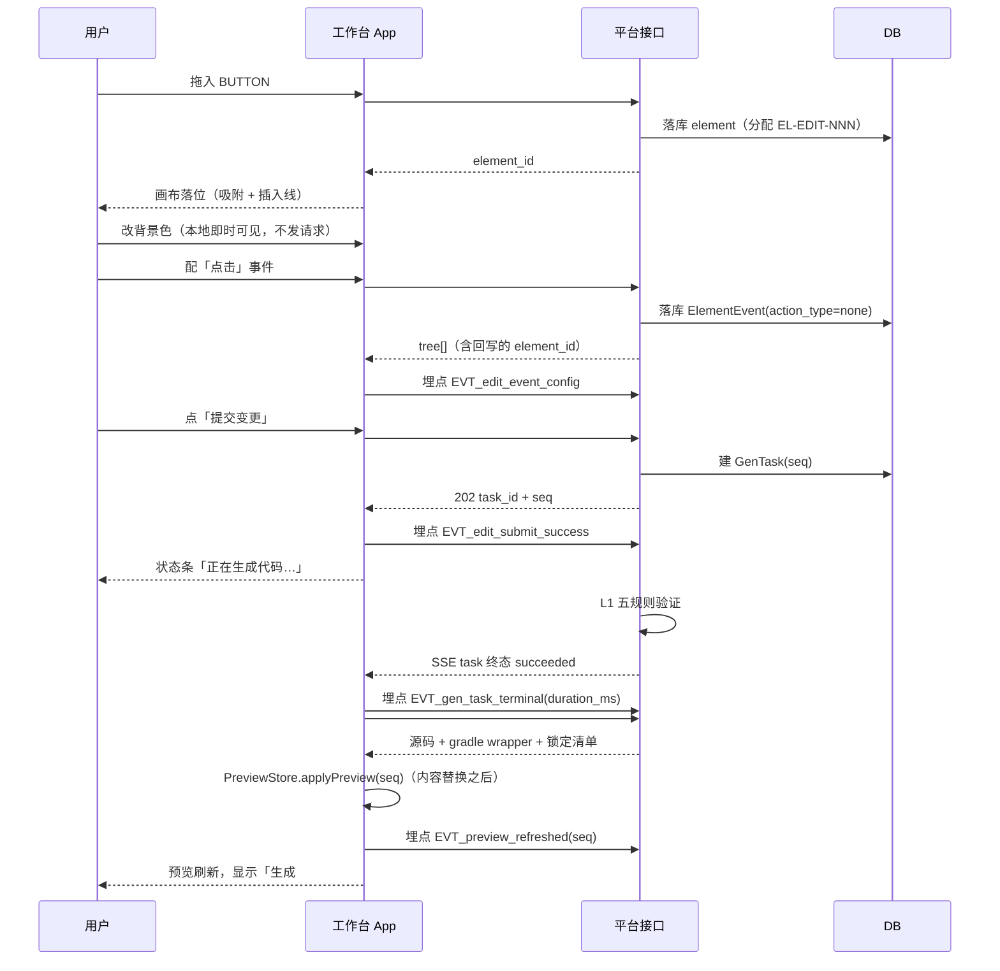

# AutoDevelopment 平台 测试 Spec

> 版本：**v0.2.15**（2026-10-26 B9 审核补充与复审闭环；前轮「审核流程优化：回写落章 + 澄清答复 + 继承勾选态 + 自动审核」；上一版 v0.2.14 = 审核流程优化；更早v0.2.13 = 未通过项补充信息）｜ 来源 PRD：`platform/平台需求概要.md` v1.4（第 4 轮回写后 · 门禁阻断 0）｜ 角色：测试 ｜ 更新：2026-10-26；**本轮同版增量补正**：#8服务端哈希、初载/手动文档门禁、严格正文继承与当前doc历史；不另开轮次。
>
> **本次作业性质**：以 `platform/design/验收标准.md`（**118 条 AC + 9 条 E2E，已确认基线**）为**底稿做格式转换**，
> 补上四份角色 Spec 才暴露出来的新缺口；**不从零重写**。
> **对齐对象**：`UI-Spec.md`（13 页 / **435 `EL-*`**〔沿革：412 → **419**〔2026-10-21 本机落地 +7〕→ **424**〔2026-10-22 对话面板 +5〕→ **425**〔2026-10-23 审核页写回入口 `EL-REVIEW-052` +1〕→ **426**〔2026-10-26 审核页未通过项补充信息 `EL-REVIEW-053` +1〕→ **427**〔2026-10-26 审核流程优化 `EL-REVIEW-054` +1〕〕）、`接口-Spec.md`（**75 接口** = 63 基线 + 补口 `#63`~`#70` 8 条 + **本机落地 `#71`/`#71a`/`#72`/`#72a` 4 条**、13 错误码、SSE）、
> `App-Spec.md`（**13 条 `RT-*`** / 65 行页面五态 / §10 埋码点 / **附节 A 安卓侧 7 条**）、`埋点-Spec.md`（**54 事件** / 9 节点漏斗 / 7 条合规事件）。
> **上游需求包**：`platform/requirements/测试-需求包.md`（三层 + E2E 最小覆盖集）。
>
> **来源标签**（沿用基线记法）：`§FX` / `§X` = PRD 章节；`AC-*` / `E2E-*` = `验收标准.md`；
> `#n` = `接口契约 #n` ↔ `API-PLAT-0nn`；`UI-*` / `EL-*` / `RT-*` / `EVT_*` = 四份上游 Spec；
> `[拆解缺口-Q#]` / `[缺口-UI-##]` / `[缺口-API-##]` / `[缺口-APP-##]` / `[埋点-Q#]` / `[冲突-*]` = **既有缺口，原样带编号，不重复裁决**；
> ★ = **补口标记**（**2026-10-21 已按 `platform/decisions/P0-补口裁决单.md §4` 由草案转正式基线**：`#63`~`#68` + 新增 `#69`/`#70` + 7 项字段级补口，实体 23 个）；`[来源: 推断，待确认]` = **原文标签原样保留**。
>
> **四条硬口径（贯穿全篇，逐条遵守，来源：`测试-需求包 §0` + 项目约束）**：
> ① **补口接口已转基线**（`#63`~`#68` + 新增 `#69`/`#70`，2026-10-21）—— §4.16 / §5 中原「**草案未确认前入口应处于禁用态**」的用例组**保留为历史口径留档**（标注**已闭合**、**不再执行**），**放行依据改为正向用例**（§4.16 `TC-DRAFT-007`~`012`/`015`/`016`、§5 各页正向用例）。
> ② **不得把"平台自身（Web 工作台）"与"平台生成出来的安卓工程"混为一谈** —— 前者是 §4/§5/§6 的测试对象，后者单列 **附节 A**。
> ③ **埋点事件名以埋点 Spec 为准** —— `EVT_DELIVER_FORBIDDEN` **已合并**进 `EVT_auth_forbidden`、`EVT_EDIT_SYNC_SUBMIT` **已改名**为 `EVT_edit_submit_success`；`App-Spec §10` 的占位名（大写形式）一律作废（`埋点-Spec` 附节 A）。
> ④ **本机落地 4 接口（`#71`/`#71a`/`#72`/`#72a`，2026-10-21）属「开发阶段扩展」** —— **未过门禁、未进入第 4 轮基线冻结范围**（来源：`接口-Spec §5.4.13`）；`#72` 是**阶段性的本地登录**，**生产必须 `AD_PASSWORD_LOGIN=disabled`**；`#72`/`#72a` 的用例**必须在 `development` 与 `disabled` 两个环境档位各跑一遍**（见 §4.17）。

---

## 1 文档信息

| 项 | 内容 |
|---|---|
| 文档目的 | 定义**接口 / App / 埋点**三层测试及**端到端串联**，作为本期交付的**最后一道关口**与上线放行依据 |
| 依据文档 | `platform/平台需求概要.md` v1.4（唯一事实来源）；`platform/design/验收标准.md`（118 AC + 9 E2E）；UI Spec；接口 Spec；App Spec；埋点 Spec |
| 底稿 | `platform/design/验收标准.md` §2~§16（逐 REQ 的 `AC-*`）+ §1（`E2E-01`~`09`）—— 本 Spec 的 `TC-*` **由其转化**，AC 未覆盖的分支由本 Spec 补 |
| 关联文档 | `baseline/需求追溯矩阵.md`（本 Spec 回填「测试用例ID」列）、`platform/requirements/测试-需求包.md`、`platform/requirements/需求条目表.md`（91 REQ）、`platform/requirements/拆解期发现的问题.md`（14 条） |
| 覆盖对象总数 | **75 接口**（63 基线 + 补口 `#63`~`#70` **8 条**，2026-10-21 由草案转基线 + **本机落地 `#71`/`#71a`/`#72`/`#72a` 4 条**，2026-10-21 · 开发阶段扩展 · **未过门禁**）｜ **13 路由** + **65 行页面五态** ｜ **54 埋点事件**〔2026-10-21 本机落地后；冻结基线 52〕｜ **9 个 P0 主流程节点** ｜ **91 条 REQ** |
| 用例总数 | 见 §11「覆盖率」 |

---

## 2 测试范围与策略

### 2.1 测试层级

| 层级 | 代码段 | 测试对象 | 判定依据来源 |
|---|---|---|---|
| ① 接口 | `0xx` | **平台自身 75 个接口**（`#1`~`#62` 基线 + `#44a` + 补口 `#63`~`#70`，2026-10-21 转基线 + **本机落地 `#71`/`#71a`/`#72`/`#72a` 4 条**，见 §4.17） | `接口-Spec §5.2` 的 **13 错误码** + §5.3 分页排序 + §5.1 SSE + §5.4.13 各接口出参 |
| ② App | `1xx` | **平台自身 Web 工作台 13 条 `RT-*`**（含 65 行页面五态） | `UI-Spec` 文案逐字 + `App-Spec §5` 五态 + §6.3 错误码→文案 |
| ③ 埋点 | `2xx` | **A 线：平台自身 54 个事件** | `埋点-Spec §3` 事件字典（触发时机 / 参数 / 上报时机 / 去重规则）+ §7.1 验证方法 + §7.2 的 V-01~V-12 |
| ④ E2E | `TC-E2E-0xx` | `TC-E2E-001`~`TC-E2E-009`（S0→S9） | `验收标准 §1` |
| ⑤ 状态迁移专项 | `300`~`349` | `Project.stage` / `GenTask` / `VerifyTask` / 元素与版本状态机（30 条，§8） | `数据模型 §3` 状态机 + 取消分支 `D-Q22` |
| ⑥ 补口专用 | `TC-DRAFT-0xx` | 补口接口**转基线后的正向 / 契约比对用例**（16 条，§4.16，**本期放行依据**）；其中 `TC-DRAFT-001`~`006`/`013` 为**历史禁用态口径（已闭合，留档不执行）** | `接口契约 §1.12` + 四份 Spec 的 `[缺口-*]` / `[冲突-*]` 条目 |
| 附节 A | `350`~`399` | **生成出来的安卓工程侧**（`App-Spec` 附节 A 的 7 条实现约束，8 条） | `App-Spec` 附节 A 的「怎么验」列 |

### 2.2 ★ 用例编号约定（**本项目特例，先定口径**）

`TC-<模块>-<三位>`（**允许数字后带一个小写字母后缀**，用于同一编号下的细分子用例 —— 如 `TC-REVIEW-001a`~`001e`；**后缀不改变编号所属层级**，全项目仍唯一）；**模块段 = `REQ-*` 的模块名**（基础模块名沿用 REQ 模块，`WORK` 为工作台专列，`DRAFT` 为补口专用模块，`E2E` 为端到端串联模块）；**三位数字按层级分块**，保证全项目唯一：

| 数字段 / 模块 | 层级 | 示例 |
|---|---|---|
| `001`~`099` | **接口层**（含 `TC-DRAFT-001`~`016` 补口专用组，见 §4.16） | `TC-PROJ-001` = `#2 POST /projects` 正常创建；`TC-DRAFT-001` = `#63`~`#66` 登录链路（**原"未确认前禁用"口径已闭合，改为留档；正向见 `TC-DRAFT-007`~`009`**） |
| `100`~`199` | **App 层** | `TC-PROJ-101` = `RT-PROJ-001` 元素与文案齐全 |
| `200`~`299` | **埋点层** | `TC-PROJ-201` = `EVT_proj_create_success` 正向触发 |
| `300`~`349` | **状态迁移专项**（§8，共 30 条） | `TC-PROJ-301` = `[*] → created` 状态迁移 |
| `350`~`399` | **安卓工程侧专项**（附节 A，共 8 条） | `TC-GEN-351` = A-1 生成物非模板渲染 |
| `TC-E2E-001`~`TC-E2E-009` | **E2E 串联**（§7，共 9 条） | `TC-E2E-007` = S7 核心链路 |

> **模块段清单**：`AUTH` `PROJ` `KB` `WORK` `UPLOAD` `REVIEW` `CHAT` `SPLIT` `SPEC` `UIEDIT` `GEN` `PREVIEW` `API` `CAP` `DELIVER` `NF` `TRACK` `BASE` `DESIGN` `DRAFT` `E2E`。
> **表头列映射**（相对 `templates/测试-Spec.md` 的扩展）：模板 §4 的「入参 / 期望状态码 / 期望错误码或文案」三列保留，**另补「前置条件 / 操作步骤」两列**以满足「用例必须写全」的硬性要求；模板 §5 的「步骤 / 预期结果」拆为「前置条件 / 操作步骤 / 预期结果」。

### 2.3 覆盖原则（逐条硬性）

| # | 原则 |
|---|---|
| 1 | **每条 REQ ≥ 1 条正向 + 1 条异常/边界**；只有正向 = **未覆盖**。 |
| 2 | **预期结果必须可判定**：给**具体文案（逐字，引号内）**、**具体字段值**、**具体状态码**、**具体 `EVT_*` 事件名与参数**。**禁止**"正常显示""符合预期""无异常"。 |
| 3 | **接口层覆盖全部 75 个接口**（63 基线 + 补口 8 + **本机落地 4**）；补口接口（`#63`~`#70`）**已为正式基线**，按其**业务成功路径 + 异常/边界**编制用例；失能的「禁用/兜底」口径用例（`TC-DRAFT-001`~`006`/`013`）**保留留档、不再执行**；本机落地 4 接口按其**正向 + 异常/边界 + 用户隔离**编制用例（§4.17），**`#72`/`#72a` 须在两档环境变量下各断言一次**。 |
| 4 | **App 层覆盖全部 13 条 `RT-*` + 65 行页面五态**；文案逐字引用 `UI-Spec`。 |
| 5 | **埋点层覆盖全部 54 个事件**；事件名/时机/参数逐字引用 `埋点-Spec`。 |
| 6 | **E2E 覆盖 `E2E-01`~`09`** 全部 9 个 P0 主流程节点。 |
| 7 | **状态迁移覆盖**：依据 `数据模型.md` 状态机，含**取消**分支（`D-Q22`）。 |
| 8 | 因 `[缺口-*]` **无法执行的用例必须显式挂编号**（§9），**不得静默跳过**。 |
| 9 | **范围排除的验证 = 证明其不存在**（`REQ-BASE-001`、`REQ-AUTH-007`）。 |

### 2.4 不在范围

① 数据仓库建模 / BI 报表 / 埋点可视化看板（`埋点-Spec §1`）；② **B 线（被开发项目）埋点具体条目的枚举**（由平台按用户 PRD 生成，本 Spec 只验 `TrackPlan` 规范符合性，见附节 A `TC-GEN-358`）；③ 平台**服务端构建 / 打包 / 云 CI**（项目约束 1、2 —— 且需**负向断言其不存在**）；④ 数字资产安全的**增强策略**（`D-X2`，需**负向断言其不存在**）；⑤ 跨端 / 已有项目改样式 / 图表地图 Canvas / WebView / 视频剪辑 / AR（`D-X1`/`D-X3`/`D-X4`）。
> **注意**：③④⑤ 属「**范围排除的验证**」——**不是"不测"，而是"断言界面与产出中均不存在"**。

### 2.5 优先级定义

`P0` = 主流程必经或**合规硬项**（漏做即交付不成立）｜ `P1` = 分支与异常 ｜ `P2` = 边角。与 `验收标准.md` 的 AC 级别对齐。

### 2.6 准入 / 准出

| 项 | 条件 |
|---|---|
| **准入** | ① 四份上游 Spec 均已产出；② 测试环境可访问 `#1`~`#62` 全部基线接口；③ 测试账号（需求方 / 管理员各 1）就绪；④ 生成产物可在**用户本机**完成 L2 构建（仅用于 A-5 验证，**不计平台指标**） |
| **准出（上线）** | ① §11 三条层级线覆盖率达标；② **P0 用例 100% 通过**；③ §7 的 9 条 E2E 全通过；④ **§6.3 合规证据链专项全通过**（`AC-AU-08`/`AC-AU-09`，P0 合规）；⑤ §9 的缺口**逐条给出"已闭合 / 仍开放"的结论**（`§9.1` 13 行**全部已闭合**）；⑥ `baseline/需求追溯矩阵.md` 的「测试用例ID」列已回填、孤儿数 = 0 |
| **阻断项** | P0 用例失败 / 合规证据链断裂 / **静默降级**被观测到 → **阻断上线**，不得以"已知问题"放行 |

---

## 3 测试环境与数据

| 项 | 内容 |
|---|---|
| 环境 | 测试环境（独立于生产）；平台侧为 **Web 工作台**（**桌面浏览器 1440×900 基准**，`埋点-Spec §1`）；账号 = **飞书扫码登录**（`D-Q6`）。**2026-10-21 补充**：本机开发阶段亦可经 `#72 POST /auth/password/login`（＋ `#72a GET /auth/methods`）用**本地账号密码**登录，启用态由 `AD_PASSWORD_LOGIN` 决定 —— **测试须在 `development` 与 `disabled` 两个档位各跑一遍**（§4.17），**生产必须 `disabled`** |
| 账号与权限 | **需求方**账号 1 个（用户 A，仅自己创建的项目）+ **管理员**账号 1 个；另备**用户 B** 用于越权用例（A 请求 B 的项目 → 403） |
| 测试数据准备 | ① 137 个项目（分页边界，`AC-PROJ-05`）；② 20 页内 `.docx`（含 1 张内嵌表格）+ 含白板图的飞书文档（`partial`）；③ 23.4MB 文件（413）；④ `.pdf`（422）；⑤ 120 页文档（422，当前 {n} 页）；⑥ 空白 `.docx`（`empty_document=true`）；⑦ 畸形记录 / BOM / CRLF 文档；⑧ 200 个控件的页面（第 201 个拒收）；⑨ 元素 id 已达 999 的页面（溢出四位）；⑩ 回流 > 3 轮的审核会话；⑪ 两个引用同一接口的 Spec（`REQ-API-003`） |
| 依赖与桩 | ① **大模型 / 飞书**：需可控桩以构造 60s 超时、退避 2 次仍失败、`UPSTREAM_UNAVAILABLE`；② **SSE 断线**：可强制断开 `#45`（`ping` 15s 未达）；③ **网络离线**：可切 `navigator.onLine=false`；④ **L2 构建代理**：可在用户本机运行并回传 `#46`；⑤ **时钟**：可模拟 29 天 / 31 天（`AC-AU-07`）、UTC 存储与本地时区展示（`AC-PROJ-02`） |
| 埋点断言工具 | 需能**逐条查上报日志**并核对：事件名、参数名与取值、条数、`client_ts`（UTC，无 1970）、`event_id`、`dedup_key`。**上报体禁含项**逐字段核对（`埋点-Spec §5`） |
| 一致性比对 | 埋点事件名 ↔ `App-Spec §10.1` 埋码位置 ↔ 本 Spec 用例事件名 **三处一致**（`需求追溯矩阵 §三-4`） |

---

## 4 第一层 · 接口测试

> **覆盖对象**：**75 个接口全量**（`#1`~`#62` + `#44a` **基线 63** ｜ 补口 **`#63`~`#70` 8 条**，2026-10-21 由草案转正式基线 ｜ **本机落地 `#71`/`#71a`/`#72`/`#72a` 4 条**，2026-10-21 · 开发阶段扩展 · **未过门禁** → **§4.17**）。
> **判定依据**：状态码与 `code` 一律引 `接口-Spec §5.2`（13 错误码）；分页/排序/筛选引 §5.3；SSE 引 §5.1；出参字段名引 §5.0.3（本机落地 4 接口的出参字段名引 **§5.4.13**）。
> **补口接口的处理**：`#63`~`#68` **已转基线** → 测其**成功路径 + 异常/边界**（§4.16 `TC-DRAFT-007`~`012`）；**新增 `#69`**（导出审核报告）/ **`#70`**（中止流程）→ `TC-DRAFT-015`/`016`。原「未确认前入口禁用/兜底」用例（`TC-DRAFT-001`~`006`/`013`）**标注为历史口径（已闭合）、保留留档、不再执行**。
> **本机落地 4 接口的处理**：**§4.17** 新编 **22 条**（`TC-AUTH-001`~`013`、`TC-REVIEW-030`~`038`），按**正向 + 异常/边界 + 用户隔离 + 两档环境变量**编制；**本次未改动任何既有 `TC-*` 编号**。

### 4.1 项目（`#1`~`#6` · 组 1.1）

| 用例 ID | API-ID | 对应 REQ-ID | 场景 | 前置条件 | 操作步骤 | 入参 | 期望状态码 | 期望错误码/文案 | 优先级 |
|---|---|---|---|---|---|---|---|---|---|
| TC-PROJ-001 | `#1` `GET /projects` | `REQ-PROJ-002`、`REQ-NF-004` | **正常** | 账号 A 下有 137 个项目 | 1. 以 A 的 `Bearer` 调 `#1`；2. 传 `page=1&page_size=20` | `page=1`、`page_size=20` | 200 | `code=OK`；`items.length=20`；`total=137`；`has_more=true`；`sort="updated_at:desc"`；`items[0].updated_at` ≥ `items[19].updated_at` | P0 |
| TC-PROJ-002 | `#1` | `REQ-PROJ-002`、`REQ-NF-004` | **分页边界：`page` 超末页** | 137 个项目 | 1. 调 `#1` 传 `page=99` | `page=99&page_size=20` | **200（不报错）** | `code=OK`；`items=[]`；`total=137`；`has_more=false` | P0 |
| TC-PROJ-003 | `#1` | `REQ-NF-004` | **越界：`page_size>100`** | — | 1. 调 `#1` 传 `page_size=101` | `page_size=101` | **400** | `INVALID_ARGUMENT`；`data.field="page_size"`；`data.received=101` | P1 |
| TC-PROJ-004 | `#1` | `REQ-AUTH-002` | **无权限：逐对象鉴权** | 用户 A、B 各有项目 | 1. 以 **A 的 token** 调 `#1`；2. 检查 `items` 是否含 B 的项目 id | — | 200 | `code=OK`；`items[].project_id` **不含任何 B 的项目 id**（**只返回调用者可见项目**，不是 403） | P0 |
| TC-PROJ-005 | `#1` | `REQ-NF-004` | **排序稳定次序键** | 造 3 个项目 `updated_at` **完全相同** | 1. 调 `#1`；2. 观察 3 条的相对顺序 | — | 200 | 三条按 `id` **升序**排列（稳定次序键，翻页不重不乱） | P1 |
| TC-PROJ-006 | `#2` `POST /projects` | `REQ-PROJ-001` | **正常** | 已登录 | 1. 调 `#2` 传 `name="点餐 App"` | `{"name":"点餐 App"}` | 200（或 201） | `code=OK`；`data.project_id` 为 36 位非空串；`data.name="点餐 App"`；`data.stage="created"`；`data.created_at` 为 **UTC ISO-8601** | P0 |
| TC-PROJ-007 | `#2` | `REQ-PROJ-001` | **异常：空白名** | — | 1. 调 `#2` 传 `name=""` | `{"name":""}` | **400** | `INVALID_ARGUMENT`；`data.field="name"`；App 侧保留已输入（`AC-PROJ-01`） | P0 |
| TC-PROJ-008 | `#2` | `REQ-PROJ-001` | **边界：可见字符两侧（49 / 51）** | — | 1. 传 49 个可见字符（含 emoji，emoji 按 1 计）；2. 再传 51 个 | `name` = 49 字符 / 51 字符 | 200 / **400** | 49 → `code=OK`；51 → `INVALID_ARGUMENT` + `data.field="name"`（`AC-PROJ-04`） | P1 |
| TC-PROJ-009 | `#2` | `REQ-NF-006`、`REQ-PROJ-001` | **幂等重放** | — | 1. 带 `Idempotency-Key=K1` 调 `#2`；2. **3s 内**用同一 `K1` 重复调用 | 同 `Idempotency-Key`、同 body | **409** | `IDEMPOTENT_REPLAY`；**返回首次结果**（`project_id` 与第一次**完全相同**）；库中**只有 1 个项目**（`AC-PROJ-09`） | P0 |
| TC-PROJ-010 | `#2` | `REQ-PROJ-001` | **并发 / 重名（允许）** | — | 1. 已存在 `name="点餐 App"`；2. 用**不同** `Idempotency-Key` 再建同名 | `{"name":"点餐 App"}` | 200 | `code=OK`；返回**新的** `project_id`（≠ 已存在者）——**同用户重名允许**（`AC-PROJ-03`） | P1 |
| TC-PROJ-011 | `#2` | `REQ-PROJ-001` | **缺参** | — | 1. 调 `#2` 不传 `name` 字段 | `{}` | **400** | `INVALID_ARGUMENT`；`data.field="name"` | P1 |
| TC-PROJ-012 | `#2` | `REQ-PROJ-001` | **类型错误** | — | 1. 调 `#2` 传 `name=123`（数字而非字符串） | `{"name":123}` | **400** | `INVALID_ARGUMENT`；`data.field="name"` | P1 |
| TC-PROJ-013 | `#3` `GET /projects/{id}` | `REQ-PROJ-002` | **正常** | A 有项目 P1 | 1. 调 `#3` 传 P1 的 id | — | 200 | `code=OK`；含 `name`/**`owner_user_id`**/`stage`/`current_revision_id`/`current_version_id`（**未产生时为 `null`，键必须存在**） | P1 |
| TC-PROJ-014 | `#3` | `REQ-PROJ-002` | **异常：对象不存在** | — | 1. 调 `#3` 传随机 UUID | — | **404** | `NOT_FOUND` | P1 |
| TC-PROJ-015 | `#3` | `REQ-AUTH-002` | **无权限：越权且不泄露存在性** | A、B 各 1 个项目 | 1. 以 **A 的 token** 调 `#3` 传 **B 的** project_id | — | **403** | `FORBIDDEN`；**message 与 404 `NOT_FOUND` 的文案不得有可区分差异**；**参数不含对象名**（`AC-AU-01`） | P0 |
| TC-PROJ-016 | `#4` `PATCH /projects/{id}` | `REQ-PROJ-003` | **正常** | 项目 P1 | 1. 带 `If-Match: <version>` 调 `#4` 改 `name="点餐 App v2"` | `{"name":"点餐 App v2"}` | 200 | `code=OK`；返回更新后的对象；`updated_at` 已刷新 | P1 |
| TC-PROJ-017 | `#4` | `REQ-NF-003` | **并发冲突** | P1 已被他人改过（`version` 前进 1） | 1. 带**旧** `If-Match` 调 `#4` | `If-Match: <stale>` | **409** | `VERSION_CONFLICT`；**不静默覆盖**（`AC-AP-05` 同口径） | P1 |
| TC-PROJ-018 | `#4` | `REQ-PROJ-003` | **异常：非法名** | — | 1. 调 `#4` 改 `name=""` | `{"name":""}` | **400** | `INVALID_ARGUMENT`；`data.field="name"` | P1 |
| TC-PROJ-019 | `#5` `DELETE /projects/{id}` | `REQ-PROJ-004` | **正常（逻辑删除）** | 有生成代码的项目 | 1. 调 `#5`（`body {confirm:true}`）；2. 查列表 | `{"confirm":true}` | 200 | `code=OK`；`data.deleted_at` 为 **UTC** 非空；该项目**不出现在** `#1` 列表中〔2026-10-22 补 `confirm` 与出参断言，语义核对销项〕 | P0 |
| TC-PROJ-020 | `#5` | `REQ-PROJ-004` | **异常：重复删除** | P1 已逻辑删除 | 1. 再次调 `#5` 传 P1（`body {confirm:true}`） | `{"confirm":true}` | **404** | `NOT_FOUND`（已删除对象不可再删；**不得返回 200**） | P1 |
| TC-PROJ-021 | `#5` | `REQ-AUTH-002` | **无权限** | A、B 各 1 个项目 | 1. 以 A 的 token 删 B 的项目（`body {confirm:true}`） | `{"confirm":true}` | **403** | `FORBIDDEN`；不泄露存在性 | P0 |
| TC-PROJ-025 | `#5` | `REQ-PROJ-004` | **异常：缺二次确认** | 有项目 P1 | 1. 调 `#5` **不带** `confirm` | `{}` / 无 body | **400** | `INVALID_ARGUMENT`「删除项目需要显式确认。」；P1 **未被删除**（`⬛` 破坏性，**服务端亦须校验**） | P0 |
| TC-PROJ-022 | `#6` `GET /projects/{id}/stats` | `REQ-PROJ-005` | **正常：状态条字段齐全** | 项目处于 `reviewing` | 1. 调 `#6` | — | 200 | `code=OK`；`stage` 合法枚举；**`gate.verdict ∈ {unreviewed,running,blocked,passed}`**；**`gate.blocking_count`、`gate.major_count` 存在**；**`version_seq`、`running_tasks`、`loopback_round` 存在**〔2026-10-22 按实现对齐——**不再断言 `gate_counts`/`suggestion`/`current_version_id`**〕 | P0 |
| TC-PROJ-023 | `#6` | `REQ-NF-005` | **空数据返回形态：无版本** | 新项目，**零版本** | 1. 调 `#6` | — | 200 | **`version_seq=0`**（实现用 `0` 作「尚无版本」哨兵，**不是 `null`**）〔2026-10-22 按实况修正〕；`running_tasks=0`（**零就是 0**）；`loopback_round=1`（**无回流时返回 `1`，不是 `null`**）；`gate.verdict="unreviewed"` | P1 |
| TC-PROJ-024 | `#6` | `REQ-AUTH-002` | **无权限** | A、B 各 1 个项目 | 1. 以 A 的 token 调 B 的 `#6` | — | **403** | `FORBIDDEN`；不泄露存在性 | P1 |
| TC-PROJ-026 | `#6` | `REQ-PROJ-005`、`REQ-REVIEW-001` | **评分卡归属字段：三态可判**〔2026-10-22 新增〕 | ① 从未审核；② 审核后 PRD 出新 revision；③ 审核且 revision 未变 | 1. 三种状态下分别调 `#6`；2. 比对 `current_revision_id` 与 `gate.review_revision_id` | — | 200 | 三态均含 **`current_revision_id`** 与 **`gate.review_revision_id`**；①两者均为 `null` + `gate.verdict="unreviewed"`；②两者**不等**；③两者**相等**；**判定顺序**：先看 `verdict="unreviewed"`，再比 revision（见 `接口-Spec §5.5.4`） | P0 |
| TC-PROJ-027 | `#6` | `REQ-PROJ-005` | **空数据：`review_revision_id` 为 `null` 而非缺键**〔2026-10-22 新增〕 | 新项目，无任何审核报告 | 1. 调 `#6`；2. 检查出参键 | — | 200 | `gate.review_revision_id` **键存在且为 `null`**（**不是 `undefined`/丢键**，参照 `#3` 的同类口径）；`current_revision_id` 同为 `null` | P1 |

### 4.2 知识库（`#7`~`#9` · 组 1.2）

| 用例 ID | API-ID | 对应 REQ-ID | 场景 | 前置条件 | 操作步骤 | 入参 | 期望状态码 | 期望错误码/文案 | 优先级 |
|---|---|---|---|---|---|---|---|---|---|
| TC-KB-001 | `#7` `GET /projects/{id}/kb-docs` | `REQ-KB-001` | **正常** | PRD 已解析成功 | 1. 调 `#7`；2. 核对 `items[]` | — | 200 | `code=OK`；`items[].origin="agent_extracted"`；字段含 `title`/`sector`/`origin`/`updated_at`（`AC-KB-01`）〔2026-10-22 按实现对齐：原写 `doc_type`〕 | P0 |
| TC-KB-002 | `#7` | `REQ-KB-001`、`REQ-AUTH-006` | **跨项目隔离（必须取不到）** | 项目 A 与 B 各有知识库；B 有独有词 `zzz-unique-b` | 1. 在 **A** 的 `#7` 检索 `zzz-unique-b` | `q=zzz-unique-b` | 200 | `code=OK`；`items=[]` 且 `total=0` —— **取不到 B 的内容**（强制按 `project_id` 过滤，`AC-KB-03`） | P0 |
| TC-KB-003 | `#7` | `REQ-KB-002` | **无权限且不泄露存在性** | B 有知识库 | 1. 以 A 的 token 调 B 的 `#7` | — | **403** | `FORBIDDEN`；**不透露对象是否存在** | P1 |
| TC-KB-004 | `#8` `GET /kb-docs/{id}` | `REQ-KB-001` | **正常** | 知识库有文档 D1 | 1. 调 `#8` | — | 200 | `code=OK`；`content_md` 为 **Markdown 原文**（非空）；#8字段含`document_id:string\|null`、`version`、`content_hash:string`；content_hash为服务端SHA-256本次content_md，前端不计算摘要 | P1 |
| TC-KB-005 | `#8` | `REQ-KB-001` | **异常：不存在** | — | 1. 调 `#8` 传随机 id | — | **404** | `NOT_FOUND` | P1 |
| TC-KB-006 | `#9` `PUT /kb-docs/{id}` | `REQ-KB-001` | **正常：origin 变更** | 文档 D1 | 1. 带 `If-Match` 调 `#9` 保存编辑；2. 再查 `#8` | `{"content_md":"…编辑后…"}` | 200 | `code=OK`；`data.origin="user_edited"`（`AC-KB-02`） | P0 |
| TC-KB-007 | `#9` | `REQ-NF-003` | **并发冲突** | D1 的 `version` 已前进 | 1. 带**旧** `If-Match` 调 `#9` | `If-Match: <stale>` | **409** | `VERSION_CONFLICT`；不静默覆盖 | P1 |

### 4.3 上传与解析（`#10`~`#15` · 组 1.3）

| 用例 ID | API-ID | 对应 REQ-ID | 场景 | 前置条件 | 操作步骤 | 入参 | 期望状态码 | 期望错误码/文案 | 优先级 |
|---|---|---|---|---|---|---|---|---|---|
| TC-UPLOAD-001 | `#10` `POST …/uploads` | `REQ-UPLOAD-001` | **正常（文件路径）** | 已登录、告知已确认、外发开关开 | 1. 以 `multipart/form-data` 上传 5MB / 10 页 `.docx` | `file=<docx>` | 200 | `code=OK`；`data.file_id` 非空；`data.size_bytes` 与文件一致；`data.status` 已进入解析（`AC-UP-01`） | P0 |
| TC-UPLOAD-002 | `#10` | `REQ-UPLOAD-002` | **越界：超 20MB** | — | 1. 上传 23.4MB 文件 | `file=23.4MB` | **413** | `PAYLOAD_TOO_LARGE`；message **逐字**「文件超过 20MB（当前 23.4MB）。请压缩后重试。」；**不产生文件记录**（`AC-UP-03`） | P0 |
| TC-UPLOAD-003 | `#10` | `REQ-UPLOAD-002` | **异常：格式不支持** | — | 1. 上传 `.pdf` | `file=<pdf>` | **422** | `FORMAT_UNSUPPORTED`；message **逐字**「暂不支持该格式。请上传 .docx / .md 或飞书云文档链接。」；**不产生文件记录**（`AC-UP-02`） | P0 |
| TC-UPLOAD-004 | `#10` | `REQ-NF-006` | **幂等重放** | — | 1. 带 `Idempotency-Key=U1` 上传；2. **3s 内**重复同键同文件 | 同键、同文件 | **409** | `IDEMPOTENT_REPLAY`；**返回首次 `file_id`**；库里**只 1 条**上传记录 | P1 |
| TC-UPLOAD-005 | `#10` | `REQ-AUTH-004` ★ | **上游不可用（外发关闭）分支** | 外发开关已关闭（或 `#68` 已关闭 → 失败分支） | 1. 调 `#10` 上传 | `file=<docx>` | **503** | `UPSTREAM_UNAVAILABLE`；**不得返回 200 假装在跑**（`AC-AU-09`）；对应埋点 `EVT_gen_blocked_by_egress`（`entry=upload`） | P0 |
| TC-UPLOAD-006 | `#10` | `REQ-UPLOAD-001` | **上传链闭环：出参含 `document_id`**（`[缺口-APP-01]` **已于 2026-10-21 闭合**） | 已登录 | 1. 调 `#10` 上传 `.docx`；2. 检查出参键集合；3. 用返回值调 `#12` | `file=<docx>` | 200 | 出参含 **`file_id`** + **`document_id`**（+ `size_bytes`/`status`）；`document_id` **可直接作为 `#12` 的路径参数**并返回 **202**（**链路闭环**）；`reject_reason` 仅在该条被拒时非空 | P0 |
| TC-UPLOAD-007 | `#11` `POST …/documents` | `REQ-UPLOAD-001` | **正常（飞书链接路径）** | 有权限的飞书文档链接 | 1. 调 `#11` 提交链接 | `{"source_type":"feishu_link","url":"…"}` | 200 | `code=OK`；`data.document_id` 非空；`data.source_type="feishu_link"` | P0 |
| TC-UPLOAD-008 | `#11` | `REQ-UPLOAD-001` | **异常：无效链接 vs 无权限（两种文案）** | — | 1. 提交**无效/已失效**链接；2. 提交**平台无权限**的链接 | 两个不同 url | 400 / 403 | ①「**链接无效或已失效。**」；②「**平台没有这篇文档的访问权限。**」+「去飞书授权」—— **两者文案必须不同**（`AC-UP-07` / `AC-UP-08`） | P1 |
| TC-UPLOAD-009 | `#11` | `REQ-GEN-010` | **上游超时** | 飞书桩置为超时 | 1. 调 `#11` | — | **504** | `UPSTREAM_TIMEOUT`；返回**可重试失败态** | P1 |
| TC-UPLOAD-010 | `#12` `POST …/revisions` | `REQ-UPLOAD-001` | **正常：触发解析** | 已有 `document_id` | 1. 调 `#12` | — | **202** | `code=OK`；`data.task_id` 非空；`data.revision_id` 非空 | P0 |
| TC-UPLOAD-011 | `#12` | `REQ-UPLOAD-005` | **幂等 / revision 不覆盖** | 同一文档已解析过 | 1. 再次调 `#12`；2. 查 `#13` 列表 | — | 202 | **新建 revision**；`#13` 中**旧 revision 仍在**、`created_at` 更早、**未被覆盖**（`AC-UP-09`） | P1 |
| TC-UPLOAD-012 | `#12` | `REQ-UPLOAD-006`、`REQ-NF-007` | **并发：串行排队不并行** | 上一解析任务仍在 `running` | 1. 再调 `#12` | — | 202 | `code=OK`；任务**排队（串行）**，`running_tasks` 不出现两个并行解析（`AC-UP-11`） | P1 |
| TC-UPLOAD-013 | `#13` `GET …/revisions` | `REQ-UPLOAD-005` | **正常：倒序** | 同一文档有 2 个 revision | 1. 调 `#13` | — | 200 | `code=OK`；`items[]` 含 `revision_id`/`parse_status`/`created_at`；按 `created_at` **倒序**（最新在前） | P1 |
| TC-UPLOAD-014 | `#13` | `REQ-NF-004` | **分页边界 + 空数据** | 单 revision 文档 | 1. 调 `#13` 传 `page=99` | `page=99` | 200 | `code=OK`；`items=[]`；`total=1`；**不报错** | P1 |
| TC-UPLOAD-015 | `#13` | `REQ-UPLOAD-005` | **异常：document 不存在** | — | 1. 调 `#13` 传随机 document_id | — | **404** | `NOT_FOUND` | P2 |
| TC-UPLOAD-016 | `#14` `GET …/parse-result` | `REQ-UPLOAD-003` | **正常：分块结果四块齐全** | 解析成功 | 1. 调 `#14` | — | 200 | `code=OK`；`parts{}` 含 `body`/`tables`/`whiteboards`/`attachments` 四键；`parse_status="succeeded"`；`empty_document=false` | P0 |
| TC-UPLOAD-017 | `#14` | `REQ-UPLOAD-003` | **部分成功 ≠ 错误码** | 含白板图且取不到 | 1. 调 `#14` | — | **200** | `code=OK`（**不是错误码**）；`parse_status="partial"`；`failed_parts[]` 非空；`total` **只统计成功部分**；**`partial` 返回 200 + `code=OK`**（`[待澄清-错误码口径]`：`PARSE_PARTIAL` 为**非错误标记**，`AC-UP-06`） | P0 |
| TC-UPLOAD-018 | `#14` | `REQ-UPLOAD-004` | **空文档：与解析失败区分** | 上传空白 `.docx` | 1. 调 `#14` | — | 200 | `code=OK`；`parse_status="succeeded"` **且** `empty_document=true` —— **与 `failed` 是两个取值**（`AC-UP-05`） | P1 |
| TC-UPLOAD-019 | `#14` | `REQ-UPLOAD-003` | **异常：revision 不存在** | — | 1. 调 `#14` 传随机 revision_id | — | **404** | `NOT_FOUND` | P2 |
| TC-UPLOAD-020 | `#15` `POST …/manual-supplement` | `REQ-UPLOAD-003` | **正常：手动补充** | `parse_status=partial`，`whiteboards` 块失败 | 1. 调 `#15` 传 `part_key=whiteboards` | `{"part_key":"whiteboards","content":"…"}` | 200 | `code=OK`；该块 `status → "ok"`；`failed_parts` 相应减少 | P1 |
| TC-UPLOAD-021 | `#15` | `REQ-UPLOAD-003` | **类型错误：非法 part_key** | — | 1. 调 `#15` 传 `part_key="xxx"` | `{"part_key":"xxx"}` | **400** | `INVALID_ARGUMENT`；`data.field="part_key"` | P1 |
| TC-UPLOAD-022 | `#15` | `REQ-UPLOAD-003` | **异常：revision 不存在** | — | 1. 调 `#15` 传随机 revision_id | — | **404** | `NOT_FOUND` | P2 |

### 4.4 门禁审核与门禁标准（`#16`~`#24` · 组 1.4）

| 用例 ID | API-ID | 对应 REQ-ID | 场景 | 前置条件 | 操作步骤 | 入参 | 期望状态码 | 期望错误码/文案 | 优先级 |
|---|---|---|---|---|---|---|---|---|---|
| TC-REVIEW-001 | `#16` `POST …/reviews` | `REQ-REVIEW-001` | **正常：触发审核**（带 `force:true` 强制新跑） | 有已解析的 revision | 1. 调 `#16`，`{"force":true}` | `{"force":true}` | **202** | `code=OK`；`data.review_id`/`data.task_id` 非空；`data.standard_version` 为当前版本号；`data.reused=false` | P0 |
| TC-REVIEW-001a | `#16` | `REQ-REVIEW-001` | **复用：不带 `force` 且已有未作废报告 → 不重跑**〔2026-10-22 决策 D-1 新增〕 | revision R 已有终态报告（`superseded=0`），门禁标准版本未变，`depth` 未变 | 1. 调 `#16`（**不带 `force`**）；2. 比对报告条数/`superseded`/模型调用次数 | — | **200** | `code=OK`；`data.reused=true`；**`data.task_id === null`**；`data.review_id` = 原报告；**报告总数不变、原报告仍 `superseded=0`、无新增模型调用**（`UI-Spec`「默认（已审核）→ 展示已有 `ReviewReport`」） | P0 |
| TC-REVIEW-001b | `#16` | `REQ-REVIEW-001` | **复用的三个反例：必须重跑**〔2026-10-22 决策 D-1 新增〕 | ① 门禁标准保存后 `standard_version` 变化；② PRD 出新 revision；③ 已有报告卡在 `running` 但任务已不在 | 1. 分别在三种条件下**不带 `force`** 调 `#16` | — | **202** | 三种情况均**新起任务**（`reused=false`、`task_id` 非空）；**不得复用**（宁可多跑一次，不可给错档位的结论） | P1 |
| TC-REVIEW-001c | `#16` | `REQ-REVIEW-001` | **复用但上次仍在跑 → 交回同一任务**〔2026-10-22 决策 D-1 新增〕 | revision R 的未作废报告 `verdict="running"`，且存在 `queued`/`running` 的 review 任务 | 1. 连调 `#16` 两次（**都不带 `force`**）；2. 查任务表 | — | **202** | 第二次返回 `data.task_id` = 第一次的任务号，`reused=true`；**任务表内 review 任务只有 1 条**（不另起第二个任务、不重复计费） | P1 |
| TC-REVIEW-001d | `#6` + 审核页 | `REQ-REVIEW-001`、`REQ-REVIEW-008` | **进页三态判定（App 层）**〔2026-10-22 新增〕 | ① 从未审核；② 审核后 PRD 换版；③ 审核且 revision 未变 | 1. 分别在三种状态下用浏览器进审核页；2. 观察首屏与 `#16` 是否发出 | — | — | ① 显示「还没开始审核。」+「开始审核」，**不自动开审**；② 显示 `EL-REVIEW-033`「这份评分卡已过期（PRD 已更新到 {revision}）。」+「重新审核」，**不自动开审、不产生新报告**；③ 直接显示已有评分卡；**三态判定顺序不可换** | P0 |
| TC-REVIEW-001e | `#16` | `REQ-REVIEW-001` | **「重新审核」按当前 revision 重跑**〔2026-10-22 新增〕 | 已处于「评分卡已过期」态 | 1. 点 `EL-REVIEW-034`「重新审核」；2. 等待任务终态；3. 查 `#6` 与报告表 | — | **202** | 携带 **`force:true`**；新报告 `revision_id` = **`#6` 的 `current_revision_id`**；旧报告置 `superseded=1`；重跑后 `#6` 的 `gate.review_revision_id === current_revision_id`（再刷新进页 → 转为复用、**不再新增报告**） | P0 |
| TC-REVIEW-002 | #16 | `REQ-REVIEW-003`、`REQ-REVIEW-004` | **force服务端兜底，不拦复用** | 同revision存在未superseded报告，阻断未答或unset | 1. force:true直调；2. 缺省force=false复用 | 对照同revision与新revision | 400 / 200或202 | force同revision既有报告：阻断未answered/converted或unset→INVALID_ARGUMENT且无新任务；**复用分支在前不拦**；不把fail评分项数量作为拒绝条件；新持久化脚本01验证前端纯条件，专门force后端兜底还需补测 | P0 |
| TC-REVIEW-003 | `#16` | `REQ-SPLIT-002` | **`depth` 入参存在性（已闭合）** | — | 1. 检查 `#16` 的入参定义与请求体 | — | — | **断言契约中存在可选 `depth`**（`[拆解缺口-Q6]` **已闭合** 2026-10-21）→ `AC-SP-05` 可执行；原「不存在」断言作废（见 §9） | P0 |
| TC-REVIEW-004 | `#16` | `REQ-GEN-010` | **上游超时** | 大模型桩置超时 60s | 1. 调 `#16` | — | **504** | `UPSTREAM_TIMEOUT`；可重试失败态 | P1 |
| TC-REVIEW-005 | `#17` `GET /reviews/{id}` | `REQ-REVIEW-001` | **正常：评分卡**（含 2026-10-21 新增的 `model` 字段） | 审核完成 | 1. 调 `#17` | — | 200 | `code=OK`；`verdict ∈ {running,passed,blocked,failed,superseded}`；`counts{blocking,major,suggestion}` 三键；`standard_version` 与 `#16` 返回一致；**`model` 字段存在且为本次审核实际使用的模型 id**（规格同 `#71` 的模型 `id`，即**落在 `items[].id` 取值域内**；本次审核非空 → 界面 `EL-REVIEW-051` 渲染「**模型：{model}**」）；**负向断言**：`model` 为**空字符串 `""`** 的历史数据（`接口-Spec §5.5.9` 已冻结：未记录 → `""`，**不是 `null`/缺失**） → `EL-REVIEW-051` **整块不渲染**（**不得**用占位符顶替）〔`model` 字段 2026-10-21 新增，`接口-Spec §5.4.13`〕 | P0 |
| TC-REVIEW-006 | `#17` | `REQ-REVIEW-001` | **异常：改版后旧卡过期** | 已出评分卡（绑 revision R1）；上传新 revision R2 | 1. 调 `#17` 查 R1 的评分卡 | — | 200 | `code=OK`；`verdict="superseded"`；**不参与放行判定**（`AC-RV-02`） | P0 |
| TC-REVIEW-007 | #17 | `REQ-REVIEW-001` | **当前PRD与报告版本分离** | 已审核；当前正文可读 | 1. GET17；2. GET8；3. 写回后查旧报告17 | — | 200 | #17顶层revision_id不变；prd={revision_id,document_id,kb_doc_id,version,content_hash}指当前项目PRD，hash为SHA256当前KB正文；无当前revision/KB时prd=null；写回新revision后旧卡superseded=true；初次loadAll GET17→GET8比doc.version/prd.version与doc.content_hash/prd.content_hash，不一致清savedPrd并置documentError，不依赖客户端摘要API。映射新脚本07 assertDocumentContract | P0 |
| TC-REVIEW-008 | `#17` | `REQ-REVIEW-001` | **异常：review 不存在** | — | 1. 调 `#17` 传随机 id | — | **404** | `NOT_FOUND` | P2 |
| TC-REVIEW-009 | #18 | `REQ-REVIEW-001` | **逐项真实DTO与已写入说明回显** | 报告已完成 | 1. GET18；2. 写回后与新报告18对照 | — | 200 | 字段集 {item_code,group,group_title,level,verdict,evidence_ref,suggestion,accepted,supplement}；evidence_ref实际string；verdict为pass/fail/na；supplement默认空，非空且正文存在、同document链才继承说明；accepted仅新fail且旧accepted、有效正文supplement或相同非空suggestion且markdown包含该建议才继承，移除正文后不得只凭相同建议继承；accepted不覆盖verdict。映射新脚本03/08/09 | P0 |
| TC-REVIEW-010 | `#18` | `REQ-REVIEW-005` | **条数口径：不写死 43** | 门禁标准版本 V 共 N 项 | 1. 调 `#18`；2. 计数 | — | 200 | `items.length == N`（= 当前 `standard_version` 的**全部检查项**）；**断言用例不得写死 43**（`[拆解缺口-Q2-附]`） | P1 |
| TC-REVIEW-011 | `#18` | `REQ-REVIEW-001` | **分页 + 空数据** | 无评分卡项 | 1. 调 `#18` 传 `page=99` | `page=99` | 200 | `code=OK`；`items=[]`；**不报错**；另：review 不存在 → **404** `NOT_FOUND` | P1 |
| TC-REVIEW-012 | #19 | `REQ-REVIEW-003`、`REQ-REVIEW-004` | **清单排除归档题** | 有问题与convert假设 | 1. GET19；2. convert→accept→convert | — | 200 | 当前无分页，items按question_code排序；status=converted题不返回但存储answer保留；再convert恢复open或answered，不重复建题。映射新脚本02 | P0 |
| TC-REVIEW-013 | `#19` | `REQ-REVIEW-003` | **影响范围：出参含 `impact`**（`[缺口-UI-02]`/`[缺口-API-02]` **已于 2026-10-21 闭合**） | 审核完成且存在待澄清项 | 1. 调 `#19`；2. 检查出参与界面回显 | — | 200 | 每项含 **`impact`**（映射 `E18 GateQuestion.impact`，**text、可空**）；界面 `EL-REVIEW-021` **整行显示影响范围**；`impact` 为 `null` 时该行显示 **`—`**（**不编造文案**） | P1 |
| TC-REVIEW-014 | `#19` | `REQ-REVIEW-003` | **空态：0 条 vs 尚未审核** | ① 审核完成且 0 条；② 从未审核 | 1. 分别调 `#19` | — | 200 / 404 | ① `items=[]` + `total=0` → 显示「**没有待澄清项，可以直接进入拆解。**」；② 无 review → **404**`NOT_FOUND` → 显示「尚未审核」——**两态文案不同**（`AC-RV-04`） | P0 |
| TC-REVIEW-015 | #20 | `REQ-REVIEW-003` | **独立作答规范化** | 有当前报告问题 | 1. 提交 __other 加实际自由文本；2. GET19 | answer=__other 实际答复 | 200 | 起始__other清理并trim，保存真实文本/status=answered；非options自由文本允许；不产生PRD新版本，页面确认写入仍走#23。映射新脚本03 standalone #20 | P0 |
| TC-REVIEW-016 | `#20` | `REQ-REVIEW-003` | **异常：question_code 不存在** | — | 1. 调 `#20` 传随机 code | — | **404** | `NOT_FOUND` | P1 |
| TC-REVIEW-017 | #20 / #23 | `REQ-REVIEW-003` | **空白与Other标记不是答案** | 阻断题待答 | 1. 分别提交空串、空白、仅__other及加空白；2. #23带同输入 | 对照 __other 实际文本 | 400 | #20 INVALID_ARGUMENT「请先填写答复。」；#23合并后阻断空答拒绝整次、补充/版本等不半保存；规范化非空自由文本允许（不再错误地断言Z必为非法）。映射新脚本01/03/04 | P1 |
| TC-REVIEW-018 | #21 | `REQ-REVIEW-004`、`REQ-REVIEW-003` | **convert→归档→恢复** | 当前报告假设 | 1. convert；2. GET19立即看题；3. 作答；4. accept；5. convert | assumption_code/choice | 200 | POST返回converted_question_code（convert为code_converted，accept=null）；convert为blocking题、options=[]；accept归档但保留answer，再convert恢复answered、同题仅1条；前端重拉#19/#21。映射新脚本02；假设下复用EL22需浏览器验收 | P1 |
| TC-REVIEW-019 | `#21` | `REQ-REVIEW-004` | **异常：`unset` 阻止进入生成** | 假设清单有 1 条未选 | 1. 调 `#21`（POST）提交 `choice="unset"`；2. 再提交生成类请求 | `{"choice":"unset"}` | **400** | `INVALID_ARGUMENT`；**`unset` 不得进入生成阶段**（服务端校验，`AC-RV-05`） | P1 |
| TC-REVIEW-020 | `#21` | `REQ-REVIEW-004` | **类型错误：`choice` 非枚举** | — | 1. 调 `#21` 传 `choice="maybe"` | `{"choice":"maybe"}` | **400** | `INVALID_ARGUMENT`；`data.field="choice"` | P2 |
| TC-REVIEW-021 | `#22` `POST …/accept-candidates` | `REQ-REVIEW-006` | **正常：仅批量勾选，不写 PRD** | 已勾选多条「采纳」 | 1. 记录 `#8`/`#32` 内容哈希；2. 调 `#22`；3. 再取 `#8`/`#32` 内容哈希 | `{"accepted":["c1","c2"]}` | 200 | `code=OK`；**调用前后 PRD 内容哈希完全相同**（**无写 PRD 副作用**）；返回**勾选结果**（`AC-RV-07`、`D-Q10`） | P0 |
| TC-REVIEW-022 | `#22` | `REQ-REVIEW-006` | **异常：非法入参** | — | 1. 调 `#22` 传不存在的候选 id | `{"accepted":["nope"]}` | **400** | `INVALID_ARGUMENT` | P2 |
| TC-REVIEW-023 | #23→#8 | `REQ-REVIEW-002`、`REQ-REVIEW-003` | **原子写入与可核验版本回执** | 假设已选、阻断实际答复齐全 | 1. 同次提交accepted/supplements/answers、confirm/snapshot=true；2. GET8对照；3. 新revision审输入；4. 历史组名/自定义标题/已有小节/代码围栏/无变化分支 | 同item/code重复输入与有效文本 | 200 | flat diff与diff_summary同值且删改0；正文保已有标题/子节/围栏/字样并去重插入；历史组名映射默认小节，不改历史std；澄清答复规范化写入；changed才加version/生revision/作废报告，old revision和源文件不覆盖；无变化回零diff/原version/revision；响应 {deleted_lines,modified_lines,added_lines,diff_summary,changed,new_revision_id,kb_doc_id,kb_version,content_hash,sections_added,snapshot,snapshot_id}；sections_added是处理标题去重，不保证新建；**不能仅凭标题判pass**，受控适配器按正文事实，新模型仍fail不得免审。映射新脚本03/05/06/07/08/09 | P0 |
| TC-REVIEW-024 | #23 | `REQ-REVIEW-004`、`REQ-REVIEW-003`、`REQ-REVIEW-002` | **拒绝与故障整次不落库** | unset或阻断空答；错误/跨项目题/条目；故障注入 | 1. 提交；2. 对照完整事务前后；3. 撤故障同key重试 | 无效answers/accepted_items/补充；无confirm/snapshot | 400 / 403 / 500 | 各校验拒绝无半保存；事务快照/答案/补充/采纳/KB/revision/stage/report均不变；unset逐字文案「还有 {n} 条假设没有选择，先逐条选完再继续。」；成功重试后GET8与回执一致。映射新脚本04/10（数组/类型的更多边界另待补） | P0 |
| TC-REVIEW-025 | #23 | `REQ-NF-006`、`REQ-REVIEW-002` | **同key并发与重放** | 同一有效body/key | 1. 六并发；2. 重放；3. 对照snapshot/revision/version | 同key | **200（当前全局机制回放首次成功）** | 每次返回首次完整回执、只1快照/1新revision/KB+1；不重复保存；失败不缓存成功、同key可重试。映射新脚本10，不再断言必返回409 IDEMPOTENT_REPLAY | P1 |
| TC-REVIEW-026 | `#24` `GET /gate-standards` | `REQ-REVIEW-005` | **正常：版本与 current 唯一** | 标准已保存 3 个版本 | 1. 调 `#24`（GET） | — | 200 | `code=OK`；`items[] = {code,level,title}`；`version=3`；**`is_current=true` 的行有且仅有 1 条** | P1 |
| TC-REVIEW-027 | `#24` | `REQ-REVIEW-005` | **正常：保存后版本 +1 且历史不重算** | 当前版本 3；已有历史评分（`standard_version=3`） | 1. 调 `#24`（PUT）改等级并保存；2. 查 `#17` 的历史评分 | — | 200 | `code=OK`；版本变为 **4**；历史评分的 `standard_version` **仍为 3**（**历史不重算**，`AC-RV-06`） | P1 |
| TC-REVIEW-028 | `#24` | `REQ-AUTH-002` | **无权限：非 admin 不可改** | 用**需求方**账号 | 1. 调 `#24`（PUT） | — | **403** | `FORBIDDEN`（`PUT` 需 admin）——**归属层级见 `[拆解缺口-Q3]`，本用例只验"非 admin 被拒"** | P1 |
| TC-REVIEW-029 | `#24` | `REQ-REVIEW-005` | **异常：非法 items** | — | 1. 调 `#24`（PUT）传 `level="unknown"` | — | **400** | `INVALID_ARGUMENT`；`data.field="items[0].level"` | P2 |

### 4.5 对话（`#25`~`#27` · 组 1.5）

| 用例 ID | API-ID | 对应 REQ-ID | 场景 | 前置条件 | 操作步骤 | 入参 | 期望状态码 | 期望错误码/文案 | 优先级 |
|---|---|---|---|---|---|---|---|---|---|
| TC-CHAT-001 | `#25` `GET …/chat/messages` | `REQ-CHAT-001`、`REQ-CHAT-002` | **正常：`seq` 升序** | 已有 3 条消息 | 1. 调 `#25` | — | 200 | `code=OK`；`items[] = {message_id,project_id,seq,role,content,status,thread_key,created_at}`（`thread_key` ∈ 10 个子步骤；**正文键是 `content`**）；按 `seq` **升序** | P0 |
| TC-CHAT-002 | `#25` | `REQ-AUTH-002` | **无权限** | A、B 各 1 个项目 | 1. 以 A 的 token 调 B 项目的 `#25` | — | **403** | `FORBIDDEN`；不泄露存在性 | P1 |
| TC-CHAT-003 | `#26` `POST …/chat/messages` | `REQ-CHAT-001` | **正常：发送并流式回复** | 已登录 | 1. 调 `#26` 传 `content="补充一下"` | `{"content":"补充一下"}` | 200 | `code=OK`；`data.message_id`/`data.seq` 非空；回复经 **SSE `chat.delta`** 增量回传 | P0 |
| TC-CHAT-004 | `#26` | `REQ-CHAT-001` | **异常：空内容** | — | 1. 调 `#26` 传 `content=""` | `{"content":""}` | **400** | `INVALID_ARGUMENT`；App 提示「**先说点什么再发送。**」（`AC-CH-01`） | P0 |
| TC-CHAT-005 | `#26` | `REQ-CHAT-001` | **越界：20001 字符** | — | 1. 调 `#26` 传 20001 字符 | `content` 长度 20001 | **400** | `INVALID_ARGUMENT`；**说明上限 20000**（`AC-CH-05`）；App 文案「消息最多 20000 字符，当前 20001 字符。」 | P1 |
| TC-CHAT-006 | `#26` | `REQ-NF-006`、`REQ-CHAT-001` | **幂等重放 / 连点两次** | — | 1. 带 `Idempotency-Key=C1` 调 `#26`；2. **3s 内**重放；3. 查 `#25` | 同键 | **409** | `IDEMPOTENT_REPLAY`；`#25` 中该会话**只入库 1 条消息**（`AC-CH-02`） | P0 |
| TC-CHAT-007 | `#26` | `REQ-CHAT-001` | **并发：串行处理** | 上一条消息仍在处理中 | 1. 再调 `#26` 发一条 | `{"content":"再来一条"}` | 200/202 | `code=OK`；**串行处理（排队）**，**不并发改写同一 PRD**（`AC-CH-03`） | P1 |
| TC-CHAT-008 | `#26` | `REQ-CHAT-001` | **注入：`"`；2. 查 `#25` | 含 `<script>` | 200 | `code=OK`；**`content`** **原样返回**（含 `<script>` 文本）；**渲染侧转义、不执行任何标签**（`AC-CH-04`） | P1 |
| TC-CHAT-009 | `#27` `POST …/retry` | `REQ-CHAT-002` | **正常：重发不重复入库** | 某条回复 `status=failed` | 1. 记 `#25` 条数；2. 调 `#27`；3. 再查 `#25` | — | 200 | `code=OK`；返回**同一 `message_id`**；`#25` 条数**未增加**（`AC-CH-06`） | P1 |
| TC-CHAT-010 | `#27` | `REQ-CHAT-002` | **超时** | 大模型桩置超时 | 1. 调 `#27` | — | **504** | `UPSTREAM_TIMEOUT`；单条 **60s 超时**；仍失败 → 可重试失败态 | P1 |
| TC-CHAT-011 | `#25` `GET …/chat/messages` | `REQ-CHAT-001` | **正常：不给 `thread` → 返回全部线程** | 同一项目在「工作台」「上传」两个线程各有消息 | 1. 不给 `thread` 调 `#25` | — | 200 | `code=OK`；`items[].thread_key` **存在**且 ∈ 10 个子步骤；两类线程的消息**都在**（面板据此分组） | P0 |
| TC-CHAT-012 | `#25` | `REQ-CHAT-001` | **正常：指定 `thread` 只取该线程** | 同上 | 1. 调 `#25?thread=upload` | `thread=upload` | 200 | 仅返回 `thread_key=upload` 的消息；**工作台的消息不出现** | P0 |
| TC-CHAT-013 | `#25` | `REQ-CHAT-001` | **边界：非法 `thread` 回落默认线程** | 同上 | 1. 调 `#25?thread=bogus`（或空串） | `thread=bogus` | 200 | **不是 400**；按 `workbench` 返回（`data.thread="workbench"`） | P1 |
| TC-CHAT-014 | `#26` | `REQ-CHAT-001` | **正常：带 `thread` 落库并分线程** | 已登录 | 1. 带 `{"content":"…","thread":"upload"}` 调 `#26`；2. 分别查两个线程 | `thread=upload` | 202 | 该条 `thread_key=upload`；SSE `chat.delta` 带 `thread_key`；`#25?thread=workbench` **查不到**该条 | P0 |
| TC-CHAT-015 | `#26` | `REQ-CHAT-001` | **缺省：不传 `thread` 归默认线程** | 已登录 | 1. 只传 `{"content":"…"}` 调 `#26` | 无 `thread` | 202 | 落库 `thread_key=workbench`（**老客户端行为不变**） | P1 |
| TC-CHAT-016 | `#26` | `REQ-CHAT-001` | **边界：`seq` 在线程内单增、跨线程互不影响** | 工作台已有 3 条（`seq` 1~3） | 1. 在「上传」线程发一条；2. 核 `seq` | `thread=upload` | 202 | 该条 `seq=1`（**线程内独立计数**）；工作台仍是 1~3 | P1 |

### 4.6 拆解（`#28`~`#29` · 组 1.6）

| 用例 ID | API-ID | 对应 REQ-ID | 场景 | 前置条件 | 操作步骤 | 入参 | 期望状态码 | 期望错误码/文案 | 优先级 |
|---|---|---|---|---|---|---|---|---|---|
| TC-SPLIT-001 | `#28` `POST …/splits` | `REQ-SPLIT-001`、`REQ-SPLIT-003` | **正常 / 重新拆解** | `gate_passed` | 1. 调 `#28`（首次）；2. 已有 Spec 后再调一次（重新拆解） | — | **202** | `code=OK`；返回 `task_id`；**旧 Spec 归档为历史版本、不删除**（`AC-SP-02`） | P0 |
| TC-SPLIT-002 | `#28` | `REQ-SPLIT-003` | **并发：单飞拒绝** | 已有拆解任务在 `running` | 1. 再调 `#28` | — | **409** | 拒绝；App 侧提示「**上一次拆解还没结束。**」（`AC-SP-03`） | P0 |
| TC-SPLIT-003 | `#28` | `REQ-SPLIT-002` | **自适应深度：可选 `depth` 入参覆盖项目值**（`[拆解缺口-Q6]` **已于 2026-10-21 闭合**） | 项目 `depth=standard`（`E1 Project.depth`） | 1. 不传 `depth` 调 `#28`；2. 传 `depth=minimal` 再调；3. 传非法值调 | 可选 `depth` ∈ {`minimal`,`standard`,`comprehensive`} | 202 / 400 | ① 不传 → **按项目级 `depth` 执行**；② 传 `minimal` → **只查 A/D/G + 角落扫描、只出受影响角色 Spec**（`AC-SP-05` **可执行**）；③ 非法值（如 `"deep"`）→ **400 `INVALID_ARGUMENT`**；`#16` 入参同规则 | P1 |
| TC-SPLIT-004 | `#29` `GET …/requirements` | `REQ-SPLIT-001` | **正常：5 角色包 + REQ-ID 唯一** | 拆解完成 | 1. 调 `#29`；2. 汇总全部 `req_ids[]` 并检查重复 | — | 200 | `code=OK`；`items[]` 含 `ui`/`api`/`app`/`track`/`test` **5 个 role**；全部 `req_ids` **无重复**（项目内唯一，`AC-SP-01`） | P0 |
| TC-SPLIT-005 | `#29` | `REQ-SPLIT-001` | **空数据形态：某角色 0 条** | 人为使某角色拆出 0 条 | 1. 调 `#29` | — | 200 | `code=OK`；该 role **仍返回一条且 `req_ids=[]`**（**不是缺行**）；App 显示「**这一角色没有拆出需求。**」（`AC-SP-04`） | P1 |
| TC-SPLIT-006 | `#29` | `REQ-SPLIT-001` | **异常：未过门禁** | 项目 `stage≠gate_passed` | 1. 调 `#29` | — | **4xx**（400/403） | 拒绝返回需求包（**不得返回空包假装成功**） | P0 |
| TC-SPLIT-007 | `#29` | `REQ-AUTH-002` | **无权限** | A、B 各 1 个项目 | 1. 以 A 的 token 调 B 的 `#29` | — | **403** | `FORBIDDEN`；不泄露存在性 | P1 |

### 4.7 Spec 生成、校对与追溯（`#30`~`#34` · 组 1.6b）

| 用例 ID | API-ID | 对应 REQ-ID | 场景 | 前置条件 | 操作步骤 | 入参 | 期望状态码 | 期望错误码/文案 | 优先级 |
|---|---|---|---|---|---|---|---|---|---|
| TC-SPEC-001 | `#30` `POST …/specs:generate` | `REQ-SPEC-001` | **正常：5 份串行生成** | 拆解完成 | 1. 调 `#30` | — | 200/202 | `code=OK`；`data.succeeded[]` 含 `ui`/`api`/`app`/`track`/`test` **5 项**；`data.overall="succeeded"` | P0 |
| TC-SPEC-002 | `#30` | `REQ-SPEC-001` | **部分成功 ≠ 成功** | 人为让 **2 份**生成失败 | 1. 调 `#30` | — | 200 | `code=OK`；`data.overall="**partial**"`（**绝不显示为 `succeeded`**）；`data.failed[{role,error_code}]` **长度 = 2**；`succeeded[]` 长度 = 3（`AC-SC-02`、`E2E-06`） | P0 |
| TC-SPEC-003 | `#30` | `REQ-SPEC-001` | **全失败** | 大模型桩全失败 | 1. 调 `#30` | — | 200 | `data.overall="failed"`；`succeeded=[]`；**整体不置成功** | P1 |
| TC-SPEC-004 | `#30` | `REQ-NF-006` | **幂等重放** | — | 1. 带同 `Idempotency-Key` 3s 内重放 | 同键 | **409** | `IDEMPOTENT_REPLAY`；**不重复生成**（`#31` 的 `spec_id` 不变） | P1 |
| TC-SPEC-005 | `#31` `GET …/specs` | `REQ-SPEC-001` | **正常：五份列表** | 已生成 | 1. 调 `#31` | — | 200 | `code=OK`；`items[] = {spec_id,role,status,stale,error_code}`；**5 个 role 齐全且顺序 UI→接口→App→埋点→测试** | P0 |
| TC-SPEC-006 | `#31` | `REQ-SPEC-002` | **异常：上游变更 → 已过期** | 已生成 Spec；之后上游需求变更 | 1. 调 `#31` | — | 200 | `code=OK`；受影响那份 `stale=true`；App 显示「**已过期**」+「重新生成」（`AC-SC-03`） | P1 |
| TC-SPEC-007 | `#31` | `REQ-AUTH-002` | **无权限** | A、B 各 1 个项目 | 1. 以 A 的 token 调 B 的 `#31` | — | **403** | `FORBIDDEN` | P1 |
| TC-SPEC-008 | `#32` `GET /specs/{id}` | `REQ-SPEC-001` | **正常：Markdown 内容** | Spec 已生成 | 1. 调 `#32` | — | 200 | `code=OK`；`content_md` 非空且为 Markdown；**5 份相互独立**（任一份内容不含其余四份的头） | P0 |
| TC-SPEC-009 | `#32` | `REQ-SPEC-001` | **异常：该份生成失败** | 该份 `status=failed` | 1. 调 `#32` | — | 200 | `code=OK`；`content_md=""`（**失败时为空，不是错误码**）；其余 3 份仍可正常取到（单份失败**不阻断**其余） | P1 |
| TC-SPEC-010 | `#32` | `REQ-SPEC-001` | **异常：spec 不存在** | — | 1. 调 `#32` 传随机 id | — | **404** | `NOT_FOUND` | P2 |
| TC-SPEC-011 | `#33` `GET /specs/{id}/export` | `REQ-SPEC-003` | **正常：导出 .md（需鉴权）** | 已登录且有权 | 1. 调 `#33` | — | 200 | 返回**文件流**；文件名形如 `{role}-spec.md`；内容**不含密钥与内部凭据**（`AC-SC-05`）；**不写入访问日志正文** | P1 |
| TC-SPEC-012 | `#33` | `REQ-AUTH-001` | **未登录** | token 置空 | 1. 调 `#33` | — | **401** | `UNAUTHENTICATED`；**不返回任何业务数据** | P0 |
| TC-SPEC-013 | `#33` | `REQ-AUTH-002`、`REQ-AUTH-005` | **无权限 + 内容脱敏** | A 的 token 请求 B 的 spec | 1. 调 `#33` | — | **403** | `FORBIDDEN`；**内容不含大模型 key / 飞书 token**（`AC-AU-06`） | P0 |
| TC-SPEC-014 | `#34` `POST …/proofread` | `REQ-PROOF-001` | **正常：产出补充要求清单** | Spec 已生成 | 1. 调 `#34` | — | 200 | `code=OK`；`items[] = {content,can_loopback}`；**每项 `can_loopback` 有明确布尔值**（`AC-SC-06`） | P1 |
| TC-SPEC-015 | `#34` | `REQ-PROOF-001` | **上游超时** | 大模型桩超时 | 1. 调 `#34` | — | **504** | `UPSTREAM_TIMEOUT`；可重试 | P2 |
### 4.8 可视化编辑（`#35`~`#42` · 组 1.7）

| 用例 ID | API-ID | 对应 REQ-ID | 场景 | 前置条件 | 操作步骤 | 入参 | 期望状态码 | 期望错误码/文案 | 优先级 |
|---|---|---|---|---|---|---|---|---|---|
| TC-UIEDIT-001 | `#35` `GET …/pages` | `REQ-UIEDIT-002` | **正常：页面列表** | 项目已建页面 | 1. 调 `#35` | — | 200 | `code=OK`；`items[] = {page_id,name,module_code,order_index,status}`；`module_code` 为 **2~12 位大写**英文短名；**不分页** | P0 |
| TC-UIEDIT-002 | `#35` | `REQ-AUTH-002` | **无权限** | A、B 各 1 个项目 | 1. 以 A 的 token 调 B 的 `#35` | — | **403** | `FORBIDDEN` | P1 |
| TC-UIEDIT-003 | `#36` `POST /pages/{id}/elements` | `REQ-UIEDIT-001`、`REQ-UIEDIT-009` | **正常：服务端分配 id** | 画布已打开 | 1. 调 `#36` 新增 `BUTTON` | `{"widget_type":"BUTTON",…}` | 200 | `code=OK`；`data.element_id` 为**归一化大写零填充**形式，正则匹配 `^EL-[A-Z]{2,12}-[0-9]{3}$`（`AC-ED-01`） | P0 |
| TC-UIEDIT-004 | `#36` | `REQ-UIEDIT-001` | **越界：第 201 个控件** | 页面已有 200 个控件 | 1. 调 `#36` 新增第 201 个 | — | **400** | `INVALID_ARGUMENT`；App 提示「**单页最多 200 个控件。**」（`AC-ED-03`）；埋点 `EVT_edit_drop_rejected`（`reject_reason=limit_exceeded`，`current_count=200`） | P0 |
| TC-UIEDIT-005 | `#36` | `REQ-UIEDIT-010` | **越界：`widget_type` 不在 37 项内** | — | 1. 调 `#36` 传 `widget_type="WebView"`（不在白名单） | `{"widget_type":"WebView"}` | **400** | `INVALID_ARGUMENT`；`data.field="widget_type"`（**37 项为封闭集合，禁"等"**） | P0 |
| TC-UIEDIT-006 | `#36` | `REQ-UIEDIT-001` | **异常：父子合法性（服务端二次校验）** | 目标父容器为叶子控件 | 1. 调 `#36` 把新控件挂到非法父级 | — | **400** | `INVALID_ARGUMENT`；App 提示「**这个位置放不了：{原因}。**」（`AC-ED-02`） | P0 |
| TC-UIEDIT-007 | `#36` | `REQ-NF-006` | **幂等重放** | — | 1. 带同 `Idempotency-Key` 3s 内重放 | 同键 | **409** | `IDEMPOTENT_REPLAY`；**返回首次 `element_id`**；控件树中**只 1 个**新控件 | P1 |
| TC-UIEDIT-008 | `#37` `PATCH /elements/{id}` | `REQ-UIEDIT-005` | **正常：改 alias / 父级 / 顺序** | 存在元素 E | 1. 带 `If-Match` 调 `#37` 改 `alias` | `{"alias":"主按钮"}` | 200 | `code=OK`；返回更新后的元素；控件树与画布**同步**（同一棵树） | P1 |
| TC-UIEDIT-009 | `#37` | `REQ-NF-003` | **并发冲突** | E 已被他人修改 | 1. 带**旧** `If-Match` 调 `#37` | `If-Match: <stale>` | **409** | `VERSION_CONFLICT`；不静默覆盖 | P1 |
| TC-UIEDIT-010 | `#38` `DELETE /elements/{id}` | `REQ-UIEDIT-008` | **正常：置 void 且 id 不可复用** | 存在元素 E | 1. 调 `#38`；2. 调 `#41` 查台账；3. 尝试用同一 id 新建 | 二次确认后 | 200 | `code=OK`；`data.status="void"`；`data.voided_at` 非空；`#41` 可查到该 id；**再用该 id 建元素 → 4xx**（不可复用，`AC-ED-07`） | P0 |
| TC-UIEDIT-011 | `#38` | `REQ-UIEDIT-008` | **异常：重复删除** | E 已 `void` | 1. 再调 `#38` | — | **4xx** | 拒绝；**`void` 是单向终态**，不可再变更 | P1 |
| TC-UIEDIT-012 | `#38` | `REQ-AUTH-002` | **无权限** | A、B 各 1 个项目 | 1. 以 A 的 token 删 B 项目的元素 | — | **403** | `FORBIDDEN`（**服务端亦须校验**，不能只靠前端确认弹窗，边界清单 #14） | P0 |
| TC-UIEDIT-013 | `#39` `PUT /elements/{id}/style` | `REQ-UIEDIT-003` | **正常：全量样式 11 项** | 存在元素 E | 1. 调 `#39` 提交 11 项全量样式 | `{width,height,…}` | 200 | `code=OK`；返回更新后的 `StyleProps`；**风格改动画布即时可见且不触发代码生成**（`AC-ED-04`） | P0 |
| TC-UIEDIT-014 | `#39` | `REQ-UIEDIT-003` | **越界：宽 = -5** | 存在元素 E | 1. 调 `#39` 传 `width=-5` | `{"width":-5}` | **400** | `INVALID_ARGUMENT`；`data.field="width"`；`data.received=-5`；App 字段级报错「**宽只能是 1~2000dp，或选「自适应 / 撑满」。**」且**保留已输入**（`AC-ED-05`） | P0 |
| TC-UIEDIT-015 | `#39` | `REQ-UIEDIT-003` | **越界：圆角 201** | 存在元素 E | 1. 调 `#39` 传 `radius=201` | `{"radius":201}` | **400** | `INVALID_ARGUMENT`；`data.field="radius"`；`data.received=201`（取值域 0~200） | P1 |
| TC-UIEDIT-016 | `#39` | `REQ-UIEDIT-003` | **绕过前端 → 服务端二次校验** | 绕过 UI 直接调接口 | 1. 直连 `#39` 提交非法属性（如 `opacity=1.5`） | `{"opacity":1.5}` | **400** | `INVALID_ARGUMENT`；**服务端仍拒绝**（`AC-ED-06`） | P0 |
| TC-UIEDIT-017 | `#40` `PUT /elements/{id}/events` | `REQ-UIEDIT-004` | **正常：3 类事件并存** | 存在元素 E | 1. 调 `#40` 同时配 `click`/`long_click`/`double_click` | `{"events":["click","long_click","double_click"]}` | 200 | `code=OK`；`events[]` **3 条并存、互不排斥**；`action_type="none"`；App 显示「**暂无动作（TODO）**」（`AC-ED-10`） | P0 |
| TC-UIEDIT-018 | `#40` | `REQ-UIEDIT-004` | **越界：4 条事件** | — | 1. 调 `#40` 传 4 条 | `{"events":[…4 条…]}` | **400** | `INVALID_ARGUMENT`（事件 **≤3 条**） | P1 |
| TC-UIEDIT-019 | `#40` | `REQ-UIEDIT-004` | **异常：`action_type` 非 none** | — | 1. 调 `#40` 传 `action_type="navigate"` | `{"action_type":"navigate"}` | **400**（或服务端强制回 `none`） | **本期 `action_type` 仅 `none`**；**面板内不配置跳转/接口调用**（项目约束 4） | P1 |
| TC-UIEDIT-020 | `#41` `GET …/element-id-ledger` | `REQ-UIEDIT-008`、`REQ-UIEDIT-009` | **正常：台账含已作废 id** | 有 1 个 `void` 元素 | 1. 调 `#41` | — | 200 | `code=OK`；`items[] = {element_id,alias,status,voided_at}`；**含 `status="void"` 的历史 id** 且 `voided_at` 非空 | P1 |
| TC-UIEDIT-021 | `#41` | `REQ-NF-004` | **分页 + 无权限** | — | 1. 调 `#41` 传 `page=99`；2. 以 A 的 token 调 B 项目的 `#41` | — | 200 / **403** | ① `items=[]` + 真实 `total`，**不报错**；② `FORBIDDEN` | P2 |
| TC-UIEDIT-022 | `#42` `GET/PUT /pages/{id}/draft` | `REQ-UIEDIT-007` | **正常：草稿读写（不产生业务写）** | 编辑中未提交的改动 | 1. 调 `#42`（PUT）存草稿；2. 刷新后调 `#42`（GET）；3. 检查元素接口调用日志 | — | 200 | ① PUT 成功；② GET 返回同一草稿且提示「**已恢复上次未提交的改动。**」（`AC-ED-12`）；③ **两态切换与草稿读写都不产生业务写请求**（`REQ-UIEDIT-006` 口径） | P0 |
| TC-UIEDIT-023 | `#42` | `REQ-UIEDIT-007` | **并发冲突** | 另一会话已改草稿 | 1. 调 `#42`（PUT） | — | **409** | `VERSION_CONFLICT`；**绝不静默丢弃未提交改动** | P1 |

### 4.9 代码生成与验证（`#43`~`#49`、`#44a` · 组 1.8）★

| 用例 ID | API-ID | 对应 REQ-ID | 场景 | 前置条件 | 操作步骤 | 入参 | 期望状态码 | 期望错误码/文案 | 优先级 |
|---|---|---|---|---|---|---|---|---|---|
| TC-GEN-001 | `#43` `POST /pages/{id}/generations` | `REQ-GEN-001` | **正常：提交变更 → 建任务** | 页面有元素树 | 1. 调 `#43` | 元素树 + 样式 + 事件 JSON | **202** | `code=OK`；`data.task_id` 非空；`data.seq` 为**单调递增整数** | P0 |
| TC-GEN-002 | `#43` | `REQ-NF-006` | **幂等重放（`project_id` + `input_hash`）** | — | 1. 带同 `Idempotency-Key` 与**同 `input_hash`** 3s 内重放 | 同键 + 同 hash | **409** | `IDEMPOTENT_REPLAY`；**返回首次 `task_id`/`seq`**；**不新建第二个任务** | P0 |
| TC-GEN-003 | `#43` | `REQ-GEN-001` | **并发：同项目 >1 并发生成** | 已有生成任务在跑 | 1. 再调 `#43` | — | **429** | `RATE_LIMITED`；App 提示「**请求太频繁，{n} 秒后重试。**」+ 倒计时 | P1 |
| TC-GEN-004 | `#43` | `REQ-GEN-006` | **异常：提交旧序号结果** | 本地基于旧 `seq` | 1. 调 `#43` 带**旧** `seq` | `{"seq":<stale>}` | **409** | `TASK_STALE`；**静默丢弃**并提示已用最新结果；**只应用序号最新的结果**（`AC-ED-14`） | P0 |
| TC-GEN-005 | `#43` | `REQ-AUTH-004` ★ | **上游不可用（外发关闭）** | 外发开关关闭 / `#68` 已关闭 | 1. 调 `#43` | — | **503** | `UPSTREAM_UNAVAILABLE`；**不得 200 假装在跑**（`AC-AU-09`）；埋点 `EVT_gen_blocked_by_egress`（`entry=edit_submit`） | P0 |
| TC-GEN-006 | `#44` `GET /tasks/{id}` | `REQ-GEN-006`、`REQ-PREVIEW-002` | **正常：降级路径自足出参** | 有任务 T | 1. 调 `#44` | — | 200 | `code=OK`；字段齐全：`task_id`/`type`/`status`/`progress`/`seq`/`result_ref`/`error_code`/`started_at`/`finished_at`；**`progress` 递增**；**SSE 不可用时可据此独立渲染** | P0 |
| TC-GEN-007 | `#44` | `REQ-GEN-006` | **异常：任务不存在** | — | 1. 调 `#44` 传随机 task_id | — | **404** | `NOT_FOUND` | P2 |
| TC-GEN-008 | `#44` | `REQ-GEN-003` | **L2 回传：出参含 `l2_result{reported,passed,log_digest}`**（`[缺口-APP-02]` **已于 2026-10-21 闭合**） | 任务已完成；先构造 **L2 未回传**，再经 `#46` **回传** | 1. 未回传时调 `#44`；2. 回传后再调 `#44` | — | 200 | ① 未回传 → `l2_result.reported=false`（`passed`/`log_digest` 为 `null`），工程标「**未验证构建**」且**不阻断**（`AC-ED-22`）；② 回传后 → `reported=true`、`passed` 为布尔、`log_digest` 非空；**L2 耗时不计入 L1 指标**（`REQ-NF-001`） | P1 |
| TC-GEN-009 | `#44a` `POST /tasks/{id}/cancel` | `REQ-GEN-005` | **正常：取消生成** | 任务 T 处于 `running` | 1. 调 `#44a`；2. 查 `#55` 版本列表 | — | 200 | `code=OK`；`data.status="canceled"`；**本次产物丢弃、不写入项目版本**（`seq` 不新增）；**不计入重试次数**（`AC-ED-18`/`AC-ED-19`） | P0 |
| TC-GEN-010 | `#44a` | `REQ-GEN-005` | **异常：非 running 时取消** | 任务 T 已 `succeeded` | 1. 调 `#44a` | — | **400** | `INVALID_ARGUMENT`；**不改变任务状态**；不产生取消事件 | P1 |
| TC-GEN-011 | `#44a` | `REQ-GEN-005`、`REQ-GEN-008` | **取消 ≠ 失败（互斥校验）** | 任务 T `running` | 1. 取消；2. 调 `#44` 核对 `status`；3. 查埋点日志 | — | 200 | `#44` 的 `status="canceled"`（**≠ `failed`**）；`result_ref=null`；埋点**只有** `EVT_gen_task_canceled`，**无** `EVT_gen_task_terminal` 成功/失败（`埋点-Spec §7.3`「取消」） | P0 |
| TC-GEN-012 | `#45` `GET …/tasks/stream` | `REQ-GEN-007` | **正常：SSE 三类事件** | 有长任务在跑 | 1. 建立 SSE 连接并观察 ≥20s | — | 200（`text/event-stream`） | 收到 **`task`**（`data.{task_id,type,status,progress,seq}`）、**`chat.delta`**（`data.{message_id,seq,delta,thread_key}`）、**`ping`**（**每 15s**） | P0 |
| TC-GEN-013 | `#45` | `REQ-GEN-007` | **断线重连按 seq 取最新** | 连接已建立 | 1. 强制断开 SSE；2. 等待自动重连；3. 核对收到的 `seq` | — | — | 重连后按 `seq` **取最新**；同一 `task_id` 的**终态只上报一次**（不重复计数） | P0 |
| TC-GEN-014 | `#45` | `REQ-GEN-007` | **降级：SSE 不可用自动 2s 轮询** | SSE 端点置为不可用 | 1. 观察客户端行为；2. 对照界面 | — | — | 自动降级为 **2s 轮询 `#44`**；**界面无差别**（无额外提示）；`#44` 出参自足（边界清单 #13） | P1 |
| TC-GEN-024 | `#45` `GET …/tasks/stream` | `REQ-GEN-007` | **正常：`ai.step` 事件字段齐全** | 触发一次解析/审核任务 | 1. 观察 SSE | — | 200（`text/event-stream`） | 收到 `event: ai.step`；`data` 含 `step_id`/`task_id`/`kind`/`title`/`status`/`progress`/`at`；**不含 PRD 正文与生成代码** | P0 |
| TC-GEN-025 | `#45` | `REQ-GEN-007` | **同 `step_id` 覆盖式更新（不追加新行）+ `at` 不刷新** | 任务处于 `running` | 1. 观察同一任务从 `running(1%)` → `running(40%)` → `succeeded(100%)`；2. 比对三次推送的 `at` | — | — | 三次推送的 **`step_id` 相同**；客户端按 `step_id` **原地更新**（步骤行数不增长）；终态 `status=done`；**三次的 `at` 完全相同**（`at` = **首次发生时刻**，只刷新 `status`/`title`/`detail`/`duration_ms`/`progress`）〔2026-10-22 补：`at` 若被刷新，与消息按时间混排时已完成的步骤会落到它产生的回复**之后**〕 | P1 |
| TC-GEN-029 | `#45` + 对话面板 | `REQ-GEN-007`、`REQ-CHAT-001` | **步骤与消息共用一个列表、按时间混排**〔2026-10-22 新增〕 | 同一项目先有对话消息、再触发一次带 `ai.step` 的任务 | 1. 在对话框发一条消息；2. 触发一次审核/解析（产生 `ai.step`）；3. 观察对话面板 | — | — | **面板内只有一个滚动列表**（不存在独立的「AI 处理过程」折叠区块/第二条滚动条）；步骤条目与消息气泡**按 `at`/`created_at` 时间混排**在同一条时间线里；**步骤条目落在它产生的结果消息之前**；无步骤时列表**只有消息、不出现空态**；步骤条目不出现「`AI 处理过程`」标题行与汇总文案 | P0 |
| TC-GEN-026 | `#45` | `REQ-GEN-007` | **大模型调用步骤含耗时、不含正文** | 触发一次审核 | 1. 观察 `kind=llm` 的步骤 | — | — | 进入时 `status=running`；返回后 `status=done` + `duration_ms` ≥ 0；`detail` **只有规模性描述**（如「输出 N 字」），**无正文** | P1 |
| TC-GEN-027 | `#45` | `REQ-GEN-007` | **新订阅补发近期步骤 + 不落库** | 项目近期有步骤；`layer`：先断开再重连 | 1. 断开 SSE 后重连（或换新连接）；2. 重启服务后重连 | — | — | 重连后**立即收到**该项目近期 `ai.step`（≤60 条 / 30 分钟）；**重启服务后为空**（内存缓存、**不落库**） | P0 |
| TC-GEN-028 | `#45` | `REQ-GEN-007` | **失败/取消映射与缓存上限** | 构造失败与取消各一次 | 1. 观察 `ai.step.status` | — | — | 任务态 `failed` 与 `timeout` **均映射为** `ai.step.status=failed`；`canceled` → `canceled`（**`ai.step.status` 枚举不含 `timeout`**）；缓存超 60 条时**丢最旧**；超 30 分钟的条目**不再补发** | P2 |
| TC-GEN-015 | `#46` `POST /tasks/{id}/build-report` | `REQ-GEN-003` | **正常：L2 回传绑定任务** | 用户在**本机**完成 `assembleDebug` | 1. 以代理令牌调 `#46` 传 `{passed:true}`；2. 查 `#44`/`#49` | `{"l2_result":{"passed":true,"log_digest":"…"}}` | 200 | `code=OK`；`l2_result` **绑定到该次生成任务**；任务详情可见**日志摘要**（`AC-ED-20`） | P1 |
| TC-GEN-016 | `#46` | `REQ-GEN-003` | **异常：非法 body** | — | 1. 调 `#46` 传 `{"passed":"yes"}` | 类型错误 | **400** | `INVALID_ARGUMENT` | P2 |
| TC-GEN-017 | `#47` `GET /tasks/{id}/artifacts` | `REQ-GEN-009` | **正常：只出源码** | L1 已通过 | 1. 调 `#47`；2. 检查产物清单 | — | 200 | `code=OK`；产物含**源码 + `gradle wrapper` + 依赖版本锁定清单**；**不返回 apk / aab / 任何构建结果**（`AC-DL-06`、`REQ-GEN-009`） | P0 |
| TC-GEN-018 | `#47` | `REQ-GEN-002` | **异常：L1 未过** | 该任务 L1 `failed` | 1. 调 `#47` | — | **409** | `CONFLICT`；**L1 未过不得返回"已就绪"产物** | P0 |
| TC-GEN-019 | `#47` | `REQ-GEN-009` | **异常：任务不存在** | — | 1. 调 `#47` 传随机 task_id | — | **404** | `NOT_FOUND` | P2 |
| TC-GEN-020 | `#48` `POST …/retry` | `REQ-GEN-004` | **正常：重试并返回剩余次数** | L1 失败，`attempt=1` | 1. 调 `#48` | — | 200 | `code=OK`；`data.attempt=2`；**返回剩余次数**（还剩 2 次）；App 显示「**重试（还剩 {n} 次）**」 | P0 |
| TC-GEN-021 | `#48` | `REQ-GEN-004` | **边界：重试上限 3** | `attempt=3` | 1. 调 `#48` | — | **400**（或返回 `manual_required`） | `INVALID_ARGUMENT`；**上限 3 次**；`n=0` → 转「**需要人工介入**」+ 查看验证日志（`AC-ED-16`） | P0 |
| TC-GEN-022 | `#49` `GET …/verifications` | `REQ-GEN-002`、`REQ-GEN-004` | **正常：L1/L2 两次验证证据** | 任务已完成 L1 与（可选）L2 | 1. 调 `#49` | — | 200 | `code=OK`；`items[] = {layer,status,attempt,evidence}`；`layer` 含 **`L1` 与 `L2` 两条**；L1 的 `evidence` 含**五条规则逐条结果**（`syntax`/`structure`/`element_id_mapping`/`style_range`/`reference`） | P0 |
| TC-GEN-023 | `#49` | `REQ-GEN-002` | **异常：任务不存在** | — | 1. 调 `#49` 传随机 task_id | — | **404** | `NOT_FOUND` | P2 |

### 4.10 接口定义管理（`#50`~`#53` · 组 1.9）

| 用例 ID | API-ID | 对应 REQ-ID | 场景 | 前置条件 | 操作步骤 | 入参 | 期望状态码 | 期望错误码/文案 | 优先级 |
|---|---|---|---|---|---|---|---|---|---|
| TC-API-001 | `#50` `GET/POST …/apis` | `REQ-API-001` | **正常：清单 137 条 + 分页 + 倒序 + 筛选** | 项目有 137 条接口定义 | 1. 调 `#50`（GET）`page=1&page_size=20`；2. 加 `status=active`；3. 加 `q` | `page=1&page_size=20&status=active` | 200 | `code=OK`；`items.length=20`；`total=137`；`updated_at` **倒序**；`items[] = {api_id,code,name,method,path,status,updated_at}`；筛选生效（`AC-AP-01`） | P0 |
| TC-API-002 | `#50` | `REQ-API-001` | **异常：`code` 重复** | 已存在 `code="ORDER_001"` | 1. 调 `#50`（POST）新建同 `code` | `{"code":"ORDER_001",…}` | **400** | `INVALID_ARGUMENT`；`data.field="code"` | P1 |
| TC-API-003 | `#50` | `REQ-NF-004` | **关键词匹配字段逐项验** | 接口 A 的 `code` / B 的 `name` / C 的 `path` 各含 `order` | 1. 调 `#50`（GET）传 `q=order` | `q=order` | 200 | 返回 **A、B、C 三条**（`q` 匹配 `code`/`name`/`path` **三个字段**）；另 `q` 长度 101 → **400** `INVALID_ARGUMENT` | P1 |
| TC-API-004 | `#51` `GET/PATCH /apis/{id}` | `REQ-API-001` | **正常：详情 / 编辑** | 存在接口 A | 1. 调 `#51`（GET）；2. 带 `If-Match` 调 `#51`（PATCH）改 `path` | `{"path":"/v2/order"}` | 200 | ① GET 返回**单对象完整字段**；② PATCH 返回更新后对象，`updated_at` 刷新 | P1 |
| TC-API-005 | `#51` | `REQ-NF-003` | **并发冲突** | A 已被他人修改 | 1. 带**旧** `If-Match` 调 `#51`（PATCH） | `If-Match: <stale>` | **409** | `VERSION_CONFLICT`；App 提示「**该接口已被他人修改。**」+ diff + 两个处置按钮，**不静默覆盖**（`AC-AP-05`） | P0 |
| TC-API-006 | `#52` `DELETE /apis/{id}` | `REQ-API-003` | **正常：删除在下次生成版本后生效** | 接口 A **被某 Spec 引用** | 1. 调 `#52`；2. 查引用方 Spec 状态 | 二次确认后 | 200 | `code=OK`；返回**影响范围**；引用它的 Spec 与验收标准标记「**需复核**」；删除**下次生成版本后生效**（`AC-AP-04`） | P0 |
| TC-API-007 | `#52` | `REQ-AUTH-002` | **无权限** | A、B 各 1 个项目 | 1. 以 A 的 token 删 B 的接口 | — | **403** | `FORBIDDEN`（**服务端亦须校验**） | P1 |
| TC-API-008 | `#53` `PUT /apis/{id}/schema` | `REQ-API-001` | **正常：字段类型完整 8 项** | 存在接口 A | 1. 调 `#53` 提交 `req_schema`，逐个使用 8 种类型 | `field_type ∈ {string,int,long,double,bool,object,array,date}` | 200 | `code=OK`；**8 项枚举全部被接受**；**下拉不含"等"**（`AC-AP-02`） | P0 |
| TC-API-009 | `#53` | `REQ-API-001` | **异常：`field_type` 非枚举** | — | 1. 调 `#53` 传 `field_type="string等"` | `{"field_type":"string等"}` | **400** | `INVALID_ARGUMENT`；`data.field="req_schema[0].field_type"`；**禁"等"** | P1 |
| TC-API-010 | `#53` | `REQ-API-001` | **异常：字段名 `1abc`** | — | 1. 调 `#53` 传字段名 `1abc` | `{"field_name":"1abc"}` | **400** | `INVALID_ARGUMENT`；字段级报错并**保留已输入**（`AC-AP-03`） | P1 |

### 4.11 版本（`#54`~`#57` · 组 1.10）★ 接口版本控制 = **项目整体版本**

| 用例 ID | API-ID | 对应 REQ-ID | 场景 | 前置条件 | 操作步骤 | 入参 | 期望状态码 | 期望错误码/文案 | 优先级 |
|---|---|---|---|---|---|---|---|---|---|
| TC-DELIVER-001 | `#54` `GET …/versions` | `REQ-API-002`、`REQ-DELIVER-002` | **正常：`current` 唯一** | 项目有 v1~v3 | 1. 调 `#54`；2. 统计 `status="current"` 的行数 | — | 200 | `code=OK`；`items[]` 按 `seq` **倒序**；`is_current`/`status=current` 的行**有且仅有 1 条**；`seq` **项目内单调递增**（`AC-AP-06`） | P0 |
| TC-DELIVER-002 | `#54` | `REQ-DELIVER-002` | **空数据形态：零版本** | 新项目，零版本 | 1. 调 `#54` | — | 200 | `code=OK`；`items=[]`；`total=0`；App 显示「**还没有版本记录。**」+「生成第一个版本」（`AC-DL-05`） | P1 |
| TC-DELIVER-003 | `#54` | `REQ-AUTH-002` | **无权限** | A、B 各 1 个项目 | 1. 以 A 的 token 调 B 的 `#54` | — | **403** | `FORBIDDEN` | P1 |
| TC-DELIVER-004 | `#54` | `REQ-DELIVER-002` | **版本卡片三项有来源：`created_by`/`summary`/`artifacts[]`**（`[缺口-API-07]` **已于 2026-10-21 闭合**） | 项目已有 v1（用户 A 创建、摘要非空） | 1. 调 `#54`；2. 检查出参键 | — | 200 | 出参含 **`created_by`**（`ref(User)` → 展示昵称）、**`summary`**（text）、**`artifacts`**（`enum{spec,apis,capabilities,android_code,tracking_plan}[]`）；三字段**均可空**；为空时界面显示 **`—`**（**不编造操作人与摘要**） | P1 |
| TC-DELIVER-005 | `#55` `POST …/versions` | `REQ-API-002`、`REQ-DELIVER-001` | **正常：打版本整包快照** | 项目有产物 | 1. 记当前 `seq`；2. 调 `#55`；3. 再查 `#54` | — | 200 | `code=OK`；`data.seq = 原 seq + 1`；快照内容含 **Spec + 接口定义 + 能力配置 + 安卓代码 + 埋点方案**（`AC-DL-01`）；**旧版置 `superseded`** | P0 |
| TC-DELIVER-006 | `#55` | `REQ-NF-006` | **幂等重放** | — | 1. 带同 `Idempotency-Key` 3s 内重放 | 同键 | **409** | `IDEMPOTENT_REPLAY`；**返回首次 `version_id`/`seq`**；**不产生第 2 个版本** | P1 |
| TC-DELIVER-007 | `#56` `GET /versions/{id}/diff` | `REQ-API-002`、`REQ-DELIVER-002` | **正常：diff 粒度** | 有 v2 与 v3 | 1. 调 `#56` 分别对接口与 Spec | — | 200 | `code=OK`；`diff[] = {path,left,right,change}`；**接口按字段级**（`path` 到字段）、**Spec 按文档级**；`change` 有明确枚举（新增/删除/修改），**变更行有文字标识、不只靠颜色**（`AC-DL-04`） | P1 |
| TC-DELIVER-008 | `#56` | `REQ-DELIVER-002` | **异常：版本不存在** | — | 1. 调 `#56` 传随机 version_id | — | **404** | `NOT_FOUND` | P2 |
| TC-DELIVER-009 | `#57` `POST /versions/{id}/rollback` | `REQ-DELIVER-003` | **正常：整包回滚** | 当前 v3，回滚到 v2 | 1. 调 `#57`；2. 逐项核对全部产物 | — | 200 | `code=OK`；**全部产物**（Spec / 接口定义 / 能力配置 / 安卓代码 / 埋点方案）恢复到 v2；**v3 归档保留可读**；快照**只读保留**（`AC-DL-02`） | P0 |
| TC-DELIVER-010 | `#57` | `REQ-NF-007`、`REQ-DELIVER-003` | **原子性：中途失败全成或全不成** | 回滚过程中人为注入失败 | 1. 调 `#57`；2. 检查版本号与各产物 | — | 5xx/409 | **当前版本未变更**（App 显示「**回滚没完成，当前版本未变更。**」+ 重试）；**无半包数据**（`AC-DL-03`） | P0 |
| TC-DELIVER-011 | `#57` | `REQ-DELIVER-003` | **并发冲突** | 版本已被他人改 | 1. 调 `#57` | — | **409** | `VERSION_CONFLICT` | P1 |

### 4.12 能力配置（`#58` · 组 1.11）

| 用例 ID | API-ID | 对应 REQ-ID | 场景 | 前置条件 | 操作步骤 | 入参 | 期望状态码 | 期望错误码/文案 | 优先级 |
|---|---|---|---|---|---|---|---|---|---|
| TC-CAP-001 | `#58` `GET …/capabilities` | `REQ-CAP-001` | **正常：7 行默认全关** | 新项目 | 1. 调 `#58`（GET） | — | 200 | `code=OK`；`items.length=7`；**每行 `enabled=false`**；`capability ∈ {push,apm,crash_report,log_report,stats_sdk,hardening,privacy_dialog}`；`items[] = {capability,enabled,code_status,note}`（`AC-CP-01`） | P0 |
| TC-CAP-002 | `#58` | `REQ-CAP-001` | **正常：保存即生成 + 生成前备份** | 勾选「推送」 | 1. 记录旧接入代码路径；2. 调 `#58`（PUT）`push.enabled=true`；3. 查备份路径与 `code_status` | `{"items":[{"capability":"push","enabled":true}]}` | 200 | `code=OK`；`overall="succeeded"`；该项 `code_status="generated"`；**生成前的旧代码在备份路径可查**（`AC-CP-02`） | P0 |
| TC-CAP-003 | `#58` | `REQ-CAP-002` | **部分成功 ≠ 成功** | 7 项中人为让 **2 项**生成失败 | 1. 调 `#58`（PUT）启用 7 项 | — | 200 | `code=OK`；`overall="**partial**"`；`failed[{capability,error_code}]` **长度 = 2**；App 显示「**{n} 项生成失败：{列表}**」+ 逐项重试；**整体不显示为成功**（`AC-CP-03`） | P1 |
| TC-CAP-004 | `#58` | `REQ-CAP-003` | **正常：取消勾选不删代码** | 「推送」已勾选并已生成代码 | 1. 调 `#58`（PUT）`push.enabled=false`；2. 查已生成代码 | `{"enabled":false}` | 200 | `code=OK`；`enabled=false`；**已生成的接入代码保留并加注释标记**（**未删除**）；App 二次确认文案「**仅移除配置，代码保留并加注释**」（`AC-CP-04`） | P1 |
| TC-CAP-005 | `#58` | `REQ-CAP-004` | **合规：密钥不出参、不入日志** | 启用任一能力 | 1. 调 `#58`（PUT）；2. 全量检查响应体、访问日志、前端产物 | — | 200 | **响应体与日志中不出现任何真实 key / token**；出参**无 key 字段**；App 文案「**本期不采集密钥…请在工程内自行填写。**」（`AC-CP-05`、`AC-AU-06`） | P0 |
| TC-CAP-006 | `#58` | `REQ-CAP-005` | **冲突结构：出参含 `conflicts[]` + `alignment_table[]`**（`[缺口-API-05]` **已于 2026-10-21 闭合**） | 造两个能力要求同一库不同版本 | 1. 调 `#58`（PUT，**须带 `If-Match`**）；2. 检查出参键 | — | 200 | 出参含 **`conflicts[]=[{library,version_a,version_b}]`** 与 **`alignment_table[]`**；**冲突以配置为准**（不阻断保存）；**无冲突时 `conflicts=[]`（空数组，不是缺字段）**；缺 `If-Match` → **409 `VERSION_CONFLICT`** | P1 |
| TC-CAP-007 | `#58` | `REQ-NF-003` | **`If-Match` 并发保护（已闭合）** | — | 1. 检查 `#58`（PUT）的请求头要求；2. 不带 `If-Match` 并发写两次 | — | — | **断言 `#58` 要求 `If-Match`、缺头返回 `VERSION_CONFLICT`**（`[拆解缺口-Q13]` **已闭合** 2026-10-21）→ 画布/能力配置的并发保护**已可覆盖**（`AC-AP-05`，`Q13` 已闭合） | P1 |
| TC-CAP-008 | `#58` | `REQ-CAP-001` | **类型错误** | — | 1. 调 `#58`（PUT）传 `enabled="yes"`（字符串） | `{"enabled":"yes"}` | **400** | `INVALID_ARGUMENT`；`data.field="items[0].enabled"` | P2 |

### 4.13 埋点方案（`#59` · 组 1.11）

| 用例 ID | API-ID | 对应 REQ-ID | 场景 | 前置条件 | 操作步骤 | 入参 | 期望状态码 | 期望错误码/文案 | 优先级 |
|---|---|---|---|---|---|---|---|---|---|
| TC-TRACK-001 | `#59` `GET …/tracking-plan` | `REQ-SPLIT-004` | **正常：方案条目格式合规** | 拆解已完成，已产出 `TrackPlan` | 1. 调 `#59`；2. 逐条核对字段 | — | 200 | `code=OK`；`items[] = {event_key,trigger_desc,params,element_id,status}`；`event_key` 匹配 `^EVT_[a-z0-9_]+$`（**小写下划线**）；`element_id` 匹配 `^EL-[A-Z]{2,12}-[0-9]{3}$`（`埋点-Spec §B.1` 的 B1/B4） | P0 |
| TC-TRACK-002 | `#59` | `REQ-SPLIT-004` | **异常：`event_key` 项目内唯一** | 方案含 ≥2 条 | 1. 汇总全部 `event_key` 并查重 | — | 200 | **无重复 `event_key`**（**项目内唯一**）；`trigger_desc` **不得**为「操作时」「页面加载时」「数据变化时」这类不可判定表述（`埋点-Spec §B.1` 的 B2/B6/B7） | P0 |
| TC-TRACK-003 | `#59` | `REQ-SPLIT-004` | **状态四态可枚举** | 方案刚产出 | 1. 调 `#59` 观察 `status`；2. 确认后复查 | — | 200 | `status` 取值属 `draft` → `confirmed` 流转（`数据模型 E12`）；S4 产出后为 `confirmed`（`E2E-05`） | P1 |
| TC-TRACK-004 | `#59` | `REQ-AUTH-002` | **无权限** | A、B 各 1 个项目 | 1. 以 A 的 token 调 B 的 `#59` | — | **403** | `FORBIDDEN` | P1 |

### 4.14 交付（`#60`~`#61` · 组 1.11）

| 用例 ID | API-ID | 对应 REQ-ID | 场景 | 前置条件 | 操作步骤 | 入参 | 期望状态码 | 期望错误码/文案 | 优先级 |
|---|---|---|---|---|---|---|---|---|---|
| TC-DELIVER-012 | `#60` `GET …/deliverables` | `REQ-DELIVER-001` | **正常：交付归档清单** | 项目已交付 | 1. 调 `#60` | — | 200 | `code=OK`；`artifacts[]` 含 **Spec 包 + 安卓工程源码**；含**版本号** | P0 |
| TC-DELIVER-013 | `#60` | `REQ-AUTH-002` | **无权限** | A、B 各 1 个项目 | 1. 以 A 的 token 调 B 的 `#60` | — | **403** | `FORBIDDEN` | P1 |
| TC-DELIVER-014 | `#61` `POST …/deliverables/export` | `REQ-DELIVER-001` | **正常：打包导出（需鉴权）** | 已登录且有权 | 1. 调 `#61`；2. 解包检查 | — | 200 | 返回**压缩包流**；含源码 + `gradle wrapper`（`gradlew`/`gradle-wrapper.jar`/`wrapper.properties`）+ **依赖版本锁定清单**；**不含密钥与内部凭据**（`AC-DL-06`） | P0 |
| TC-DELIVER-015 | `#61` | `REQ-AUTH-001` | **未登录** | token 置空 | 1. 调 `#61` | — | **401** | `UNAUTHENTICATED`；**不返回任何业务数据** | P0 |
| TC-DELIVER-016 | `#61` | `REQ-AUTH-002` | **无权限（导出被拦截）** | A 的 token 请求 B 的交付包 | 1. 调 `#61` | — | **403** | `FORBIDDEN`；**导出属于必须逐对象鉴权的三处之一**（`AC-AU-02`）；埋点走 `EVT_auth_forbidden`（`resource=deliverable`） | P0 |

### 4.15 平台自身埋点上报（`#62` · 组 1.11）

| 用例 ID | API-ID | 对应 REQ-ID | 场景 | 前置条件 | 操作步骤 | 入参 | 期望状态码 | 期望错误码/文案 | 优先级 |
|---|---|---|---|---|---|---|---|---|---|
| TC-TRACK-005 | `#62` `POST /metrics/events` | `REQ-TRACK-001`、`REQ-TRACK-003` | **正常：批量接收** | 已登录 | 1. 调 `#62` 提交 20 条合法事件 | `{"schema_version":"1.0","batch":[ …20 条… ]}` | 200 | `code=OK`；`data.accepted=20`；`rejected=[]`；服务端按 `event_id` 幂等 | P0 |
| TC-TRACK-006 | `#62` | `REQ-TRACK-003` | **边界：大批量不阻断** | — | 1. 调 `#62` 提交 200 条（队列上限） | 200 条 | 200 | `code=OK`；全部 `accepted`；**响应不阻断业务**；**不返回阻断性错误** | P1 |
| TC-TRACK-007 | `#62` | `REQ-TRACK-003` | **异常：上报失败不影响业务** | 将 `#62` 置为 500 / 断网 | 1. 走完一条主流程；2. 观察界面 | — | 5xx | **业务流程仍可正常走完**；**界面无任何上报错误提示**（V-10）；客户端**静默指数退避重试 ≤2 次**（1s/3s） | P0 |
| TC-TRACK-008 | `#62` | `REQ-AUTH-005`、`REQ-TRACK-003` | **合规：禁含项被拒** | — | 1. 调 `#62` 提交 1 条**参数内嵌 PRD 正文 / 生成代码 / 密钥**的事件 | 含禁含项 | 200 | `code=OK`；该条进入 **`rejected[]`** 且**不落库**；`data.rejected` 含其 `event_id`（V-06） | P0 |
| TC-TRACK-009 | `#62` | `REQ-TRACK-003` | **幂等重放：同 `event_id` 不产生第二条** | — | 1. 提交 `event_id=E1`；2. 再提交同一 `E1` | 同 `event_id` | 200 | `code=OK`；服务端**去重**，库中 `E1` **只有 1 条**（`埋点-Spec §5` 去重主体） | P1 |

### 4.16 补口专项（`#63`~`#70` · 组 1.12）—— **2026-10-21 补口已由草案转正式基线**

> **本节是本 Spec 相对四份上游 Spec 的强制新增**，2026-10-21 按 `platform/decisions/P0-补口裁决单.md §4` **重同步**：
> `#63`~`#68` **已转正式基线**（纳入 §11 覆盖统计），**新增 `#69`/`#70`**；实体同步为 **23 个**（增 `E22 User` / `E23 ReviewItem`）。
> **两类用例**：① **正向 / 契约比对**（`TC-DRAFT-007`~`012`、`015`、`016`）—— **本期放行依据**；
> ② **历史口径（已闭合）**（`TC-DRAFT-001`~`006`、`013`）—— **保留留档、不再执行**（其"未确认前"的前置条件已不成立，已在 §9 销项）；`TC-DRAFT-014` 为**静态断言**，继续有效。
> **共同预期（两类通用）**：**不得用假数据、不得前端估算、不得静默失败**；每个入口 / 失败分支**必须给出原因**（可判定文案）。

| 用例 ID | API-ID | 对应 REQ-ID | 场景 | 前置条件 | 操作步骤 | 入参 | 期望结果（状态码 / 文案 / 断言） | 优先级 |
|---|---|---|---|---|---|---|---|---|
| TC-DRAFT-001 | `#63` `GET /auth/feishu/qrcode` | `REQ-AUTH-001`、`[缺口-UI-01]`/`[缺口-API-01]` | **历史口径（已闭合）**：未确认前登录链路禁用 → 现由 `TC-DRAFT-007`（`#63` 契约）+ `TC-AUTH-101`/`102`（`RT-AUTH-001` 正向）替代 | **不执行**（`#63`~`#66` 已转基线） | 1. 打开 `/login`；2. 观察页面 | — | **留档**：原文为「不渲染二维码 / 不请求 `#63`；给出明确维护提示；整站不可用」（`[缺口-UI-01]` **已于 2026-10-21 闭合**） | P0 |
| TC-DRAFT-002 | `#64` `GET /auth/feishu/qrcode/{state}` | `REQ-AUTH-001` | **历史口径（已闭合）**：未确认前轮询不启动 → 现由 `TC-DRAFT-008`（`#64` 四值 + `token`）替代 | **不执行** | 1. 检查网络面板 | — | **留档**：原文为「无任何 `#64` 轮询请求；不伪造 `scan_status`」；闭合后 `#64` **按 1.5s 轮询**正常发起 | P0 |
| TC-DRAFT-003 | `#65` `POST /auth/logout` | `REQ-AUTH-001` | **历史口径（已闭合）**：未确认前登出降级为本地清理 → 现走 `#65` 正向路径 | **不执行** | 1. 若有本地会话，点「退出登录」 | — | **留档**：原文为「走本地强制登出（`forced=true`）；不请求 `#65`」；闭合后**正常调 `#65`** 失效当前 token，`EVT_auth_logout` 仍 1 条 | P1 |
| TC-DRAFT-004 | `#66` `GET /users/me` | `REQ-AUTH-001`、`REQ-AUTH-008` | **历史口径（已闭合）**：未确认前用户信息区不渲染 → 现由 `TC-DRAFT-009`（`#66` 个人数据最小化）替代 | **不执行** | 1. 打开需展示用户信息的页面 | — | **留档**：原文为「不显示昵称/头像；不落库任何用户资料」；闭合后**正常渲染** `user_id`/`nickname`/`avatar_url`/`role`（`E22 User` 已补） | P1 |
| TC-DRAFT-005 | `#67` `GET …/traceability-matrix` | `REQ-SPEC-004`、`[缺口-UI-04]`/`[缺口-API-04]` | **历史口径（已闭合）**：未确认前追溯矩阵抽屉禁用 → 现由 `TC-DRAFT-010`（四态 + 孤儿检测）替代 | **不执行** | 1. 打开 `UI-SPEC-001` / `UI-SPLIT-001`；2. 点追溯入口 | — | **留档**：原文为「入口禁用 + 原因文案；不走前端估算」；闭合后**入口可用**，四态**一律由 `#67` 给出**（前端仍不得估算） | P0 |
| TC-DRAFT-006 | `#68` `GET/PUT /users/me/ai-egress` | `REQ-AUTH-004`、`[缺口-UI-06]`/`[缺口-API-06]` | **历史口径（已闭合）**：未确认前开关不渲染 → 现由 `TC-DRAFT-011` + `TC-CAP-111` 替代 | **不执行** | 1. 打开 `UI-CAP-001`；2. 首次上传前/首次生成前 | — | **留档**：原文为「`EL-CAP-019` 开关不渲染；告知弹窗仍须可用；生成/上传入口一律拦截」；闭合后**开关正常渲染**，告知弹窗与拦截规则**不变**（`AC-AU-08`/`AC-AU-09` 仍为硬项） | P0 |
| TC-DRAFT-007 | `#63` | `REQ-AUTH-001` | **正向：契约比对** | 补口已转基线 | 1. 调 `#63` | — | 200；`qrcode_url`（string）/`expires_in_seconds`（int，默认 **120**）/`state`（string）**逐字匹配** | P1 |
| TC-DRAFT-008 | `#64` | `REQ-AUTH-001` | **正向：`scan_status` 四值 + `token`；1.5s 轮询** | 补口已转基线 | 1. 依次构造 4 种状态；2. `confirmed` 时检查 `token`；3. 观察轮询间隔 | — | `scan_status ∈ {pending_scan,scanned,expired,confirmed}`；`confirmed` 时**含 `token`**；**轮询间隔 1.5s（不另开 SSE）**；`state` 失效 → **404** `NOT_FOUND` | P1 |
| TC-DRAFT-009 | `#66` | `REQ-AUTH-008` | **正向：个人数据最小化** | 补口已转基线 | 1. 调 `#66` | — | 出参**仅** `user_id`(=open_id)/`nickname`/`avatar_url`/`role`；**无多余个人字段**；`role ∈ {requester,admin}`；**`open_id` 不得出现在前端产物/日志/URL** | P1 |
| TC-DRAFT-010 | `#67` | `REQ-SPEC-004` | **正向：四态覆盖 + 孤儿检测** | 补口已转基线 | 1. 调 `#67` | — | `items[] = {req_id,summary,targets{ui,api,app,track,test},coverage_status,orphan}`；`coverage_status ∈ {OK,GAP,N/A,Deferred}`（**不允许留空**）；`orphan_count` 与 `orphan=true` 的条数一致 | P1 |
| TC-DRAFT-011 | `#68` | `REQ-AUTH-004` | **正向：开关读写 + 不可用原因** | 补口已转基线 | 1. GET；2. PUT 关闭；3. PUT 开启；4. 关闭状态下调 `#43` | `{"egress_enabled":false}` | GET 返回 `egress_enabled`/`policy_text`/`disabled_reason`/`consent_acknowledged_at`；PUT 关闭后 `#10`/`#12`/`#43`/`#58` 返回 **503 `UPSTREAM_UNAVAILABLE`** + `disabled_reason` **非空**（**不得静默降级**） | P0 |
| TC-DRAFT-012 | `#63`~`#68` | `REQ-NF-008` | **正向：响应包与版本前缀** | 补口已转基线 | 1. 逐个调用 6 个补口接口 | — | 全部路径以 **`/api/v1/`** 开头；统一响应包 `{code,message,data,request_id}` 字段齐全；`request_id` 存在且**不含 PRD/代码内容**；**对端新增字段被忽略（前端不崩）** | P2 |
| TC-DRAFT-013 | 7 项字段级补口（`#6`/`#10`/`#19`/`#44`/`#54`/`#58`） | `REQ-REVIEW-001`、`REQ-REVIEW-003`、`REQ-REVIEW-008`、`REQ-GEN-003`、`REQ-DELIVER-002`、`REQ-CAP-005`、`REQ-UPLOAD-001` | **历史口径（已闭合）**：字段级补口的兜底 → 7 项字段已全部落地，改由正向断言覆盖 | **不执行** | 1. 逐个检查 `#10.document_id`、`#19.impact`、`#44.l2_result`、`#54.created_by/summary/artifacts`、`#58.conflicts[]/alignment_table[]`、`#6.loopback_round` | — | **留档**：原文为「对应 UI 项不显示 / 不渲染该区；埋点参数留空不报」；**闭合后各字段均存在**，正向断言见 `TC-UPLOAD-006`/`TC-REVIEW-013`/`TC-GEN-008`/`TC-DELIVER-004`/`TC-CAP-006`/`TC-REVIEW-007`；埋点 `conflicts_count` **报实际条数（无冲突报 0）** | P0 |
| TC-DRAFT-014 | `[冲突-API-01]` | `REQ-SPEC-004`、`REQ-KB-002`、`REQ-AUTH-004` | **收口结论的适用范围**（静态断言，继续有效） | — | 1. 核对 `接口契约 §2` 收口结论与三处 P0 缺口 | — | **显式断言**：该结论**只对 `接口契约 §2` 表内所列展示项成立**，**不覆盖** `UI-Spec` 新增的 13 页元素集（`EL-*`，**435 个**〔B9正文/状态8元素；此前427〕〔2026-10-26 审核流程优化 `EL-REVIEW-054` +1；同日早些未通过项补充信息 `EL-REVIEW-053` +1；2026-10-23 审核页写回入口 `EL-REVIEW-052` +1；2026-10-22 对话面板 +5：`EL-WORK-031`~`035`；2026-10-21 本机落地后 419；**原 412**〕）（`[冲突-API-01]`，**已闭合 2026-10-21**：`接口契约 §2` 已补适用范围限定语）；**不得静默覆盖** | P0 |
| TC-DRAFT-015 | `#69` `GET /projects/{project_id}/reviews/{review_id}/export` | `REQ-REVIEW-001`、`REQ-DELIVER-001`、`[缺口-APP-03]`（**已闭合**） | **正向：导出审核报告 + 三态鉴权** | 已登录（需求方）+ 审核已完成 | 1. 调 `#69`（自己的项目）；2. 未登录态调；3. 用用户 B 的 token 调 A 的项目；4. 逐字段检查导出内容 | 路径 `{project_id}`/`{review_id}` | **200**：返回**审核报告导出内容**（含评分卡逐项 + 逐项证据 + `review_id`/`standard_version`，与 `#17`+`#18` 一致；**正文头部含 `使用模型：<id>` 行**，`<id>` **与 `#17` 的 `model` 逐字一致**；**具体介质 / 文件名以 `接口契约`/`接口-Spec` 为准，本 Spec 不锁定 MIME**）；**未登录 → 401 `UNAUTHORIZED`**；**越权 → 403 `FORBIDDEN`**（**不泄露对象是否存在**）；`review_id` 不存在 → **404 `NOT_FOUND`**；**导出内容不含任何第三方 key / 内部凭据**（`AC-T-010` 密钥零泄漏）〔`使用模型：` 行 2026-10-21 新增，`接口-Spec §5.4.13`〕 | P1 |
| TC-DRAFT-016 | `#70` `⬛ POST /projects/{project_id}/abort` | `REQ-REVIEW-008`、`[缺口-APP-04]`（**已闭合**） | **正向：中止流程（破坏性 · 归档不删）** | 已登录 + 项目处于 `gate_passed` 且回流 > 3 轮 | 1. 在 `EL-REVIEW-037` 选「中止」并经**二次确认**；2. 调 `#70`；3. 查 `#3` 状态、`#54` 版本与产物；4. 重复调一次 | 路径 `{project_id}` | **200**：**⬛ 破坏性 → 必须二次确认后才发起**；成功 = 本流程**归档并终止**（`Project.stage` 迁移 `gate_passed → [*]`）；**回环前产物归档为历史版本、不物理删除**（`AC-SP-02`）；**重复调用不得产生第二次归档**（`#54` 版本数不变）；越权 → **403 `FORBIDDEN`**；埋点 `EVT_review_loopback_exceeded`（`choice=abort`）**1 条** | P1 |
---

### 4.17 本机落地（`#71`/`#71a`/`#72`/`#72a` · 组 1.13）—— **2026-10-21 · 开发阶段扩展 · 未过门禁**

> **来源与状态**：本节对应 `接口-Spec §5.4.13`（组 1.13「本机落地」）。4 个接口**为在本机跑通链路而加**，**未过门禁、未进入第 4 轮基线冻结范围**（原 71 个）。
> **接口清单（4 个 → 接口总数 71 → 75）**：`#71` `GET /llm/models`（B）｜ `#71a` `PUT /me/llm-model`（B）｜ `#72` `POST /auth/password/login`（**无鉴权**）｜ `#72a` `GET /auth/methods`（**无鉴权**）。
> **判定依据**：状态码与 `code` 一律引 `接口-Spec §5.2`（13 错误码）；出参字段名引 `§5.4.13`；界面落点引 `UI-Spec` 的 **`EL-AUTH-017`~`021`**（登录方式切换 / 用户名 / 密码 / 登录按钮 / 开发登录提示）、**`EL-REVIEW-051`**（评分卡「`模型：{model}`」）、**`EL-GLOBAL-009` + `CMP-017`**（顶栏大模型选择器）。
> **两条环境口径**：① `#72`/`#72a` 的启用态由 **`AD_PASSWORD_LOGIN`** 决定（`development` = 启用 / `disabled` = 未启用），**同一套用例须在两档各跑一遍**；② `#72` 是**阶段性的本地登录**，**生产必须 `disabled`**。
> ✅ **上游已同步（2026-10-21 同步轮收口）**：`App-Spec` 已补 `API-PLAT-071`/`071A`/`072`/`072A` 与 `EL-AUTH-017`~`021`/`EL-REVIEW-051`/`EL-GLOBAL-009` 的落点（含埋码点），`埋点-Spec` 已补 `EVT_auth_password_login`、`EVT_llm_model_switch`（事件 **52 → 54**）→ 本 Spec 已补埋点层 4 条（`TC-AUTH-233`/`234`、`TC-TRACK-221`/`222`，见 §6.1.1 与 §6.1.12）；`[测试-Q24]` **已闭合**。

| 用例 ID | API-ID | 对应 REQ-ID | 场景 | 前置条件 | 操作步骤 | 入参 | 期望状态码 | 期望错误码/文案 | 优先级 |
|---|---|---|---|---|---|---|---|---|---|
| TC-AUTH-001 | `#72` `POST /auth/password/login` | `REQ-AUTH-001` | **正向：开发登录成功（首次自动开通）** | `AD_PASSWORD_LOGIN=development`；库中无 `demo` 账号 | 1. **不带** `Bearer` 调 `#72`；2. 查响应字段；3. 用返回的 `token` 调 `#66`；4. 查 `tbl_account` | `{"username":"demo","password":"Passw0rd!"}` | 200 | `code=OK`；`data.token` 非空且可作 `Bearer` 调通 `#66`（同一用户）；`data.created=true`；`data.user` 非空；**响应体不含 `password` 字段**（`user_id` 形态与 `role` 取值**本次不锁定** → §9.4 `[测试-Q22]`） | P0 |
| TC-AUTH-002 | `#72` | `REQ-AUTH-001` | **★正向：再次登录 `created=false` + 用户名大小写不敏感** | `demo` 已存在（首次登录已发生） | 1. 用 `demo` 再登录；2. 用 `DEMO` 第三次登录；3. 比对三次响应与账号行数 | `{"username":"demo",…}` / `{"username":"DEMO",…}` | 200 / 200 | 第 2、3 次均 `code=OK` 且 **`created=false`**；三次返回**同一账号**（`data.user` 的 id 相同）；`tbl_account` 中该账号**只有 1 行**（**大小写不敏感**，不做重复开通、不产生 `Demo`/`DEMO` 第二行） | P0 |
| TC-AUTH-003 | `#72` | `REQ-AUTH-001`、`REQ-AUTH-002` | **★异常：账号不存在 vs 密码错误 不可区分**（**不得**据响应判断账号是否存在） | `demo` 存在（口令 P）；另有**不存在**账号 `nobody` | 1. 用 `demo` + 错误口令调 `#72`；2. 用 `nobody` + 任意口令调 `#72`；3. **逐字段对比两次响应体** | ①`{"username":"demo","password":"wrong-pass"}` ②`{"username":"nobody","password":"wrong-pass"}` | **401 / 401** | 两次 `code` **均为 `UNAUTHENTICATED`**；两次 `message` **逐字完全相同**；两次响应体**除 `request_id` 外逐字段相同**；`message` **不含**「不存在 / 未注册 / 无此账号 / 用户名错误」等**仅指向账号存在性**的字样（`AC-AU-01` 同口径） | P0 |
| TC-AUTH-004 | `#72` | `REQ-AUTH-001` | **★异常：凭据错误不得自助开通账号** | 库中无 `nobody`；`demo` 行状态已记录 | 1. 用 `nobody` + 任意口令调 `#72`；2. 查 `tbl_account` 行数；3. 再用 `demo` + 错口令调一次，查该行 | 见上 | **401 / 401** | 均 `UNAUTHENTICATED`；`tbl_account` 中 **`nobody` 无新增行**（前后行数一致）；`demo` 行**未被改写**（`password_hash` 与失败前一致、`updated_at` 未刷新） | P0 |
| TC-AUTH-005 | `#72` | `REQ-AUTH-001` | **边界：用户名字符数（1 / 32 / 33）** | — | 1. 传 1 位用户名；2. 传 **32** 位用户名；3. 传 **33** 位用户名 | 1 位 / 32 位 / 33 位 | **400 / 200 / 400** | 1 位与 33 位 → `INVALID_ARGUMENT` + `data.field="username"`；**32 位 → `code=OK` 正常签发 `token`**（边界值本身合法，**不得**误判为超长） | P1 |
| TC-AUTH-006 | `#72` | `REQ-AUTH-001` | **异常：用户名含空格 / 中文** | — | 1. 传 `"de mo"`；2. 传 `"测试用户"` | `{"username":"de mo",…}` / `{"username":"测试用户",…}` | **400 / 400** | 两次均 `INVALID_ARGUMENT` + `data.field="username"`；**不签发 `token`、不落库**；文案**不得**因非法字符类型不同而出现可供探测的分支差异（统一句，同 `TC-AUTH-003`） | P1 |
| TC-AUTH-007 | `#72` | `REQ-AUTH-001` | **异常：空密码 / 缺参 / 类型错误** | — | 1. 传 `password=""`；2. 不传 `password` 键；3. 传 `password=123456`（数字） | 三种 | **400 / 400 / 400** | 均 `INVALID_ARGUMENT` + `data.field="password"`；**不签发 `token`**。**呈现规则（`UI-Spec`/`App-Spec`/`埋点-Spec` 三处统一）**：纯空白值由**前端拦下**（`EL-AUTH-018`/`EL-AUTH-019` 字段级提示，`#72` 请求**不发出**，保留已输入）；服务端返回 400 时复用 `EL-AUTH-010` 显示服务端 `message` | P1 |
| TC-AUTH-008 | `#72` | `REQ-AUTH-001` | **★异常：未启用本地登录** | 环境 `AD_PASSWORD_LOGIN=disabled` | 1. 调 `#72`（用**正确的**用户名与口令） | `{"username":"demo","password":"<正确口令>"}` | **400** | `INVALID_ARGUMENT`；响应**无 `token` 字段**（**不得 200 假成功**）；**不得**因「未启用」而暴露该账号是否存在（与 `TC-AUTH-003` 同一不可区分口径） | P0 |
| TC-AUTH-009 | `#72` | `REQ-AUTH-001`、`REQ-AUTH-005` | **★合规：不得泄露明文密码** | 已完成 `TC-AUTH-001`（账号已建） | 1. 读库中该账号行；2. 比对 `password_hash` 与明文口令；3. 查响应体 / 响应头 / 访问日志 / URL | — | 200（前序调用） | `tbl_account.password_hash` **匹配 `^scrypt\$[^$]+\$[^$]+$`** 形态；**`password_hash != "<明文口令>"`** 且**不含明文口令子串**；响应体 / 响应头 / 访问日志 / URL 中**均无明文口令**（`AC-AU-05`/`AC-AU-06` 同口径） | P0 |
| TC-AUTH-010 | `#72` | `REQ-AUTH-001`、`REQ-NF-006` | **并发：同凭据并发首登** | 库中无 `race` 账号 | 1. **并发**发出 2 个相同 `#72` 请求；2. 查 `tbl_account` 中 `race` 的行数 | `{"username":"race","password":"…"}` ×2 | 200 ×2 | 两次均 `code=OK` 且各自签发 `token`；`tbl_account` 中 `race` **只有 1 行**（**不得**并发开出两条同名账号）；两次响应的 `created` **不得同时为 `true`**（只有 1 行 → 至多一次是新建） | P1 |
| TC-AUTH-011 | `#72a` `GET /auth/methods` | `REQ-AUTH-001` | **正向：无鉴权可达 + 三字段齐全** | `AD_PASSWORD_LOGIN=development` | 1. **不带** `Bearer` 调 `#72a`；2. 检查字段名与取值类型 | — | 200 | `code=OK`；**未带 token 亦为 200**（公开端点）；出参含 `password_login`(**bool**)、`password_login_hint`(**string**)、`feishu_login`(**string 枚举 `real`/`development`，不是 bool**) **三键齐全**；`password_login=true`；`password_login_hint` **非空**（文案由服务端下发、前端不得硬编码；**具体字样未定义 → 本次只断言非空**，见 §9.4 `[测试-Q23]`） | P0 |
| TC-AUTH-012 | `#72a` | `REQ-AUTH-001` | **★边界：未启用时 `password_login=false`** | 环境 `AD_PASSWORD_LOGIN=disabled` | 1. 调 `#72a`；2. 打开 `/login` 观察渲染 | — | 200 | `code=OK`；**`password_login=false`**；`EL-AUTH-017`（登录方式切换）**不渲染**，页面直接呈现飞书扫码（`UI-Spec §4.1`）；**不得**因未启用而返回 401/403（该端点为公开） | P0 |
| TC-AUTH-013 | `#72a` | `REQ-AUTH-001` | **边界：与 `#72` 的启用态成对一致（防口径漂移）** | 可切换 `AD_PASSWORD_LOGIN` | 1. `development` 下取 `#72a` → 调 `#72`；2. 切 `disabled` 后取 `#72a` → 再调 `#72` | — | 200 / 200 / 400 | ①`password_login=true` **且** `#72` 返回 **200**；②`password_login=false` **且** `#72` 返回 **400 `INVALID_ARGUMENT`** —— **两处口径不得漂移**（一个说可用、另一个拒绝，或反之） | P1 |
| TC-REVIEW-030 | `#71` `GET /llm/models` | `REQ-REVIEW-001` | **正向：清单与三个模型字段齐全** | 已登录（用户 A） | 1. 带 `Bearer` 调 `#71`；2. 逐项检查 `items[]`；3. 检查三个顶层字段 | — | 200 | `code=OK`；`items[]` 每项含 `id`/`name`/`description`/`available` **四键**；顶层含 `default_model`/`selected_model`/`effective_model` **三键**；`default_model` 与 `effective_model` **均落在 `items[].id` 取值域内**（**不得**为任意字符串）〔三者关系与回落规则**未定义** → §9.4 `[测试-Q21]`，本次**不锁定**〕 | P0 |
| TC-REVIEW-031 | `#71` | `REQ-REVIEW-001` | **★正向：不可用项与 `reason` 一并返回**（前端置灰依据） | 模型目录含 ≥1 项 `available=false` | 1. 调 `#71`；2. 逐项检查 `available` 与 `reason` | — | 200 | `code=OK`；`items[]` **包含** `available=false` 的项（**不得过滤掉、不得只在 `available=true` 时返回**）；每项 `available=false` 的 **`reason` 为非空字符串**；`available=true` 的项 `reason` 为空或缺省 —— 供 `EL-GLOBAL-009`「不可用项**置灰并给原因**」渲染 | P0 |
| TC-REVIEW-032 | `#71` | `REQ-REVIEW-001`、`REQ-AUTH-002` | **异常：未鉴权** | token 置空 | 1. **不带** `Bearer` 调 `#71` | — | **401** | `UNAUTHENTICATED`；**不返回任何模型清单**（清单与选择按用户隔离，**不得匿名下发**） | P0 |
| TC-REVIEW-033 | `#71` | `REQ-REVIEW-001` | **★隔离：模型选择按用户隔离** | 用户 A、B 可各自登录，且各自选过**不同**模型 | 1. A 调 `#71` 记 `selected_model`/`effective_model`；2. B 调 `#71` 记同两项；3. 各自复调一次 | — | 200 / 200 | A 与 B 的 `selected_model` **各自独立、互不覆盖**；**同一用户两次调用结果一致**（服务端持久化，非每次随机/非前端本地）；`effective_model` **仅由该用户自己的选择决定** | P0 |
| TC-REVIEW-034 | `#71a` `PUT /me/llm-model` | `REQ-REVIEW-001` | **正向：保存并回读一致（幂等）** | 已登录 A；`#71` 中存在 `available=true` 的模型 M | 1. 调 `#71a` 传 M；2. **重复**调一次同 M；3. 调 `#71` 回读 | `{"model":"<M>"}` | 200 / 200 | `code=OK`；返回 `selected_model="<M>"` 与 `effective_model`；**重复保存结果不变、不产生第二条偏好记录**；`#71` 回读 `selected_model` **为 M**（**服务端持久化**，非仅前端本地状态） | P0 |
| TC-REVIEW-035 | `#71a` | `REQ-REVIEW-001` | **异常：模型不存在 / 缺参** | — | 1. 传 `model="no-such-model"`；2. 不传 `model` 键；3. 两次调用后调 `#71` 回读 | `{"model":"no-such-model"}` / `{}` | **400 / 400** | 均 `INVALID_ARGUMENT` + `data.field="model"`；**不得 200 静默接受**；两次失败后 `#71.selected_model` **保持原值不变** | P1 |
| TC-REVIEW-036 | `#71a` | `REQ-REVIEW-001` | **★异常：不可用项不可被选中** | `#71` 中存在 `available=false` 的模型 N | 1. 调 `#71a` 传 N；2. 调 `#71` 回读 | `{"model":"<N>"}` | **400** | `INVALID_ARGUMENT`；**不得**静默写入、**不得**静默落到 `default_model`；`#71.selected_model` **仍为原值**（未被 N 覆盖）；界面 `EL-GLOBAL-009` 中 N **为置灰不可选** | P0 |
| TC-REVIEW-037 | `#71a` | `REQ-REVIEW-001` | **★隔离：A 的选择不影响 B** | A、B 各自已选 `MA` / `MB` | 1. A 保存 `MA2`；2. 调 B 的 `#71`；3. 调 A 的 `#71` | `{"model":"<MA2>"}` | 200 / 200 / 200 | B 的 `selected_model`/`effective_model` **仍为 `MB`**（**不被 A 覆盖**）；A 的变为 `MA2`（**按用户隔离，非全局单例**） | P0 |
| TC-REVIEW-038 | `#71a` | `REQ-REVIEW-001`、`REQ-AUTH-002` | **异常：未鉴权** | token 置空 | 1. **不带** `Bearer` 调 `#71a` | `{"model":"<M>"}` | **401** | `UNAUTHENTICATED`；**不得写入任何用户的模型偏好**（写入必须落在调用者自身） | P0 |

> **本节计数**：新增 **22 条**（`TC-AUTH-001`~`013` **13 条** + `TC-REVIEW-030`~`038` **9 条**）；**接口覆盖 71 → 75**（本节 4 个接口**全部按正向 + 异常/边界覆盖**）。
> **与 `REQ` 的关系**：`REQ-AUTH-001`（本地登录 = 开发阶段替换口径）｜ `REQ-REVIEW-001`（模型选择为**派生**）—— **未新增任何 `REQ`**，故 §12 追溯表**行数仍为 91 行**，仅这两行回填新用例。

---

## 5 第二层 · App 测试

> **覆盖对象**：`App-Spec §3` 的 **13 条 `RT-*`**（与 `UI-Spec §2` 的 13 个 `UI-ID` **一一映射**）+ **`App-Spec §5` 的 65 行页面五态**。
> **判定依据**：文案**逐字**引 `UI-Spec`；状态触发条件与重试策略引 `App-Spec §5.x`；错误码→界面文案引 `App-Spec §6.3`；异常与降级引 §9。
> **每页 6 组断言**（≥ 五态要求）：① 元素与文案齐全（正向）② 加载中 ③ 空数据 ④ 错误 ⑤ 无权限 ⑥ 离线。
> **补口接口已转基线**（`#63`~`#70`，2026-10-21）：§5 中原「★未确认前禁用态」断言（`TC-AUTH-108`、`TC-SPLIT-109`、`TC-SPEC-109`、`TC-CAP-110`）**保留为历史口径（已闭合，留档不执行）**；`TC-CAP-111` 转为常规正向用例。

### 5.1 `RT-AUTH-001` /login（`UI-AUTH-001`）

| 用例 ID | 路由 ID | 对应 REQ-ID | 场景 | 前置条件 | 操作步骤 | 预期结果（引用 UI 文案） | 优先级 |
|---|---|---|---|---|---|---|---|
| TC-AUTH-101 | `RT-AUTH-001` | `REQ-AUTH-001` | **元素与文案齐全** | 未登录 | 1. 打开 `/login`；2. 逐个核对元素 | `EL-AUTH-002` 平台标志 + `EL-AUTH-003` 标题「**AutoDevelopment**」+ `EL-AUTH-004` 一句话说明 + `EL-AUTH-006` 二维码图（**200×200**）+ `EL-AUTH-008`「**刷新二维码**」**全部可见**；**无任何业务数据渲染** | P0 |
| TC-AUTH-102 | `RT-AUTH-001` | `REQ-AUTH-001` | **加载中** | 打开页面 | 1. 观察 `#63` 请求期间 | 二维码位显示 **200×200 骨架块** + 「**正在加载二维码…**」；**>3s 追加**「还在加载，已用 {n} 秒…」；**超时 30s → 转错误态** | P1 |
| TC-AUTH-103 | `RT-AUTH-001` | `REQ-AUTH-001` | **空数据** | 打开页面 | 1. 检查是否存在空态 | **不适用**：本页无列表型数据（`UI-Spec §4.1 ⑥` 未定义空态）→ **断言页面上不出现空态文案** | P2 |
| TC-AUTH-104 | `RT-AUTH-001` | `REQ-AUTH-001` | **错误** | `#64` 换 token 失败 / 网络异常 | 1. 使 `#64` 返回失败 | `EL-AUTH-010` 显示「**登录没成功，请重试。**」+ `EL-AUTH-011`「**重新扫码**」；点「重新扫码」重走 `#63`；`RATE_LIMITED` → **倒计时后**才允许重试 | P0 |
| TC-AUTH-105 | `RT-AUTH-001` | `REQ-AUTH-002` | **无权限** | 逐对象鉴权返回 403 | 1. 触发 403 | `EL-AUTH-014` 显示「**你没有权限访问这个项目。**」+「**返回上一级**」；**不显示对象名、不提示是否存在**；无上一级 → `RT-PROJ-001` | P0 |
| TC-AUTH-106 | `RT-AUTH-001` | `REQ-AUTH-001` | **离线** | `navigator.onLine=false` 或 `#63` 网络层失败 | 1. 断网后打开页面 | 全局顶栏「**连接已断开，正在重连…**」+ 卡片内「**二维码加载失败。**」+「**刷新二维码**」；网络恢复（`online`）→ **自动重取 `#63`**；恢复期间**禁止重复点击（1s 串行）** | P1 |
| TC-AUTH-107 | `RT-AUTH-001` | `REQ-AUTH-001`、`REQ-AUTH-003` | **会话过期恢复草稿 + 返回栈** | 编辑中会话过期 | 1. 在 `RT-EDIT-001` 编辑中使 token 失效；2. 重新认证 | 跳 `RT-AUTH-001` + `EL-AUTH-012`「**登录已过期，已为你保留未提交的内容。**」；重新认证后**回到原页面并恢复草稿**，Toast「**已恢复上次未提交的改动。**」；**`/login` 不留在返回栈**（避免回退再进登录页） | P0 |
| TC-AUTH-108 | `RT-AUTH-001` | `REQ-AUTH-004` | **历史口径（已闭合）**：未确认前登录链路禁用 | **不执行**（`#63`~`#66` 已转基线） | 1. 打开 `/login` | **留档**：原文为「不渲染二维码、不启动轮询、不伪造任何登录成功态」；**闭合后**正向预期见 `TC-AUTH-101`/`102`/`104`（二维码 200×200、1.5s 轮询、登录成功） | P0 |

### 5.2 `RT-PROJ-001` /projects（`UI-PROJ-001`）

| 用例 ID | 路由 ID | 对应 REQ-ID | 场景 | 前置条件 | 操作步骤 | 预期结果（引用 UI 文案） | 优先级 |
|---|---|---|---|---|---|---|---|
| TC-PROJ-101 | `RT-PROJ-001` | `REQ-PROJ-002`、`REQ-PROJ-005` | **元素与文案齐全** | 已有 3 个项目 | 1. 打开 `/projects`；2. 核对卡片 | 每张卡片含 **项目名 / 阶段标签 / 「最后更新于 X」 / 操作**；`EL-PROJ-005`「**新建项目**」可见；列表**每页 20 条**、`updated_at` 倒序、支持关键词与状态筛选；分页可选 **20 / 50 / 100**（`REQ-NF-004`，`[冲突-UI-04]` 取 20/50/100）；**卡片上不出现「元素 id 前缀示例」展示项**（`[拆解缺口-Q5]` **已闭合**：该展示项已从 `页面规格 §1.1` 移除） | P0 |
| TC-PROJ-102 | `RT-PROJ-001` | `REQ-PROJ-002` | **加载中** | 打开页面 | 1. 观察 `#1` 请求期间 | 列表区显示**骨架屏**；**>3s 追加**「还在加载，已用 {n} 秒…」 | P2 |
| TC-PROJ-103 | `RT-PROJ-001` | `REQ-PROJ-002` | **空数据（与"搜索无结果"是两个视图）** | ① 零项目；② 搜索 `xyz` 无匹配 | 1. 分别打开两种场景 | ① 空态「**还没有项目**」+ CTA「**新建项目**」；②「**没有匹配「xyz」的项目。**」+「**清除搜索**」——**两视图文案不同**；**② 不得**显示为「还没有项目」（`AC-PROJ-06`/`AC-PROJ-07`） | P0 |
| TC-PROJ-104 | `RT-PROJ-001` | `REQ-PROJ-002`、`REQ-NF-008` | **错误（含 500 `INTERNAL` 统一错误码）** | `#1` 返回 HTTP 500 `code="INTERNAL"` | 1. 使 `#1` 返回 500 `{"code":"INTERNAL","message":"出了点问题。","request_id":"req_500_demo"}` | 响应 `code="INTERNAL"`；界面显示**可重试失败态**（「**项目列表没加载出来。**」/ 通用 500 兜底「**出了点问题。**」+「**请把 request_id {id} 提供给我们。**」+「**重试**」按钮，`App-Spec §6.3`）；**`request_id` 可见且不含业务正文**；**与"还没有项目"空态视图不同** | P1 |
| TC-PROJ-105 | `RT-PROJ-001` | `REQ-AUTH-002` | **无权限** | 以越权身份打开 | 1. 触发 403 | 统一无权限文案；**不出现"该项目不存在"式的可区分差异** | P1 |
| TC-PROJ-106 | `RT-PROJ-001` | `REQ-NF-002` | **离线** | 断网 | 1. 断网后打开列表 | 全局顶栏「**连接已断开，正在重连…**」；**保留上一次成功结果并置灰**；写操作**禁用 + 原因**「**网络断开，恢复后可继续。**」；网络恢复 → 自动重取 `#1` | P1 |
| TC-PROJ-107 | `RT-PROJ-001` | `REQ-PROJ-001` | **新建：校验失败保留已输入** | 打开新建弹窗 | 1. 名称填空 → 提交 | `EL-PROJ-039` 字段级错误显示「**项目名不能为空，长度 1~50。**」；**已输入内容全部保留**（`AC-PROJ-01`） | P0 |
| TC-PROJ-108 | `RT-PROJ-001` | `REQ-PROJ-004` | **删除：二次确认 + 影响范围** | 项目已有生成代码 | 1. 点删除 | 弹二次确认并**说明影响范围与 30 天清除**；确认后卡片移除 + Toast「**项目已删除，30 天后彻底清除**」（`AC-PROJ-08`） | P0 |
| TC-PROJ-109 | `RT-PROJ-001` | `REQ-KB-002` | **知识库入口（项目卡片次按钮）** | 列表已打开 | 1. 点卡片上的「**知识库**」次按钮 | 进入 `RT-KB-001`；页首常驻「**只含本项目内容**」（`REQ-KB-002`） | P1 |
| TC-PROJ-110 | `RT-PROJ-001` | `REQ-PROJ-001` | **连点只创建 1 个** | 列表已打开 | 1. **3s 内连点两次**「新建」→ 确定 | **只创建 1 个项目**（`AC-PROJ-09`）；请求期内**按钮禁用**（`REQ-NF-006`） | P0 |

### 5.3 `RT-KB-001` /kb（`UI-KB-001`）

| 用例 ID | 路由 ID | 对应 REQ-ID | 场景 | 前置条件 | 操作步骤 | 预期结果（引用 UI 文案） | 优先级 |
|---|---|---|---|---|---|---|---|
| TC-KB-101 | `RT-KB-001` | `REQ-KB-001`、`REQ-KB-002` | **元素与文案齐全** | PRD 已解析 | 1. 打开知识库 | 页首常驻「**只含本项目内容**」；**四分区 Tab**（PRD / Spec / 术语表 / 领域模型）齐全；当前 `?sector=prd&doc={kb_doc_id}` 精确深链匹配#7后GET8开详情；PRD历史按当前openDoc.document_id调#13，换文档历史不串台，无document_id清空历史；编辑保存后 `origin` 置 `user_edited` | P1 |
| TC-KB-102 | `RT-KB-001` | `REQ-KB-001` | **加载中** | 打开页面 | 1. 观察 `#7` 期间 | 内容区骨架屏；**>3s 追加**进度说明 | P2 |
| TC-KB-103 | `RT-KB-001` | `REQ-KB-002` | **空数据** | 新项目、知识库为空 | 1. 打开 | 空态 + 引导「**上传 PRD 后自动生成**」；**不报错**（`AC-KB-04`） | P1 |
| TC-KB-104 | `RT-KB-001` | `REQ-KB-001` | **错误** | `#7` 返回 500 | 1. 使接口失败 | 可重试失败态；**与空态文案不同** | P2 |
| TC-KB-105 | `RT-KB-001` | `REQ-KB-002` | **无权限** | 越权访问他人项目知识库 | 1. 触发 403 | 统一 403 文案；**不透露对象是否存在**；进入即校验权限 | P1 |
| TC-KB-106 | `RT-KB-001` | `REQ-NF-002` | **离线** | 断网 | 1. 断网后进入 | 顶栏「**连接已断开，正在重连…**」；只读内容**保留并置灰**；**编辑保存禁用 + 原因** | P1 |
| TC-KB-107 | `RT-KB-001` | `REQ-KB-001` | **正向：跨项目检索取不到** | 项目 A、B 各有知识库 | 1. 在 A 的知识库检索 B 的独有词 | **检索不到**（强制按 `project_id` 过滤，`AC-KB-03`） | P0 |
| TC-KB-108 | `RT-KB-001` | `REQ-AUTH-006` | **切项目清空上一项目内容** | 从 A 切到 B | 1. 直接切换到 B 的知识库 | **不残留 A 的内容**（缓存键带 `project_id`；切项目清空上一项目画布与草稿） | P0 |

### 5.4 `RT-WORK-001` /projects/{id}（`UI-WORK-001`）

| 用例 ID | 路由 ID | 对应 REQ-ID | 场景 | 前置条件 | 操作步骤 | 预期结果（引用 UI 文案） | 优先级 |
|---|---|---|---|---|---|---|---|
| TC-WORK-101 | `RT-WORK-001` | `REQ-PROJ-005` | **元素与文案齐全（顶部状态条）** | 已进入项目 | 1. 核对状态条 | 显示 **项目名 / 当前阶段 / 门禁徽标 / 版本号 `v{n}` / 进行中任务数**；门禁徽标**四态**（未审核 / 审核中 / 未通过 / 已通过）**均有文字、不只靠颜色**（`REQ-NF-002`） | P0 |
| TC-WORK-102 | `RT-WORK-001` | `REQ-CHAT-001` | **加载中** | 打开工作台 | 1. 观察 `#3` 期间 | 状态条与左栏骨架屏；**>3s 追加**进度说明 | P2 |
| TC-WORK-103 | `RT-WORK-001` | `REQ-CHAT-001` | **空数据（对话空态）** | **当前线程**无消息（项目其它线程有消息也算） | 1. 打开对话面板（悬浮对话框，进入项目即默认展开） | 文案逐字 = **`这个步骤还没有对话。说说要改什么，或回答平台的问题。`**；**与「加载失败」视图不同** | P1 |
| TC-WORK-104 | `RT-WORK-001` | `REQ-CHAT-001` | **错误** | `#25` 返回 500 | 1. 使接口失败 | 可重试失败态；**不静默卡死** | P1 |
| TC-WORK-105 | `RT-WORK-001` | `REQ-AUTH-002` | **无权限** | 越权访问 | 1. 触发 403 | 统一 403 文案；**不渲染任何业务数据** | P0 |
| TC-WORK-106 | `RT-WORK-001` | `REQ-GEN-007` | **离线 / SSE 断线** | 断网 / `ping` 15s 未达 | 1. 制造 SSE 断线 | `EL-WORK-024`「**连接已断开，正在重连…**」；**降级 2s 轮询 `#44`，界面无差别**；重连成功继续 | P1 |
| TC-WORK-107 | `RT-WORK-001` | `REQ-CHAT-001` | **空消息被拦截** | 输入框为空 | 1. 点发送 | 禁止发送 + `EL-WORK-020`「**先说点什么再发送。**」**抖动提示（240ms，`[缺口-UI-11]` 暂按此实现并声明）**；**不发 `#26`** | P0 |
| TC-WORK-108 | `RT-WORK-001` | `REQ-CHAT-001` | **超长消息被拦截** | 输入 20001 字符 | 1. 点发送 | `EL-WORK-021` 显示「**消息最多 20000 字符，当前 20001 字符。**」；**不发请求** | P1 |
| TC-WORK-109 | `RT-WORK-001` | `REQ-UIEDIT-006` | **两态切换不丢改动** | 编辑中有未提交改动 | 1. 点 `EL-WORK-010` 分段控件「编辑 \| 预览」（**文字 + 图标，不只靠颜色**）；2. 切回编辑 | **不丢失未提交改动**；**切换不产生业务写请求** | P0 |
| TC-WORK-110 | `RT-WORK-001` | `REQ-GEN-005` | **停止生成入口** | 生成任务 `running` | 1. 点 `EL-WORK-023`「**停止生成**」 | 任务条显示「**已停止**」；**界面不呈现为错误态**；**预览保持上次成功结果**；**版本号不新增**（`AC-ED-18`/`AC-ED-19`，`[拆解缺口-Q8]` 按语义引用 `REQ-GEN-005`） | P0 |
| TC-WORK-111 | `RT-WORK-001` | `REQ-GEN-008` | **生成失败 vs 验证失败（不同视图）** | 分别构造两种失败 | 1. 观察两处界面 | 生成失败 → 「**代码没生成出来。**」+「重新生成」；验证失败 → 「**生成的代码没通过验证。**」+ 原因 + 重试——**两个独立组件、两套文案、两个重试入口**（§9.4） | P0 |
| TC-WORK-112 | `RT-WORK-001` | `REQ-PROJ-005` | **进度说明 >3s** | 长任务 >3s | 1. 观察 | **>3s 追加进度说明**（各页「正在…」文案 + 秒数） | P2 |

### 5.5 `RT-UPLOAD-001` /upload（`UI-UPLOAD-001`）

| 用例 ID | 路由 ID | 对应 REQ-ID | 场景 | 前置条件 | 操作步骤 | 预期结果（引用 UI 文案） | 优先级 |
|---|---|---|---|---|---|---|---|
| TC-UPLOAD-101 | `RT-UPLOAD-001` | `REQ-UPLOAD-001` | **元素与文案齐全** | 已进入上传页 | 1. 核对元素 | **拖拽区 + 飞书链接输入 + 分块进度区 + 部分成功标黄区**齐全；分块进度区 **4 个块可见**（正文 / 表格 / 白板 / 附件）；`EL-UPLOAD-014`「开始解析」可见 | P0 |
| TC-UPLOAD-102 | `RT-UPLOAD-001` | `REQ-UPLOAD-006` | **加载中（含 >30s 追加）** | 上传 20 页文档 | 1. 观察解析进度 | 进度条百分比；**20 页内 ≤30s**；**超 30s 追加**「**还在解析，已用 {n} 秒…**」（`AC-UP-12`） | P0 |
| TC-UPLOAD-103 | `RT-UPLOAD-001` | `REQ-UPLOAD-004` | **空数据：空文档（与解析失败区分）** | 上传空白 `.docx` | 1. 观察提示 | 提示「**这是个空文档，没有可解析的内容。**」；**与解析失败文案不同**（`AC-UP-05`） | P1 |
| TC-UPLOAD-104 | `RT-UPLOAD-001` | `REQ-UPLOAD-002` | **错误：三种拒绝文案逐字** | 分别上传 `.pdf` / 23.4MB / 120 页 | 1. 逐个观察文案 | ①「**暂不支持该格式。请上传 .docx / .md 或飞书云文档链接。**」②「**文件超过 20MB（当前 23.4MB）。请压缩后重试。**」③ 页数超限（**当前 {n} 页**）；**被拒文件不进列表** | P0 |
| TC-UPLOAD-105 | `RT-UPLOAD-001` | `REQ-AUTH-002` | **无权限** | 越权访问 | 1. 触发 403 | 统一 403 文案；不泄露存在性 | P1 |
| TC-UPLOAD-106 | `RT-UPLOAD-001` | `REQ-UPLOAD-002` | **离线 / 上传中断** | 上传中强制断网 | 1. 断网中断上传 | 「**上传中断了。**」+「**重试**」；**不产生半成品记录**（`REQ-UPLOAD-002`）；重试后不出现重复记录 | P0 |
| TC-UPLOAD-107 | `RT-UPLOAD-001` | `REQ-UPLOAD-003` | **部分成功：顶部标黄 + 手动补充** | 飞书文档含白板且取不到 | 1. 观察结果 | **顶部标黄**并列出未取到的块 + `EL-UPLOAD-025`「**手动补充**」入口；**不得显示为完全成功**（`AC-UP-06`） | P0 |
| TC-UPLOAD-108 | `RT-UPLOAD-001` | `REQ-UPLOAD-005` | **revision 历史倒序** | 同文档已上传 2 次 | 1. 查看 revision 历史 | 列表**倒序**（最新在前）；**旧 revision 仍可查、未被覆盖**（`AC-UP-09`、`[冲突-UI-03]` 保留上传页 + 知识库页两处） | P1 |
| TC-UPLOAD-109 | `RT-UPLOAD-001` | `REQ-AUTH-004` ★ | **合规告知未确认：上传入口拦截**（`AC-AU-08`，**与补口草案无关**） | 告知弹窗未确认 | 1. 点「上传 PRD」；2. 不确认直接关闭弹窗 | `EVT_upload_entry_click` 已上报（`gate=notice_required`）；**弹窗未确认 → 不放行上传**；**无 `#10` 请求、无 `EVT_upload_start`**；报 `EVT_aiegress_notice_canceled`（`AC-AU-08`） | P0 |

### 5.6 `RT-REVIEW-001` /review（`UI-REVIEW-001`）

| 用例 ID | 路由 ID | 对应 REQ-ID | 场景 | 前置条件 | 操作步骤 | 预期结果（引用 UI 文案） | 优先级 |
|---|---|---|---|---|---|---|---|
| TC-REVIEW-101 | RT-REVIEW-001 | `REQ-REVIEW-001`、`REQ-REVIEW-002`、`REQ-KB-001` | **正文入口/Drawer/精确深链齐全** | 报告与当前正文可读 | 1. 打开页面；2. 查看当前PRD；3. 知识库中打开；4. 满足条件后提交/取消 | EL-REVIEW-055~062真实呈现；Drawer title「当前 PRD 正文」宽780，显示标题/v版/revision/Markdown，关闭不编辑；deep link ?sector=prd&doc=精确kb_doc_id，KbPage匹配列表后GET8打开该doc；无savedPrd入口disabled；手动满足条件才弹EL50、取消无#16；原始上传只读与当前KB版本区分。新脚本07仅HTTP/数据身份；**Drawer/浏览器导航待实机验收** | P0 |
| TC-REVIEW-102 | `RT-REVIEW-001` | `REQ-REVIEW-001` | **加载中（>5min 给进度反馈）** | 审核中 | 1. 观察 | 进度反馈；**超过 5min 给进度提示**；失败**保留已出的部分结果**（`AC-RV-10`） | P1 |
| TC-REVIEW-103 | `RT-REVIEW-001` | `REQ-REVIEW-003` | **空数据（0 条 vs 尚未审核）** | ① 审核完成且 0 条；② 从未审核 | 1. 分别打开 | ①「**没有待澄清项，可以直接进入拆解。**」；② 显示「尚未审核」——**两态不同**（`AC-RV-04`） | P0 |
| TC-REVIEW-104 | `RT-REVIEW-001` | `REQ-REVIEW-007` | **错误 / 降级：需人工确认** | agent 输出畸形 | 1. 触发审核 | 自动重试 **1 次**；仍失败 → 降级显示「**需人工确认**」+ 人工入口；**绝不静默写入**（`AC-RV-09`） | P1 |
| TC-REVIEW-105 | `RT-REVIEW-001` | `REQ-AUTH-002` | **无权限** | 越权访问 | 1. 触发 403 | 统一 403 文案 | P1 |
| TC-REVIEW-106 | RT-REVIEW-001 | `REQ-NF-002`、`REQ-REVIEW-003` | **断网输入与回读失败** | 页面有输入/写回后GET8断网 | 1. 输入；2. 写回后模拟GET8失败/版本hash不符 | 页面内存输入保留（离页刷新恢复未实现）；GET8失败/核验不符显示EL62，不发自动#16、不报writeback成功事件。当前代码canSubmit/canWrite均要求!documentError，superseded重新审核disabled=!canSubmit，phase=stale文档错禁用；核验失败不得手动绕过，真实浏览器故障路径待验收 | P1 |
| TC-REVIEW-107 | `RT-REVIEW-001` | `REQ-REVIEW-001` | **旧评分卡已过期** | PRD 已出新 revision | 1. 查看旧评分卡 | 标记「**已过期**」；**不参与放行判定**；**独立视图**（`AC-RV-02`） | P0 |
| TC-REVIEW-108 | RT-REVIEW-001 | `REQ-REVIEW-003`、`REQ-REVIEW-004`、`REQ-REVIEW-002` | **提交disabled精确条件** | 独立设置busy/阻断未答/unset/dirty/revision未变/documentError及组合；对照仍有fail但输入已写新revision | 1. 检查按钮和EL60；2. 满足条件再提交 | disabled=!reviewId或documentError或busy（writing/deciding/loading）或blockingOpen或unset或dirty或无新已写入revision；dirty比输入与已加载答案/说明，__other空值不算答复；**fail评分项不是禁用条件**；正常disabled没有click高亮、无#16、无submit/submit_blocked事件；条件全满足才二次确认并force审，不因accepted自动pass。映射新脚本01纯函数+源码绑定；真实按钮交互待浏览器验收 | P0 |
| TC-REVIEW-109 | RT-REVIEW-001 | `REQ-REVIEW-006`、`REQ-REVIEW-002`、`REQ-REVIEW-003`、`REQ-REVIEW-004` | **采纳、补充、写回、复审完整闭环** | 当前报告fail项与问题/假设 | 1. fail行填补充；2. convert下答复；3. 确认写入；4. GET8核验；5. 自动/手动审 | 补充非空自动勾选，可取消；两个写回入口canWrite禁用条件：保存/选择/审核中、superseded、unset、阻断空答、documentError；EL52零勾选但有非空答复仍可写；#22仅勾选；EL22同时在假设下复用，与题目区同答案，确认#23原子answers+supplements；changed且GET8 version/hash/补充存在核验成功才自动#16，开关关则等手动；仅标题/采纳不保证pass；新报告同文档链且补充正文存在才保留说明，仍fail不丢说明且不免审，异document不继承；accepted的same-suggestion分支已要求相同、非空且markdown包含建议；仅相同或移除正文后不可继承，不把该已修逻辑列未落实缺口。新脚本02~10验证HTTP/持久化/适配器输入；自动勾选/Drawer/回读后自动触发需浏览器验收 | P1 |
| TC-REVIEW-110 | `RT-REVIEW-001` | `REQ-REVIEW-005` | **门禁标准抽屉（非独立页）** | 打开 `?drawer=gate-standard` | 1. 打开抽屉；2. 保存 | 抽屉内可增删检查项 / 改等级；保存后**版本号回显**「门禁标准已保存（v{n}）」；**不开新页**（`[冲突-UI-02]` 现状处置） | P1 |
| TC-REVIEW-111 | `RT-REVIEW-001` | `REQ-REVIEW-005`、`[冲突-UI-02]` | **分支：若门禁标准页独立** | PM 裁定独立成页 | 1. 检查路由表 | **若独立成页** → 页面数 **14**、路由表 **+1 行**（`RT-REVIEW-002` `/projects/{id}/gate-standard`）；本用例**当前标记为待分支**（**不自行裁决**） | P2 |
| TC-REVIEW-112 | `RT-REVIEW-001` | `REQ-REVIEW-003`、`REQ-REVIEW-008`、`[缺口-UI-02]`、`[缺口-UI-03]` | **缺口：两处展示项不显示** | 缺口未闭合 | 1. 检查待澄清项与回流轮次 | `impact`（影响范围）**该行不显示**、**不编造文案**；回流轮次**不显示**（不显示「第 0/3 轮」） | P1 |

### 5.7 `RT-SPLIT-001` /split（`UI-SPLIT-001`）

| 用例 ID | 路由 ID | 对应 REQ-ID | 场景 | 前置条件 | 操作步骤 | 预期结果（引用 UI 文案） | 优先级 |
|---|---|---|---|---|---|---|---|
| TC-SPLIT-101 | `RT-SPLIT-001` | `REQ-SPLIT-001`、`REQ-SPLIT-004` | **元素与文案齐全** | `gate_passed` | 1. 打开拆解页 | **5 张角色包卡片**（UI/接口/App/埋点/测试）+ **深度选择区** + **埋点方案摘要区**齐全；卡片可展开/收起；含 `?drawer=trace` 追溯入口 | P0 |
| TC-SPLIT-102 | `RT-SPLIT-001` | `REQ-SPLIT-001` | **加载中** | 拆解中 | 1. 观察 | 逐角色进度；**>5min 超时置失败可重试**且全程有进度提示（`REQ-NF-001`） | P1 |
| TC-SPLIT-103 | `RT-SPLIT-001` | `REQ-SPLIT-001` | **空数据：某角色 0 条** | 某角色拆出 0 条 | 1. 展开该角色卡片 | 「**这一角色没有拆出需求。**」+ **回流对话入口**（`AC-SP-04`） | P1 |
| TC-SPLIT-104 | `RT-SPLIT-001` | `REQ-SPLIT-001` | **错误** | 拆解任务 `failed` | 1. 观察 | 可重试失败态；**重试按钮可用**；**不自动重试到死** | P1 |
| TC-SPLIT-105 | `RT-SPLIT-001` | `REQ-AUTH-002` | **无权限** | 越权访问 | 1. 触发 403 | 统一 403 文案 | P1 |
| TC-SPLIT-106 | `RT-SPLIT-001` | `REQ-NF-002` | **离线** | 断网 | 1. 断网后打开 | 顶栏断线文案；「开始拆解」**禁用 + 原因** | P2 |
| TC-SPLIT-107 | `RT-SPLIT-001` | `REQ-SPLIT-003` | **重新拆解：二次确认 + 按钮禁用** | 已生成 Spec | 1. 点「重新拆解」 | 二次确认并说明「**已生成的 5 份 Spec 会归档为历史版本（不删除）**」；拆解中「重新拆解」**按钮禁用**；重复触发提示「**上一次拆解还没结束。**」 | P1 |
| TC-SPLIT-108 | `RT-SPLIT-001` | `REQ-SPLIT-002` | **深度档位与门禁强度同屏，且后端有落点**（`[拆解缺口-Q6]` **已于 2026-10-21 闭合**） | 项目 `depth=standard` | 1. 切换深度档位为 Minimal；2. 触发拆解；3. 观察审核结果与产出 | 深度档位与门禁强度**同屏可见**；Minimal 档由 `#28` 传 `depth=minimal` → **只查 A/D/G + 角落扫描、只出受影响角色 Spec**（`AC-SP-05` **可执行**）；`#16` 入参同规则 | P0 |
| TC-SPLIT-109 | `RT-SPLIT-001` | `REQ-SPEC-004` | **历史口径（已闭合）**：未确认前追溯抽屉禁用 | **不执行**（`#67` 已转基线） | 1. 点 `?drawer=trace` | **留档**：原文为「入口禁用 + 原因文案」；**闭合后**抽屉**正常打开**，四态与孤儿检测**由 `#67` 给出**（见 `TC-DRAFT-010`） | P0 |
| TC-SPLIT-110 | `RT-SPLIT-001` | `REQ-SPLIT-004` | **埋点方案摘要可辨四态** | 方案已产出 | 1. 查看埋点方案摘要区 | `status` 四态在界面**可辨**；`event_key` / `trigger_desc` / `params` / `element_id` 四项可见 | P1 |

### 5.8 `RT-EDIT-001` /editor?mode=edit（`UI-EDIT-001`）★ 本期核心

| 用例 ID | 路由 ID | 对应 REQ-ID | 场景 | 前置条件 | 操作步骤 | 预期结果（引用 UI 文案） | 优先级 |
|---|---|---|---|---|---|---|---|
| TC-UIEDIT-101 | `RT-EDIT-001` | `REQ-UIEDIT-002`、`REQ-UIEDIT-010` | **元素与文案齐全** | 已进入编辑页 | 1. 核对五大区 | **控件面板（37 项，分组 + 本地搜索）+ 手机样式画布（360dp 基准，1dp=3px）+ 控件树 + 属性面板（11 项）+ 事件面板（3 项）** 全部可见；`EL-EDIT-037`「提交变更」可见 | P0 |
| TC-UIEDIT-102 | `RT-EDIT-001` | `REQ-UIEDIT-002` | **加载中** | 打开编辑页 | 1. 观察 `#35`/`#36` 期间 | 画布骨架屏；**>3s 追加**进度说明 | P2 |
| TC-UIEDIT-103 | `RT-EDIT-001` | `REQ-UIEDIT-005` | **空数据：控件树空态** | 画布无控件 | 1. 查看控件树 | 「**画布上还没有控件。从左边控件面板拖一个进来。**」（`REQ-UIEDIT-005`）；**永不出现孤儿节点** | P1 |
| TC-UIEDIT-104 | `RT-EDIT-001` | `REQ-GEN-010` | **错误：代码没生成出来** | 大模型超时 | 1. 提交变更 | 「**代码没生成出来。**」+「**重新生成**」；**绝不静默写入**（`AC-ED-15`） | P0 |
| TC-UIEDIT-105 | `RT-EDIT-001` | `REQ-AUTH-002` | **无权限** | 越权访问 | 1. 触发 403 | 统一 403 文案；**不渲染任何业务数据** | P0 |
| TC-UIEDIT-106 | `RT-EDIT-001` | `REQ-UIEDIT-007` | **离线** | 断网 | 1. 断网后继续拖控件（触发 `EVT_edit_submit_blocked`，`block_reason=offline`） | **不阻塞编辑**；**本地草稿继续保存**；提交**禁用 + 原因**「网络断开，恢复后可继续。」；`EL-EDIT-037` 给出提示 | P1 |
| TC-UIEDIT-107 | `RT-EDIT-001` | `REQ-UIEDIT-001` | **拖拽落点拒收 + 原因** | 编辑态 | 1. 把控件拖到画布外释放 | `EL-EDIT-012` 显示「**这个位置放不了：{原因}。**」；**拒收**；埋点 `EVT_edit_drop_rejected`（`reject_reason=outside_canvas`）（`AC-ED-02`） | P0 |
| TC-UIEDIT-108 | `RT-EDIT-001` | `REQ-UIEDIT-001` | **第 201 个控件** | 页面已有 200 个控件 | 1. 拖第 201 个 | `EL-EDIT-013` 显示「**单页最多 200 个控件。**」（`AC-ED-03`） | P0 |
| TC-UIEDIT-109 | `RT-EDIT-001` | `REQ-UIEDIT-003` | **改样式即时可见且不触发生成** | 选中控件 | 1. 改背景色；2. 观察网络面板 | 画布**即时可见**；**不触发代码生成**（**无 `#43` 请求**）（`AC-ED-04`、`D-Q12`） | P0 |
| TC-UIEDIT-110 | `RT-EDIT-001` | `REQ-UIEDIT-003` | **宽 = -5 字段级报错保留已输入** | 选中控件 | 1. 在「宽」输入 `-5` | 报错「**宽只能是 1~2000dp，或选「自适应 / 撑满」。**」；**已输入内容全部保留**（`AC-ED-05`） | P0 |
| TC-UIEDIT-111 | `RT-EDIT-001` | `REQ-UIEDIT-004` | **事件面板：三类并存 + 暂无动作** | 选中控件 | 1. 勾选点击 / 长按 / 双击 | 三类**并存互不排斥**；`action_type=none` 显示「**暂无动作（TODO）**」；**界面上不存在跳转/接口参数控件**（`AC-ED-10`、项目约束 4） | P0 |
| TC-UIEDIT-112 | `RT-EDIT-001` | `REQ-UIEDIT-004` | **300ms 双击判定（取消单击回调）** | 控件同时配了点击与双击 | 1. **300ms 内点两次** | 判为**双击**；**取消已触发的单击回调**（`AC-ED-09`） | P1 |
| TC-UIEDIT-113 | `RT-EDIT-001` | `REQ-UIEDIT-005` | **控件树默认展开 3 层 + 双向选中同步** | 10 层嵌套 | 1. 打开控件树；2. 在画布选中一个元素 | **缩进 + 折叠，默认展开 3 层**；**与画布双向选中同步**（`AC-ED-11`） | P1 |
| TC-UIEDIT-114 | `RT-EDIT-001` | `REQ-UIEDIT-008` | **删除控件二次确认** | 选中控件 | 1. 点删除 | 二次确认并说明「**id 会作废且不可复用**（埋点与测试用例可能引用它）」；确认后 `status=void`（`AC-ED-07`） | P0 |
| TC-UIEDIT-115 | `RT-EDIT-001` | `REQ-UIEDIT-009` | **元素 id 归一化显示可复制** | 选中控件 | 1. 查看角标与属性面板顶部 | **角标与面板顶部同步显示同一 id**（**归一化大写零填充**）且**可复制**；两种写法归一化后视为**同一元素**、**不重复计数** | P1 |
| TC-UIEDIT-116 | `RT-EDIT-001` | `REQ-UIEDIT-007` | **草稿恢复** | 编辑中未提交，刷新页面 | 1. 刷新；2. 观察提示 | 草稿自动恢复 + 「**已恢复上次未提交的改动。**」（`AC-ED-12`） | P1 |
| TC-UIEDIT-117 | `RT-EDIT-001` | `REQ-UIEDIT-001` | **生成中不阻塞编辑 + 提交串行** | 生成任务 `running` | 1. 继续拖控件；2. 再点提交 | **不阻塞编辑**；提交**串行化（后者排队）**（`AC-ED-21`，`REQ-GEN-001`；编号已重编，`[拆解缺口-Q8]` 销项） | P0 |
| TC-UIEDIT-118 | `RT-EDIT-001` | `REQ-AUTH-004` ★ | **合规告知未确认 / 外发关闭 / 假设 `unset`：提交被拦截** | 告知未确认 / 外发关闭 / 假设 `unset` | 1. 点「提交变更」 | 提示原因并**拦截**；**无 `#43` 请求**；埋点 `EVT_edit_submit_blocked`（`block_reason ∈ {notice_unconfirmed,egress_disabled,assumption_unset,offline,no_page}`）；**与 `EVT_edit_submit_success` 互斥** | P0 |
| TC-UIEDIT-119 | `RT-EDIT-001` | `REQ-NF-002` | **键盘可达（含拖拽替代）** | 编辑态 | 1. 全键盘操作：Tab 选中 + 方向键微调 + `Tab→Enter→方向键` 放置 | **全部功能可用键盘完成**；选中态用**边框 + 尺寸手柄 + 控件树高亮三重表达**（**不只靠颜色**）；**无阻塞性动效**（拖拽/展开/选中瞬时，`AC-NF-05`~`07`）；键位按 `UI-Spec §3.7` 建议值（`[缺口-UI-09]`） | P2 |
| TC-UIEDIT-120 | `RT-EDIT-001` | `REQ-UIEDIT-010` | **控件面板本地搜索不走接口** | 编辑态 | 1. 在控件面板搜索框输入关键词；2. 观察网络面板 | **无任何接口请求**（**本地筛选**）；结果即时过滤；37 项按类别分组；**不可拖入项不出现** | P1 |

### 5.9 `RT-PREVIEW-001` /editor?mode=preview（`UI-PREVIEW-001`）

| 用例 ID | 路由 ID | 对应 REQ-ID | 场景 | 前置条件 | 操作步骤 | 预期结果（引用 UI 文案） | 优先级 |
|---|---|---|---|---|---|---|---|
| TC-PREVIEW-101 | `RT-PREVIEW-001` | `REQ-PREVIEW-003` | **元素与文案齐全（近似预览标记常驻）** | 已有生成结果 | 1. 切到预览态 | 右上角**常驻**「**近似预览**」标记（文字 + 图标）；点开列出**差异范围**，**默认可见差异项名称**，至少含**字体度量 / 阴影 / 控件原生外观**三项；**不作"接近真机"的任何承诺**（`AC-PV-05`） | P0 |
| TC-PREVIEW-102 | `RT-PREVIEW-001` | `REQ-PREVIEW-002` | **加载中：生成中带进度百分比** | `mode=preview` 且任务 `running` | 1. 观察 | 「**正在生成代码…**」+ **进度百分比**（`AC-PV-02`） | P0 |
| TC-PREVIEW-103 | `RT-PREVIEW-001` | `REQ-PREVIEW-001` | **空数据：还没生成过** | 尚无生成结果 | 1. 切预览态 | 「**还没生成过页面。**」+ 引导（`AC-PV-01`） | P0 |
| TC-PREVIEW-104 | `RT-PREVIEW-001` | `REQ-PREVIEW-002` | **错误：验证失败 ≠ 生成失败** | L1 失败 | 1. 切预览态 | 「**生成的代码没通过验证。**」+ 原因 + 重试；**与"生成失败"是不同视图**（`AC-PV-03`） | P0 |
| TC-PREVIEW-105 | `RT-PREVIEW-001` | `REQ-PREVIEW-001` | **无权限 / 只读** | 预览态 | 1. 尝试编辑 | **只读（不可编辑）**（`AC-PV-04`，**已确认基线条目**；`[拆解缺口-Q11]` **已闭合**：来源标签已更正为 `[来源: 平台推导 → PM 确认，2026-10-21]`） | P1 |
| TC-PREVIEW-106 | `RT-PREVIEW-001` | `REQ-PREVIEW-002` | **离线 / 渲染资源加载失败** | 制造渲染资源失败 | 1. 切预览态 | 「**预览没加载出来。**」+「**重试**」（**30s 超时**）（`AC-PV-06`） | P1 |
| TC-PREVIEW-107 | `RT-PREVIEW-001` | `REQ-PREVIEW-004` | **溯源：序号 + 时间戳** | L1 通过 | 1. 观察预览区 | 显示「**生成 #{seq} · {时间}**」；时间 **UTC 存储、浏览器本地时区展示**；**时间戳缺失不得出现 1970**（`AC-ED-13`） | P0 |
| TC-PREVIEW-108 | `RT-PREVIEW-001` | `REQ-PREVIEW-004` | **时间戳缺失：`null` 而非 `0`** | 造 `finished_at=null` | 1. 观察 | **不出现 1970**；显示为**占位**（不是 `1970-01-01`）；**`null` 与 `0` 可区分**（`REQ-NF-005`） | P1 |
| TC-PREVIEW-109 | `RT-PREVIEW-001` | `REQ-PREVIEW-001` | **刷新无淡入动画** | L1 通过触发刷新 | 1. 观察刷新瞬间 | 预览**内容替换后立即可见**，**无淡入动画**；埋点 `EVT_preview_refreshed` 在**内容替换之后**上报 | P1 |
| TC-PREVIEW-110 | `RT-PREVIEW-001` | `REQ-GEN-006` | **旧响应后到不覆盖新预览** | 构造乱序响应（先 `seq=3` 后 `seq=2`） | 1. 观察预览 | **只应用序号最新的结果**；旧结果**不覆盖**新预览（`AC-ED-14`） | P0 |
| TC-PREVIEW-111 | `RT-PREVIEW-001` | `REQ-GEN-005` | **停止生成（预览侧入口）** | 任务 `running` | 1. 点 `EL-PREVIEW-015`「停止生成」 | 状态置「已停止」；**预览保持上次成功结果**；**不呈现为错误态**；版本号不新增 | P0 |
| TC-PREVIEW-112 | `RT-PREVIEW-001` | `REQ-GEN-003` | **未验证构建灰标** | 已交付但**未回传** L2 结果 | 1. 查看工程标记 | 工程标「**未验证构建**」（**灰标 + 悬浮说明**）；**不阻断用户继续使用**（`AC-ED-22`，`REQ-GEN-003`；编号已重编，`[拆解缺口-Q8]` **已闭合**）；该标记由 **`#44.l2_result.reported`** 判定（`[缺口-APP-02]` **已闭合**）：`reported=false` → 标「未验证构建」，**不得显示为"已验证"**；`reported=true` → 按 `passed` 显示 | P1 |

### 5.10 `RT-API-001` /apis（`UI-API-001`）

| 用例 ID | 路由 ID | 对应 REQ-ID | 场景 | 前置条件 | 操作步骤 | 预期结果（引用 UI 文案） | 优先级 |
|---|---|---|---|---|---|---|---|
| TC-API-101 | `RT-API-001` | `REQ-API-001` | **元素与文案齐全** | 有 137 条接口定义 | 1. 打开接口管理页 | 清单列（**编号/名称/方法/路径/状态/最后更新**）+ **搜索 + 状态筛选（草稿/生效/已废弃）+ 分页 + 字段编辑抽屉 + 版本区** 齐全；每页 **20**（可选 20/50/100） | P0 |
| TC-API-102 | `RT-API-001` | `REQ-API-001` | **加载中** | 打开页面 | 1. 观察 `#50` 期间 | 表格骨架屏；**>3s 追加**进度说明 | P2 |
| TC-API-103 | `RT-API-001` | `REQ-NF-004` | **空数据（空 vs 筛掉）** | ① 零接口；② 筛选后为 0 | 1. 分别观察 | ① 空态 + 新建引导；② **"无匹配"视图**——**两者可区分**（`total=0` + 筛选条件一并呈现） | P1 |
| TC-API-104 | `RT-API-001` | `REQ-API-001` | **错误** | `#50` 返回 500 | 1. 使接口失败 | 可重试失败态 | P2 |
| TC-API-105 | `RT-API-001` | `REQ-AUTH-002` | **无权限** | 越权访问 | 1. 触发 403 | 统一 403 文案 | P1 |
| TC-API-106 | `RT-API-001` | `REQ-NF-002` | **离线** | 断网 | 1. 断网后编辑字段 | 草稿保留；保存**禁用 + 原因** | P2 |
| TC-API-107 | `RT-API-001` | `REQ-API-001` | **字段类型下拉完整 8 项** | 打开字段抽屉 | 1. 展开「字段类型」下拉 | 给出**完整 8 项**（string/int/long/double/bool/object/array/date），**无"等"**（`AC-AP-02`） | P1 |
| TC-API-108 | `RT-API-001` | `REQ-NF-003` | **并发冲突不静默覆盖** | 两人同时改同一接口 | 1. 后提交者保存 | 提示「**该接口已被他人修改。**」+ **diff** + 两个处置按钮；**不静默覆盖**（`AC-AP-05`） | P0 |
| TC-API-109 | `RT-API-001` | `REQ-API-002` | **两个动作可区分** | 编辑后 | 1. 观察状态提示 | 「**接口已保存（未纳入版本）**」与「**生成新版本**」**是两个不同动作**（`REQ-API-002`） | P1 |
| TC-API-110 | `RT-API-001` | `REQ-API-003` | **删除接口二次确认 + 影响范围** | 接口被 Spec 引用 | 1. 点删除 | 二次确认 + **说明影响范围**；确认后引用方 Spec 标「**需复核**」（`AC-AP-04`） | P0 |

### 5.11 `RT-CAP-001` /capabilities（`UI-CAP-001`）★ 含 P0 合规开关

| 用例 ID | 路由 ID | 对应 REQ-ID | 场景 | 前置条件 | 操作步骤 | 预期结果（引用 UI 文案） | 优先级 |
|---|---|---|---|---|---|---|---|
| TC-CAP-101 | `RT-CAP-001` | `REQ-CAP-001` | **元素与文案齐全** | 新项目 | 1. 打开能力配置页 | **7 项能力开关**（推送/性能采集/崩溃上报/日志上报/统计SDK/加固/隐私合规弹窗）齐全且**默认全关**；目标端显示「**安卓（本期固定）**」；含**生成状态列**；`EL-CAP-009`「保存并生成」可见 | P0 |
| TC-CAP-102 | `RT-CAP-001` | `REQ-CAP-001` | **加载中** | 打开页面 | 1. 观察 `#58`（GET）期间 | 列表骨架屏 | P2 |
| TC-CAP-103 | `RT-CAP-001` | `REQ-CAP-001` | **空数据** | 固定 7 行 | 1. 观察 | **不适用**：**每项目固定 7 行**，不存在空列表；**断言界面不出现"暂无能力"类空态文案** | P2 |
| TC-CAP-104 | `RT-CAP-001` | `REQ-CAP-002` | **错误 / 部分失败** | 7 项中 2 项生成失败 | 1. 保存并生成 | 「**{n} 项生成失败：{列表}**」+ **逐项重试**；**整体不显示为成功**（`AC-CP-03`） | P1 |
| TC-CAP-105 | `RT-CAP-001` | `REQ-AUTH-002` | **无权限** | 越权访问 | 1. 触发 403 | 统一 403 文案 | P1 |
| TC-CAP-106 | `RT-CAP-001` | `REQ-NF-002` | **离线** | 断网 | 1. 断网后切换开关 | 保存**禁用 + 原因**；**不静默丢弃配置** | P1 |
| TC-CAP-107 | `RT-CAP-001` | `REQ-CAP-004` | **密钥不采集** | 打开页面 | 1. 检查所有输入控件；2. 检查日志 | **界面上无 key 输入框**；文案「**本期不采集密钥。接入代码里预留了占位，请在工程内自行填写。**」；**界面与日志中不出现任何真实 key**（`AC-CP-05`） | P0 |
| TC-CAP-108 | `RT-CAP-001` | `REQ-CAP-003` | **取消勾选二次确认** | 「推送」已生成代码 | 1. 取消勾选 | 二次确认文案「**仅移除配置，代码保留并加注释**」（`AC-CP-04`） | P1 |
| TC-CAP-109 | `RT-CAP-001` | `REQ-CAP-005` | **冲突区：按 `conflicts[]` 逐项渲染**（`[缺口-API-05]` **已于 2026-10-21 闭合**） | 造两能力同库不同版本 | 1. 造冲突并保存 | **冲突区逐项列出** `library` / `version_a` / `version_b`；顶部标黄；`alignment_table[]` 展示对齐结果；逐项重试**可用**；**不编造结构** | P1 |
| TC-CAP-110 | `RT-CAP-001` | `REQ-AUTH-004` | **历史口径（已闭合）**：未确认前开关不渲染 | **不执行**（`#68` 已转基线） | 1. 打开能力配置页 | **留档**：原文为「`EL-CAP-019` 开关不渲染；告知弹窗仍必须可用」；**闭合后**开关**正常渲染**（见 `TC-CAP-111`）；**告知弹窗与生成入口拦截规则不变**（`AC-AU-08`/`AC-AU-09`） | P0 |
| TC-CAP-111 | `RT-CAP-001` | `REQ-AUTH-004` | **开关关闭 → 入口禁用 + 原因** | `#68` 开关处于关闭态 | 1. 关闭 `EL-CAP-019`；2. 观察 Toast 与各生成入口 | Toast「**已关闭「PRD 与代码外发第三方大模型」。**」；生成类入口**置灰 + 显示原因**（`disabled_reason`）；埋点 `EVT_aiegress_disabled` + `EVT_gen_blocked_by_egress`（**证明没有静默降级**） | P0 |

### 5.12 `RT-SPEC-001` /specs（`UI-SPEC-001`）

| 用例 ID | 路由 ID | 对应 REQ-ID | 场景 | 前置条件 | 操作步骤 | 预期结果（引用 UI 文案） | 优先级 |
|---|---|---|---|---|---|---|---|
| TC-SPEC-101 | `RT-SPEC-001` | `REQ-SPEC-001` | **元素与文案齐全** | 已生成 Spec | 1. 打开 Spec 产出页 | **五 tab**（UI/接口/App/埋点/测试）+ `?drawer=trace` 追溯抽屉入口 + **《补充要求清单》** 区齐全；每份含 `EL-SPEC-009`「导出 .md」 | P0 |
| TC-SPEC-102 | `RT-SPEC-001` | `REQ-SPEC-002` | **加载中（超 5min 置失败可重试）** | 生成中 | 1. 观察 | **当前生成到哪个角色**呈现；**单份超 5min 置失败可重试且全程有进度提示**（`AC-SC-04`） | P1 |
| TC-SPEC-103 | `RT-SPEC-001` | `REQ-SPEC-001` | **空数据：尚未生成** | 拆解完成但未生成 | 1. 打开 | 空态 + 「生成」引导；**各 tab 不显示伪造内容** | P1 |
| TC-SPEC-104 | `RT-SPEC-001` | `REQ-SPEC-001` | **错误：部分失败不置成功** | 2 份生成失败 | 1. 观察 | **顶部标黄** + **失败 tab 单独重试**；**整体不置成功**（`AC-SC-02`） | P0 |
| TC-SPEC-105 | `RT-SPEC-001` | `REQ-AUTH-002` | **无权限** | 越权访问 | 1. 触发 403 | 统一 403 文案 | P1 |
| TC-SPEC-106 | `RT-SPEC-001` | `REQ-NF-002` | **离线** | 断网 | 1. 断网后导出 | 导出**禁用 + 原因**；**不静默失败** | P1 |
| TC-SPEC-107 | `RT-SPEC-001` | `REQ-SPEC-003` | **导出成功 / 失败文案** | 已生成，已登录 | 1. 点「导出 .md」 | 下载触发 + Toast；**内容不含密钥**；403 → 明确失败文案 + 可重试 | P1 |
| TC-SPEC-108 | `RT-SPEC-001` | `REQ-SPEC-002` | **过期态 + 重新生成** | 上游需求变更 | 1. 观察该 tab | 「**已过期**」标记 + 「**重新生成**」按钮（`AC-SC-03`） | P1 |
| TC-SPEC-109 | `RT-SPEC-001` | `REQ-SPEC-004` | **历史口径（已闭合）**：未确认前追溯抽屉禁用 | **不执行**（`#67` 已转基线） | 1. 点 `?drawer=trace` | **留档**：原文为「入口禁用 + 原因文案」；**闭合后**抽屉**正常打开**；**四态仍不得由前端估算**（一律取 `#67`） | P0 |
| TC-SPEC-110 | `RT-SPEC-001` | `REQ-PROOF-001` | **补充要求清单逐条回流** | 已校对 | 1. 查看清单 | 每项「**回流**」入口可点，跳 `RT-WORK-001` 对话栏（**不能补的回流到聊天框**） | P1 |

### 5.13 `RT-VER-001` /versions（`UI-VER-001`）

| 用例 ID | 路由 ID | 对应 REQ-ID | 场景 | 前置条件 | 操作步骤 | 预期结果（引用 UI 文案） | 优先级 |
|---|---|---|---|---|---|---|---|
| TC-DELIVER-101 | `RT-VER-001` | `REQ-DELIVER-002` | **元素与文案齐全** | 项目有 v1~v3 | 1. 打开版本归档页 | **版本时间线（`v{n}` 倒序）+ 版本卡片 + diff 视图 + 「回滚到此版本」入口 + 交付区（`EL-VER-025`~`027`）** 齐全；含 `?version=<version_id>` 选中态 | P0 |
| TC-DELIVER-102 | `RT-VER-001` | `REQ-DELIVER-002` | **加载中** | 打开页面 | 1. 观察 `#54` 期间 | 时间线骨架屏 | P2 |
| TC-DELIVER-103 | `RT-VER-001` | `REQ-DELIVER-002` | **空数据：零版本** | 新项目 | 1. 打开 | 「**还没有版本记录。**」+「**生成第一个版本**」（`AC-DL-05`） | P1 |
| TC-DELIVER-104 | `RT-VER-001` | `REQ-DELIVER-003` | **错误：回滚失败整体回退** | 回滚中途失败 | 1. 触发失败 | 「**回滚没完成，当前版本未变更。**」+ 重试；**失败整体回退 UI**（`AC-DL-03`） | P0 |
| TC-DELIVER-105 | `RT-VER-001` | `REQ-AUTH-002` | **无权限** | 越权访问 | 1. 触发 403 | 统一 403 文案；**导出需鉴权** | P0 |
| TC-DELIVER-106 | `RT-VER-001` | `REQ-NF-002` | **离线** | 断网 | 1. 断网后点下载 | 下载**禁用 + 原因**；恢复后可重试 | P2 |
| TC-DELIVER-107 | `RT-VER-001` | `REQ-DELIVER-002` | **`current` 用文字标记 + 变更行文字标识** | 有 v2/v3 | 1. 查看时间线与 diff | **`current` 用文字标记**（**不只靠颜色**）；diff **变更行有文字标识**（新增/删除/修改）（`AC-DL-04`、`REQ-NF-002`） | P1 |
| TC-DELIVER-108 | `RT-VER-001` | `REQ-DELIVER-003` | **回滚二次确认 + 影响范围** | 当前 v3 | 1. 点「回滚到此版本」 | 二次确认 + 说明影响范围（**含「正在编辑的内容会丢失」**）；**回滚中锁写**（`AC-DL-02`） | P0 |
| TC-DELIVER-109 | `RT-VER-001` | `REQ-DELIVER-001` | **交付区：下载源码 / 导出 Spec 包** | 三层测试通过 | 1. 点 `EL-VER-025`「下载工程源码」/ `EL-VER-027`「导出 Spec 包」 | 下载触发；**记录版本号**；**导出需鉴权**（`E2E-09`） | P0 |
| TC-DELIVER-110 | `RT-VER-001` | `REQ-DELIVER-002` | **版本卡片三项有来源**（`[缺口-API-07]` **已于 2026-10-21 闭合**） | 项目已有 ≥1 个历史版本 | 1. 查看版本卡片 | **操作人（`created_by` → 昵称）/ 变更摘要（`summary`）/ 产物清单（`artifacts[]`）三处正常显示**；字段为空时显示 **`—`**（**不编造操作人与摘要**） | P1 |
| TC-DELIVER-111 | `RT-VER-001` | `REQ-GEN-003` | **L2 回传入口（本地构建代理）** | 已交付 | 1. 在本机跑代理并回传 | 任务详情可见**日志摘要**；**平台界面不出现"编译/打包/构建进度"**（`REQ-GEN-009`） | P1 |

### 5.14 跨页通用 App 用例（跳转 / 返回栈 / 弱网 / 权限兜底）

| 用例 ID | 路由 ID | 对应 REQ-ID | 场景 | 前置条件 | 操作步骤 | 预期结果 | 优先级 |
|---|---|---|---|---|---|---|---|
| TC-NF-101 | 全局 | `REQ-AUTH-001`、`REQ-AUTH-003` | **路由守卫 + 返回栈** | 未登录访问任意需登录路由 | 1. 直接访问 `/projects/{id}/editor` | 重定向 `RT-AUTH-001` 且 `?next=` 携带原目标；**不渲染任何业务数据**；登录成功后 `replace` 到 `nextPath`，**原页面不入返回栈** | P0 |
| TC-NF-102 | 全局 | `REQ-AUTH-003` | **权限被拒兜底（≤5min 生效）** | 管理员被降级 | 1. 在 `RT-EDIT-001` 长停留；2. 观察 | 每 60s 轻量重校验（`[待澄清-A04]`，**周期值为推断，带标签**）；或**任一写操作返回 403 兜底**；**≤5min 内生效**（`AC-AU-04`） | P1 |
| TC-NF-103 | 全局 | `REQ-NF-002` | **弱网：>3s 追加进度说明** | 单请求 >3s | 1. 模拟高延迟 | 各页「正在…」文案 + **>3s 追加进度说明**；只读请求**退避重试 ≤2 次**；**不阻塞编辑**；提交类**排队串行** | P1 |
| TC-NF-104 | 全局 | `REQ-NF-001` | **超时分三档** | 分别构造 | 1. 造普通 30s / 外部依赖 60s / 长任务 5min 超时 | 三档各自进入**可重试失败态**；长任务超时 → `timeout`（**可重试**）；**保留已得的部分结果** | P1 |
| TC-NF-105 | 全局 | `REQ-NF-008` | **未知字段容忍（不崩）** | 后端返回新增字段 | 1. 使 `#1` 返回多一个未知字段 | 前端**忽略未知字段、页面不崩**；**删除字段视为破坏性变更**（需报缺陷） | P2 |
| TC-NF-106 | 全局 | `REQ-AUTH-005` | **前端产物不含敏感内容** | 走完主流程 | 1. 检查控制台 / 埋点 / URL / localStorage | **控制台、埋点上报体、URL、前端产物中均不含** PRD 正文、生成代码、密钥（`AC-AU-05`/`AC-AU-06`）；**草稿明文存本地但绝不入上报/日志/URL**（`[待澄清-A05]`） | P0 |
| TC-NF-107 | 全局 | `REQ-AUTH-006` | **切换项目清空上一项目态** | 项目 A 编辑中 → 切到 B | 1. 直接切到 B | **画布与草稿清空上一项目内容**；**不残留**（`REQ-AUTH-006`） | P0 |
| TC-NF-108 | 全局 | `REQ-BASE-001` | **范围排除验证：iOS / 跨端入口不存在** | — | 1. 遍历全部 13 页与产出物 | **界面与产出中不存在** iOS / 跨平台 / 一端生成另一端 / 已有项目导入 / 图表地图 / Canvas / 复杂动画 / WebView / 视频剪辑 / AR 的入口与产物（**证明其不存在**） | P0 |
| TC-NF-109 | 全局 | `REQ-AUTH-007` | **范围排除验证：增强策略不存在** | — | 1. 遍历界面与接口 | **断言不存在**防截屏 / 水印 / 防篡改 / 防泄露能力；**基础鉴权 / 项目隔离 / 日志脱敏 / 密钥管理必须照做存在** | P2 |
| TC-NF-110 | 全局 | `REQ-GEN-009` | **范围排除验证：无构建入口 / 无构建进度** | — | 1. 遍历 13 页与全部接口 | **界面上不得出现"平台编译/打包"**；**无任何构建/打包/编译进度**；**无 apk/aab 产物** | P0 |
| TC-NF-111 | 全局 | `REQ-NF-002` | **所有状态标识不只靠颜色** | — | 1. 遍历所有状态标识（选中/当前/失败/过期/部分成功） | **没有任何状态只靠颜色**表达（均有图标或文字）（`AC-NF-06`） | P2 |
| TC-NF-112 | 全局 | `REQ-NF-005` | **时间本地化 + 未知三态** | — | 1. 观察各页时间 | UTC 存储、**浏览器本地时区展示**；界面提供「**最后更新于 X**」；**`null`/`0`/`n/a` 三者可区分**；**不出现 1970** | P1 |
| TC-DESIGN-101 | 全局 | `REQ-DESIGN-001` | **`[拆解缺口-Q10]` 已拍板：本期 `§F15` 仅作设计态参考** | — | 1. 检查动效 | **验收口径 = 仅「无动效」**（`AC-NF-07`）：拖拽落位 / 面板展开 / 选中态**瞬时完成**；**不产出参考图 / 动效规范**（本期不产出交付物） | P2 |
---

## 6 第三层 · 埋点测试

> **覆盖对象**：`埋点-Spec §3` 的 **54 个事件全量**（§3.1=6、§3.2=5、§3.3=5、§3.4=6、§3.5=5、§3.6=4、§3.7=8、§3.8=3、§3.9=2、§3.10=2、§3.11=7、§3.13=1）。
> **判定依据**：触发时机 / 上报参数 / 上报时机 / 去重规则**逐条引 `埋点-Spec §3` 的对应行**；验证方法与边界引 **§7.1**；通用断言引 **§7.2 的 V-01~V-12**。
> **口径（三条不得混用）**：① **埋点不经事件面板上报**（事件面板只生成空回调存根，`action_type` 仅 `none`）；② **A 线（平台自身）与 B 线（被开发项目）事件名不共享命名空间**；③ **L1 计入指标、L2 仅记录**。
> ⚠️ **事件名以埋点 Spec 为准**：`EVT_DELIVER_FORBIDDEN` **已合并**进 `EVT_auth_forbidden`（`resource=deliverable`）；`EVT_EDIT_SYNC_SUBMIT` **已改名**为 `EVT_edit_submit_success`；`App-Spec §10` 的大写占位名一律作废（`埋点-Spec` 附节 A）。
> ✅ **原依赖 ★草案接口的事件已就绪**（`EVT_auth_*` 5 条依赖 `#63`~`#66`；7 条合规事件依赖 `#68`）—— **2026-10-21 补口已转正式基线，成功分支成立**，用例按**正向预期**执行（`[埋点-Q9]` **已闭合**）。

### 6.1 逐事件用例（54 事件 × 正向 + 边界 = 108 条）

#### 6.1.1 账号与会话（§3.1 · 回答 `G-010`）—— 依赖 `#63`~`#66`（2026-10-21 已转基线）

| 用例 ID | 事件名 | 对应 REQ-ID | 场景 | 前置条件 | 操作步骤 | 预期（时机 / 参数 / 条数） | 优先级 |
|---|---|---|---|---|---|---|---|
| TC-AUTH-201 | `EVT_auth_scan_success` | `REQ-AUTH-001` | **正向触发** | `#64` 就绪 | 1. 扫码并确认登录；2. 查上报日志 | **恰 1 条**；触发时机 = `scan_status=confirmed` 且 `token` 写入 `STORE-GLOBAL/SESSION` **之后**、`replace` 到 `nextPath` **之前**；参数含 `duration_ms:int`、`qr_refresh_count:int`、`reentry:bool`；**无 `open_id` 明文** | P1 |
| TC-AUTH-202 | `EVT_auth_scan_success` | `REQ-AUTH-001` | **边界：重复扫码** | 同上 | 1. 同一会话内重复触发扫码成功 | 同一 `session_id` **仍只 1 条**；`duration_ms ≥ 0` | P2 |
| TC-AUTH-203 | `EVT_auth_login_failed` | `REQ-AUTH-001` | **正向触发** | — | 1. 断网后重试扫码；2. 查日志 | **1 条/次失败**；触发时机 = `#64` 失败或网络异常且 `EL-AUTH-010`「登录没成功，请重试。」**渲染之后**；`error_code ∈ {UPSTREAM_TIMEOUT,UPSTREAM_UNAVAILABLE,RATE_LIMITED,NOT_FOUND}` | P1 |
| TC-AUTH-204 | `EVT_auth_login_failed` | `REQ-AUTH-001` | **边界：连续失败 3 次** | — | 1. 连续失败 3 次 | **3 条**（**不同 `state`**）；同一 `state` 只报 1 次 | P2 |
| TC-AUTH-205 | `EVT_auth_session_expired` | `REQ-AUTH-001`、`REQ-AUTH-003` | **正向触发** | 已登录 | 1. 使 token 失效后操作；2. 查日志 | **恰 1 条**；时机 = 任意业务接口 **401** 且跳转 `RT-AUTH-001`、`EL-AUTH-012` **渲染之后**；参数 `source_rt`/`source_api`/`had_draft` **与实际一致** | P0 |
| TC-AUTH-206 | `EVT_auth_session_expired` | `REQ-AUTH-001` | **边界：多接口同时 401** | — | 1. 并发触发 3 个接口 401 | **仍只 1 条**（同一 `session_id`） | P1 |
| TC-AUTH-207 | `EVT_auth_logout` | `REQ-AUTH-001` | **正向触发** | 已登录 | 1. 点用户菜单「退出登录」；2. 查日志 | **恰 1 条**；时机 = `#65` 返回成功（或网络失败走本地强制登出）**之后**、清会话状态**之后**；`forced` 与实际分支一致 | P1 |
| TC-AUTH-208 | `EVT_auth_logout` | `REQ-AUTH-001` | **边界：网络失败强制登出** | 断网 | 1. 断网点退出登录 | `forced=true` 且**只报 1 条** | P2 |
| TC-AUTH-209 | `EVT_auth_forbidden` | `REQ-AUTH-002`、`REQ-AUTH-003` | **正向触发** | A、B 各 1 个项目 | 1. 用 A 账号请求 B 项目；2. 查日志 | **1 条**；时机 = **任意业务接口 403** 且统一无权限态**渲染之后**；`resource` 正确（`project`）；**参数不含对象名**、**不区分「不存在」与「无权限」** | P0 |
| TC-AUTH-210 | `EVT_auth_forbidden` | `REQ-AUTH-002` | **边界：3s 内重复 403** | — | 1. 3s 内触发同一接口多次 403 | **只 1 条**（同一 `source_api` + `resource` 3s 内去重）；**该事件也是「导出被拒」的承接事件**（`resource=deliverable`，替代已合并的 `EVT_DELIVER_FORBIDDEN`） | P1 |
| TC-AUTH-233 | `EVT_auth_password_login` | `REQ-AUTH-001` | **正向触发（`success`）** | 本地账号密码登录已启用（`AD_PASSWORD_LOGIN=development`） | 1. 输入合法用户名与正确密码；2. 点 `EL-AUTH-020`；3. 查上报日志 | **恰 1 条**；时机 = `token` 写入 `STORE-GLOBAL/SESSION` **之后**、跳转 **之前**；`result="success"`；`retry_index` 与实际重试次数一致；**参数不含用户名/密码**（含长度、掩码、哈希）—— 见 `埋点-Spec` §5 上报体禁含项 | P1 |
| TC-AUTH-234 | `EVT_auth_password_login` | `REQ-AUTH-001` | **边界：三分支互斥（`blocked`/`failed`/`success`）+ 不得用于判断账号是否存在** | 同上 | 1. 留空提交（前端必填校验拦截）；2. 用错误密码提交；3. 用正确密码提交 | ① `blocked`：**`#72` 请求未发出**，`EL-AUTH-018`/`019` 字段级提示**之后恰 1 条**，`block_reason` 有值；② `failed`：`#72` 返回 401 且 `EL-AUTH-010`「用户名或密码不正确。」**渲染之后** 1 条，`reason` 与 `error_code` 一致；③ `success` 1 条；**三次互斥、不重复上报**；**任何分支的参数（含 `duration_ms`）都不得可用于区分「账号不存在」与「密码错误」** | P1 |

#### 6.1.2 项目与激活（§3.2）

| 用例 ID | 事件名 | 对应 REQ-ID | 场景 | 前置条件 | 操作步骤 | 预期（时机 / 参数 / 条数） | 优先级 |
|---|---|---|---|---|---|---|---|
| TC-PROJ-201 | `EVT_proj_create_click` | `REQ-PROJ-001` | **正向触发** | 列表已打开 | 1. 点「新建项目」；2. 查日志 | **1 条**；时机 = `EL-PROJ-005`/`EL-PROJ-023` 的 `onClick` 内、`createDialog.open` 置 `true` **之前**（**不发请求**）；`entry ∈ {header,empty_state}`；**此时无 `project_id`** | P1 |
| TC-PROJ-202 | `EVT_proj_create_click` | `REQ-PROJ-001` | **边界：300ms 内连点 5 次** | — | 1. 300ms 内连点 5 次「新建项目」 | **只 1 条**（同一 `element_id` **300ms** 内去重） | P1 |
| TC-PROJ-203 | `EVT_proj_create_success` ★节点 1 | `REQ-PROJ-001`、`REQ-NF-006` | **正向触发** | — | 1. 新建项目成功；2. 查日志 | **1 条**；时机 = `#2` 成功、**列表已插入该项目**、Toast「项目已创建」**渲染之后**（**不是点击「新建」时**）；参数 `project_id`(36) 非空、`stage="created"`、`name_visible_chars` = 实际可见字符数（**无项目名文本**）、`duration_ms`；`dedup_key = Idempotency-Key` | P0 |
| TC-PROJ-204 | `EVT_proj_create_success` | `REQ-NF-006` | **边界：连点 / 幂等重放 / 断网重放** | — | ① 3s 内连点「确定」；② 走 `IDEMPOTENT_REPLAY` 分支；③ 断网重放后恢复 | ① **只 1 条**（`AC-PROJ-09`）；② `IDEMPOTENT_REPLAY` 分支**不产生第 2 条**；③ 恢复后补报**仍 1 条** | P0 |
| TC-PROJ-205 | `EVT_proj_create_blocked` | `REQ-PROJ-001` | **正向触发** | — | 1. 项目名填空 → 提交；2. 查日志 | **1 条**；时机 = `#2` 返回 **400 `INVALID_ARGUMENT`** 且 `EL-PROJ-039` 字段级错误**渲染之后**；`code="INVALID_ARGUMENT"`、`field="name"`；**不含用户输入内容** | P1 |
| TC-PROJ-206 | `EVT_proj_create_blocked` | `REQ-PROJ-001` | **边界：连续 3 次非法提交** | — | 1. 连续提交 3 次非法 | **3 条**（每次点击各 1 条） | P2 |
| TC-PROJ-207 | `EVT_proj_open_workbench` | `REQ-PROJ-002`、`REQ-PROJ-005` | **正向触发** | 列表有项目 | 1. 从列表进入项目；2. 查日志 | **1 条**；时机 = 点 `EL-PROJ-015`/`EL-PROJ-010` 且 `#3` 成功、已进入 `RT-WORK-001` **之后**；`stage` **与卡片标签一致**；`from_entry ∈ {card,enter_button}` | P1 |
| TC-PROJ-208 | `EVT_proj_open_workbench` | `REQ-PROJ-002` | **边界：同一会话反复进出** | — | 1. 反复进出同一项目 3 次 | **只 1 条/项目/会话** | P2 |
| TC-PROJ-209 | `EVT_proj_deleted` | `REQ-PROJ-004`、`REQ-AUTH-008` | **正向触发** | 有项目 | 1. 二次确认后删除；2. 查日志 | **1 条**；时机 = `EL-PROJ-046` 确认后 `#5` 成功、卡片已移除、Toast「项目已删除，30 天后彻底清除」**渲染之后**；`deleted_at` 为 **UTC** | P1 |
| TC-PROJ-210 | `EVT_proj_deleted` | `REQ-PROJ-004` | **边界：删除失败** | — | 1. 使 `#5` 失败 | **不报**；同一 `project_id` **只 1 条** | P2 |

#### 6.1.3 上传与解析（§3.3 · 漏斗节点 2）

| 用例 ID | 事件名 | 对应 REQ-ID | 场景 | 前置条件 | 操作步骤 | 预期（时机 / 参数 / 条数） | 优先级 |
|---|---|---|---|---|---|---|---|
| TC-UPLOAD-201 | `EVT_upload_entry_click` | `REQ-UPLOAD-001` | **正向触发** | 工作台 | 1. 点 `EL-WORK-027`「上传 PRD」；2. 查日志 | **1 条**；时机 = `onClick` 内、**路由跳转之前**（**即使随后被告知弹窗拦截，本事件已上报**）；`gate ∈ {notice_required,pass}` | P1 |
| TC-UPLOAD-202 | `EVT_upload_entry_click` | `REQ-UPLOAD-001` | **边界：300ms 连点** | — | 1. 连点 5 次 | **只 1 条** | P2 |
| TC-UPLOAD-203 | `EVT_upload_start` | `REQ-UPLOAD-001`、`REQ-NF-006` | **正向触发** | 告知已确认 + 外发开关开 + 预校验通过 | 1. 点 `EL-UPLOAD-014`；2. 查日志 | **1 条**；时机 = 三个前置全部满足后、`#10` **请求发出之前**；参数 `source_type`、`file_count`、`total_size_mb>0`；**无文件名**；`dedup_key = Idempotency-Key` | P0 |
| TC-UPLOAD-204 | `EVT_upload_start` | `REQ-UPLOAD-001`、`REQ-AUTH-004` | **边界：3s 连点 / 未确认告知** | — | ① 3s 内连点；② 告知未确认时点上传 | ① **只 1 条**；② **不发 `#10`、不报本事件**，改报 `EVT_aiegress_notice_canceled`（`AC-AU-08`） | P0 |
| TC-UPLOAD-205 | `EVT_upload_rejected` | `REQ-UPLOAD-002` | **正向触发（旁路）** | — | 1. 拖入 30MB 文件；2. 查日志 | **1 条**；时机 = 前端预校验失败并渲染 `EL-UPLOAD-028/029/030` **之后**；`reject_reason="too_large"`；`size_mb` 正确；**无文件名**；`page_count` 未知时为 **`null`（不填 0）** | P1 |
| TC-UPLOAD-206 | `EVT_upload_rejected` | `REQ-UPLOAD-002` | **边界：同一文件重复拖入 / `#10` 413、422 分支** | — | ① 重复拖入；② 让 `#10` 返回 413 / 422 | ① **每次选择 1 条**；② **服务端拒绝分支同样上报**，`reject_reason` 分别取 `too_large` / `format_unsupported` | P1 |
| TC-UPLOAD-207 | `EVT_upload_parse_terminal` ★节点 2 | `REQ-UPLOAD-001`、`003`、`004`、`006` | **正向触发（含三取值）** | — | 1. 上传含白板图的 PRD（取不到）；2. 查日志 | **1 条**；时机 = 解析任务进入**终态**（SSE `task` 终态 或 `#44` 轮询到终态）且 `#14` 写入 **之后**；`parse_status="partial"`；`failed_parts_count ≥ 1`；`parts_ok_count`、`duration_ms`、`revision_id`、`source_type`、`error_code` 齐全；**`partial` 未混入 `succeeded`**（`AC-UP-06`） | P0 |
| TC-UPLOAD-208 | `EVT_upload_parse_terminal` | `REQ-UPLOAD-001`、`REQ-GEN-007` | **边界：SSE 断线重连 / 离页再回 / 断网补报** | — | ① SSE 断线重连；② 离开页面再回；③ 断网期间产生终态 | ① **仍只 1 条**（**以 `task_id` 去重**）；② 按 `task_id` 续查、**不重复**；③ 恢复后**补报 1 条** | P0 |
| TC-UPLOAD-209 | `EVT_upload_part_manual_supplement` | `REQ-UPLOAD-003` | **正向触发** | `partial` 态 | 1. 点 `EL-UPLOAD-025`「手动补充」；2. 查日志 | **1 条/块**；时机 = `#15` 成功、该块 `status → ok` **之后**；`part_key ∈ {body,tables,whiteboards,attachments}` | P1 |
| TC-UPLOAD-210 | `EVT_upload_part_manual_supplement` | `REQ-UPLOAD-003` | **边界：同一块重复补充 / 补充失败** | — | ① 同一块重复补充；② 补充失败 | ① 同一 `revision_id` + `part_key` **只 1 条**；② 失败 **不报** | P2 |

#### 6.1.4 门禁审核（§3.4 · 漏斗节点 3）

| 用例 ID | 事件名 | 对应 REQ-ID | 场景 | 前置条件 | 操作步骤 | 预期（时机 / 参数 / 条数） | 优先级 |
|---|---|---|---|---|---|---|---|
| TC-REVIEW-201 | `EVT_review_submit` | `REQ-REVIEW-001` | **正向触发** | 有已解析 revision | 1. 点 `EL-REVIEW-026`「提交复审」；2. 查日志 | **1 条**；时机 = 二次确认通过、`#16` 返回 **202**、`review_id`+`task_id` 写入 **之后**（**与「审核完成」是两个事件**）；`review_id`/`revision_id`/`standard_version` 非空 | P0 |
| TC-REVIEW-202 | `EVT_review_submit` | `REQ-REVIEW-001`、`REQ-REVIEW-003` | **边界：3s 连点 / 预检分支互斥（不发 `#16`）** | — | ① 3s 内连点；② 阻断未答时提交 | ① **只 1 条**（同一 `revision_id`+`standard_version`）；② **报 `EVT_review_submit_blocked`**——**两个事件互斥** | P0 |
| TC-REVIEW-203 | `EVT_review_submit_blocked` | `REQ-REVIEW-003` | **正向触发** | 存在未作答阻断项 | 1. 点「提交复审」；2. 查日志 | **1 条**；时机 = **前端预检命中（有未答阻断 → `return`，不发 `#16`）** 且 `EL-REVIEW-035` **渲染之后**（**未入队**）；`blocking_open ≥ 1`；`code="INVALID_ARGUMENT"`〔2026-10-23 收口：与 `埋点-Spec:158`、`App-Spec` 同侧；`#16` 的 400 仅作**绕过兜底**，`TC-REVIEW-002` 保留〕 | P1 |
| TC-REVIEW-204 | `EVT_review_submit_blocked` | `REQ-REVIEW-003` | **边界：连续提交** | — | 1. 连续提交 3 次 | **每次点击 1 条**（3 条） | P2 |
| TC-REVIEW-205 | `EVT_review_verdict` ★节点 3 | `REQ-REVIEW-001`、`REQ-REVIEW-007` | **正向触发** | 审核完成 | 1. 跑完一次审核；2. 查日志 | **1 条/`review_id`**；时机 = `#17` **首次**返回终态 `verdict` 且 `STORE-REVIEW.report` 写入 **之后**；`verdict ∈ {running,passed,blocked,failed,superseded}`；`blocking_count`/`major_count`/`suggestion_count` **三项齐全**；`standard_version` **与评分卡一致**；`malformed:bool` | P0 |
| TC-REVIEW-206 | `EVT_review_verdict` | `REQ-REVIEW-001`、`REQ-REVIEW-007` | **边界：轮询多次同一终态 / 旧卡 superseded / 审核失败** | — | ① 轮询多次拿到同一终态；② 新 revision 后旧卡 `superseded`；③ 审核失败 | ① **只 1 条**；② `superseded` 后续翻转**不重复上报**；③ `verdict="failed"` **1 条** | P1 |
| TC-REVIEW-207 | `EVT_review_writeback` | `REQ-REVIEW-002`、`REQ-REVIEW-006` | **正向触发** | 勾选建议后 | 1. 点 `EL-REVIEW-031`「确认写入」；2. 查日志 | **1 条**；时机 = `#23` 成功、`diff_summary` **渲染之后**；**`deleted_lines = 0` 且 `modified_lines = 0`**；`accepted_items_count` = 勾选数；`added_lines`、`new_revision_id` 存在 | P0 |
| TC-REVIEW-208 | `EVT_review_writeback` | `REQ-REVIEW-002` | **边界：未确认直接写 / 重复点击** | — | ① 未确认直接写；② 重复点「确认写入」 | ① **不发请求、不报**；② **只 1 条**（同一 `review_id`） | P1 |
| TC-REVIEW-209 | `EVT_review_standard_saved` | `REQ-REVIEW-005` | **正向触发** | 打开门禁标准抽屉 | 1. 点 `EL-REVIEW-047` 保存；2. 查日志 | **1 条**；时机 = `#24` 返回成功、版本号回显「门禁标准已保存（v{n}）」**之后**；`standard_version` = 回显版本号；`items_count` 正确 | P1 |
| TC-REVIEW-210 | `EVT_review_standard_saved` | `REQ-REVIEW-005` | **边界：同一版本号重复保存** | — | 1. 未改动直接保存 | **同一版本号只 1 条** | P2 |
| TC-REVIEW-211 | `EVT_review_loopback_exceeded` | `REQ-REVIEW-008` | **正向触发** | 回流轮次 > 3 | 1. 点 `EL-REVIEW-037` 任一按钮；2. 查日志 | **1 条**；时机 = 该动作完成 **之后**；`choice ∈ {accept_and_record,abort}` **与点击一致**（**选 `abort` 时走 `#70`**，`[缺口-APP-04]` **已闭合**：二次确认后归档并终止本流程） | P1 |
| TC-REVIEW-212 | `EVT_review_loopback_exceeded` | `REQ-REVIEW-008`、`[缺口-API-03]` | **边界：`loopback_round` 取值口径**（缺口**已闭合**） | 已回流 2 轮 | 1. 查日志中的 `loopback_round` | **以服务端 `#6.loopback_round` 为准**（`[缺口-API-03]`/`[埋点-Q8]` **已于 2026-10-21 闭合，挂项目级**，**不再本地兜底、不再留空**）；取值 ∈ **1~3**；同一 `revision_id` **只 1 条** | P1 |

#### 6.1.5 拆解与 Spec 生成（§3.5 · 漏斗节点 4、5）

| 用例 ID | 事件名 | 对应 REQ-ID | 场景 | 前置条件 | 操作步骤 | 预期（时机 / 参数 / 条数） | 优先级 |
|---|---|---|---|---|---|---|---|
| TC-SPLIT-201 | `EVT_split_start` | `REQ-SPLIT-001`、`REQ-SPLIT-003` | **正向触发** | `gate_passed` | 1. 点空态「开始拆解」或确认「重新拆解」；2. 查日志 | **1 条**；时机 = `#28` 返回 **202**、`runningTask` 写入 **之后**；`trigger ∈ {first_run,re_split}`；`depth_ui` 为当前档位（与 `E1 Project.depth` / `#28` 可选 `depth` 一致）；`project_id` 非空 | P1 |
| TC-SPLIT-202 | `EVT_split_start` | `REQ-SPLIT-003` | **边界：409 拒绝分支 / 3s 连点** | 已有拆解任务 `running` | ① 重复触发（409）；② 3s 内连点 | ① **不报本事件**（409 分支）；② **只 1 条** | P1 |
| TC-SPLIT-203 | `EVT_split_done` ★节点 4 | `REQ-SPLIT-001` | **正向触发** | 拆解成功 | 1. 查日志 | **1 条**；时机 = 拆解任务终态 `succeeded` 且 `#29` 返回、**5 个角色包全部落库之后**；`req_total:int`；`req_count_by_role` **五键齐全且合计 = `req_total`**；`empty_role_count`；`duration_ms`；**以 `task_id` 去重** | P0 |
| TC-SPLIT-204 | `EVT_split_done` | `REQ-SPLIT-001` | **边界：某角色 0 条 / SSE 重连** | — | ① 某角色 0 条；② SSE 重连 | ① **仍 1 条**且 `empty_role_count ≥ 1`（**某角色 0 条仍计到达**）；② **仍 1 条** | P1 |
| TC-SPLIT-205 | `EVT_split_failed` | `REQ-SPLIT-001`、`REQ-NF-001` | **正向触发（旁路）** | — | 1. 拆解超时（>5min）；2. 查日志 | **1 条**；时机 = 终态 `failed` 或 `timeout` 且失败态**渲染之后**；`status ∈ {failed,timeout}`；`error_code`、`duration_ms` 存在 | P1 |
| TC-SPLIT-206 | `EVT_split_failed` | `REQ-SPLIT-001` | **边界：不再自动重试到死** | — | 1. 观察超时后行为 | 界面给**可重试失败态**；**不产生重复的 `EVT_split_failed`** | P2 |
| TC-SPEC-201 | `EVT_spec_gen_done` ★节点 5 | `REQ-SPEC-001`、`REQ-SPEC-002` | **正向触发 + 部分成功** | 人为让 1 份失败 | 1. 生成 5 份；2. 查日志 | **1 条**；时机 = `#30` 返回（**含 `overall`**）且 `genResult` 写入、五份列表刷新 **之后**；`overall="partial"`；`failed_roles` 非空；`duration_ms_by_role` **五键齐全**；**`partial` 不得上报为成功**（`AC-SC-02`） | P0 |
| TC-SPEC-202 | `EVT_spec_gen_done` | `REQ-SPEC-001` | **边界：同一 `overall` 时刻** | — | 1. 并发触发两次生成 | 同一 `project_id` + 同一 `overall` 时刻**只 1 条**；**`overall` 不得为 `succeeded`** | P1 |
| TC-SPEC-203 | `EVT_spec_export` | `REQ-SPEC-003` | **正向触发** | 已生成 Spec | 1. 点 `EL-SPEC-009`「导出 .md」；2. 查日志 | **1 条**；时机 = `#33` 成功、下载已触发与 Toast **渲染之后**；`role ∈ {ui,api,app,track,test}`；`doc_size_kb`；**无正文、无密钥** | P1 |
| TC-SPEC-204 | `EVT_spec_export` | `REQ-SPEC-003` | **边界：403 / 3s 内重复导出** | — | ① 越权导出（403）；② 3s 内重复导出 | ① **走 `EVT_auth_forbidden`（`resource=spec_export`）**，**不报 `EVT_spec_export`**；② **只 1 条** | P1 |

#### 6.1.6 对话（§3.6 · 回答 `G-012`）

| 用例 ID | 事件名 | 对应 REQ-ID | 场景 | 前置条件 | 操作步骤 | 预期（时机 / 参数 / 条数） | 优先级 |
|---|---|---|---|---|---|---|---|
| TC-CHAT-201 | `EVT_chat_send_success` | `REQ-CHAT-001`、`REQ-NF-006` | **正向触发** | 工作台对话栏 | 1. 发一条消息；2. 查日志 | **1 条**；时机 = 点 `EL-WORK-022` 或 `EL-WORK-019` 回车且内容非空未超长、`#26` 返回后本地消息置 `status=sent` **之后**；`char_count` = **实际字符数**；`message_id`/`message_seq`/`phase`；**无正文** | P0 |
| TC-CHAT-202 | `EVT_chat_send_success` | `REQ-CHAT-001` | **边界：3s 内连点发送 / Enter 与点击同时** | — | ① 3s 内连点「发送」；② Enter 与点击同时 | ① **只 1 条**（`AC-CH-02`）；② **只 1 条** | P0 |
| TC-CHAT-203 | `EVT_chat_send_blocked` | `REQ-CHAT-001` | **正向触发（空 / 超长两取值）** | — | ① 空内容点发送；② 输入 20001 字符点发送 | 各 **1 条**；时机 = 空 → `EL-WORK-020`「先说点什么再发送。」抖动提示**渲染之后**；超长 → `EL-WORK-021` 文案**渲染之后**（**均不发请求**）；`reason ∈ {empty,over_length}`；`char_count`；`limit=20000` | P0 |
| TC-CHAT-204 | `EVT_chat_send_blocked` | `REQ-CHAT-001` | **边界：连续抖动点击** | — | 1. 连续点击发送 5 次 | 同一 `reason` **1s 内只 1 条**；**0 条 `EVT_chat_send_success`**（§7.3「空消息被拦截」） | P1 |
| TC-CHAT-205 | `EVT_chat_reply_terminal` | `REQ-CHAT-002` | **正向触发（正常 / 断流）** | — | ① 正常回复；② 断流超时 | 各 **1 条**；时机 = SSE `chat.delta` 收到**完成标记** 或 **60s 超时置 `failed` 之后**；`status ∈ {completed,failed,timeout}`；`duration_ms` **与流时长一致**；`message_id` | P1 |
| TC-CHAT-206 | `EVT_chat_reply_terminal` | `REQ-CHAT-002` | **边界：SSE 重连** | — | 1. SSE 断线重连 | 按 `message_id` **仍 1 条** | P1 |
| TC-CHAT-207 | `EVT_chat_resend` | `REQ-CHAT-002` | **正向触发** | 某条回复失败 | 1. 点 `EL-WORK-017`「重发」；2. 查日志 | **1 条**；时机 = `#27` 成功、该消息就地转 `streaming` **之后**；`message_id`；`retry_index` **从 1 起递增** | P1 |
| TC-CHAT-208 | `EVT_chat_resend` | `REQ-CHAT-002` | **边界：重发再失败** | — | 1. 重发后再失败 | **不重复入库**、**不重复计数**（同一 `message_id` 的同一 `retry_index` 只 1 条） | P2 |

#### 6.1.7 编辑与生成（§3.7 · 漏斗节点 6、7）

| 用例 ID | 事件名 | 对应 REQ-ID | 场景 | 前置条件 | 操作步骤 | 预期（时机 / 参数 / 条数） | 优先级 |
|---|---|---|---|---|---|---|---|
| TC-UIEDIT-201 | `EVT_edit_drop_rejected` | `REQ-UIEDIT-001` | **正向触发（旁路）** | 编辑态 | 1. 拖到画布外；2. 查日志 | **1 条**；时机 = 前端落点校验失败并渲染 `EL-EDIT-012` **之后**；`reject_reason="outside_canvas"`；`widget_type` **合法（37 项之一）**；`current_count` | P1 |
| TC-UIEDIT-202 | `EVT_edit_drop_rejected` | `REQ-UIEDIT-001` | **边界：第 201 个控件 / 1s 内重复** | 已有 200 个控件 | 1. 拖第 201 个 | `reject_reason="limit_exceeded"` 且 **`current_count=200`**；同一 `widget_type` + `reject_reason` **1s 内只 1 条** | P1 |
| TC-UIEDIT-203 | `EVT_edit_event_config` | `REQ-UIEDIT-004` | **正向触发** | 选中控件 | 1. 勾选「点击」+「双击」；2. 等草稿保存成功；3. 查日志 | **1 条**；时机 = **`#42` 草稿保存成功、服务端回写 `element_id` 之后**〔2026-10-22 由 `#40` 改挂，见 `埋点-Spec §11 v0.1.4`〕；`event_types=["click","double_click"]`；**`action_type="none"`（固定）**；`count=2`；`element_id` 为**归一化大写零填充** | P0 |
| TC-UIEDIT-204 | `EVT_edit_event_config` | `REQ-UIEDIT-004` | **边界：1s 内连续勾选 / 保存失败 / 全部取消** | — | ① 1s 内连续勾选多个；② 制造保存失败（如 `VERSION_CONFLICT`）；③ 把已勾选项全部取消后再保存 | ① **只报最终态 1 条**（同 `element_id` 1s 内去重）；② **保存失败 → 不上报**（不得先报后回滚）；③ **全部取消 → 不上报**（`count` 下限为 `1`，空集不可表达）；三条共同：**只报「配了哪类事件」，不报动作语义** | P0 |
| TC-UIEDIT-205 | `EVT_edit_element_voided` | `REQ-UIEDIT-008`、`REQ-UIEDIT-009` | **正向触发** | 选中控件 | 1. 删除控件并经二次确认；2. 查日志 | **1 条**；时机 = `#38` 成功、节点已移出渲染树 **之后**；`element_id` 为**归一化形式**；`widget_type`；`child_count` | P1 |
| TC-UIEDIT-206 | `EVT_edit_element_voided` | `REQ-UIEDIT-009` | **边界：同一 id 不得第二条 / 作废 id 不再产生新事件** | 控件已 `void` | ① 再次删除同一 id；② 检查该 id 后续事件 | ① **不出现第二条**（`void` 单向终态）；② **作废 id 不得再出现在任何新事件的 `element_id` 中**（V-04，可查 `#41` 台账） | P1 |
| TC-UIEDIT-207 | `EVT_edit_submit_blocked` | `REQ-UIEDIT-001`、`REQ-AUTH-004`、`REQ-REVIEW-004` | **正向触发（五种原因）** | — | 1. 分别构造 5 种条件后点「提交变更」 | 各 **1 条**；时机 = 点 `EL-EDIT-037` 且以下任一成立并给出提示**之后**（**不发 `#43`**）：`block_reason ∈ {notice_unconfirmed,egress_disabled,assumption_unset,offline,no_page}`；`page_id` | P0 |
| TC-UIEDIT-208 | `EVT_edit_submit_blocked` | `REQ-UIEDIT-001` | **边界：与成功事件互斥** | — | 1. 同一次点击对照日志 | **同一次点击只可能出现 `..._blocked` 与 `..._success` 其一**；同一 `block_reason` **1s 内只 1 条** | P0 |
| TC-UIEDIT-209 | `EVT_edit_submit_success` ★节点 6 | `REQ-UIEDIT-001`、`REQ-GEN-001`、`REQ-NF-006` | **正向触发** | 前置全部通过 | 1. 点「提交变更」；2. 查日志 | **1 条**；时机 = `#43` 返回 **202** 且 `task_id`+`seq` 写入 **之后**（**首次收到 `queued` 之前**）；`task_id`/`seq` **非空**；`widget_type_dist` **合计 = `element_count`**；`dedup_key = Idempotency-Key` | P0 |
| TC-UIEDIT-210 | `EVT_edit_submit_success` | `REQ-GEN-001` | **边界：3s 连点 / 提交中继续编辑** | — | ① 3s 内连点；② 提交中继续编辑后再提交 | ① **只 1 条**（同一 `task_id`）；② **不阻塞**，后续提交**各 1 条** | P1 |
| TC-GEN-201 | `EVT_gen_task_enqueued` | `REQ-GEN-001`、`REQ-GEN-007` | **正向触发** | 已提交生成 | 1. 观察；2. 查日志 | **1 条/`task_id`**；时机 = `TaskHub.onTaskEvent` **首次**收到该 `task_id` 的 `queued` 事件时；`task_id`/`seq`/`source ∈ {edit_submit,preview_regenerate,chat_generate}` | P1 |
| TC-GEN-202 | `EVT_gen_task_enqueued` | `REQ-GEN-007` | **边界：SSE 重连** | — | 1. 断线重连 3 次 | **不重复**（**以 `task_id` 去重**） | P1 |
| TC-GEN-203 | `EVT_gen_task_terminal` ★节点 7 | `REQ-GEN-001`、`REQ-GEN-008`、`REQ-NF-001`、`REQ-TRACK-002` | **正向触发（成功/失败/超时各一次）** | — | 1. 分别构造三种终态；2. 查日志 | 各 **1 条**；时机 = 收到该 `task_id` 终态且产物引用写入 **之后**；`status ∈ {succeeded,failed,timeout}`；`duration_ms` **与 `started_at`/`finished_at` 一致**；**服务端口径**；`queue_ms`、`attempt`(1~3)、`error_code`；**L2 耗时不在其中** | P0 |
| TC-GEN-204 | `EVT_gen_task_terminal` | `REQ-GEN-006`、`REQ-GEN-005` | **边界：旧响应后到 / 取消 / 重复轮询** | — | ① 构造乱序响应；② 取消一次；③ 重复轮询同一终态 | ① **旧响应不上报**；② **取消走 `EVT_gen_task_canceled`，本事件不出**（**互斥**）；③ **只 1 条**（`task_id` + `status` 去重） | P0 |
| TC-GEN-205 | `EVT_gen_task_canceled` | `REQ-GEN-005` | **正向触发（旁路）** | 任务 `running` | 1. 点「停止生成」；2. 查日志 | **1 条**；时机 = `#44a` 成功、状态置 `canceled` **之后**；`progress ∈ [0,100]`；`elapsed_ms`；`entry ∈ {preview,workbench}`；**无成功/失败事件** | P0 |
| TC-GEN-206 | `EVT_gen_task_canceled` | `REQ-GEN-005` | **边界：非 running 时点 / 不得与 failed 合并** | 任务已终态 | 1. 再点「停止生成」 | 非 `running` → **400**，**不报本事件**；`canceled` **不得与 `failed` 合并**；**不计入自动重试次数**；分支按 `status` **互斥枚举**（`switch` 而非 `if` 串联） | P0 |

#### 6.1.8 预览与验证（§3.8 · 漏斗节点 8）

| 用例 ID | 事件名 | 对应 REQ-ID | 场景 | 前置条件 | 操作步骤 | 预期（时机 / 参数 / 条数） | 优先级 |
|---|---|---|---|---|---|---|---|
| TC-PREVIEW-201 | `EVT_verify_failed` | `REQ-GEN-002`、`REQ-GEN-004` | **正向触发（旁路）** | 构造 L1 不过的产物 | 1. 触发 L1 失败；2. 查日志 | **1 条**；时机 = `#49` 返回 L1 终态 `failed` 且 `verify_failed` 态**渲染之后**；`failed_rules` 非空且 ⊆ `{syntax,structure,element_id_mapping,style_range,reference}`；`attempt`(1~3)；`error_code`；**无代码内容** | P0 |
| TC-PREVIEW-202 | `EVT_verify_failed` | `REQ-GEN-004` | **边界：attempt 递增到 3 / 上限后停止** | — | 1. 连续重试至 `attempt=3` | `attempt` **递增 1→3**；`attempt=3` 后**停止自动重试**（**不再产生本事件**）；以 `task_id`+`attempt` 去重 | P1 |
| TC-PREVIEW-203 | `EVT_preview_refreshed` ★节点 8 | `REQ-PREVIEW-001`、`REQ-PREVIEW-004`、`REQ-GEN-006` | **正向触发** | L1 `passed` | 1. 观察预览刷新；2. 查日志 | **1 条**；时机 = **L1 `passed`** 且 `PreviewStore.applyPreview(seq)` **内部已完成内容替换之后**；`seq`/`task_id`/`l1_duration_ms`/`page_id` 齐全；`seq` **单调递增** | P0 |
| TC-PREVIEW-204 | `EVT_preview_refreshed` | `REQ-GEN-006` | **边界：旧 `seq` 后到不上报** | — | 1. 构造乱序：先发 `seq=3` 再发 `seq=2` | **只有 1 条 `EVT_preview_refreshed(seq=3)`**；旧 `seq` **不上报**（上报点位于 `applyPreview` **内部**，**只在 `seq > appliedSeq` 时被调用**） | P0 |
| TC-PREVIEW-205 | `EVT_l2_reported` | `REQ-GEN-003`、`REQ-NF-001` | **正向触发（仅记录）** | 用户本机完成构建并回传 | 1. 回传 `#46`；2. 查日志 | **1 条/`task_id`**；时机 = `#46` 到达且 `l2_result.reported=true` 写入 **之后**；`l2_passed:bool`；`l2_duration_ms`（**仅记录**）；`log_digest_len` | P1 |
| TC-PREVIEW-206 | `EVT_l2_reported` | `REQ-GEN-003`、`REQ-NF-001` | **边界：未回传 → 无事件 / L2 不混入 L1** | 未回传 | ① 不回传；② 核对 `G-002` 指标构成 | ① **无事件**（**不是失败态**）；② **`l2_duration_ms` 不得混入 `G-002` 的 L1 指标**（V-12、项目约束 2）；重复回传 **只 1 条** | P0 |

#### 6.1.9 交付与版本（§3.9 · 漏斗节点 9）

| 用例 ID | 事件名 | 对应 REQ-ID | 场景 | 前置条件 | 操作步骤 | 预期（时机 / 参数 / 条数） | 优先级 |
|---|---|---|---|---|---|---|---|
| TC-DELIVER-201 | `EVT_deliver_done` ★节点 9 | `REQ-DELIVER-001`、`REQ-NF-006` | **正向触发** | 三层测试通过 | 1. 点「下载工程源码」/「导出 Spec 包」；2. 查日志 | **1 条**；时机 = `#60`/`#61` 成功、**下载已触发之后**；`deliver_type ∈ {android_source,spec_package}`；`version_seq`/`file_count`/`duration_ms`；**不含任何文件内容** | P0 |
| TC-DELIVER-202 | `EVT_deliver_done` | `REQ-DELIVER-001` | **边界：未生成过 / 403 / 重复下载** | — | ① 未生成过时点下载；② 越权导出；③ 同版本同会话重复下载 | ① **按钮置灰，不报**；② **走 `EVT_auth_forbidden`**，**不报本事件**；③ **只 1 条** | P1 |
| TC-DELIVER-203 | `EVT_version_rolled_back` | `REQ-DELIVER-003` | **正向触发（成功 / 失败均报）** | 当前 v3 | 1. 回滚到 v2（成功一次、失败一次）；2. 查日志 | 各 **1 条**；时机 = `#57` 返回（**成功或失败均报**）且 UI 状态已整体回退/更新 **之后**；`result ∈ {succeeded,failed}`；`target_version_seq`/`from_version_seq`/`duration_ms` | P1 |
| TC-DELIVER-204 | `EVT_version_rolled_back` | `REQ-DELIVER-003`、`REQ-NF-007` | **边界：回滚失败不得报成功 / 回滚中不自动重试** | — | 1. 使回滚中途失败 | **1 条 `failed`**（**不得报成功**）；回滚中**不自动重试**；**当前版本未变更** | P0 |

#### 6.1.10 能力配置（§3.10 · 回答 `G-011`）

| 用例 ID | 事件名 | 对应 REQ-ID | 场景 | 前置条件 | 操作步骤 | 预期（时机 / 参数 / 条数） | 优先级 |
|---|---|---|---|---|---|---|---|
| TC-CAP-201 | `EVT_cap_save_generated` | `REQ-CAP-001`、`REQ-CAP-002`、`REQ-CAP-005` | **正向触发 + 部分成功** | 开 2 项能力 | 1. 点「保存并生成」；2. 查日志 | **1 条**；时机 = `#58` 返回（含 `overall`）、`items` 写入 **之后**；`enabled_capabilities` 长度 = 2；`failed_capabilities`；`duration_ms`；**`partial` 不得走成功分支**；**`conflicts_count` = `#58.conflicts[]` 的实际长度**（`[缺口-API-05]` **已闭合**；**无冲突时报 `0`，不再留空**）；**无任何密钥** | P0 |
| TC-CAP-202 | `EVT_cap_save_generated` | `REQ-CAP-001` | **边界：保存中连点 / 同一 overall 时刻** | — | ① 保存中连点；② 并发保存 | ① **只 1 条**；② 同一 `overall` 时刻**只 1 条**（`dedup_key = Idempotency-Key`） | P1 |
| TC-CAP-203 | `EVT_cap_disable_confirmed` | `REQ-CAP-003` | **正向触发** | 能力已生成过代码 | 1. 关闭开关并经二次确认；2. 查日志 | **1 条**；时机 = `#58` 返回成功 **之后**；`capability` 为 7 项枚举之一；`code_status_before ∈ {not_generated,generated,partial,failed}` | P1 |
| TC-CAP-204 | `EVT_cap_disable_confirmed` | `REQ-CAP-003` | **边界：未确认的关闭** | — | 1. 关闭开关但取消二次确认 | **不报**；同一 `capability` **只 1 条** | P2 |

#### 6.1.11 ★ 外发大模型合规事件（§3.11 · P0 · 回答 `G-009`）—— 依赖 `#68`（2026-10-21 已转基线）

| 用例 ID | 事件名 | 对应 REQ-ID | 场景 | 前置条件 | 操作步骤 | 预期（时机 / 参数 / 条数） | 优先级 |
|---|---|---|---|---|---|---|---|
| TC-AUTH-211 | `EVT_aiegress_notice_shown` ★合规 | `REQ-AUTH-004`、`AC-AU-08` | **正向触发（证据链第 1 环）** | `consent_acknowledged_at` 为 `null` | 1. 首次上传前触发；2. 查日志 | **1 条**；时机 = `EL-GLOBAL-004` 弹窗容器**挂载（`onShow`）完成且逐字文案渲染之后**；`trigger_scene="upload_first"` | P0 |
| TC-AUTH-212 | `EVT_aiegress_notice_shown` | `REQ-AUTH-004`、`AC-AU-08` | **边界：同一会话重复触发 / 已确认后不再出现** | — | ① 同一会话重复触发；② `consent_acknowledged_at` 非空时再触发 | ① 同一 `trigger_scene` 在**同一 `session_id`** 内**只 1 条**；② **不再出现**（`AC-AU-08`） | P0 |
| TC-AUTH-213 | `EVT_aiegress_notice_confirmed` ★合规 | `REQ-AUTH-004`、`AC-AU-08` | **正向触发（证据链第 2 环）** | 弹窗已展示 | 1. 点 `EL-GLOBAL-007`「我已知悉，继续」；2. 查日志 | **1 条**；时机 = `#68` PUT 返回成功、`consent_acknowledged_at` 写入 **之后**、**原动作继续执行之前**；`consent_acknowledged_at` **非空**（UTC）；`trigger_scene`；**不上报 PRD 正文**；**随后出现 `EVT_upload_start`**（**原动作继续**） | P0 |
| TC-AUTH-214 | `EVT_aiegress_notice_confirmed` | `REQ-AUTH-004` | **边界：成功后不再弹窗** | 已确认 | 1. 再次触发告知场景 | 同一 `trigger_scene` **只报 1 次**；**不再弹窗** | P0 |
| TC-AUTH-215 | `EVT_aiegress_notice_write_failed` ★合规 | `REQ-AUTH-004` | **正向触发** | 断网 | 1. 断网后点确认；2. 查日志 | **1 条**；时机 = `#68` PUT 返回失败且弹窗内错误条「**确认状态没保存成功。**」**渲染之后**；`error_code`；`trigger_scene`；**不报 `..._confirmed`** | P0 |
| TC-AUTH-216 | `EVT_aiegress_notice_write_failed` | `REQ-AUTH-004` | **边界：3s 内重复 / 恢复后补报 confirmed** | — | ① 3s 内重复失败；② 恢复网络后重试成功 | ① 同一 `trigger_scene` + `error_code` **3s 内只 1 条**；② **补报 `..._confirmed` 1 条** | P0 |
| TC-AUTH-217 | `EVT_aiegress_notice_canceled` ★合规 | `REQ-AUTH-004`、`AC-AU-08` | **正向触发（可判定的流失）** | 弹窗已展示 | 1. 点 `EL-GLOBAL-008`「取消」或按 `Esc`；2. 查日志 | **1 条**；时机 = **原动作未执行之后**；`trigger_scene`；**确无原动作事件**（**无 `EVT_upload_start` / 无 `EVT_edit_submit_*`**） | P0 |
| TC-AUTH-218 | `EVT_aiegress_notice_canceled` | `REQ-AUTH-004` | **边界：连续开关弹窗** | — | 1. 1s 内连续开关弹窗 5 次 | **1s 内只 1 条** | P1 |
| TC-AUTH-219 | `EVT_aiegress_disabled` ★合规 | `REQ-AUTH-004`、`AC-AU-09` | **正向触发（证据链第 3 环 · 关闸）** | `#68` 就绪 | 1. 切换 `EL-CAP-019` 至 `false`；2. 查日志 | **1 条**；时机 = `#68` PUT 返回成功、Toast「**已关闭「PRD 与代码外发第三方大模型」。**」**渲染之后**；`egress_enabled=false`；`disabled_reason_len:int`（**只报长度，不报全文**） | P0 |
| TC-AUTH-220 | `EVT_aiegress_disabled` | `REQ-AUTH-004` | **边界：重复切换同值** | — | 1. 重复切换到 `false` | 同一 `session_id` 内同一取值**只 1 条**；**不撤销已完成的确认记录** | P1 |
| TC-AUTH-221 | `EVT_aiegress_enabled` ★合规 | `REQ-AUTH-004` | **正向触发** | 开关已关闭 | 1. 切换 `EL-CAP-019` 至 `true`；2. 查日志 | **1 条**；时机 = `#68` PUT 返回成功 **之后**；`egress_enabled=true` | P0 |
| TC-AUTH-222 | `EVT_aiegress_enabled` | `REQ-AUTH-004` | **边界：重复切换同值** | — | 1. 重复切换到 `true` | 同一 `session_id` 内同一取值**只 1 条** | P1 |
| TC-AUTH-223 | `EVT_gen_blocked_by_egress` ★合规 | `REQ-AUTH-004`、`AC-AU-09` | **正向触发（★「没有静默降级」的正面证据）** | 外发开关已关闭 | 1. 点「提交变更」（或上传 / 能力保存）；2. 查日志 | **1 条**；时机 = ① 生成入口置灰并给出原因文案**渲染之后** 或 ② `#10`/`#12`/`#43`/`#58` 返回 `UPSTREAM_UNAVAILABLE` 且原因**渲染之后**；`entry ∈ {upload,edit_submit,preview_regenerate,chat_generate,capability}`；`code="UPSTREAM_UNAVAILABLE"` | P0 |
| TC-AUTH-224 | `EVT_gen_blocked_by_egress` | `REQ-AUTH-004`、`AC-AU-09` | **边界：3s 内重复 / ★静默降级判定** | — | ① 3s 内重复触发同一入口；② 执行**静默降级判定** | ① 同一 `entry` **3s 内只 1 条**；② **「拦截次数 > 0」= 没有静默降级**；**「拦截次数 = 0 且无成功事件」= 疑似静默降级，判失败**；**任一入口出现「点了没反应且无本事件」即判失败** | P0 |

#### 6.1.12 全局偏好：大模型选择（§3.13 · 回答 `G-014`）—— 依赖 `#71`/`#71a`（2026-10-21 本机落地）

| 用例 ID | 事件名 | 对应 REQ-ID | 场景 | 前置条件 | 操作步骤 | 预期（时机 / 参数 / 条数） | 优先级 |
|---|---|---|---|---|---|---|---|
| TC-TRACK-221 | `EVT_llm_model_switch` | `REQ-REVIEW-001` | **正向触发** | 已登录；`#71` 返回 ≥2 个可用模型 | 1. 在顶栏 `EL-GLOBAL-009` 选另一个可用模型；2. 查上报日志 | **恰 1 条**；时机 = `#71a` **返回成功之后**、`EL-GLOBAL-009` 显示新模型**之后**；`result="succeeded"`；`from_model`/`to_model` 均 ∈ `#71.items[].id` 且 **`from_model` ≠ `to_model`**；`available_model_count` 与 `#71` 一致 | P1 |
| TC-TRACK-222 | `EVT_llm_model_switch` | `REQ-REVIEW-001` | **边界：失败分支 + 与 `#17.model` 互印证** | 同上前置 | 1. 选一个已失效模型使 `#71a` 失败；2. 再成功切换一次；3. 触发一次审核并取 `#17` 的 `model` | ① 失败分支 `result="failed"`，**界面回到原模型**（不静默写入）、`selected_model` 不变；② 取 `EVT_review_submit.client_ts` **之前最后一条**切换的 `to_model` **应等于** `#17.model`；不等即判**埋点缺口**；**不得**用 `to_model` 覆盖 `#17.model`（权威来源是服务端） | P1 |

### 6.2 漏斗 9 节点可串联（`AC-TR-01`、`E2E-08`）

| 用例 ID | 事件名（节点） | 对应 REQ-ID | 场景 | 前置条件 | 操作步骤 | 预期（时机 / 参数 / 条数） | 优先级 |
|---|---|---|---|---|---|---|---|
| TC-TRACK-201 | 节点 1 `EVT_proj_create_success` | `REQ-TRACK-001` | **节点到达判定** | 已登录 | 1. 新建项目；2. 只点「新建」但不提交 | ① 提交成功 → **计到达**；② 只点击 → 只有 `EVT_proj_create_click`，**不计到达**（被拦截走 `EVT_proj_create_blocked`） | P0 |
| TC-TRACK-202 | 节点 2 `EVT_upload_parse_terminal` | `REQ-TRACK-001` | **节点到达判定** | — | 1. 分别造 `succeeded`+非空文档 / `partial` / `empty_document=true` | ① `parse_status="succeeded"` **且** `empty_document=false` → **计到达**；② `partial`/`failed` → **走旁路、不达**；③ `empty_document=true` → 见 §9 `[埋点-Q1]`（**默认不计入**） | P0 |
| TC-TRACK-203 | 节点 3 `EVT_review_verdict` | `REQ-TRACK-001` | **节点到达判定** | — | 1. 分别造 `blocked` / `failed` / `superseded` | ① `verdict ∈ {passed,blocked}` → **计到达（阻断也算到达，计"到达未通过"）**；② `failed` / `superseded` → **不计到达** | P0 |
| TC-TRACK-204 | 节点 4 `EVT_split_done` | `REQ-TRACK-001` | **节点到达判定** | — | 1. 拆解成功（含某角色 0 条） | 5 个角色包落库后上报 → **计到达**；某角色 0 条**仍计到达**（由 `empty_role_count` 参数体现） | P0 |
| TC-TRACK-205 | 节点 5 `EVT_spec_gen_done` | `REQ-TRACK-001`、`REQ-SPEC-001` | **节点到达判定** | — | 1. 分别造 `succeeded` / `partial` | ① `overall="succeeded"` → **计到达**；② `partial` → **单独统计、不计成功**（`AC-SC-02`） | P0 |
| TC-TRACK-206 | 节点 6 `EVT_edit_submit_success` | `REQ-TRACK-001` | **节点到达判定** | — | 1. 提交变更（成功 / 被拦截各一次） | ① 返回 `task_id`+`seq` **之后** → **计到达**；② 被拦截 → 走 `EVT_edit_submit_blocked`，**不计到达** | P0 |
| TC-TRACK-207 | 节点 7 `EVT_gen_task_terminal` | `REQ-TRACK-001` | **节点到达判定** | — | 1. 分别造 `succeeded` / `failed` / `timeout` / `canceled` | ① `status="succeeded"` → **计到达**；② `failed`/`timeout` → **走旁路**；③ `canceled` → **另有事件、不计失败、不达** | P0 |
| TC-TRACK-208 | 节点 8 `EVT_preview_refreshed` | `REQ-TRACK-001` | **节点到达判定** | — | 1. L1 `passed` 触发刷新；2. 构造旧 `seq` 后到 | ① **L1 `passed` 且预览内容已替换之后** → **计到达**；② **旧 `seq` 结果不上报**（`REQ-GEN-006`） | P0 |
| TC-TRACK-209 | 节点 9 `EVT_deliver_done` | `REQ-TRACK-001` | **节点到达判定 + 全漏斗串联** | 三层测试通过 | 1. 走完 S0→S9 全流程；2. 按 `user_hash` 去重还原 9 节点 | 9 个节点事件**各 1 条**；**逐节点还原漏斗**（`AC-TR-01`）；分母 = 节点 1 用户数；**同一用户同一节点只计 1 次**；403 → **不计到达**；`EVT_auth_session_expired` / `EVT_auth_forbidden` 期间的中断**不计入任何节点的到达** | P0 |
| TC-TRACK-210 | 漏斗旁路 4 条 | `REQ-TRACK-001` | **旁路事件一条不少** | — | 1. 分别造 4 种旁路 | ① 生成失败/超时 → `EVT_gen_task_terminal(status∈{failed,timeout})`；② 验证失败 → `EVT_verify_failed`；③ 取消 → `EVT_gen_task_canceled`；④ 外发关闭 → `EVT_gen_blocked_by_egress` —— **4 条旁路全在，且与 9 节点事件可区分** | P0 |
| TC-TRACK-211 | 漏斗断网补报 | `REQ-TRACK-003` | **断网补报不丢不重** | 断网期间产生多事件 | 1. 断网走流程；2. 恢复网络 | 队列持久化到 `localStorage`（**上限 200 条，超出丢最旧**）；`online` 后按 **FIFO 补报**；**按 `event_id` 不重复**（V-09） | P0 |
| TC-TRACK-212 | 退出补报 | `REQ-TRACK-003` | **退出时 flush 不延迟卸载** | 队列非空 | 1. 关闭页面 / 切后台 | `visibilitychange=hidden` / `pagehide` 时 flush 一次（`sendBeacon` 语义）；**不得因上报而延迟卸载**（V-11） | P1 |

### 6.3 ★ 外发大模型合规证据链**专项**（P0 合规 · 项目约束 5）

> **本节是为项目约束 5 单独设计的专项**：`埋点-Spec §8.3` 三段式证据链的**逐环断言**，以及对「**静默降级**」的**正面反证**。
> **判定关键**：「**被拦截的生成次数 > 0**」是「**没有静默降级**」的**正面证据**；「**拦截次数 = 0 且无成功事件**」= **疑似静默降级，判失败**。

| 用例 ID | 事件名 | 对应 REQ-ID | 场景 | 前置条件 | 操作步骤 | 预期（时机 / 参数 / 条数） | 优先级 |
|---|---|---|---|---|---|---|---|
| TC-AUTH-225 | 证据链① | `REQ-AUTH-004`、`AC-AU-08` | **告知被展示** | `consent_acknowledged_at=null` | 1. 首次上传前触发；2. 查日志 | `EVT_aiegress_notice_shown` **≥ 1 条**；`trigger_scene ∈ {upload_first,generate_first,workbench_generate}`；**弹窗内容与用户输入一律不上报**（只报 `trigger_scene` 枚举） | P0 |
| TC-AUTH-226 | 证据链② | `REQ-AUTH-004`、`AC-AU-08` | **确认 → 原动作继续** | 弹窗已展示 | 1. 点「我已知悉，继续」；2. 走完上传 | `EVT_aiegress_notice_confirmed` **1 条**（按 `trigger_scene`，成功后**不再弹窗**、不再报 `shown`）；`consent_acknowledged_at` **非空且此后不再展示弹窗**；**只上报时间戳（UTC）、不含 PRD 任何片段**；**随后出现 `EVT_upload_start`** | P0 |
| TC-AUTH-227 | 证据链②′ | `REQ-AUTH-004`、`AC-AU-08` | **拒绝 → 原动作未执行（可判定的流失）** | 弹窗已展示 | 1. 点「取消」/ `Esc`；2. 查日志 | `EVT_aiegress_notice_canceled` **1 条**；**原动作未执行**（**无 `EVT_upload_start` / 无 `EVT_edit_submit_*`**）；**无 `#10`/`#43` 请求** | P0 |
| TC-AUTH-228 | 证据链③ | `REQ-AUTH-004`、`AC-AU-09` | **关闸不静默（开关关闭 + 拦截发生）** | 开关关闭 | 1. 关闭 `EL-CAP-019`；2. 分别在 **4 个入口**尝试生成类操作；3. 查日志 | `EVT_aiegress_disabled` **1 条**；`EVT_gen_blocked_by_egress` **≥ 1 条**且 `entry` 可定位到**具体入口**（`upload`/`edit_submit`/`preview_regenerate`/`chat_generate`/`capability`）；**关闸不撤销已完成的确认记录**（只报布尔与文案长度，**不上报文案全文**） | P0 |
| TC-AUTH-229 | 静默降级反证 | `REQ-AUTH-004`、`AC-AU-09` | **★「拦截次数 > 0」= 没有静默降级** | 开关关闭 | 1. 关闭开关后走一遍完整生成流程 | **拦截次数 > 0**（`EVT_gen_blocked_by_egress` 计数 ≥ 1）；**且不出现任何生成成功事件**；**接口层返回 503 `UPSTREAM_UNAVAILABLE` 而非 200 假装在跑** | P0 |
| TC-AUTH-230 | 静默降级判定 | `REQ-AUTH-004` | **★疑似静默降级判定（失败条件）** | 开关关闭 | 1. 关闭开关后点生成入口 | **若「拦截次数 = 0 且无成功事件」→ 判为疑似静默降级，本用例判失败**；**任一入口"点了没反应"且无 `EVT_gen_blocked_by_egress` → 判失败** | P0 |
| TC-AUTH-231 | 合规脱敏 | `REQ-AUTH-004`、`REQ-AUTH-005` | **★本组事件零敏感数据** | — | 1. 逐字段检查 7 条合规事件的参数 | **任何参数都不得包含** PRD 正文、生成的业务代码、姓名/邮箱等个人数据；**只允许**布尔、枚举、时间戳与标识；`EVT_aiegress_disabled.disabled_reason_len` **只报长度** | P0 |
| TC-AUTH-232 | 合规状态分离 | `REQ-AUTH-004` | **★用户级开关与项目级能力配置分离** | — | 1. 关闭用户级外发开关（`#68`）；2. 检查项目级 `#58` | **两者分离**：`#58 /capabilities` 是**项目级**，外发开关是**用户级**；关闭用户级开关**不得改写**项目级能力配置；`EVT_aiegress_*` 与 `EVT_cap_save_generated` **互不串扰** | P0 |

### 6.4 通用断言（`埋点-Spec §7.2` 的 V-01~V-12，**每条事件都适用**）

| 用例 ID | 断言 | 对应 REQ-ID | 判定 | 优先级 |
|---|---|---|---|---|
| TC-TRACK-213 | **V-01 / V-02 事件名合法性** | `REQ-TRACK-001` | 事件名 ∈ 本 Spec 的 **54 条**枚举；形式为 `EVT_<模块>_<动作>` **小写下划线**；出现**枚举外**事件名、**大写形式**（如 `EVT_PROJ_CREATE_SUCCESS`）、拼写/下划线不合法 → **失败** | P0 |
| TC-TRACK-214 | **V-03 / V-04 `element_id` 合法性** | `REQ-UIEDIT-009` | 带 `element_id` 的事件其值**必须是 `UI-Spec` 中真实存在的 `EL-*`** 且为**归一化大写零填充**；**自造 id / 别名 / 小写形式 → 失败**；**作废（`void`）的 `EL-*` 不得再出现在任何新事件中**（可查 `#41`） | P0 |
| TC-TRACK-215 | **V-05 公共参数齐全** | `REQ-TRACK-001` | `event_id`/`event_name`/`client_ts`/`schema_version`/`device_id`/`session_id`/`app_version`/`platform`/`page_rt`/`prev_rt`/`project_id`/`dedup_key`/`seq`（除标注者）**缺一 → 失败**；`prev_rt` 无上一页时为 **`null`（不填 `''`）**；`project_id` 在登录页场景为 **`null`** | P0 |
| TC-TRACK-216 | **V-06 上报体禁含项** | `REQ-AUTH-005`、`REQ-TRACK-003` | 上报体**不含** PRD 正文 / 生成的业务代码 / 对话消息正文 / **文件名** / **项目名** / **任何密钥或令牌** / **`open_id` 明文**；命中任一 → **失败**（`AC-AU-05`/`AC-AU-06`） | P0 |
| TC-TRACK-217 | **V-07 / V-08 时间与"未知"三态** | `REQ-NF-005` | 所有 `datetime` 为 **UTC ISO-8601**；**无 `1970-01-01`**；`client_ts` 缺失时**不上报该条**；`null`（未知）/`0`（零）/`n/a`（不适用）**三者可区分**；**用 `0` 表未知 → 失败** | P1 |
| TC-TRACK-218 | **V-09 / V-10 / V-11 上报通道健壮性** | `REQ-TRACK-003` | ① 断网期间事件恢复后**补齐且不重复**（按 `event_id`）；② 上报失败**不影响业务**、**界面无任何上报错误提示**；③ 离开页面时队列已 flush、**不出现"为上报而延迟卸载"** —— 任一不满足 → **失败** | P0 |
| TC-TRACK-219 | **V-12 L1 / L2 严格分层** | `REQ-NF-001` | `G-002` 指标中**不含任何来自 `EVT_l2_reported` 的耗时**；**L2 耗时混入 L1 → 失败** | P0 |
| TC-TRACK-220 | **上报时机口径** | `REQ-TRACK-001` | **即时 flush**（漏斗节点 / 旁路 / ★合规事件）**入队后立即 flush（异步，不阻塞业务与离开页面）**；**批量**（其余）在内存队列满 **20 条** 或距上次 flush **30s** 触发；**两者不得混用** | P1 |
---

## 7 第四层 · 端到端串联

> **链路**：**UI 操作 → App 请求 → 接口返回 → 数据落库 → 前端回显 → 埋点上报**，一条链路走通并**校验各环节数据一致**。
> **对齐既有 `E2E-01`~`E2E-09`**（`验收标准 §1`），**不另起一套**；用例编号 `TC-E2E-001`~`TC-E2E-009`。
> **每个步骤都有"中间校验点"**，任一步不一致即判失败。**本 Spec 是 P0 主流程放行的唯一依据**。

### 7.1 `TC-E2E-001` · S0 新建项目 + 建知识库（`E2E-01`）

- **覆盖 REQ**：`REQ-PROJ-001`、`REQ-PROJ-002`、`REQ-KB-001`、`REQ-KB-002`、`REQ-AUTH-001`
- **前置**：用户已通过**飞书扫码登录**

| 步骤 | 操作 | 中间校验点 | 预期 |
|---|---|---|---|
| 1 | 打开 `/projects`，点「新建项目」，输入 `点餐 App`，提交 | `#2` 请求体 / 响应 `project_id` | `#2` 返回 `code=OK`、`stage="created"`；**列表首位**出现该项目 |
| 2 | 查 `#1` 列表 | 数据落库 | `#1` 的 `items[0].name="点餐 App"`；`total` 增 1 |
| 3 | 查 `#6 /stats` | 状态条回显 | `stage="created"`；`gate.verdict="unreviewed"` |
| 4 | 打开该项目的知识库（`RT-KB-001`） | 知识库**视为就绪** | `#7` 返回 `code=OK`；`items=[]` + `total=0`；页面显示**空态 + 引导「上传 PRD 后自动生成」** |
| 5 | 查埋点日志 | 埋点上报 | `EVT_proj_create_click` **1 条**；`EVT_proj_create_success` **1 条**（`stage="created"`，`name_visible_chars=4`，**无项目名文本**） |
| 6 | 全流程观察 | **不出现任何报错** | 无红色/错误提示；控制台无未捕获异常 |

### 7.2 `TC-E2E-002` · S1 上传与解析（`E2E-02`）

- **覆盖 REQ**：`REQ-UPLOAD-001`~`006`、`REQ-AUTH-004`

| 步骤 | 操作 | 中间校验点 | 预期 |
|---|---|---|---|
| 1 | 首次进入上传页（`consent_acknowledged_at=null`） | 告知弹窗 | `EL-GLOBAL-004` 弹窗展示；埋点 `EVT_aiegress_notice_shown` **1 条** |
| 2 | 点「我已知悉，继续」 | `#68` PUT（**已转基线**） | 确认后 `consent_acknowledged_at` 非空；埋点 `..._confirmed` **1 条**；**原动作继续** |
| 3 | 上传一份 20 页内的 `.docx`（含 1 张内嵌表格） | `#10` → `#12` | **30s 内完成**（`AC-NF-01`）；埋点 `EVT_upload_start` **1 条**（`total_size_mb>0`，**无文件名**） |
| 4 | 查 `#14` 分块结果 | 数据落库 | `parse_status="succeeded"`（或 `partial` 且**明确标黄列出**未取到的块）；`parts` 四块存在；`document_id` + `revision_id` 生成 |
| 5 | 前端回显 | 与 UI 文案一致 | 分块进度区 **4 个块可见**；`succeeded` 不标黄；`partial` **顶部标黄** |
| 6 | **再次上传同一文件** | revision 语义 | **产生新 revision**；`#13` 中**旧 revision 仍可查**、未被覆盖；埋点 `EVT_upload_parse_terminal` **再 1 条**（`task_id` 去重，**旧任务的终态不重复上报**） |

### 7.3 `TC-E2E-003` · S2 门禁审核（`E2E-03`）

- **覆盖 REQ**：`REQ-REVIEW-001`、`REQ-REVIEW-005`

| 步骤 | 操作 | 中间校验点 | 预期 |
|---|---|---|---|
| 1 | 在审核页触发门禁审核（**前置：`EL-REVIEW-054`「自动审核」= 关**，由用户点「开始审核 / 提交复审」） | `#16` 返回 **202** | `review_id` + `task_id` 生成；埋点 `EVT_review_submit` **1 条**（**若为「开」**：进页自动开审 / 回写后自动重审**不报**该事件，仅 `EVT_review_verdict` 1 条〔2026-10-26〕） |
| 2 | 查 `#18` 评分卡逐项 | 证据完整性 | A~I 逐项 + **每项带证据行号**（`evidence_ref` 字符串非空）；**无证据的判定不得输出** |
| 3 | 查 `#19` 待澄清清单 | 分组 | 按 **阻断/重要/建议** 三档分组；`items[].level` 三值齐全 |
| 4 | 查 `#17` 与 `#16` 返回 | 绑定关系 | 评分卡**绑定该 `revision_id`**；`standard_version` 与提交时一致 |
| 5 | **再次上传 PRD 产生新 revision** | 过期语义 | `#17` 旧评分卡 `superseded=true`（顶层verdict保持原终态）；前端显示「**已过期**」；**不参与放行判定** |
| 6 | 查埋点 | 上报 | `EVT_review_verdict` **1 条/`review_id`**；`verdict` 与界面一致；**轮询多次同一终态不重复上报** |

### 7.4 `TC-E2E-004` · S3 审核补充 → 原子写回 → 正文核验 → 复审（`E2E-04`）

- **覆盖 REQ**：`REQ-CHAT-001`、`REQ-REVIEW-001`、`REQ-REVIEW-002`、`REQ-REVIEW-003`、`REQ-REVIEW-004`、`REQ-KB-001`；聊天仍只聊天，不把一句聊天消息当作已写入 PRD。

| 步骤 | 操作 | 中间校验点 | 预期 |
|---|---|---|---|
| 1 | 存在fail评分项/未答阻断/unset | EL26 disabled + EL60 | 不弹确认、不发#16；当前不报submit_blocked，不声称禁用按钮可点击高亮 |
| 2 | fail项补充实际正文，逐条答复，convert假设下补充 | 非空补充自动勾选；#21后重拉#19/#21，EL22复用 | __other/空白不算已答；页面输入未写回时dirty，提交仍disabled；取消采纳不写该说明 |
| 3 | 确认写入 | #23同次answers+supplements；快照/KB/revision | 原子保存、历史标准局部映射、插入保正文；changed=true返回可核验身份与hash；失败无半保存 |
| 4 | GET8回读 | version=kb_version，SHA256=content_hash，补充在正文 | 不一致/读取失败→EL62且停止自动复审；changed=false无新revision、不自动复审 |
| 5 | changed且核验成功 | 自动开则#16 force:true且silent；关则手动满足条件后确认 | 新报告审核输入为新正文，模型按内容判定；**fail可以保留/增减，不承诺单调减少**，accepted/标题不能强行pass；同doc已写补充继承，异doc隔离 |
| 6 | 查看当前PRD→在知识库打开 | EL55~59；?sector=prd&doc=确切kb_doc_id | 显示知识库当前版而非上传源文件；真实Drawer/点击/自动复审尚待实机验证 |
| 7 | 判断拆解与埋点 | 当前报告passed、blocking=0、无未答/无unset才可拆解 | 自动不报EVT_review_submit；核验成功才EVT_review_writeback；新卡EVT_review_verdict按report去重，不静默免审 |

> 映射新持久化脚本01~10场景族（是同TC扩展断言，**不新增TC**）；脚本用隔离SQLite与受控正文证据适配器，不证明真实模型结论或真实浏览器自动链。

### 7.5 `TC-E2E-005` · S4 需求拆解 + 埋点方案（`E2E-05`）

- **覆盖 REQ**：`REQ-SPLIT-001`、`REQ-SPLIT-002`、`REQ-SPLIT-003`、`REQ-SPLIT-004`

| 步骤 | 操作 | 中间校验点 | 预期 |
|---|---|---|---|
| 1 | 前置：`stage="gate_passed"` | — | `#6` 的 `gate.verdict="passed"` |
| 2 | 触发拆解 | `#28` 返回 **202** | `task_id` 生成；埋点 `EVT_split_start` **1 条**（`trigger="first_run"`） |
| 3 | 查 `#29` 角色需求包 | 5 个角色包 | `items[]` **5 个 role 齐全**；全部 `req_ids` **项目内唯一**（**无重复**） |
| 4 | 查 `#59` 埋点方案 | **本阶段产出** | `TrackPlan.status="confirmed"`；`event_key` 满足 `^EVT_[a-z0-9_]+$` **且项目内唯一**；`trigger_desc` 可判定 |
| 5 | **重复触发拆解** | 单飞语义 | `#28` 返回 **409**；前端提示「**上一次拆解还没结束。**」；埋点**不出现第二条 `EVT_split_start`** |
| 6 | 查埋点 | 上报 | `EVT_split_done` **1 条**；`req_count_by_role` **五键合计 = `req_total`** |

### 7.6 `TC-E2E-006` · S5 Spec 生成（`E2E-06`）

- **覆盖 REQ**：`REQ-SPEC-001`、`REQ-SPEC-002`

| 步骤 | 操作 | 中间校验点 | 预期 |
|---|---|---|---|
| 1 | 触发 Spec 生成 | `#30` 返回 | 生成顺序 **UI → 接口 → App → 埋点 → 测试（串行）**（`AC-SC-01`） |
| 2 | 查 `#31` 五份列表 | 产出物形态 | **5 份均为 `.md`**；role 顺序与生成顺序一致；**相互独立** |
| 3 | 抽查 `#32` 任一份 | 独立性 | 任一份内容**不含其余四份的头**；`content_md` 非空 |
| 4 | **人为让其中 2 份失败** | 部分成功语义 | `#30` 的 `overall="partial"`（**绝不显示为成功**）；`failed[{role,error_code}]` 长度 = 2；其余 3 份**正常展示** |
| 5 | 前端回显 | 与 UI 文案一致 | **顶部标黄** + **失败 tab 单独「重试这一份」**；**整体不置成功** |
| 6 | 查埋点 | 上报 | `EVT_spec_gen_done` **1 条**（`overall="partial"`）；`duration_ms_by_role` **五键齐全**；**`partial` 绝不走成功分支** |

### 7.7 `TC-E2E-007` · S7 编辑 → 生成 → 验证 → 预览刷新 ★ **本期核心**（`E2E-07`）

- **覆盖 REQ**：`REQ-UIEDIT-001`、`REQ-UIEDIT-003`、`REQ-UIEDIT-004`、`REQ-GEN-001/002/005/006`、`REQ-PREVIEW-001/004`、`REQ-NF-001`
- **链路**：UI 操作 → App 请求 → 接口返回 → 数据落库 → 前端回显 → 埋点上报

| 步骤 | 操作 | 中间校验点 | 预期 |
|---|---|---|---|
| 1 | 拖入 1 个 `BUTTON` 到画布 | `#36` 响应 `element_id` | `#36` 返回 `code=OK`；`element_id` 匹配 `^EL-[A-Z]{2,12}-[0-9]{3}$`（**服务端分配**）；落位用**最近容器吸附 + 插入线**（`AC-ED-01`） |
| 2 | 选中控件，改背景色 | **编辑态即时可见** | 画布**即时可见**；**网络面板无 `#43` 请求**（**不触发代码生成**，`AC-ED-04`/`D-Q12`） |
| 3 | 在事件面板配「点击」 | `#42` 草稿保存响应 | 事件随草稿树落库；`action_type="none"`；界面显示「**暂无动作（TODO）**」；埋点 `EVT_edit_event_config` **1 条**（`action_type="none"`，在保存成功之后） |
| 4 | 点「提交变更」 | `#43` 返回 **202** | `task_id` + `seq` 写入；**状态条显示「正在生成代码…」**（`AC-PV-02`）；埋点 `EVT_edit_submit_success` **1 条**（`widget_type_dist` 合计 = `element_count`） |
| 5 | 等待 L1 结果 | `#49` / SSE `task` 终态 | L1 **五条规则逐条打勾**（`syntax`/`structure`/`element_id_mapping`/`style_range`/`reference`）；埋点 `EVT_gen_task_terminal` **1 条**（`status="succeeded"`，`duration_ms` 为**服务端口径**） |
| 6 | **L1 通过 → 预览自动刷新** | `applyPreview(seq)` 前后 | 预览**内容替换**后显示「**生成 #{seq} · {时间}**」；埋点 `EVT_preview_refreshed` **1 条**（**在内容替换之后**、**无淡入动画**） |
| 7 | 刷新后核对元素 id | **一一对应** | 预览中每个元素 id 与画布**一一对应**（**多一个/少一个都判失败**，`L1 规则③`） |
| 8 | 查 `#47` 产物 | 交付物形态 | 生成的代码含 **`gradle wrapper`** 与**依赖版本锁定清单**；**不含 apk/aab** |
| 9 | **（建议补）点「停止生成」** | `#44a` → `canceled` | 任务置 `canceled`；**本次产物丢弃、不写入项目版本**（`seq` 不新增）；**不计入重试次数**；**界面不呈现为错误态**；埋点 `EVT_gen_task_canceled` **1 条**、**无成功/失败事件** |
| 10 | 查 `G-002` 指标 | **L1 P95 ≤ 90s** | 本次 L1 `duration_ms` 进入 L1 指标；**L2 耗时不在其中**（`AC-NF-03`、`AC-NF-04`） |

### 7.8 `TC-E2E-008` · S8 测试（三层 + E2E）（`E2E-08`）

- **覆盖 REQ**：`REQ-SPLIT-004`、`REQ-TRACK-001`、`REQ-TRACK-002`

| 步骤 | 操作 | 中间校验点 | 预期 |
|---|---|---|---|
| 1 | 前置：预览已刷新 | — | `EVT_preview_refreshed` 已上报 |
| 2 | 进入测试阶段 | 三层可执行 | **接口 / App / 埋点**三层用例**均可执行**（本 Spec §4/§5/§6 全量） |
| 3 | 校验**埋点方案**（`TrackPlan`） | 方案在本阶段**被验证** | 逐条 `TrackPlan` 条目：**触发时机是否精确、参数是否完整、是否重复/漏报** 三项均通过（`REQ-SPLIT-004`） |
| 4 | 校验 **54 个事件** | 逐事件 | §6.1 的 **108 条**用例全通过；V-01~V-12 通用断言全通过 |
| 5 | 校验漏斗 | 9 节点可串联 | `AC-TR-01`：**可还原漏斗**（新建项目 → 上传 → 门禁通过 → 拆解 → Spec → 编辑 → 生成 → 预览 → 交付） |
| 6 | 校验耗时事件 | `AC-TR-02` | **成功与失败都有事件且都带耗时**；**L2 耗时不得计入 L1 指标** |

### 7.9 `TC-E2E-009` · S9 交付归档（`E2E-09`）

- **覆盖 REQ**：`REQ-DELIVER-001`、`REQ-DELIVER-002`、`REQ-API-002`

| 步骤 | 操作 | 中间校验点 | 预期 |
|---|---|---|---|
| 1 | 前置：三层测试通过 | — | §4/§5/§6 全通过 |
| 2 | 触发交付 | `#60` / `#61` | 输出 **Markdown Spec 包 + 安卓工程源码**；`artifacts[]` 含版本号 |
| 3 | 查版本 | **记录版本号** | `#54` 中 `seq` 新值；`current` 唯一；`#55` 已打整包快照 |
| 4 | 下载 / 导出 | **需鉴权** | 已登录且有权 → 下载触发；**未登录 → 401 `UNAUTHENTICATED`**；**越权 → 403 `FORBIDDEN`**；包内**不含密钥与内部凭据** |
| 5 | 干净环境构建 | 交付物可用性 | 包内**含 `gradle wrapper` + 依赖版本锁定清单**，**可在干净环境构建**（`AC-DL-06`） |
| 6 | 查埋点 | 漏斗节点 9 | `EVT_deliver_done` **1 条**（`deliver_type`、`version_seq`、`file_count`、`duration_ms`）；**不含任何文件内容** |

---

## 8 状态迁移覆盖（依据 `数据模型.md` 的状态机）

> **口径**：状态与迁移**逐条覆盖**，含**取消分支**（`D-Q22` 新增）与**非错误态**语义。
> **重点**：`canceled` **不进错误态**、**不计重试**、**不入版本**；`partial` **不等于** `succeeded`；`superseded` **不参与放行**。

### 8.1 `Project.stage`（`数据模型 §3.1`）

| 用例 ID | 对应 REQ-ID | 迁移 | 触发 | 预期 |
|---|---|---|---|---|
| TC-PROJ-301 | `REQ-PROJ-001` | `[*] → created` | 新建项目成功 | `#6` 的 `stage="created"`；埋点 `EVT_proj_create_success`（`stage="created"`） |
| TC-PROJ-302 | `REQ-UPLOAD-001` | `created → kb_ready` | PRD 解析成功且知识库视为就绪 | `stage="kb_ready"`；空知识库**视为就绪**（`E2E-01`） |
| TC-PROJ-303 | `REQ-REVIEW-001` | `kb_ready → reviewing` | 触发门禁审核 | `stage="reviewing"`；`gate.verdict="running"` |
| TC-PROJ-304 | `REQ-REVIEW-003` | `reviewing → supplementing` | 存在阻断项 | `stage="supplementing"`；`gate.verdict="blocked"` |
| TC-PROJ-305 | `REQ-REVIEW-001` | `reviewing/supplementing → gate_passed` | 阻断项 = 0 | `stage="gate_passed"`；`gate.verdict="passed"`（`E2E-04`） |
| TC-PROJ-306 | `REQ-SPLIT-001` | `gate_passed → splitting → spec_generating` | 触发拆解 → 触发生成 | 依次迁移；`running_tasks` 期间 >0 |
| TC-PROJ-307 | `REQ-UIEDIT-001` | `→ editing` | 进入可视化编辑 | `stage="editing"`；`mode=edit` |
| TC-PROJ-308 | `REQ-GEN-001` | `editing → code_generating → verifying` | 提交变更 → L1 验证 | 依次迁移；`stage` 与任务条文案一致 |
| TC-PROJ-309 | `REQ-GEN-004` | `verifying → manual_required` | L1 重试 3 次仍失败 | `stage="manual_required"`；界面「**需要人工介入**」+ 查看验证日志 |
| TC-PROJ-310 | `REQ-PREVIEW-001` | `verifying → preview_ready` | L1 通过 | `stage="preview_ready"`；预览刷新 |
| TC-PROJ-311 | `REQ-DELIVER-001` | `preview_ready → testing → delivered` | 三层测试通过 → 交付 | `stage="delivered"`；`#60` 有产物 |
| TC-PROJ-312 | `REQ-GEN-005` | **取消分支**：`code_generating → editing` | 生成中「停止生成」 | 回到编辑态；**不呈现为错误态**；**版本号 `v{n}` 不新增**（`D-Q22`、`AC-ED-18`/`AC-ED-19`） |
| TC-PROJ-313 | `REQ-DELIVER-004` | **回环归档**：`testing → supplementing`（回环） | 测试 → 对话补充 → 审核 → 拆解 | 回环前产物**归档为历史版本、不物理删除**（`AC-SP-02`） |

### 8.2 `GenTask.status` / `VerifyTask.status`（`数据模型 §3.2`）

| 用例 ID | 对应 REQ-ID | 迁移 | 触发 | 预期 |
|---|---|---|---|---|
| TC-GEN-301 | `REQ-GEN-001` | `→ queued` | `#43` 返回 202 | 埋点 `EVT_gen_task_enqueued` **1 条** |
| TC-GEN-302 | `REQ-GEN-006` | `queued → running → succeeded` | L1 通过 | 终态 `succeeded`；`#47` 可取产物；埋点 `EVT_gen_task_terminal(status=succeeded)` |
| TC-GEN-303 | `REQ-GEN-008` | `running → failed` | 生成失败 | **与验证失败是两条独立路径**；埋点 `EVT_gen_task_terminal(status=failed)` + `error_code` |
| TC-GEN-304 | `REQ-GEN-008` | `running → timeout` | 统一 **5min** 超时 | 终态 `timeout`；**可重试**；埋点 `EVT_gen_task_terminal(status=timeout)` |
| TC-GEN-305 | `REQ-GEN-005` | **取消**：`running → canceled` | `#44a` | **`canceled` ≠ `failed`**；**丢弃产物、不入版本、不计重试**；埋点**只有** `EVT_gen_task_canceled` |
| TC-GEN-306 | `REQ-GEN-005` | **非法迁移：非 running 时取消** | 终态后调 `#44a` | **400 `INVALID_ARGUMENT`**；状态**不变**；**不产生取消事件** |
| TC-GEN-307 | `REQ-GEN-002` | `VerifyTask: running → passed` | L1 五规则全过 | `#49` 的 `items[].layer="L1"`、`status="passed"`；**触发预览刷新** |
| TC-GEN-308 | `REQ-GEN-004` | `VerifyTask: running → failed → (retry ×3) → manual_required` | L1 逐条失败 | `attempt` 递增 **1→3**；`n=0` 转「需要人工介入」；埋点 `EVT_verify_failed` 每次 1 条、**上限后不再产生** |
| TC-GEN-309 | `REQ-GEN-003` | `l2_result.reported: false → true` | `#46` 回传 | 未回传时工程标「**未验证构建**」**不阻断**；回传后 `reported=true`；埋点 `EVT_l2_reported`（**未回传不报**） |

### 8.3 `Element.status` / `ElementEvent.action_type` / `TrackPlan.status`（`数据模型 E6/E8/E12`）

| 用例 ID | 对应 REQ-ID | 状态/迁移 | 触发 | 预期 |
|---|---|---|---|---|
| TC-UIEDIT-301 | `REQ-UIEDIT-008` | `Element.status: active → void`（**单向终态**） | `#38` | `status="void"`；`voided_at` 非空；**id 不回收、不复用**；**作废 id 不再产生新事件**；`#41` 台账可查 |
| TC-UIEDIT-302 | `REQ-UIEDIT-008` | **非法迁移：`void` 再变更** | 对已 `void` 元素再操作 | **4xx 拒绝**；埋点**不出现第二条** `EVT_edit_element_voided` |
| TC-UIEDIT-303 | `REQ-UIEDIT-004` | `action_type: → none`（**本期唯一取值**） | `#40` | `action_type="none"`；生成代码为**空回调存根**；界面「**暂无动作（TODO）**」；**不存在跳转/接口参数控件** |
| TC-UIEDIT-304 | `REQ-UIEDIT-009` | **id 空间迁移：三位 → 四位（溢出 999）** | 序号达 999 后新增 | 扩展为四位并在**术语表登记**；**归一化比较**（不得因位数变化误判为不同元素）；埋点 `element_id` 仍为归一化形式 |
| TC-SPLIT-301 | `REQ-SPLIT-004` | `TrackPlan.status: draft → confirmed` | S4 拆解产出 | S4 后为 `confirmed`（`E2E-05`）；S7 由 App 角色写入安卓工程；S8 由测试验证 |

### 8.4 版本状态（`数据模型 E10`）

| 用例 ID | 对应 REQ-ID | 状态/迁移 | 触发 | 预期 |
|---|---|---|---|---|
| TC-DELIVER-301 | `REQ-API-002` | `current → superseded` | `#55` 打新版本 | 旧版置 `superseded`；**`current` 有且仅有 1 条**；`seq` **单调递增** |
| TC-DELIVER-302 | `REQ-DELIVER-003` | **回滚：多步写入全成或全不成** | `#57` 中途失败 | **当前版本未变更**；**无半包数据**；快照**只读保留**；埋点 `EVT_version_rolled_back(result=failed)` **1 条**（**不得报成功**） |
| TC-DELIVER-303 | `REQ-DELIVER-004` | `→ archived`（回环归档） | 回环 | 回环前产物**置 `archived`、不物理删除**（`AC-SP-02`）；归档版本**仍可见** |

---

## 9 上游缺口清单 + 相应用例 + **重同步后状态与预期行为**

> **本节是本 Spec 相对四份上游 Spec 的强制新增**：凡因 `[缺口-*]` / `[冲突-*]` **无法闭环**的用例，**逐条挂编号**并给出**可执行的预期行为**。
> **三类兜底口径（不得混用）**：**① 禁用**（入口置灰/不渲染 + 原因文案）｜ **② 兜底**（该行不显示 / 参数留空不报 / 按建议值实现并标注）｜ **③ 带 `[待澄清]` 标签**（原样带出，不自行裁决）。
> ✅ **2026-10-21「S6.5 补口落地」重同步**：`platform/design/` 已按 `platform/decisions/P0-补口裁决单.md §4` 落地（接口 **63→71**、实体 **21→23**、`AC-ED` 编号重编）。
> 本条按新基线**逐条销项**：**已闭合 35 行**（`§9.1` 13 全闭合 + `§9.2` 22）、**仍开放 14 行**（均**原样带标签**）。闭合行的预期行为已由「禁用/兜底」**改判为正向可判定断言**，并在 §4/§5 同步替换。
> ⚠️ **红线（继续有效）**：**本 Spec 不替需求方裁决任何一条**；**仍开放**行一律**带标签执行、不自行裁决**。

### 9.1 P0 缺口（**未闭合则阻断上线**）

| 缺口编号 | 来源 | 一句话 | **重同步后状态与预期行为** | 相应用例 | 等级 |
|---|---|---|---|---|---|
| `[缺口-UI-01]` / `[缺口-API-01]` | UI Spec §10.2 / 接口 Spec §3.3 | **飞书扫码登录原无对应接口**（含 `E22 User` 缺失）→ 二维码 / 昵称 / 头像 / 登出均无来源 | ✅ **已闭合**（`#63`~`#66` 已于 2026-10-21 **由草案转正式基线**；`E22 User` 已补）→ **正向**：`/login` 渲染二维码（**200×200**）、**1.5s 轮询** `#64`、`confirmed` 拿 `token`、昵称/头像由 `#66` 渲染、登出调 `#65`；`EVT_auth_*` **走成功分支**。历史禁用态口径见 §4.16（留档） | `TC-DRAFT-007`~`009`、`TC-AUTH-101`/`102`/`104`/`106`、`TC-AUTH-201`~`208` | **P0** |
| `[缺口-UI-04]` / `[缺口-API-04]` | UI Spec §10.2 / 接口 Spec §3.3 | **需求追溯矩阵原无接口** → `#67` | ✅ **已闭合**（`#67` 转正式基线）→ **正向**：追溯抽屉**可打开**；**四态 + `orphan_count` 一律由 `#67` 给出**（**前端仍不得估算**）。历史禁用态口径见 §4.16（留档） | `TC-DRAFT-010`、`TC-SPLIT-109`、`TC-SPEC-109` | **P0** |
| `[缺口-UI-06]` / `[缺口-API-06]` **P0 合规** | UI Spec §10.2 / 接口 Spec §3.3 | **外发大模型用户级开关原无接口落点**（`#58` 是项目级、开关是用户级）→ `#68` | ✅ **已闭合**（`#68` 转正式基线）→ **正向**：`EL-CAP-019` 开关**正常渲染与读写**；关闭时 `#10`/`#12`/`#43`/`#58` 返回 **503 `UPSTREAM_UNAVAILABLE`** + `disabled_reason` **非空**；**告知弹窗与「生成/上传入口拦截」规则不变**（`AC-AU-08`/`AC-AU-09` 仍为硬项） | `TC-DRAFT-011`、`TC-CAP-110`（留档）、`TC-CAP-111`、`TC-AUTH-211`~`232` | **P0（合规）** |
| `[缺口-APP-01]` | App Spec §12.3 | **上传链缺一环**：`#10` 出参无 `document_id`，而 `#12` 路径参数是 `document_id` | ✅ **已闭合**（**方案①**：`#10` 出参增 **`document_id`**）→ **正向**：`#10` → `#12` **链路闭环**；文件路径与飞书链接路径**均可上传** | `TC-UPLOAD-006`（改判正向）、`TC-UPLOAD-101` | **P0** |
| `[缺口-API-07]` | 接口 Spec §3.3（★本 Spec 新发现） | `E10 ProjectVersion` 缺 `created_by`/`summary`/`artifacts`，`#54` 未定义 → 版本卡片三项无来源 | ✅ **已闭合**（`E10` 补 **`created_by`（`ref(User)`）/ `summary`（text）/ `artifacts`（json）**；`#54` 出参同步）→ **正向**：三项**正常显示**；字段为空显示 **`—`**（**不编造操作人与摘要**） | `TC-DELIVER-004`（改判正向）、`TC-DELIVER-110` | **P0** |
| `[冲突-API-01]` | 接口 Spec §3.3 | `接口契约 §2` 收口结论「无一项依赖界面上凭空显示的数据」与三处 P0 缺口冲突 | 🟡 **已裁决**：该结论**适用范围限定为「`接口契约 §2` 表内所列展示项」**，**不覆盖** `UI-Spec` 新增的 13 页元素集（`EL-*`，**435 个**〔B9正文/状态8元素；此前427〕〔2026-10-26 审核流程优化 `EL-REVIEW-054` +1；同日早些未通过项补充信息 `EL-REVIEW-053` +1；2026-10-23 审核页写回入口 `EL-REVIEW-052` +1；2026-10-22 对话面板 +5；2026-10-21 本机落地后 419；原 412〕）。**✅ 已闭合**（2026-10-21）：`接口契约 §2` 已补该限定语；`[测试-Q20]` 随之闭合；**不静默覆盖** | `TC-DRAFT-014` | **P0** |
| `[拆解缺口-Q2]` | 拆解期 §二 | 属性面板「11 项」计数口径：`§F14` 11 行 / `§8` 12 名 / `E7` 13 字段 | ✅ **已闭合**（`页面规格 §6.1` + `平台需求概要 §8` **已补口径注**）→ 断言继续按 **`§F14` 的 11 行**逐项，**不写死清单** | `TC-UIEDIT-013`~`016`、`TC-UIEDIT-110` | **P0** |
| `[拆解缺口-Q5]` | 拆解期 §二 | 项目卡片「元素 id 前缀示例」无接口来源 | ✅ **已闭合**（裁决**移除**；`页面规格 §1.1` **已移除该展示项**）→ **正向**：卡片上**不出现**「元素 id 前缀示例」（`TC-PROJ-101` 已加负向断言） | `TC-PROJ-101` | **P0** |
| `[拆解缺口-Q11]` | 拆解期 §二 | 预览态「只读」非 `§F9` 原文，缺来源标签 | ✅ **已闭合**（`AC-PV-04` 确认为**已确认基线条目**；`页面规格 §2.2` **来源标签已更正**为 `[来源: 平台推导 → PM 确认，2026-10-21]`）→ 直接断言只读 | `TC-PREVIEW-105` | **P0** |
| `[冲突-UI-02]` | UI Spec §10.2 / App Spec §12.2 | `UI-需求包` 指定「门禁标准配置页」，13 页清单无此页 | ✅ **已闭合**（**裁决 = 按现状**：**无独立页**；落为 `RT-REVIEW-001` 的 `?drawer=gate-standard` **区域锚点**）→ **13 页 / 13 `RT-*` 口径不变**，不再有 14 页分支 | `TC-REVIEW-110`、`TC-REVIEW-111` | **P0** |
| `[埋点-Q4]` | 埋点 Spec §10 | 埋点数据保留期与清理口径无实体承载（`[拆解缺口-Q7]` 在埋点侧的合规落点） | ✅ **已闭合**（`埋点-Spec §8.2` **由「建议」升为正式基线**）→ 保留期 **明细 180 天**；**随项目删除 30 天物理清除**（基准 = `EVT_proj_deleted.deleted_at`）；**随账号注销删除** | `TC-PROJ-209`、`TC-TRACK-211` | **P0（合规）** |
| `[埋点-Q7]` | 埋点 Spec §10 | `#62` 批量上报的请求体 schema 未定义 | ✅ **已闭合**（`接口契约 #62` 明确 **`{schema_version, batch:[…]}`**）→ 上报体**可逐字段断言**；服务端返回 `rejected[]` 时**前端只本地计数、不重试** | `TC-TRACK-005`、`TC-TRACK-008` | **P0** |
| `[埋点-Q9]` | 埋点 Spec §10 | `#63`~`#68` 原为补口草案，埋码能否先于接口确认？ | ✅ **已闭合**（补口已转正式基线）→ **按正向埋码与断言**（**不再需要"成功分支走失败分支"**）；`#68` 已随一批闭合 | `TC-DRAFT-007`~`012`、`TC-AUTH-201`~`224` | **P0** |

### 9.2 P1 / P2 缺口（**不阻断上线，但必须逐条给结论**）

| 缺口编号 | 来源 | 一句话 | **重同步后状态与预期行为** | 相应用例 | 等级 |
|---|---|---|---|---|---|
| `[缺口-UI-02]` / `[缺口-API-02]` | UI/接口 Spec | 待澄清项「影响范围」无字段（`#19`/`E18` 均无 `impact`） | ✅ **已闭合**（`#19` 出参增 **`impact`**；`E18 GateQuestion` 增 **`impact text N`**）→ **正向**：`EL-REVIEW-021` **整行显示影响范围**；`impact=null` 时显示 **`—`**（**不编造文案**） | `TC-REVIEW-013`（改判正向）、`TC-REVIEW-112` | P1 |
| `[缺口-UI-03]` / `[缺口-API-03]` | UI/接口 Spec | 「回流轮次 第 {n}/3 轮」无字段 | ✅ **已闭合**（**挂项目级**：`#6` 出参增 **`loopback_round`（1~3）**）→ **正向**：`EL-REVIEW-036` 显示「**第 {n}/3 轮**」；埋点 `loopback_round` **以服务端为准**（`TC-REVIEW-212`） | `TC-REVIEW-007`（改判正向）、`TC-REVIEW-212` | P1 |
| `[缺口-UI-05]` / `[缺口-API-05]` | UI/接口 Spec | 能力依赖冲突无返回结构（`#58` 的 `conflicts[]`） | ✅ **已闭合**（`#58` 出参增 **`conflicts[]=[{library,version_a,version_b}]`** + **`alignment_table[]`**）→ **正向**：冲突区**逐项渲染**；埋点 `conflicts_count` **报实际条数（无冲突报 `0`，不再留空）** | `TC-CAP-006`（改判正向）、`TC-CAP-109`、`TC-CAP-201` | P1 |
| `[缺口-APP-02]` | App Spec §12.3 | `#44` 出参未列 `l2_result`，但 3 处以它为来源 | ✅ **已闭合**（`#44` 出参增 **`l2_result{reported,passed,log_digest}`**）→ **正向**：`reported=false` → 标「**未验证构建**」且**不阻断**（`AC-ED-22`）；**不得显示为"已验证"** | `TC-GEN-008`（改判正向）、`TC-PREVIEW-112` | P1 |
| `[缺口-APP-03]` | App Spec §12.3 | `EL-REVIEW-027`「导出审核报告」无接口、无数据需求登记 | ✅ **已闭合**（**新增 `#69 GET /projects/{id}/reviews/{review_id}/export`**，需鉴权、不含密钥）→ **正向**：按钮**可用**；点击走 `#69` + Toast「**审核报告已导出**」；403 → 统一 403 文案 | `TC-DRAFT-015`、`TC-REVIEW-101`（改判正向） | P1 |
| `[缺口-APP-04]` | App Spec §12.3 | 超限二选一的「**中止（归档并终止本流程）**」无接口落点 | ✅ **已闭合**（**新增 `#70 ⬛ POST /projects/{id}/abort`**）→ **正向**：`choice=abort` → **二次确认**后调 `#70`，**归档并终止本流程、产物不物理删除**（`AC-SP-02`） | `TC-DRAFT-016`、`TC-REVIEW-211`（`choice=abort` 分支改判正向） | P1 |
| `[缺口-APP-05]` | App Spec §12.3 | **「离线」页态在 `UI-Spec` 中未逐页定义** | ✅ **已闭合（App 侧）**：按 **`App-Spec §9.1`** 的统一口径实现（顶栏复用 **`CMP-005`** 样式、文案口径 **`EL-WORK-024`「连接已断开，正在重连…」**）→ 12 条 `*-106` 用例按此执行。**`UI-Spec` 逐页「⑥ 状态」的「离线」行已补**（2026-10-21，13 页齐备）→ **全链路闭合** | `TC-AUTH-106`、`TC-PROJ-106`、`TC-KB-106`、`TC-WORK-106`、`TC-UPLOAD-106`、`TC-REVIEW-106`、`TC-SPLIT-106`、`TC-UIEDIT-106`、`TC-API-106`、`TC-CAP-106`、`TC-SPEC-106`、`TC-DELIVER-106` | P1 |
| `[拆解缺口-Q6]` | 拆解期 §二 | **自适应深度无字段/接口落点** → `AC-SP-05` 无法执行 | ✅ **已闭合**（**项目级**：`E1 Project` 增 **`depth`** enum{`minimal`,`standard`,`comprehensive`}，默认 `standard`；**`#16`/`#28` 请求体增可选 `depth` 覆盖项目值**）→ **`AC-SP-05` 可执行**：Minimal 档**只查 A/D/G + 角落扫描、只出受影响角色 Spec**；`REQ-SPLIT-002` 由 **GAP → OK** | `TC-SPLIT-003`（改判正向）、`TC-SPLIT-108`（改判正向）、`TC-REVIEW-003` | **P1** |
| `[拆解缺口-Q7]` | 拆解期 §二 | **平台自身埋点无实体承载**、保留期与清理口径无定义 | ✅ **已闭合**（裁决 **不新增埋点实体**，只走 `#62` 不留业务库；保留期按 `埋点-Spec §8.2` **转正式**；产出时机 S4 定义 / S5 随五份产出）→ `REQ-AUTH-008` 由 **GAP（部分）→ OK** | `TC-TRACK-211`、`TC-PROJ-209`（`deleted_at` 作为清理时间基准） | **P1** |
| `[拆解缺口-Q3]` | 拆解期 §一 | 门禁标准归属（项目级 vs 全局）与维护人 | ✅ **已闭合**（**拍板：项目级 + 管理员维护**；`E21 GateStandard` 增 **`project_id`**；`#24` 路径改 **`/projects/{project_id}/gate-standards`**；需求方**只读自己项目的当前标准**）→ 可验「**非 admin → 403**」+「**跨项目标准互不可见**」 | `TC-REVIEW-026`~`029`、`TC-REVIEW-110` | P1 |
| `[拆解缺口-Q4]` | 拆解期 §二 | 缺 `User` 实体（`role` 枚举与个人数据无宿主） | ✅ **已闭合**（补 **`E22 User`**：`user_id`(=飞书 `open_id`)/`role`∈{`requester`,`admin`}/`nickname`/`avatar_url`/`deleted_at`）→ `E1.owner_user_id`、`E2.updated_by` 的 **`ref(User)` 不再悬空** | `TC-DRAFT-009` | P1 |
| `[拆解缺口-Q8]` | 拆解期 §一 | `AC-ED-18`/`AC-ED-19` **各出现两次（编号复用）** | ✅ **已闭合**（`验收标准 §9` 已重编并重排为 **`18`=取消生成 / `19`=canceled 非错误态 / `20`=L2 回传 / `21`=生成中不阻塞编辑 / `22`=未回传标「未验证构建」**）→ 用例引用已同步 | `TC-GEN-009`~`011`、`TC-UIEDIT-117`、`TC-PREVIEW-112`、`TC-WORK-110` | P1 |
| `[拆解缺口-Q13]` | 拆解期 §二 | 画布 / 能力配置写接口未标 `If-Match` | ✅ **已闭合**（为 **`#39`/`#40`/`#53`/`#58`** 补 **`version` + `If-Match`**）→ `REQ-NF-003`/`AC-AP-05` **可覆盖画布与能力配置**；缺/错 `If-Match` → **409 `VERSION_CONFLICT`** | `TC-CAP-007`、`TC-UIEDIT-009` | P1 |
| `[拆解缺口-Q2-附]` | 拆解期 §三 | 「43 项评分卡」写死，与可维护标准冲突 | ✅ **已闭合**（`AC-RV-01` 改为「**按当前 `standard_version` 的全部检查项**（T0 默认 **43** 项）」；并补 **`E23 ReviewItem`** 承载逐项 + `evidence_ref`）→ 断言**不得写死 43** | `TC-REVIEW-010` | P1 |
| `[拆解缺口-Q9]` | 拆解期 §二 | 接口总数 62 vs 63 | ✅ **已闭合**（统一后**再经 S6.5 补口 → 71；2026-10-21 本机落地 4 条 → 现为 75**）→ 本 Spec **一律按 75 统计覆盖率**（§11；`#71`/`#71a`/`#72`/`#72a` 见 §4.17，**开发阶段扩展、未过门禁**） | §11 覆盖率 | P2 |
| `[拆解缺口-Q12]` | 拆解期 §三 | 埋点在串行链条中的位置三处表述不一 | ✅ **已闭合**（统一 `§6` + `AC-SC-01`：**UI → 接口 → App → 埋点 → 测试**；埋点方案 S4 定义、Spec S5 产出、代码 S7、验证 S8） | `TC-SPEC-001`、`TC-SPEC-101` | P1 |
| `[拆解缺口-Q10]` | 拆解期 §二 | `§F15` 无可验收内容 | ✅ **已闭合**（**拍板：本期 `§F15` 仅作设计态参考、不产出交付物**；`REQ-DESIGN-001` 保留需求号，**验收口径 = 仅「无动效」**（`AC-NF-07`））→ `REQ-DESIGN-001` 由 **GAP → OK** | `TC-DESIGN-101` | P2 |
| `[拆解缺口-Q1]` | 拆解期 §一 | 文首第 66 行「本文仍不得进入拆解阶段 S4」与第 64 行矛盾 | ✅ **已闭合**（`平台需求概要.md` 第 66 行**已于 2026-10-20 清除**；以第 62/64 行 + `§11.7 E` 为准）；**程序性，不影响任何用例执行** | 全部（程序性） | P2 |
| `[拆解缺口-Q14]` | 拆解期 §三 | `E4`/`E16` 编号呈现不一致 | ✅ **已闭合**（`数据模型 §2` 已拆为 **`E4 DocRevision`** / **`E16 Document`** 两节） | 无 | P2 |
| `[埋点-Q1]` | 埋点 Spec §10 | `empty_document=true` 是否计入漏斗节点 2？ | ⏳ **仍开放（原样带标签）**：**默认不计入**（计旁路），`succeeded`+`empty_document=true` 单独统计为「空文档率」 | `TC-TRACK-202`、`TC-UPLOAD-018` | P1 |
| `[埋点-Q2]` | 埋点 Spec §10 | `partial` 是否计入节点 2 / 节点 5 的「到达」？ | ⏳ **仍开放**：**不计入"成功"，但计入"到达"并单列**；漏斗图中 `partial` 走**旁路虚线** | `TC-TRACK-202`、`TC-TRACK-205`、`TC-SPEC-201` | P1 |
| `[埋点-Q3]` | 埋点 Spec §10 | `user_hash` 哈希口径与盐的归属 | ⏳ **仍开放**：按**服务端哈希**执行（前端只带 `Bearer`）；`[来源: 推断，待确认]` → 见 `[测试-Q11]` | `TC-AUTH-201`、`TC-TRACK-216` | P1 |
| `[埋点-Q5]` | 埋点 Spec §10 | 是否新增「埋点事件」实体 | ✅ **已闭合**（裁决：**不新增埋点实体**，本期**只走 `#62` 不留业务库**） | `TC-TRACK-005` | P1 |
| `[埋点-Q6]` | 埋点 Spec §10 | 埋点 Spec 的产出阶段表述不一致 | ✅ **已闭合**（产出时机统一：**方案 S4 定义、Spec S5 产出**；本 Spec 为第 5 位产出） | `TC-SPEC-001` | P2 |
| `[埋点-Q8]` | 埋点 Spec §10 | `loopback_round` 无字段 | ✅ **已闭合**（同 `[缺口-API-03]`：**`#6` 出参增 `loopback_round`**）→ **以服务端为准，不再本地兜底** | `TC-REVIEW-212` | P2 |
| `[埋点-Q10]` | 埋点 Spec §10 | A 线（平台）与 B 线（用户项目）事件名同名风险 | ⏳ **仍开放（原样带标签）**：**物理隔离 + 显式字段** —— A 线落平台埋点库带 `source=platform`；B 线**不进平台埋点库** | `TC-TRACK-213`、`TC-TRACK-001`、`TC-GEN-358` | P1 |
| `[埋点-Q11]` | 埋点 Spec §10 | SSE 断线降级轮询下耗时与 `progress` 以谁为准？ | ⏳ **仍开放（原样带标签）**：**一律以服务端 `started_at`/`finished_at`/`progress` 为准** | `TC-GEN-006`、`TC-GEN-203` | P2 |
| `[埋点-Q12]` | 埋点 Spec §10 | 「人工修订率」类二阶质量指标本期不埋 | ⏳ **仍开放（原样带标签）**：列入下一期专项；**本期不设事件**，用例**断言该事件不存在** | `TC-TRACK-213`（V-01） | P2 |
| `[冲突-UI-01]` | UI Spec §10.2 | `UI-需求包 §一` 把对话栏写作 `UI-CHAT-001`，页面清单无此页 | ⏳ **仍开放（原样带标签）**：按**页面清单**处理（右栏归 `UI-WORK-001`），保持 **13 页**与 `RT-*` 一一映射 | `TC-WORK-101` | P1 |
| `[冲突-UI-03]` | UI Spec §10.2 | revision 历史展示落点：上传页 + 知识库页两处 | ⏳ **仍开放（原样带标签）**：**保留两处**（上传页看本次、知识库看全量），两处均复用 `#13` | `TC-UPLOAD-108`、`TC-KB-101` | P2 |
| `[冲突-UI-04]` | UI Spec §10.2 | 每页条数：`页面规格§1.1` 写 20/50，`REQ-NF-004` 写 20/50/100 | ⏳ **仍开放（原样带标签）**：**取 `REQ-NF-004` 的 20/50/100** | `TC-PROJ-101`、`TC-API-101` | P1 |
| `[冲突-UI-05]` | UI Spec §10.2 | `REQ-SPLIT-004`、`REQ-CAP-005` 的 UI 落点与需求条目表角色列不一致 | ⏳ **仍开放（原样带标签）**：**保留 UI 展示点**并标 `OK` | `TC-SPLIT-101`、`TC-CAP-109` | P1 |
| `[待澄清-错误码口径]` | App Spec §12.2 | `数据模型 §5.4` 有 14 行（多 `PARSE_PARTIAL`），`接口契约 §0.5` 只有 13 个 | ⏳ **仍开放（原样带标签）**：采「**13 个错误码 + 1 个非错误标记 `PARSE_PARTIAL`（HTTP 200）**」 | `TC-UPLOAD-017` | P2 |
| `[待澄清-SSE-AUTH]` | App Spec §12.2 | SSE 经 `EventSource` 不能自定义头 | ⏳ **仍开放（原样带标签）**：**不自行拍板**；**本地不得写依赖该方案的凭据** | `TC-GEN-012`~`014` | P1 |
| `[缺口-UI-07]`~`[缺口-UI-12]` | UI Spec §10.2 | 全局组件 `EL` 归属 / 暗色模式 / 键盘替代键位 / <1280px 布局 / 输入框抖动 / id 溢出样例 | ⏳ **仍开放（② 兜底 + ③ 带标签）**：按 `UI-Spec` 的**建议值**实现并**声明为建议值**；**不承诺暗色为交付项**；溢出按 `EL-HOME-1000` 且**比较一律归一化** | `TC-UIEDIT-119`、`TC-UIEDIT-304`、`TC-WORK-107`、`TC-NF-111` | P1~P2 |
| `[待澄清-A01]`~`[待澄清-A06]` | App Spec §12.3 | `minSdkVersion`/`targetSdkVersion`、前端技术栈、深链接、重校验周期、缓存与加密、错误上报通道 | ⏳ **仍开放（原样带标签）**：生成工程**不写死版本号**或写占位；只冻结形态约束；本期**只做端内跳转**；重校验暂用 **60s**；草稿**明文存本地但绝不入上报/日志/URL**；错误上报**只走 `#62` 最小事件 + 本地控制台** | `TC-NF-102`、`TC-NF-106`、`TC-GEN-351` | P1~P2 |

### 9.3 缺口汇总口径（**2026-10-21 重同步后**）

| 指标 | 数值 | 说明 |
|---|---|---|
| **§9.1 行数（原 P0）** | **13 行** | 行数不变；**13 行全部已闭合** |
| **§9.2 行数（原 P1 / P2）** | **36 行** | 24（P1）+ 10（P2）+ 2（P1~P2 打包行） |
| **§9.1 + §9.2 合计行数** | **49 行** | 13 + 36 = **49 行**（逐行可复现，未增行未删行） |
| ✅ **已闭合** | **35 行** | `§9.1` **13 行全部**（`UI-01/API-01`、`UI-04/API-04`、`UI-06/API-06`、`APP-01`、`API-07`、`Q2`、`Q5`、`Q11`、`冲突-UI-02`、`埋点-Q4`、`埋点-Q7`、`埋点-Q9`）+ `§9.2` **22 行**（`UI-02/API-02`、`UI-03/API-03`、`UI-05/API-05`、`APP-02`、`APP-03`、`APP-04`、`APP-05`、`Q3`、`Q4`、`Q6`、`Q7`、`Q8`、`Q9`、`Q10`、`Q12`、`Q13`、`Q1`、`Q14`、`Q2-附`、`埋点-Q5`、`埋点-Q6`、`埋点-Q8`） |
| ✅ **已闭合** | （含于上） | `[冲突-API-01]`（`接口契约 §2` 限定语**已补**，2026-10-21） |
| ⏳ **仍开放（原样带标签执行）** | **14 行** | §9.2 的 14 行：`埋点-Q1`/`Q2`/`Q3`/`Q10`/`Q11`/`Q12`、`冲突-UI-01`/`03`/`04`/`05`、`待澄清-错误码口径`、`待澄清-SSE-AUTH`、`缺口-UI-07~12`、`待澄清-A01~A06` |
| **§9.4 行数（本机落地新增）** | **5 行** | `[测试-Q21]`~`[测试-Q25]`，**2026-10-21 新增登记**（`§9.1` 13 行 / `§9.2` 36 行**未增未删**） |
| **校验** | **49 行合计**：`§9.1` 13（全闭合）+ `§9.2` 36（已闭合 22 + 仍开放 14）= 49 ✓ | 与合计行数一致；`§9.4` **5 行另计** → **§9 合计 54 行** |
| **原「禁用」类 5 处** | **→ 0 处** | 登录链路、追溯抽屉、外发开关、审核报告导出、超限「中止」**均已闭合** |
| **原「兜底/不渲染」类 13 处** | **→ 0 处** | 版本卡片三项、`impact` 行、回流轮次、能力冲突区、`l2_result` 标记、离线页态等**均已闭合**（离线项：**UI 13 页 `⑥ 状态` 的「离线」行已补**，App 侧口径一致） |
| **原「参数留空不报」类 2 处** | **→ 0 处** | `conflicts_count`（报实际条数）、`loopback_round`（以 `#6` 为准） |

### 9.4 本机落地 4 接口（`#71`/`#71a`/`#72`/`#72a`，2026-10-21）**新增登记**的缺口

> **本节新增 5 行**（`§9.1` 13 行 / `§9.2` 36 行**未增未删**）。来源：`接口-Spec §5.4.13`（**本机开发阶段扩展、未过门禁、未进入第 4 轮基线冻结范围**）。
> **一类口径**：以下 5 行**一律原样带标签、不自行裁决**；其中 `[测试-Q24]` 是**本次唯一阻断 App/埋点层覆盖**的项。

| 缺口编号 | 来源 | 一句话 | **状态与预期行为** | 相应用例 | 等级 |
|---|---|---|---|---|---|
| `[测试-Q21]` | 接口 Spec §5.4.13（本 Spec 新发现） | `#71` 的 `default_model`/`selected_model`/`effective_model` **三者关系与回落规则未定义**（§5.4.13 只列了字段名） | ⏳ **仍开放**：**可判定部分** = 三字段都存在，且 `default_model`/`effective_model` **落在 `items[].id` 取值域内**；**未定义部分** = 用户**从未选过**时 `selected_model` 是 `null` 还是等于 `default_model`、所选模型**变为不可用后** `effective_model` 是否回落 —— 用例**只断言取值域与「同一用户两次结果一致」，不锁定回落规则** | `TC-REVIEW-030`/`033`/`034` | P1 |
| `[测试-Q22]` | 接口 Spec §5.4.13（本 Spec 新发现） | `#72` 自动开通的**本地账号与 `E22 User` 主键口径冲突**：`E22.user_id` = 飞书 `open_id`，本地账号**无 `open_id`**；`role` 默认值亦未定义 | ⏳ **仍开放**：用例**只断言 `data.user` 非空 + 同一账号多次登录返回同一 id**，**不锁定** `user_id` 形态与 `role` 取值（**不猜**） | `TC-AUTH-001`/`002` | P1 |
| `[测试-Q23]` | 接口 Spec §5.4.13 + `UI-Spec §4.1`（本 Spec 新发现） | `#72a` 的 `password_login_hint` **取值来源与文案未定义**，而 `UI-Spec` 明确「文案由 `#72a` 下发，前端不硬编码」 | ⏳ **仍开放**：用例**只断言该字段非空且为 string**；一旦给出文案，**须改为逐字断言**（否则 `EL-AUTH-021` 的渲染无从判定） | `TC-AUTH-011` | P2 |
| `[测试-Q24]` | `App-Spec` / `埋点-Spec` **未同步**（本 Spec 新发现） | **上游两份 Spec 尚未覆盖这 4 个接口及其界面落点** | ✅ **已闭合（2026-10-21 同步轮收口）**：`App-Spec` 已补 `API-PLAT-071`/`071A`/`072`/`072A` 与 `EL-AUTH-017`~`021`/`EL-REVIEW-051`/`EL-GLOBAL-009` 落点；`埋点-Spec` 已补 `EVT_auth_password_login` 与 `EVT_llm_model_switch`（事件 52 → 54）→ 本 Spec 已补**埋点层** 4 条用例（`TC-AUTH-233`/`234`、`TC-TRACK-221`/`222`）；**App 层（`TC-AUTH-1xx` 五态）本次有意不增** —— 理由：本 4 接口为开发阶段扩展、`§10 DoD` 已声明不为其新增放行条目，五态仍按 `§2.3 #4` 的行数口径成立。**原判定过程留档**：：实测 `App-Spec` 对 `#71`/`#71a`/`#72`/`#72a`、`EL-AUTH-017`~`021`、`EL-REVIEW-051`、`EL-GLOBAL-009`、`CMP-017` 的**引用数均为 0**（`grep` 复核）→ `/login` 账号密码分支的**五态**、`#71a` 保存失败文案、顶栏选择器三态与置灰原因文案**均无判定依据**；`埋点-Spec` 事件字典中**无「选择模型」「密码登录」事件** → **App 层与埋点层用例本次无法编制**。**待两份 Spec 同步后**补 `TC-AUTH-1xx`/`TC-REVIEW-1xx`（五态）与 `TC-AUTH-2xx`/`TC-REVIEW-2xx`（事件） | §4.17 **全部 22 条**（**仅接口层**） | **P0** |
| `[测试-Q25]` | `UI-Spec` 变更记录 v0.1.2 ↔ 本 Spec §4.16/§9.1（本 Spec 新发现） | `UI-Spec` 的 `EL-*` 总数已由 **412 → 419 → 424 → 425 → 426 → 427**〔2026-10-26 审核流程优化 `EL-REVIEW-054` +1；同日早些未通过项补充信息 `EL-REVIEW-053` +1；2026-10-23 审核页写回入口 `EL-REVIEW-052` +1；2026-10-22 对话面板 +5〕，本 Spec 的 `TC-DRAFT-014` 与 `[冲突-API-01]` 行**仍引 412** | ✅ **已闭合（2026-10-21 同步轮收口）**：UI 侧口径已确认，本 Spec 三处 `412`（§1 对齐对象、`TC-DRAFT-014`、`[冲突-API-01]`）**已同步为 419**（保留「原 412」括注可追溯） | `TC-DRAFT-014`、`[冲突-API-01]` | P2 |

> **✔ 不构成缺口的项（可直接判定）**：`#71a` 的「模型不存在 / 不可选 → `INVALID_ARGUMENT`」、`#72` 的「错密码不自助开通 / 明文密码不落库 / 大小写不敏感」、`#72a` 的「未启用 → `password_login=false`」**均已由 `接口-Spec §5.4.13` 明确给出**，用例见 §4.17。

---

## 10 验收标准（DoD）

| 编号 | 验收项 | 对应 REQ-ID | 是否 P0 阻塞 | 判定方式 |
|---|---|---|---|---|
| AC-T-001 | 接口层覆盖 **75/75** 接口（63 基线 + 补口 `#63`~`#70` 8 条 + **本机落地 `#71`/`#71a`/`#72`/`#72a` 4 条**〔§4.17，**开发阶段扩展、未过门禁**〕，**正向 + 异常**） | 全部 | 是 | §11 覆盖率 + §4 用例全通过 |
| AC-T-002 | App 层覆盖 **13/13** 路由 + **65 行五态**（13 页 × 5 态：加载 / 空 / 错误 / 无权限 / 离线） | 全部 | 是 | §11 覆盖率 + §5 用例全通过 |
| AC-T-003 | 埋点层覆盖 **54/54** 事件（含 V-01~V-12 通用断言）〔2026-10-21 本机落地后；**冻结基线为 52**〕 | `REQ-TRACK-001`~`003` | 是 | §6 用例全通过（**108 = 54 × 2**） |
| AC-T-004 | E2E **`E2E-01`~`09`** 全部走通且各环节数据一致 | `REQ-*`（S0~S9） | 是 | §7 全通过 |
| AC-T-005 | **合规证据链专项**三段式齐备，**拦截次数 > 0** | `REQ-AUTH-004`、`AC-AU-08`、`AC-AU-09` | 是 | `TC-AUTH-225`~`232` 全通过 |
| AC-T-006 | **无静默降级**（任一入口"点了没反应且无事件"即失败） | `REQ-AUTH-004` | 是 | `TC-AUTH-229`/`230` 通过 |
| AC-T-007 | **取消 ≠ 失败**：取消不入版本、不计重试、非错误态 | `REQ-GEN-005` | 是 | `TC-GEN-009`~`011`、`TC-PREVIEW-111`、`TC-GEN-305` |
| AC-T-008 | **部分成功 ≠ 成功**：三处（上传/Spec/能力）`partial` 均置黄 | `REQ-UPLOAD-003`、`REQ-SPEC-001`、`REQ-CAP-002` | 是 | `TC-UPLOAD-107`、`TC-SPEC-104`、`TC-CAP-104` |
| AC-T-009 | **L1/L2 严格分层**：L2 耗时不计入 L1 指标 | `REQ-NF-001` | 是 | `TC-TRACK-219`（V-12）、`TC-PREVIEW-206` |
| AC-T-010 | **密钥零泄漏**：界面 / 日志 / URL / 前端产物 / 埋点上报体均无 key | `REQ-CAP-004`、`REQ-AUTH-005` | 是 | `TC-CAP-005`、`TC-NF-106`、`TC-TRACK-216` |
| AC-T-011 | **补口接口已转基线后**：登录 / 追溯 / 外发开关 / 导出审核报告 / 超限「中止」**五条链路正向可走通**，且**不得静默失败** | `REQ-AUTH-001`、`REQ-AUTH-004`、`REQ-SPEC-004`、`REQ-REVIEW-001`、`REQ-REVIEW-008` | 是 | `TC-DRAFT-007`~`012`/`015`/`016` + `TC-REVIEW-101`/`211` |
| AC-T-012 | **安卓工程侧 7 条约束**（附节 A）逐条可验 | `REQ-GEN-001`~`010` | 是 | 附节 A 全通过 |
| AC-T-013 | **范围排除验证**：iOS/跨端/构建入口/增强策略**均不存在** | `REQ-BASE-001`、`REQ-AUTH-007`、`REQ-GEN-009` | 是 | `TC-NF-108`~`110` |
| AC-T-014 | 每条 REQ **≥1 正向 + 1 异常/边界** | 全部 91 条 | 是 | §12 追溯表逐行核对 |
| AC-T-015 | 未覆盖 / 部分可判定项**已逐条列出并说明原因** | — | 是 | §11 未覆盖清单 + §9 |
| AC-T-016 | `baseline/需求追溯矩阵.md` 的「测试用例ID」列**已回填**、孤儿数 **0** | — | 是 | RTM 核对 |

---

## 11 覆盖率

### 11.1 REQ 覆盖

| 指标 | 数值 |
|---|---|
| **用例总数** | **600 条**（表内定义行 **591 条** + §7 E2E 串联 **9 条** `TC-E2E-001`~`TC-E2E-009`）〔2026-10-22：语义核对销项 +1 = `TC-PROJ-025`；对话线程 +6 = `TC-CHAT-011`~`016`；AI 处理过程 +5 = `TC-GEN-024`~`028`；**过程与消息共列 +1 = `TC-GEN-029`**；**`#16` 复用语义 +3 = `TC-REVIEW-001a`/`001b`/`001c`**；**评分卡归属三态 +4 = `TC-PROJ-026`/`027`、`TC-REVIEW-001d`/`001e`**〕—— 较 v0.2.1 **+34**（**§4.17 本机落地接口层 22 条**：`TC-AUTH-001`~`013` + `TC-REVIEW-030`~`038`；**§6 埋点层 4 条**：`TC-AUTH-233`/`234` + `TC-TRACK-221`/`222`〔随 `埋点-Spec` 事件 52 → 54 补〕；另有 `TC-REVIEW-005`/`TC-DRAFT-015` **仅就地补断言、不新增编号**）；**无编号重排、无用例删除** |
| **REQ 总数** | **91**（`需求条目表.md`；`[原]` 25 + `[＋]` 66） |
| **已挂测试用例的 REQ 数** | **91** |
| **覆盖率（已编制用例口径）** | **100%（91/91）** |
| **其中：正 + 异常均可完整判定（`OK`）** | **89**（较 v0.1 **机核实值 86 增加 3 条**：`REQ-SPLIT-002`、`REQ-DESIGN-001`、`REQ-AUTH-008` 由 `GAP` 转 `OK`；v0.1 正文原记 88 系**重复计数**，见 §12 小结脚注） |
| **其中：仅部分可判定（`GAP`，因既有缺口）** | **0**（v0.1 的 3 条**已随补口落地全部转为 `OK`**） |
| **其中：范围排除（`N/A`，以"证明其不存在"方式覆盖）** | **2**（`REQ-BASE-001`、`REQ-AUTH-007`） |
| **其中：`Deferred`** | **0** |
| **其中：带 `[来源: 推断，待确认]` 标签（结论待复核）** | **2**（`REQ-KB-002`、`REQ-UIEDIT-005`；**仍开放**，见 §13 `[测试-Q16]`） |
| **接口覆盖（接口数 / 已覆盖）** | **75 / 75**（63 基线 **全量** + 补口 **`#63`~`#70` 8 条** + **本机落地 `#71`/`#71a`/`#72`/`#72a` 4 条**，**全部按正向 + 异常/边界覆盖**；本机落地 4 条见 §4.17，2026-10-21 **开发阶段扩展、未过门禁**） |
| **页面覆盖（RT 数 / 已覆盖）** | **13 / 13**；**页面五态 65 / 65** |
| **埋点覆盖（EVT 数 / 已覆盖）** | **54 / 54** + 通用断言 12 条〔2026-10-21 本机落地后；**冻结基线 52/52**〕 |
| **E2E 覆盖** | **9 / 9**（`E2E-01`~`E2E-09`） |
| **状态迁移覆盖** | `Project.stage` 13 条 + `GenTask`/`VerifyTask` 9 条 + 元素/事件/版本 8 条 |
| **孤儿数量** | **0**（每个 `TC-*` 均挂 ≥1 个 `REQ-ID`） |

### 11.2 未覆盖 / 部分未覆盖 REQ 及原因（**逐条列出，不隐瞒**）

> ✅ **2026-10-21 重同步结果：`GAP` 归零**。v0.1 的 3 条 `GAP`（`REQ-SPLIT-002`、`REQ-DESIGN-001`、`REQ-AUTH-008`）**均已随补口落地转为 `OK`**，逐条说明如下（**保留留档，便于追溯**）：

| REQ-ID | 原未覆盖的部分 | 原原因（缺口编号） | **重同步后处置** | 现状态 |
|---|---|---|---|---|
| `REQ-SPLIT-002` | 自适应深度 Minimal 档的实际行为（`AC-SP-05`：只查 A/D/G + 角落扫描、只出受影响角色 Spec） | `[拆解缺口-Q6]`：深度无字段落点、无接口入参 | **已闭合**：`E1 Project` 增 **`depth`**（默认 `standard`）、`#16`/`#28` 入参增**可选 `depth` 覆盖项目值** → `AC-SP-05` **可执行**；用例 `TC-SPLIT-003`/`TC-SPLIT-108` **改判正向** | **`OK`** |
| `REQ-DESIGN-001` | `§F15` 的产出物与验收方式 | `[拆解缺口-Q10]`：`§F15` 无可判定验收 | **已闭合**：拍板**本期 `§F15` 仅作设计态参考、不产出交付物**；**验收口径 = 仅「无动效」**（`AC-NF-07`，`TC-DESIGN-101`） → **口径收敛、可完整判定** | **`OK`**（口径收敛） |
| `REQ-AUTH-008` | 平台自身埋点的保留期与清理口径（个人数据随项目删除 30 天物理清除的**埋点侧**口径） | `[拆解缺口-Q7]` → `[埋点-Q4]`：埋点数据无实体承载 | **已闭合**：裁决**不新增埋点实体**（只走 `#62`）；保留期与清理口径按 **`埋点-Spec §8.2` 转为正式基线**（明细 180 天 / 随项目 30 天物理清除 / 随注销删除）；清理时间基准 `EVT_proj_deleted.deleted_at`（`TC-PROJ-209`、`TC-TRACK-211`）；`E22 User` 已补 | **`OK`** |

> **另有 2 条 REQ 覆盖但结论需复核**（**不算未覆盖**，但结论带条件）：
> `REQ-KB-002`（元素构成/三态为 `[来源: 推断，待确认]`）—— `TC-KB-101`/`103`/`105`/`109` 的文案断言**须在标签转正后复核**；
> `REQ-UIEDIT-005`（元素构成/交互/状态为 `[来源: 推断，待确认]`）—— `TC-UIEDIT-103`/`113`/`116` 的控件树断言**须在标签转正后复核**。
> **`REQ-AUTH-004`（外发开关）**原依赖 P0 缺口 `[缺口-API-06]`：**`#68` 已转基线**，开关与告知弹窗**均按正向用例执行**（`TC-CAP-111`、`TC-AUTH-211`~`232`），**不再是部分可判定**。
> ✅ **原 2 处口径项已闭合（2026-10-21）**：`[冲突-API-01]`（`接口契约 §2` 限定语已补）、`[缺口-APP-05]`（`UI-Spec` 13 页 `⑥ 状态` 的「离线」行已补）。

---

## 12 需求追溯表（91 条 REQ ↔ 测试用例）

> **口径**：逐行对齐 `需求条目表.md` 的 91 条 REQ；「测试用例 ID」列即为**回填 `baseline/需求追溯矩阵.md`** 的内容。
> 覆盖状态四态：`OK`（有正 + 异常用例）｜ `GAP`（因缺口仅部分可判定）｜ `N/A`（范围排除，**用"证明其不存在"的方式覆盖**）｜ `Deferred`（延后）。

| REQ-ID | 测试用例 ID（三层 + E2E） | 覆盖状态 | 备注 |
|---|---|---|---|
| `REQ-PROJ-001` | `TC-PROJ-006`~`012` ｜ `TC-PROJ-101`/`107`/`110` ｜ `TC-PROJ-201`~`206` ｜ `TC-E2E-001` | OK | 正 + 异常（空白/49/51/缺参/类型/幂等/并发）齐 |
| `REQ-PROJ-002` | `TC-PROJ-001`~`005`/`013`/`014` ｜ `TC-PROJ-101`~`104` ｜ `TC-PROJ-207`/`208` | OK | 空态 vs 无匹配两视图 |
| `REQ-PROJ-003` | `TC-PROJ-016`~`018` ｜ 埋点 `N/A`（§3.12） | OK | 重命名不改变漏斗口径 |
| `REQ-PROJ-004` | `TC-PROJ-019`~`021`、`TC-PROJ-025` ｜ `TC-PROJ-108` ｜ `TC-PROJ-209`/`210` | OK | 破坏性操作有确认 + 影响范围 |
| `REQ-PROJ-005` | `TC-PROJ-022`/`023`/`024`/**`026`**/**`027`** ｜ `TC-WORK-101`/`112` ｜ `TC-PROJ-207` | OK | 状态条四态 + 字段名按实况；**2026-10-22 增**：`#6` 的 **`current_revision_id`** 与 **`gate.review_revision_id`**（评分卡是否过期可判、无报告时为 `null` 不缺键） |
| `REQ-KB-001` | `TC-KB-001`/`002`/`004`~`007` ｜ `TC-KB-101`/`103`/`104`/`107` | OK | 跨项目检索取不到 |
| `REQ-KB-002` | `TC-KB-003` ｜ `TC-KB-101`/`103`/`105`/`108` ｜ `TC-PROJ-109` | OK | **带 `[来源: 推断，待确认]`，结论待复核** |
| `REQ-UPLOAD-001` | `TC-UPLOAD-001`~`007`/`010` ｜ `TC-UPLOAD-101`/`102`/`108`/`109` ｜ `TC-UPLOAD-201`~`204`/`207`/`208` ｜ `TC-E2E-002` | OK | 三条通路 + 幂等 |
| `REQ-UPLOAD-002` | `TC-UPLOAD-002`/`003` ｜ `TC-UPLOAD-104`/`106` ｜ `TC-UPLOAD-205`/`206` | OK | 413/422 文案逐字 |
| `REQ-UPLOAD-003` | `TC-UPLOAD-016`~`022` ｜ `TC-UPLOAD-107` ｜ `TC-UPLOAD-209`/`210` | OK | `partial` 不混入成功 |
| `REQ-UPLOAD-004` | `TC-UPLOAD-018` ｜ `TC-UPLOAD-103` ｜ `TC-UPLOAD-207`（`empty_document` 参数） | OK | 空文档 ≠ 解析失败 |
| `REQ-UPLOAD-005` | `TC-UPLOAD-011`/`013`/`015` ｜ `TC-UPLOAD-108` | OK | revision 不覆盖 |
| `REQ-UPLOAD-006` | `TC-UPLOAD-012` ｜ `TC-UPLOAD-102` ｜ `TC-UPLOAD-207`（`duration_ms`） | OK | >30s 追加提示 |
| `REQ-REVIEW-001` | `TC-REVIEW-001`/`001a`/`001b`/`001c`/`001d`/`001e`/`005`/`006`/`008`~`011` ｜ `TC-REVIEW-101`/`102`/`107` ｜ `TC-REVIEW-201`/`202`/`205`/`206` ｜ `TC-DRAFT-015`（`#69` 导出）｜ **`TC-REVIEW-030`~`038`**（**本机落地 `#71`/`#71a`**，§4.17）｜ **`TC-TRACK-221`/`222`**（**`EVT_llm_model_switch`**，§6.1.12）｜ `TC-E2E-003`/`TC-E2E-004` | OK | 逐项证据 + 绑定 revision + 导出审核报告；**2026-10-21 增**：`#17` 出参 **`model`**（`TC-REVIEW-005` 补断言）、`#69` 报告头部 **`使用模型：<id>`**（`TC-DRAFT-015` 补断言）、**模型选择按用户隔离 + 不可用项不可选**（`#71`/`#71a`）；**2026-10-22 增**：`#16` **复用/强制重跑**（`001a`~`001c`）与**进页三态判定**（`001d`/`001e`） |
| `REQ-REVIEW-002` | `TC-REVIEW-023`/`025` ｜ `TC-REVIEW-101` ｜ `TC-REVIEW-207`/`208` ｜ `TC-E2E-004` | OK | 回写后删改 0 行 |
| `REQ-REVIEW-003` | `TC-REVIEW-002`/`012`/`014`~`017` ｜ `TC-REVIEW-103`/`108`/`112` ｜ `TC-REVIEW-203`/`204` | OK | 阻断未答拒绝拆解 |
| `REQ-REVIEW-004` | `TC-REVIEW-018`~`020`/`024` ｜ `TC-UIEDIT-207`（`assumption_unset`） | OK | `unset` 不得进生成 |
| `REQ-REVIEW-005` | `TC-REVIEW-026`~`029` ｜ `TC-REVIEW-110` ｜ `TC-REVIEW-209`/`210` | OK | 版本 +1、历史不重算 |
| `REQ-REVIEW-006` | `TC-REVIEW-021`/`022` ｜ `TC-REVIEW-109` ｜ `TC-REVIEW-207` | OK | 仅批量勾选 |
| `REQ-REVIEW-007` | `TC-REVIEW-104` ｜ `TC-REVIEW-205`/`206`（`malformed`） | OK | 降级「需人工确认」 |
| `REQ-REVIEW-008` | `TC-REVIEW-007`/`011` ｜ `TC-REVIEW-211`/`212` ｜ `TC-DRAFT-016`（`#70` 中止） | OK | 超限二选一（`#70` 已就位）；`loopback_round` 挂 `#6` |
| `REQ-REVIEW-009` | 接口层：`#16` 出参「被分块部分清单」（`TC-REVIEW-001` 附断言）｜ 埋点 `N/A` | OK | 不得静默截断 |
| `REQ-REVIEW-010` | 注入测试：PRD 含「忽略以上指令」类文本 → `TC-REVIEW-001` 附断言 + `TC-CHAT-008` | OK | 指令隔离 |
| `REQ-CHAT-001` | `TC-CHAT-001`~`008` ｜ `TC-WORK-103`/`104`/`107`/`108` ｜ `TC-CHAT-201`~`204` ｜ `TC-E2E-004` | OK | 空/超长/连点/串行/转义 |
| `REQ-CHAT-002` | `TC-CHAT-009`/`010` ｜ `TC-WORK-103`/`104` ｜ `TC-CHAT-205`~`208` | OK | 重发不重复入库 |
| `REQ-SPLIT-001` | `TC-SPLIT-001`/`004`~`007` ｜ `TC-SPLIT-101`~`104` ｜ `TC-SPLIT-201`~`206` ｜ `TC-E2E-005` | OK | 5 角色包 + REQ-ID 唯一 |
| `REQ-SPLIT-002` | `TC-SPLIT-003`（**改判正向**：`depth` 入参）｜ `TC-SPLIT-108`、`TC-REVIEW-003` | OK | **`[拆解缺口-Q6]` 已闭合**：`E1.depth` + `#16`/`#28` 可选 `depth` → `AC-SP-05` 可执行 |
| `REQ-SPLIT-003` | `TC-SPLIT-001`/`002` ｜ `TC-SPLIT-107` ｜ `TC-SPLIT-201`/`202` | OK | 单飞 + 归档不删 |
| `REQ-SPLIT-004` | `TC-TRACK-001`~`004` ｜ `TC-SPLIT-110` ｜ `TC-E2E-005`/`TC-E2E-008` ｜ `TC-SPLIT-301` ｜ `TC-GEN-358` | OK | 方案在 S4 产出、S8 验证 |
| `REQ-SPEC-001` | `TC-SPEC-001`~`005`/`008`~`010` ｜ `TC-SPEC-101`/`103`/`104` ｜ `TC-SPEC-201`/`202` ｜ `TC-E2E-006` | OK | 顺序 + 相互独立 + 部分失败 |
| `REQ-SPEC-002` | `TC-SPEC-006` ｜ `TC-SPEC-102`/`108` ｜ `TC-SPEC-201` | OK | 过期 + 超时可重试 |
| `REQ-SPEC-003` | `TC-SPEC-011`~`013` ｜ `TC-SPEC-107` ｜ `TC-SPEC-203`/`204` | OK | 导出需鉴权 + 无密钥 |
| `REQ-SPEC-004` | `TC-DRAFT-005`/`010`/`014` ｜ `TC-SPLIT-109`、`TC-SPEC-109` | OK | **`#67` 已转基线**：四态 + 孤儿检测由接口给出（前端仍不得估算） |
| `REQ-PROOF-001` | `TC-SPEC-014`/`015` ｜ `TC-SPEC-110` | OK | 补充要求清单 + 回流 |
| `REQ-UIEDIT-001` | `TC-UIEDIT-003`~`007` ｜ `TC-UIEDIT-101`/`107`/`108`/`117` ｜ `TC-UIEDIT-201`/`202`/`207`~`210` ｜ `TC-E2E-007` | OK | 服务端分配 id + 上限 200 |
| `REQ-UIEDIT-002` | `TC-UIEDIT-001` ｜ `TC-UIEDIT-101`/`102`/`119` ｜ `TC-UIEDIT-304` | OK | 360dp + 三重选中表达 |
| `REQ-UIEDIT-003` | `TC-UIEDIT-013`~`016` ｜ `TC-UIEDIT-109`/`110` ｜ `TC-E2E-007` | OK | 11 项 + 二次校验 |
| `REQ-UIEDIT-004` | `TC-UIEDIT-017`~`019` ｜ `TC-UIEDIT-111`/`112` ｜ `TC-UIEDIT-203`/`204`/`303` | OK | 3 类并存 + 空存根 |
| `REQ-UIEDIT-005` | `TC-UIEDIT-008`/`009` ｜ `TC-UIEDIT-103`/`113` | OK | **带 `[来源: 推断，待确认]`，结论待复核** |
| `REQ-UIEDIT-006` | `TC-UIEDIT-022` ｜ `TC-WORK-109` | OK | 切换不丢改动、不产生业务写 |
| `REQ-UIEDIT-007` | `TC-UIEDIT-022`/`023` ｜ `TC-UIEDIT-116` ｜ `TC-AUTH-107` | OK | 草稿恢复 + 会话过期 |
| `REQ-UIEDIT-008` | `TC-UIEDIT-010`~`012`/`020` ｜ `TC-UIEDIT-114` ｜ `TC-UIEDIT-205`/`206`/`301`/`302` | OK | id 不可复用 |
| `REQ-UIEDIT-009` | `TC-UIEDIT-003`/`020` ｜ `TC-UIEDIT-115` ｜ `TC-UIEDIT-206`/`304` | OK | 归一化 + 溢出四位 |
| `REQ-UIEDIT-010` | `TC-UIEDIT-005` ｜ `TC-UIEDIT-120` | OK | 37 项封闭集合 + 本地筛选 |
| `REQ-GEN-001` | `TC-GEN-001`~`005` ｜ `TC-UIEDIT-117` ｜ `TC-UIEDIT-209`/`210`、`TC-GEN-201`、`TC-E2E-007` | OK | 幂等键 + 原子落盘 |
| `REQ-GEN-002` | `TC-GEN-017`/`018`/`022` ｜ `TC-GEN-307` ｜ `TC-PREVIEW-201`/`202` | OK | L1 五规则 |
| `REQ-GEN-003` | `TC-GEN-008`/`015`/`016` ｜ `TC-DELIVER-111`、`TC-PREVIEW-112` ｜ `TC-PREVIEW-205`/`206`/`TC-GEN-309` | OK | L2 仅记录 |
| `REQ-GEN-004` | `TC-GEN-020`/`021`/`022` ｜ `TC-GEN-308` ｜ `TC-PREVIEW-201`/`202` | OK | 上限 3 次 |
| `REQ-GEN-005` | `TC-GEN-009`~`011` ｜ `TC-WORK-110`、`TC-PREVIEW-111` ｜ `TC-GEN-205`/`206`/`305`/`306` ｜ `TC-E2E-007` 步骤 9 | OK | 取消不入版本、不计重试 |
| `REQ-GEN-006` | `TC-GEN-004`/`006`/`007` ｜ `TC-PREVIEW-110` ｜ `TC-GEN-204`、`TC-PREVIEW-204` | OK | 旧响应后到 |
| `REQ-GEN-007` | `TC-GEN-012`~`014`、`TC-GEN-024`~`029` ｜ `TC-WORK-106` ｜ `TC-GEN-202` | OK | SSE + 降级轮询；**2026-10-22 补充**：`ai.step` 的 `at` = **首次发生时刻**（`TC-GEN-025`）与**步骤/消息共用一条时间线**（`TC-GEN-029`） |
| `REQ-GEN-008` | `TC-GEN-011` ｜ `TC-WORK-111` ｜ `TC-GEN-303`/`304` | OK | 生成失败 ≠ 验证失败 |
| `REQ-GEN-009` | `TC-GEN-017` ｜ `TC-NF-110` ｜ `TC-GEN-355`（A-5） | OK | 只出源码；**负向断言无构建入口** |
| `REQ-GEN-010` | `TC-UPLOAD-009`、`TC-REVIEW-004`、`TC-SPEC-015` ｜ `TC-UIEDIT-104` ｜ `TC-GEN-203`（`error_code`） | OK | 60s 超时 + 退避 2 次 |
| `REQ-PREVIEW-001` | `TC-PREVIEW-107`/`109`/`110` ｜ `TC-PREVIEW-203`/`204` ｜ `TC-E2E-007` | OK | 刷新时机 = L1 完成 |
| `REQ-PREVIEW-002` | `TC-GEN-006` ｜ `TC-PREVIEW-102`~`104`/`106` | OK | 六态互不混淆 |
| `REQ-PREVIEW-003` | `TC-PREVIEW-101` ｜ 接口层 N/A（前端渲染能力） | OK | 差异清单可见性 + 文案 |
| `REQ-PREVIEW-004` | `TC-PREVIEW-107`/`108` ｜ `TC-PREVIEW-203` | OK | 缺失返回 `null` 而非 `0` |
| `REQ-API-001` | `TC-API-001`~`004`/`008`~`010` ｜ `TC-API-101`/`103`/`104`/`107` | OK | 8 项枚举 + 保留已输入 |
| `REQ-API-002` | `TC-DELIVER-001`/`005`~`008` ｜ `TC-API-109` ｜ `TC-DELIVER-301` | OK | `seq` 单调 + `current` 唯一 |
| `REQ-API-003` | `TC-API-006`/`007` ｜ `TC-API-110` | OK | 下次版本生效 + 需复核 |
| `REQ-CAP-001` | `TC-CAP-001`~`003`/`008` ｜ `TC-CAP-101`~`104` | OK | 7 项默认全关 + 保存即生成 |
| `REQ-CAP-002` | `TC-CAP-003` ｜ `TC-CAP-104` ｜ `TC-CAP-201` | OK | `partial` 不置成功 |
| `REQ-CAP-003` | `TC-CAP-004` ｜ `TC-CAP-108` ｜ `TC-CAP-203`/`204` | OK | 仅移除配置、代码保留 |
| `REQ-CAP-004` | `TC-CAP-005` ｜ `TC-CAP-107` ｜ `TC-TRACK-216` | OK | 密钥零泄漏 |
| `REQ-CAP-005` | `TC-CAP-006` ｜ `TC-CAP-109` ｜ `TC-CAP-201`（`conflicts_count` 报实际条数） | OK | **`#58` 已补 `conflicts[]`/`alignment_table[]`**（`[缺口-API-05]` 已闭合） |
| `REQ-BASE-001` | `TC-NF-108` | **N/A**（范围排除） | **验证方式：证明其不存在** |
| `REQ-NF-001` | `TC-NF-104`、`TC-GEN-022` ｜ `TC-WORK-112`/`TC-NF-103` ｜ `TC-PREVIEW-206`/`TC-TRACK-219` ｜ `TC-E2E-007` 步骤 10 | OK | L1 计入 / L2 仅记录 |
| `REQ-NF-002` | `TC-NF-103`/`TC-NF-111` ｜ `TC-UIEDIT-119`、`TC-WORK-101`、`TC-DELIVER-107` | OK | 键盘 / 非颜色 / 无动效 |
| `REQ-NF-003` | `TC-PROJ-017`、`TC-KB-007`、`TC-UIEDIT-009`/`023`、`TC-API-005`、`TC-DELIVER-011` ｜ `TC-API-108` ｜ `TC-CAP-007` | OK | **`[拆解缺口-Q13]` 已闭合**：`#39`/`#40`/`#53`/`#58` 已补 `If-Match`，画布与能力配置**可覆盖** |
| `REQ-NF-004` | `TC-PROJ-002`~`005`、`TC-UPLOAD-014`、`TC-UIEDIT-021`、`TC-API-003` ｜ `TC-API-103` | OK | 分页排序全站统一 |
| `REQ-NF-005` | `TC-PROJ-023`、`TC-PREVIEW-108` ｜ `TC-NF-112` ｜ `TC-TRACK-217` | OK | UTC + 无 1970 + 三态可区分 |
| `REQ-NF-006` | `TC-PROJ-009`、`TC-UPLOAD-004`、`TC-CHAT-006`、`TC-UIEDIT-007`、`TC-REVIEW-025`、`TC-GEN-002`、`TC-SPEC-004`、`TC-DELIVER-006` ｜ `TC-PROJ-110` ｜ `TC-PROJ-204` | OK | 五类提交类接口全覆盖 |
| `REQ-NF-007` | `TC-DELIVER-010`、`TC-UPLOAD-012` ｜ `TC-DELIVER-104` ｜ `TC-GEN-305`、`TC-DELIVER-302` | OK | 原子性 |
| `REQ-NF-008` | `TC-DRAFT-012`（统一响应包）｜ `TC-NF-105`（未知字段容忍） | OK | `/api/v1/` 前缀 + `request_id` |
| `REQ-AUTH-001` | `TC-SPEC-012`、`TC-DELIVER-015` ｜ `TC-AUTH-101`~`107`、`TC-NF-101` ｜ `TC-AUTH-201`~`208` ｜ `TC-DRAFT-007`~`009` ｜ **`TC-AUTH-001`~`013`**（**本机落地 `#72`/`#72a`**，§4.17）｜ **`TC-AUTH-233`/`234`**（**`EVT_auth_password_login`**，§6.1.1） | OK | **`#63`~`#66` 已转基线**：登录链路正向可走通；**2026-10-21 增本地账号密码登录（开发阶段）**：不可区分性（账号不存在 vs 密码错误）、明文密码不落库、大小写不敏感、错密码不自助开通、用户名/密码边界、未启用档 → `INVALID_ARGUMENT` + `#72a.password_login=false`；**`#72` 生产必须 `disabled`** |
| `REQ-AUTH-002` | `TC-PROJ-004`/`015`/`021`/`024` 等 12 处越权 ｜ `TC-AUTH-105`/`TC-PROJ-105` 等 ｜ `TC-AUTH-209`/`210` | OK | 三处（列表/搜索/导出）都拦截 |
| `REQ-AUTH-003` | `TC-REVIEW-028` ｜ `TC-NF-102` ｜ `TC-AUTH-205`/`209` | OK | ≤5min 生效（周期值带标签） |
| `REQ-AUTH-004` | `TC-UPLOAD-005`、`TC-GEN-005` ｜ `TC-UPLOAD-109`、`TC-CAP-110`/`111`、`TC-UIEDIT-118`、`TC-AUTH-108` ｜ `TC-AUTH-211`~`232`、`TC-DRAFT-006`/`011` | OK | **`#68` 已转基线**：开关与告知弹窗均可正向验证（`AC-AU-08`/`AC-AU-09` 仍为硬项） |
| `REQ-AUTH-005` | `TC-SPEC-013`、`TC-TRACK-008` ｜ `TC-NF-106` ｜ `TC-TRACK-216` | OK | 日志/URL/前端/上报体四路核对 |
| `REQ-AUTH-006` | `TC-KB-002` ｜ `TC-KB-108`、`TC-NF-107` | OK | 缓存键/文件路径带 `project_id` |
| `REQ-AUTH-007` | `TC-NF-109` | **N/A**（范围排除） | **验证方式：证明其不存在** |
| `REQ-AUTH-008` | `TC-PROJ-019`/`TC-PROJ-209` ｜ `TC-PROJ-110`（只展示 open_id/昵称/头像）｜ `TC-DRAFT-009`；**保留期/清理口径**：`TC-PROJ-209`、`TC-TRACK-211` | OK | **`[拆解缺口-Q7]`/`[埋点-Q4]` 已闭合**：保留期与清理口径按 `埋点-Spec §8.2` **转正式基线**；`E22 User` 已补（`role` 枚举与个人数据有宿主） |
| `REQ-DELIVER-001` | `TC-DELIVER-012`~`016` ｜ `TC-DELIVER-109` ｜ `TC-DELIVER-201`/`202` ｜ `TC-E2E-009` | OK | 导出需鉴权 |
| `REQ-DELIVER-002` | `TC-DELIVER-001`/`002`/`004` ｜ `TC-DELIVER-101`/`103`/`107`/`110` | OK | 时间线 + diff 文字标识 |
| `REQ-DELIVER-003` | `TC-DELIVER-009`~`011` ｜ `TC-DELIVER-104`/`108` ｜ `TC-DELIVER-203`/`204`/`302` | OK | 全成或全不成 |
| `REQ-DELIVER-004` | `TC-DELIVER-009` ｜ `TC-PROJ-313`、`TC-DELIVER-303` | OK | 归档不物理删除 |
| `REQ-DESIGN-001` | `TC-DESIGN-101` | OK | **`[拆解缺口-Q10]` 已闭合**：拍板本期 `§F15` 仅设计态参考、不产出交付物；**验收口径 = 仅「无动效」**（`AC-NF-07`） |
| `REQ-TRACK-001` | `TC-TRACK-005`~`007` ｜ 埋点层全量（`TC-AUTH-201`~`224`、`TC-PROJ-201`~`210`、`TC-UPLOAD-201`~`210`、`TC-REVIEW-201`~`212`、`TC-SPLIT-201`~`206`、`TC-SPEC-201`~`204`、`TC-CHAT-201`~`208`、`TC-UIEDIT-201`~`210`、`TC-GEN-201`~`206`、`TC-PREVIEW-201`~`206`、`TC-DELIVER-201`~`204`、`TC-CAP-201`~`204`）｜ `TC-TRACK-201`~`212` ｜ `TC-E2E-008` | OK | **本 Spec 埋点层主体** |
| `REQ-TRACK-002` | `TC-GEN-203`/`205` ｜ `TC-PREVIEW-205`/`206` ｜ `TC-TRACK-219` | OK | 成功/失败均有事件且带耗时 |
| `REQ-TRACK-003` | `TC-TRACK-005`~`009`/`213`~`220` ｜ `TC-TRACK-211`/`212` ｜ `TC-TRACK-218` | OK | 批量 + 失败静默重试 + 不含正文 |

**覆盖率小结（本表口径，机核 · 2026-10-21 重算）**：**91 行**逐行对齐 = `OK` **89 条** + `GAP` **0 条** + `N/A` **2 条**（`REQ-BASE-001`、`REQ-AUTH-007`，均以"证明其不存在"方式覆盖）+ `Deferred` **0 条**；**89 + 0 + 2 = 91 ✓；无空白行、无孤儿**。
> **与 v0.1 的差异**：v0.1 原记「`OK` 88 + `GAP` 3 + `N/A` 2」（**该行原存在重复计数，88+3+2=93≠91**）—— 本次按机核重算：v0.1 实为 **`OK` 86 + `GAP` 3 + `N/A` 2 = 91**；补口落地后 **3 条 `GAP` 全部转 `OK`** → **`OK` 89 + `GAP` 0 + `N/A` 2 = 91**。
> `OK` **89 条中含 2 条结论待复核**（`REQ-KB-002`、`REQ-UIEDIT-005`，带 `[来源: 推断，待确认]`；**仍开放**，见 §13 `[测试-Q16]`）。
> 原 3 条 `GAP` 的缺口（`[拆解缺口-Q6]`、`[拆解缺口-Q10]`、`[拆解缺口-Q7]`→`[埋点-Q4]`）**均已闭合**，逐条说明留档于 §11.2。
> ✅ **原 2 处口径项已闭合（2026-10-21）**：见上。

---

## 13 待澄清清单

> **口径**：本 Spec **新发现**的用 `[测试-Q#]`；**既有缺口原样带出、不重复裁决、不升级标签**。
> **一类裁决口径矛盾，一律挂编号，不替需求方裁决。**

| 编号 | 问题 | 等级 | 影响用例 | 建议方案 | 状态 |
|---|---|---|---|---|---|
| `[测试-Q1]` | ★ **补口接口 `#63`~`#68` 与 7 项字段级补口全部为草案，但 `[缺口-UI-01]`（登录）与 `[缺口-UI-06]`（合规）是 P0** —— **草案未确认前，平台是否可交付？** | **P0** | `TC-DRAFT-001`~`014`、`TC-AUTH-108`、`TC-CAP-110` | **已闭合**：2026-10-21 `P0-补口裁决单 §4` **批准 `#63`~`#68` 全部转正式基线**，并新增 `#69`/`#70`；本 Spec §4.16 已重同步（历史禁用态口径留档不执行） | ✅ 已闭合 |
| `[测试-Q2]` | ★ **`#63`~`#68` 确认后，其**成功路径**用例（`TC-DRAFT-007`~`012`）才可执行** —— 本轮**无法给出通过结论** | **P0** | `TC-DRAFT-007`~`012` | **已闭合**：接口已转基线，**成功路径用例本期即可执行**；RTM 中按「可执行」而非「待执行」回填 | ✅ 已闭合 |
| `[测试-Q3]` | **「43 项评分卡」的断言口径**（`AC-RV-01` 写死 43，但门禁标准可维护 → 条数会变） | P1 | `TC-REVIEW-010` | **已闭合**：`AC-RV-01` 已改为「**按当前 `standard_version` 的全部检查项**（T0 默认 43 项）」；`E23 ReviewItem` 已补 | ✅ 已闭合 |
| `[测试-Q4]` | **`PARSE_PARTIAL` 算不算错误码**：`数据模型 §5.4` 14 行 vs `接口契约 §0.5` 13 个 | P2 | `TC-UPLOAD-017` | 建议按「**13 个错误码 + 1 个非错误标记（HTTP 200）**」统一 | 待 PM |
| `[测试-Q5]` | **「离线」页态的统一呈现与文案未逐页定义**（`UI-Spec §4.x ⑥` 只有加载/空/错误/403） | P1 | 12 条 `*-106` 用例 | **App 侧已闭合**（`App-Spec §9.1` 统一口径：顶栏 `CMP-005` + `EL-WORK-024`）；**`UI-Spec` 逐页「⑥ 状态」的「离线」行已补**（2026-10-21）→ **全链路闭合** | ✅ 已闭合 |
| `[测试-Q6]` | **`AC-ED-18`/`AC-ED-19` 编号复用**导致用例无法唯一定位 | P1 | `TC-GEN-009`~`011`、`TC-UIEDIT-117`、`TC-PREVIEW-112`、`TC-WORK-110` | **已闭合**：`验收标准 §9` 已重编第二组为 `AC-ED-21`/`AC-ED-22`（顺序 18→19→20→21→22），本 Spec 引用同步更新（见 2026-10-21 `platform/decisions/P0-补口裁决单.md` `Q8`） | ✅ 已闭合 |
| `[测试-Q7]` | **`[冲突-UI-02]` 分支**：若「门禁标准配置页」独立成页 → 13 页变 14 页，`RT-*` 变 14 条 | **P0** | `TC-REVIEW-110`/`111`、§11 覆盖率口径 | **已闭合**：裁决 **按现状（无独立页）** → 落 `RT-REVIEW-001` 的 `?drawer=gate-standard` 锚点；**13 页 / 13 `RT-*` 口径不变**，不再有 14 页分支 | ✅ 已闭合 |
| `[测试-Q8]` | **埋点数据保留期与清理口径无实体承载**（`[埋点-Q4]`）—— 合规项的**可核验性**依赖它 | **P0** | `TC-PROJ-209`、`TC-TRACK-211` | **已闭合**：`埋点-Spec §8.2` **由「建议」升为正式基线**（明细 180 天；随项目 30 天物理清除；随账号注销删除） | ✅ 已闭合 |
| `[测试-Q9]` | **L2 本地构建耗时「仅记录」的落地方式**：记在哪、谁可查？（平台不留库） | P1 | `TC-PREVIEW-205`/`206`、`TC-GEN-015` | 建议明确"只记录在任务详情、不做持久化报表"；**L2 不计平台指标已确认** | 待 PM |
| `[测试-Q10]` | **`#62` 批量上报的请求体 schema 未定义**（`[埋点-Q7]`）→ 测试无法逐字段断言上报体 | **P0** | `TC-TRACK-005`~`009`、`TC-TRACK-216` | **已闭合**：`接口契约 #62` 已明确 `{schema_version, batch:[…]}`（采纳 `埋点-Spec §5` 定义）→ **上报体可逐字段断言** | ✅ 已闭合 |
| `[测试-Q11]` | **`user_hash` 由谁计算**（前端不传 vs `#66` 下发）→ 影响 V-06 的 `open_id 明文` 断言落点 | P1 | `TC-TRACK-216`、`TC-AUTH-201` | 建议**服务端哈希**（前端只带 `Bearer`）；若前端直传需为 `#66` 补字段 | 待 PM（`[埋点-Q3]`） |
| `[测试-Q12]` | **`[缺口-APP-01]`（上传链 `file_id → document_id` 不闭环）的处置方式未定** → 决定文件路径上传用例是"禁用"还是"走通" | **P0** | `TC-UPLOAD-006`、`TC-UPLOAD-101` | **已闭合**：采**方案①** —— `#10` 出参增 **`document_id`**；文件路径上传**已可走通**（`TC-UPLOAD-006` 改判正向） | ✅ 已闭合 |
| `[测试-Q13]` | **`[缺口-API-03]` 回流轮次落点**（`E17` 还是项目级）→ 影响埋点 `loopback_round` 与 UI 展示 | P2 | `TC-REVIEW-007`、`TC-REVIEW-212` | **已闭合**：裁决**挂项目级** → `#6` 出参增 `loopback_round`（1~3）；埋点**以服务端为准** | ✅ 已闭合 |
| `[测试-Q14]` | **`[拆解缺口-Q3]` 门禁标准归属**（项目级 vs 全局，谁维护）→ 影响权限用例的完整形态 | P1 | `TC-REVIEW-028`、`TC-REVIEW-110` | **已闭合**：**项目级 + 管理员维护**；`E21` 增 `project_id`、`#24` 改项目作用域 → 可验「非 admin 403」+「跨项目标准不可见」 | ✅ 已闭合 |
| `[测试-Q15]` | **`[拆解缺口-Q13]` 画布/能力配置写接口无 `If-Match`** → `REQ-NF-003` 在这两处**无法覆盖** | P1 | `TC-CAP-007`、`TC-UIEDIT-009` | **已闭合**：已为 `#39`/`#40`/`#53`/`#58` 补 `version` + `If-Match`（缺/错 → 409 `VERSION_CONFLICT`） | ✅ 已闭合 |
| `[测试-Q16]` | **`REQ-KB-002` 与 `REQ-UIEDIT-005` 的元素构成/三态为 `[来源: 推断，待确认]`** → 用例已编制但**结论需在标签转正后复核** | P1 | `TC-KB-101`/`103`/`105`/`109`、`TC-UIEDIT-103`/`113`/`116` | 建议确认其为正式条款或补标签 | 待 PM |
| `[测试-Q17]` | **`AC-NF-03` 的 P95 ≤ 90s 如何取样**（样本量 / 观察窗口 / 是否含排队时间）PRD 未给 | P1 | `TC-E2E-007` 步骤 10、`TC-GEN-203` | 建议明确取样口径（含 `queue_ms` 否）；**当前用例按"服务端 `started_at → finished_at`"断言**（`埋点-Spec §2 G-002`） | 待 PM |
| `[测试-Q18]` | **`REQ-REVIEW-009`（超长 PRD 分块）与 `REQ-REVIEW-010`（指令隔离）无独立接口/页面落点** → 用例只能附在既有接口的断言上 | P2 | `TC-REVIEW-001` 附断言、`TC-CHAT-008` | 建议明确这两条的可观测落点（如 `#16` 出参增"被分块部分清单"、安全告警通道） | 待 PM/接口 |
| `[测试-Q19]` | **`#62` 上报失败时"本地计数"是否可查**（V-10 要求"界面无错误暴露"，但**测试需要能验证计数**） | P2 | `TC-TRACK-218` | 建议提供**本地调试入口**（仅开发构建）或在控制台以 `debug` 级别输出，**生产不暴露** | 待 PM |
| `[测试-Q20]` | **`[冲突-API-01]` 收口结论的适用范围** | P2 | `TC-DRAFT-014` | **✅ 已闭合**（2026-10-21）：`接口契约 §2` 已补适用范围限定语，`TC-DRAFT-014` 断言**可机核** | ✅ 已闭合 |
| `[测试-Q21]` | **`#71` 的 `default_model`/`selected_model`/`effective_model` 三者关系与回落规则未定义**（未选过时 `selected_model` 是 `null` 还是等于 `default_model`？所选模型变不可用后 `effective_model` 是否回落？） | P1 | `TC-REVIEW-030`/`033`/`034` | 建议在 `接口-Spec §5.4.13` 补三者关系与回落规则；**当前用例只断言取值域 + 同一用户结果一致，不锁定回落规则**（详见 §9.4） | 待 PM/接口 |
| `[测试-Q22]` | **`#72` 自动开通的本地账号与 `E22 User` 主键口径冲突**（`E22.user_id` = 飞书 `open_id`，本地账号无 `open_id`）；`role` 默认值亦未定义 | P1 | `TC-AUTH-001`/`002` | 建议明确本地账号的 `user_id` 形态（如 `local:<username>`）与默认 `role`；**当前不锁定该两项**（详见 §9.4） | 待 PM/接口 |
| `[测试-Q23]` | **`#72a` 的 `password_login_hint` 取值来源与文案未定义**，而 `UI-Spec` 要求「文案由 `#72a` 下发，前端不硬编码」 | P2 | `TC-AUTH-011` | 建议给出提示文案字样（或明确由服务端配置下发）；**当前只断言非空**（详见 §9.4） | 待 PM/接口 |
| `[测试-Q24]` | ★ **`App-Spec` 与 `埋点-Spec` 未同步本机落地 4 接口**：`App-Spec` 对 `#71`/`#71a`/`#72`/`#72a` 与 `EL-AUTH-017`~`021`/`EL-REVIEW-051`/`EL-GLOBAL-009`/`CMP-017` **引用数为 0**；`埋点-Spec` 无「选择模型」「密码登录」事件 | **P0** | §4.17 全部 22 条（**仅接口层**）；App/埋点层**无对应用例** | 待 `App-Spec` 补 `/login` 账号密码分支五态、`#71a` 保存失败文案、顶栏选择器三态与置灰原因文案；待 `埋点-Spec` 补模型选择/密码登录事件（或明确**不埋**）。补后方可编制 App/埋点层用例（详见 §9.4） | 待 App/埋点角色 |
| `[测试-Q25]` | **`UI-Spec` 的 `EL-*` 总数已 412 → 419，本 Spec `TC-DRAFT-014`/`[冲突-API-01]` 行仍引 412** | P2 | `TC-DRAFT-014`、`[冲突-API-01]` | ✅ **已闭合**（2026-10-21 同步轮）：三处已同步为 419（保留「原 412」括注）；**其后随动：2026-10-22 → 424、2026-10-23 → 425、2026-10-26 → 426 → 427**（**B9当前引用435**；既有历史沿革止于427，本轮新增8个真实元素）；详见 §9.4 | — |

**既有缺口引用（原样带出；**已于 2026-10-21 闭合的见 §9 各行「✅ 已闭合」**）**：`[拆解缺口-Q1]`~`Q14`、`[缺口-UI-01]`~`12`、`[缺口-API-01]`~`07`、`[缺口-APP-01]`~`05`、`[冲突-UI-01]`~`05`、`[冲突-API-01]`、`[埋点-Q1]`~`Q12`、`[待澄清-错误码口径]`、`[待澄清-SSE-AUTH]`、`[待澄清-A01]`~`[待澄清-A06]`。

> **§13 状态汇总（2026-10-21 本机落地重同步后）**：✅ **已闭合 13 条**（`Q1`、`Q2`、`Q3`、`Q5`、`Q6`、`Q7`、`Q8`、`Q10`、`Q12`、`Q13`、`Q14`、`Q15`、`Q20`：`Q5` 的 UI 逐页「离线」行**已补**、`Q20` 的 `接口契约 §2` 限定语**已补**）；**待 PM/角色 12 条**（`Q4`、`Q9`、`Q11`、`Q16`、`Q17`、`Q18`、`Q19` + **本次新增 `Q21`、`Q22`、`Q23`、`Q24`、`Q25`**）。**13 + 12 = 25 条 ✓**（v0.2.1 为 13 + 7 = 20 条，本次 **+5 条**，均为本机落地 4 接口引入，见 §9.4）。

---

> **B9 对 TC-REVIEW-203 的执行边界**：ReviewPage正常disabled分支不发#16也无EVT_review_submit_blocked，旧事件期望暂不可达（实现缺口，不视为已通过）；需主Agent决定保留事件的新埋码点再验。
> **B9 对 TC-REVIEW-204 的执行边界**：ReviewPage正常disabled分支不发#16也无EVT_review_submit_blocked，旧事件期望暂不可达（实现缺口，不视为已通过）；需主Agent决定保留事件的新埋码点再验。

### B9 新持久化脚本映射（用例不新增）

**已在磁盘**：`server/test/review-writeback-regression.mjs`。入口 `node --test server/test/review-writeback-regression.mjs`（根目录）/ `node --test test/review-writeback-regression.mjs`（server）；该脚本未在 package.json 新挂命令。文档助手只读脚本、**未运行**；按主Agent执行反馈：首轮47/47，业务门槛强化后46/47（01源码静态匹配仍按旧canSubmit表达式，测试agent正修；尚未看到修订后最终47/47），不把脚本存在当测试通过。SQLite=:memory:、临时上传位于workspace .tmp、受控适配器根据FLOW+PHASES等**正文证据**判断、禁止外网；不是旧任务重跑/真实DB/真实模型验证。

| 脚本场景族（test标题前缀） | 就地增强的既有TC | 证据范围/不足 |
|---|---|---|
| 01 normalizeAnswer / reviewSubmitReasons / ReviewPage source binding | TC-REVIEW-017、TC-REVIEW-108 | 纯函数+按钮源码绑定；不是挂载浏览器测试 |
| 02 convert / archive / restore | TC-REVIEW-012、TC-REVIEW-018、TC-REVIEW-019、TC-REVIEW-109 | HTTP问题即时可读/保答归档/再convert；假设下框点击需实机 |
| 03 atomic #23 / non-answer / standalone #20 | TC-REVIEW-015、TC-REVIEW-017、TC-REVIEW-023、TC-REVIEW-024 | answers、supplement、revision事务；__other不入正文 |
| 04 reject unanswered/unset/foreign/outsider/confirm/snapshot | TC-REVIEW-024 | 全事务足迹不变；不宣称已覆盖所有数组类型边界 |
| 05 historical group title / custom historical title | TC-REVIEW-023 | 不动历史标准，只用报告标准局部落章映射 |
| 06 insertion exact oracle / suggestion-only | TC-REVIEW-023、TC-REVIEW-109 | 标题/子节/围栏/字样精确保留；仅建议不解决 |
| 07 response / changed=false | TC-REVIEW-007、TC-REVIEW-023、TC-REVIEW-101 | GET8/revisionText/#17 prd/hash一致；无变化不生版本 |
| 08 new adapter body / title-only still fail | TC-REVIEW-023、TC-REVIEW-109 | 受控正文证据，不是模型真实通过；accepted不覆盖fail |
| 09 same document supplement / removal / another upload | TC-REVIEW-009、TC-REVIEW-109 | 已写补充存在与同链隔离；same-suggestion非空且正文包含的业务门槛已加固，更多分支专测不由文件存在推定通过 |
| 10 concurrent same-key / fault injection | TC-REVIEW-024、TC-REVIEW-025 | snapshot/supplement/KB/revision/stage故障完整回滚与重试 |

**分责任证据与待验收**：主Agent已实际跑b2 25/25、b3 21/21、b4 18/18；真实服务已kill旧PID并新开`node src/server.ts`，健康=`real:gpt-5.6-terra-dhwork`，真实DB supplement迁移成功（不等于真实模型读取新写正文通过）。新脚本最新已见46/47，01静态匹配修订及复跑待测试agent；#16 force/unset服务端专测仍待补。浏览器真实disabled/自动勾选/convert两区联动、初载与回读失败同时拦手动/自动审、Drawer精确doc与当前document_id历史，以及真实PRD写入→模型新正文判定仍待主Agent；详情见B9。用例定义仍591表内+9 E2E=600，脚本test数不是Spec用例总数。
## 14 变更记录

| 版本 | 日期 | 变更内容 | 变更人 |
|---|---|---|---|
| **v0.2.4** | **2026-10-22** | **「语义核对 S4/S5/S6 销项」**（依据 `reviews/A2-语义核对报告-20261021.md`；`S3` 用例见上一批 2026-10-22 同步）：① **`S4`** —— `TC-PROJ-019`/`020`/`021` 补 `body {confirm:true}`，**新增 `TC-PROJ-025`**（缺 `confirm` → 400 `INVALID_ARGUMENT`、项目未被删除）；② **`S5`** —— `TC-KB-001` 断言字段 `doc_type` **改 `sector`**（按实现对齐）；③ **`S6`** —— `#62` 的 `schema_version` 类型错断言归入「必须为字符串」。**未重排任何 `TC-*` 编号、未删除任何既有用例** | 测试角色（语义核对销项） |
| **v0.2.5** | **2026-10-22** | **「对话线程 + AI 处理过程 用例补口 + 计数修正」**（依据 `reviews/五份Spec一致性校对报告.md §⑲` 的 B2/B5/B6）：① **新增 6 条线程用例**（§4.5）：`TC-CHAT-011`（不给 `thread` → 全部线程）、`012`（指定线程只取该线程）、`013`（非法值**回落** `workbench`，**不是 400**）、`014`（`#26` 带 `thread` 落库 + `chat.delta` 带 `thread_key` + 跨线程查不到）、`015`（缺省归 `workbench`）、`016`（`seq` 线程内单增）；② **新增 5 条 `ai.step` 用例**（§4.9）：`TC-GEN-024`（字段齐全、不含正文）、`025`（同 `step_id` 覆盖式更新）、`026`（大模型步骤含 `duration_ms`）、`027`（**新订阅补发 + 不落库**）、`028`（失败/取消映射与缓存上限 60 条/30 分钟）；③ **`TC-CHAT-001` 断言补 `thread_key`**；④ **用例总数 580 → 592**（表内 **571 → 583**）—— 含语义核对销项补入的 `TC-PROJ-025`（**v0.2.4 曾漏改计数**，本轮一并修正）；⑤ 对齐对象 `EL-*` 419 → **424**（对话面板新增 `EL-WORK-031`~`035`）；**未重排任何既有编号、未删除任何用例** | 测试角色（线程/AI 过程补口） |
| **v0.2.5a** | **2026-10-22** | **「第 5 轮一致性校对销项」**：① 新增 6 条线程用例 `TC-CHAT-011`~`016`、5 条 `ai.step` 用例 `TC-GEN-024`~`028`；② `TC-CHAT-001` 断言补 `thread_key`、`TC-GEN-012` 的 `chat.delta` 补 `thread_key`、`TC-WORK-103` 逐字断言新空态文案；③ `TC-DRAFT-014` / `[冲突-API-01]` 的元素数 **412 → 419 → 424**；④ **用例总数 580 → 592（表内 571 → 583）**；⑤ `TC-GEN-028` 澄清「任务态 `failed`/`timeout` 均映射为 `ai.step.status=failed`」；⑥ 文首「更新」→ 2026-10-22 | 测试角色（第 5 轮销项） |
| **v0.2.6** | **2026-10-22** | **「Spec↔实现核对（B6）销项」**：`TC-CHAT-001` 断言与 `TC-CHAT-008` 的正文键 `content_md` → **`content`**（并补 `project_id`）；**用例总数仍 592（表内 583）**、编号零重排 | 测试角色（B6 销项） |
| **v0.2.7** | **2026-10-22** | **「`#16` 复用语义 + `EVT_edit_event_config` 改挂草稿保存」**（PM 裁决）：① **新增 3 条 `#16` 用例**（§1.4）：`TC-REVIEW-001a`（不带 `force` 且已有未作废报告 → **200 / `task_id=null` / `reused=true`**，报告数不变、原报告仍未作废、**无新增模型调用**）、`TC-REVIEW-001b`（**三个必须重跑的反例**：门禁标准改版 / 新 revision / 报告卡 `running` 但任务已不在）、`TC-REVIEW-001c`（复用但上次仍在跑 → **交回同一 `task_id`**，任务表内 review 任务只有 1 条）；② `TC-REVIEW-001` 补 `{"force":true}` 与 `data.reused=false` 断言；③ `TC-UIEDIT-203` 埋码时机 `#40` → **`#42` 草稿保存成功**，`TC-UIEDIT-204` 补「保存失败 → 不上报」「全部取消 → 不上报」；④ E2E（`TC-E2E-003` 步骤表与序列图）事件配置一步由 `#40` 改为经 `#42` 草稿保存；⑤ **用例总数 592 → 595（表内 583 → 586）**；⑥ **未重排任何既有编号、未删除任何用例** | 测试角色（PM 裁决落地） |
| **v0.2.8** | **2026-10-22** | **「评分卡归属三态收口（D-1 残余）」**（PM 裁决「开一轮」）：① **新增 4 条用例** —— `TC-PROJ-026`（`#6` 出参含 `current_revision_id` + `gate.review_revision_id`，**三态可判**）、`TC-PROJ-027`（无报告时两字段为 **`null` 而非缺键**）、`TC-REVIEW-001d`（**进页三态判定**：未审核→空态 / 换版→「已过期」/ 其余→直接展示，**判定顺序不可换**，且①②**不自动开审、不产生新报告**）、`TC-REVIEW-001e`（点「重新审核」带 `force:true`，新报告落到**当前 revision**，旧报告置 `superseded`，再刷新转为复用）；② §12 追溯表 `REQ-REVIEW-001` / `REQ-PROJ-005` 两行补引用；③ **用例总数 595 → 599（表内 586 → 590）**；④ **未重排任何既有编号、未删除任何用例** | 测试角色（D-1 残余收口） |
| **v0.2.9** | **2026-10-22** | **「对话：agent 处理过程与消息共用一个列表」**（PM 口径）：① **新增 1 条用例** `TC-GEN-029`（**步骤与消息共用一个列表、按时间混排**：面板只有一个滚动列表、无独立折叠区块、无「AI 处理过程」标题与汇总、步骤落在它产生的结果消息之前、无步骤时不显示空态）；② `TC-GEN-025` 补「**`at` 不刷新**」（同 `step_id` 三次推送 `at` 完全相同）；③ §11.1 用例总数 **599 → 600**（表内 **590 → 591**）；④ §12 追溯表 `REQ-GEN-007` 行补两条用例；⑤ **未重排任何既有编号、未删除任何用例** | 测试角色（PM 口径 · 过程与消息共列） |
| **v0.2.10** | **2026-10-22** | **「第 9 轮一致性校对（`§㉕`）销项」**：§2.2 用例编号约定**补写「允许数字后带一个小写字母后缀」**（同一编号下的细分子用例，如 `TC-REVIEW-001a`~`001e`；**后缀不改变编号所属层级**、全项目仍唯一）—— 此前**约定未写明**而用例已实际使用后缀（见 `reviews/五份Spec一致性校对报告.md §㉕` 的 `F3`）；`baseline/术语表.md` 编号约定行同批对齐。**用例总数 600、编号零重排、未删除任何既有用例** | 测试角色（第 9 轮销项） |
| **v0.2.12** | **2026-10-23** | **「审核页写回入口补 `EL-REVIEW-052`（PM 拍板『加』）」**：**就地补断言、不新增编号** —— `TC-REVIEW-109` 补第 ④ 条：底部操作条另有 `EL-REVIEW-052`「写回已勾选（{n} 项）」，`n = 0` → 禁用；`n > 0` 且无 `unset` → **不调 `#22`**、直接弹 `EL-REVIEW-028`（回写范围 = 已勾选的 `n` 条）；有 `unset` → 与第 ③ 条同样的前置拦截。§1 对齐对象 `EL-*` **424 → 425**。**用例总数仍 600、编号零新增零重排、接口覆盖仍 75/75** | 测试角色（PM 拍板 · 补子集写回入口） |
| **v0.2.13** | **2026-10-26** | **「审核页『未通过项 · 补充信息』`EL-REVIEW-053`」（PM 口径「按建议口径」）**：**就地补断言、不新增编号** —— `TC-REVIEW-109` 补第 ⑤ 条：评分卡**「结论 = 未通过」**行可展开「补充信息」（`EL-REVIEW-053`，**仅未通过行渲染**），填写后该行**「采纳」由禁用转可用**；勾选并写回（`#23`）后 PRD 的「评审采纳建议」下出现 `- [编号] 补充：{文本}`；**未勾选 / 文本为空 / 编号不属于该评分卡 → 不写入（不报错）**；同批 `TC-REVIEW-009` 的 `#18` 出参字段集补 **`supplement`**（`{gate_code,level,verdict,suggestion,evidence_ref{chapter,line},supplement}`，与接口-Spec `§5.0.3`/`§5.4.4`/`§5.5.10` 逐字同集）。§1 对齐对象 `EL-*` **425 → 426**。**用例总数仍 600、编号零新增零重排、接口覆盖仍 75/75** | 测试角色（PM 口径 · 未通过项补充信息） |
| **v0.2.14** | **2026-10-26** | **「审核流程优化：一次收敛」（PM 口径「按推荐口径」）**：**就地补断言、不新增编号** —— ① `TC-REVIEW-023` 补「落地方式三条」断言（补充信息落章 + `sections_added[]`、`## 澄清答复`、只勾选没填的进文末清单、**复审该项判 `pass`**）；② `TC-REVIEW-109` 第 ⑤ 条改「落章」口径、并补第 ⑥ 条（**复审继承勾选态**）与第 ⑦ 条（**自动审核 `EL-REVIEW-054`**：进页自动开审 + 回写后自动重审，**两条自动路径都不报 `EVT_review_submit`**）。③ `TC-E2E-003` 步骤 1 补**前置条件**（`EL-REVIEW-054` = **关**）并注明「开」时的期望分支（自动开审 ⇒ `EVT_review_submit` **0 条**）。§1 对齐对象 `EL-*` **426 → 427**。**用例总数仍 600、编号零新增零重排、接口覆盖仍 75/75** | 测试角色（PM 口径 · 审核流程优化） |
| **v0.2.11** | **2026-10-23** | **「审核页写回入口与前置拦截（PM 拍板：入口走 A + 前置拦截按 B 只跳转）」**：**就地补断言、不新增编号**（沿用 v0.2.2 的口径）—— ① `TC-REVIEW-101` 补「点「提交复审」**先弹 `EL-REVIEW-050` 二次确认**，取消则不提交（**无 `#16` 调用**）」；② `TC-REVIEW-108` 补「有未答阻断时**不进二次确认、直接拒绝**且**不发 `#16`**」；③ `TC-REVIEW-109` 补三条：入口在**底部操作条**（评分卡卡片内无写回按钮）、勾选后**立即弹** `EL-REVIEW-028`、**前置拦截**（有 `unset` 假设 → **不发 `#22`、不弹窗**，提示 + **滚动定位并高亮**第一条未选、**不产生埋点事件**）。**用例总数仍 600、编号零重排、接口覆盖仍 75/75** | 测试角色（PM 拍板 · 入口 A + 前置拦截 B） |
| **v0.2.3** | **2026-10-21** | **「同步轮收口」**（并行改动后的旧数清理与端到端补齐）：① **撤换** `§4.17` 上方的「上游未同步声明」（`App-Spec`/`埋点-Spec` 已同步，`[测试-Q24]` **已闭合**）；② **补埋点层 4 条用例**（随 `埋点-Spec` 事件 **52 → 54**）：`TC-AUTH-233`/`234`（`EVT_auth_password_login`，追加至 §6.1.1）、`TC-TRACK-221`/`222`（`EVT_llm_model_switch`，新增 §6.1.12）；③ **用例总数 576 → 580**（表内 **567 → 571** + E2E 9）；§6.1 口径 **52 事件 × 2 → 54 事件 × 2 = 108 条**；§6 覆盖对象的分节求和补 `§3.1` 5 → 6 与 `§3.13=1`；`TC-TRACK-213`、§2.2/§2.3/§1 对齐对象、§5 E2E 表「52 个事件」全部改 54；④ **`#72a.feishu_login` 类型冻结为 string 枚举**（`real`/`development`，**不是 bool**），`TC-AUTH-011` 断言同步；⑤ **元素数 412 → 419 同步**（§1 对齐对象、`TC-DRAFT-014`、`[冲突-API-01]`），`[测试-Q25]` **已闭合**；⑥ `§12` 两行回填新用例（`REQ-AUTH-001` ← `TC-AUTH-233`/`234`；`REQ-REVIEW-001` ← `TC-TRACK-221`/`222`）。**未重排任何 `TC-*` 编号、未删除任何既有用例** | 测试角色（同步轮收口） |
| **v0.2.2** | **2026-10-21** | **「本机落地 4 接口同步」**（接口 **71 → 75**：新增 `#71`/`#71a`/`#72`/`#72a`，依据 `接口-Spec §5.4.13`）—— ① **新增 §4.17「本机落地」接口测试节 22 条**：`TC-AUTH-001`~`013`（`#72` 本地账号密码登录 10 条 + `#72a` 登录方式 3 条）、`TC-REVIEW-030`~`038`（`#71` 模型清单 4 条 + `#71a` 模型选择 5 条），覆盖要求方点名的 8 项关键行为（**账号不存在/密码错误不可区分**、**明文密码不落库**、**用户名/密码边界**、**大小写不敏感 + `created=false`**、**未启用档 `INVALID_ARGUMENT` + `#72a.password_login=false`**、**错密码不自助开通**、**选择按用户隔离 + 不可用项不可选 + 不可用项与 `reason` 一并返回**、**两档环境变量成对一致**）；② **就地补断言、不新增编号**：`TC-REVIEW-005`（`#17` 评分卡增 **`model`** 字段 + `EL-REVIEW-051`「模型：{model}」/空值整块不渲染）、`TC-DRAFT-015`（`#69` 导出报告头部含 **`使用模型：<id>`**，与 `#17.model` 逐字一致）—— **改动理由**：门禁结论随模型而变（同一 PRD 实测 blocking 0~9 不等），不记录模型则**不可审计**；③ **计数与追溯同步**：§1 文档信息 / §2.1 测试层级 / §2.3 覆盖原则 / §4 覆盖对象 / §10 `AC-T-001` / §11.1「接口覆盖」**71/71 → 75/75**；§11.1「用例总数」**554 → 576**（表内 **545 → 567** + E2E 9，**如实加 22**）；§9.2 `[拆解缺口-Q9]` 口径 71 → 75；§12 追溯表 **行数不变（91 行）**，仅 `REQ-AUTH-001`、`REQ-REVIEW-001` **两行回填新用例**；④ **§9 新增 §9.4**（**+5 行**，§9.1 13 行 / §9.2 36 行**未增未删**）：`[测试-Q21]` 模型三字段回落规则未定义、`[测试-Q22]` 本地账号与 `E22 User` 主键口径冲突、`[测试-Q23]` `password_login_hint` 文案未定义、`[测试-Q24]` **`App-Spec`/`埋点-Spec` 未同步（引用数 0）→ App/埋点层用例本次无法编制**、`[测试-Q25]` `UI-Spec` `EL-*` 412 → 419 而本 Spec 仍引 412；§9.3 增「§9.4 行数」行；⑤ **§13 待澄清新增 5 条**（`Q21`~`Q25`）→ 状态汇总 **13 + 7 = 20 条 → 13 + 12 = 25 条**；⑥ **§3 测试环境**补「开发阶段亦可本地账号密码登录、须两档各跑一遍」；⑦ **§1 头部「三条硬口径」→「四条硬口径」**（新增 ④ 本机落地属开发阶段扩展）；⑧ **未过门禁声明**：本节新增用例对应 **本机开发阶段扩展**，**未过门禁、未进入第 4 轮基线冻结范围**，`#72` 为**阶段性本地登录、生产必须 `AD_PASSWORD_LOGIN=disabled`**，故 **§10 DoD 不新增与本 4 接口相关的放行条目**（`AC-T-001` 仅同步计数口径）。**未重排/未改动任何既有 `TC-*` 编号、未删除任何既有用例** | 测试角色（本机落地重同步） |
| **v0.2.1** | **2026-10-21** | **一致性校对第 4 轮 NOT-READY 销项**（E1~E8 / F1~F7）：① `depth` 落点确认（`#16`/`#28` 可选入参）；② `[冲突-API-01]`、`[测试-Q5]`、`[测试-Q20]` 全部闭合（`§13` 状态汇总改为 **已闭合 13 / 待 PM 7**）；③ 接口覆盖 **71/71**、用例 **554** 不变。 | 测试角色（S6.5 复验） |
| **v0.2** | **2026-10-21** | **「S6.5 补口落地重同步」**：按 `platform/decisions/P0-补口裁决单.md §4` 与更新后的 `platform/design/`（接口 **63→71**、实体 **21→23**、`AC-ED` 编号重编、`AC-RV-01` 口径收敛）重同步本 Spec —— ① **接口数 69→71**：§4 覆盖对象 / §1 文档信息 / §2.1 测试层级 / §2.3 覆盖原则 / §11.1 覆盖率 / §10 `AC-T-001`/`AC-T-011` 全部改口径（`#63`~`#68` **由草案转正式基线** + 新增 `#69` 导出审核报告 / `#70` 中止流程）；② **§4.16 改标题与内容**为「补口已转基线」，原文 6 条禁用态用例 + 1 条兜底用例**保留留档并标「历史口径（已闭合）、不再执行」**，另**新增 `TC-DRAFT-015`/`016`**（`#69`/`#70` 正向用例）；③ **§4 七条「缺口证据」用例改判正向**（`TC-UPLOAD-006`、`TC-REVIEW-007`、`TC-REVIEW-013`、`TC-SPLIT-003`、`TC-GEN-008`、`TC-DELIVER-004`、`TC-CAP-006`）；④ **§5 App 层**同步改判（`TC-REVIEW-101`、`TC-SPLIT-108`、`TC-CAP-109`、`TC-DELIVER-110`、`TC-PREVIEW-112`、`TC-CAP-201`、`TC-REVIEW-211`/`212`、`TC-PREVIEW-105`、`TC-PROJ-101`、`TC-DESIGN-101` 等）与 4 条历史口径留档（`TC-AUTH-108`、`TC-SPLIT-109`、`TC-SPEC-109`、`TC-CAP-110`）；⑤ **§9 缺口清单整体销项**：49 行逐条给状态 —— **已闭合 34 行** / 已裁决待落设计文本 1 行 / **仍开放 14 行**（原样带标签），§9.3 汇总口径重算并加校验式；⑥ **§11 覆盖率重算**：接口 **71/71**、用例总数 **554**（表内 545 + E2E 9）、`GAP` **3→0**、`OK` **89**、`N/A` **2**、`Deferred` **0**（并修正 v0.1 小结的重复计数：原记 `88+3+2`，实为 `86+3+2`）；⑦ **§12 追溯表** 3 条 `GAP` 行转 `OK` 并回填新用例；⑧ **§13 待澄清** 11 条标「已闭合」、2 条标「待落文本 / 待落地」、7 条仍待 PM；⑨ **§14 变更记录**追加本行。**未重排任何 `TC-*` 编号、未删除任何既有用例** | 测试角色（第 5 环 · 收口） |
| **v0.2.15** | **2026-10-26** | **B9 审核补充与复审闭环（按代码同步）**：就地增强TC-REVIEW-002/007/009/012/015/017/018/023/024/025/101/106/108/109与TC-E2E-004；新增持久化脚本01~10映射，修正标题即pass、草稿、幂等和单调减少误断言；定义591+9=600、接口75不变；EL435；详见 `reviews/B9-审核补充与复审闭环-20261026.md`。不代表实机/真实模型验收完成，不追加历史一致性报告 **同版增量补正**：#8摘要由服务端生成；初次#17→#8版本/hash核验，documentError禁用写回与手动复审；same-suggestion非空且正文包含才继承；KB历史绑定当前document_id。主Agent已跑b2 25/25、b3 21/21、b4 18/18；新脚本首轮47/47，门槛强化后46/47（01静态匹配待测试agent修订/复跑），不声称最终47通过。 | 文档同步 |
| v0.1 | 2026-10-20 | 初稿。以 `platform/design/验收标准.md`（118 AC + 9 E2E）为**底稿做格式转换**，以四份角色 Spec 为**对齐对象**：① §4 接口层 **69/69** 接口（63 基线全量 + 6 ★草案按**禁用态**测），含 §4.16「**草案未确认前入口应处于禁用态**」专项 14 条；② §5 App 层 **13/13** `RT-*` + **65 行页面五态** + 跨页通用 13 条；③ §6 埋点层 **52/52** 事件 × 2 + **9 节点漏斗** + **§6.3 外发大模型合规证据链专项 8 条** + V-01~V-12 通用断言；④ §7 E2E **9/9**（`E2E-01`~`09`，`E2E-07` 含 Mermaid 时序图）；⑤ §8 **状态迁移覆盖**（含**取消分支** `D-Q22`）；⑥ §9 **上游缺口清单**（共 49 行：P0 13 / P1 24 / P2 10 / P1~P2 打包 2）+ 未闭合前的**禁用/兜底/带标签**三类预期行为；⑦ §10 DoD 16 条；⑧ §11 覆盖率（用例总数 **552** = 表内 543 + E2E 9；REQ 91/91、孤儿 0、GAP 3 条**逐条说明**）；⑨ §12 **需求追溯表 91 行**（回填 RTM 用）；⑩ §13 待澄清 **20 条**；⑪ **附节 A** 安卓工程侧 7 条约束测试 | 测试角色（第 5 环 · 收口） |

---

## 附节 A ★ 生成到安卓工程侧的测试（`App-Spec` 附节 A 的 7 条实现约束）

> **★ 本节与 §4/§5/§6 是两回事**：前三节测 **平台自身（Web 工作台）**；**本节测「平台为用户的安卓工程生成什么」** —— 即**代码生成链路**必须遵守的 7 条约束。
> **落点**：`REQ-GEN-001`~`010`、`REQ-UIEDIT-001`~`010`、`REQ-CAP-001`~`004`、`REQ-DELIVER-001`。
> **校验方式**：逐条给「怎么验」（引 `App-Spec` 附节 A 的「怎么验」列）；**原 3 处草案依赖（`#68` / `#58` 的 `conflicts[]`/`alignment_table[]` / `#54` 的 `artifacts[]`）已于 2026-10-21 转正式基线**，可直接作为断言依据。

| 用例 ID | 约束 | 对应 REQ-ID | 前置条件 | 操作步骤 | 预期（**可判定**） | 优先级 |
|---|---|---|---|---|---|---|
| TC-GEN-351 | **A-1 生成物 = 布局 XML + Kotlin，由 AI 直接生成**；**不得**走模板渲染 / 占位符替换 / 预置工程改写 | `REQ-GEN-001`、`REQ-BASE-001` | 准备两份**不同元素树** | 1. 分别生成两次；2. 抽查 `#43` 产物 → `#47` 出参 `artifacts[]`；3. 同输入再生成一次 | ① **不存在**固定骨架里被替换的**占位符痕迹**（如 `{{...}}`、`__PLACEHOLDER__`、`TODO_TPL`）；② **同输入两次生成的文本不逐字相同**（生成式特征）；③ **`input_hash` 相同** | P0 |
| TC-GEN-352 | **A-2 元素 id → 安卓侧标识的确定性映射**：`EL-HOME-001` → `R.id.el_home_001`，**由 agent 在生成时回填** | `REQ-UIEDIT-009`、`REQ-GEN-002`（L1 规则③） | 已有页面元素树 | 1. 取该页面全部 `element_id`；2. 在生成的 XML `android:id` 中逐个核对 | 逐个 `element_id` 与 `R.id.el_xxx_nnn` **一一对应**：**无遗漏、无多余**（`EL-X-NNN` ↔ `R.id.el_x_nnn`）；**id 一律用归一化（大写零填充）形式比较与存储** | P0 |
| TC-GEN-353 | **A-3 事件只生成空回调存根**（如 `setOnClickListener { /* TODO：由对话补充 */ }`），`action_type` 本期**仅 `none`**；三类事件**可并存** | `REQ-UIEDIT-004` | 控件配了事件 | 1. 配 1 类事件 → 生成 → 查代码；2. 同元素勾 **3 类** → 生成 → 再查 | ① 回调体内**只有 TODO 注释**；② 代码里**不存在**跳转目标解析 / 接口调用 / 埋点上报参数；③ 同一元素勾三类 → **生成三个回调**；④ `action_type` 全为 `none` | P0 |
| TC-GEN-354 | **A-4 同时配 `click` 与 `double_click` 时：300ms 判定窗，双击取消已触发的单击回调** | `REQ-UIEDIT-004` | 生成含两类事件的工程，**在本机构建并运行** | 1. 真机**连点两次**（间隔 <300ms）；2. 观察回调执行日志/计数器 | **只有双击回调生效**；**单击回调不被执行**（可观测日志/计数器差值 = 0）；实现为 `GestureDetector` 或等价 | P1 |
| TC-GEN-355 | **A-5 工程产物含 `gradle wrapper` + 依赖版本锁定清单；本机构建 —— 平台不做服务端构建、不接第三方云 CI；界面不得出现任何构建/打包/编译进度** | `REQ-GEN-009`、`REQ-DELIVER-001` | 已交付 | 1. 解压交付包（`#60`/`#61`）；2. 检查 `#47` 出参；3. 遍历平台界面与接口 | ① 交付包内**含 `gradlew` / `gradle-wrapper.jar` / `wrapper.properties`** + **依赖版本锁定清单**；② **平台侧无构建产物**（**无 apk / aab**）；③ **App/UI 无构建入口、无任何构建进度**（`TC-NF-110` 交叉验证）；④ 在本机**干净环境可构建**（`AC-DL-06`） | P0 |
| TC-GEN-356 | **A-6 能力接入代码：勾选即生成、生成前自动备份、冲突以配置为准；第三方 key 只留占位** | `REQ-CAP-001`~`004` | 打开能力配置 | 1. 勾选并保存 → 查 `code_status`；2. 查生成前旧代码备份路径；3. 造冲突；4. 全文搜索真实 key | ① 勾选并保存 → `code_status` 变 **`generated`**；② 生成前**旧代码在备份路径可查**；③ 冲突时**配置覆盖既有**（且有备份）；④ 代码中**不存在任何真实 key**，**只有占位常量/注释** | P0 |
| TC-GEN-357 | **A-7 代码文件原子落盘**（先写临时文件再改名）；**任务中断不产生半成品文件** | `REQ-NF-007`、`REQ-GEN-001` | 准备可中断的生成任务 | 1. 在写入过程中**强制中断**任务；2. 检查产物目录与已有文件 | ① 产物目录**无半成品文件**（无可被扫描到的 `.tmp` / `.part` 残留）；② 已有文件**保持上一次完整版本**（内容哈希与其上一版本一致） | P0 |
| TC-GEN-358 | **A 附注：B 线埋点写入用户工程**（`TrackPlan`，`REQ-SPLIT-004`） | `REQ-SPLIT-004` | 有已确认的 `TrackPlan` | 1. 生成工程；2. 检查用户工程内的埋点代码落点 | 埋点代码**按 `埋点-Spec` 附节 B 的 B1~B8 八项**写入：`event_key` 小写下划线且项目内唯一、`trigger_desc` 可判定、`params` 有名/类型/取值、`element_id` **真实存在于该项目**、有埋码回调、有去重规则、上报时机明确；**A 线事件名不得出现在用户工程内**（`[埋点-Q10]` 物理隔离） | P1 |

**附节 A 的原三处草案依赖（2026-10-21 已转正式基线，可直接当断言依据）**：`#68`（外发开关关闭时生成类调用须返回**明确不可用原因**）、`#58` 的 `conflicts[]`/`alignment_table[]`、`#54` 的 `artifacts[]`（交付包内容清单）。
**「平台自身」与「生成出来的安卓工程」的边界（不得混为一谈）**：`TC-GEN-351`~`358` 验的是**产物**；`TC-NF-110` 验的是**平台自身界面上不存在构建入口**。
