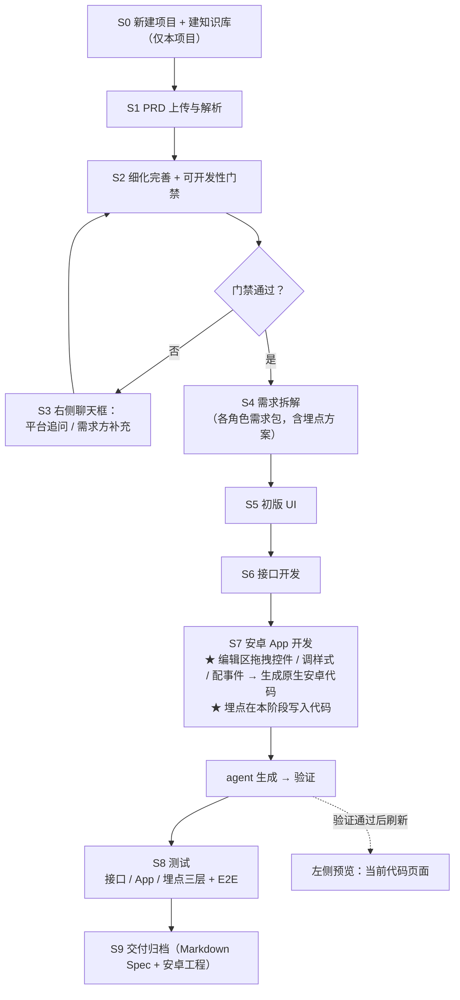
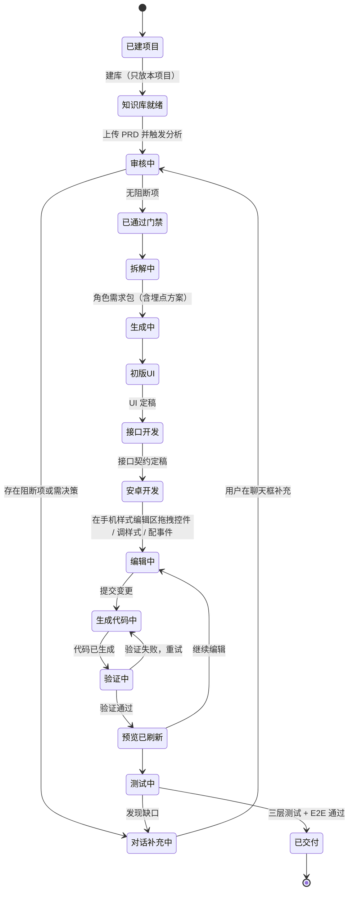

# 平台需求概要（平台自身的产品需求）

> **版本** v1.4 ｜ **日期** 2026-10-20 ｜ **状态** 已定稿 · 本期范围冻结 · **待确认清单为空**
>
> 至 v1.4，**全部待确认项（阻断 / 重要 / 建议 / 细节）均已结清**；
> 安全边界（Q15）与跨端（Q6）经需求方确认**本期不做、延后补充**。
>
> **来源标注规则**（本文件自身遵守平台的第 7 条约定「无来源不入正文」）：
> - `[S 10-20 HH:MM]` = 需求方在 2026-10-20 飞书对话中的原话，附时间戳
> - `[S 10-20 18:35 / 18:49 / 18:59 / 19:11]` = 需求方对本文件澄清清单的书面答复
> - `[U]` = 会话内需求方补充
> - `[P]` = 整理方补写，属**假设**，须 PM 确认后才生效

---

## 审核状态（平台门禁审核 · 2026-10-20）

> **本节由「PRD 审核完善 Agent」于 2026-10-20 追加，非需求方原文。** 回写只做补充与澄清，原文已有内容未作任何删改。

**门禁结论：未通过。** 存在 **22 项阻断**、10 项重要未通过、4 项建议未通过；未收敛角落 **42** 条。
逐项证据（附原文行号）见 `reviews/平台需求概要-v1.4-审核报告.md`；原文快照见 `reviews/平台需求概要-v1.4-原文快照-9674afb5.md`。

**文档状态更新为：待 PM 补充（不得进入拆解阶段 S4）。**

### 关于上方第 3 行的「待确认清单为空」

第 3 行的「待确认清单为空」是**需求方视角**的结论——回答的是「这个产品**要做什么**、做成什么样」，该问题在 v1.0~v1.4 的 Q1~Q17 中确实已全部结清，且来源标注完整。
它**不等于**这份需求通过了**可开发性门禁**——门禁回答的是「**怎么做**、数据长什么样、边界怎么处理、怎么算通过」。

两套清单的口径区别：

| | 原文 §11 的待澄清清单 | 门禁检查出的待澄清清单（§11.4） |
|---|---|---|
| 口径 | 需求澄清口径 | 可开发性口径（Definition of Ready） |
| 回答 | 要做什么、做成什么样 | 怎么做、数据模型、边界分支、验收口径 |
| 权限 | 需求方（业务决策） | 需求方 + 技术决策者（含架构与成本取舍） |
| 编号 | 原文 Q1 ~ Q17（**已结清**） | `[待澄清-Q1]` ~ `[待澄清-Q21]`（**未解决**） |

因此「待确认清单为空」与「22 项阻断」**同时成立，并不矛盾**。

### 门禁结果的要点

- **最重的单点缺口**：§F13「网页拖拽 UI 控件 → 直接生成原生安卓代码」目前只是一句话需求，**没有任何技术路线**（生成机制 / 验证定义 / 构建位置 / 预览渲染方式，四项全空）。
- **六类与「需求谈没谈清」无关的检查项全部未过**：B（状态穷举与迁移）、C（数据与字段，`baseline/领域模型.md` 当前为空模板）、D（页面级元素构成与具体文案）、E（平台自身接口契约）、H（角落收敛）、I（假设的集中确认）。
- **原文内部不一致 4 处**，须 PM 裁决：§9 第 391 行 vs §2 第 119 行（样式"即时可见" vs "生成后刷新"）；§8 第 376 行 vs §F14（属性面板 4 项 vs 11 项）；§8 第 376 行 vs §F14（事件面板 2 项 vs 3 项）；§8 第 374 行「一键采纳」 vs §F4「只写入已 `Accept` 的内容」。
- **原文 §11.3「可直接进入开发」的表述不成立**（该句本身未删改，保留备查，已由本节与 §11.4 更正）。
- **待 PM 处理**：21 个待澄清问题（16 阻断 + 5 重要）、34 条待确认假设、7 条待确认的不在范围项。见审核报告第四、五节。
- **放行最小集合**：① 技术路线（生成 / 验证 / 构建 / 预览）② 数据模型 ③ 角色权限 + 账号体系 + 安全边界口径 ④ 页面级 UI 规格 + 验收标准 ⑤ 平台接口契约 + 长任务回传机制。

---

## 0 变更摘要

### 0.1 v0.1 → v0.2

| # | 变更 | 来源 |
|---|---|---|
| 1 | 平台从「PRD → Spec 文档」扩展为「**对话式 + 实时预览 + 落到可运行工程**」 | [S 10-20 18:02] [U] |
| 2 | 主流程明确为 **PRD 补充完善 → 初版 UI → 接口开发 → 安卓 App 开发 → 测试** | [U] |
| 3 | 补充完善由「页面填表」改为「**聊天框对话**」 | [S 10-20 12:11] [U] |
| 4 | 新增：基座选择、能力自选、接口能力管理、拖拽与控件行为编辑、UE 参考、知识库、数字资产安全、分阶段分任务 | 见 F10~F16 |

### 0.2 v0.2 → v1.0（结清 4 条阻断项）

| 编号 | **已定结论** | 来源 |
|---|---|---|
| ~~Q1~~ | 第一阶段**从新建项目开始** | [S 10-20 18:35] |
| ~~Q2~~ | 第一阶段**只做安卓**（iOS / 跨平台不进本期） | [S 10-20 18:35] |
| ~~Q3~~ | 埋点**不作独立流程阶段**：需求阶段定方案 → 开发阶段写进代码 → 测试阶段验证 | [S 10-20 18:35] |
| ~~Q4~~ | 网页**拖拽 UI 控件 → 直接生成原生安卓代码**，靠**项目内唯一的元素 id** 对应 | [S 10-20 18:35] |

### 0.3 v1.0 → v1.1（结清全部重要级）

| 编号 | **已定结论** | 来源 |
|---|---|---|
| ~~Q5~~ | 左侧预览 = **显示当前调整的代码页面** | [S 10-20 18:49] |
| ~~Q9~~ | 数字资产安全 = **不能随意改动敏感数据** | [S 10-20 18:49] |
| ~~Q10~~ | 知识库 = **只放本项目** | [S 10-20 18:49] |
| ~~Q11~~ | Spec 交付格式 = **Markdown（.md）** | [S 10-20 18:49] |
| ~~Q13~~ | 「简单 UI 元素」= 安卓开发控件 | [S 10-20 18:49] |

### 0.4 v1.1 → v1.2

| # | 变更 | 来源 |
|---|---|---|
| 1 | **控件白名单大幅扩充**（开关、进度条、下拉选择、日期选择器等），明确"尽可能全" | [S 10-20 18:59] |
| 2 | **预览更新时机**：**agent 生成并验证完成后**更新预览区域（非实时） | [S 10-20 18:59] |
| 3 | 安全边界（Q15）**本期不做** | [S 10-20 18:59] |
| 4 | 跨端（Q6）**本期不做** | [S 10-20 18:59] |

### 0.5 v1.2 → v1.3（本次，全部结清）

| # | 变更 | 来源 |
|---|---|---|
| 1 | **新增 F14 手机样式编辑区域**：拖拽控件到该区域编辑页面；选中控件后可定制**样式属性**（宽高、背景色、字体颜色、字体大小等）与**事件**（点击、长按） | [S 10-20 19:11] |
| 2 | **Q7 已定**：能力自选采用**默认集**（见 F11） | [S 10-20 19:11] |
| 3 | **Q8 已定**：接口版本控制按**方案 A 项目整体版本** | [S 10-20 19:11] |
| 4 | **Q12 已定**：门禁分级标准由**需求方本人**维护 | [S 10-20 19:11] |

### 0.6 v1.3 → v1.4（Q17 结清，**无剩余待确认项**）

| # | 变更 | 来源 |
|---|---|---|
| 1 | 编辑区域与预览区域 = **同一区域的两个状态**（编辑态 / 预览态） | [S 10-20 19:17] |
| 2 | 样式属性面板**按全量写**（补入内外边距、圆角、边框、透明度、对齐方式、可见性） | [S 10-20 19:17] |
| 3 | 事件**保留双击**（点击 / 长按 / 双击） | [S 10-20 19:17] |

---

## 1 定位

### 1.1 三个层次的目标

| 层次 | 目标 | 来源 |
|---|---|---|
| **终极** | 让需求方**不接触开发平台（不接触工程 / 代码）**就能完成开发 | [S 10-20 17:52] |
| **本阶段** | **从新建项目开始**、**只做安卓**、面向**小项目快速开发** | [S 10-20 18:35] [S 10-20 18:04] |
| **远期补充** | 已有项目改样式；跨端与「开发完一端自主生成另一端」 | [S 10-20 17:52] [S 10-20 09:58] |

### 1.2 一句话

需求方在网页上丢一份 PRD → 平台用智能体把它**补充完善到可开发**（不合适的地方在**右侧聊天框**里对话补充）→ 按角色拆解并生成 **Markdown** Spec → 在**手机样式的编辑区域**里**拖拽控件、调样式、配事件**，直接生成原生安卓代码，**左侧预览在 agent 生成并验证完成后**刷新为当前代码页面。

### 1.3 使用者

对话者就是**需求提供方**本人 [S 10-20 12:11]，**不假设其具备工程能力**。

---

## 2 使用界面

| 区域 | 内容 | 来源 |
|---|---|---|
| **左** | **手机样式的编辑区域 / 预览区域** | [S 10-20 18:49] [S 10-20 19:11] |
| **右** | **对话框**，显示与 agent 的对话信息 | [S 10-20 18:02] |

**左侧区域的两个角色**：

1. **编辑态**：一个**手机样式的编辑区域**，用户把控件从控件面板**拖拽到该区域**进行页面编辑；
   选中控件后可定制它的**样式属性**与**事件**（详见 F14）。[S 10-20 19:11]
2. **预览态**：显示**当前调整的代码页面**的系统渲染效果。[S 10-20 18:49]

**预览的更新时机**（v1.2 定清）[S 10-20 18:59]：

```
用户操作（拖拽控件 / 改样式 / 配事件 / 对话补充）
        │
        ▼
agent 生成代码 → agent 验证 → 验证通过
        │
        ▼
★ 此时才刷新左侧预览（显示当前代码页面）
```

- **不是**随用户每次拖拽 / 输入实时变化；而是等 agent **生成并验证完成**后一次性更新。
- 生成中 / 验证中 / 验证失败 需要各自的中间态提示（可重试）。[P]

**交互范式**：对话为主。上传 PRD 后触发智能体分析；不合适 / 需要决策的地方，**允许用户在聊天框里补充完善**。[U]

需求：`REQ-PREVIEW-001`、`REQ-PREVIEW-002`、`REQ-CHAT-001`
> **已定（Q17）**：编辑区域与预览区域是**同一个区域的两个状态**——
> **编辑态**下拖拽控件、调样式、配事件；**预览态**下显示生成并验证通过后的代码页面。[S 10-20 19:17]

---

## 3 输入与输出

| | 内容 | 来源 |
|---|---|---|
| **输入** | 一份 PRD 文档：`.docx` / `.md` / 飞书云文档链接 | [S 10-20 12:11] |
| **输出（文档）** | 各角色所需的 Spec 文档，**格式统一为 Markdown（.md）** | [S 10-20 12:11] [S 10-20 18:49] |
| **输出（工程）** | 可编译运行的原生**安卓**工程 | [S 10-20 18:35] |

---

## 4 主流程



**主流程**：PRD 补充完善 → 初版 UI → 接口开发 → 安卓 App 开发（**含埋点埋码**） → 测试（**含埋点验证**）。[U] [S 10-20 18:35]

**分阶段、分任务**：每一步都要形成**实物产出**；按积木思维推进。[S 10-20 09:58]

**埋点的位置**：不占独立阶段——S4 定方案、S7 写进代码、S8 验证。[S 10-20 18:35]

---

## 5 功能清单

### F1 项目建立与知识库
- **项目从新建开始**；知识库**只放本项目**的内容（PRD、Spec、术语表、领域模型）。[S 10-20 14:48] [S 10-20 18:35] [S 10-20 18:49]
- 需求：`REQ-KB-001`

### F2 PRD 上传与解析
- Web 上传：`.docx` / `.md` / 飞书云文档链接；解析正文、内嵌表格、白板图、附件；生成 `document_id` + `revision_id`。
- 需求：`REQ-UPLOAD-001`

### F3 细化完善 + 可开发性门禁（核心）
- **补充完善到可进行开发的阶段，不能有阻断的业务点**；不完善的地方**提示用户修改**。[S 10-20 11:46]
- 对照 `baseline/可开发性门禁清单.md`，输出《完善建议》+《待澄清问题清单》（阻断 / 重要 / 建议）。
- 门禁三级标准由**需求方本人**维护。[S 10-20 19:11]
- 需求：`REQ-REVIEW-001`

### F4 对话式补充完善
- **允许用户在聊天框中补充完善**。[U]
- 有**阻断**项未解决时不得进入下一阶段。
- **补充内容写回原 PRD 文件**：回写前留原文快照；只写入已 `Accept` 的内容。
- 回流循环默认上限 3 轮，超限升级为「接受并记录 / 中止」。
- 需求：`REQ-CHAT-001`、`REQ-REVIEW-002`

### F5 需求拆解
- 拆成角色需求包，统一编 `REQ-ID`；**埋点方案在此定义**，代码实现推迟到开发阶段。[S 10-20 18:35]
- 需求：`REQ-SPLIT-001`

### F6 自适应深度

| 档位 | 适用 | 门禁强度 | 产出 |
|---|---|---|---|
| **Minimal** | 小改动、字段调整、单页面 | 只查 A/D/G + 角落扫描 | 只出受影响角色的 Spec |
| **Standard** | 常规功能需求 | 全表检查 | 全部角色 Spec |
| **Comprehensive** | 涉及资金 / 权限 / 合规 / 多租户 | 全表 + 强制角落全景扫描 + 人工复核 | 全部 Spec + 安全与合规小节 |

需求：`REQ-SPLIT-002`

### F7 角色 Spec 生成
- 顺序：**初版 UI → 接口 → 安卓 App → 测试**；交付格式统一 **Markdown**。[U] [S 10-20 18:49]
- 需求：`REQ-SPEC-001`

### F8 角色校对与补充要求
- 逐份核对，输出《补充要求清单》；不能补的**回流 F4 聊天框**。[S 10-20 11:46]
- 需求：`REQ-PROOF-001`

### F9 预览区域
- 显示**当前调整的代码页面**。[S 10-20 18:49]
- **更新时机：agent 生成并验证完成后更新**；非实时。[S 10-20 18:59]
- 需配套三个中间态：生成中 / 验证中 / 验证失败（可重试）。[P]
- 需求：`REQ-PREVIEW-001`、`REQ-PREVIEW-002`

### F10 基座与目标端
- **第一阶段：只做安卓原生。** [S 10-20 18:35]
- **跨端（iOS / 跨平台 / 一端生成另一端）本期不做**，延后。[S 10-20 18:59]
- 需求：`REQ-BASE-001`

### F11 能力自选配置
- 用户可以自己选择要配置哪些能力。[S 10-20 17:13]
- **已定：采用以下默认集**（默认**全关**，用户按需勾选）。[S 10-20 19:11] [P]

| # | 能力 | 说明 |
|---|---|---|
| 1 | 推送 | 系统推送 / 厂商通道 |
| 2 | 性能采集 | APM、启动耗时、卡顿 |
| 3 | 崩溃上报 | 崩溃堆栈采集 |
| 4 | 日志上报 | 端上日志采集 |
| 5 | 统计 SDK | 基础行为统计（与埋点是两回事） |
| 6 | 加固 | 包体加固 |
| 7 | 隐私合规弹窗 | 首次启动授权 |

- 勾选后的效果：**生成对应的接入代码与依赖配置**（是否还需要用户填第三方账号，后续实现时再定）。[P]
- 需求：`REQ-CAP-001`

### F12 接口能力管理
- **接口能力在页面上按用户需要增删改查**，并做**版本控制**。[S 10-20 09:58]
- **已定：版本控制按方案 A —— 项目整体版本**。[S 10-20 19:11]

| 方案 | 说明 |
|---|---|
| **A（选定）** | **每次生成 Spec 打一个项目级版本号（v1/v2…），整包快照 + diff，可整包回滚** |
| ~~B~~ | ~~单接口独立版本（本期不采用）~~ |

- 需求：`REQ-API-001`

### F13 UI 控件拖拽 → 原生安卓代码生成（★ 本期核心交互）

**机制**（Q4 结清）：
1. 用户在编辑区域**拖拽 UI 控件**；
2. 平台**直接生成对应的原生安卓代码**；
3. 对应关系靠**元素 id**：每个拖拽出来的控件在项目中具有**唯一 id**。

**可拖拽控件白名单（v1.2 扩全，"尽可能全"）** [S 10-20 18:49] [S 10-20 18:59]：

| 类别 | 控件（Android 对应） |
|---|---|
| **文本与按钮** | 文本 `TextView`、按钮 `Button`、多行文本 / 富文本、标签 `Label` |
| **输入** | 输入框 `EditText`、多行输入、密码输入、搜索框 `SearchView` |
| **媒体** | 图片 `ImageView`、视频播放 `VideoView`、头像 `Avatar` |
| **容器与布局** | 线性容器 `LinearLayout`、约束容器 `ConstraintLayout`、相对容器 `RelativeLayout`、滚动容器 `ScrollView`、卡片 `CardView` |
| **列表与网格** | 列表 `RecyclerView` / `ListView`、网格 `GridView`、轮播 `Banner` |
| **选择** | 单选按钮 `RadioButton`、多选按钮 `CheckBox`、开关 `Switch`、下拉选择 `Spinner`、滑块 `SeekBar`、评分 `RatingBar` |
| **时间** | 日期选择器 `DatePicker`、时间选择器 `TimePicker` |
| **进度与反馈** | 进度条 `ProgressBar`、加载中 `Loading`、轻提示 `Toast`、弹窗 `Dialog` / `AlertDialog` |
| **导航** | 顶部标题栏 `Toolbar` / `AppBar`、底部导航 `BottomNavigationView`、标签页 `TabLayout` |
| **其它** | 分割线 `Divider`、占位 `Space`、单选组、多选组 |

**明确不在本期范围**[P]：图表、地图、自定义绘制（Canvas）、复杂动画、WebView 内嵌页、视频剪辑、AR。

**元素 id 约定**：`EL-<模块>-<三位>`，**项目内全局唯一、不可复用、不可回收**；
它是「网页拖拽控件 ↔ 原生安卓控件 ↔ 埋点曝光点 ↔ 测试用例定位」的统一主键。

需求：`REQ-UIEDIT-001`

### F14 手机样式编辑区域（画布）与控件属性编辑（★ 本轮新增）

**编辑区域** [S 10-20 19:11]：
- 提供一个**手机样式的编辑区域**（手机外框画布）；
- 用户把控件从控件面板**拖拽到该区域**，在该区域内**进行页面编辑**（摆放、调整）。

**选中控件后可定制两类属性**：

**① 样式属性（全量）** [S 10-20 19:11] [S 10-20 19:17]

| 属性 | 说明 |
|---|---|
| **宽 / 高** | 控件尺寸 |
| **背景色** | 色值 #RRGGBB |
| **字体颜色** | 色值 #RRGGBB |
| **字体大小** | sp |
| **内边距** | padding |
| **外边距** | margin |
| **圆角** | corner radius |
| **边框** | 线宽 / 颜色 / 样式 |
| **透明度** | alpha |
| **对齐方式** | 水平 / 垂直 |
| **可见性** | visible / invisible / gone |

**② 事件**

| 事件 | 来源 |
|---|---|
| **点击** | [S 10-20 19:11] [S 10-20 19:17] |
| **长按** | [S 10-20 19:11] [S 10-20 19:17] |
| **双击** | [S 10-20 09:58] [S 10-20 19:17] |

**与预览的关系**：编辑完成后由 agent 生成代码并验证，**验证通过**才刷新左侧预览（见 F9 / §2）。[S 10-20 18:59]

需求：`REQ-UIEDIT-002`、`REQ-UIEDIT-003`、`REQ-UIEDIT-004`

### F15 设计参考
- **UE 作为交互、动效参考**。[S 10-20 17:44]
- 需求：`REQ-DESIGN-001`

### F16 交付与归档
- 各角色 Spec 以 **Markdown（.md）** 交付 / 预览 / 版本归档 / 变更记录；安卓工程交付。[S 10-20 18:49]
- 需求：`REQ-DELIVER-001`

---

## 6 角色与顺序

| 顺序 | 角色 | 职责 | 产出时机 | 来源 |
|---|---|---|---|---|
| 1 | **UI** | 有哪些元素、需要什么交互、什么动效、字样、样式；**元素 id 的唯一权威来源** | S5 初版 UI | [S 10-20 11:46] |
| 2 | **接口** | 需要什么数据、什么格式，**必须满足 UI 展示及交互所需的数据** | S6 接口开发 | [S 10-20 11:46] |
| 3 | **App（安卓）** | UI 与接口的对应关系 + 详细需求；**埋点在此阶段写入代码** | S7 安卓开发 | [S 10-20 11:46] [S 10-20 18:35] |
| 4 | **埋点** | 需要什么埋点、什么场景埋点 | Spec 在 S4；代码在 S7；验证在 S8 | [S 10-20 11:46] [S 10-20 18:35] |
| 5 | **测试** | 接口、App、埋点三层 + E2E 串联 | S8 测试 | [S 10-20 11:46] |

---

## 7 文档 / 项目状态机



---

## 8 关键页面

| 页面 | 元素 | 交互 |
|---|---|---|
| 项目列表 / 新建 | 新建项目、项目卡片、知识库入口 | 新建、进入 |
| **工作台（主界面）** | **左：手机样式编辑区域 / 预览区域；右：对话框** | 拖拽控件、调样式、配事件；对话补充；验证通过后预览刷新 |
| 上传页 | 拖拽区、格式校验提示、进度条 | 上传中 / 失败重试 / 格式不支持 |
| 审核结果 | 门禁评分卡、完善建议（可一键采纳）、待澄清清单（分级） | 勾选采纳、逐条回答、提交复审 |
| 需求拆解页 | 角色需求包卡片、REQ-ID 列表 | 展开 / 收起重拆 |
| **可视化编辑页** | **手机样式画布**、**可拖拽控件面板（见 F13 白名单）**、控件树、**属性面板（宽/高/背景色/字体颜色/字体大小…）**、**事件面板（点击/长按）**、元素 id 显示 | 拖控件入画布 → 选中控件 → 改样式 / 配事件 → 生成安卓代码 → 验证通过后预览刷新 |
| 接口管理页 | 接口清单、字段、增删改查、**项目级版本（v1/v2）历史与整包 diff** | 增删改查、版本对比回滚 |
| 能力配置 | 目标端（本期固定安卓）、能力勾选（推送 / 性能采集 / 崩溃上报 / 日志上报 / 统计 SDK / 加固 / 隐私合规弹窗，默认全关） | 选择、保存、生成 |
| Spec 产出页 | 各角色 Markdown 文档 tab、预览、导出、追溯矩阵 | 切换、导出、跳转追溯 |
| 版本归档页 | 版本时间线、diff 视图 | 查看历史 / 回滚 |

---

## 9 非功能需求

| 项 | 目标 | 来源 |
|---|---|---|
| PRD 解析耗时 | ≤ 30s（20 页以内） | [P] |
| Spec 生成耗时 | ≤ 5min / 份 | [P] |
| 代码生成 + 验证耗时 | ≤ 30s / 次操作（超出需给进度反馈） | [P] |
| 属性编辑响应 | 编辑区内样式调整即时可见（本地预览），代码生成异步 | [P] |
| 权限 | 需求方仅见自己的项目；管理员可见全部 | [P] |
| 工程搭建难度 | 按**积木思维**提供所需的基础组件，尽可能降低搭建难度 | [S 10-20 09:58] |
| **数字资产安全** | **本期不做**，后期补充 | [S 10-20 18:59] |

---

## 10 分期规划

| 阶段 | 范围 | 依据 |
|---|---|---|
| **第一步** | 拆分 + 完善需求 | [S 10-20 09:58] |
| **第二步** | 转 Spec（Markdown）并完善 | [S 10-20 09:58] [S 10-20 18:49] |
| **第三步（本期）** | **新建项目 + 安卓**：初版 UI → 接口 → 手机样式编辑区拖拽控件 / 调样式 / 配事件 → 生成原生安卓代码（含埋点埋码） → 测试 | [S 10-20 18:35] [S 10-20 19:11] [U] |
| 后续 | **安全边界**；**跨端与「一端生成另一端」**；已有项目改样式 | [S 10-20 18:59] [S 10-20 17:52] |

---

## 11 待确认清单

### 11.1 已定 / 已结清（全部）

| 编号 | 结论 | 结清于 |
|---|---|---|
| Q1 | 第一阶段**从新建项目开始** | v1.0 |
| Q2 | 第一阶段**只做安卓** | v1.0 |
| Q3 | 埋点不单独占流程阶段：需求定方案 / 开发埋码 / 测试验证 | v1.0 |
| Q4 | 拖拽 UI 控件 → 直接生成原生安卓代码，靠项目内唯一元素 id 对应 | v1.0 |
| Q5 | 左侧预览 = 显示**当前调整的代码页面** | v1.1 |
| Q10 | 知识库 = **只放本项目** | v1.1 |
| Q11 | Spec 交付格式 = **Markdown（.md）** | v1.1 |
| Q13 | 「简单 UI 元素」= 安卓开发控件 | v1.1 |
| Q14 | 控件白名单**尽可能全**（见 F13） | v1.2 |
| Q16 | 预览更新口径 = **agent 生成并验证完成后**更新 | v1.2 |
| **Q7** | 能力自选采用**默认集**（推送 / 性能采集 / 崩溃上报 / 日志上报 / 统计 SDK / 加固 / 隐私合规弹窗，默认全关） | v1.3 |
| **Q8** | 接口版本控制 = **方案 A 项目整体版本**（整包快照 + diff，可整包回滚） | v1.3 |
| **Q12** | 门禁三级标准由**需求方本人**维护 | v1.3 |
| **Q17** | 编辑区与预览区 = **同一区域的两个状态**；样式属性面板**全量**（含内外边距/圆角/边框/透明度/对齐/可见性）；事件保留**点击 / 长按 / 双击** | v1.4 |
| — | PM 补充内容**写回原 PRD 文件** | v1.0 |
| — | 交付形式：Spec **相互独立**成文 | v1.0 |

### 11.2 已延后（本期不做）

| 编号 | 事项 | 处理 |
|---|---|---|
| **Q6** | 跨端（iOS / 跨平台 / 一端生成另一端） | **本期不做**，延后 [S 10-20 18:59] |
| **Q15** | 数字资产安全边界（不能随意改动敏感数据） | **本期忽略**，后期再补充 [S 10-20 18:59] |

### 11.3 待确认（**空**）

> **无待确认项。** 本文件所有阻断级 / 重要级 / 建议级 / 细节确认均已结清，本期范围冻结，可直接进入开发。
>
> 后续若要变更，请走版本升级：在 §0 追加一节，并在 §11.1 登记新结论。

### 11.4 本轮门禁审核登记（2026-10-20 · 待 PM 确认，**均未生效**）

> **本节由「PRD 审核完善 Agent」追加。** 依据 §11.3 上方第 3 行的自述与门禁检查的差异（见文首「审核状态」一节），
> §11.3 的「待确认（空）」**不再成立**，改由本节登记。
>
> ⚠️ 本节**仅登记编号、主题与影响范围**；问题的完整正文、选项与兜底项，以及假设的完整内容与 Accept / Convert 选择，
> **全部在 `reviews/平台需求概要-v1.4-审核报告.md` 第四、五节**。
> **在 PM 逐条选择 `Accept` 之前，本节任何一条都不构成本文档的正式条款。**

**A. 待澄清问题（门禁口径，与原文 Q1~Q17 属不同命名空间）**

| 编号 | 等级 | 问题（摘要） | 影响范围 |
|---|---|---|---|
| [待澄清-Q1] | 阻断 | 拖拽控件 → 原生安卓代码的生成机制 | 全部角色 / §F13 / §F14 |
| [待澄清-Q2] | 阻断 | 「agent 验证」验什么、怎么验、验不过怎么办 | §F9 / §7 状态机 / 测试 |
| [待澄清-Q3] | 阻断 | 生成的安卓代码在哪里构建 | 全部角色 / §3 / §9 耗时指标 |
| [待澄清-Q4] | 阻断 | 左侧预览的「系统渲染效果」如何实现 | §2 / §F9 / UI / 接口 |
| [待澄清-Q5] | 阻断 | 角色与权限矩阵 | §9 权限行 / 全部写操作 |
| [待澄清-Q6] | 阻断 | 平台账号体系（有无登录、登录方式） | §F1 / §9 / §F3 |
| [待澄清-Q7] | 阻断 | §11.2「数字资产安全本期忽略」的边界覆盖范围 | §11.2 / 全部角色 |
| [待澄清-Q8] | 阻断 | 是否由平台先产出《领域模型》草案 | `baseline/领域模型.md` / 接口 / App |
| [待澄清-Q9] | 阻断 | 平台自身接口契约由谁产出 | §8 全部页面 / 接口 / App |
| [待澄清-Q10] | 阻断 | 页面级 UI 规格与文案由谁产出（含 2 处内部不一致） | §8 全部 10 个页面 / §F14 |
| [待澄清-Q11] | 阻断 | 验收标准由谁产出（全文当前 0 条） | 测试 / App / UI / 接口 |
| [待澄清-Q12] | 阻断 | §9「样式即时可见」 vs §2「生成后刷新」的统口径 | §2 / §9 / §F9 / §F14 |
| [待澄清-Q13] | 阻断 | 控件的「点击 / 长按 / 双击」配上之后实际做什么 | §F14 / UI / App / 埋点 |
| [待澄清-Q14] | 阻断 | 并发编辑冲突的处置（多标签页 / 多设备 / 双人） | UI / App / 接口 / 测试 |
| [待澄清-Q15] | 阻断 | 长任务结果如何回传到前端（轮询 / SSE / WS） | 接口 / App / §2 / §9 |
| [待澄清-Q16] | 阻断 | 项目级版本「整包回滚」到底回滚什么 | §F12 / §8 版本归档页 / §7 回环 |
| [待澄清-Q17] | 重要 | 知识库内容从哪来、谁维护、能否手改 | §F1 / §F2 |
| [待澄清-Q18] | 重要 | 门禁三级标准的维护形态 | §F3 第 180 行 |
| [待澄清-Q19] | 重要 | 能力配置「生成接入代码」的时机与冲突处理 | §F11 第 237 行 |
| [待澄清-Q20] | 重要 | 控件白名单的维护形态与收敛粒度（现行"尽可能全"） | §F13 第 258-273 行 |
| [待澄清-Q21] | 重要 | 平台自身是否做埋点 | §F6 / §9 指标 |

**B. 待确认假设（编号 + 主题；完整内容见审核报告第五节）**

| 编号 | 主题 | 编号 | 主题 |
|---|---|---|---|
| 假设-A1 | 项目名字段规则 | 假设-A18 | 上传文件存储与 revision 规则 |
| 假设-A2 | 元素 id 编码规则与溢出处理 | 假设-A19 | 列表排序 / 分页 / 搜索约定 |
| 假设-A3 | 元素 id → 安卓 `R.id` 映射 | 假设-A20 | 时区与「最后更新于」 |
| 假设-A4 | 元素 id 删除后作废与台账 | 假设-A21 | 平台接口版本与字段容忍 |
| 假设-A5 | 画布规格与 dp 基准 | 假设-A22 | 外部调用超时 / 退避重试 / 幂等键 |
| 假设-A6 | 尺寸 / 边距 / 字号取值范围 | 假设-A23 | 部分解析失败不阻断其余 |
| 假设-A7 | 透明度 alpha 口径 | 假设-A24 | 空态与失败态文案结构区分 |
| 假设-A8 | 对齐方式枚举补全 | 假设-A25 | 破坏性操作二次确认 |
| 假设-A9 | 边框样式枚举 | 假设-A26 | 预览带任务序号与时间戳 |
| 假设-A10 | 色值格式统一 `#RRGGBB` | 假设-A27 | 评分卡绑定 `revision_id` |
| 假设-A11 | 单击 / 双击判定窗 | 假设-A28 | 逐对象鉴权 |
| 假设-A12 | 提交类操作幂等 | 假设-A29 | agent 输出结构校验与降级 |
| 假设-A13 | 生成任务序号与"仅最新生效" | 假设-A30 | agent 无来源主张的处理 |
| 假设-A14 | 各阶段耗时目标与超时阈值（原文 `[P]` 项） | 假设-A31 | 超上下文分块不截断 |
| 假设-A15 | 验证失败重试上限 | 假设-A32 | 别名 vs id；会话历史持久化 |
| 假设-A16 | 代码文件原子写入 | 假设-A33 | PRD 内容与 agent 指令定界隔离 |
| 假设-A17 | 上传文件规格（格式 / 大小 / 页数） | 假设-A34 | 项目删除语义与密钥管理 |

**C. 待确认的「不在范围」项（7 条）**

| # | 排除项 | 依据 |
|---|---|---|
| 1 | 跨端（iOS / 跨平台 / 一端生成另一端） | §11.2（原文 Q6，已定延后） |
| 2 | 数字资产安全的**增强策略**（防篡改 / 防截屏 / 水印）；基础鉴权**不在此列**，边界待 [待澄清-Q7] | §11.2（原文 Q15） |
| 3 | 已有项目改样式、在既有工程上作业 | §1.1（远期） |
| 4 | 图表 / 地图 / Canvas / 复杂动画 / WebView 内嵌页 / 视频剪辑 / AR | §F13 第 273 行（原文标 `[P]`，待确认） |
| 5 | 金额 / 计价 / 费率 | 全文无交易能力 |
| 6 | 组织 / 团队 / 多租户协作概念 | 全文未提 |
| 7 | 平台自身的消息推送 / 通知 | 全文未提 |

---

## 12 回流日志（append-only，只增不删）

> 由「PRD 审核完善 Agent」维护。回流循环上限 3 轮（见 §F4）。

| 轮次 | 日期 | 触发 | 门禁结论 | 阻断项 | 未收敛角落 | 本轮动作 | 回写前 revision | 回写后 revision |
|---|---|---|---|---|---|---|---|---|
| 1 | 2026-10-20 | 首次门禁审核 | **未通过** | 22 | 42 | 留快照 → 产出审核报告 → 回写「审核状态」+ §11.4 登记 + 本节 | `v1.4-20261020-9674afb5` | `v1.4-20261020-d8a08c18` |

**第 1 条明细**

- 原文快照：`reviews/平台需求概要-v1.4-原文快照-9674afb5.md`（SHA-256 `9674afb5…`，与回写前逐字节一致）
- 审核报告：`reviews/平台需求概要-v1.4-审核报告.md`
- 回写范围：**仅**「审核状态」一节 + §11.4 登记 + 本节。**未删除、未改写任何原文内容**（校验：diff → 删除/修改 0 行，新增 125 行，原文 443 行逐行保留）。
- **未回写**：96 条需求草案、34 条假设的具体内容、21 个待澄清问题的正文与选项（原因：未获 PM 的 `Accept` / `Looks correct` 显式确认；硬规则禁止写入未 Accept 内容）。
- 回写后 revision_id：`v1.4-20261020-0b8866d3`（内容 SHA-256 前 8 位；**声明的版本号 v1.4 未动**——版本行属原文内容，回写不改写原文）
- 复审范围：22 项阻断 + 10 项重要 + 被补充内容波及的关联条目；不推翻已通过项（A2、C6、C7、H1、H3、H4、I1）。

