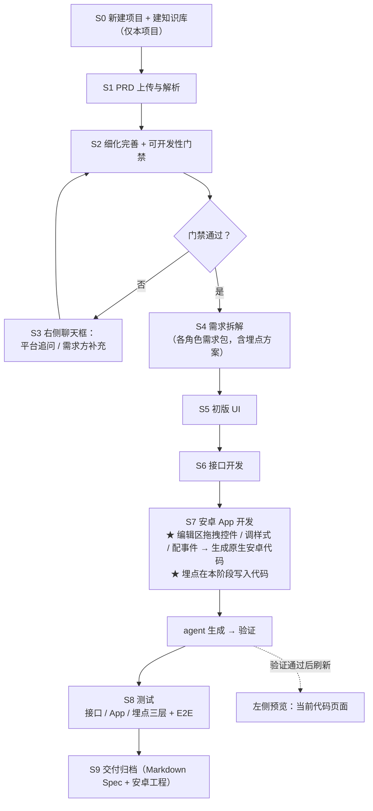
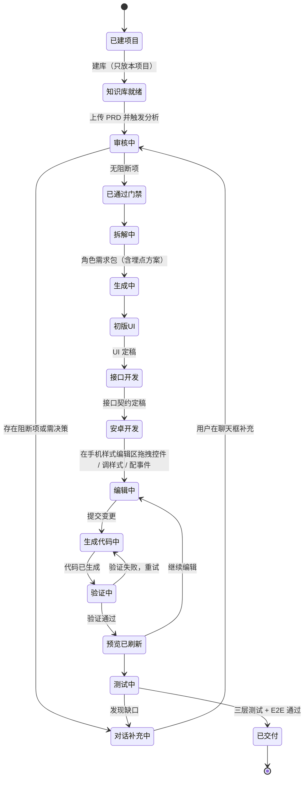

# 平台需求概要（平台自身的产品需求）

> **版本** v1.4 ｜ **日期** 2026-10-20 ｜ **状态** 已定稿 · 本期范围冻结 · **待确认清单为空**
>
> 至 v1.4，**全部待确认项（阻断 / 重要 / 建议 / 细节）均已结清**；
> 安全边界（Q15）与跨端（Q6）经需求方确认**本期不做、延后补充**。
>
> **来源标注规则**（本文件自身遵守平台的第 7 条约定「无来源不入正文」）：
> - `[S 10-20 HH:MM]` = 需求方在 2026-10-20 飞书对话中的原话，附时间戳
> - `[S 10-20 18:35 / 18:49 / 18:59 / 19:11]` = 需求方对本文件澄清清单的书面答复
> - `[U]` = 会话内需求方补充
> - `[P]` = 整理方补写，属**假设**，须 PM 确认后才生效

---

## 审核状态（平台门禁审核 · 2026-10-20）

> **本节由「PRD 审核完善 Agent」于 2026-10-20 追加，非需求方原文。** 回写只做补充与澄清，原文已有内容未作任何删改。

**门禁结论：未通过。** 存在 **22 项阻断**、10 项重要未通过、4 项建议未通过；未收敛角落 **42** 条。
逐项证据（附原文行号）见 `reviews/平台需求概要-v1.4-审核报告.md`；原文快照见 `reviews/平台需求概要-v1.4-原文快照-9674afb5.md`。

**文档状态更新为：待 PM 补充（不得进入拆解阶段 S4）。**

### 关于上方第 3 行的「待确认清单为空」

第 3 行的「待确认清单为空」是**需求方视角**的结论——回答的是「这个产品**要做什么**、做成什么样」，该问题在 v1.0~v1.4 的 Q1~Q17 中确实已全部结清，且来源标注完整。
它**不等于**这份需求通过了**可开发性门禁**——门禁回答的是「**怎么做**、数据长什么样、边界怎么处理、怎么算通过」。

两套清单的口径区别：

| | 原文 §11 的待澄清清单 | 门禁检查出的待澄清清单（§11.4） |
|---|---|---|
| 口径 | 需求澄清口径 | 可开发性口径（Definition of Ready） |
| 回答 | 要做什么、做成什么样 | 怎么做、数据模型、边界分支、验收口径 |
| 权限 | 需求方（业务决策） | 需求方 + 技术决策者（含架构与成本取舍） |
| 编号 | 原文 Q1 ~ Q17（**已结清**） | `[待澄清-Q1]` ~ `[待澄清-Q21]`（**未解决**） |

因此「待确认清单为空」与「22 项阻断」**同时成立，并不矛盾**。

### 门禁结果的要点

- **最重的单点缺口**：§F13「网页拖拽 UI 控件 → 直接生成原生安卓代码」目前只是一句话需求，**没有任何技术路线**（生成机制 / 验证定义 / 构建位置 / 预览渲染方式，四项全空）。
- **六类与「需求谈没谈清」无关的检查项全部未过**：B（状态穷举与迁移）、C（数据与字段，`baseline/领域模型.md` 当前为空模板）、D（页面级元素构成与具体文案）、E（平台自身接口契约）、H（角落收敛）、I（假设的集中确认）。
- **原文内部不一致 4 处**，须 PM 裁决：§9 第 391 行 vs §2 第 119 行（样式"即时可见" vs "生成后刷新"）；§8 第 376 行 vs §F14（属性面板 4 项 vs 11 项）；§8 第 376 行 vs §F14（事件面板 2 项 vs 3 项）；§8 第 374 行「一键采纳」 vs §F4「只写入已 `Accept` 的内容」。
- **原文 §11.3「可直接进入开发」的表述不成立**（该句本身未删改，保留备查，已由本节与 §11.4 更正）。
- **待 PM 处理**：21 个待澄清问题（16 阻断 + 5 重要）、34 条待确认假设、7 条待确认的不在范围项。见审核报告第四、五节。
- **放行最小集合**：① 技术路线（生成 / 验证 / 构建 / 预览）② 数据模型 ③ 角色权限 + 账号体系 + 安全边界口径 ④ 页面级 UI 规格 + 验收标准 ⑤ 平台接口契约 + 长任务回传机制。
>
> **第 2 轮更新（2026-10-20）**：放行最小集合的**第 1 项（技术路线）已由 PM 拍板** —— **AI 生成 + 本地构建**；Q1~Q4 经 PM `Accept` 后已转为正式条款（见 §11.5，以及 §2 / §F13 / §9 三处对应的「平台补充」块）。
> 其余 4 项（数据模型 / 角色权限+账号+安全边界 / 页面级 UI 规格+验收标准 / 平台接口契约+长任务回传）**仍待 PM 确认**，草案见 `reviews/平台需求概要-待确认草案.md`。
> **门禁状态：仍为「未通过」。** 22 项阻断中**第 1 项（技术路线）已在决策层结清**，但门禁复审尚未执行；**本文仍不得进入拆解阶段 S4**。

>
> **第 3 轮更新（2026-10-20 · 回流最后一轮）**：PM 已对本文件《待确认草案》（`reviews/平台需求概要-待确认草案.md`）**T0 档 57 条全部 `Accept`**（按平台给出的推荐默认值）。本轮已将 57 条**全部回写为正式条款**，落位见 §11.6。
> 另：平台已按 PM 要求**代做四类产出物草案** —— 《数据模型》《页面规格》《接口契约》《验收标准》，落于 `platform/design/`。**均为草案**；按硬规则，**未经 PM 过目确认前一律不写入本正文**，故本正文只留指针，不含其内容。
> **门禁复审（第 3 轮）结论：仍为「未通过」。** 阻断项 **22 → 2**（交付口径，含四类产出物草案；严格口径 22 → 19，只计已回写生效的正式条款）。逐项证据见 `reviews/平台需求概要-v1.4-审核报告-第3轮.md`。
> **回流轮次已达上限（3 / 3）**：剩余未决项不再进入第 4 轮，按 §F4 规则**升级处理**（`接受并记录` / `中止` 二选一，见 §11.6 D 表）。
> **本文仍不得进入拆解阶段 S4。**

---

## 0 变更摘要

### 0.1 v0.1 → v0.2

| # | 变更 | 来源 |
|---|---|---|
| 1 | 平台从「PRD → Spec 文档」扩展为「**对话式 + 实时预览 + 落到可运行工程**」 | [S 10-20 18:02] [U] |
| 2 | 主流程明确为 **PRD 补充完善 → 初版 UI → 接口开发 → 安卓 App 开发 → 测试** | [U] |
| 3 | 补充完善由「页面填表」改为「**聊天框对话**」 | [S 10-20 12:11] [U] |
| 4 | 新增：基座选择、能力自选、接口能力管理、拖拽与控件行为编辑、UE 参考、知识库、数字资产安全、分阶段分任务 | 见 F10~F16 |

### 0.2 v0.2 → v1.0（结清 4 条阻断项）

| 编号 | **已定结论** | 来源 |
|---|---|---|
| ~~Q1~~ | 第一阶段**从新建项目开始** | [S 10-20 18:35] |
| ~~Q2~~ | 第一阶段**只做安卓**（iOS / 跨平台不进本期） | [S 10-20 18:35] |
| ~~Q3~~ | 埋点**不作独立流程阶段**：需求阶段定方案 → 开发阶段写进代码 → 测试阶段验证 | [S 10-20 18:35] |
| ~~Q4~~ | 网页**拖拽 UI 控件 → 直接生成原生安卓代码**，靠**项目内唯一的元素 id** 对应 | [S 10-20 18:35] |

### 0.3 v1.0 → v1.1（结清全部重要级）

| 编号 | **已定结论** | 来源 |
|---|---|---|
| ~~Q5~~ | 左侧预览 = **显示当前调整的代码页面** | [S 10-20 18:49] |
| ~~Q9~~ | 数字资产安全 = **不能随意改动敏感数据** | [S 10-20 18:49] |
| ~~Q10~~ | 知识库 = **只放本项目** | [S 10-20 18:49] |
| ~~Q11~~ | Spec 交付格式 = **Markdown（.md）** | [S 10-20 18:49] |
| ~~Q13~~ | 「简单 UI 元素」= 安卓开发控件 | [S 10-20 18:49] |

### 0.4 v1.1 → v1.2

| # | 变更 | 来源 |
|---|---|---|
| 1 | **控件白名单大幅扩充**（开关、进度条、下拉选择、日期选择器等），明确"尽可能全" | [S 10-20 18:59] |
| 2 | **预览更新时机**：**agent 生成并验证完成后**更新预览区域（非实时） | [S 10-20 18:59] |
| 3 | 安全边界（Q15）**本期不做** | [S 10-20 18:59] |
| 4 | 跨端（Q6）**本期不做** | [S 10-20 18:59] |

### 0.5 v1.2 → v1.3（本次，全部结清）

| # | 变更 | 来源 |
|---|---|---|
| 1 | **新增 F14 手机样式编辑区域**：拖拽控件到该区域编辑页面；选中控件后可定制**样式属性**（宽高、背景色、字体颜色、字体大小等）与**事件**（点击、长按） | [S 10-20 19:11] |
| 2 | **Q7 已定**：能力自选采用**默认集**（见 F11） | [S 10-20 19:11] |
| 3 | **Q8 已定**：接口版本控制按**方案 A 项目整体版本** | [S 10-20 19:11] |
| 4 | **Q12 已定**：门禁分级标准由**需求方本人**维护 | [S 10-20 19:11] |

### 0.6 v1.3 → v1.4（Q17 结清，**无剩余待确认项**）

| # | 变更 | 来源 |
|---|---|---|
| 1 | 编辑区域与预览区域 = **同一区域的两个状态**（编辑态 / 预览态） | [S 10-20 19:17] |
| 2 | 样式属性面板**按全量写**（补入内外边距、圆角、边框、透明度、对齐方式、可见性） | [S 10-20 19:17] |
| 3 | 事件**保留双击**（点击 / 长按 / 双击） | [S 10-20 19:17] |

---

## 1 定位

### 1.1 三个层次的目标

| 层次 | 目标 | 来源 |
|---|---|---|
| **终极** | 让需求方**不接触开发平台（不接触工程 / 代码）**就能完成开发 | [S 10-20 17:52] |
| **本阶段** | **从新建项目开始**、**只做安卓**、面向**小项目快速开发** | [S 10-20 18:35] [S 10-20 18:04] |
| **远期补充** | 已有项目改样式；跨端与「开发完一端自主生成另一端」 | [S 10-20 17:52] [S 10-20 09:58] |

### 1.2 一句话

需求方在网页上丢一份 PRD → 平台用智能体把它**补充完善到可开发**（不合适的地方在**右侧聊天框**里对话补充）→ 按角色拆解并生成 **Markdown** Spec → 在**手机样式的编辑区域**里**拖拽控件、调样式、配事件**，直接生成原生安卓代码，**左侧预览在 agent 生成并验证完成后**刷新为当前代码页面。

### 1.3 使用者

对话者就是**需求提供方**本人 [S 10-20 12:11]，**不假设其具备工程能力**。

---

## 2 使用界面

| 区域 | 内容 | 来源 |
|---|---|---|
| **左** | **手机样式的编辑区域 / 预览区域** | [S 10-20 18:49] [S 10-20 19:11] |
| **右** | **对话框**，显示与 agent 的对话信息 | [S 10-20 18:02] |

**左侧区域的两个角色**：

1. **编辑态**：一个**手机样式的编辑区域**，用户把控件从控件面板**拖拽到该区域**进行页面编辑；
   选中控件后可定制它的**样式属性**与**事件**（详见 F14）。[S 10-20 19:11]
2. **预览态**：显示**当前调整的代码页面**的系统渲染效果。[S 10-20 18:49]

**预览的更新时机**（v1.2 定清）[S 10-20 18:59]：

```
用户操作（拖拽控件 / 改样式 / 配事件 / 对话补充）
        │
        ▼
agent 生成代码 → agent 验证 → 验证通过
        │
        ▼
★ 此时才刷新左侧预览（显示当前代码页面）
```

- **不是**随用户每次拖拽 / 输入实时变化；而是等 agent **生成并验证完成**后一次性更新。
- 生成中 / 验证中 / 验证失败 需要各自的中间态提示（可重试）。[P]
>
> **[平台补充 · 第 2 轮回写 · PM 已 Accept]** 预览口径的两个技术结论（`[answer:Q2]`、`[answer:Q4]`；前提：PM 已定技术路线 = **AI 生成 + 本地构建**）：
>
> **①「验证」分两层；本节（第 143–156 行）的刷新时机由 L1 层触发**（对应 `[待澄清-Q2]`）
> - **L1 · agent 静态验证（服务端，秒级）**：生成的 Kotlin / XML 语法可解析、结构合法、元素 id 与画布元素树一一对应、属性取值在允许域内、引用完整。**L1 通过 = 原文所说的「agent 生成并验证完成」，此时刷新预览** —— 本节既有的刷新口径**保持不变**。
> - **L2 · 本地构建验证（用户本机）**：用户在本机以 Android Studio / Gradle 编译通过 = 工程可运行。L2 是「工程可交付」的判定，**不参与预览刷新时机的判定**。
>
> **② 预览的渲染方式 = 网页内自研渲染器（近似渲染）**（对应 `[待澄清-Q4]`）
> - 将元素树按安卓布局规则绘制为 DOM / Canvas 近似图。
> - ⚠️ **口径差异（须 PM 知悉；原文措辞未改动）**：原文第 141 行「显示**当前调整的代码页面**的**系统渲染效果**」中，「系统渲染」指**真机系统的真实渲染**；本方案产出的是**网页内的近似渲染**，与真机存在差异 —— 真机效果以用户本机构建运行的结果为准。
>
> **来源**：`[answer:Q2]`、`[answer:Q4]`（PM 2026-10-20 答复）。由此打开、尚未 `Accept` 的残留项 R1~R4 见 §11.5 C 表与草案文件。

>
> **[平台补充 · 第 3 轮回写 · PM 已 Accept（T0）]** 本轮 T0 中与本节相关的条款（来源：`[answer:T0]`，PM 2026-10-20「T0 全部 Accept」）：
>
> **① 编辑态「即时可见」与预览态「生成后刷新」的分层统一**（`D-Q12`，对应 `[待澄清-Q12]`）
> - **编辑态**：样式属性的改动在画布上**即时可见**（仅本地样式渲染，不含业务逻辑）——§9 第 391 行「样式调整即时可见」**成立**。
> - **预览态**：仍在 agent 生成 + 验证（L1）完成后刷新——本节第 143–156 行的口径**不变**。
> - 两句话各管一层，互不冲突。
>
> **② 预览刷新以 L1 静态验证为触发 —— 接受**（`D-R4`）：完全保持本节既有的刷新时机不变。
>
> **③ 平台如何获知「本地构建已通过」**（`D-R1`）：平台随工程交付一个**本地构建代理**（一条 Gradle 命令 / 一个小 CLI，用户在本机 Android Studio 内执行）；代理把 `assembleDebug` 的**成功 / 失败 + 日志摘要**回传平台，并绑定到该次生成任务。**平台不以「未回传」阻断用户** —— 未回传时工程仅标记为「未验证构建」，用户仍可继续。
>
> **④ 旧响应后到**（`D-A13`）：每次生成任务带**单调递增序号**，服务端与前端**只应用序号最新的结果**，旧响应后到不得覆盖新预览。
>
> **⑤ 预览溯源**（`D-A26`）：预览态显示本次生成的**任务序号 + 时间戳**，供用户判断新旧。
>
> **⑥ 时间约定**（`D-A20`）：**UTC 存储、浏览器本地时区展示**；界面提供「最后更新于 X」；时间戳缺失**不得**显示为「1970」。
>
> **⑦ 预览渲染差异的披露**（`D-R3` 尚未生效，此条为 T0 内的口径说明）：`D-R3`（改写原文第 141 行措辞）属 **T1，PM 未答**，故本节原文措辞**一字未改**；`D-R3` 的推荐默认值见草案文件第 3 节。

**交互范式**：对话为主。上传 PRD 后触发智能体分析；不合适 / 需要决策的地方，**允许用户在聊天框里补充完善**。[U]

需求：`REQ-PREVIEW-001`、`REQ-PREVIEW-002`、`REQ-CHAT-001`
> **已定（Q17）**：编辑区域与预览区域是**同一个区域的两个状态**——
> **编辑态**下拖拽控件、调样式、配事件；**预览态**下显示生成并验证通过后的代码页面。[S 10-20 19:17]

---

## 3 输入与输出

| | 内容 | 来源 |
|---|---|---|
| **输入** | 一份 PRD 文档：`.docx` / `.md` / 飞书云文档链接 | [S 10-20 12:11] |
| **输出（文档）** | 各角色所需的 Spec 文档，**格式统一为 Markdown（.md）** | [S 10-20 12:11] [S 10-20 18:49] |
| **输出（工程）** | 可编译运行的原生**安卓**工程 | [S 10-20 18:35] |

---

## 4 主流程



**主流程**：PRD 补充完善 → 初版 UI → 接口开发 → 安卓 App 开发（**含埋点埋码**） → 测试（**含埋点验证**）。[U] [S 10-20 18:35]

**分阶段、分任务**：每一步都要形成**实物产出**；按积木思维推进。[S 10-20 09:58]

**埋点的位置**：不占独立阶段——S4 定方案、S7 写进代码、S8 验证。[S 10-20 18:35]

---

## 5 功能清单

### F1 项目建立与知识库
- **项目从新建开始**；知识库**只放本项目**的内容（PRD、Spec、术语表、领域模型）。[S 10-20 14:48] [S 10-20 18:35] [S 10-20 18:49]
- 需求：`REQ-KB-001`

>
> **[平台补充 · 第 3 轮回写 · PM 已 Accept（T0）]** 知识库与项目生命周期（来源：`[answer:T0]`）：
>
> - **知识库内容来源与维护**（`D-Q17`，对应 `[待澄清-Q17]`）：内容由 **agent 自动从 PRD 抽取写入，用户可编辑**；范围 = PRD、Spec、术语表、领域模型。
> - **知识库隔离**：检索**强制按 `project_id` 过滤**；缓存键、日志、文件路径均带 `project_id`；知识库**随项目版本归档**。
> - **项目删除语义**（`D-A34`）：删除项目 = **逻辑删除，30 天后物理清除**；密钥（大模型 key、飞书 token）运行时从受保护存储加载，**不入日志、不下发前端**。（`D-A34` 与 `[待澄清-Q7]` 的安全边界口径**联动**，见 §11.6 D 表。）
> - **项目名规则**（`D-A1`）：必填，trim 后 **1~50 可见字符**（按可见字符计数，emoji / 组合字符计入）；同用户内**允许重名**，以 `project_id` 区分。
> - **首次运行**：新用户无历史数据 / 无缓存 / 无配置时，全链路可用（对应「从新建项目开始」）。

### F2 PRD 上传与解析
- Web 上传：`.docx` / `.md` / 飞书云文档链接；解析正文、内嵌表格、白板图、附件；生成 `document_id` + `revision_id`。
- 需求：`REQ-UPLOAD-001`

>
> **[平台补充 · 第 3 轮回写 · PM 已 Accept（T0）]** 上传与解析的执行细则（来源：`[answer:T0]`）：
>
> - **文件规格**（`D-A17`）：支持 `.docx` / `.md` / 飞书云文档链接；单文件 **≤ 20MB、≤ 100 页**；超出明确拒绝并提示。
> - **文件与 revision 规则**（`D-A18`）：上传文件以**系统生成 id 存储**（原文件名仅作展示，古怪文件名与普通名同样处理）；同一文档重复上传生成**新 `revision_id`**，旧 revision 保留可查、**不覆盖**。
> - **部分解析失败**（`D-A23`）：正文 / 内嵌表格 / 白板图 / 附件**任一失败不阻断其余**，其余照常解析；失败项在审核结果页单列，并提供手动补充入口。
> - **外部调用**（`D-A22`）：统一超时 **60s**；重试采用**指数退避 + 抖动、最多 2 次**；生成类操作携带幂等键（`project_id` + 元素树哈希）。
> - **空输入**：空白文档判定为「解析成功但无内容」，**与解析失败区分**（见 `D-A24`）。
> - **提交类操作幂等**（`D-A12`）：新建项目 / 上传 / 发送消息 / 提交生成 / 提交审核，同一次意图 **3s 内只产生一次副作用**。

### F3 细化完善 + 可开发性门禁（核心）
- **补充完善到可进行开发的阶段，不能有阻断的业务点**；不完善的地方**提示用户修改**。[S 10-20 11:46]
- 对照 `baseline/可开发性门禁清单.md`，输出《完善建议》+《待澄清问题清单》（阻断 / 重要 / 建议）。
- 门禁三级标准由**需求方本人**维护。[S 10-20 19:11]
- 需求：`REQ-REVIEW-001`

>
> **[平台补充 · 第 3 轮回写 · PM 已 Accept（T0）]** 门禁审核的形态与留痕（来源：`[answer:T0]`）：
>
> - **门禁三级标准的维护形态**（`D-Q18`，对应 `[待澄清-Q18]`）：**平台内可视化编辑器** —— 可增删检查项、改等级，**每次保存带版本号**；标准变更后**历史评分不重算**，按当时版本留痕。
> - **评分卡绑定**（`D-A27`）：评分卡与 PRD 的 `revision_id` 绑定；PRD 产生新 revision 后，旧评分卡标记「**已过期**」，不参与放行判定。
> - **判定须有证据**：每条门禁判定必须绑定原文证据（章节 / 行号）；无证据的判定不得输出；PM 可推翻并留痕。
> - **agent 输出校验与降级**（`D-A29`）：所有 agent 产出按预期结构校验；失败重试 1 次，仍失败则降级为「**需人工确认**」，**绝不静默写入**。
> - **无来源主张**（`D-A30`）：agent 的无来源主张一律不得进正文，只能进《假设确认清单》并标 `[assumption]`，须 PM 确认。
> - **超上下文**（`D-A31`）：PRD 超长时按章节分块处理，并在审核报告中**列出被分块的部分**，**绝不静默截断**。
> - **指令隔离**（`D-A33`）：PRD 内容与 agent 指令之间用定界符隔离；PRD 中的任何文字**不得改变 agent 的指令与权限**。
> - ⚠️ **一处未决冲突（保留原文，未改一字）**：§8 第 374 行「完善建议（**可一键采纳**）」与 §F4「只写入已 `Accept` 的内容」存在张力。平台口径：一键采纳**仅做批量勾选**，写入仍需一次显式的确认 —— 该项属 `D-Q10`（T1，PM 未答），见 §11.6 D 表。

### F4 对话式补充完善
- **允许用户在聊天框中补充完善**。[U]
- 有**阻断**项未解决时不得进入下一阶段。
- **补充内容写回原 PRD 文件**：回写前留原文快照；只写入已 `Accept` 的内容。
- 回流循环默认上限 3 轮，超限升级为「接受并记录 / 中止」。
- 需求：`REQ-CHAT-001`、`REQ-REVIEW-002`

### F5 需求拆解
- 拆成角色需求包，统一编 `REQ-ID`；**埋点方案在此定义**，代码实现推迟到开发阶段。[S 10-20 18:35]
- 需求：`REQ-SPLIT-001`

### F6 自适应深度

| 档位 | 适用 | 门禁强度 | 产出 |
|---|---|---|---|
| **Minimal** | 小改动、字段调整、单页面 | 只查 A/D/G + 角落扫描 | 只出受影响角色的 Spec |
| **Standard** | 常规功能需求 | 全表检查 | 全部角色 Spec |
| **Comprehensive** | 涉及资金 / 权限 / 合规 / 多租户 | 全表 + 强制角落全景扫描 + 人工复核 | 全部 Spec + 安全与合规小节 |

需求：`REQ-SPLIT-002`

### F7 角色 Spec 生成
- 顺序：**初版 UI → 接口 → 安卓 App → 测试**；交付格式统一 **Markdown**。[U] [S 10-20 18:49]
- 需求：`REQ-SPEC-001`

### F8 角色校对与补充要求
- 逐份核对，输出《补充要求清单》；不能补的**回流 F4 聊天框**。[S 10-20 11:46]
- 需求：`REQ-PROOF-001`

### F9 预览区域
- 显示**当前调整的代码页面**。[S 10-20 18:49]
- **更新时机：agent 生成并验证完成后更新**；非实时。[S 10-20 18:59]
- 需配套三个中间态：生成中 / 验证中 / 验证失败（可重试）。[P]
- 需求：`REQ-PREVIEW-001`、`REQ-PREVIEW-002`

### F10 基座与目标端
- **第一阶段：只做安卓原生。** [S 10-20 18:35]
- **跨端（iOS / 跨平台 / 一端生成另一端）本期不做**，延后。[S 10-20 18:59]
- 需求：`REQ-BASE-001`

### F11 能力自选配置
- 用户可以自己选择要配置哪些能力。[S 10-20 17:13]
- **已定：采用以下默认集**（默认**全关**，用户按需勾选）。[S 10-20 19:11] [P]

| # | 能力 | 说明 |
|---|---|---|
| 1 | 推送 | 系统推送 / 厂商通道 |
| 2 | 性能采集 | APM、启动耗时、卡顿 |
| 3 | 崩溃上报 | 崩溃堆栈采集 |
| 4 | 日志上报 | 端上日志采集 |
| 5 | 统计 SDK | 基础行为统计（与埋点是两回事） |
| 6 | 加固 | 包体加固 |
| 7 | 隐私合规弹窗 | 首次启动授权 |

- 勾选后的效果：**生成对应的接入代码与依赖配置**（是否还需要用户填第三方账号，后续实现时再定）。[P]
- 需求：`REQ-CAP-001`

>
> **[平台补充 · 第 3 轮回写 · PM 已 Accept（T0）]** 能力配置的执行细则（`D-Q19`，来源：`[answer:T0]`）：
>
> - **触发时机**：**保存配置即生成**接入代码；生成前自动备份旧代码；冲突时**以配置为准**。
> - **第三方账号 / 密钥**：**本期不采集**（原文「后续实现时再定」由此结清）——只生成接入代码的占位与说明，真实 key 由用户在工程内自填。
> - **取消勾选**（破坏性）：**二次确认**，并明确「仅移除配置」还是「同时移除代码」；平台口径：**仅移除配置**，代码留注释标记，避免误删用户手写内容。
> - **依赖版本冲突**：以版本对齐表统一；冲突时报错并**指明冲突项**。
> - **版本一致性**：能力配置**纳入项目级版本快照**（与 `D-Q16` 口径一致）。

### F12 接口能力管理
- **接口能力在页面上按用户需要增删改查**，并做**版本控制**。[S 10-20 09:58]
- **已定：版本控制按方案 A —— 项目整体版本**。[S 10-20 19:11]

| 方案 | 说明 |
|---|---|
| **A（选定）** | **每次生成 Spec 打一个项目级版本号（v1/v2…），整包快照 + diff，可整包回滚** |
| ~~B~~ | ~~单接口独立版本（本期不采用）~~ |

- 需求：`REQ-API-001`

>
> **[平台补充 · 第 3 轮回写 · PM 已 Accept（T0）]** 项目级版本的回滚语义（`D-Q16`，对应 `[待澄清-Q16]`，来源：`[answer:T0]`）：
>
> - **整包回滚 = 回滚一切受版本管理的产物** —— Spec 文档、接口定义、能力配置、**已生成的安卓代码**，整体恢复到该版本快照；**已生成的埋点方案同批回滚**。
> - **理由**：方案 A 已定为「整包快照 + diff、可整包回滚」；若只回滚一半（例如只退 Spec 不动代码），会出现 Spec 与代码不一致 —— 比不回滚更糟。
> - **回滚确认**：回滚属破坏性操作，**二次确认并说明影响范围**；**快照只读保留**，回滚后数据仍可读。
> - **§7 回环的处置**：测试 → 对话补充 → 审核 → 拆解 的回环，回环前的产物**归档为历史版本保留，不物理删除**（解决 §7 状态机的回环缺条件问题）。
> - **版本号规则**：项目内**单调递增**；diff 视图粒度 = 接口定义按**字段级**、Spec 按**文档级**。
> - **接口清单操作**：删除接口**二次确认 + 影响范围**；字段级校验并**保留已输入**；两人同时改同一接口采用**乐观锁 + 版本号**，冲突**不静默覆盖**（依赖 `D-Q14`，见 §9）。
> - **接口编号与字段类型**：接口编号沿用 `REQ-`/`EL-` 同族命名规则；字段类型枚举**完整给出**（string / int / long / double / bool / object / array / date），**禁写「等」**；数值精度与单位随字段声明。

### F13 UI 控件拖拽 → 原生安卓代码生成（★ 本期核心交互）

**机制**（Q4 结清）：
1. 用户在编辑区域**拖拽 UI 控件**；
2. 平台**直接生成对应的原生安卓代码**；
3. 对应关系靠**元素 id**：每个拖拽出来的控件在项目中具有**唯一 id**。

**可拖拽控件白名单（v1.2 扩全，"尽可能全"）** [S 10-20 18:49] [S 10-20 18:59]：

| 类别 | 控件（Android 对应） |
|---|---|
| **文本与按钮** | 文本 `TextView`、按钮 `Button`、多行文本 / 富文本、标签 `Label` |
| **输入** | 输入框 `EditText`、多行输入、密码输入、搜索框 `SearchView` |
| **媒体** | 图片 `ImageView`、视频播放 `VideoView`、头像 `Avatar` |
| **容器与布局** | 线性容器 `LinearLayout`、约束容器 `ConstraintLayout`、相对容器 `RelativeLayout`、滚动容器 `ScrollView`、卡片 `CardView` |
| **列表与网格** | 列表 `RecyclerView` / `ListView`、网格 `GridView`、轮播 `Banner` |
| **选择** | 单选按钮 `RadioButton`、多选按钮 `CheckBox`、开关 `Switch`、下拉选择 `Spinner`、滑块 `SeekBar`、评分 `RatingBar` |
| **时间** | 日期选择器 `DatePicker`、时间选择器 `TimePicker` |
| **进度与反馈** | 进度条 `ProgressBar`、加载中 `Loading`、轻提示 `Toast`、弹窗 `Dialog` / `AlertDialog` |
| **导航** | 顶部标题栏 `Toolbar` / `AppBar`、底部导航 `BottomNavigationView`、标签页 `TabLayout` |
| **其它** | 分割线 `Divider`、占位 `Space`、单选组、多选组 |

**明确不在本期范围**[P]：图表、地图、自定义绘制（Canvas）、复杂动画、WebView 内嵌页、视频剪辑、AR。

**元素 id 约定**：`EL-<模块>-<三位>`，**项目内全局唯一、不可复用、不可回收**；
它是「网页拖拽控件 ↔ 原生安卓控件 ↔ 埋点曝光点 ↔ 测试用例定位」的统一主键。

需求：`REQ-UIEDIT-001`
>
> **[平台补充 · 第 2 轮回写 · PM 已 Accept]** 生成与构建的技术路线（`[answer:Q1]`、`[answer:Q3]`；PM 拍板：**AI 生成 + 本地构建**）：
>
> **① 生成机制 = AI 直接生成**（对应 `[待澄清-Q1]`，**不走模板渲染**）
> 画布结构（元素树 + 样式属性 + 事件 + 元素 id）序列化为结构化 JSON → 提交大模型 → **直接产出原生安卓代码**（布局 XML + Kotlin）。
> - **不采用**「预置模板 + 占位符替换」，也**不采用**「以预置工程为基座做结构化改写」。
> - 元素 id 仍是唯一对应主键（第 311 行口径不变）；生成时须按确定性规则映射为安卓侧合法标识（见假设-A3）。
> - 大模型不可用 / 超时 / 输出不合法时：任务置失败可重试，**绝不静默写入**（见假设-A22、假设-A29）。
>
> **② 构建位置 = 用户本地**（对应 `[待澄清-Q3]`）
> - 平台**只产出安卓工程源码**（附 `gradle wrapper` 与依赖版本锁定清单）；**编译与打包在用户本机完成** —— 用户本机已具备 Android Studio（安卓工具链与 SDK 环境）。
> - 平台**不提供**服务端容器化 Android SDK / Gradle 构建，也**不接**第三方云端 CI。
> - ⚠️ **由此打开的残余项（尚未 `Accept`，不是本文条款）**：平台**如何获知「本地构建已通过」**（本地构建代理自动回传 / 用户手动回填）—— 原文与本补充块均未定义，见 §11.5 C 表的 R1 与草案文件。
>
> **来源**：`[answer:Q1]`、`[answer:Q3]`（PM 2026-10-20 答复）。

>
> **[平台补充 · 第 3 轮回写 · PM 已 Accept（T0）]** 白名单收敛与元素 id（来源：`[answer:T0]`）：
>
> - **白名单维护形态与收敛粒度**（`D-Q20`，对应 `[待澄清-Q20]`）：**由平台把白名单收敛为原子控件枚举** —— 每项对应一个确定的 Android 类，**写入术语表，PM 确认后冻结**；后续变更走版本升级。原文中不可直接映射 Android 类的复合项（「多行文本 / 富文本」「标签 `Label`」「头像 `Avatar`」「轮播 `Banner`」「占位 `Space`」「单选组、多选组」及整行「其它」）**由该枚举逐一落定**。
>   → **枚举表本身为草案，尚待 PM 确认**，见 `platform/design/数据模型.md`（第 4 节「原子控件枚举」）；**确认前本正文不视为已冻结**。
> - **元素 id 编码规则**（`D-A2`）：`EL-<模块>-<三位>`；模块名取页面**英文短名**（大写，2~12 字符）；序号 **001~999**，超出后扩展四位并在术语表登记。
> - **元素 id → 安卓工程映射**（`D-A3`）：`EL-HOME-001` → `R.id.el_home_001`（**确定性转换**），并在 UI Spec 留对照表；**在 AI 生成路线下，此转换由 agent 在生成时回填**。
> - **元素 id 删除后语义**（`D-A4`）：置为**作废态，不回收、不复用**，保留在 **id 台账**中可查；删除控件属破坏性操作，**二次确认**。
> - **id 分配**：id 由**服务端集中分配**，客户端只持临时 id（避免两用户同时拖控件导致冲突）。
> - **白名单变更的影响面**：白名单新增控件后**不回溯改写既有工程**，仅对后续操作生效；组件库版本与工程内依赖不一致时，以工程内**依赖版本锁定清单**为准并随工程交付。
> - **控件面板**：按 §F13 类别**分组 + 关键词搜索**；单页控件上限 **200**，超限拒绝拖入并提示。
> - **落点规则**：拖拽落点非法（画布外 / 容器层级不合法）时**拒收并给出原因**；合法落点用**最近容器吸附 + 插入线指示**。
> - **未提交改动**：编辑中的改动进**本地草稿并自动保存**，刷新 / 关闭页面 / 会话过期后**绝不静默丢弃**；提交后由 agent **原子落盘**（先写临时文件再改名，任务中断不产生半成品文件，`D-A16`）。

### F14 手机样式编辑区域（画布）与控件属性编辑（★ 本轮新增）

**编辑区域** [S 10-20 19:11]：
- 提供一个**手机样式的编辑区域**（手机外框画布）；
- 用户把控件从控件面板**拖拽到该区域**，在该区域内**进行页面编辑**（摆放、调整）。

**选中控件后可定制两类属性**：

**① 样式属性（全量）** [S 10-20 19:11] [S 10-20 19:17]

| 属性 | 说明 |
|---|---|
| **宽 / 高** | 控件尺寸 |
| **背景色** | 色值 #RRGGBB |
| **字体颜色** | 色值 #RRGGBB |
| **字体大小** | sp |
| **内边距** | padding |
| **外边距** | margin |
| **圆角** | corner radius |
| **边框** | 线宽 / 颜色 / 样式 |
| **透明度** | alpha |
| **对齐方式** | 水平 / 垂直 |
| **可见性** | visible / invisible / gone |

**② 事件**

| 事件 | 来源 |
|---|---|
| **点击** | [S 10-20 19:11] [S 10-20 19:17] |
| **长按** | [S 10-20 19:11] [S 10-20 19:17] |
| **双击** | [S 10-20 09:58] [S 10-20 19:17] |

**与预览的关系**：编辑完成后由 agent 生成代码并验证，**验证通过**才刷新左侧预览（见 F9 / §2）。[S 10-20 18:59]

需求：`REQ-UIEDIT-002`、`REQ-UIEDIT-003`、`REQ-UIEDIT-004`

>
> **[平台补充 · 第 3 轮回写 · PM 已 Accept（T0）]** 画布与属性的取值域（来源：`[answer:T0]`）：
>
> - **画布基准**（`D-A5`）：以 **dp** 为单位，**基准宽 360dp**，展示按 **1dp = 3px**；画布尺寸随所选机型档位变化。
> - **尺寸类属性**（`D-A6`）：宽 / 高支持 `dp` 固定值 / `wrap_content` / `match_parent`；字号 **8~72sp**；内 / 外边距 **0~200dp**，**四边独立**（支持联动锁）；**负值拒绝**。
> - **透明度**（`D-A7`）：alpha 取 **0~100 整数**（对应 0.0~1.0），界面以**百分比**展示。
> - **对齐方式**（`D-A8`）：补全为 **水平 left / center / right，垂直 top / center / bottom**（原文第 301 行仅写「水平 / 垂直」）。
> - **边框**（`D-A9`）：样式 **solid / dashed / dotted**；线宽 **0~10dp**。
> - **色值**（`D-A10`）：统一 **`#RRGGBB`**（不含 alpha 通道，透明度由独立属性控制）。
> - **单击 / 双击判定**（`D-A11`）：同一控件同时配置时，**300ms** 内的第二次点击视为双击，并**取消已触发的单击回调**。
> - **属性校验**：非法输入（字母当尺寸、超范围）**字段级提示、指明哪个字段、保留用户已输入的全部内容**；服务端在生成前**二次校验**属性合法性（可信侧再校验）。
> - **选中态表达（不只靠颜色）**：选中 = **边框 + 尺寸手柄 + 控件树高亮**（三重表达）；支持 **Tab 选中 + 方向键微调**。
> - **属性面板条目**：**以本节 11 项全量清单为准**。⚠️ §8 第 376 行只列 4 项且带省略号，两者的取舍属 `D-Q10`（T1，PM 未答），见 §11.6 D 表。

### F15 设计参考
- **UE 作为交互、动效参考**。[S 10-20 17:44]
- 需求：`REQ-DESIGN-001`

### F16 交付与归档
- 各角色 Spec 以 **Markdown（.md）** 交付 / 预览 / 版本归档 / 变更记录；安卓工程交付。[S 10-20 18:49]
- 需求：`REQ-DELIVER-001`

---

## 6 角色与顺序

| 顺序 | 角色 | 职责 | 产出时机 | 来源 |
|---|---|---|---|---|
| 1 | **UI** | 有哪些元素、需要什么交互、什么动效、字样、样式；**元素 id 的唯一权威来源** | S5 初版 UI | [S 10-20 11:46] |
| 2 | **接口** | 需要什么数据、什么格式，**必须满足 UI 展示及交互所需的数据** | S6 接口开发 | [S 10-20 11:46] |
| 3 | **App（安卓）** | UI 与接口的对应关系 + 详细需求；**埋点在此阶段写入代码** | S7 安卓开发 | [S 10-20 11:46] [S 10-20 18:35] |
| 4 | **埋点** | 需要什么埋点、什么场景埋点 | Spec 在 S4；代码在 S7；验证在 S8 | [S 10-20 11:46] [S 10-20 18:35] |
| 5 | **测试** | 接口、App、埋点三层 + E2E 串联 | S8 测试 | [S 10-20 11:46] |

---

## 7 文档 / 项目状态机



---

## 8 关键页面

| 页面 | 元素 | 交互 |
|---|---|---|
| 项目列表 / 新建 | 新建项目、项目卡片、知识库入口 | 新建、进入 |
| **工作台（主界面）** | **左：手机样式编辑区域 / 预览区域；右：对话框** | 拖拽控件、调样式、配事件；对话补充；验证通过后预览刷新 |
| 上传页 | 拖拽区、格式校验提示、进度条 | 上传中 / 失败重试 / 格式不支持 |
| 审核结果 | 门禁评分卡、完善建议（可一键采纳）、待澄清清单（分级） | 勾选采纳、逐条回答、提交复审 |
| 需求拆解页 | 角色需求包卡片、REQ-ID 列表 | 展开 / 收起重拆 |
| **可视化编辑页** | **手机样式画布**、**可拖拽控件面板（见 F13 白名单）**、控件树、**属性面板（宽/高/背景色/字体颜色/字体大小…）**、**事件面板（点击/长按）**、元素 id 显示 | 拖控件入画布 → 选中控件 → 改样式 / 配事件 → 生成安卓代码 → 验证通过后预览刷新 |
| 接口管理页 | 接口清单、字段、增删改查、**项目级版本（v1/v2）历史与整包 diff** | 增删改查、版本对比回滚 |
| 能力配置 | 目标端（本期固定安卓）、能力勾选（推送 / 性能采集 / 崩溃上报 / 日志上报 / 统计 SDK / 加固 / 隐私合规弹窗，默认全关） | 选择、保存、生成 |
| Spec 产出页 | 各角色 Markdown 文档 tab、预览、导出、追溯矩阵 | 切换、导出、跳转追溯 |
| 版本归档页 | 版本时间线、diff 视图 | 查看历史 / 回滚 |

>
> **[平台补充 · 第 3 轮回写 · PM 已 Accept（T0）]** 本节的来源登记与页面级规格指针：
>
> **① §8 整表的来源登记（对应门禁 I2）**
> 本表为原文既有内容，此前**无来源列**。按铁律二（无来源不入正文），现逐行补登记如下（映射依据 = 本文件内部章节交叉引用，**未新增任何业务规则**）：
>
> | 本节页面 | 来源（本文件内可回溯处） |
> |---|---|
> | 项目列表 / 新建 | §1.1（「从新建项目开始」`[S 10-20 18:35]`）、§F1 |
> | 工作台（主界面） | §2（`[S 10-20 18:49]` `[S 10-20 19:11]`）、§F9、§F4 |
> | 上传页 | §F2、§3（输入格式 `[S 10-20 12:11]`） |
> | 审核结果 | §F3（`[S 10-20 11:46]` 第 178 行）、§F4 |
> | 需求拆解页 | §F5（`[S 10-20 18:35]`） |
> | 可视化编辑页 | §F13（`[S 10-20 18:35]` `[S 10-20 18:49]`）、§F14（`[S 10-20 19:11]` `[S 10-20 19:17]`） |
> | 接口管理页 | §F12（`[S 10-20 09:58]` `[S 10-20 19:11]`） |
> | 能力配置 | §F11（`[S 10-20 17:13]` `[S 10-20 19:11]`） |
> | Spec 产出页 | §F7（`[S 10-20 18:49]`）、§F16 |
> | 版本归档页 | §F12（方案 A）、§F16（`[S 10-20 18:49]`） |
>
> **本节内暂无法回溯来源的两项**（按铁律二登记为待确认，**不删不改原文**）：① 「**控件树**」—— 本文件仅在 §8 出现，§F2~§F16 无对应功能条目，属**孤儿产物**，须回流补需求；② 「知识库入口」—— 原文未标注来源，并入 §F1 的知识库条目一并确认。
>
> **② §7 状态机的来源登记**：§7 的状态与迁移**均可由 §4 主流程 + §6 角色表 + 各 F 条目逐节点回溯**（S0~S9 与 §F1/F2/F3/F4/F5/F7/F13/F14/F9/F16 一一对应），此前未逐边标注；登记为 `[来源: 本文件 §4 + §F1~§F16]`。**未新增状态**（状态的补全与迁移条件见 `platform/design/数据模型.md` 第 3 节）。
>
> **③ 页面级 UI 规格（元素构成 / 交互 / 空·加载·错误三态 / 具体文案）**：原文 §8 是**页面清单**而非页面规格。平台已按 PM 要求**代做草案** → `platform/design/页面规格.md`。**该文件为草案，未经 PM 确认前不构成本文档条款，也未写入本正文。**
> ⚠️ 其中「称谓与口吻」（对用户自称什么、把使用者叫「需求方」「你」还是「用户」）以及 §8 与 §F14 的**两处条目冲突**的裁决，属 `D-Q10`（**T1，PM 未答**），见 §11.6 D 表。
>
> **④ 交互与文案的通用条款**（`D-A24`、`D-A25`，来源 `[answer:T0]`）
> - **空态与失败态必须可区分**：空态 = 「本来就没有」+ 引导动作；失败态 = 失败原因 + 重试按钮。
> - **破坏性操作**（删除项目 / 删除接口 / 删除控件 / 取消能力勾选 / 版本回滚 / 重新拆解）**一律二次确认，并在弹窗中说明影响范围**。
> - **动效**：拖拽落位、预览刷新过渡、面板展开收起均需有说明；未定义处按「**无动效**」处理并在页面规格中显式声明。
> - **键盘与对比度**：所有功能可用键盘完成；状态**绝不只靠颜色**表达。

---

## 9 非功能需求

| 项 | 目标 | 来源 |
|---|---|---|
| PRD 解析耗时 | ≤ 30s（20 页以内） | [P] |
| Spec 生成耗时 | ≤ 5min / 份 | [P] |
| 代码生成 + 验证耗时 | ≤ 30s / 次操作（超出需给进度反馈） | [P] |
| 属性编辑响应 | 编辑区内样式调整即时可见（本地预览），代码生成异步 | [P] |
| 权限 | 需求方仅见自己的项目；管理员可见全部 | [P] |
| 工程搭建难度 | 按**积木思维**提供所需的基础组件，尽可能降低搭建难度 | [S 10-20 09:58] |
| **数字资产安全** | **本期不做**，后期补充 | [S 10-20 18:59] |
>
> **[平台补充 · 第 2 轮回写 · ⚠️ 待 PM 确认 · 未生效]**
>
> ⚠️ **与上表第 3 行「代码生成 + 验证耗时 ≤ 30s / 次操作」的冲突（显式指出，不静默覆盖）**
> PM 已定技术路线为「**AI 生成 + 本地构建**」（`[answer:Q1]`、`[answer:Q3]`）。在该路线下，该指标的两半都不再成立：
> - 「代码生成」不再是模板占位符替换，而是**由大模型生成整页的 XML + Kotlin**，单次耗时量级显著高于 30s；
> - 「验证」的编译层发生在**用户本机**（见 §2 的 L2），耗时取决于用户机器 —— **平台不可控，也不应计入平台侧指标**。
>
> **本文未改动该数字**（遵照 PM 指令：列为待确认项）。
> **修正建议**见 `reviews/平台需求概要-待确认草案.md` → 条目 **`D-R2`**（配套 `D-A14`；建议：L1 静态验证 P95 ≤ 90s；L2 本地构建不计入平台指标、仅记录耗时）。
>
> ⚠️ 另：上表第 5 行「权限 | 需求方仅见自己的项目；管理员可见全部」仍为 `[P]` 假设，**在 `[待澄清-Q5]` / `[待澄清-Q6]` 结清之前，不构成本文档的正式条款**。

>
> **[平台补充 · 第 3 轮回写 · PM 已 Accept（T0）]** 本表相关的执行细则与非功能约定（来源：`[answer:T0]`）：
>
> **① 代码生成与验证的耗时（`D-A14`，与 `D-R2` 联动）**
> 本表第 3 行「代码生成 + 验证 ≤ 30s / 次操作」在「AI 生成 + 本地构建」路线下拆为两条口径：
> - **L1（平台侧，可度量）**：`代码生成 + 静态验证` **P95 ≤ 90s**；超出即给进度反馈。
> - **L2（用户本机，仅记录不计 KPI）**：本地构建耗时**不设平台指标**，只在任务详情里记录并展示。
> - 本表第 1、2 行（PRD 解析 ≤ 30s / 20 页以内、Spec 生成 ≤ 5min / 份）**保留**。
> - ⚠️ **原文该行数字一字未改**（改名原文数字的授权属 `D-R2`，**T1，PM 未答**）；本条为**新增的有效口径条款**，两者并存时**以本条为准**。
> - **超时阈值**：统一 5min；超时置为失败**可重试**，全程给进度提示（`D-A14`）。
> - **验证失败重试**（`D-A15`）：自动重试上限 **3 次**，超限置为「**需人工介入**」并停止自动重试（消除 §7 的重试环）。**L1 由平台自动重试；L2 本地构建失败由用户决定是否重新生成。**
>
> **② 列表类默认约定**（`D-A19`）：**每页 20 条，按 `updated_at` 倒序，支持关键词搜索**（项目列表 / 接口清单 / 待澄清清单 / Spec 列表通用）。
>
> **③ 平台自身 API 版本**（`D-A21`）：以 `/api/v1/` 前缀做版本；**对端新增字段容忍，删除字段视为破坏性变更**。
>
> **④ 并发编辑**（`D-Q14`，对应 `[待澄清-Q14]`）：**乐观锁 + 版本号** —— 提交时校验版本，冲突时提示「该内容已被他人修改」并给出 diff；画布、接口管理页、能力配置通用。
>
> **⑤ 长任务结果回传**（`D-Q15`，对应 `[待澄清-Q15]`）：**SSE 服务端推送** —— 单向、比轮询实时、比 WebSocket 实现轻；并为 §F4 对话流的流式输出预留同一套机制。
>
> **⑥ 权限与鉴权的通用规则**（`D-A28`）：**逐对象鉴权** —— 每一次对项目及其子对象的读写都校验调用者权限（**含列表、搜索、导出**）；越权返回 **403** 且**不泄露对象是否存在**。⚠️ **角色与权限矩阵本身仍属 `D-Q5` / `D-Q6`（T1，PM 未答）**；在本表第 5 行的矩阵结清之前，该行仍不构成本文档的正式条款。
>
> **⑦ 平台自身埋点**（`D-Q21`，对应 `[待澄清-Q21]`）：**做，覆盖主流程漏斗** —— 新建项目 → 上传 → 门禁通过 → 拆解 → Spec → 编辑 → 生成 → 预览 → 交付，外加**代码生成成功 / 失败与耗时**。事件命名与上报时机由 S4 拆解阶段的埋点 Spec 定义。
>
> **⑧ 会话与留痕**：会话过期后**重新认证即恢复草稿，绝不静默丢弃**；登录中权限被撤销的在 **≤ 5min** 时间窗内生效；对话历史随项目持久化，仅本项目可见范围内的成员可读（`D-A32`：元素**别名仅供展示，元素 id 是唯一事实来源**）。
>
> **⑨ 本期产出的四类设计文档（草案，尚未生效）**
> 平台已代做并交付：`platform/design/数据模型.md`（实体 / 字段 / 类型 / 必填 / 枚举全量 / 状态机）、`platform/design/页面规格.md`（元素构成 / 交互 / 三态 / 文案）、`platform/design/接口契约.md`（路径 / 入参 / 出参 / 错误码 / 分页排序 / SSE）、`platform/design/验收标准.md`（Given/When/Then）。**四者均为草案，PM 过目确认后方为正式基线；确认前不写入本正文。**
>
> **⑩ 外部依赖与降级**：依赖大模型（门禁 / Spec 生成 / 代码生成 / 验证）与飞书开放平台（`[prd §F2]` 输入含飞书云文档链接）；不可用时按 `D-A22` 超时与退避重试，失败降级为可重试的失败态并**给用户明确提示**，**绝不静默成功**。

---

## 10 分期规划

| 阶段 | 范围 | 依据 |
|---|---|---|
| **第一步** | 拆分 + 完善需求 | [S 10-20 09:58] |
| **第二步** | 转 Spec（Markdown）并完善 | [S 10-20 09:58] [S 10-20 18:49] |
| **第三步（本期）** | **新建项目 + 安卓**：初版 UI → 接口 → 手机样式编辑区拖拽控件 / 调样式 / 配事件 → 生成原生安卓代码（含埋点埋码） → 测试 | [S 10-20 18:35] [S 10-20 19:11] [U] |
| 后续 | **安全边界**；**跨端与「一端生成另一端」**；已有项目改样式 | [S 10-20 18:59] [S 10-20 17:52] |

---

## 11 待确认清单

### 11.1 已定 / 已结清（全部）

| 编号 | 结论 | 结清于 |
|---|---|---|
| Q1 | 第一阶段**从新建项目开始** | v1.0 |
| Q2 | 第一阶段**只做安卓** | v1.0 |
| Q3 | 埋点不单独占流程阶段：需求定方案 / 开发埋码 / 测试验证 | v1.0 |
| Q4 | 拖拽 UI 控件 → 直接生成原生安卓代码，靠项目内唯一元素 id 对应 | v1.0 |
| Q5 | 左侧预览 = 显示**当前调整的代码页面** | v1.1 |
| Q10 | 知识库 = **只放本项目** | v1.1 |
| Q11 | Spec 交付格式 = **Markdown（.md）** | v1.1 |
| Q13 | 「简单 UI 元素」= 安卓开发控件 | v1.1 |
| Q14 | 控件白名单**尽可能全**（见 F13） | v1.2 |
| Q16 | 预览更新口径 = **agent 生成并验证完成后**更新 | v1.2 |
| **Q7** | 能力自选采用**默认集**（推送 / 性能采集 / 崩溃上报 / 日志上报 / 统计 SDK / 加固 / 隐私合规弹窗，默认全关） | v1.3 |
| **Q8** | 接口版本控制 = **方案 A 项目整体版本**（整包快照 + diff，可整包回滚） | v1.3 |
| **Q12** | 门禁三级标准由**需求方本人**维护 | v1.3 |
| **Q17** | 编辑区与预览区 = **同一区域的两个状态**；样式属性面板**全量**（含内外边距/圆角/边框/透明度/对齐/可见性）；事件保留**点击 / 长按 / 双击** | v1.4 |
| — | PM 补充内容**写回原 PRD 文件** | v1.0 |
| — | 交付形式：Spec **相互独立**成文 | v1.0 |

### 11.2 已延后（本期不做）

| 编号 | 事项 | 处理 |
|---|---|---|
| **Q6** | 跨端（iOS / 跨平台 / 一端生成另一端） | **本期不做**，延后 [S 10-20 18:59] |
| **Q15** | 数字资产安全边界（不能随意改动敏感数据） | **本期忽略**，后期再补充 [S 10-20 18:59] |

>
> **[平台补充 · 第 3 轮回写 · PM 已 Accept（T0）]** 本节两条延后项的边界（`D-X1`~`D-X7` 已获 PM `Accept`）：
> - **Q6 跨端**：本期不做，延后（原文已定）。`D-X1`。
> - **Q15 数字资产安全**：本期忽略的**仅是增强策略**（防篡改 / 防截屏 / 水印 / 防泄露）；**基础鉴权不在此列**，其边界**仍待 `D-Q7`**（T1，PM 未答）。`D-X2`。
> - 另确认 5 条不在范围：已有项目改样式（`D-X3`）、图表 / 地图 / Canvas / 复杂动画 / WebView 内嵌页 / 视频剪辑 / AR（`D-X4`，原文标 `[P]`，本轮由 PM `Accept` 转为确认排除）、金额 / 计价 / 费率（`D-X5`）、组织 / 团队 / 多租户协作（`D-X6`）、平台自身消息推送 / 通知（`D-X7`）。

### 11.3 待确认（**空**）

> **无待确认项。** 本文件所有阻断级 / 重要级 / 建议级 / 细节确认均已结清，本期范围冻结，可直接进入开发。
>
> 后续若要变更，请走版本升级：在 §0 追加一节，并在 §11.1 登记新结论。

### 11.4 本轮门禁审核登记（2026-10-20 · 待 PM 确认，**均未生效**）

> **本节由「PRD 审核完善 Agent」追加。** 依据 §11.3 上方第 3 行的自述与门禁检查的差异（见文首「审核状态」一节），
> §11.3 的「待确认（空）」**不再成立**，改由本节登记。
>
> ⚠️ 本节**仅登记编号、主题与影响范围**；问题的完整正文、选项与兜底项，以及假设的完整内容与 Accept / Convert 选择，
> **全部在 `reviews/平台需求概要-v1.4-审核报告.md` 第四、五节**。
> **在 PM 逐条选择 `Accept` 之前，本节任何一条都不构成本文档的正式条款。**

**A. 待澄清问题（门禁口径，与原文 Q1~Q17 属不同命名空间）**

| 编号 | 等级 | 问题（摘要） | 影响范围 |
|---|---|---|---|
| [待澄清-Q1] | 阻断 | 拖拽控件 → 原生安卓代码的生成机制 | 全部角色 / §F13 / §F14 |
| [待澄清-Q2] | 阻断 | 「agent 验证」验什么、怎么验、验不过怎么办 | §F9 / §7 状态机 / 测试 |
| [待澄清-Q3] | 阻断 | 生成的安卓代码在哪里构建 | 全部角色 / §3 / §9 耗时指标 |
| [待澄清-Q4] | 阻断 | 左侧预览的「系统渲染效果」如何实现 | §2 / §F9 / UI / 接口 |
| [待澄清-Q5] | 阻断 | 角色与权限矩阵 | §9 权限行 / 全部写操作 |
| [待澄清-Q6] | 阻断 | 平台账号体系（有无登录、登录方式） | §F1 / §9 / §F3 |
| [待澄清-Q7] | 阻断 | §11.2「数字资产安全本期忽略」的边界覆盖范围 | §11.2 / 全部角色 |
| [待澄清-Q8] | 阻断 | 是否由平台先产出《领域模型》草案 | `baseline/领域模型.md` / 接口 / App |
| [待澄清-Q9] | 阻断 | 平台自身接口契约由谁产出 | §8 全部页面 / 接口 / App |
| [待澄清-Q10] | 阻断 | 页面级 UI 规格与文案由谁产出（含 2 处内部不一致） | §8 全部 10 个页面 / §F14 |
| [待澄清-Q11] | 阻断 | 验收标准由谁产出（全文当前 0 条） | 测试 / App / UI / 接口 |
| [待澄清-Q12] | 阻断 | §9「样式即时可见」 vs §2「生成后刷新」的统口径 | §2 / §9 / §F9 / §F14 |
| [待澄清-Q13] | 阻断 | 控件的「点击 / 长按 / 双击」配上之后实际做什么 | §F14 / UI / App / 埋点 |
| [待澄清-Q14] | 阻断 | 并发编辑冲突的处置（多标签页 / 多设备 / 双人） | UI / App / 接口 / 测试 |
| [待澄清-Q15] | 阻断 | 长任务结果如何回传到前端（轮询 / SSE / WS） | 接口 / App / §2 / §9 |
| [待澄清-Q16] | 阻断 | 项目级版本「整包回滚」到底回滚什么 | §F12 / §8 版本归档页 / §7 回环 |
| [待澄清-Q17] | 重要 | 知识库内容从哪来、谁维护、能否手改 | §F1 / §F2 |
| [待澄清-Q18] | 重要 | 门禁三级标准的维护形态 | §F3 第 180 行 |
| [待澄清-Q19] | 重要 | 能力配置「生成接入代码」的时机与冲突处理 | §F11 第 237 行 |
| [待澄清-Q20] | 重要 | 控件白名单的维护形态与收敛粒度（现行"尽可能全"） | §F13 第 258-273 行 |
| [待澄清-Q21] | 重要 | 平台自身是否做埋点 | §F6 / §9 指标 |

**B. 待确认假设（编号 + 主题；完整内容见审核报告第五节）**

| 编号 | 主题 | 编号 | 主题 |
|---|---|---|---|
| 假设-A1 | 项目名字段规则 | 假设-A18 | 上传文件存储与 revision 规则 |
| 假设-A2 | 元素 id 编码规则与溢出处理 | 假设-A19 | 列表排序 / 分页 / 搜索约定 |
| 假设-A3 | 元素 id → 安卓 `R.id` 映射 | 假设-A20 | 时区与「最后更新于」 |
| 假设-A4 | 元素 id 删除后作废与台账 | 假设-A21 | 平台接口版本与字段容忍 |
| 假设-A5 | 画布规格与 dp 基准 | 假设-A22 | 外部调用超时 / 退避重试 / 幂等键 |
| 假设-A6 | 尺寸 / 边距 / 字号取值范围 | 假设-A23 | 部分解析失败不阻断其余 |
| 假设-A7 | 透明度 alpha 口径 | 假设-A24 | 空态与失败态文案结构区分 |
| 假设-A8 | 对齐方式枚举补全 | 假设-A25 | 破坏性操作二次确认 |
| 假设-A9 | 边框样式枚举 | 假设-A26 | 预览带任务序号与时间戳 |
| 假设-A10 | 色值格式统一 `#RRGGBB` | 假设-A27 | 评分卡绑定 `revision_id` |
| 假设-A11 | 单击 / 双击判定窗 | 假设-A28 | 逐对象鉴权 |
| 假设-A12 | 提交类操作幂等 | 假设-A29 | agent 输出结构校验与降级 |
| 假设-A13 | 生成任务序号与"仅最新生效" | 假设-A30 | agent 无来源主张的处理 |
| 假设-A14 | 各阶段耗时目标与超时阈值（原文 `[P]` 项） | 假设-A31 | 超上下文分块不截断 |
| 假设-A15 | 验证失败重试上限 | 假设-A32 | 别名 vs id；会话历史持久化 |
| 假设-A16 | 代码文件原子写入 | 假设-A33 | PRD 内容与 agent 指令定界隔离 |
| 假设-A17 | 上传文件规格（格式 / 大小 / 页数） | 假设-A34 | 项目删除语义与密钥管理 |

**C. 待确认的「不在范围」项（7 条）**

| # | 排除项 | 依据 |
|---|---|---|
| 1 | 跨端（iOS / 跨平台 / 一端生成另一端） | §11.2（原文 Q6，已定延后） |
| 2 | 数字资产安全的**增强策略**（防篡改 / 防截屏 / 水印）；基础鉴权**不在此列**，边界待 [待澄清-Q7] | §11.2（原文 Q15） |
| 3 | 已有项目改样式、在既有工程上作业 | §1.1（远期） |
| 4 | 图表 / 地图 / Canvas / 复杂动画 / WebView 内嵌页 / 视频剪辑 / AR | §F13 第 273 行（原文标 `[P]`，待确认） |
| 5 | 金额 / 计价 / 费率 | 全文无交易能力 |
| 6 | 组织 / 团队 / 多租户协作概念 | 全文未提 |
| 7 | 平台自身的消息推送 / 通知 | 全文未提 |

---

### 11.5 第 2 轮门禁答复登记（2026-10-20 · Q1~Q4 已获 PM `Accept`，构成正式条款）

> **本节由「PRD 审核完善 Agent」追加。** 依据：PM 于 2026-10-20 就第 1 轮门禁审核「放行最小集合」第 1 项作出决策，并明确对 Q1~Q4 选择 `Accept`。
> **来源标签**：`[answer:Q#]` = PM 对本文件第 1 轮《待澄清问题清单》（见 `reviews/平台需求概要-v1.4-审核报告.md` 第四节）的书面答复。
> **回写范围**：**仅 Q1~Q4 四条**。**未删除、未改写原文任何已有内容**（校验见 §12 第 2 条明细）。

**A. PM 已拍板的技术路线（以下全部条款的前提）**

| 项 | 结论 | 来源 |
|---|---|---|
| 生成 | 代码由 **AI（智能体）直接生成**，**不走模板渲染** | `[answer:Q1]` |
| 构建 | 构建在**用户本地电脑**完成（本机已装 Android Studio） | `[answer:Q3]` |

**B. Q1~Q4 的正式条款落位（全部已 `Accept`）**

| 编号 | 结论（**自本轮回写起生效**） | 落位 |
|---|---|---|
| `[待澄清-Q1]` | 生成机制 = **AI 直接生成**：画布结构序列化为 JSON → 大模型 → 原生安卓代码（XML + Kotlin）；**不采用**模板渲染 / 占位符替换 / 预置工程改写 | §F13 末「平台补充」块 |
| `[待澄清-Q2]` | 「验证」= **两层**：**L1 agent 静态验证**（服务端：语法 / 结构 / 元素 id 一致性 / 属性合法性）通过即触发预览刷新；**L2 本地构建验证**（用户本机编译）仅作工程可交付判定，**不影响刷新时机** | §2 末「平台补充」块 |
| `[待澄清-Q3]` | 构建位置 = **用户本地**：平台只产出源码 + `gradle wrapper` + 依赖版本锁定清单；平台**不提供**服务端 Android SDK / Gradle 构建，不接第三方云 CI | §F13 末「平台补充」块 |
| `[待澄清-Q4]` | 预览渲染 = **网页内自研渲染器（近似渲染）**；与真机存在差异，真机以本地构建运行结果为准 | §2 末「平台补充」块 |

**C. 由 Q1~Q4 打开、尚未 `Accept` 的残余项（不构成本文档条款）**

| 编号 | 残余项 | 缘由 |
|---|---|---|
| 残余-R1 | 平台**如何获知「本地构建已通过」**（本地构建代理自动回传 / 用户手动回填 / 不做回传） | 选了本地构建，但「平台 ↔ 本机」的握手机制未定；§3「可编译运行的安卓工程」的交付判定依赖它 |
| 残余-R2 | §9「代码生成 + 验证 ≤ 30s / 次操作」的**修正值** | AI 生成本身的耗时量级 + L2 在用户本机不可控；已按 PM 指令**保留原文数字**，仅标注（见 §9 补充块） |
| 残余-R3 | §2 第 141 行「**系统渲染效果**」的措辞口径 | Q4 定为**近似渲染**，与「系统渲染」的字面含义有差异；已按 PM 指令**保留原文措辞**，仅标注 |
| 残余-R4 | 预览刷新以 **L1 静态验证**为触发是否可接受 | 原文 §2 / §F9 只写「生成并验证完成」，未区分层级；平台取 L1 以**保持原文刷新时机不变**，须 PM 确认 |

**D. 本轮草案的覆盖范围（全部未生效）**

草案文件：`reviews/平台需求概要-待确认草案.md`

- 待澄清问题：`[待澄清-Q5]` ~ `[待澄清-Q21]`（17 条 = 12 阻断 + 5 重要）
- 待确认假设：假设-A1 ~ 假设-A34（34 条）
- 未收敛角落：上一轮扫描表中标记为「待澄清」的角落行（本轮已逐行复核与重算，见草案文件第 4 节）
- 「不在范围」待确认项：7 条

> **在 PM 逐条选择 `Accept` 之前，本节 C 表与 D 表所列任何一条都不构成本文档的正式条款。**

---

---

### 11.6 第 3 轮门禁答复登记（2026-10-20 · T0 共 57 条已获 PM `Accept`，构成正式条款）

> **本节由「PRD 审核完善 Agent」追加。** 依据：PM 于 2026-10-20 就第 2 轮《待确认草案》答复「**T0 全部 Accept**」，即在 T0 档 57 条上全部按平台给出的推荐默认值接受。
> **来源标签**：`[answer:T0]` = PM 2026-10-20 的上述答复。
> **回写范围**：**仅 T0 的 57 条**（`D-R1`~`D-R4`、`D-Q8`/`D-Q9`/`D-Q11`/`D-Q12`/`D-Q14`~`D-Q21`、`D-A1`~`D-A34`、`D-X1`~`D-X7`）。**未删除、未改写原文任何已有内容**（校验见 §12 第 3 条明细）。

**A. 残余项 `D-R1`~`D-R4`（4 条）**

| 编号 | 结论（**自本轮回写起生效**） | 落位 |
|---|---|---|
| `D-R1` | 平台随工程交付**本地构建代理**；回传 `assembleDebug` 成功/失败 + 日志摘要并绑定生成任务；**未回传不阻断用户**，仅标记「未验证构建」 | §2 末补充块 ③ |
| `D-R2` | ⚠️ **属 T1，PM 未答 → 未生效**（改写原文 §9 数字需 PM 授权）；本轮仅以 `D-A14` 的**新增有效口径条款**并存 | §9 每轮复审 D 表（§11.6 D） |
| `D-R3` | ⚠️ **属 T1，PM 未答 → 未生效**（改写原文措辞需 PM 授权）；原文第 141 行措辞一字未改 | §11.6 D |
| `D-R4` | 预览刷新以 **L1 静态验证**为触发 = **接受**，保持原文刷新时机不变 | §2 末补充块 ② |

**B. 待澄清问题 `D-Q8`~`D-Q21` 中属 T0 的 12 条**

| 编号 | 结论（**自本轮回写起生效**） | 落位 |
|---|---|---|
| `D-Q8` | 由平台按 F1~F16 推导**完整领域模型草案**（覆盖 15 类实体），PM 事后修正 | `platform/design/数据模型.md`（指针见 §9 补充块 ⑨） |
| `D-Q9` | 由平台先出**平台自身接口清单与契约草案**（含分页 / 排序 / 筛选约定），PM 复核 | `platform/design/接口契约.md` |
| `D-Q11` | 由平台为每个 REQ 产出 **Given/When/Then 验收标准草案**，覆盖 P0 主流程 S0→S9 | `platform/design/验收标准.md` |
| `D-Q12` | 「样式即时可见」与「预览生成后刷新」**分层统一**：编辑态本地即时可见 / 预览态生成验证后刷新 | §2 末补充块 ① |
| `D-Q14` | 并发编辑 = **乐观锁 + 版本号**，冲突提示「该内容已被他人修改」并给 diff | §9 补充块 ④ |
| `D-Q15` | 长任务结果回传 = **SSE 服务端推送**；对话流流式输出复用同一机制 | §9 补充块 ⑤ |
| `D-Q16` | 整包回滚 = 回滚**一切受版本管理的产物**（Spec / 接口 / 能力配置 / 已生成安卓代码 / 埋点方案）；回环产物归档不删 | §F12 末补充块 |
| `D-Q17` | 知识库 = **agent 自动从 PRD 抽取写入，用户可编辑**；检索强制按 `project_id` 过滤 | §F1 末补充块 |
| `D-Q18` | 门禁标准维护形态 = **平台内可视化编辑器 + 每次保存带版本号**；历史评分不重算 | §F3 末补充块 |
| `D-Q19` | 能力配置 = **保存即生成**、生成前备份、冲突以配置为准；**第三方密钥本期不采集**；取消勾选二次确认 | §F11 末补充块 |
| `D-Q20` | 白名单**收敛为原子控件枚举**（每项对应确定的 Android 类），写入术语表、**PM 确认后冻结** | §F13 末补充块（枚举表本体在 `platform/design/数据模型.md` 第 4 节，**待 PM 确认**） |
| `D-Q21` | 平台自身**做埋点**，覆盖主流程漏斗 + 代码生成成功/失败与耗时 | §9 补充块 ⑦ |

**C. 假设 `D-A1`~`D-A34`（34 条，全部 Accept；按硬规则，Accept 后**仍标记为假设**，只是允许继续）**

| 编号 | 结论摘要 | 落位 |
|---|---|---|
| `D-A1` | 项目名 1~50 可见字符、同用户内允许重名 | §F1 |
| `D-A2` | 元素 id 编码规则与 999 溢出扩展 | §F13 |
| `D-A3` | 元素 id → `R.id.el_home_001` 确定性映射，agent 生成时回填 | §F13 |
| `D-A4` | 元素 id 删除后作废、不回收、台账可查 | §F13 |
| `D-A5` | 画布基准 360dp / 1dp = 3px | §F14 |
| `D-A6` | 尺寸取值域（dp / wrap / match；8~72sp；0~200dp；负值拒绝） | §F14 |
| `D-A7` | 透明度 0~100 整数，百分比展示 | §F14 |
| `D-A8` | 对齐方式补全为 3×3 | §F14 |
| `D-A9` | 边框 solid / dashed / dotted，0~10dp | §F14 |
| `D-A10` | 色值统一 `#RRGGBB` | §F14 |
| `D-A11` | 单击 / 双击 300ms 判定窗 | §F14 |
| `D-A12` | 提交类操作幂等（3s 内一次副作用） | §F2 |
| `D-A13` | 生成任务单调序号，只应用最新结果 | §2 |
| `D-A14` | 耗时分两层：L1 P95 ≤ 90s；L2 仅记录；统一超时 5min（与 `D-R2` 并存） | §9 |
| `D-A15` | 验证失败自动重试上限 3 次 → 转「需人工介入」 | §9 |
| `D-A16` | 代码文件原子写入，不留半成品 | §F13 |
| `D-A17` | 上传规格 `.docx`/`.md`/飞书链接，≤20MB、≤100 页 | §F2 |
| `D-A18` | 文件按系统 id 存储；重复上传生成新 revision，不覆盖 | §F2 |
| `D-A19` | 列表默认每页 20 条、`updated_at` 倒序、关键词搜索 | §9 |
| `D-A20` | UTC 存储 + 本地时区展示；「最后更新于 X」 | §2 |
| `D-A21` | 平台 API `/api/v1/` 版本；新增字段容忍 | §9 |
| `D-A22` | 外部调用 60s 超时、退避重试 2 次、生成类带幂等键 | §F2 |
| `D-A23` | 部分解析失败不阻断其余，失败项单列 | §F2 |
| `D-A24` | 空态与失败态可区分（空态引导 / 失败态原因+重试） | §8 |
| `D-A25` | 破坏性操作一律二次确认 + 说明影响范围 | §8 |
| `D-A26` | 预览显示任务序号 + 时间戳 | §2 |
| `D-A27` | 评分卡绑定 `revision_id`，新 revision 后旧卡「已过期」 | §F3 |
| `D-A28` | 逐对象鉴权（含列表 / 搜索 / 导出），越权 403 且不泄露存在性 | §9 |
| `D-A29` | agent 输出结构校验 + 失败降级，绝不静默写入 | §F3 |
| `D-A30` | 无来源主张只进《假设确认清单》并标 `[assumption]` | §F3 |
| `D-A31` | 超长 PRD 分块并列出被分块部分，绝不静默截断 | §F3 |
| `D-A32` | 对话历史随项目持久化；元素 id 是唯一事实来源 | §9 |
| `D-A33` | PRD 内容与 agent 指令定界隔离 | §F3 |
| `D-A34` | 项目逻辑删除 30 天后物理清除；密钥不入日志、不下发前端 | §F1 |

**D. 本轮**未生效**的条目（T1，PM 尚未答复；回流已达上限，按 §F4 升级处理）**

| 编号 | 主题 | 状态 | 需 PM 的动作 |
|---|---|---|---|
| `D-Q5` | 角色与权限矩阵（门禁 A3） | **未答** | 拍板矩阵（草案给了两角色默认值） |
| `D-Q6` | 平台账号体系（门禁 A3 / F3） | **未答** | 拍板账号形态（默认建议：飞书扫码） |
| `D-Q7` | 安全边界口径（门禁 C5，**合规义务**） | **未答** | 拍板边界（尤其「基础鉴权是否也算不做」） |
| `D-Q10` | 页面文案口径 + §8/§F14 两处裁决 | **未答** | 拍板称谓口吻 + 两项裁决 |
| `D-Q13` | 事件「点击/长按/双击」的动作语义 | **未答** | 拍板动作范围（默认建议：空回调存根） |
| `D-R2` / `D-R3` | 改写原文数字 / 措辞的授权 | **未答** | 授权或另给值 |
| `D-Q22` | **本轮新发现的遗留角落**：生成中的任务能否**取消**（门禁 A4） | **新增** | 拍板取消语义（默认建议见草案第 9 节） |

> **在 PM 逐条答复上表之前，本节 D 表所列任何一条都不构成本文档的正式条款。**

**E. 「不在范围」7 条（`D-X1`~`D-X7`，PM 已 `Accept`，视为确认）**

| # | 排除项 | 依据 |
|---|---|---|
| `D-X1` | 跨端（iOS / 跨平台 / 一端生成另一端） | §11.2（原文 Q6） |
| `D-X2` | 数字资产安全的**增强策略**（防篡改 / 防截屏 / 水印）；**基础鉴权不在此列** —— 边界仍待 `D-Q7` | §11.2（原文 Q15） |
| `D-X3` | 已有项目改样式、在既有工程上作业 | §1.1（远期） |
| `D-X4` | 图表 / 地图 / Canvas / 复杂动画 / WebView 内嵌页 / 视频剪辑 / AR | §F13 第 273 行 |
| `D-X5` | 金额 / 计价 / 费率 | 全文无交易能力 |
| `D-X6` | 组织 / 团队 / 多租户协作概念 | 全文未提 |
| `D-X7` | 平台自身的消息推送 / 通知 | 全文未提 |

---

## 12 回流日志（append-only，只增不删）

> 由「PRD 审核完善 Agent」维护。回流循环上限 3 轮（见 §F4）。

| 轮次 | 日期 | 触发 | 门禁结论 | 阻断项 | 未收敛角落 | 本轮动作 | 回写前 revision | 回写后 revision |
|---|---|---|---|---|---|---|---|---|
| 1 | 2026-10-20 | 首次门禁审核 | **未通过** | 22 | 42 | 留快照 → 产出审核报告 → 回写「审核状态」+ §11.4 登记 + 本节 | `v1.4-20261020-9674afb5` | `v1.4-20261020-d8a08c18` |
| 2 | 2026-10-20 | PM 拍板技术路线（AI 生成 + 本地构建）并对 Q1~Q4 选择 `Accept` | **未通过**（技术路线已在决策层结清，复审未跑） | 22（待复审） | 42（待复核） | 留第 2 轮快照 → 回写 Q1~Q4 正式条款（文首 / §2 / §F13 / §9 / §11.5）→ 产出待确认草案（**独立文件，不入正文**） | `v1.4-20261020-14736546` | `v1.4-20261020-72c1e45d` |

| 3 | 2026-10-20 | PM 对第 2 轮草案答复「T0 全部 Accept」（57 条） | **未通过**（阻断 22 → 2 交付口径 / 22 → 19 严格口径） | 2（交付口径） | 8（7 条指向 T1 + 1 条新遗留） | 留第 3 轮快照 → 回写 T0 的 57 条正式条款（文首 / §2 / §F1 / §F2 / §F3 / §F11 / §F12 / §F13 / §F14 / §8 / §9 / §11.2 / §11.6）→ 交付四类产出物草案到 `platform/design/` → 产出第 3 轮复审报告 | `v1.4-20261020-107ae0f0` | 见本条明细 |

**第 1 条明细**

- 原文快照：`reviews/平台需求概要-v1.4-原文快照-9674afb5.md`（SHA-256 `9674afb5…`，与回写前逐字节一致）
- 审核报告：`reviews/平台需求概要-v1.4-审核报告.md`
- 回写范围：**仅**「审核状态」一节 + §11.4 登记 + 本节。**未删除、未改写任何原文内容**（校验：diff → 删除/修改 0 行，新增 125 行，原文 443 行逐行保留）。
- **未回写**：96 条需求草案、34 条假设的具体内容、21 个待澄清问题的正文与选项（原因：未获 PM 的 `Accept` / `Looks correct` 显式确认；硬规则禁止写入未 Accept 内容）。
- 回写后 revision_id：`v1.4-20261020-0b8866d3`（内容 SHA-256 前 8 位；**声明的版本号 v1.4 未动**——版本行属原文内容，回写不改写原文）
- 复审范围：22 项阻断 + 10 项重要 + 被补充内容波及的关联条目；不推翻已通过项（A2、C6、C7、H1、H3、H4、I1）。

**第 2 条明细**

- 第 2 轮回写前快照：`reviews/平台需求概要-v1.4-原文快照-14736546-轮2前.md`（内容 SHA-256 前 8 位 `14736546`，与回写前文件逐字节一致）
- **第 1 轮快照 `9674afb5` 不是本轮的「回写前状态」**（它早于第 1 轮的 agent 追加，无法作为第 2 轮的差异基线），故按硬规则**另留一份**。
- 回写范围：**仅** Q1~Q4（文首指针 + §2 补充块 + §F13 补充块 + §9 冲突标注 + §11.5 登记节 + 本节）。
- **未删除、未改写任何原文内容**（校验：`diff reviews/平台需求概要-v1.4-原文快照-9674afb5.md platform/平台需求概要.md | grep -c '^<'` → **0**；原文 443 行逐行保留）。
- **未回写**：Q5~Q21、假设-A1~A34、未收敛角落、7 条不在范围项的**具体内容**（原因：未经 PM `Accept`；硬规则禁止写入未 Accept 内容），一并落在 `reviews/平台需求概要-待确认草案.md`。
- 本轮**未改动**原文任何数字与措辞（含 §9 的 30s 指标、§2 的「系统渲染效果」），冲突点均以「⚠️ 显式标注」方式指出而非静默覆盖。
- 回写后 revision_id：`v1.4-20261020-72c1e45d` —— **该值为写入本节这段记录之前**的文件内容 SHA-256 前 8 位；写入本记录这一动作本身会再次改变指纹（自引用哈希的固有问题）。**任何时点比对请现场复算 `shasum -a 256`，并一律以 `diff <快照> <文件> | grep -c '^<'` = 0 为判据，不要比对固定哈希值。**
- 复审范围（下一轮）：22 项阻断 + 10 项重要 + 被本轮补充内容波及的关联条目；不推翻已通过项（A2、C6、C7、H1、H3、H4、I1）。
- 回流轮次：**第 2 轮 / 上限 3 轮**。

**第 3 条明细**

- 第 3 轮回写前快照：`reviews/平台需求概要-v1.4-原文快照-107ae0f0-轮3前.md`（内容 SHA-256 前 8 位 `107ae0f0`，与回写前文件逐字节一致）
- **回写范围**：**仅 T0 的 57 条**（`D-R1`~`D-R4`、`D-Q8`/`D-Q9`/`D-Q11`/`D-Q12`/`D-Q14`~`D-Q21`、`D-A1`~`D-A34`、`D-X1`~`D-X7`），以及为满足铁律二所需的 **§8 / §7 来源登记**。
- **未删除、未改写任何原文内容**（校验：`diff reviews/平台需求概要-v1.4-原文快照-107ae0f0-轮3前.md platform/平台需求概要.md | grep -c '^<'` → **0**；另与最初原文快照 `9674afb5` 对 diff，删除/修改行同样为 **0**）。
- **未回写**：`D-Q5`、`D-Q6`、`D-Q7`、`D-Q10`、`D-Q13`、`D-R2`、`D-R3` 的**具体结论**（原因：属 T1，PM 尚未答复）；四类产出物（数据模型 / 页面规格 / 接口契约 / 验收标准）的**具体内容**（原因：为草案，未经 PM 过目确认；硬规则禁止写入未 Accept 内容）—— 四者全部落在 `platform/design/` 与 `reviews/平台需求概要-待确认草案.md`。
- 本轮**未改动**原文任何数字与措辞（含 §9 的 30s 指标、§2 的「系统渲染效果」、§8 的省略号与「一键采纳」、§F14 的「水平 / 垂直」），冲突点一律以 ⚠️ 显式标注而非静默覆盖。
- 回写后 revision_id：以现场复算的 `shasum -a 256 platform/平台需求概要.md` 前 8 位为准（写入本条记录这一动作本身会再次改变指纹）。**判据一律用 `diff <快照> <文件> | grep -c '^<'` = 0，不比对固定哈希值。**
- 第 3 轮复审报告：`reviews/平台需求概要-v1.4-审核报告-第3轮.md`
- 第 3 轮交付的四类产出物草案：`platform/design/数据模型.md`、`platform/design/页面规格.md`、`platform/design/接口契约.md`、`platform/design/验收标准.md`
- 回流轮次：**第 3 轮 / 上限 3 轮 —— 已达上限**。剩余未决项（§11.6 D 表）升级为「**接受并记录** / **中止**」二选一，不再自动进入下一轮。

