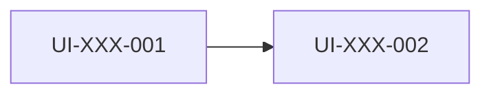

# {{项目名}} UI Spec

> 版本：v0.1 ｜ 来源 PRD：{{标题}}（document_id: {{id}}, revision_id: {{rev}}）｜ 角色：UI ｜ 更新：{{YYYY-MM-DD}}
>
> ★ **元素 ID 约定**：`EL-<模块>-<三位>`，项目内**全局唯一、不可复用、不可回收**。它是「网页拖拽元素 →
> 原生安卓代码控件 → 埋点曝光点 → 测试用例定位」的统一主键，下游四份文档都以它对齐。

## 1 文档信息
| 项 | 内容 |
|---|---|
| 文档目的 | 供 UI 切图、App 开发对照实现；为接口角色提供数据需求来源 |
| 适用范围 | {{iOS / Android / Web / 小程序}} |
| 不在范围 | 接口实现、后端规则（见接口 Spec / App Spec） |
| 关联文档 | RTM、接口 Spec、App Spec |

## 2 页面清单
| 页面 ID | 页面名 | 对应 REQ-ID | 优先级 | 备注 |
|---|---|---|---|---|
| UI-XXX-001 |  | REQ-XXX-001 | P0 |  |

## 3 全局样式规范
### 3.1 色彩
| 语义 | 亮色 | 暗色 | 用途 |
|---|---|---|---|
| 主色 / 辅助色 | #RRGGBB | #RRGGBB |  |
| 背景 / 表面 |  |  |  |
| 文字 主/次/弱 |  |  |  |
| 成功/警告/错误 |  |  |  |

### 3.2 字体与字号
| 层级 | 字号(iOS pt / Android sp) | 字重 | 行高 | 颜色 |
|---|---|---|---|---|

### 3.3 间距 / 圆角 / 阴影 / 图标
- 间距栅格：{{8pt}}；圆角：{{}}；阴影：{{}}；图标：{{尺寸/线宽/风格}}

### 3.4 暗色模式
{{支持 → 见 3.1 暗色列 / 不支持}}

## 4 页面详细设计
> 每个页面必须写全 **元素 / 交互 / 动效 / 字样 / 样式** 五项。

### 4.1 {{页面名}}（UI-XXX-001，对应 REQ-XXX-001）
**① 元素清单**
| 元素 ID | 元素名 | 类型 | 层级/父元素 | 是否可交互 |
|---|---|---|---|---|
| EL-XXX-001 |  | 按钮 |  | 是 |

**② 交互规则**
| 元素 ID | 触发 | 行为 | 跳转目标 | 可否重复触发 | 边界 |
|---|---|---|---|---|---|

**③ 动效**
| 元素/页面 | 触发条件 | 动效描述 | 时长 | 曲线 |
|---|---|---|---|---|
|  |  | {{无动效则明确写"无"}} |  |  |

**④ 文案字样（必须给出具体文字）**
| 位置 | 文案内容 | 备注 |
|---|---|---|
| 按钮 | 立即提交 |  |
| 错误提示 | 网络异常，请稍后重试 |  |

**⑤ 样式**
| 元素 ID | 尺寸 | 颜色 | 字号 | 间距 | 圆角 | 阴影 |
|---|---|---|---|---|---|---|

**⑥ 状态**
| 状态 | 呈现 | 触发条件 | 退出条件 |
|---|---|---|---|
| 默认 / 加载中 / 空数据 / 错误 |  |  |  |

**⑦ 适配**：小屏 / 大屏 / 横竖屏 / 安全区
**⑧ 待澄清**：[待澄清-Q1]

### 4.2 …（每页一节）

## 5 元素-数据需求表（→ 交付给接口角色）
| 元素 ID | 所属页面 | 展示内容 | 数据格式要求 | 是否必需 | 为空时如何显示 |
|---|---|---|---|---|---|
| EL-XXX-001 | UI-XXX-001 |  | 金额保留2位小数 | 是 | 显示 "--" |

## 6 组件库与复用
| 组件 ID | 组件名 | 使用页面 | 状态数 | 是否全局复用 |
|---|---|---|---|---|

## 7 页面跳转总览

## 8 需求追溯表
| REQ-ID | 需求摘要 | 承接页面 ID | 覆盖状态 |
|---|---|---|---|

## 9 待澄清清单
| 编号 | 问题 | 等级 | 影响页面 | 建议方案 | 状态 |
|---|---|---|---|---|---|

## 10 变更记录
| 版本 | 日期 | 变更内容 | 变更人 |
|---|---|---|---|
| v0.1 |  | 初稿 |  |
