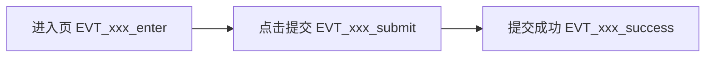

# {{项目名}} 埋点 Spec

> 版本：v0.1 ｜ 来源 PRD：{{标题}}（document_id: {{id}}, revision_id: {{rev}}）｜ 角色：埋点 ｜ 更新：{{YYYY-MM-DD}}

## 1 文档信息
| 项 | 内容 |
|---|---|
| 文档目的 | 定义需要什么埋点、什么场景埋点，供开发实施与测试验证 |
| 不在范围 | 数据仓库建模与报表 |
| 关联文档 | UI Spec、App Spec、测试 Spec、RTM |

## 2 埋点目标与口径
| 目标编号 | 要回答的业务问题 | 对应 REQ-ID | 关键指标 | 口径说明 |
|---|---|---|---|---|
| G-001 | 提交转化率流失在哪一步 | REQ-XXX-001 | 提交转化率 | 提交成功/进入页 UV |

## 3 事件字典
| 事件名 | 触发场景 | 精确触发时机 | 上报参数（名/类型/取值） | 上报时机 | 去重规则 | 对应 REQ-ID |
|---|---|---|---|---|---|---|
| EVT_XXX_submit |  | 点击提交且校验通过、发请求前 |  | 即时 | 同一 session 内不重复 | REQ-XXX-001 |

> 触发时机必须可判定，禁止"操作时""页面加载时"。

## 4 场景清单
| 场景 | 涉及页面(UI-ID) | 涉及动作 | 事件 | 是否核心漏斗节点 |
|---|---|---|---|---|
|  | UI-XXX-001 |  | EVT_XXX_submit | 是 |

## 5 公共参数
| 参数名 | 类型 | 取值/来源 | 说明 |
|---|---|---|---|
| device_id | string | 设备 |  |
| user_id | string | 登录态 | 未登录为空 |
| app_version | string | 包信息 |  |
| session_id | string | 会话 |  |
| referrer_page | string | 路由 | 来源页 RT-ID |

## 6 漏斗定义

| 漏斗 | 节点顺序 | 绑定事件 | 目标转化 |
|---|---|---|---|
|  |  |  |  |

## 7 数据校验与验收
| 事件名 | 验证方法 | 预期结果 | 边界（连续点击/断网/退出） |
|---|---|---|---|
| EVT_XXX_submit | 触发后查上报日志 | 参数完整、时机正确、仅 1 条 | 连续点击仅上报 1 次 |

## 8 隐私与合规
| 事件 | 涉及的敏感数据 | 脱敏要求 | 合规依据 |
|---|---|---|---|

## 9 需求追溯表
| REQ-ID | 需求摘要 | 承接事件 | 覆盖状态 |
|---|---|---|---|

## 10 待澄清清单
| 编号 | 问题 | 等级 | 影响事件 | 建议方案 | 状态 |
|---|---|---|---|---|---|

## 11 变更记录
| 版本 | 日期 | 变更内容 | 变更人 |
|---|---|---|---|
| v0.1 |  | 初稿 |  |
