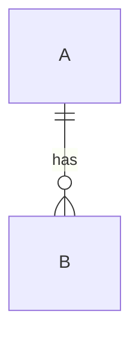
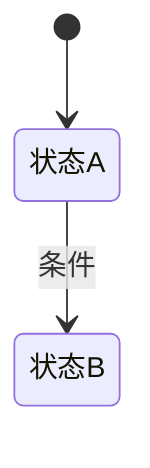
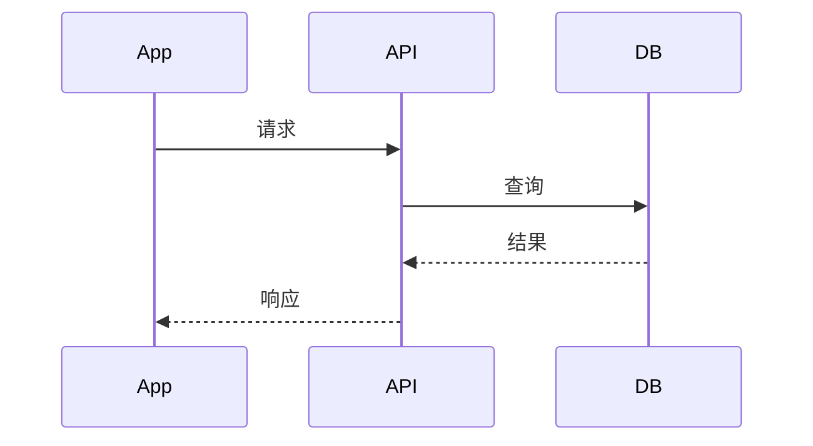

# {{项目名}} 接口 Spec

> 版本：v0.1 ｜ 来源 PRD：{{标题}}（document_id: {{id}}, revision_id: {{rev}}）｜ 角色：接口 ｜ 更新：{{YYYY-MM-DD}}

## 1 文档信息
| 项 | 内容 |
|---|---|
| 文档目的 | 定义满足 UI 展示与交互所需的全部数据契约 |
| 设计原则 | **由 UI 的元素-数据需求倒推接口，而非正向设计** |
| 不在范围 | 界面实现（UI Spec）、客户端实现（App Spec） |
| 关联文档 | UI Spec、App Spec、RTM |

## 2 范围与总览
- 模块范围：{{}}
- 接口总数：{{}}
- 非功能指标（PRD 未给则标 `[待澄清]`）：QPS {{}}、P95 {{}}、并发 {{}}、数据保留 {{}}

## 3 UI 数据供给对照表（核心章节）
> UI 要展示的每一项数据，必须在此表中有明确来源。

| EL-ID | UI 元素 | 需要的数据 | 格式要求（精度/单位/时间格式） | 来源接口 | 来源字段 | 是否满足 | 不满足时的处理 |
|---|---|---|---|---|---|---|---|
| EL-XXX-001 |  |  |  | API-XXX-001 |  | ✅ / ❌ |  |

**缺口汇总**
| EL-ID | 缺口说明 | 处理方式 | 关联 [待澄清] |
|---|---|---|---|

## 4 数据模型
### 4.1 实体清单
| 实体 | 表名 | 对应 REQ-ID | 说明 |
|---|---|---|---|
|  | TBL_XXX_YYY |  |  |

### 4.2 字段字典
| 表 | 字段 | 类型 | 长度 | 可空 | 默认值 | 枚举取值 | 说明 |
|---|---|---|---|---|---|---|---|

### 4.3 实体关系

## 5 接口定义
### 5.1 {{接口名}}（API-XXX-001，对应 REQ-XXX-001）
| 项 | 内容 |
|---|---|
| 方法 / 路径 | POST /api/v1/xxx |
| 用途 |  |
| 鉴权 | {{Bearer / 无 / 签名}} |
| 幂等 | {{是：幂等键 xxx / 否}} |
| 限流 | {{}} |
| 分页 | {{页码式 page/size ｜ 游标式 cursor ｜ 不适用}} |
| 排序 / 筛选 | {{}} |

**请求头**
| 字段 | 必填 | 说明 |
|---|---|---|

**请求参数**
| 名称 | 类型 | 必填 | 约束 | 示例 | 说明 |
|---|---|---|---|---|---|

**响应结构**
| 名称 | 类型 | 必有 | 示例 | 说明 |
|---|---|---|---|---|
| code | int | 是 | 0 | 0 成功 |
| data.xxx |  |  |  |  |

**空数据 / 缺省形态**
- 列表为空时：`data.list = []`，`total = 0`
- 可空字段缺省时：

**错误码**
| code | message | 触发条件 | 客户端应如何处理 |
|---|---|---|---|

### 5.2 …（每接口一节）

## 6 业务规则与状态机
### 6.1 业务规则
| 规则 ID | 对应 REQ-ID | 规则描述 | 触发条件 | 例外 |
|---|---|---|---|---|

### 6.2 状态机

| 状态 | 允许操作 | 迁移到 | 触发条件 |
|---|---|---|---|

## 7 关键时序

## 8 安全与非功能
- 鉴权/权限模型：
- 敏感数据加密与脱敏：
- 日志与审计：
- 缓存策略与失效：

## 9 外部依赖
| 依赖系统 | 用途 | 协议 | 失败降级 |
|---|---|---|---|

## 10 需求追溯表
| REQ-ID | 需求摘要 | 承接接口 ID | 覆盖状态 |
|---|---|---|---|

## 11 待澄清清单
| 编号 | 问题 | 等级 | 影响接口 | 建议方案 | 状态 |
|---|---|---|---|---|---|

## 12 变更记录
| 版本 | 日期 | 变更内容 | 变更人 |
|---|---|---|---|
| v0.1 |  | 初稿 |  |
