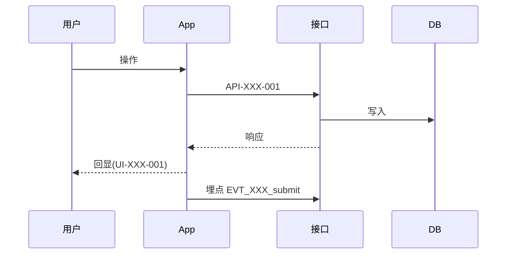

# {{项目名}} 测试 Spec

> 版本：v0.1 ｜ 来源 PRD：{{标题}}（document_id: {{id}}, revision_id: {{rev}}）｜ 角色：测试 ｜ 更新：{{YYYY-MM-DD}}

## 1 文档信息
| 项 | 内容 |
|---|---|
| 文档目的 | 定义接口 / App / 埋点 三层测试及端到端串联 |
| 依据文档 | PRD、UI Spec、接口 Spec、App Spec、埋点 Spec |
| 关联文档 | RTM |

## 2 测试范围与策略
| 项 | 内容 |
|---|---|
| 测试层级 | ① 接口 ② App ③ 埋点 ④ E2E 串联 |
| 不在范围 |  |
| 优先级定义 | P0 阻塞上线 / P1 重要 / P2 一般 |
| 用例编号 | `TC-<模块>-<三位>`（**允许数字后带一个小写字母后缀**，如 `TC-REVIEW-001a`；**后缀不改变编号所属层级**，全项目仍唯一） |
| 准入准出 | 进入测试条件、退出（上线）条件 |

## 3 测试环境与数据
| 项 | 内容 |
|---|---|
| 环境 | {{测试/预发}} |
| 账号与权限 |  |
| 测试数据准备 |  |
| 依赖与桩 |  |

## 4 第一层 · 接口测试
| 用例 ID | API-ID | 对应 REQ-ID | 场景 | 入参 | 期望状态码 | 期望错误码/文案 | 优先级 |
|---|---|---|---|---|---|---|---|
| TC-XXX-001 | API-XXX-001 | REQ-XXX-001 | 正常 |  | 200 | 0 | P0 |
|  |  |  | 缺参 / 类型错误 / 越界 / 无权限 / 幂等重放 / 并发 / 分页边界 / 空数据 |  |  |  |  |

## 5 第二层 · App 测试
| 用例 ID | 路由 ID | 对应 REQ-ID | 场景 | 步骤 | 预期结果（引用 UI 文案） | 优先级 |
|---|---|---|---|---|---|---|
| TC-XXX-010 | RT-XXX-001 | REQ-XXX-001 | 元素与文案齐全 | 1. 2. | 按钮显示"立即提交" | P0 |
|  |  |  | 加载/空/错误/无权限/离线 |  |  |  |
|  |  |  | 接口失败时的用户可见结果 |  |  |  |

## 6 第三层 · 埋点测试
| 用例 ID | 事件名 | 对应 REQ-ID | 场景 | 步骤 | 预期（时机/参数/条数） | 优先级 |
|---|---|---|---|---|---|---|
| TC-XXX-020 | EVT_XXX_submit | REQ-XXX-001 | 正常触发 | 1. 2. | 校验通过后即时上报1条，参数完整 | P0 |
|  |  |  | 连续点击 / 断网补报 / 退出上报 |  |  |  |

## 7 第四层 · 端到端串联
### 7.1 {{场景名}}（E2E-001）
- 覆盖 REQ：{{}}
- 链路：UI 操作 → App 请求 → 接口返回 → 数据落库 → 前端回显 → 埋点上报
- 步骤与预期：
| 步骤 | 操作 | 中间校验点 | 预期 |
|---|---|---|---|
| 1 |  | API 返回字段 |  |
| 2 |  | 数据落库 |  |
| 3 |  | 前端回显与 UI 文案一致 |  |
| 4 |  | 埋点上报正确 |  |

## 8 验收标准（DoD）
| 编号 | 验收项 | 对应 REQ-ID | 是否 P0 阻塞 | 判定方式 |
|---|---|---|---|---|
| AC-001 |  |  | 是 |  |

## 9 覆盖率
| 指标 | 数值 |
|---|---|
| REQ 总数 |  |
| 已覆盖 REQ 数 |  |
| 覆盖率 |  |
| 未覆盖 REQ 及原因 |  |
| 接口覆盖（API 数 / 已覆盖） |  |
| 页面覆盖（RT 数 / 已覆盖） |  |
| 埋点覆盖（EVT 数 / 已覆盖） |  |

## 10 待澄清清单
| 编号 | 问题 | 等级 | 影响用例 | 建议方案 | 状态 |
|---|---|---|---|---|---|

## 11 变更记录
| 版本 | 日期 | 变更内容 | 变更人 |
|---|---|---|---|
| v0.1 |  | 初稿 |  |
